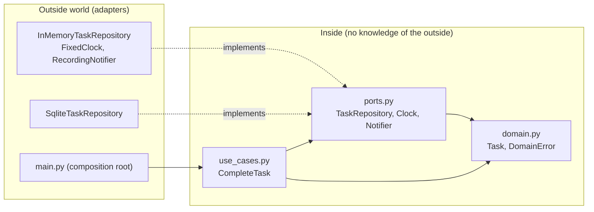

# 01. Clean and hexagonal architecture in Python

> **Draft: written but not yet run.** The code and the expected output in this lesson were prepared by reading the code and the official documentation. They have not been executed yet. If something does not behave as described, trust your tool's real output and report it.

## What you will be able to do
- Explain the dependency rule and name the layers (domain, ports, use cases, adapters) of a ports-and-adapters design.
- Define ports as `typing.Protocol` classes and write two adapters that satisfy one port without inheriting from it.
- Enforce the dependency rule with an automated architecture test instead of a wiki page.
- Decide, with stated costs, when this structure is worth it and when a plain FastAPI plus SQLAlchemy service is the better choice.

## Recap
1. In Python 201 lesson 02 a `Protocol` described a shape. What does a class have to do to satisfy a protocol?
   <details><summary>Answer</summary>Nothing explicit. It only has to provide the required attributes and methods with compatible signatures (structural typing). A type checker verifies it; the runtime does not.</details>
2. In Python 201 lesson 08 you separated DTOs from entities. Why?
   <details><summary>Answer</summary>The wire format (what clients see) changes for different reasons and at different speeds than the stored or in-memory model, so coupling them makes every change risky.</details>
3. Which phase of the capstone put the database behind repository functions?
   <details><summary>Answer</summary>Phase 2, "Data" ([chapter 02](https://github.com/Uee03/Code101/blob/main/capstones/backend-python/tutorials/phase-2-data/02-data.md)).</details>

## Why it matters
Frameworks and databases change faster than the rules of your business. If `import fastapi` or `import sqlalchemy` appears in the code that decides whether a task may be completed, then every framework upgrade, database change or test is a change to the business rules too. Ports and adapters (also called hexagonal architecture) and clean architecture are two names for one discipline: **source-code dependencies point inward, towards the business rules**, and everything that talks to the outside world is a replaceable adapter.

The price is real: more files, more indirection and more places to look when a request fails. This lesson teaches the structure, a way to enforce it, and the criteria for skipping it.

## What you will build
A small `taskapp` package with four layers and no third-party dependency:



One use case, `CompleteTask`, runs unchanged against an in-memory repository and a SQLite repository. A small script reads the imports of each inner file and fails when one points outward.

## Before you start
- **Prerequisites:** Python 201 lessons [02, type hints and mypy](../../201-hero-to-super-hero/phase-1-core-skills/02-type-hints-and-mypy.md), [08, your first FastAPI service](../../201-hero-to-super-hero/phase-3-apis-and-data/08-your-first-fastapi-service.md) and [11, testing and the notes API](../../201-hero-to-super-hero/phase-4-quality/11-testing-and-notes-api.md).
- Time: 75 min for a senior developer, including typing and the exercise. Two sittings are fine; the natural break is after Step 6.
- Python **3.14 or newer** (the capstone container uses 3.14). The code needs 3.10 or newer for the `X | None` syntax; 3.14 is the teaching baseline. Windows commands use `py -3.14`; macOS and Linux use `python3.14`. If your interpreter is newer, change the version number.
- Terminal and editor from Python 101 lesson 01. If you are unsure which folder a terminal is in, the text before `>` or `$` shows it, and `cd ~/code101/python301/lesson01` returns you here on every platform.
- Source pack (optional): every file is shown in full in this lesson, so you can follow without it. The finished code, the exercise starter and the solution are in the course repository https://github.com/Uee03/Code101 under `source/python/301-super-hero-to-legendary/phase-1-architecture/01-clean-and-hexagonal-architecture/` (on that page choose **Code, Download ZIP**, or run `git clone https://github.com/Uee03/Code101.git`).
- No dependencies and no network. Nothing is installed.

## Steps
### Step 1. Create the workspace
**PowerShell - folder: anywhere**
```powershell
New-Item -ItemType Directory -Path "$HOME/code101/python301/lesson01/taskapp/adapters" -Force | Out-Null
Set-Location "$HOME/code101/python301/lesson01"
code .
```

**macOS/Linux - folder: anywhere**
```bash
mkdir -p ~/code101/python301/lesson01/taskapp/adapters
cd ~/code101/python301/lesson01
code .
```
Expected result: the folder `lesson01` with an empty `taskapp/adapters` inside exists and the editor opens it. If `code` is not found, use **File > Open Folder**. Create each file below with **Explorer > New File**, paste the full content and save (a dot on the editor tab means "not saved").

### Step 2. Mark the packages
Two files stay empty on purpose. They make `taskapp` and `taskapp.adapters` regular packages.

**File: `taskapp/__init__.py`** (empty)

**File: `taskapp/adapters/__init__.py`** (empty)

### Step 3. The domain: rules with no imports from your own code
**File: `taskapp/domain.py`**
```python
from dataclasses import dataclass, replace
from datetime import datetime
from enum import Enum


class TaskStatus(Enum):
    OPEN = "open"
    DONE = "done"


class DomainError(Exception):
    """A business rule was broken."""


@dataclass(frozen=True)
class Task:
    id: int
    title: str
    status: TaskStatus = TaskStatus.OPEN
    completed_at: datetime | None = None

    def complete(self, now: datetime) -> "Task":
        if self.status is TaskStatus.DONE:
            raise DomainError(f"task {self.id} is already done")
        return replace(self, status=TaskStatus.DONE, completed_at=now)
```
`complete` receives the time as an argument. The domain never calls `datetime.now()`: time is an input, so the rule is a pure function you can test without patching anything.

### Step 4. The ports: what the inside needs from the outside
**File: `taskapp/ports.py`**
```python
from datetime import datetime
from typing import Protocol

from taskapp.domain import Task


class TaskRepository(Protocol):
    def get(self, task_id: int) -> Task | None: ...

    def save(self, task: Task) -> None: ...


class Clock(Protocol):
    def now(self) -> datetime: ...


class Notifier(Protocol):
    def task_completed(self, task: Task) -> None: ...
```
A **port** is an interface owned by the inside. It is named in the language of the business (`task_completed`, not `post_to_webhook`) and shaped by what the use case needs, not by what a database offers. That ownership is the whole point of the dependency inversion principle.

### Step 5. The use case: orchestration with no framework
**File: `taskapp/use_cases.py`**
```python
from taskapp.domain import DomainError, Task
from taskapp.ports import Clock, Notifier, TaskRepository


class TaskNotFound(DomainError):
    pass


class CompleteTask:
    def __init__(self, tasks: TaskRepository, clock: Clock, notifier: Notifier) -> None:
        self._tasks = tasks
        self._clock = clock
        self._notifier = notifier

    def __call__(self, task_id: int) -> Task:
        task = self._tasks.get(task_id)
        if task is None:
            raise TaskNotFound(f"task {task_id} was not found")
        done = task.complete(self._clock.now())
        self._tasks.save(done)
        self._notifier.task_completed(done)
        return done
```
A use case loads, asks the domain to decide, saves and tells the world. It owns the order of those steps and nothing else. There is no HTTP status code here: translating `TaskNotFound` into 404 is an adapter's job.

### Step 6. Two adapters for one port
**File: `taskapp/adapters/memory.py`**
```python
from datetime import datetime

from taskapp.domain import Task


class InMemoryTaskRepository:
    def __init__(self, tasks: list[Task] | None = None) -> None:
        self._tasks = {task.id: task for task in tasks or []}

    def get(self, task_id: int) -> Task | None:
        return self._tasks.get(task_id)

    def save(self, task: Task) -> None:
        self._tasks[task.id] = task


class FixedClock:
    def __init__(self, moment: datetime) -> None:
        self._moment = moment

    def now(self) -> datetime:
        return self._moment


class RecordingNotifier:
    def __init__(self) -> None:
        self.completed: list[int] = []

    def task_completed(self, task: Task) -> None:
        self.completed.append(task.id)
```

**File: `taskapp/adapters/sqlite_repo.py`**
```python
import sqlite3
from datetime import datetime

from taskapp.domain import Task, TaskStatus

SCHEMA = """
CREATE TABLE IF NOT EXISTS tasks (
    id INTEGER PRIMARY KEY,
    title TEXT NOT NULL,
    status TEXT NOT NULL,
    completed_at TEXT
)
"""


class SqliteTaskRepository:
    def __init__(self, connection: sqlite3.Connection) -> None:
        self._connection = connection
        self._connection.execute(SCHEMA)

    def get(self, task_id: int) -> Task | None:
        row = self._connection.execute(
            "SELECT id, title, status, completed_at FROM tasks WHERE id = ?", (task_id,)
        ).fetchone()
        if row is None:
            return None
        completed = datetime.fromisoformat(row[3]) if row[3] else None
        return Task(row[0], row[1], TaskStatus(row[2]), completed)

    def save(self, task: Task) -> None:
        completed = task.completed_at.isoformat() if task.completed_at else None
        with self._connection:
            self._connection.execute(
                "INSERT INTO tasks (id, title, status, completed_at) VALUES (?, ?, ?, ?) "
                "ON CONFLICT(id) DO UPDATE SET title = excluded.title, "
                "status = excluded.status, completed_at = excluded.completed_at",
                (task.id, task.title, task.status.value, completed),
            )
```
Neither class inherits from `TaskRepository`. They satisfy it structurally. `with self._connection:` commits on success and rolls back on an exception. The SQL uses `?` placeholders, never string formatting.

### Step 7. The composition root
The only place that knows which concrete classes exist is the program's entry point.

**File: `main.py`**
```python
import sqlite3
from datetime import datetime, timezone

from taskapp.adapters.memory import FixedClock, InMemoryTaskRepository, RecordingNotifier
from taskapp.adapters.sqlite_repo import SqliteTaskRepository
from taskapp.domain import Task
from taskapp.ports import TaskRepository
from taskapp.use_cases import CompleteTask


def run(label: str, repository: TaskRepository) -> None:
    notifier = RecordingNotifier()
    clock = FixedClock(datetime(2026, 1, 15, 9, 30, tzinfo=timezone.utc))
    complete = CompleteTask(repository, clock, notifier)
    done = complete(1)
    print(f"{label}: {done.title} -> {done.status.value} at {done.completed_at.isoformat()}")
    print(f"{label}: notified {notifier.completed}")


def main() -> None:
    seed = Task(1, "Write the report")
    run("memory", InMemoryTaskRepository([seed]))
    sqlite_repository = SqliteTaskRepository(sqlite3.connect(":memory:"))
    sqlite_repository.save(seed)
    run("sqlite", sqlite_repository)
    print("persisted:", sqlite_repository.get(1).status.value)


if __name__ == "__main__":
    main()
```

### Step 8. Predict, then run
Before you run it, predict: will the two label groups print identical text apart from the label? What does `persisted:` print, and why can it differ from what `run` printed?

**PowerShell - folder: `~/code101/python301/lesson01`**
```powershell
py -3.14 main.py
```

**macOS/Linux - folder: `~/code101/python301/lesson01`**
```bash
python3.14 main.py
```
Expected output, not yet run:
```text
memory: Write the report -> done at 2026-01-15T09:30:00+00:00
memory: notified [1]
sqlite: Write the report -> done at 2026-01-15T09:30:00+00:00
sqlite: notified [1]
persisted: done
```
`persisted:` reads the task back **from the database**, not from the object `run` returned, so it proves the adapter wrote and read the state correctly.

### Step 9. Enforce the rule with a test, not a convention
**File: `check_dependency_rule.py`**
```python
import ast
from pathlib import Path

INFRASTRUCTURE = ("sqlite3", "sqlalchemy", "fastapi", "requests", "httpx")

FORBIDDEN = {
    "domain.py": ("taskapp.ports", "taskapp.use_cases", "taskapp.adapters") + INFRASTRUCTURE,
    "ports.py": ("taskapp.use_cases", "taskapp.adapters") + INFRASTRUCTURE,
    "use_cases.py": ("taskapp.adapters",) + INFRASTRUCTURE,
}


def imported_modules(source: str) -> set[str]:
    modules: set[str] = set()
    for node in ast.walk(ast.parse(source)):
        if isinstance(node, ast.Import):
            modules.update(alias.name for alias in node.names)
        elif isinstance(node, ast.ImportFrom) and node.module and node.level == 0:
            modules.add(node.module)
    return modules


def violations(package_dir: Path) -> list[str]:
    found: list[str] = []
    for filename, forbidden in FORBIDDEN.items():
        source = (package_dir / filename).read_text(encoding="utf-8")
        for module in sorted(imported_modules(source)):
            if module.startswith(forbidden):
                found.append(f"{filename} must not import {module}")
    return found


if __name__ == "__main__":
    problems = violations(Path(__file__).parent / "taskapp")
    print("\n".join(problems) if problems else "dependency rule holds")
    raise SystemExit(1 if problems else 0)
```
The script parses each inner file with `ast` (it does not import or run it) and lists the modules it imports. `module.startswith(forbidden)` accepts a tuple, so one call checks every forbidden prefix. The exit code is 1 on a violation, so a CI step fails.

**PowerShell - folder: `~/code101/python301/lesson01`**
```powershell
py -3.14 check_dependency_rule.py
```

**macOS/Linux - folder: `~/code101/python301/lesson01`**
```bash
python3.14 check_dependency_rule.py
```
Expected output, not yet run:
```text
dependency rule holds
```
Now break it on purpose: add `import sqlite3` to the top of `taskapp/domain.py`, run the check again and expect `domain.py must not import sqlite3`. Remove the line again.

### Step 10. Test the use case without a database
**File: `test_use_cases.py`**
```python
import unittest
from datetime import datetime, timezone
from pathlib import Path

from check_dependency_rule import imported_modules, violations
from taskapp.adapters.memory import FixedClock, InMemoryTaskRepository, RecordingNotifier
from taskapp.domain import DomainError, Task, TaskStatus
from taskapp.use_cases import CompleteTask, TaskNotFound

NOW = datetime(2026, 1, 15, 9, 30, tzinfo=timezone.utc)


class CompleteTaskTests(unittest.TestCase):
    def setUp(self) -> None:
        self.repository = InMemoryTaskRepository([Task(1, "Write the report")])
        self.notifier = RecordingNotifier()
        self.complete = CompleteTask(self.repository, FixedClock(NOW), self.notifier)

    def test_completes_saves_and_notifies(self) -> None:
        done = self.complete(1)
        self.assertEqual(done.status, TaskStatus.DONE)
        self.assertEqual(done.completed_at, NOW)
        self.assertEqual(self.repository.get(1), done)
        self.assertEqual(self.notifier.completed, [1])

    def test_unknown_task_is_reported(self) -> None:
        with self.assertRaises(TaskNotFound):
            self.complete(99)
        self.assertEqual(self.notifier.completed, [])

    def test_completing_twice_breaks_the_domain_rule(self) -> None:
        self.complete(1)
        with self.assertRaises(DomainError):
            self.complete(1)
        self.assertEqual(self.notifier.completed, [1])


class DependencyRuleTests(unittest.TestCase):
    def test_the_package_obeys_the_rule(self) -> None:
        self.assertEqual(violations(Path(__file__).parent / "taskapp"), [])

    def test_the_checker_sees_a_bad_import(self) -> None:
        modules = imported_modules("import sqlite3\nfrom taskapp.adapters import memory\n")
        self.assertEqual(modules, {"sqlite3", "taskapp.adapters"})


if __name__ == "__main__":
    unittest.main()
```

**PowerShell - folder: `~/code101/python301/lesson01`**
```powershell
py -3.14 -m unittest -v
```

**macOS/Linux - folder: `~/code101/python301/lesson01`**
```bash
python3.14 -m unittest -v
```
Expected output, not yet run: five test lines ending in `ok`, then a blank line, `Ran 5 tests in <time>s`, a blank line and `OK`. The time differs on every machine.

## How it works
1. `main.py` builds concrete objects and passes them into `CompleteTask`. That is **dependency injection by constructor**; no container or framework is needed.
2. `CompleteTask` only knows `TaskRepository`, `Clock` and `Notifier`. It cannot import SQLite because `check_dependency_rule.py` would fail.
3. The domain decides (`Task.complete`), the use case sequences, the adapter persists.
4. The arrows in the diagram all point from outside to inside. That is the **dependency rule**. Control flow still goes in and out (the use case calls the repository), which is why the port exists: it lets the inner layer call outward without depending outward.

**Misconception to correct:** "hexagonal means a folder called `adapters`." The folders are a consequence. The rule is about which module imports which. A `domain` folder whose files import `sqlalchemy` is not hexagonal, whatever it is called.

## Decision record (ADR-001)
| | |
|---|---|
| **Context** | The task rules must survive a change of web framework or database and run in tests in milliseconds. |
| **Decision** | Ports are `typing.Protocol` classes owned by the inner layers. Adapters implement them structurally. The dependency rule is checked by an AST test. |
| **Consequences** | Positive: fakes are plain classes, no mocking library for the core, framework upgrades cannot touch rules. Negative: more files, one extra hop when debugging, adapters can drift from the port until a type checker or a contract test runs (lesson 02 adds contract tests). |
| **Alternatives rejected** | `abc.ABC` base classes (forces adapters to import the inner layer and subclass it; useful when you want runtime `isinstance` checks or shared behaviour). `unittest.mock` everywhere (tests the call sequence of your own code rather than behaviour). Importing SQLAlchemy models into the domain (fastest to write, couples rules to the ORM's lifecycle and session). |

## When not to use this
- **CRUD with almost no rules.** If a handler validates input and writes a row, a port and a use case add cost and no protection. Use FastAPI and SQLAlchemy directly and revisit when the first real rule appears.
- **Scripts, one-off jobs, prototypes.** The structure pays back through years of change, not days.
- **Teams that will not keep the rule.** An unenforced architecture decays into folders with names. Either run the check in CI or do not pretend.
- **Interfaces with exactly one implementation that will never change** and no fake need: a `Protocol` there is ceremony. Introduce a port when you need a second implementation, usually the test fake.

## What to measure
Never adopt this because it "feels clean". Take these measurements before and after, on your own service:
- How many tests need a database or a network? How long does the whole suite take (`python -m unittest` prints the total)?
- Which files change when you replace the database driver or upgrade the web framework? Count them from your version control history.
- How many lines does a new feature need in each layer? If a typical change touches five files for one rule, the ports may be too fine-grained.

## Production checklist for this pattern
- [ ] The dependency rule runs in CI and fails the build.
- [ ] Ports are named after business needs, not technologies.
- [ ] Exactly one composition root builds the object graph.
- [ ] Domain errors are translated to transport errors (HTTP status, exit code) at the edge only.
- [ ] Time, randomness and IDs enter the core as arguments or ports, never from global calls.
- [ ] Each real adapter has at least one test against the real technology (integration test), because fakes cannot prove SQL or network behaviour.

## Try it
Starter: `exercise/starter/exercise.py`. Copy the `starter` folder itself and rename the copy `try01` in your lesson folder, then work in `try01`.
1. **Guided:** implement the three TODOs in `ReopenTask.__call__`. The program prints the reopened task, then one error message for task 2 (still open) and one for task 9 (missing).
2. **Change:** add a `Notifier`-style port named `AuditLog` with one method `task_reopened(task)`. Inject it into `ReopenTask`, write a recording fake, and make a test show that reopening a task records exactly one entry and a failed reopen records none.
3. **Stretch (no single answer):** `CompleteTask` saves, then notifies. If the process stops between those two calls, the notification is lost. Write three sentences on what you would change and what each choice costs. Lesson 06 returns to this problem.

**File: `exercise/starter/exercise.py`**
```python
from dataclasses import dataclass, replace
from typing import Protocol


@dataclass(frozen=True)
class Task:
    id: int
    title: str
    done: bool = False


class TaskRepository(Protocol):
    def get(self, task_id: int) -> Task | None: ...

    def save(self, task: Task) -> None: ...


class InMemoryTaskRepository:
    def __init__(self, tasks: list[Task]) -> None:
        self._tasks = {task.id: task for task in tasks}

    def get(self, task_id: int) -> Task | None:
        return self._tasks.get(task_id)

    def save(self, task: Task) -> None:
        self._tasks[task.id] = task


class ReopenTask:
    def __init__(self, tasks: TaskRepository) -> None:
        self._tasks = tasks

    def __call__(self, task_id: int) -> Task:
        # TODO 1: load the task; raise LookupError(f"task {task_id} was not found") when it is missing
        # TODO 2: raise ValueError(f"task {task_id} is not done") when it is still open
        # TODO 3: save and return a copy of the task with done=False (use replace)
        raise NotImplementedError


if __name__ == "__main__":
    repository = InMemoryTaskRepository([Task(1, "Write the report", done=True), Task(2, "Plan the week")])
    reopen = ReopenTask(repository)
    print(reopen(1))
    for missing_or_open in (2, 9):
        try:
            reopen(missing_or_open)
        except (LookupError, ValueError) as error:
            print(error)
```
Run it in `try01` with `py -3.14 exercise.py` (macOS and Linux: `python3.14 exercise.py`). Expected output once complete:
```text
Task(id=1, title='Write the report', done=False)
task 2 is not done
task 9 was not found
```

<details><summary>Solution</summary>

**File: `exercise/solution/exercise.py`** (only `ReopenTask.__call__` differs from the starter)
```python
    def __call__(self, task_id: int) -> Task:
        task = self._tasks.get(task_id)
        if task is None:
            raise LookupError(f"task {task_id} was not found")
        if not task.done:
            raise ValueError(f"task {task_id} is not done")
        reopened = replace(task, done=False)
        self._tasks.save(reopened)
        return reopened
```
The guard clauses come first, so the repository is never written when a rule fails. `replace` copies the frozen dataclass, so the stored object is not mutated in place.

</details>

## Check yourself
1. Which direction do source-code imports point, and which direction does control flow go in `CompleteTask`?
   <details><summary>Answer</summary>Imports point inward (adapters import ports and domain; use cases import ports and domain). Control flow goes inward from `main.py` to the use case and then outward again through the port to the repository. The port is what lets the call go out without an import coming back.</details>
2. Why does `Task.complete` take `now` as a parameter?
   <details><summary>Answer</summary>So the rule is a pure function of its inputs. The test passes a fixed time and no clock needs patching.</details>
3. Predict: you add `from taskapp.adapters.memory import FixedClock` to `use_cases.py`. What happens when you run `check_dependency_rule.py`, and does `main.py` still run?
   <details><summary>Answer</summary>The check prints `use_cases.py must not import taskapp.adapters.memory` and exits with 1. `main.py` still runs, which is exactly why a rule that is not checked automatically decays silently.</details>
4. Give one situation where a plain FastAPI handler calling SQLAlchemy is the better design.
   <details><summary>Answer</summary>A thin CRUD endpoint with no business rule beyond input validation: ports and use cases would only add indirection.</details>

## Common mistakes
| Symptom or error text | Cause | Fix |
|---|---|---|
| `ModuleNotFoundError: No module named 'taskapp'` | The terminal is not in `lesson01`, so Python cannot find the package | `cd ~/code101/python301/lesson01` and run again |
| `ModuleNotFoundError: No module named 'taskapp.adapters'` | `taskapp/adapters/__init__.py` is missing | Create the empty file (Step 2) |
| `ImportError: cannot import name ... (most likely due to a circular import)` (typical message) | The domain imported a port or use case, which imports the domain | Move the shared type inward; the domain must not import its neighbours |
| `AttributeError: 'NoneType' object has no attribute 'status'` in `main.py` | `persisted:` found no row because `save` was not called for the seed task | Keep the `sqlite_repository.save(seed)` line before `run("sqlite", ...)` |
| A type checker reports that an adapter is "incompatible with protocol" (typical message) | A method name or signature differs from the port | Make the adapter's method match the port exactly |

## Best practice
Keep business rules free of framework and driver imports, and enforce that with an automated test. Source: PEP 544 (Protocols: structural subtyping) https://peps.python.org/pep-0544/ and the typing documentation https://docs.python.org/3/library/typing.html#typing.Protocol

## Going further
- The capstone applies a pragmatic version of this layering: routers, repositories and stored functions. Read [TDD.md](https://github.com/Uee03/Code101/blob/main/capstones/backend-python/TDD.md) section 3 and ask which of its modules would have to move to satisfy the rule here.
- Run `py -3.14 -m pip install import-linter` later and compare its contract syntax with the hand-written script. A tool earns its place when you have more than a handful of rules.

## Summary
- You explained the dependency rule and named the four layers.
- You wrote ports as protocols and two adapters that satisfy one without inheriting from it.
- You enforced the rule with an AST-based test that fails the build.
- You listed when a plain CRUD service is the better choice and what to measure to decide.

## Next lesson
02. Domain modeling and SOLID in practice: entities, value objects, repositories and a unit of work, with contract tests that keep adapters honest.
