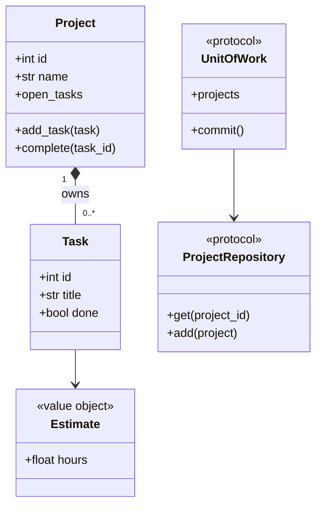

# 02. Domain modeling and SOLID in practice

> **Draft: written but not yet run.** The code and the expected output in this lesson were prepared by reading the code and the official documentation. They have not been executed yet. If something does not behave as described, trust your tool's real output and report it.

## What you will be able to do
- Choose between an entity, a value object and an aggregate root for a concept, and justify the choice by identity and by the consistency rule it protects.
- Implement a repository port and a unit of work that make a multi-step change all-or-nothing.
- Write a contract test that every repository adapter must pass, and explain which SOLID principle that protects.
- Name two situations where tactical domain-driven design is more cost than value.

## Recap
1. In lesson 01, who owns a port: the inner layer or the adapter?
   <details><summary>Answer</summary>The inner layer. It is shaped by what the use case needs.</details>
2. What did the architecture test in lesson 01 check, and what did it deliberately not check?
   <details><summary>Answer</summary>It checked which modules the inner files import. It did not check behaviour; adapters can still be wrong, which is what contract tests in this lesson address.</details>
3. In Python 201 lesson 01 you used dataclasses and `__eq__`. What does `frozen=True` change?
   <details><summary>Answer</summary>Attribute assignment raises `FrozenInstanceError`, and with the default `eq=True` the class also gets a generated `__hash__`.</details>

## Why it matters
Most production bugs in business code are broken rules: a limit exceeded, a state reached twice, two writes where one failed. If rules live in request handlers, every new endpoint re-implements them slightly differently. A domain model puts each rule in one place, and a unit of work makes a change to several objects atomic. SOLID is the checklist you use to keep that structure from rotting; this lesson shows each letter on the same code instead of in the abstract.

## What you will build
A `Project` that owns tasks and enforces a work-in-progress limit of three open tasks. Tasks carry an `Estimate` value object. A unit of work lets a service add a task and either commit or discard the change. A contract test defines what any `ProjectRepository` must do.



## Before you start
- **Prerequisites:** [Python 301 lesson 01, clean and hexagonal architecture](01-clean-and-hexagonal-architecture.md) and [Python 201 lesson 01, classes in depth](../../201-hero-to-super-hero/phase-1-core-skills/01-classes-in-depth.md).
- Time: 80 min, including the exercise. Natural break after Step 6.
- Python **3.14 or newer**; Windows commands use `py -3.14`, macOS and Linux `python3.14`. Standard library only, no network.
- Finish lesson 01 (the vocabulary of ports and use cases is assumed).
- Source pack (optional): every file is shown in full in this lesson, so you can follow without it. The finished code, the exercise starter and the solution are in the course repository https://github.com/Uee03/Code101 under `source/python/301-super-hero-to-legendary/phase-1-architecture/02-domain-modeling-and-solid/` (on that page choose **Code, Download ZIP**, or run `git clone https://github.com/Uee03/Code101.git`).

## Steps
### Step 1. Create the workspace
**PowerShell - folder: anywhere**
```powershell
New-Item -ItemType Directory -Path "$HOME/code101/python301/lesson02" -Force | Out-Null
Set-Location "$HOME/code101/python301/lesson02"
code .
```

**macOS/Linux - folder: anywhere**
```bash
mkdir -p ~/code101/python301/lesson02
cd ~/code101/python301/lesson02
code .
```
Create each file below in this folder (flat, no sub-folders), paste the full content and save. If lost: `cd ~/code101/python301/lesson02`.

### Step 2. The domain: value object, entity and aggregate root
**File: `domain.py`**
```python
from dataclasses import dataclass


class DomainError(Exception):
    """A business rule was broken."""


class WipLimitReached(DomainError):
    """Too many open tasks for one project."""


@dataclass(frozen=True)
class Estimate:
    hours: float

    def __post_init__(self) -> None:
        if not 0 < self.hours <= 40:
            raise DomainError("an estimate must be above 0 and at most 40 hours")


class Task:
    def __init__(self, task_id: int, title: str, estimate: Estimate) -> None:
        self.id = task_id
        self.title = title
        self.estimate = estimate
        self.done = False

    def __eq__(self, other: object) -> bool:
        return isinstance(other, Task) and other.id == self.id

    def __hash__(self) -> int:
        return hash(self.id)


class Project:
    WIP_LIMIT = 3

    def __init__(self, project_id: int, name: str) -> None:
        self.id = project_id
        self.name = name
        self._tasks: list[Task] = []

    @property
    def open_tasks(self) -> list[Task]:
        return [task for task in self._tasks if not task.done]

    def open_hours(self) -> float:
        return sum(task.estimate.hours for task in self.open_tasks)

    def add_task(self, task: Task) -> None:
        if task in self._tasks:
            raise DomainError(f"task {task.id} already exists")
        if len(self.open_tasks) >= self.WIP_LIMIT:
            raise WipLimitReached(f"{self.name} already has {self.WIP_LIMIT} open tasks")
        self._tasks.append(task)

    def complete(self, task_id: int) -> None:
        for task in self._tasks:
            if task.id == task_id:
                task.done = True
                return
        raise DomainError(f"task {task_id} is not in {self.name}")
```
Three different kinds of thing, three different equalities:
- **`Estimate` is a value object.** It has no identity: two estimates of 2.0 hours are interchangeable, so equality is by value, it is immutable (`frozen=True`) and it validates itself on creation. An invalid `Estimate` cannot exist, so no other code has to re-check it.
- **`Task` is an entity.** It has an identity (`id`) that survives change. Renaming a task does not make it another task, so `__eq__` compares ids only. `__hash__` must agree with `__eq__`, otherwise sets and dicts break.
- **`Project` is an aggregate root.** The limit "at most three open tasks" is a rule about the *group*, so the group is the consistency boundary. Code outside the aggregate adds tasks only through `Project.add_task`; the `_tasks` list is private by convention.

### Step 3. The ports: small and owned by the inside
**File: `ports.py`**
```python
from types import TracebackType
from typing import Protocol, Self

from domain import Project


class ProjectRepository(Protocol):
    def get(self, project_id: int) -> Project | None: ...

    def add(self, project: Project) -> None: ...


class UnitOfWork(Protocol):
    projects: ProjectRepository

    def __enter__(self) -> Self: ...

    def __exit__(
        self,
        exc_type: type[BaseException] | None,
        exc: BaseException | None,
        traceback: TracebackType | None,
    ) -> None: ...

    def commit(self) -> None: ...
```
The repository speaks about aggregates (`Project`), not rows. The unit of work is a context manager ([Python 201 lesson 04](../../201-hero-to-super-hero/phase-1-core-skills/04-decorators-and-context-managers.md)) with one extra method. Leaving the block without `commit()` discards the work. Returning `None` from `__exit__` means exceptions are never swallowed.

### Step 4. An in-memory adapter that behaves like a transaction
**File: `adapters.py`**
```python
import copy
from types import TracebackType
from typing import Self

from domain import Project


class InMemoryProjectRepository:
    def __init__(self, store: dict[int, Project]) -> None:
        self._store = store

    def get(self, project_id: int) -> Project | None:
        return self._store.get(project_id)

    def add(self, project: Project) -> None:
        self._store[project.id] = project


class InMemoryUnitOfWork:
    def __init__(self, committed: dict[int, Project]) -> None:
        self._committed = committed
        self._working: dict[int, Project] = {}
        self.projects = InMemoryProjectRepository(self._working)
        self.commits = 0

    def __enter__(self) -> Self:
        self._working = copy.deepcopy(self._committed)
        self.projects = InMemoryProjectRepository(self._working)
        return self

    def __exit__(
        self,
        exc_type: type[BaseException] | None,
        exc: BaseException | None,
        traceback: TracebackType | None,
    ) -> None:
        self._working = {}
        self.projects = InMemoryProjectRepository(self._working)

    def commit(self) -> None:
        self._committed.clear()
        self._committed.update(self._working)
        self.commits += 1
```
`__enter__` makes a private deep copy to work on; `commit` publishes the copy; `__exit__` throws the working copy away either way. This imitates the isolation of a database transaction closely enough to test rules. It is a **test double, not a production design**: a deep copy is O(size of the store) per use, and it knows nothing about concurrent writers.

### Step 5. A service that uses the unit of work
**File: `services.py`**
```python
from domain import DomainError, Estimate, Task
from ports import UnitOfWork


def add_task(uow: UnitOfWork, project_id: int, task_id: int, title: str, hours: float) -> None:
    with uow:
        project = uow.projects.get(project_id)
        if project is None:
            raise DomainError(f"project {project_id} not found")
        project.add_task(Task(task_id, title, Estimate(hours)))
        uow.commit()
```
There is no `try/except` and no rollback call. If `add_task` or `Estimate` raises, the exception leaves the `with` block, `__exit__` discards the work and nothing was committed.

### Step 6. Predict, then run
**File: `main.py`**
```python
from adapters import InMemoryUnitOfWork
from domain import DomainError, Project
from services import add_task


def main() -> None:
    committed = {1: Project(1, "Launch")}
    uow = InMemoryUnitOfWork(committed)
    for task_id in range(1, 5):
        try:
            add_task(uow, 1, task_id, f"Task {task_id}", 4.0)
            print(f"added task {task_id}")
        except DomainError as error:
            print(f"refused task {task_id}: {error}")
    project = committed[1]
    print(f"open: {[task.id for task in project.open_tasks]}, hours: {project.open_hours()}, commits: {uow.commits}")


if __name__ == "__main__":
    main()
```
Predict first: which task is refused, and what are the commit count and the total hours?

**PowerShell - folder: `~/code101/python301/lesson02`**
```powershell
py -3.14 main.py
```

**macOS/Linux - folder: `~/code101/python301/lesson02`**
```bash
python3.14 main.py
```
Expected output, not yet run:
```text
added task 1
added task 2
added task 3
refused task 4: Launch already has 3 open tasks
open: [1, 2, 3], hours: 12.0, commits: 3
```
Three commits for three accepted tasks. The refused one never reached `commit`, so the committed project still has exactly tasks 1, 2 and 3.

### Step 7. Tests, including a contract test
**File: `test_domain.py`**
```python
import unittest

from adapters import InMemoryProjectRepository, InMemoryUnitOfWork
from domain import DomainError, Estimate, Project, Task, WipLimitReached
from services import add_task


class EstimateTests(unittest.TestCase):
    def test_value_objects_compare_by_value(self) -> None:
        self.assertEqual(Estimate(2.0), Estimate(2.0))

    def test_rejects_values_outside_the_range(self) -> None:
        for hours in (0, -1, 41):
            with self.subTest(hours=hours):
                with self.assertRaises(DomainError):
                    Estimate(hours)


class TaskTests(unittest.TestCase):
    def test_entities_compare_by_identity_not_by_attributes(self) -> None:
        first = Task(1, "Write", Estimate(1.0))
        renamed = Task(1, "Write (renamed)", Estimate(2.0))
        other = Task(2, "Write", Estimate(1.0))
        self.assertEqual(first, renamed)
        self.assertNotEqual(first, other)


class ProjectTests(unittest.TestCase):
    def test_the_fourth_open_task_is_refused(self) -> None:
        project = Project(1, "Launch")
        for task_id in (1, 2, 3):
            project.add_task(Task(task_id, f"T{task_id}", Estimate(1.0)))
        with self.assertRaises(WipLimitReached):
            project.add_task(Task(4, "T4", Estimate(1.0)))

    def test_completing_a_task_frees_a_slot(self) -> None:
        project = Project(1, "Launch")
        for task_id in (1, 2, 3):
            project.add_task(Task(task_id, f"T{task_id}", Estimate(1.0)))
        project.complete(1)
        project.add_task(Task(4, "T4", Estimate(1.0)))
        self.assertEqual([task.id for task in project.open_tasks], [2, 3, 4])


class UnitOfWorkTests(unittest.TestCase):
    def test_a_refused_change_leaves_the_committed_state_alone(self) -> None:
        committed = {1: Project(1, "Launch")}
        uow = InMemoryUnitOfWork(committed)
        for task_id in (1, 2, 3):
            add_task(uow, 1, task_id, f"T{task_id}", 1.0)
        with self.assertRaises(WipLimitReached):
            add_task(uow, 1, 4, "T4", 1.0)
        self.assertEqual(len(committed[1].open_tasks), 3)
        self.assertEqual(uow.commits, 3)

    def test_unknown_project_is_a_domain_error(self) -> None:
        with self.assertRaises(DomainError):
            add_task(InMemoryUnitOfWork({}), 9, 1, "T1", 1.0)


class ProjectRepositoryContract:
    """Every adapter must pass these tests (Liskov substitution)."""

    def make_repository(self) -> InMemoryProjectRepository:
        raise NotImplementedError

    def test_get_of_an_unknown_id_returns_none(self) -> None:
        self.assertIsNone(self.make_repository().get(99))

    def test_add_then_get_returns_the_same_project(self) -> None:
        repository = self.make_repository()
        repository.add(Project(1, "Launch"))
        found = repository.get(1)
        self.assertIsNotNone(found)
        self.assertEqual(found.name, "Launch")


class InMemoryRepositoryTests(ProjectRepositoryContract, unittest.TestCase):
    def make_repository(self) -> InMemoryProjectRepository:
        return InMemoryProjectRepository({})


if __name__ == "__main__":
    unittest.main()
```
`ProjectRepositoryContract` does not inherit from `TestCase`, so `unittest` does not collect it by itself. A concrete class mixes it with `TestCase` and supplies the adapter. A future SQLAlchemy adapter adds one four-line class and inherits both tests.

**PowerShell - folder: `~/code101/python301/lesson02`**
```powershell
py -3.14 -m unittest -v
```

**macOS/Linux - folder: `~/code101/python301/lesson02`**
```bash
python3.14 -m unittest -v
```
Expected output, not yet run: nine tests, each ending in `ok`, then `Ran 9 tests in <time>s` and `OK`. (`subTest` loops count as one test.)

## How it works
1. `Estimate` validates in `__post_init__`, so the rule "0 < hours <= 40" is enforced at the one place a value can be born.
2. `Project.add_task` enforces two invariants: no duplicate id and the work-in-progress limit. Every caller gets them, including future endpoints and scripts.
3. `add_task` (the service) is a transaction script: load, call the domain, commit. It contains no rule of its own.
4. `InMemoryUnitOfWork` gives the same *shape* as a database transaction: work on a private copy, publish on commit, discard otherwise.

### SOLID, on this code
| Principle | Where it shows up here | Smell when violated | Cost of following it |
|---|---|---|---|
| **S**ingle responsibility: one reason to change | `Estimate` (validation of hours), `Project` (WIP rule), `services.add_task` (sequencing), adapters (storage) | A handler that validates, applies the limit and writes SQL, so three teams edit one function | More small units to navigate; splitting too early produces classes with one method |
| **O**pen/closed: extend without editing | A new store is a new adapter; `services.py` and `domain.py` do not change | A growing `if backend == "sqlite": ... elif ...` ladder in the core | Needs a stable port; a badly chosen port is edited often anyway |
| **L**iskov substitution: subtypes keep the contract | `ProjectRepositoryContract` runs the same tests on every adapter | An adapter returns `[]` instead of `None`, or raises on unknown ids; callers need `isinstance` checks | Writing and maintaining contract tests, including against the real database |
| **I**nterface segregation: small, client-shaped interfaces | `ProjectRepository` has two methods; `UnitOfWork` adds a third | A 15-method `Repository` that every fake must implement | Several small protocols instead of one familiar base class |
| **D**ependency inversion: depend on abstractions you own | `services.py` imports `ports.py`, never `adapters.py` | Core code importing an ORM session | The composition root must wire things up (lesson 01) |

**Misconception to correct:** "SOLID means more classes." Each principle is a pressure to keep one kind of change local. A 30-line script that never changes needs none of it.

## Decision record (ADR-002)
| | |
|---|---|
| **Context** | A project must never exceed three open tasks, even with concurrent requests, and a failed change must leave no partial state. |
| **Decision** | `Project` is the aggregate root holding the invariant. A `UnitOfWork` port scopes the transaction. In production the unit of work wraps one database transaction with a lock or version check on the project row. |
| **Consequences** | One place for the rule; one transaction per use case. The aggregate is loaded whole, so a project with thousands of tasks makes `get` slow, and two requests editing the same project conflict. |
| **Alternatives rejected** | Rules in handlers (duplicated). A database constraint only (cannot express this rule portably, error messages leak storage details; use it as a second line of defence, not the only one). One aggregate per task with the limit enforced by a query (cheaper loads, but the invariant is then eventually enforced and races are possible). |

## When not to use this
- **Mostly-CRUD data.** If the entities have no rules beyond "required" and "max length", modelling them as aggregates and repositories only duplicates what a validation model and an ORM already give you.
- **Reporting and read-heavy screens.** Loading aggregates to display a table is wasteful. Query the data directly (a read model) and keep aggregates for writes.
- **When the SQLAlchemy `Session` is already enough.** SQLAlchemy documents its `Session` as an implementation of the unit of work pattern, and a repository over `Session.get` adds little unless you need to swap storage or hide its API. Wrap it only when the wrapper removes a real dependency from the core.
- **Huge aggregates.** If the consistency boundary contains thousands of children, either the boundary is wrong or you must accept eventual consistency for part of it.

## What to measure
- Rows or objects loaded per use case: log the count for `get` calls. A rising number is the signal that the aggregate is too large.
- Transaction conflicts and retries per hour once concurrent writers exist (lesson 06 and the capstone's ETag handling in [chapter 02](https://github.com/Uee03/Code101/blob/main/capstones/backend-python/tutorials/phase-2-data/02-data.md)).
- The number of places that mention a rule: search the repository for `3` or `WIP_LIMIT`. More than one place means the model is leaking.

## Production checklist for this pattern
- [ ] Every invariant has exactly one owner, and a test that fails if it is removed.
- [ ] Value objects are immutable and validate on construction.
- [ ] Repositories return aggregates and `None`/raise in one documented way, enforced by a contract test run against every adapter, including the real database.
- [ ] The unit of work maps to exactly one database transaction; no use case opens two.
- [ ] Concurrency is addressed: a version column, row lock or unique constraint backs each invariant.
- [ ] Domain exceptions carry no secrets and no storage details.

## Try it
Starter: `exercise/starter/exercise.py`. Copy the `starter` folder itself and rename the copy `try02`, then work in `try02`.
1. **Guided:** complete the three TODOs of the `Budget` value object. Spending returns a **new** object, the original is unchanged, and an overspend raises `DomainError` from the constructor.
2. **Change:** add a `SqliteProjectRepository` (tables `projects` and `tasks`, reuse the `?` placeholder style from lesson 01) and a `SqliteRepositoryTests` class that mixes in `ProjectRepositoryContract`. The two inherited tests must pass without being edited. Decide what the repository does to rebuild a `Project` without touching `_tasks` from outside, and write down the trade-off.
3. **Stretch (no single answer):** two requests add a task to the same project at the same moment. Compare three fixes (row lock, version column, serialisable transaction) by correctness, throughput and operational complexity. Which one would you choose for a project edited by two people versus by two hundred?

**File: `exercise/starter/exercise.py`**
```python
from dataclasses import dataclass


class DomainError(Exception):
    pass


@dataclass(frozen=True)
class Estimate:
    hours: float


@dataclass(frozen=True)
class Budget:
    hours: float

    def __post_init__(self) -> None:
        # TODO 1: raise DomainError("a budget cannot be negative") when hours is below 0
        pass

    def spend(self, estimate: Estimate) -> "Budget":
        # TODO 2: return a NEW Budget with the estimate's hours subtracted
        # TODO 3: let the constructor refuse an overspend (do not repeat the check here)
        raise NotImplementedError


if __name__ == "__main__":
    budget = Budget(20.0)
    print(budget.spend(Estimate(8.0)))
    print(budget)
    try:
        budget.spend(Estimate(25.0))
    except DomainError as error:
        print(error)
```
Expected output once complete:
```text
Budget(hours=12.0)
Budget(hours=20.0)
a budget cannot be negative
```

<details><summary>Solution</summary>

**File: `exercise/solution/exercise.py`** (only the two methods differ from the starter)
```python
    def __post_init__(self) -> None:
        if self.hours < 0:
            raise DomainError("a budget cannot be negative")

    def spend(self, estimate: Estimate) -> "Budget":
        return Budget(self.hours - estimate.hours)
```
The check lives in one place (the constructor), so `spend` cannot produce an invalid `Budget`. Because the class is frozen, the original budget is untouched, which the second `print` shows.

</details>

## Check yourself
1. Why does `Task.__eq__` compare only `id` but `Estimate` compares `hours`?
   <details><summary>Answer</summary>A task is an entity with identity that persists through change; an estimate is a value object defined only by its value.</details>
2. In `add_task`, the fourth call raises inside the `with` block. What happens to the two earlier committed tasks?
   <details><summary>Answer</summary>Nothing. They were committed by earlier calls. The working copy of the failed call is discarded by `__exit__`.</details>
3. A new adapter returns an empty list for an unknown project instead of `None`. Which principle is broken and which test catches it?
   <details><summary>Answer</summary>Liskov substitution. `test_get_of_an_unknown_id_returns_none` in the contract fails (`assertIsNone`).</details>
4. Predict: you remove `__hash__` from `Task`. Which behaviour changes?
   <details><summary>Answer</summary>Defining `__eq__` without `__hash__` sets `__hash__` to `None`, so `Task` objects become unhashable. Using them in a set or as dict keys raises `TypeError: unhashable type: 'Task'`. `task in self._tasks` on a list would still work.</details>

## Common mistakes
| Symptom or error text | Cause | Fix |
|---|---|---|
| `TypeError: unhashable type: 'Task'` | `__eq__` defined without `__hash__` | Define `__hash__` consistently with `__eq__` |
| `dataclasses.FrozenInstanceError: cannot assign to field 'hours'` | A value object was mutated | Create a new value (`Budget(self.hours - ...)`) instead |
| Commits count is 4 and the limit is not enforced (symptom) | The test or service called `commit()` before the rule ran | Call the domain method first, `commit()` last |
| `ModuleNotFoundError: No module named 'domain'` | The terminal is not in `lesson02` | `cd ~/code101/python301/lesson02` |
| Contract tests do not run (symptom) | The contract class inherits `TestCase`, or the concrete class is missing | Keep the contract a plain mixin and add a concrete `TestCase` subclass |

## Best practice
Put each invariant in one aggregate, scope each use case to one transaction, and prove every adapter with the same contract tests. Source: SQLAlchemy Session basics (the `Session` as a unit of work) https://docs.sqlalchemy.org/en/20/orm/session_basics.html and Python data model, `__eq__` and `__hash__` https://docs.python.org/3/reference/datamodel.html#object.__hash__

## Going further
- Read the capstone's [TDD.md](https://github.com/Uee03/Code101/blob/main/capstones/backend-python/TDD.md) requirements R-01 to R-24 and mark which ones are invariants (belong in a model) and which are validations (belong at the edge).
- [Python 201 lesson 01](../../201-hero-to-super-hero/phase-1-core-skills/01-classes-in-depth.md) covers dataclass options (`slots`, `kw_only`) that suit value objects.

## Summary
- You modelled an estimate as a value object, a task as an entity and a project as an aggregate root that owns the work-in-progress rule.
- You implemented a repository port and a unit of work and saw a refused change leave no trace.
- You wrote a contract test that every adapter must pass, which is Liskov substitution made executable.
- You listed when aggregates, repositories and a unit of work are not worth their cost.

## Next lesson
03. API design at scale: versioning, pagination, idempotency and contract tests for the HTTP edge of this model.
