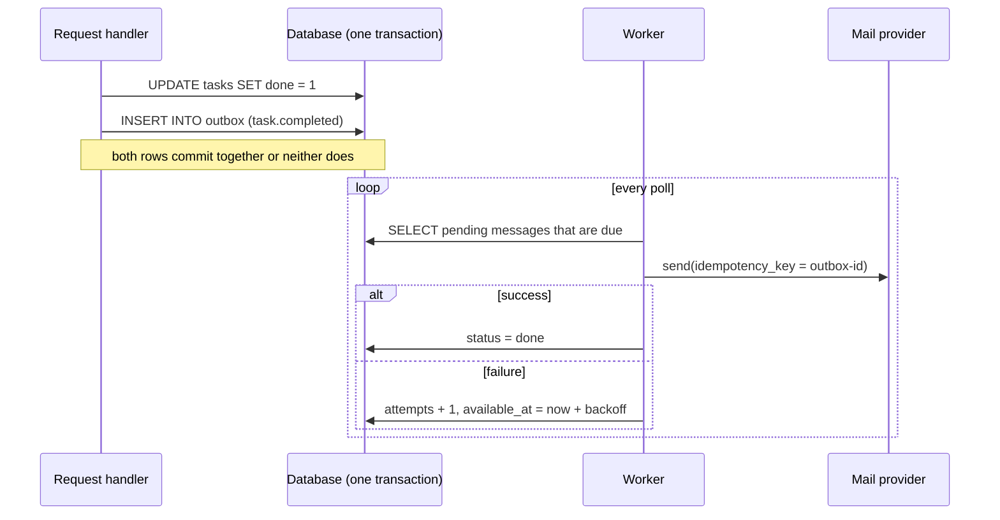

# 06. Background work and queues: outbox, retries and idempotent workers

> **Draft: written but not yet run.** The code and the expected output in this lesson were prepared by reading the code and the official documentation. They have not been executed yet. If something does not behave as described, trust your tool's real output and report it.

## What you will be able to do
- Explain the task-queue model (producer, broker, worker, acknowledgement) and the delivery guarantees each choice gives.
- Implement the transactional outbox pattern so a state change and its message are saved together or not at all.
- Write a worker with exponential backoff, a maximum number of attempts and a dead-letter state.
- Make a consumer idempotent so redelivery is harmless, and state what that does not protect against.

## Recap
1. Lesson 01 ended with a stretch question: `CompleteTask` saves, then notifies. What goes wrong if the process stops between the two?
   <details><summary>Answer</summary>The task is saved but the notification is lost, and nothing records that it was owed. This lesson fixes that.</details>
2. Lesson 03: what turns "at least once" request delivery into "at most one effect"?
   <details><summary>Answer</summary>An idempotency key stored together with the first result.</details>
3. Lesson 04: why must slow or blocking work not run inside the event loop?
   <details><summary>Answer</summary>It stalls every other task on the loop.</details>

## Why it matters
Some work does not belong in a request: sending email, calling a slow partner, generating a report, anything that must survive a restart. Moving it to the background raises three questions you cannot skip. How do you **never lose** the job when the request and the queue are two different systems? What happens when the job **fails**? And since you will deliver some jobs more than once, what makes **running twice** safe? The answers are the outbox, a retry policy and an idempotent consumer.

## What you will build
The task from lesson 01 with a reliable "task completed" email:



Everything runs in memory with `sqlite3` and a simulated clock, so the whole retry story takes milliseconds and prints the same lines every time.

## Before you start
- **Prerequisites:** Python 301 lessons [03, API design at scale](../phase-1-architecture/03-api-design-at-scale.md) and [04, concurrency models](04-concurrency-models.md); [Python 201 lesson 09, SQLAlchemy and stored procedures](../../201-hero-to-super-hero/phase-3-apis-and-data/09-sqlalchemy-and-stored-procedures.md).
- Time: 90 min. Break after Step 5.
- Python **3.14 or newer**, standard library only. Windows `py -3.14`, macOS and Linux `python3.14`.
- Source pack (optional): every file is shown in full in this lesson, so you can follow without it. The finished code, the exercise starter and the solution are in the course repository https://github.com/Uee03/Code101 under `source/python/301-super-hero-to-legendary/phase-2-performance-and-concurrency/06-background-work-and-queues/` (on that page choose **Code, Download ZIP**, or run `git clone https://github.com/Uee03/Code101.git`).
- This lesson uses SQLite so you can run it anywhere. Production notes say what changes for PostgreSQL.

## Steps
### Step 1. Create the workspace
**PowerShell - folder: anywhere**
```powershell
New-Item -ItemType Directory -Path "$HOME/code101/python301/lesson06" -Force | Out-Null
Set-Location "$HOME/code101/python301/lesson06"
code .
```

**macOS/Linux - folder: anywhere**
```bash
mkdir -p ~/code101/python301/lesson06
cd ~/code101/python301/lesson06
code .
```
Create the files below in this folder (flat). If lost: `cd ~/code101/python301/lesson06`.

### Step 2. The outbox: state change and message in one transaction
**File: `outbox.py`**
```python
import json
import sqlite3
from dataclasses import dataclass
from typing import Any

SCHEMA = """
CREATE TABLE IF NOT EXISTS tasks (
    id INTEGER PRIMARY KEY,
    title TEXT NOT NULL,
    done INTEGER NOT NULL DEFAULT 0
);
CREATE TABLE IF NOT EXISTS outbox (
    id INTEGER PRIMARY KEY AUTOINCREMENT,
    topic TEXT NOT NULL,
    payload TEXT NOT NULL,
    status TEXT NOT NULL DEFAULT 'pending',
    attempts INTEGER NOT NULL DEFAULT 0,
    available_at REAL NOT NULL,
    last_error TEXT
);
"""


@dataclass(frozen=True)
class Message:
    id: int
    topic: str
    payload: dict[str, Any]
    attempts: int


def connect(path: str = ":memory:") -> sqlite3.Connection:
    connection = sqlite3.connect(path)
    connection.executescript(SCHEMA)
    return connection


def complete_task(connection: sqlite3.Connection, task_id: int, now: float) -> None:
    with connection:
        cursor = connection.execute("UPDATE tasks SET done = 1 WHERE id = ? AND done = 0", (task_id,))
        if cursor.rowcount == 0:
            raise LookupError(f"task {task_id} is missing or already done")
        connection.execute(
            "INSERT INTO outbox (topic, payload, available_at) VALUES (?, ?, ?)",
            ("task.completed", json.dumps({"task_id": task_id}), now),
        )


def due_messages(connection: sqlite3.Connection, now: float, limit: int = 10) -> list[Message]:
    rows = connection.execute(
        "SELECT id, topic, payload, attempts FROM outbox "
        "WHERE status = 'pending' AND available_at <= ? ORDER BY id LIMIT ?",
        (now, limit),
    ).fetchall()
    return [Message(row[0], row[1], json.loads(row[2]), row[3]) for row in rows]


def mark_done(connection: sqlite3.Connection, message_id: int) -> None:
    with connection:
        connection.execute("UPDATE outbox SET status = 'done' WHERE id = ?", (message_id,))


def mark_retry(
    connection: sqlite3.Connection, message_id: int, attempts: int, available_at: float, error: str
) -> None:
    with connection:
        connection.execute(
            "UPDATE outbox SET attempts = ?, available_at = ?, last_error = ? WHERE id = ?",
            (attempts, available_at, error, message_id),
        )


def mark_dead(connection: sqlite3.Connection, message_id: int, attempts: int, error: str) -> None:
    with connection:
        connection.execute(
            "UPDATE outbox SET status = 'dead', attempts = ?, last_error = ? WHERE id = ?",
            (attempts, error, message_id),
        )


def backoff(attempts: int, base: float = 1.0, cap: float = 60.0) -> float:
    return min(cap, base * 2 ** (attempts - 1))


def count(connection: sqlite3.Connection, status: str | None = None) -> int:
    if status is None:
        return connection.execute("SELECT COUNT(*) FROM outbox").fetchone()[0]
    return connection.execute("SELECT COUNT(*) FROM outbox WHERE status = ?", (status,)).fetchone()[0]
```
The crucial function is `complete_task`. The **dual-write problem**: if you commit the database and *then* publish to a broker, a crash between the two loses the message; if you publish *first* and the commit fails, you announce something that never happened. A database cannot span two systems atomically. The outbox sidesteps that: the message is just another row in the **same** database transaction as the state change. `with connection:` commits both statements together or rolls both back. The `AND done = 0` guard also makes the transition itself safe against being applied twice.

Message states: `pending` (waiting or scheduled for retry), `done`, `dead` (gave up; needs a human). `available_at` is when the message may next be tried, which is how a retry delay is stored without a sleeping thread. The `attempts` and `last_error` columns are for operations.

### Step 3. The worker: retry, back off, give up
**File: `worker.py`**
```python
import random
import sqlite3
from collections.abc import Callable

import outbox

Handler = Callable[[outbox.Message], None]


def no_jitter(delay: float) -> float:
    return delay


def full_jitter(delay: float) -> float:
    return random.uniform(0, delay)


def run_once(
    connection: sqlite3.Connection,
    handler: Handler,
    now: float,
    max_attempts: int = 3,
    jitter: Callable[[float], float] = no_jitter,
) -> dict[str, int]:
    stats = {"done": 0, "retry": 0, "dead": 0}
    for message in outbox.due_messages(connection, now):
        try:
            handler(message)
        except Exception as error:
            attempts = message.attempts + 1
            if attempts >= max_attempts:
                outbox.mark_dead(connection, message.id, attempts, str(error))
                stats["dead"] += 1
            else:
                delay = jitter(outbox.backoff(attempts))
                outbox.mark_retry(connection, message.id, attempts, now + delay, str(error))
                stats["retry"] += 1
        else:
            outbox.mark_done(connection, message.id)
            stats["done"] += 1
    return stats
```
- `now` is a parameter, not `time.time()`, so tests and the demo control the clock. In production a loop calls `run_once(connection, handler, time.time())` every second or so.
- **Exponential backoff**: after the first failure wait 1 s, then 2 s, then 4 s, doubling up to a cap of 60 s. It gives a struggling dependency room to recover instead of hammering it.
- **Jitter** adds randomness (`full_jitter` picks a delay between 0 and the backoff). Without it, a thousand messages that failed together all retry together and recreate the outage. The demo uses `no_jitter` only so the printed numbers are deterministic.
- **`except Exception`** is deliberate at this boundary: a worker must survive any handler error and record it. It catches ordinary exceptions only; `KeyboardInterrupt` and `SystemExit` still stop the process.
- After `max_attempts` the message becomes `dead`. A **poison message** (one that can never succeed, such as malformed data) would otherwise retry forever and hide real work behind it.

### Step 4. A receiver that is safe to call twice
**File: `main.py`**
```python
from outbox import Message, complete_task, connect, count
from worker import run_once


class Mailer:
    """A receiver that deduplicates by idempotency key, like many payment and email APIs."""

    def __init__(self, fail_first: int) -> None:
        self.fail_first = fail_first
        self.attempts = 0
        self.sent: dict[str, str] = {}

    def send(self, idempotency_key: str, text: str) -> None:
        self.attempts += 1
        if self.attempts <= self.fail_first:
            raise ConnectionError("mail provider unavailable")
        self.sent.setdefault(idempotency_key, text)


def main() -> None:
    connection = connect()
    connection.execute("INSERT INTO tasks (id, title) VALUES (1, 'Write the report')")
    connection.commit()
    complete_task(connection, 1, now=0.0)
    print("outbox rows after complete:", count(connection))
    try:
        complete_task(connection, 1, now=0.0)
    except LookupError as error:
        print("second complete refused:", error)
    print("outbox rows still:", count(connection))

    mailer = Mailer(fail_first=2)

    def handler(message: Message) -> None:
        mailer.send(f"outbox-{message.id}", f"task {message.payload['task_id']} done")

    for now in (0.0, 0.5, 1.0, 3.0):
        print(f"t={now}", run_once(connection, handler, now))
    print("emails sent:", mailer.sent)
    print("mailer attempts:", mailer.attempts)
    mailer.send("outbox-1", "task 1 done")
    print("replayed delivery, emails sent:", len(mailer.sent))


if __name__ == "__main__":
    main()
```
`Mailer` fails its first two calls, then works, and records at most one email per idempotency key. The key is `outbox-<message id>`: the same message always produces the same key, no matter how many times it is delivered.

### Step 5. Predict, then run
Trace it on paper before running: the clock values are 0.0, 0.5, 1.0 and 3.0. At which ticks does the worker try the message, and when does it finally succeed? What does `emails sent:` contain?

**PowerShell - folder: `~/code101/python301/lesson06`**
```powershell
py -3.14 main.py
```

**macOS/Linux - folder: `~/code101/python301/lesson06`**
```bash
python3.14 main.py
```
Expected output, not yet run:
```text
outbox rows after complete: 1
second complete refused: task 1 is missing or already done
outbox rows still: 1
t=0.0 {'done': 0, 'retry': 1, 'dead': 0}
t=0.5 {'done': 0, 'retry': 0, 'dead': 0}
t=1.0 {'done': 0, 'retry': 1, 'dead': 0}
t=3.0 {'done': 1, 'retry': 0, 'dead': 0}
emails sent: {'outbox-1': 'task 1 done'}
mailer attempts: 3
replayed delivery, emails sent: 1
```
Reading it: at t=0.0 the first attempt fails and the message is rescheduled for 1.0. At t=0.5 nothing is due. At t=1.0 the second attempt fails and the delay doubles to 2.0, so the next try is at 3.0, where the third attempt succeeds. The final line is the point of idempotency: a **second delivery** of the same message (as happens if a worker crashes after sending but before marking `done`) does not send a second email.

**Stop here for a break if you like.**

### Step 6. Tests for the guarantees
**File: `test_outbox.py`**
```python
import sqlite3
import unittest

import outbox
from main import Mailer
from outbox import Message, complete_task, connect, count
from worker import run_once


def connection_with_task() -> sqlite3.Connection:
    connection = connect()
    connection.execute("INSERT INTO tasks (id, title) VALUES (1, 'Write the report')")
    connection.commit()
    return connection


def always_fails(message: Message) -> None:
    raise ConnectionError("down")


class AtomicityTests(unittest.TestCase):
    def test_the_task_and_the_message_are_written_together(self) -> None:
        connection = connection_with_task()
        complete_task(connection, 1, now=0.0)
        done = connection.execute("SELECT done FROM tasks WHERE id = 1").fetchone()[0]
        self.assertEqual((done, count(connection)), (1, 1))

    def test_a_refused_change_writes_no_message(self) -> None:
        connection = connection_with_task()
        with self.assertRaises(LookupError):
            complete_task(connection, 99, now=0.0)
        self.assertEqual(count(connection), 0)

    def test_if_the_message_cannot_be_written_the_task_stays_open(self) -> None:
        connection = connection_with_task()
        connection.execute("DROP TABLE outbox")
        with self.assertRaises(sqlite3.OperationalError):
            complete_task(connection, 1, now=0.0)
        done = connection.execute("SELECT done FROM tasks WHERE id = 1").fetchone()[0]
        self.assertEqual(done, 0)


class RetryTests(unittest.TestCase):
    def test_backoff_doubles_and_is_capped(self) -> None:
        self.assertEqual([outbox.backoff(n) for n in (1, 2, 3)], [1.0, 2.0, 4.0])
        self.assertEqual(outbox.backoff(10), 60.0)

    def test_a_flaky_receiver_succeeds_on_the_third_attempt(self) -> None:
        connection = connection_with_task()
        complete_task(connection, 1, now=0.0)
        mailer = Mailer(fail_first=2)

        def handler(message: Message) -> None:
            mailer.send(f"outbox-{message.id}", "done")

        results = [run_once(connection, handler, now) for now in (0.0, 0.5, 1.0, 3.0)]
        self.assertEqual([r["retry"] for r in results], [1, 0, 1, 0])
        self.assertEqual(results[-1]["done"], 1)
        self.assertEqual(count(connection, "done"), 1)

    def test_a_message_that_always_fails_ends_in_the_dead_letter_state(self) -> None:
        connection = connection_with_task()
        complete_task(connection, 1, now=0.0)
        for now in (0.0, 1.0, 3.0):
            run_once(connection, always_fails, now, max_attempts=3)
        self.assertEqual(count(connection, "dead"), 1)
        self.assertEqual(run_once(connection, always_fails, 100.0), {"done": 0, "retry": 0, "dead": 0})


class IdempotentReceiverTests(unittest.TestCase):
    def test_delivering_the_same_message_twice_has_one_effect(self) -> None:
        mailer = Mailer(fail_first=0)
        mailer.send("outbox-1", "task 1 done")
        mailer.send("outbox-1", "task 1 done")
        self.assertEqual(len(mailer.sent), 1)


if __name__ == "__main__":
    unittest.main()
```
The third atomicity test sabotages the outbox table on purpose and proves the **task stays open**: the failure of the second write rolled back the first.

**PowerShell - folder: `~/code101/python301/lesson06`**
```powershell
py -3.14 -m unittest -v
```

**macOS/Linux - folder: `~/code101/python301/lesson06`**
```bash
python3.14 -m unittest -v
```
Expected output, not yet run: seven tests ending in `ok`, then `Ran 7 tests in <time>s` and `OK`.

## How it works
### The task-queue model
A **task queue** has producers that put jobs on a queue, a broker that stores them durably, and workers that take a job, run it and **acknowledge** it. If a worker dies before acknowledging, the broker hands the job to another worker. That is the source of both its reliability and its main hazard: the same job can be delivered more than once.

| Guarantee | Meaning | How |
|---|---|---|
| At most once | Never duplicated, may be lost | Acknowledge before processing (a crash loses the job) |
| At least once | Never lost, may be duplicated | Acknowledge after processing (this lesson) |
| "Exactly once" | One *effect* | At least once delivery **plus** an idempotent consumer. True exactly-once delivery across two systems does not exist |

### What the outbox gives you and what it does not
The outbox gives **atomicity between your data and the intent to send**. It does not give you ordering across messages (retries reorder), exactly-once delivery, or a free relay: someone has to poll the table and clear it.

### Why the consumer must still be idempotent
The worker calls the handler, then marks the message `done` in a **separate** step. A crash between the two means the message is `pending` again and will be re-sent. Only the receiver (here `Mailer`, in real life a payment API or your own consumer table with a unique constraint on the message id) can make that safe.

**Misconception to correct:** "I use a message broker, so I don't need an outbox." The broker only guarantees what happens after it received the message. Your database commit and your publish to the broker are still two writes.

## Decision record (ADR-006)
| | |
|---|---|
| **Context** | Completing a task must reliably trigger an email, and a provider outage must not lose or duplicate it. |
| **Decision** | Transactional outbox in the application database. A polling worker with exponential backoff, jitter, a maximum of attempts and a `dead` state. Idempotency keys derived from the outbox id on every external call. |
| **Consequences** | No message is lost while the database is intact. Delivery is delayed by the poll interval. The outbox table grows and must be pruned. Ordering is not guaranteed. |
| **Alternatives rejected** | Publish after commit (loses messages). Publish before commit (announces events that never happened). Two-phase commit across database and broker (rare support, operational pain). Change data capture on the database log (excellent at scale, but a new system to run; a good next step once polling is the bottleneck). |

## When not to use this
- **When losing a notification is acceptable.** A best-effort log line or a cache invalidation can be fire-and-forget. Do not pay for an outbox.
- **When the work is short, local and must be visible in the response.** Do it in the request.
- **Polling at high volume.** Frequent polling of one hot table adds load and latency; at larger scale use a broker with a relay or change data capture.
- **Multiple workers on this SQLite design.** The claim step is not safe for two workers: both could select the same row. In PostgreSQL, use `SELECT ... FOR UPDATE SKIP LOCKED` so each worker locks different rows, or a lease column (`locked_until`).
- **A queue library when your need is one retry loop.** Task-queue libraries for Python (Celery, RQ, Dramatiq, arq and others) add routing, scheduling and monitoring. Adopt one when you need those features, and read its documentation for its acknowledgement and retry semantics before relying on it.

## What to measure
- **Queue depth** (pending count) and **age of the oldest pending message**. Age is the better alarm: depth can be high and healthy, age cannot.
- **Attempt distribution:** how many messages needed 2, 3 or more attempts. A shift means a dependency is degrading.
- **Dead-letter count** (alert on any non-zero value), with `last_error` grouped by text.
- **End-to-end latency** from `complete_task` to `done`.
- **Duplicate deliveries** observed by the receiver (count calls whose key was already seen).

## Production checklist
- [ ] The state change and the outbox insert share one database transaction.
- [ ] Every external call carries an idempotency key that is stable across retries.
- [ ] Backoff has a cap and jitter; the maximum attempts is explicit; dead messages are alerted on and have a replay procedure.
- [ ] Handlers have timeouts shorter than the worker's lease or poll interval.
- [ ] Multiple workers claim rows with `FOR UPDATE SKIP LOCKED` or a lease, never a plain `SELECT`.
- [ ] Old `done` rows are pruned or archived on a schedule.
- [ ] Workers handle `SIGTERM` by finishing the current message and exiting.
- [ ] Payloads contain identifiers, not secrets or personal data that must not sit in a table.

## Try it
Starter: `exercise/starter/exercise.py`. Copy the `starter` folder itself and rename the copy `try06`, then work in `try06`.
1. **Guided:** implement `process_once`. A message id already seen is skipped. Otherwise the effect runs, and **only after it succeeds** is the id added to `seen`.
2. **Change:** in your copy of `worker.py`, pass `jitter=full_jitter` and rerun the demo a few times. Explain why the printed `t=` lines now sometimes differ. Then add a test that injects a fixed jitter function such as `lambda delay: delay / 2`.
3. **Stretch (no single answer):** in `process_once`, what if the process crashes *after* the effect but *before* `seen.add`? Describe the two designs (record first, then act; or act, then record) and the failure each one risks. Which would you choose for sending money, and which for sending a newsletter?

**File: `exercise/starter/exercise.py`**
```python
from collections.abc import Callable


def process_once(seen: set[str], message_id: str, effect: Callable[[], None]) -> bool:
    # TODO 1: return False without running the effect when message_id is already in seen
    # TODO 2: run the effect
    # TODO 3: only AFTER the effect succeeded, add the id to seen and return True
    raise NotImplementedError


if __name__ == "__main__":
    seen: set[str] = set()
    log: list[str] = []
    for message_id in ["a", "b", "a"]:
        ran = process_once(seen, message_id, lambda mid=message_id: log.append(mid))
        print(message_id, "ran" if ran else "skipped")

    def failing() -> None:
        raise ConnectionError("down")

    try:
        process_once(seen, "c", failing)
    except ConnectionError:
        print("c failed, so it is not marked as seen:", "c" not in seen)
    print(log)
```
Expected output once complete:
```text
a ran
b ran
a skipped
c failed, so it is not marked as seen: True
['a', 'b']
```

<details><summary>Solution</summary>

**File: `exercise/solution/exercise.py`** (only `process_once` differs)
```python
def process_once(seen: set[str], message_id: str, effect: Callable[[], None]) -> bool:
    if message_id in seen:
        return False
    effect()
    seen.add(message_id)
    return True
```
Recording the id **after** the effect means a failing effect leaves the message eligible for retry. The cost is the window described in the stretch question: a crash between `effect()` and `seen.add` repeats the effect, which is why the receiver should also be idempotent. In a real system the effect and the `seen` insert share a database transaction, so they commit together.

</details>

## Check yourself
1. Why can an outbox row and a state change be atomic when a broker publish cannot?
   <details><summary>Answer</summary>They are two writes to the same database, covered by one transaction. A broker publish is a write to a different system that the database cannot roll back.</details>
2. Which delivery guarantee does this worker give, and what must the receiver do about it?
   <details><summary>Answer</summary>At least once. The receiver must be idempotent, for example by deduplicating on the idempotency key.</details>
3. Predict: `max_attempts=3` and the handler always fails. After how many failed attempts is the message `dead`, and when are the attempts made if the first is at t=0?
   <details><summary>Answer</summary>After three attempts, at t=0, t=1 and t=3 (backoffs of 1 s and 2 s).</details>
4. Why add jitter?
   <details><summary>Answer</summary>To spread out retries from many failures that began together, so they do not hit the recovering dependency at the same instant.</details>

## Common mistakes
| Symptom or error text | Cause | Fix |
|---|---|---|
| `ModuleNotFoundError: No module named 'outbox'` | The terminal is not in `lesson06` | `cd ~/code101/python301/lesson06` |
| `sqlite3.OperationalError: no such table: outbox` | `connect()` was not used, or the table was dropped (the atomicity test does this on purpose) | Create the connection with `connect()` |
| Messages are retried immediately in a loop (symptom) | `available_at` was not advanced on failure | Check that `mark_retry` receives `now + delay` |
| The same email is sent twice (symptom) | The receiver does not deduplicate, or the key changes per attempt | Derive the key from the message id, not from the attempt |
| The worker stops on the first handler error (symptom) | The `try/except` around the handler was removed | Keep the handler call inside `try` and record the failure |
| `sqlite3.ProgrammingError: Cannot operate on a closed database.` (typical message) | The connection was closed before the worker ran | Keep the connection open for the worker's lifetime |

## Best practice
Write the state change and the message in one transaction, retry with capped exponential backoff and jitter, and make every consumer idempotent. Source: sqlite3 transaction control https://docs.python.org/3/library/sqlite3.html#transaction-control ; SQLAlchemy 2.0 transactions (the same all-or-nothing rule in your ORM) https://docs.sqlalchemy.org/en/20/orm/session_transaction.html

## Going further
- Look at how the capstone makes writes idempotent in [chapter 02](https://github.com/Uee03/Code101/blob/main/capstones/backend-python/tutorials/phase-2-data/02-data.md), and note where a worker would plug in for notifications.
- Read about `SELECT ... FOR UPDATE SKIP LOCKED` in the PostgreSQL documentation (explicit locking, row-level locks) before building a multi-worker version.

## Summary
- You saved a state change and its message in one transaction, and proved with a sabotaged table that neither survives alone.
- You wrote a worker with capped exponential backoff, jitter, a maximum number of attempts and a dead-letter state.
- You made redelivery harmless with an idempotency key and listed what the outbox still does not guarantee.
- You named the measurements (queue depth, oldest age, attempts, dead letters) that tell you the system is healthy.

## Next lesson
07. Observability: structured logs, metrics and OpenTelemetry traces, so the queue age and retries you just designed are visible in production.
