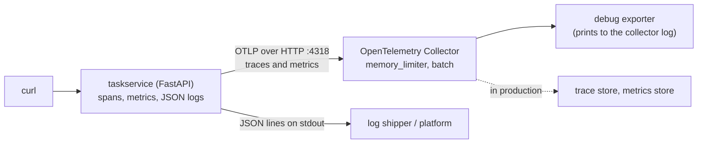

# 07. Observability: structured logs, metrics and OpenTelemetry traces

> **Draft: written but not yet run.** The code and the expected output in this lesson were prepared by reading the code and the official documentation. They have not been executed yet. If something does not behave as described, trust your tool's real output and report it.

## What you will be able to do
- Emit structured JSON logs that carry the current trace and span ids and never contain secrets.
- Create a trace span, a counter and a histogram with the OpenTelemetry API, and test them without any backend.
- Run an OpenTelemetry Collector from a full configuration file and send traces and metrics to it over OTLP.
- Choose metric labels so that cardinality stays bounded, and state what you would alert on.

## Recap
1. Python 201 lesson 07: why must a secret never appear in a log line?
   <details><summary>Answer</summary>Logs are copied to many systems with weaker access control than the secret store, and they live for a long time.</details>
2. Lesson 06: which two numbers tell you most quickly that the queue is unhealthy?
   <details><summary>Answer</summary>The age of the oldest pending message and the dead-letter count.</details>
3. Lesson 04: how would you detect that a blocking call is stalling the event loop in production?
   <details><summary>Answer</summary>Export a heartbeat lag measurement as a metric, as `loop_lag.py` computes it.</details>

## Why it matters
Monitoring answers the questions you predicted: "is the CPU high?". Observability is the property that lets you answer a question you did not predict: "why was this one request slow for this one tenant at 14:03?". It needs three kinds of data that point at each other: **logs** (what happened, in words), **metrics** (how much and how often, cheap to aggregate) and **traces** (where one request spent its time across components). Linking them with a shared trace id is what turns three piles of data into an investigation.

## What you will build
A small service whose "complete a task" operation emits all three signals:



An offline `demo.py` shows the signals with in-memory exporters and prints deterministic results, so you can understand the code before any container runs.

## Before you start
- **Prerequisites:** [Python 301 lesson 06, background work and queues](../phase-2-performance-and-concurrency/06-background-work-and-queues.md); Python 201 lessons [07, logging, configuration and secrets](../../201-hero-to-super-hero/phase-2-concurrency-and-packaging/07-logging-configuration-and-secrets.md) and [08, your first FastAPI service](../../201-hero-to-super-hero/phase-3-apis-and-data/08-your-first-fastapi-service.md).
- Time: 100 min. Two sittings: stop after Step 8 (offline part), then do Steps 9 to 12 (Collector).
- Python **3.14 or newer**; Windows `py -3.14`, macOS and Linux `python3.14`. Docker with Compose v2 is needed only for Steps 9 to 12.
- Free host ports 4317, 4318 (Collector) and 8000 (the service).
- Source pack (optional): every file is shown in full in this lesson, so you can follow without it. The finished code, the exercise starter and the solution are in the course repository https://github.com/Uee03/Code101 under `source/python/301-super-hero-to-legendary/phase-3-production/07-observability/` (on that page choose **Code, Download ZIP**, or run `git clone https://github.com/Uee03/Code101.git`).
- Pins are a teaching snapshot (direct dependencies only, transitive ones are not locked). OpenTelemetry's Python **traces and metrics are documented as Stable, logs as Development** at the time of writing; check https://opentelemetry.io/docs/languages/python/ for the current status, and note that the instrumentation packages carry a `0.xxbN` (beta) version number.

## Steps
### Step 1. Create the workspace and the environment
**PowerShell - folder: anywhere**
```powershell
New-Item -ItemType Directory -Path "$HOME/code101/python301/lesson07" -Force | Out-Null
Set-Location "$HOME/code101/python301/lesson07"
py -3.14 -m venv .venv
code .
```

**macOS/Linux - folder: anywhere**
```bash
mkdir -p ~/code101/python301/lesson07
cd ~/code101/python301/lesson07
python3.14 -m venv .venv
code .
```
Create the files below in this folder (flat). If lost: `cd ~/code101/python301/lesson07`.

### Step 2. Dependencies
**File: `requirements.txt`**
```text
fastapi==0.165.0
uvicorn==0.54.0
httpx==0.28.1
opentelemetry-api==1.45.2
opentelemetry-sdk==1.45.2
opentelemetry-exporter-otlp-proto-http==1.45.2
opentelemetry-instrumentation-fastapi==0.66b2
```
`opentelemetry-api` is the interface your code calls. `opentelemetry-sdk` is the implementation that processes and exports data. Libraries should depend on the API only; the application chooses the SDK. The exporter package speaks OTLP (the OpenTelemetry protocol) over HTTP. The instrumentation package creates spans for FastAPI requests automatically.

**PowerShell - folder: `~/code101/python301/lesson07`**
```powershell
& .\.venv\Scripts\python.exe -m pip install -r requirements.txt
```

**macOS/Linux - folder: `~/code101/python301/lesson07`**
```bash
.venv/bin/python -m pip install -r requirements.txt
```
Expected result: pip ends with `Successfully installed` and a list of packages and versions (exact lines depend on what pip resolves).

### Step 3. Structured logs that know the current trace
**File: `logging_json.py`**
```python
import json
import logging
from datetime import datetime, timezone

from opentelemetry import trace

SENSITIVE_KEYS = {"authorization", "password", "token", "secret", "api_key"}


def redact(key: str, value: object) -> object:
    return "[redacted]" if key.lower() in SENSITIVE_KEYS else value


class JsonFormatter(logging.Formatter):
    def format(self, record: logging.LogRecord) -> str:
        payload: dict[str, object] = {
            "ts": datetime.fromtimestamp(record.created, tz=timezone.utc).isoformat(),
            "level": record.levelname,
            "logger": record.name,
            "message": record.getMessage(),
        }
        context = trace.get_current_span().get_span_context()
        if context.is_valid:
            payload["trace_id"] = format(context.trace_id, "032x")
            payload["span_id"] = format(context.span_id, "016x")
        for key, value in getattr(record, "fields", {}).items():
            payload[key] = redact(key, value)
        if record.exc_info:
            payload["exception"] = self.formatException(record.exc_info)
        return json.dumps(payload, default=str)


def configure_logging(level: int = logging.INFO) -> None:
    handler = logging.StreamHandler()
    handler.setFormatter(JsonFormatter())
    root = logging.getLogger()
    root.handlers[:] = [handler]
    root.setLevel(level)
```
- One JSON object per line is **structured logging**: a log platform can index `level`, `task_id` or `trace_id` as fields instead of searching free text.
- Fields come from `extra={"fields": {...}}`. They live under one key so they cannot collide with the built-in `LogRecord` attributes (`extra` keys such as `message` or `name` raise a `KeyError`).
- `trace.get_current_span()` returns the active span (or a no-op span when there is none). `is_valid` is false outside a span, so start-up lines have no trace id. The ids are written as lowercase hexadecimal, 32 characters for a trace and 16 for a span, the same form trace tools display, so you can paste a `trace_id` from a log line into a trace search.
- `redact` is an **allow-nothing-secret** filter on field names. It is a safety net, not a licence to log tokens: the best protection is never putting a secret into a logging call.
- `exc_info` becomes a string field so a stack trace stays inside one JSON line.

### Step 4. The signals: tracer, counter and histogram
**File: `telemetry.py`**
```python
from dataclasses import dataclass

from opentelemetry.exporter.otlp.proto.http.metric_exporter import OTLPMetricExporter
from opentelemetry.exporter.otlp.proto.http.trace_exporter import OTLPSpanExporter
from opentelemetry.metrics import Counter, Histogram
from opentelemetry.sdk.metrics import MeterProvider
from opentelemetry.sdk.metrics.export import (
    InMemoryMetricReader,
    MetricReader,
    PeriodicExportingMetricReader,
)
from opentelemetry.sdk.resources import Resource
from opentelemetry.sdk.trace import SpanProcessor, TracerProvider
from opentelemetry.sdk.trace.export import BatchSpanProcessor
from opentelemetry.trace import Tracer


@dataclass
class Telemetry:
    tracer_provider: TracerProvider
    meter_provider: MeterProvider
    tracer: Tracer
    completed: Counter
    duration: Histogram


def build_telemetry(
    service_name: str, span_processor: SpanProcessor, metric_reader: MetricReader
) -> Telemetry:
    resource = Resource.create({"service.name": service_name})
    tracer_provider = TracerProvider(resource=resource)
    tracer_provider.add_span_processor(span_processor)
    meter_provider = MeterProvider(resource=resource, metric_readers=[metric_reader])
    meter = meter_provider.get_meter("taskservice")
    return Telemetry(
        tracer_provider=tracer_provider,
        meter_provider=meter_provider,
        tracer=tracer_provider.get_tracer("taskservice"),
        completed=meter.create_counter(
            "app.tasks.completed", unit="{task}", description="Tasks completed"
        ),
        duration=meter.create_histogram(
            "app.task.complete.duration", unit="s", description="Time to complete a task"
        ),
    )


def otlp_telemetry(service_name: str, endpoint: str) -> Telemetry:
    return build_telemetry(
        service_name,
        BatchSpanProcessor(OTLPSpanExporter(endpoint=f"{endpoint}/v1/traces")),
        PeriodicExportingMetricReader(
            OTLPMetricExporter(endpoint=f"{endpoint}/v1/metrics"), export_interval_millis=10_000
        ),
    )


def counter_total(reader: InMemoryMetricReader, name: str) -> float:
    data = reader.get_metrics_data()
    if data is None:
        return 0
    total = 0
    for resource_metrics in data.resource_metrics:
        for scope_metrics in resource_metrics.scope_metrics:
            for metric in scope_metrics.metrics:
                if metric.name == name:
                    total += sum(point.value for point in metric.data.data_points)
    return total
```
Vocabulary:
- A **resource** describes who emits the data (`service.name`). Every backend groups by it.
- A **span** is one timed operation with a name, attributes and a parent. A **trace** is the tree of spans for one request.
- A **counter** only goes up (events). A **histogram** records a distribution (durations), from which a backend computes percentiles. Metric names follow `dotted.lower_case`; the unit `{task}` is an annotation unit for a countable thing.
- A **span processor** decides *when* spans are exported; a **metric reader** decides *how* metrics are collected.
- `build_telemetry` takes the processor and reader as **parameters**. That is the seam that lets tests use in-memory ones and production use OTLP, and why no global provider is set: global state makes tests order-dependent.
- `BatchSpanProcessor` queues spans and exports them in batches on a background thread, so the request does not wait for the network. If the queue fills, spans are **dropped** rather than blocking: telemetry must never take the application down. `PeriodicExportingMetricReader` exports every 10 s here.
- With the HTTP exporter, when you give `endpoint=` explicitly you must include the signal path (`/v1/traces`, `/v1/metrics`).

### Step 5. A traced, measured operation
**File: `service.py`**
```python
import logging
import time

from telemetry import Telemetry

logger = logging.getLogger("taskservice")
KNOWN_TASKS = {1, 2, 3}


class UnknownTask(Exception):
    pass


def complete_task(telemetry: Telemetry, task_id: int) -> dict[str, object]:
    start = time.perf_counter()
    outcome = "error"
    try:
        with telemetry.tracer.start_as_current_span("complete_task") as span:
            span.set_attribute("task.id", task_id)
            if task_id not in KNOWN_TASKS:
                outcome = "not_found"
                logger.warning("task not found", extra={"fields": {"task_id": task_id}})
                raise UnknownTask(task_id)
            logger.info("task completed", extra={"fields": {"task_id": task_id}})
            telemetry.completed.add(1)
            outcome = "completed"
            return {"task_id": task_id, "status": "done"}
    finally:
        telemetry.duration.record(time.perf_counter() - start, {"outcome": outcome})
```
Notes:
- The span carries `task.id` as an **attribute** (high-cardinality data is fine on a span, which is stored per request).
- The histogram carries only `outcome` as a **label**, three possible values. Metric labels multiply the number of stored time series: a `task_id` label would create one series per task and can overwhelm a metrics store. This is the single most common observability cost mistake.
- When an exception leaves `start_as_current_span`, the span records it and sets its status to error by default.
- The duration is recorded in `finally`, so failures are measured too, labelled by `outcome`.

### Step 6. The HTTP layer
**File: `app.py`**
```python
from fastapi import FastAPI, HTTPException
from opentelemetry.instrumentation.fastapi import FastAPIInstrumentor

from service import UnknownTask, complete_task
from telemetry import Telemetry


def create_app(telemetry: Telemetry) -> FastAPI:
    app = FastAPI(title="taskservice", docs_url=None, redoc_url=None)
    FastAPIInstrumentor.instrument_app(
        app, tracer_provider=telemetry.tracer_provider, meter_provider=telemetry.meter_provider
    )

    @app.post("/tasks/{task_id}/complete")
    async def complete(task_id: int) -> dict[str, object]:
        try:
            return complete_task(telemetry, task_id)
        except UnknownTask:
            raise HTTPException(status_code=404, detail="Task not found") from None

    return app
```
`instrument_app` wraps this one app so every request produces a server span (and standard HTTP metrics) with the right parent, and the `complete_task` span becomes its child automatically through the active context. Passing the providers explicitly keeps the app independent of any global provider.

**File: `serve.py`**
```python
import os

import uvicorn

from app import create_app
from logging_json import configure_logging
from telemetry import otlp_telemetry


def main() -> None:
    configure_logging()
    endpoint = os.environ.get("OTEL_EXPORTER_OTLP_ENDPOINT", "http://127.0.0.1:4318")
    telemetry = otlp_telemetry("taskservice", endpoint)
    uvicorn.run(create_app(telemetry), host="127.0.0.1", port=8000, log_config=None)


if __name__ == "__main__":
    main()
```
`log_config=None` stops Uvicorn from installing its own logging configuration, so every line, including Uvicorn's own, goes through the JSON formatter. The service binds to `127.0.0.1` only.

### Step 7. Predict, then run the offline demo
**File: `demo.py`**
```python
import io
import json
import logging

from opentelemetry.sdk.metrics.export import InMemoryMetricReader
from opentelemetry.sdk.trace.export import SimpleSpanProcessor
from opentelemetry.sdk.trace.export.in_memory_span_exporter import InMemorySpanExporter

from logging_json import JsonFormatter
from service import complete_task
from telemetry import build_telemetry, counter_total


def main() -> None:
    stream = io.StringIO()
    handler = logging.StreamHandler(stream)
    handler.setFormatter(JsonFormatter())
    logging.getLogger("taskservice").addHandler(handler)
    logging.getLogger("taskservice").setLevel(logging.INFO)

    exporter = InMemorySpanExporter()
    reader = InMemoryMetricReader()
    telemetry = build_telemetry("taskservice", SimpleSpanProcessor(exporter), reader)

    complete_task(telemetry, 1)

    spans = exporter.get_finished_spans()
    line = json.loads(stream.getvalue())
    print("span names:", [span.name for span in spans])
    print("span attributes:", dict(spans[0].attributes))
    print("log carries the span's trace id:", line["trace_id"] == format(spans[0].context.trace_id, "032x"))
    print("log message and field:", line["message"], line["task_id"])
    print("counter app.tasks.completed:", counter_total(reader, "app.tasks.completed"))


if __name__ == "__main__":
    main()
```
Predict: how many spans will exist after one `complete_task` call, and will the log line contain a `trace_id`? (There is no HTTP layer here.)

**PowerShell - folder: `~/code101/python301/lesson07`**
```powershell
& .\.venv\Scripts\python.exe demo.py
```

**macOS/Linux - folder: `~/code101/python301/lesson07`**
```bash
.venv/bin/python demo.py
```
Expected output, not yet run:
```text
span names: ['complete_task']
span attributes: {'task.id': 1}
log carries the span's trace id: True
log message and field: task completed 1
counter app.tasks.completed: 1
```
`SimpleSpanProcessor` exports each span as it ends, which is what makes the in-memory exporter immediately readable. It is for tests and demos; use the batch processor in production.

### Step 8. The tests
**File: `test_observability.py`**
```python
import io
import json
import logging
import unittest

from fastapi.testclient import TestClient
from opentelemetry.instrumentation.fastapi import FastAPIInstrumentor
from opentelemetry.sdk.metrics.export import InMemoryMetricReader
from opentelemetry.sdk.trace.export import SimpleSpanProcessor
from opentelemetry.sdk.trace.export.in_memory_span_exporter import InMemorySpanExporter
from opentelemetry.trace import StatusCode

from app import create_app
from logging_json import JsonFormatter
from service import UnknownTask, complete_task
from telemetry import build_telemetry, counter_total


class ObservabilityTestCase(unittest.TestCase):
    def setUp(self) -> None:
        self.stream = io.StringIO()
        self.handler = logging.StreamHandler(self.stream)
        self.handler.setFormatter(JsonFormatter())
        logger = logging.getLogger("taskservice")
        logger.addHandler(self.handler)
        logger.setLevel(logging.INFO)
        self.exporter = InMemorySpanExporter()
        self.reader = InMemoryMetricReader()
        self.telemetry = build_telemetry("taskservice", SimpleSpanProcessor(self.exporter), self.reader)

    def tearDown(self) -> None:
        logging.getLogger("taskservice").removeHandler(self.handler)

    def log_lines(self) -> list[dict]:
        return [json.loads(line) for line in self.stream.getvalue().splitlines()]


class ServiceTests(ObservabilityTestCase):
    def test_a_completed_task_makes_a_span_a_correlated_log_and_a_count(self) -> None:
        complete_task(self.telemetry, 1)
        (span,) = self.exporter.get_finished_spans()
        (line,) = self.log_lines()
        self.assertEqual(span.name, "complete_task")
        self.assertEqual(dict(span.attributes), {"task.id": 1})
        self.assertEqual(line["trace_id"], format(span.context.trace_id, "032x"))
        self.assertEqual(line["span_id"], format(span.context.span_id, "016x"))
        self.assertEqual(counter_total(self.reader, "app.tasks.completed"), 1)

    def test_an_unknown_task_marks_the_span_as_an_error_and_is_not_counted(self) -> None:
        with self.assertRaises(UnknownTask):
            complete_task(self.telemetry, 99)
        (span,) = self.exporter.get_finished_spans()
        self.assertEqual(span.status.status_code, StatusCode.ERROR)
        self.assertEqual(self.log_lines()[0]["level"], "WARNING")
        self.assertEqual(counter_total(self.reader, "app.tasks.completed"), 0)


class LoggingTests(ObservabilityTestCase):
    def test_sensitive_fields_are_redacted(self) -> None:
        logging.getLogger("taskservice").info(
            "login", extra={"fields": {"task_id": 1, "Password": "hunter2"}}
        )
        self.assertNotIn("hunter2", self.stream.getvalue())
        self.assertEqual(self.log_lines()[0]["Password"], "[redacted]")

    def test_a_line_outside_any_span_has_no_trace_id(self) -> None:
        logging.getLogger("taskservice").info("startup")
        self.assertNotIn("trace_id", self.log_lines()[0])


class HttpTests(ObservabilityTestCase):
    def setUp(self) -> None:
        super().setUp()
        self.app = create_app(self.telemetry)
        self.client = TestClient(self.app)

    def tearDown(self) -> None:
        FastAPIInstrumentor.uninstrument_app(self.app)
        super().tearDown()

    def test_the_business_span_is_a_child_of_the_request_span(self) -> None:
        response = self.client.post("/tasks/1/complete")
        self.assertEqual(response.status_code, 200)
        business = [s for s in self.exporter.get_finished_spans() if s.name == "complete_task"]
        self.assertEqual(len(business), 1)
        self.assertIsNotNone(business[0].parent)

    def test_an_unknown_task_is_a_404(self) -> None:
        self.assertEqual(self.client.post("/tasks/99/complete").status_code, 404)


if __name__ == "__main__":
    unittest.main()
```
What is deliberately **not** asserted: the names of the spans the FastAPI instrumentation creates. They are the library's concern and may change between versions; the test checks only your span and its parent. Telemetry is part of the behaviour you ship, so it is tested like behaviour.

**PowerShell - folder: `~/code101/python301/lesson07`**
```powershell
& .\.venv\Scripts\python.exe -m unittest -v
```

**macOS/Linux - folder: `~/code101/python301/lesson07`**
```bash
.venv/bin/python -m unittest -v
```
Expected output, not yet run: six tests ending in `ok`, then `Ran 6 tests in <time>s` and `OK`.

**Stop here for a break if you like.**

### Step 9. The Collector configuration
A **Collector** is a separate process that receives telemetry from your services, processes it and forwards it to one or more backends. Why not export straight from the application? Retries, batching, redaction and fan-out then live in one operated component instead of in every service, you can change backends without redeploying services, and a slow backend cannot back-pressure the application.

**File: `otel-collector-config.yaml`**
```yaml
receivers:
  otlp:
    protocols:
      grpc:
        endpoint: 0.0.0.0:4317
      http:
        endpoint: 0.0.0.0:4318

processors:
  memory_limiter:
    check_interval: 1s
    limit_mib: 200
    spike_limit_mib: 40
  batch:
    timeout: 2s

exporters:
  debug:
    verbosity: detailed

service:
  pipelines:
    traces:
      receivers: [otlp]
      processors: [memory_limiter, batch]
      exporters: [debug]
    metrics:
      receivers: [otlp]
      processors: [memory_limiter, batch]
      exporters: [debug]
```
Line by line:
- `receivers.otlp.protocols`: accept OTLP over gRPC on 4317 and over HTTP on 4318. `0.0.0.0` means "all interfaces *inside the container*"; the Compose file below limits what the host exposes.
- `processors.memory_limiter`: checks memory every second and starts refusing data above `limit_mib` (spike margin `spike_limit_mib`) instead of being killed by the kernel. It must be **first** in each pipeline.
- `processors.batch`: groups data and sends it at least every 2 s. Fewer, larger writes are cheaper for the backend.
- `exporters.debug`: prints the telemetry it receives into the Collector's own log (`verbosity: detailed` prints attributes). It is for learning and troubleshooting. In production replace it with exporters for your trace and metrics backends.
- `service.pipelines`: wires receivers, processors and exporters per signal. A component that is defined but not listed in a pipeline is silently unused: the most common configuration mistake. There is no `logs` pipeline: the service writes logs to stdout and the platform ships them.

**File: `compose.yml`**
```yaml
name: code101-lesson07

services:
  collector:
    image: otel/opentelemetry-collector-contrib:0.165.0
    command: ["--config=/etc/otelcol/config.yaml"]
    volumes:
      - ./otel-collector-config.yaml:/etc/otelcol/config.yaml:ro
    ports:
      - "127.0.0.1:4317:4317"
      - "127.0.0.1:4318:4318"
```
- `name:` names the Compose project so cleanup affects only this lesson.
- `image: ...contrib:0.165.0` is the Collector distribution that includes community components; the tag is pinned, never `latest`.
- `command` passes the config path to the Collector.
- `volumes` mounts your file **read-only** (`:ro`) at that path. Edit the file on your machine and restart the container to apply it.
- `ports` publish both OTLP ports on the loopback interface only. Do not publish a Collector on a public interface without authentication and TLS.

### Step 10. Start the Collector and the service
**PowerShell - folder: `~/code101/python301/lesson07`**
```powershell
docker compose up -d
docker compose ps
```

**macOS/Linux - folder: `~/code101/python301/lesson07`**
```bash
docker compose up -d
docker compose ps
```
Expected result, not yet run: one service `collector` with status `running` and the ports `127.0.0.1:4317->4317/tcp` and `127.0.0.1:4318->4318/tcp`. Read its log once:
```text
docker compose logs collector
```
Expected, typical message: a line containing `Everything is ready. Begin running and processing data.` If the log shows a configuration error instead, re-check indentation in the YAML file.

Now start the service in a second terminal:

**PowerShell - folder: `~/code101/python301/lesson07`**
```powershell
& .\.venv\Scripts\python.exe serve.py
```

**macOS/Linux - folder: `~/code101/python301/lesson07`**
```bash
.venv/bin/python serve.py
```
Expected: Uvicorn's start-up lines appear as JSON objects (for example with `"message": "Application startup complete."`) because logging goes through the formatter.

### Step 11. Send traffic and look for the signals
In a third terminal:

**PowerShell - folder: `~/code101/python301/lesson07`**
```powershell
curl.exe -s -X POST http://127.0.0.1:8000/tasks/1/complete
curl.exe -s -X POST http://127.0.0.1:8000/tasks/99/complete
```

**macOS/Linux - folder: `~/code101/python301/lesson07`**
```bash
curl -s -X POST http://127.0.0.1:8000/tasks/1/complete
curl -s -X POST http://127.0.0.1:8000/tasks/99/complete
```
Expected output:
```text
{"task_id":1,"status":"done"}
{"detail":"Task not found"}
```
In the service terminal you see a JSON log line for each call, with `trace_id` and `span_id` for the lines logged inside `complete_task`. After about two seconds (batch timeout) read the Collector log:
```text
docker compose logs collector
```
What to look for (typical, the layout varies by Collector version): spans whose name is `complete_task` with the attribute `task.id`, and a server span for `POST /tasks/{task_id}/complete` whose trace id is the same as that in your log line; the span for task 99 has an error status. After about ten seconds a metrics batch containing `app.tasks.completed` and `app.task.complete.duration` appears. Copy a `trace_id` from a service log line and find the same id in the Collector output: that lookup is the whole point.

### Step 12. Clean up
Stop the service with **Ctrl+C**, then:

**PowerShell or bash - folder: `~/code101/python301/lesson07`**
```text
docker compose down --remove-orphans
```
Expected: the container and the network are removed. No volume was created.

## How it works
1. A request arrives. The instrumentation starts a server span and puts it in the **context** (a per-task, per-thread store).
2. Your code starts `complete_task` as a child; because the server span is current, the parent link is automatic.
3. The log formatter reads the current span from the same context, which is how a log line gets the same `trace_id` as the span.
4. The span ends and goes to the batch processor; the metric is recorded in the meter; neither blocks the request.
5. A background thread exports to the Collector, which batches and forwards.

Across services, the trace continues because instrumented HTTP clients add a `traceparent` header (the W3C Trace Context standard) and instrumented servers read it. Anything that does not propagate it (a queue message, a thread you start yourself) starts a new trace unless you carry the context explicitly; lesson 06's outbox payload is a good place to store a `traceparent`.

**Misconception to correct:** "More logs mean more observability." Volume is not signal. A line that cannot be correlated to a request, a tenant or a trace is expensive noise.

## Decision record (ADR-007)
| | |
|---|---|
| **Context** | We need to explain slow or failing requests across the API, the worker and the database, without tying the code to one vendor. |
| **Decision** | OpenTelemetry API and SDK in the application; OTLP to a Collector; JSON logs on stdout correlated by `trace_id`; metrics with bounded labels; head sampling configured at the Collector or SDK once volume requires it. |
| **Consequences** | Vendor-neutral instrumentation and one place to route data. One more component to run and monitor. Instrumentation is in beta for some packages, so pin versions and read release notes before upgrades. |
| **Alternatives rejected** | Vendor agent only (fast start, lock-in, less control of what leaves the process). Logs only (cannot show where time went across services). Exporting logs through the OpenTelemetry SDK now (its Python logs signal is documented as in development; stdout plus correlation fields is the safer choice today). |

## When not to use this
- **A single script or batch job** with no users waiting: a log line and an exit code are enough.
- **Full tracing of every request at very high volume.** Storage and CPU costs grow with traffic; sample (for example keep all error traces and a small percentage of normal ones) and measure the overhead.
- **High-cardinality labels on metrics** (user id, task id, URL with parameters). Put them on spans or logs.
- **Auto-instrumentation without a review.** It records URLs and sometimes headers or database statements; check what it captures for personal or secret data before sending it to a third party.
- **Logging as the audit trail.** Logs are for operators and can be dropped or sampled; keep audit records in the database (the capstone has an audit log).

## What to measure
- **The four golden signals or RED** for each endpoint: rate, errors, duration (use percentiles from the histogram, not averages).
- **Saturation:** queue age (lesson 06), connection-pool usage, event-loop lag (lesson 04).
- **The cost of telemetry itself:** compare request latency with instrumentation on and off on your own hardware, and the volume of spans and bytes per request after a week.
- **Time to answer a question:** pick a past incident and measure how long it takes to go from the alert to the failing span with the data you now have.
- **Alerts:** page on symptoms users feel (error rate, latency percentile above the objective), not on causes (CPU 80%). Define a service level objective first; an alert without one is an opinion.

## Production checklist
- [ ] JSON logs on stdout, one object per line, with `trace_id`, level, a message and a small set of stable fields.
- [ ] A redaction layer exists **and** call sites do not pass secrets to loggers.
- [ ] Metric labels are from small fixed sets; a review rejects any identifier label.
- [ ] Exporters are batched, have timeouts, and cannot block a request; telemetry failures are logged once, not on every request.
- [ ] The Collector has `memory_limiter` first, resource limits, and is not exposed publicly.
- [ ] Trace context is propagated through HTTP, queues and background jobs.
- [ ] A sampling policy exists and is documented.
- [ ] Dashboards and alerts are defined in version control next to the service.
- [ ] Runbook links in each alert say what to look at first.

## Try it
Starter: `exercise/starter/exercise.py`. Copy the `starter` folder itself and rename the copy `try07`, then work in `try07`.
1. **Guided:** implement `redact_fields` so nested dictionaries are redacted too and the input is not modified.
2. **Change:** add a second counter `app.tasks.rejected` incremented for unknown tasks, and a test that proves it increases for task 99 and not for task 1. Why is `outcome` a better label than creating one counter per outcome?
3. **Stretch (no single answer):** you need to find "all requests that were slow for tenant X". Decide which of the three signals each part of that question uses (is the request slow, which tenant, why) and where the tenant identifier should live to avoid cardinality problems.

**File: `exercise/starter/exercise.py`**
```python
SENSITIVE_KEYS = {"authorization", "password", "token", "secret", "api_key"}


def redact_fields(fields: dict) -> dict:
    # TODO 1: return a NEW dict; do not change the input
    # TODO 2: replace the value of a sensitive key (compare in lower case) with "[redacted]"
    # TODO 3: when a value is itself a dict, redact inside it with the same function
    raise NotImplementedError


if __name__ == "__main__":
    original = {"task_id": 7, "Password": "hunter2", "nested": {"token": "abc", "ok": 1}}
    print(redact_fields(original))
    print("input unchanged:", original["Password"] == "hunter2")
```
Expected output once complete:
```text
{'task_id': 7, 'Password': '[redacted]', 'nested': {'token': '[redacted]', 'ok': 1}}
input unchanged: True
```

<details><summary>Solution</summary>

**File: `exercise/solution/exercise.py`** (only `redact_fields` differs)
```python
def redact_fields(fields: dict) -> dict:
    cleaned = {}
    for key, value in fields.items():
        if key.lower() in SENSITIVE_KEYS:
            cleaned[key] = "[redacted]"
        elif isinstance(value, dict):
            cleaned[key] = redact_fields(value)
        else:
            cleaned[key] = value
    return cleaned
```
It builds a new dictionary, so the caller's data is untouched. Lists of dictionaries are not handled; deciding whether to handle them is a good extension.

</details>

## Check yourself
1. Why is `task_id` a span attribute and a log field but not a metric label?
   <details><summary>Answer</summary>Each distinct label value creates a new time series, so an unbounded identifier would explode storage and query cost. Spans and logs are stored per event, so identifiers are fine there.</details>
2. Predict: you call `logger.info("x")` inside the `complete_task` span and again after it. Which line has a `trace_id`?
   <details><summary>Answer</summary>Only the first. The formatter reads the current span from the context, and there is none after the span ends.</details>
3. Why does `build_telemetry` accept the span processor and metric reader as parameters?
   <details><summary>Answer</summary>So tests can pass in-memory ones and production can pass OTLP exporters, with no global state.</details>
4. Name two reasons to put a Collector between services and the backend.
   <details><summary>Answer</summary>Central batching, retry and redaction without changing services, and the freedom to change or add backends without redeploying services. Also: a slow backend cannot back-pressure the application.</details>

## Common mistakes
| Symptom or error text | Cause | Fix |
|---|---|---|
| `ModuleNotFoundError: No module named 'opentelemetry'` | Ran `python` instead of the `.venv` interpreter | Use `.venv/bin/python` or `.\.venv\Scripts\python.exe` |
| `KeyError: "Attempt to overwrite 'message' in LogRecord"` (typical message) | An `extra` key collides with a built-in `LogRecord` attribute | Put your data under `extra={"fields": {...}}` |
| Nothing arrives at the Collector (symptom) | Wrong endpoint (missing `/v1/traces`), the Collector is not running, or the batch has not flushed yet | `docker compose ps`; check the path; wait for the batch timeout |
| The Collector exits at start with a configuration error (typical) | YAML indentation, or a component named in a pipeline but not defined | Fix the file and run `docker compose up -d` again |
| `Bind for 127.0.0.1:4318 failed: port is already allocated` (typical message) | Another Collector or container already uses the port | Stop it or change the left side of the port mapping and the endpoint |
| Metrics appear very late (symptom) | The metric reader exports every 10 s | Wait, or lower `export_interval_millis` while experimenting |
| Log lines have no `trace_id` (symptom) | The line is logged outside any span | Log inside the span, or start a span at the entry point (the instrumentation does) |

## Best practice
Instrument with the vendor-neutral API, correlate logs with trace ids, keep metric labels bounded, and route everything through a Collector. Source: OpenTelemetry Python instrumentation https://opentelemetry.io/docs/languages/python/instrumentation/ ; OpenTelemetry Collector configuration https://opentelemetry.io/docs/collector/configuration/ ; Python logging cookbook (structured logging) https://docs.python.org/3/howto/logging-cookbook.html#implementing-structured-logging

## Going further
- The capstone logs JSON and returns problem details; compare its `logging_config.py` with `logging_json.py` here ([chapter 01](https://github.com/Uee03/Code101/blob/main/capstones/backend-python/tutorials/phase-1-skeleton/01-skeleton.md) and [chapter 05](https://github.com/Uee03/Code101/blob/main/capstones/backend-python/tutorials/phase-5-hardening/05-hardening.md) for security logging).
- Read the OpenTelemetry concepts pages on signals and sampling: https://opentelemetry.io/docs/concepts/

## Summary
- You wrote JSON logs that carry the trace and span ids and redact sensitive fields.
- You created a span, a counter and a histogram, and tested them with in-memory exporters.
- You ran a Collector from a fully explained configuration and followed one request across signals by its trace id.
- You chose bounded metric labels and listed what you would alert on.

## Next lesson
08. Security hardening: dependency auditing, secrets, input validation, SSRF and the OWASP API Top 10 for Python services.
