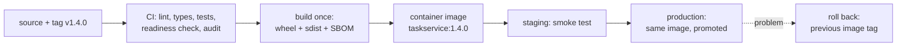

# 09. Packaging, release and a production readiness review

> **Draft: written but not yet run.** The code and the expected output in this lesson were prepared by reading the code and the official documentation. They have not been executed yet. If something does not behave as described, trust your tool's real output and report it.

## What you will be able to do
- Package a service as a versioned wheel with a single source of truth for the version, and build a non-root, multi-stage container image from it.
- Describe a release flow (build once, promote the same artifact, roll back) and generate a software bill of materials (SBOM).
- Read and explain a CI workflow outline that gates a release on tests, an audit and a readiness check.
- Perform a production readiness review of an unfamiliar service, write findings with severity and evidence, and make a go/no-go decision.

## Recap
1. Lesson 08: which tool reports known vulnerabilities in pinned dependencies, and what does a clean report not prove?
   <details><summary>Answer</summary>`pip-audit`. It does not prove the absence of unknown flaws, malicious packages or problems in transitive packages you did not audit.</details>
2. Lesson 07: which two signals would you check first after a release to see if it is healthy?
   <details><summary>Answer</summary>The error rate and a latency percentile, per endpoint, compared with before the release.</details>
3. Python 201 lesson 06: why use a `src` layout?
   <details><summary>Answer</summary>It stops tests and scripts from importing the package from the source folder by accident, so they exercise the installed package.</details>

## Why it matters
"It works on my machine" has three production versions: the artifact that was tested is not the artifact that was deployed; nobody can say which versions are inside it; and when it fails nobody knows how to go back. Packaging, a release process and a readiness review are the three habits that close those gaps. A readiness review is also where all earlier lessons meet: architecture, concurrency limits, queues, observability and security become one checklist with an owner for each line.

## What you will build
A small service `taskservice` with `/healthz`, `/readyz` and `/version`, packaged with Hatchling, containerised in two stages, described by a Compose file with hardening options, built by a CI workflow, and checked by `readiness_check.py`, a script that turns part of the checklist into code. You then review a deliberately flawed service the way you would review a colleague's before launch.



## Before you start
- **Prerequisites:** Python 301 lessons [07, observability](07-observability.md) and [08, security hardening](08-security-hardening.md); Python 201 lessons [06, packaging with uv](../../201-hero-to-super-hero/phase-2-concurrency-and-packaging/06-packaging-with-uv.md) and [11, testing and the notes API](../../201-hero-to-super-hero/phase-4-quality/11-testing-and-notes-api.md).
- Time: 110 min. Two sittings: break after Step 9 (the local build), then Steps 10 to 13 (container, CI, review).
- Python **3.14 or newer**; Windows `py -3.14`, macOS and Linux `python3.14`. Docker with Compose v2 for Steps 10 and 11 only.
- Free host port 8100.
- Source pack (optional): every file is shown in full in this lesson, so you can follow without it. The finished code, the exercise starter and the solution are in the course repository https://github.com/Uee03/Code101 under `source/python/301-super-hero-to-legendary/phase-3-production/09-packaging-release-and-readiness/` (on that page choose **Code, Download ZIP**, or run `git clone https://github.com/Uee03/Code101.git`).
- Pins are a teaching snapshot. No lock file is shipped: generate one with your own tool (`uv lock` or `pip-compile --generate-hashes`) and commit it.

## Steps
### Step 1. Create the workspace and the environment
**PowerShell - folder: anywhere**
```powershell
New-Item -ItemType Directory -Path "$HOME/code101/python301/lesson09/src/taskservice" -Force | Out-Null
New-Item -ItemType Directory -Path "$HOME/code101/python301/lesson09/tests" -Force | Out-Null
New-Item -ItemType Directory -Path "$HOME/code101/python301/lesson09/.github/workflows" -Force | Out-Null
Set-Location "$HOME/code101/python301/lesson09"
py -3.14 -m venv .venv
code .
```

**macOS/Linux - folder: anywhere**
```bash
mkdir -p ~/code101/python301/lesson09/src/taskservice ~/code101/python301/lesson09/tests ~/code101/python301/lesson09/.github/workflows
cd ~/code101/python301/lesson09
python3.14 -m venv .venv
code .
```
Paths in the file captions below are relative to `lesson09`. If lost: `cd ~/code101/python301/lesson09`. Hidden folders such as `.github` may not show in your file explorer by default; the editor's explorer shows them.

### Step 2. The package metadata
**File: `pyproject.toml`**
```toml
[build-system]
requires = ["hatchling==1.33.0"]
build-backend = "hatchling.build"

[project]
name = "taskservice"
dynamic = ["version"]
description = "Task service used by the Python 301 production lessons"
requires-python = ">=3.12"
dependencies = [
    "fastapi>=0.165,<0.166",
    "uvicorn>=0.54,<0.55",
]

[project.optional-dependencies]
dev = [
    "httpx==0.28.1",
    "ruff==0.17.6",
    "mypy==2.4.1",
    "pip-audit==2.10.1",
    "build==1.6.1",
    "cyclonedx-bom==9.0.0",
]

[tool.hatch.version]
path = "src/taskservice/__init__.py"

[tool.hatch.build.targets.wheel]
packages = ["src/taskservice"]
```
- `[build-system]` tells tools how to build the package. The backend `hatchling` is **pinned** (`==1.33.0`) so that a new backend release cannot change how your artifact is built.
- `dynamic = ["version"]` plus `[tool.hatch.version]` read the version from `src/taskservice/__init__.py`. The version is written **once**, in code, so the wheel, the `/version` endpoint and the changelog check can never disagree.
- `dependencies` uses **ranges** (compatible versions), as a library or a package should. The exact versions of a deployment live in `requirements.txt` (below): a package declares what it can work with, a deployment records what it was tested with.
- `[project.optional-dependencies] dev` lists the tools of the workflow; they are not installed in the image.
- `[tool.hatch.build.targets.wheel] packages` says which folder goes into the wheel (the `src` layout).

### Step 3. The package
**File: `src/taskservice/__init__.py`**
```python
__version__ = "1.4.0"
```

**File: `src/taskservice/app.py`**
```python
from collections.abc import Callable

from fastapi import FastAPI, Response, status

from taskservice import __version__


def create_app(dependency_ok: Callable[[], bool] = lambda: True) -> FastAPI:
    app = FastAPI(title="taskservice", docs_url=None, redoc_url=None)

    @app.get("/healthz")
    def healthz() -> dict[str, str]:
        return {"status": "alive"}

    @app.get("/readyz")
    def readyz(response: Response) -> dict[str, str]:
        if not dependency_ok():
            response.status_code = status.HTTP_503_SERVICE_UNAVAILABLE
            return {"status": "not ready"}
        return {"status": "ready"}

    @app.get("/version")
    def version() -> dict[str, str]:
        return {"version": __version__}

    return app


app = create_app()
```
Two probes with **different meanings**. *Liveness* (`/healthz`): "is this process alive?"; if it fails the platform restarts the process, so it must **not** depend on the database, otherwise a database outage makes every instance restart in a loop. *Readiness* (`/readyz`): "can this instance take traffic now?"; it checks dependencies, and when it fails the platform stops sending requests but does not kill the process. The `dependency_ok` parameter is the seam for a real database check and for tests. Interactive docs are off (`docs_url=None`).

### Step 4. Runtime requirements and the changelog
**File: `requirements.txt`**
```text
fastapi==0.165.0
uvicorn==0.54.0
```
Exactly what the image installs. Real deployments pin **every** package, including transitive ones, ideally with hashes (lesson 08).

**File: `CHANGELOG.md`**
```markdown
# Changelog

All notable changes are documented here. The format follows Keep a Changelog and the project uses Semantic Versioning.

## [1.4.0] - 2026-11-23
### Added
- `/readyz` answers 503 while a dependency is unavailable.
- `/version` reports the packaged version.
### Changed
- The container runs as a non-root user with a read-only root file system.

## [1.3.0] - 2026-10-01
### Added
- `/healthz` liveness endpoint.
```
A changelog is for humans: what changed, in terms of behaviour. **Semantic Versioning** reads `MAJOR.MINOR.PATCH`: patch for compatible fixes, minor for compatible features, major for breaking changes. For a *service* the number mostly names a build; the compatibility promise to clients is the **API version** from lesson 03, which should change far less often than the package version.

### Step 5. The readiness checker
This script automates the checks that are mechanical, so a human reviewer can spend time on the ones that are not.

**File: `readiness_check.py`**
```python
import re
import sys
from dataclasses import dataclass
from pathlib import Path


@dataclass(frozen=True)
class Finding:
    check: str
    ok: bool
    detail: str


VERSION_PATTERN = re.compile(r'__version__\s*=\s*"([^"]+)"')


def read_text(path: Path) -> str:
    return path.read_text(encoding="utf-8") if path.exists() else ""


def check_dockerfile(text: str) -> list[Finding]:
    stages = set(re.findall(r"^FROM\s+.*?\bAS\s+(\S+)", text, re.MULTILINE | re.IGNORECASE))
    images = re.findall(r"^FROM\s+(?:--\S+\s+)?(\S+)", text, re.MULTILINE)
    unpinned = [
        image for image in images if image not in stages and (":" not in image or image.endswith(":latest"))
    ]
    return [
        Finding(
            "base image is pinned",
            bool(images) and not unpinned,
            "pin a version tag, not latest: " + ", ".join(unpinned),
        ),
        Finding(
            "runs as a non-root user",
            bool(re.search(r"^USER\s+(?!root\b)\S+", text, re.MULTILINE)),
            "add a USER line that is not root",
        ),
        Finding(
            "has a HEALTHCHECK",
            bool(re.search(r"^HEALTHCHECK\b", text, re.MULTILINE)),
            "add a HEALTHCHECK instruction",
        ),
    ]


def check_project(root: Path) -> list[Finding]:
    match = VERSION_PATTERN.search(read_text(root / "src" / "taskservice" / "__init__.py"))
    version = match.group(1) if match else ""
    requirements = [
        line.strip()
        for line in read_text(root / "requirements.txt").splitlines()
        if line.strip() and not line.strip().startswith("#")
    ]
    dockerfile = read_text(root / "Dockerfile")
    findings = [
        Finding(
            "version is MAJOR.MINOR.PATCH",
            bool(re.fullmatch(r"\d+\.\d+\.\d+", version)),
            'set __version__ = "1.2.3" in src/taskservice/__init__.py',
        ),
        Finding(
            "CHANGELOG has an entry for this version",
            bool(version) and f"## [{version}]" in read_text(root / "CHANGELOG.md"),
            "add a '## [x.y.z]' heading to CHANGELOG.md",
        ),
        Finding(
            "requirements are pinned with ==",
            bool(requirements) and all("==" in line for line in requirements),
            "pin every line, for example fastapi==0.165.0",
        ),
    ]
    findings += check_dockerfile(dockerfile)
    findings += [
        Finding(
            ".dockerignore keeps .env out of the image",
            ".env" in read_text(root / ".dockerignore"),
            "create .dockerignore listing .env",
        ),
        Finding(
            "no .env file in the project",
            not (root / ".env").exists(),
            "remove .env from the project and add it to .gitignore",
        ),
        Finding(
            "CI workflow exists",
            (root / ".github" / "workflows" / "ci.yml").exists(),
            "add .github/workflows/ci.yml",
        ),
    ]
    return findings


def main(argv: list[str]) -> int:
    root = Path(argv[1]) if len(argv) > 1 else Path(".")
    findings = check_project(root)
    for finding in findings:
        status = "PASS" if finding.ok else "FAIL"
        suffix = "" if finding.ok else f": {finding.detail}"
        print(f"{status}  {finding.check}{suffix}")
    failed = sum(1 for finding in findings if not finding.ok)
    print(f"{len(findings) - failed} passed, {failed} failed")
    return 1 if failed else 0


if __name__ == "__main__":
    raise SystemExit(main(sys.argv))
```
How it works: each check is a `Finding` (name, pass or fail, advice). `check_dockerfile` looks at `FROM` lines (ignoring stage names defined with `AS`), a `USER` line that is not `root`, and a `HEALTHCHECK`. `check_project` adds the version format, a changelog entry, pinned requirements, `.dockerignore`, an absent `.env` and the CI workflow. `main` prints `PASS` or `FAIL` per check, a summary, and exits `1` when anything failed so CI can stop a release. It is **text matching, not a security scanner**: a `USER` line can exist and still be wrong. It makes a missing basic visible, nothing more.

### Step 6. Tests for the service and for the checker
**File: `tests/test_app.py`**
```python
import unittest

from fastapi.testclient import TestClient

from taskservice import __version__
from taskservice.app import create_app


class ProbeTests(unittest.TestCase):
    def test_liveness_does_not_depend_on_anything(self) -> None:
        client = TestClient(create_app(lambda: False))
        self.assertEqual(client.get("/healthz").json(), {"status": "alive"})

    def test_readiness_is_200_when_the_dependency_is_up(self) -> None:
        client = TestClient(create_app(lambda: True))
        response = client.get("/readyz")
        self.assertEqual((response.status_code, response.json()), (200, {"status": "ready"}))

    def test_readiness_is_503_when_the_dependency_is_down(self) -> None:
        client = TestClient(create_app(lambda: False))
        response = client.get("/readyz")
        self.assertEqual((response.status_code, response.json()), (503, {"status": "not ready"}))

    def test_the_running_service_reports_the_packaged_version(self) -> None:
        client = TestClient(create_app())
        self.assertEqual(client.get("/version").json(), {"version": __version__})


if __name__ == "__main__":
    unittest.main()
```

**File: `tests/test_readiness.py`**
```python
import tempfile
import unittest
from pathlib import Path

from readiness_check import check_dockerfile, check_project

PROJECT = Path(__file__).resolve().parent.parent

GOOD_DOCKERFILE = """FROM python:3.14-slim AS build
FROM python:3.14-slim AS runtime
USER 10001
HEALTHCHECK CMD ["true"]
"""


def failed_checks(findings: list) -> list[str]:
    return [finding.check for finding in findings if not finding.ok]


class DockerfileChecks(unittest.TestCase):
    def test_a_good_dockerfile_passes(self) -> None:
        self.assertEqual(failed_checks(check_dockerfile(GOOD_DOCKERFILE)), [])

    def test_latest_and_untagged_images_fail(self) -> None:
        for image in ("python:latest", "python"):
            with self.subTest(image=image):
                findings = check_dockerfile(f"FROM {image}\nUSER 10001\nHEALTHCHECK CMD true\n")
                self.assertEqual(failed_checks(findings), ["base image is pinned"])

    def test_a_stage_name_is_not_an_unpinned_image(self) -> None:
        text = "FROM python:3.14-slim AS build\nFROM build\nUSER 10001\nHEALTHCHECK CMD true\n"
        self.assertEqual(failed_checks(check_dockerfile(text)), [])

    def test_root_and_missing_healthcheck_fail(self) -> None:
        findings = check_dockerfile("FROM python:3.14-slim\nUSER root\n")
        self.assertEqual(failed_checks(findings), ["runs as a non-root user", "has a HEALTHCHECK"])


class ProjectChecks(unittest.TestCase):
    def test_this_project_passes_its_own_checks(self) -> None:
        self.assertEqual(failed_checks(check_project(PROJECT)), [])

    def test_an_empty_folder_fails_everything_except_the_absence_of_env(self) -> None:
        with tempfile.TemporaryDirectory() as folder:
            findings = check_project(Path(folder))
        self.assertEqual(len(failed_checks(findings)), len(findings) - 1)


if __name__ == "__main__":
    unittest.main()
```
`test_this_project_passes_its_own_checks` makes the checklist part of the test suite: if someone deletes the `HEALTHCHECK`, a unit test fails, not only a CI step.

### Step 7. Install and run the checks locally
**PowerShell - folder: `~/code101/python301/lesson09`**
```powershell
& .\.venv\Scripts\python.exe -m pip install -e ".[dev]"
& .\.venv\Scripts\python.exe -m unittest discover -s tests -v
```

**macOS/Linux - folder: `~/code101/python301/lesson09`**
```bash
.venv/bin/python -m pip install -e ".[dev]"
.venv/bin/python -m unittest discover -s tests -v
```
`-e` installs in **editable** mode: the environment points at your `src` folder, so tests import the same package a wheel would provide while you can still edit it. The `.[dev]` part installs the project plus the `dev` extra. Pip downloads the build backend (Hatchling) into a temporary isolated environment to build the metadata.

Expected result, not yet run: pip finishes with `Successfully installed` and a list that includes `taskservice-1.4.0`. The tests print ten lines ending in `ok`, then `Ran 10 tests in <time>s` and `OK`. (`test_readiness` also needs the next steps' files to exist: if `Dockerfile`, `.dockerignore` and the CI file are not created yet, `test_this_project_passes_its_own_checks` fails with a list of what is missing. That is the checker doing its job: create the files in Steps 8 and 11 and rerun.)

### Step 8. The Dockerfile and the ignore file
**File: `Dockerfile`**
```dockerfile
# syntax=docker/dockerfile:1
FROM python:3.14-slim AS build
WORKDIR /src
COPY pyproject.toml requirements.txt ./
COPY src ./src
RUN pip wheel --no-cache-dir --wheel-dir /wheels -r requirements.txt .

FROM python:3.14-slim AS runtime
ENV PYTHONDONTWRITEBYTECODE=1 \
    PYTHONUNBUFFERED=1
RUN useradd --system --uid 10001 --no-create-home app
COPY --from=build /wheels /wheels
RUN pip install --no-cache-dir --no-index --find-links=/wheels taskservice \
    && rm -rf /wheels
USER 10001
EXPOSE 8000
HEALTHCHECK --interval=30s --timeout=3s --retries=3 CMD ["python", "-c", "import urllib.request; urllib.request.urlopen('http://127.0.0.1:8000/healthz', timeout=2)"]
CMD ["uvicorn", "taskservice.app:app", "--host", "0.0.0.0", "--port", "8000"]
```
Line by line:
- `# syntax=docker/dockerfile:1` selects the current stable Dockerfile frontend.
- `FROM python:3.14-slim AS build` starts the **build stage**. A minor-version tag is pinned; `latest` is not. For stricter reproducibility pin the image **digest** too and let a bot update it.
- `WORKDIR /src` sets the folder for the next commands (created if missing).
- `COPY pyproject.toml requirements.txt ./` then `COPY src ./src` copy only what the build needs. Copying the requirements first lets the Docker cache reuse the layer when only code changes... except that the wheel step below needs the code too, so this ordering mainly keeps unrelated files (tests, `.git`, `.env`) out.
- `RUN pip wheel ... -r requirements.txt .` builds wheels for every pinned dependency **and** for the project, into `/wheels`. Anything that needs a compiler stays in this stage.
- `FROM python:3.14-slim AS runtime` starts a **fresh** final stage. Build tools and caches of the first stage are not in the image you ship.
- `ENV PYTHONDONTWRITEBYTECODE=1 PYTHONUNBUFFERED=1`: no `.pyc` files (the file system will be read-only) and unbuffered output so logs appear immediately. The backslash continues the line.
- `RUN useradd --system --uid 10001 --no-create-home app` creates an unprivileged user with a fixed numeric id (orchestrators check numeric ids).
- `COPY --from=build /wheels /wheels` brings only the wheels across.
- `RUN pip install --no-index --find-links=/wheels taskservice && rm -rf /wheels` installs from the local wheels only (`--no-index`: no network, so what you tested is exactly what you install) and deletes them so they do not stay in a layer.
- `USER 10001` runs everything after this, including the server, as that user.
- `EXPOSE 8000` documents the port; it publishes nothing by itself.
- `HEALTHCHECK` runs a Python one-liner every 30 s against `/healthz` and marks the container unhealthy after three failures. It uses Python because the slim image has no `curl`.
- `CMD` starts Uvicorn in exec form (a JSON list), so signals such as `SIGTERM` reach the server and it can drain requests. `0.0.0.0` is the address **inside** the container; the host exposure is decided by Compose.

**File: `.dockerignore`**
```text
.git
.github
.venv
__pycache__
*.pyc
.env
.env.*
tests
dist
sbom.cdx.json
```
The build context is everything sent to the Docker daemon. This file removes version control data, the virtual environment, secrets files and build output from it: faster builds and no accidental `COPY` of a `.env`.

### Step 9. Build the package and the SBOM
**PowerShell - folder: `~/code101/python301/lesson09`**
```powershell
& .\.venv\Scripts\python.exe -m build
& .\.venv\Scripts\python.exe -m cyclonedx_py environment --pyproject pyproject.toml --of JSON -o sbom.cdx.json
```

**macOS/Linux - folder: `~/code101/python301/lesson09`**
```bash
.venv/bin/python -m build
.venv/bin/python -m cyclonedx_py environment --pyproject pyproject.toml --of JSON -o sbom.cdx.json
```
Expected result, not yet run: `python -m build` ends with a line similar to `Successfully built taskservice-1.4.0.tar.gz and taskservice-1.4.0-py3-none-any.whl`, and the `dist` folder holds those two files. The second command writes `sbom.cdx.json`.

- The **sdist** (`.tar.gz`) is the source distribution; the **wheel** (`.whl`) is the built, installable form. Deployments install the wheel.
- An **SBOM** (software bill of materials) lists the components inside an artifact. CycloneDX is one standard format (SPDX is the other common one). `cyclonedx_py environment` inspects what is **actually installed** in the current environment, which is the most accurate source; `--pyproject` adds the project itself as the root component. Its value is **response speed**: when a new vulnerability is announced, you can search every SBOM you hold for the component instead of guessing which services contain it. It is an inventory, not a proof of safety, and it is only as complete as the environment it described (generate it from the environment you ship, not from your laptop).

**Stop here for a break if you like.**

### Step 10. Compose, run and probe the container
**File: `compose.yml`**
```yaml
name: code101-lesson09

services:
  api:
    build: .
    image: taskservice:1.4.0
    ports:
      - "127.0.0.1:8100:8000"
    read_only: true
    tmpfs:
      - /tmp
    cap_drop:
      - ALL
    security_opt:
      - no-new-privileges:true
    mem_limit: 256m
    pids_limit: 200
    restart: unless-stopped
```
- `name:` isolates this project's containers and network.
- `build: .` builds the image from the `Dockerfile` here; `image: taskservice:1.4.0` names it with the **version**, never `latest`. That tag is what you roll back to.
- `ports: "127.0.0.1:8100:8000"` exposes the container's port 8000 on the loopback address only, host port 8100. Without the leading `127.0.0.1:` Docker publishes on all interfaces.
- `read_only: true` makes the container's root file system read-only: an attacker or a bug cannot write new code into the image. `tmpfs: /tmp` gives a small in-memory writable folder for things that really need one.
- `cap_drop: ALL` removes every Linux capability; a web service needs none. `no-new-privileges` stops processes from gaining privileges through set-user-id programs.
- `mem_limit` and `pids_limit` bound memory and process count, so one runaway container cannot starve the host.
- `restart: unless-stopped` restarts after a crash or a host reboot but not after you stop it on purpose.

**PowerShell or bash - folder: `~/code101/python301/lesson09`**
```text
docker compose up -d --build --wait
```
Expected result, not yet run: Docker builds both stages, starts the container and, because the image defines a `HEALTHCHECK`, `--wait` returns when the container is healthy. With a 30-second interval this can take about half a minute. Then:

**PowerShell - folder: `~/code101/python301/lesson09`**
```powershell
curl.exe -s http://127.0.0.1:8100/healthz
curl.exe -s http://127.0.0.1:8100/readyz
curl.exe -s http://127.0.0.1:8100/version
docker compose exec api id -u
docker inspect code101-lesson09-api-1 --format "read-only: {{.HostConfig.ReadonlyRootfs}}, cap-drop: {{.HostConfig.CapDrop}}"
```

**macOS/Linux - folder: `~/code101/python301/lesson09`**
```bash
curl -s http://127.0.0.1:8100/healthz
curl -s http://127.0.0.1:8100/readyz
curl -s http://127.0.0.1:8100/version
docker compose exec api id -u
docker inspect code101-lesson09-api-1 --format "read-only: {{.HostConfig.ReadonlyRootfs}}, cap-drop: {{.HostConfig.CapDrop}}"
```
Expected output, not yet run:
```text
{"status":"alive"}
{"status":"ready"}
{"version":"1.4.0"}
10001
read-only: true, cap-drop: [ALL]
```
The numeric user `10001` proves the process is not root. Clean up when done:

**PowerShell or bash - folder: `~/code101/python301/lesson09`**
```text
docker compose down --remove-orphans --rmi all
```
Expected: the container, the network and the image `taskservice:1.4.0` are removed. (`--rmi local` would keep it, because the image has a custom name set by `image:`.) The `python:3.14-slim` base image stays in Docker's cache.

### Step 11. The CI workflow outline
**File: `.github/workflows/ci.yml`**
```yaml
name: ci

on:
  push:
    branches: [main]
    tags: ["v*"]
  pull_request:

permissions:
  contents: read

jobs:
  checks:
    runs-on: ubuntu-latest
    timeout-minutes: 15
    steps:
      - uses: actions/checkout@v7
      - uses: actions/setup-python@v7
        with:
          python-version: "3.14"
          cache: pip
          cache-dependency-path: requirements.txt
      - run: python -m pip install -e ".[dev]"
      - run: python -m ruff check .
      - run: python -m mypy src
      - run: python -m unittest discover -s tests -v
      - run: python readiness_check.py .
      - run: python -m pip_audit -r requirements.txt
      - run: python -m build
      - run: python -m cyclonedx_py environment --pyproject pyproject.toml --of JSON -o sbom.cdx.json
      - uses: actions/upload-artifact@v7
        with:
          name: release-files
          path: |
            dist/*
            sbom.cdx.json

  image:
    needs: checks
    runs-on: ubuntu-latest
    timeout-minutes: 15
    steps:
      - uses: actions/checkout@v7
      - run: docker build -t taskservice:ci .
```
This is an **outline** in GitHub Actions syntax, not a finished pipeline (it does not push or deploy). Reading it:
- `on:` runs for pushes to `main`, for version tags such as `v1.4.0` and for pull requests.
- `permissions: contents: read` gives the workflow's token the least access it needs. Widen it per job only when a job truly needs more.
- `timeout-minutes` stops a hung job from running for hours.
- The steps run **in order and stop at the first failure**: lint (`ruff`), static types (`mypy`), tests, the readiness check, the dependency audit, then build the wheel, generate the SBOM and keep both as an **artifact** of this run.
- `image` needs `checks` to succeed, then builds the container image; a real pipeline would push it to a registry **by digest** and sign it.
- Action references use version tags (`@v7`). For stronger supply-chain protection pin each action to a **full commit SHA** and let a bot propose updates, because a tag can be moved.
- Never expose repository secrets to pull requests from forks, and keep deployment credentials in a protected environment with required reviewers.

### Step 12. Run the readiness check
**PowerShell - folder: `~/code101/python301/lesson09`**
```powershell
& .\.venv\Scripts\python.exe readiness_check.py .
```

**macOS/Linux - folder: `~/code101/python301/lesson09`**
```bash
.venv/bin/python readiness_check.py .
```
Expected output, not yet run:
```text
PASS  version is MAJOR.MINOR.PATCH
PASS  CHANGELOG has an entry for this version
PASS  requirements are pinned with ==
PASS  base image is pinned
PASS  runs as a non-root user
PASS  has a HEALTHCHECK
PASS  .dockerignore keeps .env out of the image
PASS  no .env file in the project
PASS  CI workflow exists
9 passed, 0 failed
```

### Step 13. The capstone-style review: do it on a flawed candidate
This is the exercise (see **Try it**). Read it now: it uses the checker you just ran.

## How it works
1. **Build once, promote the same artifact.** The wheel and image built from tag `v1.4.0` are the ones that go to staging and then production. Rebuilding for each environment means production runs something nobody tested.
2. **The version has one source** (`__init__.py`) and three consumers: the wheel metadata, the `/version` endpoint and the changelog check.
3. **Rollback is a deploy of the previous tag.** It works only if images are immutable and kept, and if the database change was **backward compatible** (see the checklist: expand, deploy, contract).
4. **The readiness check is a ratchet.** Each time an incident teaches you a rule that can be checked mechanically, you add it to the script and it can never silently regress.

**Misconception to correct:** "A passing pipeline means it is ready for production." A pipeline proves that the things you *thought to check* pass. Readiness also includes things no tool sees: who is on call, what the rollback procedure is, whether the alert can be understood at 3 a.m.

## Decision record (ADR-009)
| | |
|---|---|
| **Context** | We must ship a service repeatedly, quickly and with the ability to return to the last good version. |
| **Decision** | Wheel built with Hatchling from a `src` layout; one version source; multi-stage non-root image tagged with the version; CI builds artifacts and an SBOM once per tag; deployments promote that image; readiness script and a human review gate the first release of a service. |
| **Consequences** | Reproducible, inspectable artifacts and a clear rollback. More files to maintain (changelog, workflow, Dockerfile) and an SBOM to store. The readiness script produces false confidence if treated as complete. |
| **Alternatives rejected** | Deploying from source (`git pull` on a server): no artifact, no rollback. A single-stage image (larger, contains build tools). Date-based versions only (fine for services, but we want SemVer for the package and a separate API version). Manual release notes without a changelog check (they drift). |

## When not to use this
- **A single script or internal tool run by one person:** a repository with a `requirements.txt` is enough. A wheel and an SBOM add ceremony without a consumer.
- **A multi-stage image when there is nothing to compile:** it still helps keep the final image clean here; if your image is a pure-Python app with no build step and a very simple layout, a single stage is acceptable. Measure image size and build time before arguing.
- **Strict SemVer for an application nobody imports:** the number then communicates "which build", and the API version carries compatibility. Do not spend meetings on whether a change is "minor" or "patch".
- **Heavy release machinery for a prototype.** Introduce the pipeline when a second person or a second environment arrives.
- **Treating the checklist as a form to fill in.** If every item is always "yes" and nobody ever says "no", the checklist has stopped working.

## What to measure
The four delivery measures from DevOps research are a good start; collect them from your repository and incident history rather than from opinion:
- **Lead time** from merge to running in production.
- **Deployment frequency.**
- **Change failure rate:** the share of deployments that needed a rollback, a hotfix or a patch.
- **Time to restore** after a failed change (rehearse a rollback once and time it).
Also record: image size and build time per release (`docker images`), the age of the base image, the number of unpinned or unaudited dependencies, and how many checklist items are automated versus manual.

## Production readiness checklist
Use it as a template, copy it into your repository, and give every line an owner and a link to evidence.

| Area | Question | Evidence |
|---|---|---|
| **Design** | Are rules in the domain and edges behind ports (lessons 01, 02)? Is the API versioned and paginated (03)? | architecture test, OpenAPI diff in CI |
| **Capacity** | Which concurrency model and pool sizes are used, and what limits throughput (04)? Has a load test with realistic data run (05)? | load-test report with percentiles, pool settings |
| **Failure** | Are timeouts, retries with backoff and idempotency in place (03, 06)? What happens when each dependency is down? Does readiness fail and liveness stay up? | failure drill notes |
| **Data** | Backups exist **and a restore was tested**. Migrations are backward compatible (expand, deploy, contract). | restore test record |
| **Observability** | Structured logs with trace ids, RED metrics and traces (07). Alerts on symptoms, each with a runbook link. | dashboard and alert definitions in version control |
| **Security** | Dependency audit in CI, secrets from a manager, strict input validation, ownership checks, SSRF guard, security headers, least-privilege container (08, this lesson). | audit output, review of the OWASP table |
| **Release** | Versioned immutable artifact, changelog, SBOM, rollback procedure rehearsed, previous image kept. | release record |
| **Operations** | On-call named, runbook written, capacity and cost reviewed, data retention and privacy considered. | on-call schedule, runbook |
| **Ownership** | One team owns the service, its dashboards and its dependencies' upgrades. | service catalogue entry |

## Try it
This is the exercise of the whole level. Starter: `exercise/starter` (a flawed service folder `candidate` and a review template). Copy the `starter` folder itself and rename the copy `try09` **inside `lesson09`** so that `..\readiness_check.py` exists next to it, then work in `try09`.

1. **Guided:** run the checker against the candidate and read each failure.
   **PowerShell - folder: `~/code101/python301/lesson09/try09`**
   ```powershell
   & ..\.venv\Scripts\python.exe ..\readiness_check.py candidate
   ```
   **macOS/Linux - folder: `~/code101/python301/lesson09/try09`**
   ```bash
   ../.venv/bin/python ../readiness_check.py candidate
   ```
   Expected output, not yet run (derived by reading the checker and the starter files):
   ```text
   FAIL  version is MAJOR.MINOR.PATCH: set __version__ = "1.2.3" in src/taskservice/__init__.py
   FAIL  CHANGELOG has an entry for this version: add a '## [x.y.z]' heading to CHANGELOG.md
   FAIL  requirements are pinned with ==: pin every line, for example fastapi==0.165.0
   FAIL  base image is pinned: pin a version tag, not latest: python:latest
   FAIL  runs as a non-root user: add a USER line that is not root
   FAIL  has a HEALTHCHECK: add a HEALTHCHECK instruction
   FAIL  .dockerignore keeps .env out of the image: create .dockerignore listing .env
   PASS  no .env file in the project
   FAIL  CI workflow exists: add .github/workflows/ci.yml
   1 passed, 8 failed
   ```
   Fix the candidate until the output is `9 passed, 0 failed`.
2. **Change (the human part, the heart of the exercise):** the script cannot see everything. Read `candidate/compose.yml` and the other files, and fill in `REVIEW-TEMPLATE.md` (rename it `REVIEW.md`): at least **eight findings** including some the script did not report, each with severity, evidence (file and line), one-sentence risk, fix and owner, then a go, no-go or go-with-conditions decision with the conditions. Do this before looking at the solution.
3. **Stretch (no single answer):** run the checker against the capstone's finished backend (`capstones/backend-python/source/phase-5-hardening/05-hardening/code`). Decide which failures are real gaps, which are not applicable to a different layout, and what you would change in either the capstone or the checker. Write down one check you would add to `readiness_check.py` and what it could wrongly pass.

**The candidate files** (these are the starter; every file is shown in full):

**File: `exercise/starter/candidate/Dockerfile`**
```dockerfile
FROM python:latest
WORKDIR /app
COPY . .
RUN pip install -r requirements.txt
EXPOSE 8000
CMD ["python", "-m", "uvicorn", "taskservice.app:app", "--host", "0.0.0.0", "--port", "8000"]
```

**File: `exercise/starter/candidate/requirements.txt`**
```text
fastapi
uvicorn>=0.30
```

**File: `exercise/starter/candidate/compose.yml`**
```yaml
name: candidate

services:
  api:
    build: .
    ports:
      - "8000:8000"
    environment:
      DATABASE_PASSWORD: admin
      DEBUG: "true"
    restart: always
```

**File: `exercise/starter/candidate/CHANGELOG.md`**
```markdown
# Changelog

## [1.3.0] - 2026-10-01
- First release.
```

**File: `exercise/starter/candidate/src/taskservice/__init__.py`**
```python
__version__ = "1.4"
```

**File: `exercise/starter/REVIEW-TEMPLATE.md`**
```markdown
# Production readiness review: candidate service

Reviewer:
Date:
Decision (go / no-go / go with conditions):

## Findings
For each finding write: id, severity (blocker / major / minor), evidence (file and line), risk in one sentence, fix, owner.

| Id | Severity | Evidence | Risk | Fix | Owner |
|----|----------|----------|------|-----|-------|
| R1 | | | | | |

## Checklist areas not covered by `readiness_check.py`
- Observability (logs, metrics, traces):
- Security (secrets, network exposure, debug mode):
- Resilience (restart policy, limits, health probes):
- Release and rollback:
- Operations (runbook, alerts, backups):

## Conditions for go
```

<details><summary>Solution</summary>

The fixed candidate lives in `exercise/solution/candidate`; the worked review is `exercise/solution/REVIEW.md`. The review's nine findings are:

| Id | Severity | Evidence | What is wrong |
|---|---|---|---|
| R1 | blocker | `compose.yml`: `DATABASE_PASSWORD: admin` | weak credential committed in a file |
| R2 | blocker | `compose.yml`: `"8000:8000"` | published on every network interface |
| R3 | blocker | `Dockerfile`: no `USER` | the process runs as root |
| R4 | major | `compose.yml`: `DEBUG: "true"` | debug output and detailed errors reach clients |
| R5 | major | `Dockerfile`: `FROM python:latest` | unreviewed, non-reproducible base image |
| R6 | major | `requirements.txt` unpinned | different builds install different versions |
| R7 | major | no `HEALTHCHECK` | the platform cannot detect a stuck process |
| R8 | minor | version `1.4` and a changelog without it | releases cannot be traced |
| R9 | minor | no `.dockerignore`, no CI | `.env` or `.git` can enter the image; nothing runs the checks |

The script reports R3, R5, R6, R7, R8 and R9 (the exact lines are in Guided above). **R1, R2 and R4 are invisible to it** and are the most dangerous ones: that is why the script supports a review and does not replace it. The solution decision is *no-go until R1 to R5 are fixed*. The fixed `Dockerfile`, `compose.yml` (secret from a file, loopback port, read-only file system, dropped capabilities, memory limit), `requirements.txt`, `CHANGELOG.md`, `__init__.py`, `.dockerignore` and a CI file make the checker print `9 passed, 0 failed`. The review also lists areas the candidate does not show at all (observability, rollback, runbook, backups) as **conditions for go**, because absence of evidence is itself a finding.

</details>

## Check yourself
1. Why must liveness not check the database?
   <details><summary>Answer</summary>If the database is down, every instance would fail liveness and be restarted repeatedly, turning a dependency outage into a restart storm. Readiness removes the instance from traffic without killing it.</details>
2. What does `--no-index --find-links=/wheels` guarantee in the runtime stage?
   <details><summary>Answer</summary>The image installs exactly the wheels built in the build stage and nothing is downloaded at that point.</details>
3. Predict: someone adds `USER root` as the last `USER` line of the Dockerfile. Does `readiness_check.py` catch it?
   <details><summary>Answer</summary>No. The checker only looks for *a* `USER` line that is not `root`; the earlier `USER 10001` still matches. It is text matching, which is why a human review and runtime evidence (`id -u` in the container) matter.</details>
4. What is an SBOM useful for the day a new vulnerability in a library is announced?
   <details><summary>Answer</summary>Searching your stored SBOMs tells you quickly which artifacts contain that component and version, so you can decide where to patch first.</details>
5. Give two things a rollback depends on besides keeping the old image.
   <details><summary>Answer</summary>Database changes that are backward compatible with the old version, and a rehearsed, documented procedure (plus configuration or feature flags that can return to the earlier behaviour).</details>

## Common mistakes
| Symptom or error text | Cause | Fix |
|---|---|---|
| `ModuleNotFoundError: No module named 'taskservice'` when running the tests | The editable install was skipped, or you used the system Python | Run `pip install -e ".[dev]"` with the `.venv` interpreter (Step 7) |
| `ModuleNotFoundError: No module named 'readiness_check'` | Tests were run from another folder | Run from `lesson09` with `-m unittest discover -s tests` |
| `test_this_project_passes_its_own_checks` fails and lists checks | `Dockerfile`, `.dockerignore` or `ci.yml` is missing or misspelled | Create the file (they are Steps 8 and 11) and run again |
| `ERROR: Could not find a version that satisfies the requirement ...` (typical message) | A pinned version is not available for your Python or index | Check the pin against the package index and your interpreter |
| `Bind for 127.0.0.1:8100 failed: port is already allocated` (typical message) | Another program uses host port 8100 | Change the left side of the port mapping and the URLs |
| The container is `unhealthy` (symptom) | The server is not listening on `0.0.0.0:8000`, or the health URL is wrong | `docker compose logs api`; check the `CMD` and the `HEALTHCHECK` URL |
| `docker compose exec api id -u` prints `0` (symptom) | The `USER` line is missing or placed before the `useradd` | Keep `USER 10001` after the user is created |
| YAML error in the workflow (symptom) | Tabs or wrong indentation | Use two spaces; validate the file in your editor |

## Best practice
Build one immutable, versioned artifact, run it as an unprivileged user, and make every release reversible and inspectable (changelog, SBOM, rollback). Source: Python Packaging User Guide, writing `pyproject.toml` https://packaging.python.org/en/latest/guides/writing-pyproject-toml/ ; Dockerfile reference https://docs.docker.com/reference/dockerfile/ ; Docker, multi-stage builds https://docs.docker.com/build/building/multi-stage/ ; CycloneDX Python tool https://cyclonedx-bom-tool.readthedocs.io/en/latest/ ; GitHub Actions, security hardening https://docs.github.com/en/actions/security-for-github-actions/security-guides/security-hardening-for-github-actions

## Going further
- The capstone's final pack contains a production-style `Dockerfile` and a Compose override: read [chapter 04](https://github.com/Uee03/Code101/blob/main/capstones/backend-python/tutorials/phase-4-run-and-ship/04-run-and-ship.md) and [chapter 05](https://github.com/Uee03/Code101/blob/main/capstones/backend-python/tutorials/phase-5-hardening/05-hardening.md) with this lesson's checklist beside you, and mark which rows each chapter satisfies.
- Read the PEP 621 specification for project metadata: https://peps.python.org/pep-0621/

## Summary
- You packaged a service with one version source, built a wheel, and generated an SBOM.
- You built a non-root multi-stage image, ran it with a hardened Compose file and explained each option.
- You read a CI workflow outline that gates a release on tests, an audit and a readiness check.
- You reviewed a flawed service, separated what a script can find from what only a reviewer can, and made a go/no-go decision.
- You finished Python 301: architecture, performance, concurrency and production, tied together by a checklist.

## Next lesson
This was the last lesson of Python 301. Continue with the capstones (the [backend-python capstone](https://github.com/Uee03/Code101/tree/main/capstones/backend-python)) or the practice capstones in `capstones/_practice/`, applying this checklist to your own project.
