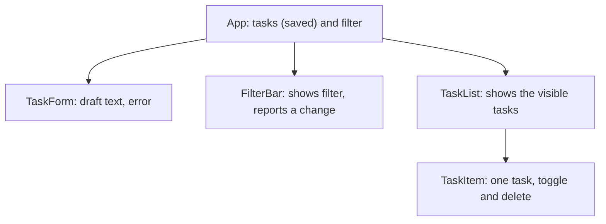

# 12. Project: a task list app

> **Draft: written but not yet run.** The code and the expected output in this lesson were prepared by reading the code and the official documentation. They have not been executed yet. If something does not behave as described, trust your tool's real output and report it.

## What you will be able to do
- plan a small React app as a tree of components before writing code;
- build a complete app with state, events, a form, a custom hook and accessible controls;
- save and restore data in the browser;
- explain every file of a Vite and React project.

## Recap
1. What does a custom hook share between components? <details><summary>Answer</summary>Logic, not data.</details>
2. Which attribute links an input to its error message? <details><summary>Answer</summary><code>aria-describedby</code>.</details>
3. How do you change an array held in state? <details><summary>Answer</summary>Build a new array (<code>map</code>, <code>filter</code>, spread) and pass it to the setter.</details>

## Why it matters
A real project is where lessons stop being separate tricks. Building an app from an empty folder shows whether you understood how the pieces fit. Think of an architect's drawing: you decide where each wall goes before you lay bricks.

## What you will build
A task list in a **new** project folder `task-list`: add tasks, tick them off, delete them, filter by All, Active or Done, see "2 tasks left", and keep everything after a reload. It works with a keyboard, announces changes to screen readers and follows light and dark mode.

Plan (the component tree and where state lives):

State lives in `App` because the form, the filter, the list and the "tasks left" line all need it: you apply "lift state up". The draft text lives in `TaskForm` because nobody else needs it.

## Before you start
- Time: about 120 minutes. **Two sittings:** stop after Step 7 (the app works, but is not styled yet) and continue with Step 8 and the checks later.
- Node 26.13.1 and npm 11.20.0 as in lesson 01. This is a new project; you do not need `react-app` any more, but keep it.
- Source pack (optional): every file is shown in full in this lesson, so you can follow without it. The finished code, the exercise starter and the solution are in the
  course repository https://github.com/Uee03/Code101 under `source/react/101-zero-to-hero/phase-3-data-and-polish/12-project-task-list/` (on that page choose **Code, Download ZIP**, or run
  `git clone https://github.com/Uee03/Code101.git`).

## Steps

### Step 1. Make the folder and copy the configuration
Make the folder `code101/task-list` (next to `react-app`) and open it in VS Code (**File > Open Folder**). Open a terminal; the prompt must end in `task-list` (recover with `Set-Location "$HOME\code101\task-list"` on Windows PowerShell or `cd "$HOME/code101/task-list"` on macOS and Linux).

Copy these files from your `react-app` project from lesson 01 into `task-list`, **unchanged**: `vite.config.ts`, `tsconfig.json`, `tsconfig.app.json`, `tsconfig.node.json`, `.gitignore`, and `src/main.tsx` (make a `src` folder first). If you no longer have them, their full text is in [lesson 01, Steps 5 and 6](../phase-1-first-app/01-install-node-and-run-a-vite-app.md). Also copy the whole `public/icons` folder from `react-app` (lesson 10, Step 1: `ui/plus.svg`, `ui/x.svg`, `ui/check-circle.svg` and `LICENSE-ICONS-CC0.txt`). Expected result: the five config files, `src/main.tsx` and `public/icons/...` exist in `task-list`.

### Step 2. Write package.json and index.html
Only the name and the title differ from lesson 01. There is no router and no query library: the app needs only React.

**File: `package.json`**
```json
{
  "name": "task-list",
  "private": true,
  "version": "1.0.0",
  "type": "module",
  "scripts": {
    "dev": "vite",
    "build": "tsc -b && vite build",
    "preview": "vite preview"
  },
  "dependencies": {
    "react": "19.3.1",
    "react-dom": "19.3.1"
  },
  "devDependencies": {
    "@types/react": "19.3.0",
    "@types/react-dom": "19.3.0",
    "@vitejs/plugin-react": "6.3.0",
    "typescript": "5.9.3",
    "vite": "8.3.8"
  }
}
```

**File: `index.html`**
```html
<!doctype html>
<html lang="en">
  <head>
    <meta charset="UTF-8" />
    <meta name="viewport" content="width=device-width, initial-scale=1.0" />
    <title>Task list</title>
  </head>
  <body>
    <div id="root"></div>
    <script type="module" src="/src/main.tsx"></script>
  </body>
</html>
```
Then run:

**Folder: `task-list`**
```powershell
npm install
```
Expected result: a summary line and the new folder `node_modules`.

### Step 3. Describe the data
**File: `src/types.ts`**
```typescript
export type Task = {
  id: number;
  title: string;
  done: boolean;
};

export type Filter = 'all' | 'active' | 'done';
```
`Filter` is a **union type**: a value can only be one of the three strings, so TypeScript catches `'finished'`.

### Step 4. Write the hook and the icon
**File: `src/hooks/useLocalStorage.ts`**
```typescript
import { useEffect, useState } from 'react';

export default function useLocalStorage<T>(key: string, initial: T) {
  const [value, setValue] = useState<T>(() => {
    try {
      const stored = window.localStorage.getItem(key);
      return stored === null ? initial : (JSON.parse(stored) as T);
    } catch {
      return initial;
    }
  });

  useEffect(() => {
    try {
      window.localStorage.setItem(key, JSON.stringify(value));
    } catch {
      // Storage can be full or blocked; the app keeps working without saving.
    }
  }, [key, value]);

  return [value, setValue] as const;
}
```
This is the same hook as lesson 11.

**File: `src/components/Icon.tsx`**
```tsx
export type IconName = 'plus' | 'x' | 'check-circle';

type IconProps = {
  name: IconName;
};

export default function Icon({ name }: IconProps) {
  return <span className={`icon icon-${name}`} aria-hidden="true" />;
}
```

### Step 5. Write the form
`useRef` gives a box that survives redraws and, for an element, points at the real DOM element; here it lets us move the keyboard focus back to the field after adding.

**File: `src/components/TaskForm.tsx`**
```tsx
import { useId, useRef, useState, type FormEvent } from 'react';
import Icon from './Icon';

type TaskFormProps = {
  onAdd: (title: string) => void;
};

export default function TaskForm({ onAdd }: TaskFormProps) {
  const [title, setTitle] = useState('');
  const [error, setError] = useState('');
  const inputRef = useRef<HTMLInputElement>(null);
  const id = useId();
  const errorId = `${id}-error`;

  function handleSubmit(event: FormEvent<HTMLFormElement>) {
    event.preventDefault();
    const trimmed = title.trim();
    if (trimmed === '') {
      setError('Write a task first.');
      inputRef.current?.focus();
      return;
    }
    onAdd(trimmed);
    setTitle('');
    setError('');
    inputRef.current?.focus();
  }

  return (
    <form onSubmit={handleSubmit} noValidate>
      <label htmlFor={`${id}-title`}>New task</label>
      <div className="row">
        <input
          id={`${id}-title`}
          ref={inputRef}
          value={title}
          maxLength={100}
          aria-describedby={error ? errorId : undefined}
          onChange={(event) => setTitle(event.target.value)}
        />
        <button type="submit">
          <Icon name="plus" />
          Add
        </button>
      </div>
      {error && (
        <p id={errorId} role="alert" className="error">
          {error}
        </p>
      )}
    </form>
  );
}
```

### Step 6. Write the item, the list and the filter bar
**File: `src/components/TaskItem.tsx`**
```tsx
import type { Task } from '../types';
import Icon from './Icon';

type TaskItemProps = {
  task: Task;
  onToggle: (id: number) => void;
  onDelete: (id: number) => void;
};

export default function TaskItem({ task, onToggle, onDelete }: TaskItemProps) {
  return (
    <li className="task">
      <label className={task.done ? 'done' : undefined}>
        <input type="checkbox" checked={task.done} onChange={() => onToggle(task.id)} />
        {task.done && <Icon name="check-circle" />}
        <span>{task.title}</span>
      </label>
      <button type="button" aria-label={`Delete ${task.title}`} onClick={() => onDelete(task.id)}>
        <Icon name="x" />
      </button>
    </li>
  );
}
```
The delete button shows only an icon, so it needs an `aria-label` with the task name: a screen reader says "Delete Buy milk, button".

**File: `src/components/TaskList.tsx`**
```tsx
import type { Task } from '../types';
import TaskItem from './TaskItem';

type TaskListProps = {
  tasks: Task[];
  onToggle: (id: number) => void;
  onDelete: (id: number) => void;
};

export default function TaskList({ tasks, onToggle, onDelete }: TaskListProps) {
  if (tasks.length === 0) {
    return <p>No tasks to show.</p>;
  }
  return (
    <ul className="tasks">
      {tasks.map((task) => (
        <TaskItem key={task.id} task={task} onToggle={onToggle} onDelete={onDelete} />
      ))}
    </ul>
  );
}
```

**File: `src/components/FilterBar.tsx`**
```tsx
import type { Filter } from '../types';

type FilterBarProps = {
  filter: Filter;
  onChange: (filter: Filter) => void;
};

const options: { value: Filter; label: string }[] = [
  { value: 'all', label: 'All' },
  { value: 'active', label: 'Active' },
  { value: 'done', label: 'Done' },
];

export default function FilterBar({ filter, onChange }: FilterBarProps) {
  return (
    <div role="group" aria-label="Show tasks" className="filters">
      {options.map((option) => (
        <button
          key={option.value}
          type="button"
          aria-pressed={filter === option.value}
          onClick={() => onChange(option.value)}
        >
          {option.label}
        </button>
      ))}
    </div>
  );
}
```
`aria-pressed` tells assistive technology which of the toggle buttons is on.

### Step 7. Write App (end of the first sitting)
**File: `src/App.tsx`**
```tsx
import { useState } from 'react';
import type { Filter, Task } from './types';
import useLocalStorage from './hooks/useLocalStorage';
import TaskForm from './components/TaskForm';
import FilterBar from './components/FilterBar';
import TaskList from './components/TaskList';

export default function App() {
  const [tasks, setTasks] = useLocalStorage<Task[]>('task-list.tasks', []);
  const [filter, setFilter] = useState<Filter>('all');

  function addTask(title: string) {
    const nextId = Math.max(0, ...tasks.map((task) => task.id)) + 1;
    setTasks([...tasks, { id: nextId, title, done: false }]);
  }

  function toggleTask(id: number) {
    setTasks(tasks.map((task) => (task.id === id ? { ...task, done: !task.done } : task)));
  }

  function deleteTask(id: number) {
    setTasks(tasks.filter((task) => task.id !== id));
  }

  const remaining = tasks.filter((task) => !task.done).length;
  const visible = tasks.filter((task) => {
    if (filter === 'active') {
      return !task.done;
    }
    if (filter === 'done') {
      return task.done;
    }
    return true;
  });

  return (
    <main>
      <h1>Task list</h1>
      <TaskForm onAdd={addTask} />
      <p role="status">{remaining === 1 ? '1 task left' : `${remaining} tasks left`}</p>
      <FilterBar filter={filter} onChange={setFilter} />
      <TaskList tasks={visible} onToggle={toggleTask} onDelete={deleteTask} />
    </main>
  );
}
```

### Step 8. Write the styles
**File: `src/styles.css`**
```css
:root {
  color-scheme: light dark;
  --bg: #ffffff;
  --text: #17212b;
  --accent: #0759aa;
  --surface: #e7f0fa;
  --border: #66788a;
  --danger: #a11a1a;
}

@media (prefers-color-scheme: dark) {
  :root {
    --bg: #11181f;
    --text: #e8eef4;
    --accent: #7db8f5;
    --surface: #1d2b38;
    --border: #8499ad;
    --danger: #ff9b9b;
  }
}

body {
  font-family: system-ui, sans-serif;
  margin: 0;
  background: var(--bg);
  color: var(--text);
}

:focus-visible {
  outline: 3px solid var(--accent);
  outline-offset: 2px;
}

main {
  max-width: 36rem;
  margin: 0 auto;
  padding: 1rem;
}

label {
  display: block;
  margin-bottom: 0.25rem;
}

.row {
  display: flex;
  gap: 0.5rem;
}

input[type='text'],
input:not([type]) {
  flex: 1;
  min-width: 0;
  font: inherit;
  padding: 0.5rem;
  background: var(--bg);
  color: var(--text);
  border: 1px solid var(--border);
  border-radius: 0.3rem;
}

button {
  font: inherit;
  min-height: 2.5rem;
  min-width: 2.5rem;
  padding: 0.4rem 0.9rem;
  border: 1px solid var(--border);
  border-radius: 0.4rem;
  background: var(--surface);
  color: var(--text);
  cursor: pointer;
}

button:hover {
  background: var(--border);
}

button[aria-pressed='true'] {
  border-width: 3px;
  font-weight: bold;
}

.filters {
  display: flex;
  gap: 0.5rem;
  margin: 0.75rem 0;
}

.tasks {
  list-style: none;
  padding: 0;
  display: grid;
  gap: 0.5rem;
}

.task {
  display: flex;
  align-items: center;
  justify-content: space-between;
  gap: 0.5rem;
  border: 1px solid var(--border);
  border-radius: 0.5rem;
  padding: 0.5rem 0.75rem;
}

.task label {
  display: flex;
  align-items: center;
  gap: 0.5rem;
  margin: 0;
  flex: 1;
  overflow-wrap: anywhere;
}

.task input[type='checkbox'] {
  width: 1.25rem;
  height: 1.25rem;
}

.done span {
  text-decoration: line-through;
}

.icon {
  display: inline-block;
  width: 1.1em;
  height: 1.1em;
  margin-right: 0.35em;
  vertical-align: -0.15em;
  background-color: currentColor;
}

.task button .icon {
  margin-right: 0;
}

.icon-plus {
  mask: url(/icons/ui/plus.svg) center / contain no-repeat;
}

.icon-x {
  mask: url(/icons/ui/x.svg) center / contain no-repeat;
}

.icon-check-circle {
  mask: url(/icons/ui/check-circle.svg) center / contain no-repeat;
}

.error {
  color: var(--danger);
  font-weight: bold;
}
```

## Run it
**Folder: `task-list`**
```powershell
npm run dev
```
Open `http://localhost:5173/` (stop the dev server of `react-app` first, because both use port 5173). Then check:
1. Expected on first load: heading "Task list", a field "New task" with an "Add" button, "0 tasks left", the filter buttons with **All** bold and thick-bordered, and "No tasks to show."
2. Add `Buy milk` and `Call Sam` with the keyboard only (type, Enter). Expected: two rows, "2 tasks left", focus stays in the field.
3. Click the checkbox of "Buy milk". Expected: a check icon appears, the text is struck through, "1 task left".
4. Click **Done**. Expected: only "Buy milk". Click **Active**: only "Call Sam". Click **All**.
5. Press Enter on an empty field. Expected: red "Write a task first." and focus in the field.
6. Reload (F5). Expected: both tasks and their state are still there. Click the x button on "Call Sam": the row disappears.

## How it works
- **State placement:** `tasks` and `filter` live in `App` (shared by four components); `title` and `error` live in `TaskForm` (private). Data goes down as props; events go up as function props (`onAdd`, `onToggle`, `onDelete`, `onChange`).
- **Derived values:** `remaining` and `visible` are recalculated on every draw from `tasks` and `filter`; they are never stored.
- **Persistence:** `useLocalStorage` replaces `useState` for `tasks` only; the filter resets on reload by design.
- **Accessibility decisions:** every input has a label; the icon-only button has an `aria-label`; `role="status"` makes the count polite to screen readers (announced when it changes); `role="alert"` announces the error; focus returns to the field after adding; `aria-pressed` marks the active filter; done tasks are shown with a strike-through **and** an icon, not by colour alone.
- **No router, no query library:** you pick tools for the problem; this app has one screen and no server, so lessons 07 and 09 are not needed here.

## Try it
Starter: `exercise/starter/src/App.tsx` (two TODOs).
1. **Guided.** Add `clearDone()` and a "Clear completed" button that only appears when at least one task is done. Expected: clicking it removes the done tasks and the button disappears.
2. **Change.** Add a "Mark all done" button. Decide where it goes and what happens when every task is already done.
3. **Stretch (optional).** Let the user edit a task's title (double click or an Edit button). Decide how to keep it keyboard accessible and write a short plan before coding.

<details><summary>Solution</summary>

**File: `exercise/solution/src/App.tsx`**
```tsx
import { useState } from 'react';
import type { Filter, Task } from './types';
import useLocalStorage from './hooks/useLocalStorage';
import TaskForm from './components/TaskForm';
import FilterBar from './components/FilterBar';
import TaskList from './components/TaskList';

export default function App() {
  const [tasks, setTasks] = useLocalStorage<Task[]>('task-list.tasks', []);
  const [filter, setFilter] = useState<Filter>('all');

  function addTask(title: string) {
    const nextId = Math.max(0, ...tasks.map((task) => task.id)) + 1;
    setTasks([...tasks, { id: nextId, title, done: false }]);
  }

  function toggleTask(id: number) {
    setTasks(tasks.map((task) => (task.id === id ? { ...task, done: !task.done } : task)));
  }

  function deleteTask(id: number) {
    setTasks(tasks.filter((task) => task.id !== id));
  }

  function clearDone() {
    setTasks(tasks.filter((task) => !task.done));
  }

  const remaining = tasks.filter((task) => !task.done).length;
  const visible = tasks.filter((task) => {
    if (filter === 'active') {
      return !task.done;
    }
    if (filter === 'done') {
      return task.done;
    }
    return true;
  });

  return (
    <main>
      <h1>Task list</h1>
      <TaskForm onAdd={addTask} />
      <p role="status">{remaining === 1 ? '1 task left' : `${remaining} tasks left`}</p>
      <FilterBar filter={filter} onChange={setFilter} />
      <TaskList tasks={visible} onToggle={toggleTask} onDelete={deleteTask} />
      {tasks.some((task) => task.done) && (
        <button type="button" onClick={clearDone}>
          Clear completed
        </button>
      )}
    </main>
  );
}
```
`tasks.some(...)` is `true` when at least one task matches.

</details>

## Check yourself
1. Why does `tasks` live in `App` and `title` in `TaskForm`? <details><summary>Answer</summary>Several components need `tasks`; only the form needs the draft text.</details>
2. What is `remaining` and why is it not state? <details><summary>Answer</summary>The number of tasks not done; it is derived from <code>tasks</code>, so storing it could make it wrong.</details>
3. Predict: you add a task while the filter is **Done**. Is it visible? <details><summary>Answer</summary>No, a new task is not done, so the Done filter hides it (it appears under All or Active).</details>
4. Why does the delete button have `aria-label`? <details><summary>Answer</summary>It contains only an icon, so a screen reader would have no name for it.</details>

## Common mistakes
| Symptom or error text | Cause | Fix |
|---|---|---|
| `Error: Port 5173 is already in use` (typical message) | The `react-app` server still runs | Stop it with Ctrl+C in its terminal |
| Page blank, console: failed to resolve `./App` or `./styles.css` (typical message) | A file is missing or misplaced | Check the file list: five config files, `index.html`, `src/...` |
| Icons missing | `public/icons` not copied | Copy the folder from `react-app` (Step 1) |
| Tasks vanish on reload | Private window or storage blocked | Use a normal window; check DevTools, Application, Local Storage |
| `Type '"star"' is not assignable...` (typical message) | Unknown icon name | Use `plus`, `x` or `check-circle` |
| Enter does nothing | The button is outside the `form`, or type is `button` | Keep the submit button inside `<form>` with `type="submit"` |

## Best practice
Plan the component tree and decide where each piece of state lives before you write code; start with the smallest working version and add features one at a time. Source: Thinking in React https://react.dev/learn/thinking-in-react

## Going further
- Level 201 starts with Hooks in depth (`useReducer`, `useRef`, `useMemo`): [201 lesson 01](../../201-hero-to-super-hero/phase-1-hooks-and-state/01-hooks-in-depth.md).
- Vite, building for production: https://vite.dev/guide/build

## Summary
- You planned a component tree and placed state where it is shared.
- You built a complete, accessible app and saved its data in the browser.
- You used a custom hook, a union type, refs, events and conditional rendering together.

## Next lesson
Level 201, lesson 01: Hooks in depth.
