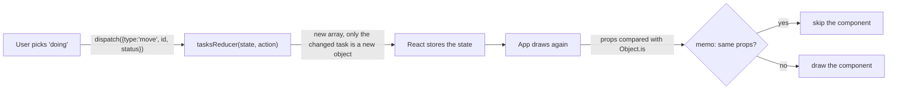

# 01. Hooks in depth: useReducer, useRef, useMemo and useCallback

> **Draft: written but not yet run.** The code and the expected output in this lesson were prepared by reading the code and the official documentation. They have not been executed yet. If something does not behave as described, trust your tool's real output and report it.

## What you will be able to do
- model related state changes with `useReducer` and a typed, exhaustive reducer;
- use `useRef` for a DOM element and for a value that must not cause a redraw;
- explain when `useMemo`, `useCallback` and `memo` help and when they only add noise;
- read the console to see which components redraw, and fix an unnecessary redraw.

## Recap
1. What does a custom hook share between two components? <details><summary>Answer</summary>Logic, never data; each call has its own state.</details>
2. Why do we write `setItems([...items, x])` and not `items.push(x)`? <details><summary>Answer</summary>State must be replaced by a new value so React notices the change.</details>
3. What is a derived value? <details><summary>Answer</summary>A value calculated from props and state during the draw instead of stored.</details>

## Why it matters
Level 101 gave you the tools for small apps. Real apps have state with rules ("a task can only move to a known status"), forms that need focus, and lists where one change must not redraw everything. These four hooks are the next layer. The capstone `web-react` uses `useRef` (guards in sign-in), `useMemo`-style stable objects and callbacks only where a measured problem exists; this lesson teaches you to tell the difference.

## What you will build
A tiny board in a new project `hooks-lab`: add, move and remove tasks through one reducer, with a summary line, and a console that shows exactly which rows redraw when you type in an unrelated field.

## Before you start
- Time: 70 minutes. New project folder `code101/hooks-lab`. Node 26.13.1 and npm 11.20.0 (see [101 lesson 01](../../101-zero-to-hero/phase-1-first-app/01-install-node-and-run-a-vite-app.md)).
- Level 201 uses the **capstone's** stricter TypeScript settings (`noUncheckedIndexedAccess` is on): reading `array[0]` gives `T | undefined`.
- Source pack (optional): every file is shown in full in this lesson, so you can follow without it. The finished code, the exercise starter and the solution are in the
  course repository https://github.com/Uee03/Code101 under `source/react/201-hero-to-super-hero/phase-1-hooks-and-state/01-hooks-in-depth/` (on that page choose **Code, Download ZIP**, or run
  `git clone https://github.com/Uee03/Code101.git`).
- No `package-lock.json` is shipped: `npm install` creates it.

## Steps

### Step 1. The project files
Create the folder `hooks-lab`, open it in VS Code and create these files exactly (they follow the capstone). In the 101 track you met most of the settings; the differences are `noUncheckedIndexedAccess` and `allowImportingTsExtensions`.

**File: `package.json`**
```json
{
  "name": "hooks-lab",
  "private": true,
  "version": "1.0.0",
  "type": "module",
  "scripts": {
    "dev": "vite",
    "build": "tsc -b && vite build",
    "preview": "vite preview"
  },
  "dependencies": {
    "react": "19.3.1",
    "react-dom": "19.3.1"
  },
  "devDependencies": {
    "@types/node": "26.6.6",
    "@types/react": "19.3.0",
    "@types/react-dom": "19.3.0",
    "@vitejs/plugin-react": "6.3.0",
    "typescript": "5.9.3",
    "vite": "8.3.8"
  }
}
```

**File: `vite.config.ts`**
```typescript
import { defineConfig } from 'vite';
import react from '@vitejs/plugin-react';

export default defineConfig({
  plugins: [react()],
  server: { host: 'localhost', port: 5173, strictPort: true },
});
```

**File: `tsconfig.json`**
```json
{
  "files": [],
  "references": [
    { "path": "./tsconfig.app.json" },
    { "path": "./tsconfig.node.json" }
  ]
}
```

**File: `tsconfig.app.json`**
```json
{
  "compilerOptions": {
    "target": "ES2022",
    "lib": ["ES2022", "DOM", "DOM.Iterable"],
    "module": "ESNext",
    "moduleResolution": "Bundler",
    "allowImportingTsExtensions": true,
    "resolveJsonModule": true,
    "isolatedModules": true,
    "verbatimModuleSyntax": true,
    "noEmit": true,
    "strict": true,
    "noUncheckedIndexedAccess": true,
    "skipLibCheck": true,
    "jsx": "react-jsx",
    "types": ["vite/client"],
    "tsBuildInfoFile": "./node_modules/.tmp/tsconfig.app.tsbuildinfo"
  },
  "include": ["src"]
}
```

**File: `tsconfig.node.json`**
```json
{
  "compilerOptions": {
    "target": "ES2022",
    "lib": ["ES2022", "DOM", "DOM.Iterable"],
    "module": "ESNext",
    "moduleResolution": "Bundler",
    "allowImportingTsExtensions": true,
    "resolveJsonModule": true,
    "isolatedModules": true,
    "verbatimModuleSyntax": true,
    "noEmit": true,
    "strict": true,
    "noUncheckedIndexedAccess": true,
    "skipLibCheck": true,
    "types": ["node", "vite/client"],
    "tsBuildInfoFile": "./node_modules/.tmp/tsconfig.node.tsbuildinfo"
  },
  "include": ["vite.config.ts"]
}
```

**File: `index.html`**
```html
<!doctype html>
<html lang="en">
  <head>
    <meta charset="UTF-8" />
    <meta name="viewport" content="width=device-width, initial-scale=1.0" />
    <title>Hooks lab</title>
  </head>
  <body>
    <div id="root"></div>
    <script type="module" src="/src/main.tsx"></script>
  </body>
</html>
```

**File: `.gitignore`**
```text
node_modules
dist
.env
*.log
src/api/schema.d.ts
*.tsbuildinfo
```
(`src/api/schema.d.ts` is a generated file that lessons 04 to 10 create; ignoring it now keeps the file identical in every lesson.)

**File: `src/main.tsx`**
```tsx
import { StrictMode } from 'react';
import { createRoot } from 'react-dom/client';
import App from './App';
import './styles.css';

createRoot(document.getElementById('root')!).render(
  <StrictMode>
    <App />
  </StrictMode>,
);
```

**File: `src/styles.css`**
```css
:root {
  color-scheme: light dark;
  font-family: system-ui, sans-serif;
}

main {
  max-width: 40rem;
  margin: 0 auto;
  padding: 1rem;
}

li {
  margin: 0.5rem 0;
}

input,
select,
button {
  font: inherit;
  padding: 0.3rem 0.5rem;
}

:focus-visible {
  outline: 3px solid #0759aa;
  outline-offset: 2px;
}
```
Then in the terminal (prompt ends in `hooks-lab`): `npm install`. Expected result: npm prints a summary; `node_modules` and `package-lock.json` appear.

### Step 2. The model and the reducer
A **reducer** is a pure function `(state, action) => newState`. `useReducer` keeps the state and gives you `dispatch(action)`. An **action** is a small object that says what happened. Using a discriminated union for actions lets TypeScript check that every kind is handled.

**File: `src/tasks.ts`**
```typescript
export type Status = 'todo' | 'doing' | 'done';

export type Task = {
  id: number;
  title: string;
  status: Status;
};

export type Action =
  | { type: 'add'; title: string }
  | { type: 'move'; id: number; status: Status }
  | { type: 'remove'; id: number };

export const statuses: Status[] = ['todo', 'doing', 'done'];

export const initialTasks: Task[] = [
  { id: 1, title: 'Write the plan', status: 'done' },
  { id: 2, title: 'Build the board', status: 'doing' },
  { id: 3, title: 'Review the code', status: 'todo' },
  { id: 4, title: 'Ship it', status: 'todo' },
];

export function isStatus(value: string): value is Status {
  return (statuses as string[]).includes(value);
}

function assertNever(value: never): never {
  throw new Error(`Unhandled action: ${JSON.stringify(value)}`);
}

export function tasksReducer(state: Task[], action: Action): Task[] {
  switch (action.type) {
    case 'add': {
      const id = Math.max(0, ...state.map((task) => task.id)) + 1;
      return [...state, { id, title: action.title, status: 'todo' }];
    }
    case 'move':
      return state.map((task) => (task.id === action.id ? { ...task, status: action.status } : task));
    case 'remove':
      return state.filter((task) => task.id !== action.id);
    default:
      return assertNever(action);
  }
}

export function countByStatus(tasks: Task[]): Record<Status, number> {
  const counts: Record<Status, number> = { todo: 0, doing: 0, done: 0 };
  for (const task of tasks) {
    counts[task.status] += 1;
  }
  return counts;
}
```
Things to notice: `isStatus` is a **type guard** (`value is Status`): after `if (isStatus(x))` TypeScript knows `x` is a `Status`, which replaces an unsafe `as Status` cast. `assertNever(action)` only compiles when every case is handled; if you add a fourth action kind and forget it, TypeScript reports that `action` is not assignable to `never`.

### Step 3. A form that returns focus (useRef for the DOM)
**File: `src/components/AddTask.tsx`**
```tsx
import { useRef, useState, type FormEvent } from 'react';

type AddTaskProps = {
  onAdd: (title: string) => void;
};

export default function AddTask({ onAdd }: AddTaskProps) {
  const [title, setTitle] = useState('');
  const inputRef = useRef<HTMLInputElement>(null);

  function handleSubmit(event: FormEvent<HTMLFormElement>) {
    event.preventDefault();
    const trimmed = title.trim();
    if (trimmed !== '') {
      onAdd(trimmed);
      setTitle('');
    }
    inputRef.current?.focus();
  }

  return (
    <form onSubmit={handleSubmit}>
      <label>
        New task <input ref={inputRef} value={title} onChange={(event) => setTitle(event.target.value)} />
      </label>{' '}
      <button type="submit">Add</button>
    </form>
  );
}
```

### Step 4. Two components that report their redraws
`memo(Component)` tells React: "skip drawing this component again if its props are the same as last time". Props are compared one by one with `Object.is` (same value, or same object **reference**). The `console.log` lines are the instrument; remove them when you are done experimenting.

**File: `src/components/TaskRow.tsx`**
```tsx
import { memo } from 'react';
import { isStatus, statuses, type Status, type Task } from '../tasks';

type TaskRowProps = {
  task: Task;
  onMove: (id: number, status: Status) => void;
  onRemove: (id: number) => void;
};

const TaskRow = memo(function TaskRow({ task, onMove, onRemove }: TaskRowProps) {
  console.log('render TaskRow', task.id);
  return (
    <li>
      {task.title} <small>({task.status})</small>{' '}
      <select
        aria-label={`Move ${task.title}`}
        value={task.status}
        onChange={(event) => {
          const next = event.target.value;
          if (isStatus(next)) {
            onMove(task.id, next);
          }
        }}
      >
        {statuses.map((status) => (
          <option key={status} value={status}>
            {status}
          </option>
        ))}
      </select>{' '}
      <button type="button" onClick={() => onRemove(task.id)}>
        Remove
      </button>
    </li>
  );
});

export default TaskRow;
```

**File: `src/components/Summary.tsx`**
```tsx
import { memo } from 'react';
import type { Status } from '../tasks';

type SummaryProps = {
  counts: Record<Status, number>;
};

const Summary = memo(function Summary({ counts }: SummaryProps) {
  console.log('render Summary');
  return (
    <p role="status">
      {counts.todo} to do, {counts.doing} doing, {counts.done} done
    </p>
  );
});

export default Summary;
```

### Step 5. Wire it together
**File: `src/App.tsx`**
```tsx
import { useCallback, useMemo, useReducer, useState } from 'react';
import AddTask from './components/AddTask';
import Summary from './components/Summary';
import TaskRow from './components/TaskRow';
import { countByStatus, initialTasks, tasksReducer, type Status } from './tasks';

export default function App() {
  const [tasks, dispatch] = useReducer(tasksReducer, initialTasks);
  const [note, setNote] = useState('');

  const counts = useMemo(() => countByStatus(tasks), [tasks]);
  const handleAdd = useCallback((title: string) => dispatch({ type: 'add', title }), []);
  const handleMove = useCallback((id: number, status: Status) => dispatch({ type: 'move', id, status }), []);
  const handleRemove = useCallback((id: number) => dispatch({ type: 'remove', id }), []);

  return (
    <main>
      <h1>Hooks lab</h1>
      <AddTask onAdd={handleAdd} />
      <Summary counts={counts} />
      <ul>
        {tasks.map((task) => (
          <TaskRow key={task.id} task={task} onMove={handleMove} onRemove={handleRemove} />
        ))}
      </ul>
      <label>
        Scratch note (unrelated to the tasks) <input value={note} onChange={(event) => setNote(event.target.value)} />
      </label>
    </main>
  );
}
```

## Run it
**Folder: `hooks-lab`**
```powershell
npm run dev
```
Open `http://localhost:5173/` and open the browser console (F12, **Console**). Do each experiment and compare. (In development `StrictMode` may run each render twice, so you can see every line doubled; compare *which* lines appear, not how many times.)
1. Page load. Expected: `render Summary` and `render TaskRow 1` to `render TaskRow 4`. The summary reads "2 to do, 1 doing, 1 done".
2. Type letters in "Scratch note". Expected: **no new console lines**. `App` redraws on every keystroke, but `Summary` and every `TaskRow` get identical props, so `memo` skips them.
3. Add a task "Test it". Expected: new lines `render Summary` and `render TaskRow 5` only. The four old rows are not drawn again: their `task` objects are the same references, and the handlers are stable.
4. Change "Review the code" to `doing`. Expected: `render Summary` and `render TaskRow 3`.
5. Click Remove on a task. Expected: `render Summary` only (the other rows keep their props).

## How it works

- **`useReducer`** puts all state transitions in one pure function that you can read in one place and test without React. Use it when state has several fields that change together, or when the next state depends on the kind of event (a rule); use `useState` for independent single values (`note`, `title`).
- **`dispatch` has a stable identity** (the same function for the life of the component), which is why `useCallback(..., [])` is correct here: the callbacks read no changing values.
- **`useRef`** returns `{ current }`, one object kept between draws. Changing `current` does **not** cause a redraw. Two good uses: pointing at a DOM element (`inputRef.current?.focus()`), and keeping a value that is not shown (a timer id, a "request already sent" flag, the previous value). Do not read or write `ref.current` while drawing (except to set it once on first use); do it in event handlers and effects.
- **`useMemo(fn, deps)`** remembers the result of `fn` until a value in `deps` changes. **`useCallback(fn, deps)`** is the same for a function (`useCallback(fn, deps)` is `useMemo(() => fn, deps)`).
- **Why memo needs both:** `memo` compares props by reference. Without `useMemo`, `countByStatus(tasks)` creates a new object on every draw, so `Summary` would redraw on every keystroke in the note field. Without `useCallback`, `handleMove` is a new function each time, so every `TaskRow` would redraw too. One missing piece cancels the effect.

### Why this, not that
| Question | Choose | Because |
|---|---|---|
| Two or three independent values | `useState` each | A reducer adds ceremony without any rule to enforce |
| One value with rules, or several fields that change together | `useReducer` | Transitions are named, testable and exhaustive |
| A value that must not redraw when changed | `useRef` | `current` is mutable and silent |
| A value derived from state | Calculate it while drawing | No state to keep in step |
| An expensive calculation (you measured it) | `useMemo` | Skips the work while inputs are the same |
| A child wrapped in `memo` receives an object or function | `useMemo` / `useCallback` in the parent | Keeps references stable so `memo` can skip |
| Everything "just in case" | Nothing | Each hook has a cost (comparisons, memory) and makes code harder to read; measure first with the React DevTools Profiler |

React also offers an optional build-time tool, the **React Compiler**, that adds this kind of memoization for you. This project does not use it, and the capstone adds `memo`, `useMemo` and `useCallback` only where it is needed.

**Common misconception:** "`useCallback` makes a function run faster." It does not. It only keeps the *same function object* between draws, which matters when something compares it (`memo`, a `useEffect` dependency array).

## Try it
Starter: `exercise/starter/src/App.tsx` (the same `App` without the three memo hooks, with two TODOs).
1. **Guided.** Copy the starter over `src/App.tsx` and repeat experiment 2 from Run it. Expected: every keystroke in the scratch note now prints `render Summary` and four `render TaskRow` lines. Then follow TODO 1 (`useMemo`) and look again: only the `TaskRow` lines remain. Follow TODO 2 (`useCallback`) and they disappear too.
2. **Change.** Add a fourth action `{ type: 'clearDone' }` that removes every done task, and a "Clear done" button. Before you add the `case`, save the file and read the TypeScript error from `assertNever`; that is exhaustiveness checking at work.
3. **Stretch (optional).** Use a `useRef` to remember the previous value of `tasks.length` and show "(one more than before)" when it grew. Decide whether the previous value should live in a ref or in state, and why.

<details><summary>Solution</summary>

**File: `exercise/solution/src/App.tsx`** (identical to the finished `App.tsx` of Step 5)
```tsx
import { useCallback, useMemo, useReducer, useState } from 'react';
import AddTask from './components/AddTask';
import Summary from './components/Summary';
import TaskRow from './components/TaskRow';
import { countByStatus, initialTasks, tasksReducer, type Status } from './tasks';

export default function App() {
  const [tasks, dispatch] = useReducer(tasksReducer, initialTasks);
  const [note, setNote] = useState('');

  const counts = useMemo(() => countByStatus(tasks), [tasks]);
  const handleAdd = useCallback((title: string) => dispatch({ type: 'add', title }), []);
  const handleMove = useCallback((id: number, status: Status) => dispatch({ type: 'move', id, status }), []);
  const handleRemove = useCallback((id: number) => dispatch({ type: 'remove', id }), []);

  return (
    <main>
      <h1>Hooks lab</h1>
      <AddTask onAdd={handleAdd} />
      <Summary counts={counts} />
      <ul>
        {tasks.map((task) => (
          <TaskRow key={task.id} task={task} onMove={handleMove} onRemove={handleRemove} />
        ))}
      </ul>
      <label>
        Scratch note (unrelated to the tasks) <input value={note} onChange={(event) => setNote(event.target.value)} />
      </label>
    </main>
  );
}
```
For rung 2 add `| { type: 'clearDone' }` to `Action` and `case 'clearDone': return state.filter((task) => task.status !== 'done');` to the reducer.

</details>

## Check yourself
1. Why must a reducer be pure? <details><summary>Answer</summary>React may call it more than once and compares results; side effects or changing the old state would give wrong or duplicated results.</details>
2. `inputRef.current` is `null` on the first draw. Why, and where is it safe to read? <details><summary>Answer</summary>The element does not exist until React has attached it after drawing; read it in event handlers and effects.</details>
3. Predict: you remove `useCallback` from `handleRemove` only. After typing in the note, which lines appear? <details><summary>Answer</summary>Four <code>render TaskRow</code> lines, because <code>onRemove</code> is a new function each draw, so every row's props differ; <code>Summary</code> stays quiet.</details>
4. Find the bug: `const counts = useMemo(() => countByStatus(tasks), []);` <details><summary>Answer</summary>The dependency list is empty, so the counts never update when tasks change; list <code>tasks</code>.</details>

## Common mistakes
| Symptom or error text | Cause | Fix |
|---|---|---|
| `Argument of type '{ type: string; ... }' is not assignable to parameter of type 'Action'` (typical message) | The literal widened to `string`, or a field is missing | Dispatch an object that matches one union member exactly |
| `Type '{...}' is not assignable to type 'never'` in `assertNever` (typical message) | A new action kind has no `case` | Add the case |
| `Cannot read properties of null (reading 'focus')` | Ref read during the draw, or the element is not rendered | Use `inputRef.current?.focus()` in a handler |
| Rows redraw although `memo` is present | A prop changes identity each draw | Stabilise it with `useCallback` or `useMemo`, or compare in the Profiler |
| `React Hook "useMemo" is called conditionally` or the hooks-order error (typical message) | Hook after an early return | Call hooks first |
| Lines appear twice in the console | `StrictMode` runs renders twice in development | Compare relative differences; it does not happen in a production build |

## Best practice
Write the plain version first, measure with the React DevTools Profiler, and add `memo`, `useMemo` and `useCallback` only for a problem you can show. Source: React, `memo` https://react.dev/reference/react/memo and `useMemo` https://react.dev/reference/react/useMemo

## Going further
- `useReducer`: https://react.dev/reference/react/useReducer
- `useRef`: https://react.dev/reference/react/useRef
- The capstone uses stable callbacks around its token gate: [web-react chapter 2](../../../../capstones/web-react/tutorials/phase-2-auth/02-sign-in.md).

## Summary
- You modelled state changes with a typed reducer and checked it for completeness with `assertNever`.
- You used `useRef` for focus and explained refs as silent mutable boxes.
- You saw with console output which components redraw and fixed it with `memo`, `useMemo` and `useCallback`.

## Next lesson
02. TanStack Query: move server data out of your own state, with queries, mutations and cache invalidation.
