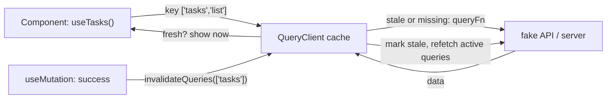

# 02. TanStack Query: queries, mutations and cache invalidation

> **Draft: written but not yet run.** The code and the expected output in this lesson were prepared by reading the code and the official documentation. They have not been executed yet. If something does not behave as described, trust your tool's real output and report it.

## What you will be able to do
- explain **server state** and why it does not belong in `useState`;
- write a query with a key factory and read `isPending`, `isError`, `isFetching` and `data`;
- write mutations that invalidate the cache after success;
- write an optimistic update that rolls back when the server refuses.

## Recap
1. In 101 lesson 09, what did `queryKey: ['books']` name? <details><summary>Answer</summary>The cache entry; components with the same key share the data.</details>
2. What is the difference between `status` and `isFetching`? <details><summary>Answer</summary><code>status</code> says whether data exists; <code>isFetching</code> says a request is in flight (also during a background refresh).</details>
3. In lesson 01, why did a missing `useCallback` make rows redraw? <details><summary>Answer</summary>The function prop changed identity, so `memo` could not skip.</details>

## Why it matters
Data on a server is a **copy you do not own**: it can change without you, it arrives late, it can fail. If you copy it into `useState` and keep it in step by hand, you rebuild caching, retries, de-duplication and refreshing badly, in every screen. TanStack Query owns that copy (the **cache**) so components only ask for it and say when it became wrong. The capstone `web-react` uses it for every screen; its decision record says so.

## What you will build
A project `query-lab` with an in-memory **fake API** (so no server is needed) and a board that loads tasks, adds a task, moves a task optimistically, removes a task, and shows what happens when the server refuses a move.

## Before you start
- Time: 75 minutes. New folder `code101/query-lab`. You know the files from lesson 01.
- Unchanged from lesson 01: `vite.config.ts`, `tsconfig.json`, `tsconfig.app.json`, `tsconfig.node.json`, `.gitignore`. Copy them from `hooks-lab`; their full text is in [lesson 01, Step 1](01-hooks-in-depth.md#step-1-the-project-files).
- Source pack (optional): every file is shown in full in this lesson, so you can follow without it. The finished code, the exercise starter and the solution are in the
  course repository https://github.com/Uee03/Code101 under `source/react/201-hero-to-super-hero/phase-1-hooks-and-state/02-tanstack-query/` (on that page choose **Code, Download ZIP**, or run
  `git clone https://github.com/Uee03/Code101.git`).

## Steps

### Step 1. package.json and index.html
Only the name, the title and one dependency differ from lesson 01.

**File: `package.json`**
```json
{
  "name": "query-lab",
  "private": true,
  "version": "1.0.0",
  "type": "module",
  "scripts": {
    "dev": "vite",
    "build": "tsc -b && vite build",
    "preview": "vite preview"
  },
  "dependencies": {
    "@tanstack/react-query": "5.108.3",
    "react": "19.3.1",
    "react-dom": "19.3.1"
  },
  "devDependencies": {
    "@types/node": "26.6.6",
    "@types/react": "19.3.0",
    "@types/react-dom": "19.3.0",
    "@vitejs/plugin-react": "6.3.0",
    "typescript": "5.9.3",
    "vite": "8.3.8"
  }
}
```

**File: `index.html`**
```html
<!doctype html>
<html lang="en">
  <head>
    <meta charset="UTF-8" />
    <meta name="viewport" content="width=device-width, initial-scale=1.0" />
    <title>Query lab</title>
  </head>
  <body>
    <div id="root"></div>
    <script type="module" src="/src/main.tsx"></script>
  </body>
</html>
```
Then run `npm install` in the project folder. Expected result: a summary line; `node_modules` and `package-lock.json` appear.

### Step 2. The model and a fake API
The fake API is plain TypeScript with a delay, so you can watch loading states. It lives in memory: reloading the page resets it. A task whose title contains `fail` cannot be moved; that lets you see a failed mutation.

**File: `src/tasks.ts`**
```typescript
export type Status = 'todo' | 'doing' | 'done';

export type Task = {
  id: number;
  title: string;
  status: Status;
};

export const statuses: Status[] = ['todo', 'doing', 'done'];

export function isStatus(value: string): value is Status {
  return (statuses as string[]).includes(value);
}
```

**File: `src/fake-api.ts`**
```typescript
import type { Status, Task } from './tasks';

let tasks: Task[] = [
  { id: 1, title: 'Write the plan', status: 'done' },
  { id: 2, title: 'Build the board', status: 'doing' },
  { id: 3, title: 'Review the code', status: 'todo' },
];
let nextId = 4;

function wait(milliseconds = 500): Promise<void> {
  return new Promise((resolve) => setTimeout(resolve, milliseconds));
}

export async function listTasks(): Promise<Task[]> {
  await wait();
  return tasks.map((task) => ({ ...task }));
}

export async function createTask(title: string): Promise<Task> {
  await wait();
  const task: Task = { id: nextId, title, status: 'todo' };
  nextId += 1;
  tasks = [...tasks, task];
  return { ...task };
}

export async function moveTask(id: number, status: Status): Promise<Task> {
  await wait();
  const current = tasks.find((task) => task.id === id);
  if (!current) {
    throw new Error('Task not found');
  }
  if (current.title.toLowerCase().includes('fail')) {
    throw new Error('The server refused this change');
  }
  const updated: Task = { ...current, status };
  tasks = tasks.map((task) => (task.id === id ? updated : task));
  return { ...updated };
}

export async function removeTask(id: number): Promise<void> {
  await wait();
  tasks = tasks.filter((task) => task.id !== id);
}
```
Each function returns **copies** (`{ ...task }`), like a real server would: the cache must never hold the same object as the "database".

### Step 3. Provide the client
**File: `src/main.tsx`**
```tsx
import { StrictMode } from 'react';
import { createRoot } from 'react-dom/client';
import { QueryClient, QueryClientProvider } from '@tanstack/react-query';
import App from './App';
import './styles.css';

const queryClient = new QueryClient({
  defaultOptions: {
    queries: { staleTime: 5_000, retry: 1 },
    mutations: { retry: false },
  },
});

createRoot(document.getElementById('root')!).render(
  <StrictMode>
    <QueryClientProvider client={queryClient}>
      <App />
    </QueryClientProvider>
  </StrictMode>,
);
```

### Step 4. The hooks: one file per feature
The capstone keeps `useQuery` and `useMutation` calls out of components, in `src/hooks/*.ts`. Components only call `useTasks()`.

**File: `src/hooks/tasks.ts`**
```typescript
import { useMutation, useQuery, useQueryClient } from '@tanstack/react-query';
import { createTask, listTasks, moveTask, removeTask } from '../fake-api';
import type { Status, Task } from '../tasks';

export const taskKeys = {
  all: ['tasks'] as const,
  list: () => [...taskKeys.all, 'list'] as const,
};

export function useTasks() {
  return useQuery({ queryKey: taskKeys.list(), queryFn: listTasks });
}

export function useCreateTask() {
  const client = useQueryClient();
  return useMutation({
    mutationFn: (title: string) => createTask(title),
    onSuccess: () => client.invalidateQueries({ queryKey: taskKeys.all }),
  });
}

export function useMoveTask() {
  const client = useQueryClient();
  return useMutation({
    mutationFn: ({ id, status }: { id: number; status: Status }) => moveTask(id, status),
    onMutate: async ({ id, status }) => {
      await client.cancelQueries({ queryKey: taskKeys.list() });
      const previous = client.getQueryData<Task[]>(taskKeys.list());
      client.setQueryData<Task[]>(taskKeys.list(), (old) =>
        old?.map((task) => (task.id === id ? { ...task, status } : task)),
      );
      return { previous };
    },
    onError: (_error, _variables, context) => {
      if (context?.previous) {
        client.setQueryData(taskKeys.list(), context.previous);
      }
    },
    onSettled: () => client.invalidateQueries({ queryKey: taskKeys.list() }),
  });
}

export function useRemoveTask() {
  const client = useQueryClient();
  return useMutation({
    mutationFn: (id: number) => removeTask(id),
    onSuccess: () => client.invalidateQueries({ queryKey: taskKeys.all }),
  });
}
```

### Step 5. The board component
**File: `src/components/Board.tsx`**
```tsx
import { useState, type FormEvent } from 'react';
import { useCreateTask, useMoveTask, useRemoveTask, useTasks } from '../hooks/tasks';
import { isStatus, statuses } from '../tasks';

export default function Board() {
  const tasks = useTasks();
  const create = useCreateTask();
  const move = useMoveTask();
  const remove = useRemoveTask();
  const [title, setTitle] = useState('');

  function handleSubmit(event: FormEvent<HTMLFormElement>) {
    event.preventDefault();
    const trimmed = title.trim();
    if (trimmed === '') {
      return;
    }
    create.mutate(trimmed, { onSuccess: () => setTitle('') });
  }

  if (tasks.isPending) {
    return <p role="status">Loading tasks...</p>;
  }
  if (tasks.isError) {
    return (
      <div role="alert">
        <p>{tasks.error.message}</p>
        <button type="button" onClick={() => void tasks.refetch()}>
          Try again
        </button>
      </div>
    );
  }

  return (
    <>
      <form onSubmit={handleSubmit}>
        <label>
          New task <input value={title} onChange={(event) => setTitle(event.target.value)} />
        </label>{' '}
        <button type="submit" disabled={create.isPending}>
          {create.isPending ? 'Saving...' : 'Add'}
        </button>
      </form>
      {move.isError && <p role="alert">Could not move the task: {move.error.message}. The board went back.</p>}
      <p>{tasks.isFetching ? 'Updating...' : 'Up to date'}</p>
      <div className="board">
        {statuses.map((status) => (
          <section key={status}>
            <h2>{status}</h2>
            <ul>
              {tasks.data
                .filter((task) => task.status === status)
                .map((task) => (
                  <li key={task.id}>
                    {task.title}
                    <br />
                    <select
                      aria-label={`Move ${task.title}`}
                      value={task.status}
                      onChange={(event) => {
                        const next = event.target.value;
                        if (isStatus(next)) {
                          move.mutate({ id: task.id, status: next });
                        }
                      }}
                    >
                      {statuses.map((value) => (
                        <option key={value} value={value}>
                          {value}
                        </option>
                      ))}
                    </select>{' '}
                    <button type="button" onClick={() => remove.mutate(task.id)}>
                      Remove
                    </button>
                  </li>
                ))}
            </ul>
          </section>
        ))}
      </div>
    </>
  );
}
```

**File: `src/App.tsx`**
```tsx
import Board from './components/Board';

export default function App() {
  return (
    <main>
      <h1>Query lab</h1>
      <p>
        A task whose title contains the word &quot;fail&quot; cannot be moved: the fake server refuses, and the board rolls back.
      </p>
      <Board />
    </main>
  );
}
```

**File: `src/styles.css`**
```css
:root {
  color-scheme: light dark;
  font-family: system-ui, sans-serif;
}

main {
  max-width: 56rem;
  margin: 0 auto;
  padding: 1rem;
}

.board {
  display: grid;
  grid-template-columns: repeat(auto-fit, minmax(14rem, 1fr));
  gap: 1rem;
}

.board section {
  border: 1px solid #66788a;
  border-radius: 0.5rem;
  padding: 0.5rem 1rem;
}

.board ul {
  list-style: none;
  padding: 0;
}

li {
  margin: 0.75rem 0;
}

input,
select,
button {
  font: inherit;
  padding: 0.3rem 0.5rem;
}

:focus-visible {
  outline: 3px solid #0759aa;
  outline-offset: 2px;
}
```

## Run it
**Folder: `query-lab`**
```powershell
npm run dev
```
Open `http://localhost:5173/`. Expected, step by step:
1. "Loading tasks..." for about half a second, then the three columns `todo`, `doing`, `done` with one card each, and "Up to date".
2. Type `Test it` and press Add. Expected: the button says "Saving..." for about half a second, then the card appears in `todo`; while the list refreshes you may briefly see "Updating..." (the invalidation made a refetch, and the fake API answered again after 500 ms).
3. Change "Review the code" to `doing`. Expected: the card jumps at once (the optimistic update), then stays after the server confirms.
4. Add a task named `will fail`, then move it to `done`. Expected: the card jumps to `done`, about half a second later it jumps back to `todo` and the message "Could not move the task: The server refused this change. The board went back." appears.
5. Remove a card. Expected: after about half a second it disappears.

## How it works

- **Query key = the cache address.** `['tasks', 'list']` is built by a **key factory** (`taskKeys`) so every file spells it the same way. Keys are arrays; invalidating `['tasks']` matches every key that *starts with* it (prefix match). Put everything the query depends on into the key (a filter, an id); when it changes, Query fetches the new entry.
- **Fresh and stale:** after `queryFn` finishes, the data is *fresh* for `staleTime` (5 seconds here; the default is 0, meaning stale immediately). Stale data is still shown instantly; Query refetches in the background when a component mounts, when the window regains focus or the network returns. `gcTime` (default 5 minutes) is how long unused data stays in the cache.
- **`isPending`** means "no data yet"; **`isFetching`** means "a request is running now"; both can be true on first load; only `isFetching` is true on a background refresh.
- **Mutations** change server data. `mutate(variables, options)` fires and forgets; `mutateAsync` returns a promise (the capstone uses it where it must wait). `isPending` on the mutation drives the "Saving..." text.
- **Invalidation** (`invalidateQueries`) marks matching queries stale and refetches those that are on screen. It is the safe default after a write: the next read comes from the server, which is the authority. Returning the promise from `onSuccess` makes the mutation stay "pending" until the refetch finishes.
- **Optimistic update** (move): `onMutate` runs before the request: (1) `cancelQueries` stops a refetch that could overwrite your guess, (2) `getQueryData` takes a **snapshot**, (3) `setQueryData` writes the expected result, (4) the snapshot is returned as `context`. `onError` receives that context and puts the snapshot back (**rollback**). `onSettled` runs after success or failure and invalidates, so the board ends up equal to the server either way. This is the pattern from the TanStack Query guide and the same one the capstone uses for task edits (it adds the `ETag`, chapter 4).

### Why this, not that
| Option | Good for | Cost |
|---|---|---|
| `useEffect` + `useState` | One tiny request on one screen | You rebuild caching, retries, cancellation, de-duplication, refetch on focus, and race-condition guards |
| TanStack Query | Any REST data in a real app | A new vocabulary (keys, stale, invalidation); version pinned |
| SWR | Similar to Query, smaller | Fewer built-in mutation helpers |
| Redux Toolkit Query | Apps already on Redux | Needs the Redux store |
| Optimistic update | Actions that nearly always succeed and where a delay feels broken | You must write rollback; use plain invalidation for rare, risky actions |

**Common misconception:** "invalidate means delete." It does not remove data; it marks it stale so it is refetched, and the old data stays visible until the new data arrives.

## Try it
Starter: `exercise/starter/src/hooks/tasks.ts`.
1. **Guided.** `useRemoveTask` in the starter has no invalidation. Run the app, press Remove and notice what happens (the card stays until the next refetch, for example when you refocus the window after 5 seconds). Then follow the TODO and repeat. Expected: the card disappears about half a second after the click.
2. **Change.** Make removal optimistic too: apply the same four steps as `useMoveTask` (`cancelQueries`, snapshot, `setQueryData` with `filter`, rollback). Test it with a failing server by temporarily making `removeTask` throw.
3. **Stretch (optional).** Compare: should Add also be optimistic? Write two sentences on what you would show in the new card before the server has given it an id.

<details><summary>Solution</summary>

**File: `exercise/solution/src/hooks/tasks.ts`**
```typescript
import { useMutation, useQuery, useQueryClient } from '@tanstack/react-query';
import { createTask, listTasks, moveTask, removeTask } from '../fake-api';
import type { Status, Task } from '../tasks';

export const taskKeys = {
  all: ['tasks'] as const,
  list: () => [...taskKeys.all, 'list'] as const,
};

export function useTasks() {
  return useQuery({ queryKey: taskKeys.list(), queryFn: listTasks });
}

export function useCreateTask() {
  const client = useQueryClient();
  return useMutation({
    mutationFn: (title: string) => createTask(title),
    onSuccess: () => client.invalidateQueries({ queryKey: taskKeys.all }),
  });
}

export function useMoveTask() {
  const client = useQueryClient();
  return useMutation({
    mutationFn: ({ id, status }: { id: number; status: Status }) => moveTask(id, status),
    onMutate: async ({ id, status }) => {
      await client.cancelQueries({ queryKey: taskKeys.list() });
      const previous = client.getQueryData<Task[]>(taskKeys.list());
      client.setQueryData<Task[]>(taskKeys.list(), (old) =>
        old?.map((task) => (task.id === id ? { ...task, status } : task)),
      );
      return { previous };
    },
    onError: (_error, _variables, context) => {
      if (context?.previous) {
        client.setQueryData(taskKeys.list(), context.previous);
      }
    },
    onSettled: () => client.invalidateQueries({ queryKey: taskKeys.list() }),
  });
}

export function useRemoveTask() {
  const client = useQueryClient();
  return useMutation({
    mutationFn: (id: number) => removeTask(id),
    onSuccess: () => client.invalidateQueries({ queryKey: taskKeys.all }),
  });
}
```

</details>

## Check yourself
1. What does `invalidateQueries({ queryKey: ['tasks'] })` match? <details><summary>Answer</summary>Every query whose key starts with <code>['tasks']</code>, including <code>['tasks','list']</code>.</details>
2. Why does `onMutate` call `cancelQueries` first? <details><summary>Answer</summary>A refetch that finishes after your optimistic write would overwrite it with older server data.</details>
3. Predict: `staleTime` is 5 seconds. You leave the tab and return after 2 seconds. Does a refetch happen? <details><summary>Answer</summary>No, the data is still fresh; after 5 seconds it would refetch on focus.</details>
4. Find the bug: a mutation's `onSuccess` calls `invalidateQueries({ queryKey: ['task'] })` but the list key is `['tasks','list']`. <details><summary>Answer</summary>The keys do not share a prefix (<code>'task'</code> vs <code>'tasks'</code>), so nothing is invalidated; use the key factory so keys cannot drift.</details>

## Common mistakes
| Symptom or error text | Cause | Fix |
|---|---|---|
| `No QueryClient set, use QueryClientProvider to set one` (typical message) | Hook used outside the provider | Wrap the tree in `main.tsx` |
| List does not update after a write | Missing `invalidateQueries`, or the key does not match | Use the key factory and invalidate the prefix |
| Board flickers back after an optimistic move | `cancelQueries` missing | Cancel in `onMutate` |
| `Property 'data' does not exist on type ...` (typical message) | Reading `data` before narrowing | Check `isPending` and `isError` first, or use `data?.` |
| Two requests on first load in development | `StrictMode` mounts twice | Expected; Query de-duplicates and the production build does not repeat |
| TypeScript error: `queryFn` returns `void` (typical message) | `queryFn` forgot to return | Return the promise |

## Best practice
After a write, invalidate; add an optimistic update only for actions where waiting would feel broken, and always write the rollback. Source: TanStack Query, Optimistic Updates https://tanstack.com/query/latest/docs/framework/react/guides/optimistic-updates

## Going further
- Query keys: https://tanstack.com/query/latest/docs/framework/react/guides/query-keys
- Invalidations from mutations: https://tanstack.com/query/latest/docs/framework/react/guides/invalidations-from-mutations
- Used for real in [web-react chapter 3](../../../../capstones/web-react/tutorials/phase-3-screens/03-screens-and-state.md) and [chapter 4](../../../../capstones/web-react/tutorials/phase-4-errors/04-errors-and-accessibility.md).

## Summary
- You separated server state (Query's cache) from UI state.
- You wrote a query, three mutations and a key factory.
- You wrote an optimistic update with snapshot and rollback and watched it fail safely.

## Next lesson
03. State management options: context versus Zustand, and where each kind of state should live.
