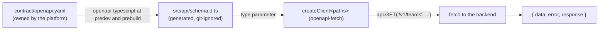

# 04. A typed API client: openapi-typescript and openapi-fetch

> **Draft: written but not yet run.** The code and the expected output in this lesson were prepared by reading the code and the official documentation. They have not been executed yet. If something does not behave as described, trust your tool's real output and report it.

## What you will be able to do
- explain what an **OpenAPI contract** is and why the client is generated from it;
- generate `schema.d.ts` with `openapi-typescript` and call the API through `openapi-fetch`;
- read the `{ data, error, response }` result and say what the type checker now catches;
- name three limits of generated types.

## Recap
1. In lesson 02, why did the key factory matter? <details><summary>Answer</summary>Every file spells the key the same way, so invalidation always matches.</details>
2. What does `fetch` do for a 404? <details><summary>Answer</summary>It resolves with `ok === false`; only network failures reject.</details>

## Why it matters
A hand-written `fetch('/v1/teams?limt=5')` compiles, runs, and quietly returns the wrong thing. If the API describes itself in a machine-readable contract, tools can turn that description into types, and the compiler becomes the first tester of every call: the path, the method, the query parameters, the body and the response are checked before you run anything. The platform of this course publishes exactly one such contract, `openapi.yaml`, that all four backends implement and both web clients consume.

## What you will build
A project `typed-client` that generates `src/api/schema.d.ts` from the platform contract, creates one typed client, shows the API health through a Query hook and makes one typed call to `listTeams` that needs sign-in (it will answer 401 until lesson 06).

## Before you start
- Time: 75 minutes. New folder `code101/typed-client`.
- Prerequisite reading: the platform contract chapter (`capstones/platform`, chapter 1) explains the contract. You only need to know it is one YAML file.
- A running backend on `http://localhost:8000` makes the health call succeed; without it you will see the "not reachable" message, which is also a result worth seeing. Start the platform and one backend with the capstone's [Start here](../../../../capstones/web-react/README.md) instructions when you are ready.
- Unchanged from lesson 01: `vite.config.ts`, `tsconfig.json`, `tsconfig.app.json`, `tsconfig.node.json`, `.gitignore` (see [lesson 01](../phase-1-hooks-and-state/01-hooks-in-depth.md#step-1-the-project-files)). `src/main.tsx` and `src/styles.css` are shown below.
- Source pack (optional): every file is shown in full in this lesson (except the generated and copied ones named below), so you can follow without it. The finished code, the exercise starter and the solution are in the
  course repository https://github.com/Uee03/Code101 under `source/react/201-hero-to-super-hero/phase-2-http-and-auth/04-typed-api-client/` (on that page choose **Code, Download ZIP**, or run
  `git clone https://github.com/Uee03/Code101.git`).

## Steps

### Step 1. Why TypeScript 5.9.3 here
Web 101 used TypeScript 7.0.2. This project pins **5.9.3** because `openapi-typescript` 7.13.0 declares the peer range `typescript ^5.x`; the newest compiler is outside what the generator supports. The language you learned is the same; only the version in `package.json` differs.

### Step 2. package.json and index.html
The new pieces: `openapi-fetch` (6 kB runtime client), `openapi-typescript` (a development tool that writes types) and three scripts. npm runs `predev` before `dev` and `prebuild` before `build` automatically, so the types are always fresh.

**File: `package.json`**
```json
{
  "name": "typed-client",
  "private": true,
  "version": "1.0.0",
  "type": "module",
  "scripts": {
    "api:gen": "openapi-typescript contract/openapi.yaml -o src/api/schema.d.ts",
    "predev": "npm run api:gen",
    "dev": "vite",
    "prebuild": "npm run api:gen",
    "build": "tsc -b && vite build",
    "preview": "vite preview"
  },
  "dependencies": {
    "@tanstack/react-query": "5.108.3",
    "openapi-fetch": "0.17.0",
    "react": "19.3.1",
    "react-dom": "19.3.1"
  },
  "devDependencies": {
    "@types/node": "26.6.6",
    "@types/react": "19.3.0",
    "@types/react-dom": "19.3.0",
    "@vitejs/plugin-react": "6.3.0",
    "openapi-typescript": "7.13.0",
    "typescript": "5.9.3",
    "vite": "8.3.8"
  }
}
```

**File: `index.html`**
```html
<!doctype html>
<html lang="en">
  <head>
    <meta charset="UTF-8" />
    <meta name="viewport" content="width=device-width, initial-scale=1.0" />
    <title>Typed client</title>
  </head>
  <body>
    <div id="root"></div>
    <script type="module" src="/src/main.tsx"></script>
  </body>
</html>
```

### Step 3. Copy the contract (never edit it)
Make the folder `contract` and copy the platform's contract into it as `contract/openapi.yaml`. In the course repository the file is `capstones/platform/source/phase-1-contract/01-openapi-contract/code/openapi.yaml`. It is about 1,500 lines, so it is not repeated here; it is a **verbatim copy**: the contract belongs to the platform and clients never change it. Expected result: `contract/openapi.yaml` exists and starts with the line `openapi: 3.1.1`.

Then run `npm install` and `npm run api:gen`:

**Folder: `typed-client`**
```powershell
npm install
npm run api:gen
```
Typical result: `api:gen` prints a line naming the input and the output file with a time in milliseconds (the exact text varies), and a new file `src/api/schema.d.ts` appears. The file is **generated**: do not edit it and do not commit it (`.gitignore` already lists it). Its shape is, abbreviated and typical:
```typescript
export interface paths {
    "/health": {
        get: operations["getHealth"];
        // ... put, post, delete, patch set to never
    };
    "/v1/teams": {
        get: operations["listTeams"];
        post: operations["createTeam"];
    };
    // ... every other path of the contract
}
export interface components { schemas: { Team: { /* ... */ }; /* ... */ } }
export interface operations { getHealth: { /* ... */ }; listTeams: { /* ... */ }; /* ... */ }
```
So `paths` maps each address and method to its operation, and `components['schemas']` holds the models.

### Step 4. Configuration and the client
Only `src/config.ts` reads `import.meta.env` (Vite's way to expose `VITE_` variables). Variables with the `VITE_` prefix are copied into the browser bundle, so they are **public**: never put a secret in one.

**File: `src/config.ts`**
```typescript
const env = import.meta.env ?? {};

export const config = {
  apiBaseUrl: env.VITE_API_BASE_URL ?? 'http://localhost:8000',
};
```

**File: `src/api/client.ts`**
```typescript
import createClient from 'openapi-fetch';
import type { paths } from './schema';
import { config } from '../config';

export const makeClient = (baseUrl: string, transport: typeof fetch = fetch) =>
  createClient<paths>({ baseUrl, fetch: transport });

export const api = makeClient(config.apiBaseUrl);
```
`createClient<paths>` ties the client to the generated types. The `transport` parameter lets later lessons give the client a different `fetch` (lesson 05: canned responses; lesson 06: one that adds the bearer token) without changing any caller.

**File: `src/api/types.ts`**
```typescript
import type { components } from './schema';

export type Schemas = components['schemas'];
export type Health = Schemas['Health'];
export type Team = Schemas['Team'];
export type Task = Schemas['Task'];
```
Entity types come from the schema; there are no hand-written copies that could drift from the contract.

### Step 5. A health hook and two components
For a non-2xx answer `openapi-fetch` puts the body in `error`, typed as the union of the documented error bodies. `/health` documents a `503` body of the same `Health` type, so `data ?? error` is a `Health` either way.

**File: `src/hooks/health.ts`**
```typescript
import { useQuery } from '@tanstack/react-query';
import { api } from '../api/client';
import type { Health } from '../api/types';

export function useHealth() {
  return useQuery({
    queryKey: ['health'],
    queryFn: async ({ signal }): Promise<Health> => {
      const { data, error, response } = await api.GET('/health', { signal });
      const body = data ?? error;
      if (!body) {
        throw new Error(`The health check failed (${response.status})`);
      }
      return body;
    },
    retry: false,
  });
}
```

**File: `src/components/ApiStatus.tsx`**
```tsx
import { useHealth } from '../hooks/health';

export default function ApiStatus() {
  const health = useHealth();
  if (health.isPending) {
    return <p role="status">Checking the API...</p>;
  }
  if (health.isError) {
    return (
      <p role="alert">
        The API is not reachable. Is a backend running on port 8000? ({health.error.message})
      </p>
    );
  }
  return (
    <p role="status">
      API status: {health.data.status}
      {health.data.version ? `, version ${health.data.version}` : ''}
      {health.data.database ? `, database ${health.data.database}` : ''}
    </p>
  );
}
```

**File: `src/components/TeamsProbe.tsx`**
```tsx
import { useState } from 'react';
import { api } from '../api/client';

export default function TeamsProbe() {
  const [message, setMessage] = useState('Not called yet.');

  async function load() {
    setMessage('Calling...');
    try {
      const { data, error, response } = await api.GET('/v1/teams', {
        params: { query: { limit: 5, sort: '-createdAt' } },
      });
      if (data) {
        setMessage(`The API returned ${data.items.length} teams.`);
      } else {
        setMessage(`The API answered ${response.status}: ${error?.title ?? 'no details'}`);
      }
    } catch {
      setMessage('The API is not reachable. Is a backend running on port 8000?');
    }
  }

  return (
    <section>
      <h2>Typed call to listTeams</h2>
      <p>This call needs a signed-in user. Without a token the API answers 401; signing in comes in lesson 06.</p>
      <button type="button" onClick={() => void load()}>
        Call GET /v1/teams
      </button>
      <p role="status">{message}</p>
    </section>
  );
}
```

### Step 6. Assemble the app
**File: `src/App.tsx`**
```tsx
import ApiStatus from './components/ApiStatus';
import TeamsProbe from './components/TeamsProbe';

export default function App() {
  return (
    <main>
      <h1>Typed client</h1>
      <ApiStatus />
      <TeamsProbe />
    </main>
  );
}
```

**File: `src/main.tsx`**
```tsx
import { StrictMode } from 'react';
import { createRoot } from 'react-dom/client';
import { QueryClient, QueryClientProvider } from '@tanstack/react-query';
import App from './App';
import './styles.css';

const queryClient = new QueryClient();

createRoot(document.getElementById('root')!).render(
  <StrictMode>
    <QueryClientProvider client={queryClient}>
      <App />
    </QueryClientProvider>
  </StrictMode>,
);
```

**File: `src/styles.css`**
```css
:root {
  color-scheme: light dark;
  font-family: system-ui, sans-serif;
}

main {
  max-width: 44rem;
  margin: 0 auto;
  padding: 1rem;
}

button {
  font: inherit;
  padding: 0.4rem 0.8rem;
}

:focus-visible {
  outline: 3px solid #0759aa;
  outline-offset: 2px;
}
```

## Run it
**Folder: `typed-client`**
```powershell
npm run dev
```
`predev` regenerates the types first. Open `http://localhost:5173/` (the backend allows only this origin; use `localhost`, never `127.0.0.1`).
1. With a backend running. Expected: "API status: ok" (typical; the version and database parts appear if the backend sends them). Click **Call GET /v1/teams**. Expected (typical): `The API answered 401: Unauthorized`.
2. With no backend. Expected: the red text "The API is not reachable. Is a backend running on port 8000?" and, after the click, the same sentence from the probe.
3. **Break it on purpose (compile time).** In `TeamsProbe.tsx` change the path to `'/v1/team'`, then `limit: 5` to `limit: 'five'`, then `sort: '-createdAt'` to `sort: 'name'`. Each change makes your editor underline the line and `npm run build` fail with a TypeScript error (typical messages: the path is not assignable to the union of paths; `string` is not assignable to `number`; `"name"` is not assignable to `"-createdAt" | "createdAt" | undefined`). Undo each change.

## How it works

- `openapi-typescript` produces **types only**, no runtime code. The compiled bundle contains just `openapi-fetch`.
- `api.GET('/v1/teams', { params: { query, path, header }, body, signal })`: the first argument must be a real path for that method; `params` must contain exactly the documented parameters (a missing required one is an error); the response is typed by status.
- The result is one object, `{ data, error, response }`. A 2xx answer fills `data`; any other status fills `error` (typed from the contract's error responses) and `data` is `undefined`. `response` is the standard `Response`, so headers (`ETag`, `Retry-After`) and `status` are available. **It does not throw on a 4xx or 5xx**; it throws only on a network failure (the `catch` in `TeamsProbe`).
- Parameters like `limit` and `sort` come from the contract's `Limit` and `SortCreated` definitions, so the allowed values (1 to 100, two sort orders) are in the types.
- **Limits you must remember:** (1) types exist only at compile time; if a backend sends something the contract does not allow, the program still believes the types. Validate untrusted data (a schema validator) where the cost of a wrong shape is high; the platform's conformance script checks the backends instead. (2) Generated types describe the contract version you copied; when the contract changes, copy it again and fix the compile errors, which is the point. (3) `openapi-fetch` is still before version 1.0, so its API can change; the project pins `0.17.0` and keeps all calls behind `client.ts` and (lesson 05) `unwrap.ts`.
- Dates are plain strings (`createdAt: string`); format them with `Intl.DateTimeFormat`.

### Why this, not that
| Option | Strength | Cost |
|---|---|---|
| openapi-typescript + openapi-fetch | Types only, tiny runtime, path and parameter checking | Pre-1.0 client; types are not runtime validation |
| OpenAPI Generator (`typescript-fetch`) | Generates a full client with classes | Needs Java for the CLI, a lot of generated code |
| orval | Generates React Query hooks | More generated code to own |
| Hand-written `fetch` | No tool | Typos and drift go unnoticed until runtime |

**Common misconception:** "if it compiles, the server will answer that way." The compiler checks your side of the contract only.

## Try it
Starter: `exercise/starter/src/components/TeamsProbe.tsx` (two TODOs).
1. **Guided.** Add the query parameter `q: 'a'` and reduce `limit` to 3. Let the editor's autocomplete (Ctrl+Space inside `query: { }`) show the names you may use. Expected: the call compiles; in the browser the answer is still 401 without sign-in.
2. **Change.** Show the problem's `traceId` when it exists (hover over `error` to see which fields the contract gives it). Expected message shape: `The API answered 401: Unauthorized (trace ...)`.
3. **Stretch (optional).** Write `useTeams()` in `src/hooks/teams.ts` with `useQuery` that throws when `data` is missing, like `useHealth`. Decide what it should do with the error `title` and `detail`; lesson 05 gives the standard answer.

<details><summary>Solution</summary>

**File: `exercise/solution/src/components/TeamsProbe.tsx`**
```tsx
import { useState } from 'react';
import { api } from '../api/client';

export default function TeamsProbe() {
  const [message, setMessage] = useState('Not called yet.');

  async function load() {
    setMessage('Calling...');
    try {
      const { data, error, response } = await api.GET('/v1/teams', {
        params: { query: { q: 'a', limit: 3, sort: '-createdAt' } },
      });
      if (data) {
        setMessage(`The API returned ${data.items.length} teams.`);
      } else {
        const trace = error?.traceId ? ` (trace ${error.traceId})` : '';
        setMessage(`The API answered ${response.status}: ${error?.title ?? 'no details'}${trace}`);
      }
    } catch {
      setMessage('The API is not reachable. Is a backend running on port 8000?');
    }
  }

  return (
    <section>
      <h2>Typed call to listTeams</h2>
      <p>This call needs a signed-in user. Without a token the API answers 401; signing in comes in lesson 06.</p>
      <button type="button" onClick={() => void load()}>
        Call GET /v1/teams
      </button>
      <p role="status">{message}</p>
    </section>
  );
}
```

</details>

## Check yourself
1. Which file is generated, and who must never edit it? <details><summary>Answer</summary><code>src/api/schema.d.ts</code>; nobody edits it, it is rewritten by <code>npm run api:gen</code>.</details>
2. A call returns 404. Is `data` set? Does the call throw? <details><summary>Answer</summary>No, <code>data</code> is <code>undefined</code> and <code>error</code> holds the body; it does not throw.</details>
3. Predict: the backend sends `limit` as a string in a page object. Does TypeScript notice? <details><summary>Answer</summary>No; types are not runtime checks.</details>
4. Why is `VITE_API_BASE_URL` not a place for a secret? <details><summary>Answer</summary>`VITE_` variables are copied into the public browser bundle.</details>

## Common mistakes
| Symptom or error text | Cause | Fix |
|---|---|---|
| `Cannot find module './schema'` (typical message) | `api:gen` has not run | Run `npm run api:gen` (or `npm run dev`, which runs it) |
| `Argument of type '"/v1/team"' is not assignable to parameter of type ...` (typical message) | Wrong path | Use a path from the contract |
| `Failed to parse` or a YAML error from `api:gen` (typical message) | `contract/openapi.yaml` missing or damaged | Copy the file again, unchanged |
| Browser console: CORS error (typical message) | Page opened as `127.0.0.1`, or another port | Use `http://localhost:5173` |
| `ERR_CONNECTION_REFUSED` (typical message) | No backend on 8000 | Start one; the lesson still shows the "not reachable" text |
| `tsc` error about `peer typescript` in npm (typical message) | TypeScript 7 installed | Keep `typescript` at `5.9.3` |

## Best practice
Generate client types from the contract in a script that runs before dev and build, keep the contract read-only in the client, and wrap the generated client once. Source: openapi-typescript documentation https://openapi-ts.dev/introduction and openapi-fetch https://openapi-ts.dev/openapi-fetch/

## Going further
- Chapter 1 of the capstone does exactly this with a smoke script: [web-react chapter 1](../../../../capstones/web-react/tutorials/phase-1-setup/01-create-app.md).
- Next, errors: the same contract defines `application/problem+json` (RFC 9457).

## Summary
- You generated types from the platform contract and never edited the contract.
- You made one typed client and read the `{ data, error, response }` result.
- You saw the compiler reject a bad path, type and enum value, and listed the limits of generated types.

## Next lesson
05. Error handling: parse `application/problem+json`, show the right message per status, and catch rendering errors with an error boundary.
