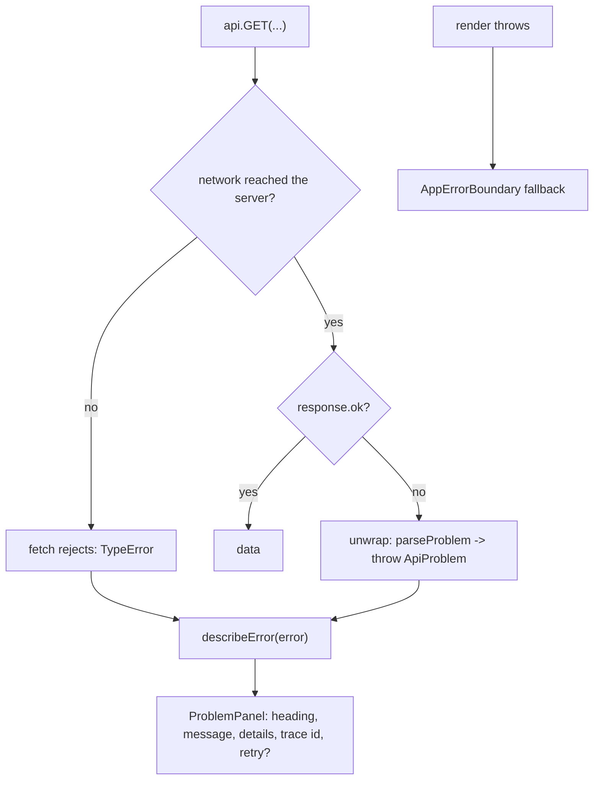

# 05. Error handling: problem+json, status messages and error boundaries

> **Draft: written but not yet run.** The code and the expected output in this lesson were prepared by reading the code and the official documentation. They have not been executed yet. If something does not behave as described, trust your tool's real output and report it.

## What you will be able to do
- parse an `application/problem+json` response (RFC 9457) into one `ApiProblem` class;
- turn each HTTP status into a clear message with a retry only where retrying can help;
- tell apart the three places an error can appear: the network call, the form, and the render;
- protect a screen with an error boundary and set Query's retry rule.

## Recap
1. When does `openapi-fetch` throw? <details><summary>Answer</summary>Only on a network failure; HTTP errors come back in `error` with `data` undefined.</details>
2. What does `makeClient(baseUrl, transport)` let you swap? <details><summary>Answer</summary>The `fetch` function the client uses.</details>

## Why it matters
Most of the time the user sees your error handling, not your happy path. "Something went wrong" with no detail is unhelpful, and showing a raw server message or a stack trace is both confusing and a small security leak. The platform answers every error with a **problem details** document, so a client can handle all failures through one parser and one table.

## What you will build
Project `error-lab` (the typed client of lesson 04 plus): a parser (`problem.ts`), `unwrap`, a pure `describeError` function, a `ProblemPanel` component, a playground with **canned** server answers (200, 404, 409, 422, 429, 500 and a network failure) so you need no backend, and a class-based error boundary for rendering errors.

## Before you start
- Time: 75 minutes. New folder `code101/error-lab`.
- Unchanged from lesson 04: `contract/openapi.yaml` (copy it again, unchanged), `vite.config.ts`, the three `tsconfig` files, `.gitignore`, `src/config.ts`, `src/api/client.ts`, `src/api/types.ts` and `src/hooks/health.ts`.
- Source pack (optional): every file is shown in full in this lesson, so you can follow without it. The finished code, the exercise starter and the solution are in the
  course repository https://github.com/Uee03/Code101 under `source/react/201-hero-to-super-hero/phase-2-http-and-auth/05-error-handling/` (on that page choose **Code, Download ZIP**, or run
  `git clone https://github.com/Uee03/Code101.git`).

## Steps

### Step 1. What a problem document looks like
RFC 9457 defines a JSON body with the content type `application/problem+json`. The platform's `Problem` schema uses: `type` (a stable address that names the problem), `title`, `status`, optional `detail`, `instance` (the request path), plus two extensions, `traceId` (find the server log line) and `code` (machine-readable, such as `last_lead`). A validation problem (422) adds `errors`, a list of `{ pointer, detail }` where `pointer` is a JSON Pointer such as `/name` into the request body. A throttled request (429) also carries a `Retry-After` header with the seconds to wait.

### Step 2. package.json and index.html
Only the name and title change from lesson 04.

**File: `package.json`**
```json
{
  "name": "error-lab",
  "private": true,
  "version": "1.0.0",
  "type": "module",
  "scripts": {
    "api:gen": "openapi-typescript contract/openapi.yaml -o src/api/schema.d.ts",
    "predev": "npm run api:gen",
    "dev": "vite",
    "prebuild": "npm run api:gen",
    "build": "tsc -b && vite build",
    "preview": "vite preview"
  },
  "dependencies": {
    "@tanstack/react-query": "5.108.3",
    "openapi-fetch": "0.17.0",
    "react": "19.3.1",
    "react-dom": "19.3.1"
  },
  "devDependencies": {
    "@types/node": "26.6.6",
    "@types/react": "19.3.0",
    "@types/react-dom": "19.3.0",
    "@vitejs/plugin-react": "6.3.0",
    "openapi-typescript": "7.13.0",
    "typescript": "5.9.3",
    "vite": "8.3.8"
  }
}
```

**File: `index.html`**
```html
<!doctype html>
<html lang="en">
  <head>
    <meta charset="UTF-8" />
    <meta name="viewport" content="width=device-width, initial-scale=1.0" />
    <title>Error lab</title>
  </head>
  <body>
    <div id="root"></div>
    <script type="module" src="/src/main.tsx"></script>
  </body>
</html>
```
Run `npm install` then `npm run api:gen` in the folder. Expected result: `node_modules`, `package-lock.json` and `src/api/schema.d.ts` appear.

### Step 3. One class for every API failure
The class and the parser import nothing from React, so scripts (and, in the capstone, the smoke test) can reuse them.

**File: `src/api/problem.ts`**
```typescript
export class ApiProblem extends Error {
  type = 'about:blank';
  title = 'Request failed';
  status = 0;
  detail?: string;
  instance?: string;
  traceId?: string;
  code?: string;
  errors?: { pointer: string; detail: string }[];
  retryAfter?: number;

  constructor(values: Partial<ApiProblem>) {
    super(values.detail ?? values.title ?? 'Request failed');
    Object.assign(this, values);
    this.name = 'ApiProblem';
  }
}

export function parseProblem(response: Response, body: unknown): ApiProblem {
  const isProblem =
    response.headers.get('Content-Type')?.includes('application/problem+json') && body && typeof body === 'object';
  const fields = isProblem ? (body as Partial<ApiProblem>) : {};
  const retry = Number(response.headers.get('Retry-After'));
  return new ApiProblem({
    ...fields,
    status: response.status,
    title: fields.title ?? `Request failed (${response.status})`,
    retryAfter: response.headers.has('Retry-After') && Number.isFinite(retry) ? Math.max(0, retry) : undefined,
  });
}
```
`parseProblem` is **defensive**: a proxy or gateway may answer with an HTML page or plain text, so it trusts the body only when the content type says problem+json. It always sets `status` from the real response, not from the body. `retryAfter` is the number of seconds (the header can also be a date; this client handles the numeric form the platform sends).

**File: `src/api/unwrap.ts`**
```typescript
import { parseProblem } from './problem';

type Result<T> = { data?: T; error?: unknown; response: Response };

export function unwrap<T>(result: Result<T>): T {
  if (!result.response.ok) {
    throw parseProblem(result.response, result.error);
  }
  return result.data as T;
}
```
`unwrap` turns the `{ data, error, response }` result into either the data or a **thrown** `ApiProblem`, which is what TanStack Query expects from a `queryFn` (a thrown error becomes `query.error`). The capstone's version also handles `304 Not Modified` for conditional requests (lesson 10).

### Step 4. One table for every status (pure function)
This is the capstone's status table (TDD section 4.4) as code. It returns plain data, so it is easy to test later and to reuse.

**File: `src/api/describe.ts`**
```typescript
import { ApiProblem } from './problem';

export type ErrorView = {
  heading: string;
  message: string;
  retryable: boolean;
  details: string[];
};

export function describeError(error: unknown): ErrorView {
  if (error instanceof ApiProblem) {
    switch (error.status) {
      case 401:
        return { heading: 'Please sign in', message: 'Your session is missing or has expired.', retryable: false, details: [] };
      case 403:
        return { heading: 'You do not have access', message: 'Ask a team lead if you need it.', retryable: false, details: [] };
      case 404:
        return {
          heading: 'Not found',
          message: 'This item does not exist, or you may not see it.',
          retryable: false,
          details: [],
        };
      case 409:
        return {
          heading: 'Conflict',
          message: error.detail ?? 'The change conflicts with the current data.',
          retryable: false,
          details: [],
        };
      case 412:
        return {
          heading: 'Someone changed this first',
          message: 'Reload the item and apply your change again.',
          retryable: false,
          details: [],
        };
      case 422:
        return {
          heading: 'Please check the form',
          message: error.detail ?? 'Some values are not valid.',
          retryable: false,
          details: (error.errors ?? []).map((item) => `${item.pointer}: ${item.detail}`),
        };
      case 429:
        return {
          heading: 'Too many requests',
          message: error.retryAfter ? `Wait ${error.retryAfter} seconds, then try again.` : 'Wait a moment, then try again.',
          retryable: true,
          details: [],
        };
      default:
        if (error.status >= 500) {
          return {
            heading: 'The server had a problem',
            message: 'This is not your fault. Try again in a moment.',
            retryable: true,
            details: [],
          };
        }
        return { heading: 'The request failed', message: error.detail ?? error.title, retryable: false, details: [] };
    }
  }
  if (error instanceof TypeError) {
    return {
      heading: 'You may be offline',
      message: 'The request did not reach the server. Check your connection.',
      retryable: true,
      details: [],
    };
  }
  return { heading: 'Something went wrong', message: 'An unexpected error happened.', retryable: false, details: [] };
}
```
Design choices: 404 never says "exists but you may not see it" as fact: the platform answers 404 for objects you may not see, so the client must not reveal more. Messages never include raw JSON, stack traces or the server's `detail` for 5xx. `retryable` is true only where waiting or repeating can help (429, 5xx, network). `fetch` rejects with a `TypeError` for network failures, which is how the code recognises them.

### Step 5. Canned server answers
A `Response` made in the browser lets the real client code run its real parsing path with no server. Each scenario is a `fetch`-shaped function.

**File: `src/api/canned.ts`**
```typescript
export type Scenario = {
  id: string;
  label: string;
  transport: typeof fetch;
};

function respond(status: number, body: unknown, headers: Record<string, string> = {}): typeof fetch {
  return async () =>
    new Response(JSON.stringify(body), {
      status,
      headers: { 'Content-Type': status >= 400 ? 'application/problem+json' : 'application/json', ...headers },
    });
}

const team = {
  id: '9f0c1b0e-2d1a-4a5b-8f2c-6a1d3e5b7c90',
  name: 'Platform team',
  description: 'Keeps the platform running.',
  memberCount: 3,
  createdBy: '2f4b7d1e-5c3a-4e8f-9a6b-1d2c3e4f5a6b',
  version: 1,
  createdAt: '2026-01-01T09:00:00Z',
  updatedAt: '2026-01-01T09:00:00Z',
};

const traceId = '4bf92f3577b34da6a3ce929d0e0e4736';

export const scenarios: Scenario[] = [
  { id: 'ok', label: '200 team found', transport: respond(200, team) },
  {
    id: '404',
    label: '404 not found',
    transport: respond(404, {
      type: 'https://code101.example/problems/not-found',
      title: 'Not found',
      status: 404,
      detail: 'No team with this id.',
      traceId,
    }),
  },
  {
    id: '409',
    label: '409 last lead',
    transport: respond(409, {
      type: 'https://code101.example/problems/conflict',
      title: 'Conflict',
      status: 409,
      detail: 'A team must keep at least one lead.',
      code: 'last_lead',
      traceId,
    }),
  },
  {
    id: '422',
    label: '422 validation',
    transport: respond(422, {
      type: 'https://code101.example/problems/validation-error',
      title: 'Validation failed',
      status: 422,
      detail: 'One or more fields are invalid.',
      traceId,
      errors: [{ pointer: '/name', detail: 'Name is required.' }],
    }),
  },
  {
    id: '429',
    label: '429 too many requests',
    transport: respond(
      429,
      { type: 'https://code101.example/problems/rate-limited', title: 'Too many requests', status: 429, traceId },
      { 'Retry-After': '7' },
    ),
  },
  {
    id: '500',
    label: '500 server error',
    transport: respond(500, {
      type: 'https://code101.example/problems/internal',
      title: 'Internal server error',
      status: 500,
      traceId,
    }),
  },
  {
    id: 'network',
    label: 'Network failure',
    transport: async () => {
      throw new TypeError('Failed to fetch');
    },
  },
];
```
The type URLs and fields are modelled on the examples in the platform contract.

### Step 6. The error panel and the error boundary
Create the folder `src/shared`.

**File: `src/shared/ProblemPanel.tsx`**
```tsx
import { ApiProblem } from '../api/problem';
import { describeError } from '../api/describe';

type ProblemPanelProps = {
  error: unknown;
  onRetry?: () => void;
};

export default function ProblemPanel({ error, onRetry }: ProblemPanelProps) {
  const view = describeError(error);
  const traceId = error instanceof ApiProblem ? error.traceId : undefined;
  return (
    <section role="alert" className="problem">
      <h2>{view.heading}</h2>
      <p>{view.message}</p>
      {view.details.length > 0 && (
        <ul>
          {view.details.map((line) => (
            <li key={line}>{line}</li>
          ))}
        </ul>
      )}
      {traceId && <p>Support code: {traceId}</p>}
      {view.retryable && onRetry && (
        <button type="button" onClick={onRetry}>
          Try again
        </button>
      )}
    </section>
  );
}
```

An **error boundary** catches errors thrown while React *renders* the components below it and shows a fallback instead of a blank page. React still requires a **class component** for this (`getDerivedStateFromError` and `componentDidCatch` have no hook version). The small library `react-error-boundary` wraps it for function components; here the class is 30 lines, so we write it ourselves.

**File: `src/shared/AppErrorBoundary.tsx`**
```tsx
import { Component, type ErrorInfo, type ReactNode } from 'react';

type AppErrorBoundaryProps = {
  children: ReactNode;
  onReset?: () => void;
};

type AppErrorBoundaryState = {
  error: Error | null;
};

export default class AppErrorBoundary extends Component<AppErrorBoundaryProps, AppErrorBoundaryState> {
  state: AppErrorBoundaryState = { error: null };

  static getDerivedStateFromError(error: Error): AppErrorBoundaryState {
    return { error };
  }

  componentDidCatch(error: Error, info: ErrorInfo) {
    console.error('Rendering error:', error.message, info.componentStack);
  }

  reset = () => {
    this.props.onReset?.();
    this.setState({ error: null });
  };

  render() {
    if (this.state.error) {
      return (
        <section role="alert" className="problem">
          <h2>Something went wrong on this screen</h2>
          <p>The rest of the app still works.</p>
          <button type="button" onClick={this.reset}>
            Try again
          </button>
        </section>
      );
    }
    return this.props.children;
  }
}
```

### Step 7. The playground, the crash demo and the app
**File: `src/components/Playground.tsx`**
```tsx
import { useState } from 'react';
import { useMutation } from '@tanstack/react-query';
import { makeClient } from '../api/client';
import { scenarios } from '../api/canned';
import { unwrap } from '../api/unwrap';
import ProblemPanel from '../shared/ProblemPanel';

const teamId = '9f0c1b0e-2d1a-4a5b-8f2c-6a1d3e5b7c90';

export default function Playground() {
  const [selected, setSelected] = useState(scenarios[0]?.id ?? 'ok');
  const run = useMutation({
    mutationFn: async (id: string) => {
      const scenario = scenarios.find((item) => item.id === id);
      if (!scenario) {
        throw new Error('Unknown scenario');
      }
      const client = makeClient('http://localhost:8000', scenario.transport);
      return unwrap(await client.GET('/v1/teams/{teamId}', { params: { path: { teamId } } }));
    },
  });

  return (
    <section>
      <h2>Simulated server answers</h2>
      <p>No backend is needed: each choice makes the client receive a canned response.</p>
      <label>
        Scenario{' '}
        <select value={selected} onChange={(event) => setSelected(event.target.value)}>
          {scenarios.map((scenario) => (
            <option key={scenario.id} value={scenario.id}>
              {scenario.label}
            </option>
          ))}
        </select>
      </label>{' '}
      <button type="button" onClick={() => run.mutate(selected)} disabled={run.isPending}>
        Run
      </button>
      {run.isPending && <p role="status">Calling...</p>}
      {run.isSuccess && <p role="status">Team found: {run.data.name}</p>}
      {run.isError && <ProblemPanel error={run.error} onRetry={() => run.mutate(selected)} />}
    </section>
  );
}
```

**File: `src/components/CrashDemo.tsx`**
```tsx
import { useState } from 'react';
import AppErrorBoundary from '../shared/AppErrorBoundary';

function Bomb({ explode }: { explode: boolean }) {
  if (explode) {
    throw new Error('Rendering failed on purpose');
  }
  return <p>No rendering error yet.</p>;
}

export default function CrashDemo() {
  const [explode, setExplode] = useState(false);
  return (
    <section>
      <h2>Error boundary</h2>
      <button type="button" onClick={() => setExplode(true)}>
        Break the render
      </button>
      <AppErrorBoundary onReset={() => setExplode(false)}>
        <Bomb explode={explode} />
      </AppErrorBoundary>
    </section>
  );
}
```

**File: `src/components/ApiStatus.tsx`**
```tsx
import { useHealth } from '../hooks/health';
import ProblemPanel from '../shared/ProblemPanel';

export default function ApiStatus() {
  const health = useHealth();
  if (health.isPending) {
    return <p role="status">Checking the API...</p>;
  }
  if (health.isError) {
    return <ProblemPanel error={health.error} onRetry={() => void health.refetch()} />;
  }
  return (
    <p role="status">
      API status: {health.data.status}
      {health.data.version ? `, version ${health.data.version}` : ''}
      {health.data.database ? `, database ${health.data.database}` : ''}
    </p>
  );
}
```

**File: `src/App.tsx`**
```tsx
import ApiStatus from './components/ApiStatus';
import CrashDemo from './components/CrashDemo';
import Playground from './components/Playground';
import AppErrorBoundary from './shared/AppErrorBoundary';

export default function App() {
  return (
    <main>
      <h1>Error lab</h1>
      <AppErrorBoundary>
        <ApiStatus />
        <Playground />
        <CrashDemo />
      </AppErrorBoundary>
    </main>
  );
}
```

### Step 8. Query's retry rule and the styles
Query retries failed queries three times by default. For HTTP answers that is wrong for 4xx (the request will fail again) and right for 5xx and network failures, at most twice, as in the capstone.

**File: `src/main.tsx`**
```tsx
import { StrictMode } from 'react';
import { createRoot } from 'react-dom/client';
import { QueryClient, QueryClientProvider } from '@tanstack/react-query';
import App from './App';
import { ApiProblem } from './api/problem';
import './styles.css';

const queryClient = new QueryClient({
  defaultOptions: {
    queries: {
      retry: (count, error) => count < 2 && (!(error instanceof ApiProblem) || error.status >= 500),
    },
    mutations: { retry: false },
  },
});

createRoot(document.getElementById('root')!).render(
  <StrictMode>
    <QueryClientProvider client={queryClient}>
      <App />
    </QueryClientProvider>
  </StrictMode>,
);
```

**File: `src/styles.css`**
```css
:root {
  color-scheme: light dark;
  font-family: system-ui, sans-serif;
}

main {
  max-width: 44rem;
  margin: 0 auto;
  padding: 1rem;
}

button,
select {
  font: inherit;
  padding: 0.4rem 0.8rem;
}

.problem {
  border: 2px solid #a11a1a;
  border-radius: 0.5rem;
  padding: 0.5rem 1rem;
  margin: 1rem 0;
}

:focus-visible {
  outline: 3px solid #0759aa;
  outline-offset: 2px;
}
```

## Run it
**Folder: `error-lab`**
```powershell
npm run dev
```
Open `http://localhost:5173/`. Expected, in order (no backend needed except the first line):
1. The top status line: with no backend the panel "You may be offline" with a "Try again" button (the real `fetch` to port 8000 failed with a `TypeError`); with a backend, "API status: ok" (typical).
2. Scenario "200 team found" then Run: "Calling..." then "Team found: Platform team".
3. "404 not found": heading "Not found", the text "This item does not exist, or you may not see it.", "Support code: 4bf92f3577b34da6a3ce929d0e0e4736", no retry button.
4. "409 last lead": heading "Conflict" and the server's sentence "A team must keep at least one lead." (the exercise improves this).
5. "422 validation": heading "Please check the form", "One or more fields are invalid.", a list item `/name: Name is required.`, the support code.
6. "429 too many requests": "Too many requests", "Wait 7 seconds, then try again.", a "Try again" button.
7. "500 server error": "The server had a problem" with a retry button. "Network failure": "You may be offline".
8. Click "Break the render". Expected: the panel "Something went wrong on this screen" replaces only the crash demo's content; the rest of the page still works; the console shows `Rendering error:` with the message. "Try again" restores "No rendering error yet."

## How it works

- Three kinds of failure get three tools. **A request failed**: query or mutation error, shown with `ProblemPanel`. **Input was invalid**: the 422 `errors` are shown next to the fields (lesson 07 maps `pointer` to inputs). **Rendering threw**: an error boundary.
- An error boundary does **not** catch errors in event handlers, in asynchronous code (promises, timers) or in the boundary itself. Those errors are handled where they happen (mutation state, `try/catch`). Query errors do not reach the boundary unless you opt in with the `throwOnError` option.
- Put boundaries at meaningful places: one at the root so the user never sees a blank page, and others around independent regions (a widget, a route) so one failure does not hide the rest.
- `error.traceId` is shown as a "support code": it lets support find the server log line without exposing internals.

### Why this, not that
| Option | Use when |
|---|---|
| Show `error.message` straight from the server | Never for 5xx: it may reveal internals |
| One `describeError` table | Always: one place to change wording, one place to test |
| `try/catch` in each component | Only for one-off flows outside Query |
| Error boundary at the root only | A minimum; add inner boundaries for independent parts |
| `react-error-boundary` library | When you want hooks like `useErrorBoundary` and reset keys; same idea |

**Common misconception:** "an error boundary catches every error." It catches errors thrown during rendering, lifecycle methods and constructors of its children; not event handlers or async code.

## Try it
Starter: `exercise/starter/src/api/describe.ts` (one TODO).
1. **Guided.** Make the 409 case special-case `error.code === 'last_lead'` with the heading "This team needs a lead" and the message from the TODO. Expected: the scenario "409 last lead" now shows that heading and message; other 409 problems still show "Conflict".
2. **Change.** In `canned.ts` add a `403 forbidden` scenario and check that the panel shows "You do not have access" and no retry button.
3. **Stretch (optional).** The capstone retries only GET requests after a 429 and waits for `Retry-After` seconds. Write down why a retry of a POST needs an `Idempotency-Key` (lesson 10 and capstone chapter 4).

<details><summary>Solution</summary>

**File: `exercise/solution/src/api/describe.ts`**
```typescript
import { ApiProblem } from './problem';

export type ErrorView = {
  heading: string;
  message: string;
  retryable: boolean;
  details: string[];
};

export function describeError(error: unknown): ErrorView {
  if (error instanceof ApiProblem) {
    switch (error.status) {
      case 401:
        return { heading: 'Please sign in', message: 'Your session is missing or has expired.', retryable: false, details: [] };
      case 403:
        return { heading: 'You do not have access', message: 'Ask a team lead if you need it.', retryable: false, details: [] };
      case 404:
        return {
          heading: 'Not found',
          message: 'This item does not exist, or you may not see it.',
          retryable: false,
          details: [],
        };
      case 409:
        if (error.code === 'last_lead') {
          return {
            heading: 'This team needs a lead',
            message: 'Assign another lead before you remove or demote this one.',
            retryable: false,
            details: [],
          };
        }
        return {
          heading: 'Conflict',
          message: error.detail ?? 'The change conflicts with the current data.',
          retryable: false,
          details: [],
        };
      case 412:
        return {
          heading: 'Someone changed this first',
          message: 'Reload the item and apply your change again.',
          retryable: false,
          details: [],
        };
      case 422:
        return {
          heading: 'Please check the form',
          message: error.detail ?? 'Some values are not valid.',
          retryable: false,
          details: (error.errors ?? []).map((item) => `${item.pointer}: ${item.detail}`),
        };
      case 429:
        return {
          heading: 'Too many requests',
          message: error.retryAfter ? `Wait ${error.retryAfter} seconds, then try again.` : 'Wait a moment, then try again.',
          retryable: true,
          details: [],
        };
      default:
        if (error.status >= 500) {
          return {
            heading: 'The server had a problem',
            message: 'This is not your fault. Try again in a moment.',
            retryable: true,
            details: [],
          };
        }
        return { heading: 'The request failed', message: error.detail ?? error.title, retryable: false, details: [] };
    }
  }
  if (error instanceof TypeError) {
    return {
      heading: 'You may be offline',
      message: 'The request did not reach the server. Check your connection.',
      retryable: true,
      details: [],
    };
  }
  return { heading: 'Something went wrong', message: 'An unexpected error happened.', retryable: false, details: [] };
}
```
A `case` that contains an `if` with a `return` falls through to the second `return` only when the `if` is false, so no `break` is needed.

</details>

## Check yourself
1. Which header tells you how long to wait after a 429? <details><summary>Answer</summary>`Retry-After` (seconds).</details>
2. A promise inside an event handler rejects. Does the error boundary show its fallback? <details><summary>Answer</summary>No; boundaries catch render errors only. Handle it with a mutation's error state or `try/catch`.</details>
3. Predict: the server answers 502 with an HTML page. What does `parseProblem` do? <details><summary>Answer</summary>The content type is not problem+json, so it ignores the body and builds a problem with status 502 and the title "Request failed (502)"; the panel says "The server had a problem".</details>
4. Why does a 404 message not say "you are not allowed"? <details><summary>Answer</summary>The platform answers 404 for objects the caller may not see, so the UI must not confirm that they exist.</details>

## Common mistakes
| Symptom or error text | Cause | Fix |
|---|---|---|
| `Cannot find module './schema'` (typical message) | Types not generated | `npm run api:gen` |
| Blank page after a render error | No boundary | Wrap the tree in `AppErrorBoundary` |
| The panel shows "Something went wrong" for an HTTP error | The error is not an `ApiProblem` (the call was not wrapped in `unwrap`) | Pass results through `unwrap` |
| Retry loops three times on a 404 | Query's default retry | Set the `retry` function in `main.tsx` |
| Fallback shows again after "Try again" | The cause still throws | Reset the cause in `onReset` (as `CrashDemo` does) |
| `error` is `unknown` in a `catch` | TypeScript treats caught values as unknown | Narrow with `instanceof` before use |

## Best practice
Parse every error response into one typed object, map statuses to messages in one pure function, never show raw server text for 5xx, and add a trace id for support. Source: RFC 9457, Problem Details for HTTP APIs https://www.rfc-editor.org/rfc/rfc9457 and React, Error boundaries https://react.dev/reference/react/Component#catching-rendering-errors-with-an-error-boundary

## Going further
- Where this table grows into banners, 412 conflict dialogs and offline detection: [web-react chapter 4](../../../../capstones/web-react/tutorials/phase-4-errors/04-errors-and-accessibility.md).
- TanStack Query, query retries: https://tanstack.com/query/latest/docs/framework/react/guides/query-retries

## Summary
- You parsed problem+json into `ApiProblem` and unwrapped client results into thrown errors.
- You wrote one status table, a reusable panel and a root error boundary.
- You simulated seven server answers without a backend and set a sensible retry rule.

## Next lesson
06. OIDC login with PKCE and protected routes: sign in with Keycloak and send the access token to the API.
