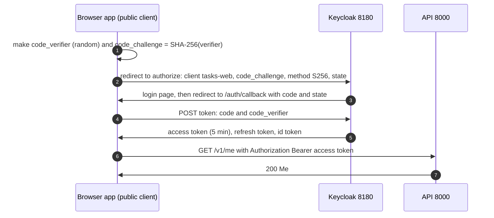

# 06. OIDC login with PKCE and protected routes

> **Draft: written but not yet run.** The code and the expected output in this lesson were prepared by reading the code and the official documentation. They have not been executed yet. If something does not behave as described, trust your tool's real output and report it.

## What you will be able to do
- explain the authorization code flow with PKCE and why a browser app is a **public client**;
- configure `react-oidc-context` and `oidc-client-ts` against the Keycloak realm `tasksteams` with tokens kept in memory;
- add the bearer token to API calls only (never to other hosts), renew once on 401 with a single-flight guard;
- protect routes with a guard and avoid an open redirect.

## Recap
1. Which hook-free module turns an HTTP failure into a thrown `ApiProblem`? <details><summary>Answer</summary><code>unwrap</code> (with <code>parseProblem</code>).</details>
2. What does `makeClient(baseUrl, transport)` let this lesson do? <details><summary>Answer</summary>Give the client a `fetch` that adds the bearer token.</details>

## Why it matters
Signing in is the part where a mistake costs the most. A token in the wrong place can be read by any script on the page; a wrong redirect can hand a login to an attacker. The industry answer for browser apps is the **authorization code flow with PKCE**, and the platform's Keycloak realm is configured exactly for it. This lesson builds the client half; the capstone chapter 2 adds the step-up for admin scopes and the manual acceptance list.

## What you will build
Project `auth-lab`: a Login page, a Callback page, a `RequireAuth` guard, a typed client that sends `Authorization: Bearer ...` to the API only, a Home page that shows `getMe` (name, roles, scopes, teams) and a Sign out button.

## Before you start
- Time: 90 minutes. New folder `code101/auth-lab`. Do the manual run only after the platform stack (Keycloak on **8180**) and one backend (**8000**) run; follow the capstone's [Start here](../../../../capstones/web-react/README.md).
- Local fixture accounts (fake, local only): `alice` / `alice-local-fake` (admin), `bob` / `bob-local-fake`, `carol` / `carol-local-fake`.
- Use `http://localhost:5173` in the browser, never `127.0.0.1`: the issuer URL and the registered redirect addresses must match exactly.
- Unchanged: `contract/openapi.yaml`, `vite.config.ts`, the three `tsconfig` files, `.gitignore`, `src/api/types.ts`, `src/api/problem.ts`, `src/api/unwrap.ts`, `src/api/describe.ts`, `src/shared/ProblemPanel.tsx` and `src/shared/AppErrorBoundary.tsx` (from [lesson 05](05-error-handling.md)).
- Source pack (optional): every file is shown in full in this lesson, so you can follow without it. The finished code, the exercise starter and the solution are in the
  course repository https://github.com/Uee03/Code101 under `source/react/201-hero-to-super-hero/phase-2-http-and-auth/06-oidc-login-and-protected-routes/` (on that page choose **Code, Download ZIP**, or run
  `git clone https://github.com/Uee03/Code101.git`).

## Steps

### Step 1. The ideas in one picture

- **OIDC** (OpenID Connect) is a layer on OAuth 2.0 that says *who* signed in (the **id token**) as well as *what the app may do* (the **access token**). The **authorization code flow** sends the browser to the identity provider (Keycloak); the user types the password **there**, never in your app; the app receives a short-lived **code** and exchanges it for tokens.
- A browser app cannot keep a secret, so it is a **public client** (no client secret). Without a secret, a stolen code could be redeemed by an attacker. **PKCE** (Proof Key for Code Exchange) fixes that: the app invents a random `code_verifier`, sends only its SHA-256 hash (`code_challenge`, method `S256`) when it starts, and sends the verifier itself when it redeems the code. Only the app that started the flow knows the verifier.
- The `state` value ties the answer to the request (against forged callbacks).

### Step 2. Where tokens live
| Option | Script on the page can read it | Survives reload | Verdict (capstone TDD 7.3) |
|---|---|---|---|
| Memory (`InMemoryWebStorage`) | only while the attacker runs inside the page | no (one silent redirect) | **Chosen** |
| `sessionStorage` | yes, any script | per tab | documented fallback |
| `localStorage` | yes, every tab | yes | rejected for tokens |
| HttpOnly cookie through a backend-for-frontend | no | yes | strongest, needs a server (out of scope) |

The transient PKCE data (verifier, state) must survive the redirect to Keycloak, so it uses `sessionStorage`; the **user store** (the tokens) uses memory. After a reload the memory is empty; the app remembers only a non-secret flag `ts.hint` in `localStorage` and then asks Keycloak for a code with `prompt: 'none'`, which succeeds without typing when the Keycloak session (30 minutes idle) is still alive.

### Step 3. package.json, index.html, .env.example
New packages: `react-router`, `react-oidc-context`, `oidc-client-ts`.

**File: `package.json`**
```json
{
  "name": "auth-lab",
  "private": true,
  "version": "1.0.0",
  "type": "module",
  "scripts": {
    "api:gen": "openapi-typescript contract/openapi.yaml -o src/api/schema.d.ts",
    "predev": "npm run api:gen",
    "dev": "vite",
    "prebuild": "npm run api:gen",
    "build": "tsc -b && vite build",
    "preview": "vite preview"
  },
  "dependencies": {
    "@tanstack/react-query": "5.108.3",
    "oidc-client-ts": "3.5.0",
    "openapi-fetch": "0.17.0",
    "react": "19.3.1",
    "react-dom": "19.3.1",
    "react-oidc-context": "3.3.1",
    "react-router": "8.5.2"
  },
  "devDependencies": {
    "@types/node": "26.6.6",
    "@types/react": "19.3.0",
    "@types/react-dom": "19.3.0",
    "@vitejs/plugin-react": "6.3.0",
    "openapi-typescript": "7.13.0",
    "typescript": "5.9.3",
    "vite": "8.3.8"
  }
}
```

**File: `index.html`**
```html
<!doctype html>
<html lang="en">
  <head>
    <meta charset="UTF-8" />
    <meta name="viewport" content="width=device-width, initial-scale=1.0" />
    <title>Auth lab</title>
  </head>
  <body>
    <div id="root"></div>
    <script type="module" src="/src/main.tsx"></script>
  </body>
</html>
```

**File: `.env.example`**
```text
VITE_API_BASE_URL=http://localhost:8000
VITE_OIDC_AUTHORITY=http://localhost:8180/realms/tasksteams
VITE_OIDC_CLIENT_ID=tasks-web
```
Copy it to `.env` only if you must change a value (`.env` is git-ignored); the code has the same defaults. None of these is secret: the client is public. Run `npm install` and `npm run api:gen`.

### Step 4. Configuration and the safe return path
**File: `src/config.ts`**
```typescript
const env = import.meta.env ?? {};

export const config = {
  apiBaseUrl: env.VITE_API_BASE_URL ?? 'http://localhost:8000',
  authority: env.VITE_OIDC_AUTHORITY ?? 'http://localhost:8180/realms/tasksteams',
  clientId: env.VITE_OIDC_CLIENT_ID ?? 'tasks-web',
  scopes: 'openid profile email tasks:read tasks:write',
};
```

A login remembers where the user wanted to go (`returnUrl`). If you blindly redirect to that value, an attacker's link `/login?returnUrl=https://evil.example` becomes an **open redirect**. This function accepts only paths that start with one `/`.

**File: `src/auth/safe-route.ts`**
```typescript
export function safeRoute(value: unknown): string {
  return typeof value === 'string' &&
    value.startsWith('/') &&
    !value.startsWith('//') &&
    !value.includes('\\') &&
    !/[\r\n]/.test(value)
    ? value
    : '/';
}
```
`//evil.example` is a protocol-relative URL (it would leave your site), a backslash can be read as a slash by some browsers, and line breaks are never valid in a path.

### Step 5. The OIDC settings
**File: `src/auth/oidc-config.ts`**
```typescript
import { InMemoryWebStorage, WebStorageStateStore, type UserManagerSettings } from 'oidc-client-ts';
import { config } from '../config';

export function oidcSettings(origin: string, transient: Storage) {
  const memory = new InMemoryWebStorage();
  const settings: UserManagerSettings = {
    authority: config.authority,
    client_id: config.clientId,
    redirect_uri: `${origin}/auth/callback`,
    post_logout_redirect_uri: `${origin}/login`,
    response_type: 'code',
    scope: config.scopes,
    disablePKCE: false,
    automaticSilentRenew: false,
    monitorSession: false,
    accessTokenExpiringNotificationTimeInSeconds: 60,
    userStore: new WebStorageStateStore({ store: memory }),
    stateStore: new WebStorageStateStore({ store: transient }),
  };
  return { settings, memory };
}
```
Line by line: `authority` is the realm URL (the library reads `/.well-known/openid-configuration` from it); `redirect_uri` is where Keycloak sends the code (it must be registered in the realm for client `tasks-web`: `http://localhost:5173/*`); `response_type: 'code'` selects the code flow; `disablePKCE: false` keeps PKCE on (S256); `automaticSilentRenew: false` and `monitorSession: false` switch off the library's hidden-iframe features, which break when third-party cookies are blocked; instead the app renews itself with the refresh token when the library fires `accessTokenExpiring` 60 seconds before expiry. `userStore` uses memory; `stateStore` uses the storage passed in (`sessionStorage`).

### Step 6. One refresh at a time (the token gate)
Keycloak rotates refresh tokens: each refresh token works once. If two requests refresh at the same moment, the second uses an already-spent token and Keycloak may end the whole session. The **single-flight** pattern makes every caller share one promise.

**File: `src/auth/token-gate.ts`**
```typescript
type UserToken = { access_token: string; expired?: boolean };

let read: () => Promise<UserToken | null> = async () => null;
let refresh: () => Promise<UserToken | null> = async () => null;
let failed: () => Promise<void> = async () => {};
let flight: Promise<string> | undefined;

export function bindTokenGate(callbacks: { read: typeof read; refresh: typeof refresh; failed: typeof failed }) {
  read = callbacks.read;
  refresh = callbacks.refresh;
  failed = callbacks.failed;
}

// One refresh at a time: with refresh-token rotation a second parallel refresh would revoke the session.
export async function renew(): Promise<string> {
  if (!flight) {
    flight = refresh()
      .then((user) => {
        if (!user || user.expired) {
          throw new Error('Please sign in again.');
        }
        return user.access_token;
      })
      .catch(async (error) => {
        await failed();
        throw error;
      })
      .finally(() => {
        flight = undefined;
      });
  }
  return flight;
}

export async function getAccessToken() {
  const user = await read();
  return user?.expired ? renew() : user?.access_token;
}

export async function endSession() {
  await failed();
}
```
The gate lives **outside** React because the API client is a plain module: it cannot call hooks, so it asks the gate for a token. `bindTokenGate` connects the gate to the real `UserManager` once.

### Step 7. The user manager, callback handling and sign-out
**File: `src/auth/user-manager.ts`**
```typescript
import { UserManager, type User } from 'oidc-client-ts';
import { oidcSettings } from './oidc-config';
import { bindTokenGate, renew } from './token-gate';
import { safeRoute } from './safe-route';

export const manager = new UserManager(oidcSettings(window.location.origin, window.sessionStorage).settings);

export let callbackReturn = '/';

export function onSigninCallback(user?: User) {
  callbackReturn = safeRoute((user?.state as { returnTo?: string } | undefined)?.returnTo);
  localStorage.setItem('ts.hint', '1');
  history.replaceState({}, document.title, callbackReturn);
}

bindTokenGate({
  read: () => manager.getUser(),
  refresh: () => manager.signinSilent(),
  failed: async () => {
    await manager.removeUser();
    localStorage.removeItem('ts.hint');
    const returnTo = safeRoute(location.pathname + location.search);
    window.location.assign(`/login?returnUrl=${encodeURIComponent(returnTo)}`);
  },
});

manager.events.addAccessTokenExpiring(() => {
  void renew().catch(() => {});
});

export async function signOut() {
  const user = await manager.getUser();
  await manager.removeUser();
  localStorage.removeItem('ts.hint');
  await manager.signoutRedirect({ id_token_hint: user?.id_token });
}
```
`onSigninCallback` runs after the code was exchanged. It reads the `returnTo` we put in `state` when the sign-in started, validates it with `safeRoute`, and uses `history.replaceState` to remove `?code=...&state=...` from the address bar and history (the code is one-use, but it should not linger). `signoutRedirect` with `id_token_hint` ends the Keycloak session as well, so signing out is real. The app **never logs tokens** and never puts them in a URL.

### Step 8. The bearer token goes to the API only
**File: `src/auth/auth-middleware.ts`**
```typescript
import { endSession, getAccessToken, renew } from './token-gate';

export function isApiUrl(url: string, base: string): boolean {
  const target = new URL(url);
  const allowed = new URL(base);
  const prefix = allowed.pathname.replace(/\/$/, '');
  return target.origin === allowed.origin && (target.pathname === prefix || target.pathname.startsWith(`${prefix}/`));
}

export function authTransport(base: string, transport: typeof fetch = fetch): typeof fetch {
  return async (input, init) => {
    const request = new Request(input, init);
    if (!isApiUrl(request.url, base)) {
      request.headers.delete('Authorization');
      return transport(request);
    }
    const token = await getAccessToken();
    if (token) {
      request.headers.set('Authorization', `Bearer ${token}`);
    }
    const retry = request.clone();
    let response = await transport(request);
    if (response.status === 401) {
      try {
        retry.headers.set('Authorization', `Bearer ${await renew()}`);
        response = await transport(retry);
      } catch {
        await endSession();
        return response;
      }
      if (response.status === 401) {
        await endSession();
      }
    }
    return response;
  };
}
```
This `fetch` wrapper (the capstone calls it the auth transport) does three things. **(1)** It adds the token only when the request URL has the API's origin and path prefix; any other host gets no `Authorization` header (a token sent to a third party is a leak). **(2)** On a 401 it renews **once** (through the single-flight gate) and retries **once** with a clone made before the first attempt (a request body can be read only once). **(3)** If that fails it ends the session and returns to login. The capstone's version adds `429 Retry-After` handling on top.

**File: `src/api/client.ts`**
```typescript
import createClient from 'openapi-fetch';
import type { paths } from './schema';
import { config } from '../config';
import { authTransport } from '../auth/auth-middleware';

export const makeClient = (baseUrl: string, transport: typeof fetch = fetch) =>
  createClient<paths>({ baseUrl, fetch: transport });

export const api = makeClient(config.apiBaseUrl, authTransport(config.apiBaseUrl));
```

**File: `src/hooks/me.ts`**
```typescript
import { useQuery } from '@tanstack/react-query';
import { api } from '../api/client';
import { unwrap } from '../api/unwrap';

export function useMe() {
  return useQuery({
    queryKey: ['me'],
    queryFn: async ({ signal }) => unwrap(await api.GET('/v1/me', { signal })),
    retry: false,
  });
}
```
Roles and scopes come from `getMe` (the server's view), not from decoding the token in the browser.

### Step 9. The guard and the pages
**File: `src/auth/RequireAuth.tsx`**
```tsx
import { Navigate, Outlet, useLocation } from 'react-router';
import { useAuth } from 'react-oidc-context';

export default function RequireAuth() {
  const auth = useAuth();
  const location = useLocation();
  if (auth.isLoading || auth.activeNavigator) {
    return <p role="status">Signing you in</p>;
  }
  if (!auth.isAuthenticated) {
    return <Navigate replace to={`/login?returnUrl=${encodeURIComponent(location.pathname + location.search)}`} />;
  }
  return <Outlet />;
}
```
`RequireAuth` is a **layout route**: it renders the matched child routes through `<Outlet />` only for a signed-in user. A UI guard hides screens; **the API remains the authority** and answers 401, 403 or 404 on its own.

**File: `src/pages/Login.tsx`**
```tsx
import { useEffect, useRef } from 'react';
import { Navigate, useSearchParams } from 'react-router';
import { useAuth } from 'react-oidc-context';
import { safeRoute } from '../auth/safe-route';

export default function Login() {
  const auth = useAuth();
  const [params] = useSearchParams();
  const started = useRef(false);
  const returnTo = safeRoute(params.get('returnUrl'));

  useEffect(() => {
    if (auth.error) {
      localStorage.removeItem('ts.hint');
      history.replaceState({}, '', '/login');
    }
    const canTryQuietly =
      !auth.isLoading && !auth.isAuthenticated && !auth.error && !started.current && localStorage.getItem('ts.hint');
    if (canTryQuietly) {
      started.current = true;
      void auth.signinRedirect({ prompt: 'none', state: { returnTo } });
    }
  }, [auth, returnTo]);

  if (auth.isAuthenticated) {
    return <Navigate replace to={returnTo} />;
  }
  return (
    <section>
      <h1>Login</h1>
      <p>Sign in with the Tasks and Teams Keycloak realm.</p>
      {auth.error && <p role="alert">{auth.error.message}</p>}
      <button
        type="button"
        disabled={auth.isLoading || !!auth.activeNavigator}
        onClick={() => {
          localStorage.removeItem('ts.hint');
          void auth.signinRedirect({ state: { returnTo } });
        }}
      >
        Sign in
      </button>
    </section>
  );
}
```
The `useRef` flag makes sure the quiet sign-in starts only once even though `StrictMode` runs effects twice in development; a second start would spend the one-time `state` value.

**File: `src/pages/Callback.tsx`**
```tsx
import { useEffect } from 'react';
import { Link, useNavigate } from 'react-router';
import { useAuth } from 'react-oidc-context';
import { callbackReturn } from '../auth/user-manager';

export default function Callback() {
  const auth = useAuth();
  const navigate = useNavigate();

  useEffect(() => {
    if (auth.isAuthenticated) {
      void navigate(callbackReturn, { replace: true });
    }
    if (auth.error) {
      localStorage.removeItem('ts.hint');
      history.replaceState({}, '', '/auth/callback');
    }
  }, [auth.isAuthenticated, auth.error, navigate]);

  return (
    <section>
      <h1>Callback</h1>
      {auth.error ? (
        <>
          <p role="alert">{auth.error.message}</p>
          <Link to="/login">Return to Login</Link>
        </>
      ) : (
        <p role="status">Signing you in</p>
      )}
    </section>
  );
}
```

**File: `src/pages/Home.tsx`**
```tsx
import { useMe } from '../hooks/me';
import ProblemPanel from '../shared/ProblemPanel';

export default function Home() {
  const me = useMe();
  if (me.isPending) {
    return <p role="status">Loading your profile...</p>;
  }
  if (me.isError) {
    return <ProblemPanel error={me.error} onRetry={() => void me.refetch()} />;
  }
  return (
    <section>
      <h1>Hello, {me.data.displayName}</h1>
      <p>Roles: {me.data.roles.join(', ') || 'none'}</p>
      <p>Scopes: {me.data.scopes.join(', ')}</p>
      <h2>My teams</h2>
      <ul>
        {me.data.teams.map((team) => (
          <li key={team.teamId}>
            {team.name} ({team.role})
          </li>
        ))}
      </ul>
    </section>
  );
}
```

**File: `src/pages/NotFound.tsx`**
```tsx
import { Link } from 'react-router';

export default function NotFound() {
  return (
    <section>
      <h1>Not found</h1>
      <p>This page is not available.</p>
      <Link to="/">Home</Link>
    </section>
  );
}
```

### Step 10. Shell, router, root and styles
**File: `src/Shell.tsx`**
```tsx
import { Link, Outlet } from 'react-router';
import { useAuth } from 'react-oidc-context';
import { signOut } from './auth/user-manager';
import AppErrorBoundary from './shared/AppErrorBoundary';

export default function Shell() {
  const auth = useAuth();
  return (
    <>
      <header>
        <nav aria-label="Main">
          <Link to="/">Home</Link>
          {auth.isAuthenticated ? (
            <button type="button" onClick={() => void signOut()}>
              Sign out
            </button>
          ) : (
            <Link to="/login">Login</Link>
          )}
        </nav>
      </header>
      <main>
        <AppErrorBoundary>
          <Outlet />
        </AppErrorBoundary>
      </main>
    </>
  );
}
```

**File: `src/router.tsx`**
```tsx
import { createBrowserRouter } from 'react-router';
import RequireAuth from './auth/RequireAuth';
import Shell from './Shell';
import Callback from './pages/Callback';
import Home from './pages/Home';
import Login from './pages/Login';
import NotFound from './pages/NotFound';

export const router = createBrowserRouter([
  {
    element: <Shell />,
    children: [
      { path: '/login', element: <Login /> },
      { path: '/auth/callback', element: <Callback /> },
      { element: <RequireAuth />, children: [{ index: true, element: <Home /> }] },
      { path: '*', element: <NotFound /> },
    ],
  },
]);
```

**File: `src/main.tsx`**
```tsx
import { StrictMode } from 'react';
import { createRoot } from 'react-dom/client';
import { QueryClient, QueryClientProvider } from '@tanstack/react-query';
import { AuthProvider } from 'react-oidc-context';
import { RouterProvider } from 'react-router/dom';
import { ApiProblem } from './api/problem';
import { manager, onSigninCallback } from './auth/user-manager';
import { router } from './router';
import './styles.css';

const queryClient = new QueryClient({
  defaultOptions: {
    queries: {
      retry: (count, error) => count < 2 && (!(error instanceof ApiProblem) || error.status >= 500),
    },
    mutations: { retry: false },
  },
});

// A different user must never see the previous user's cached data.
manager.events.addUserUnloaded(() => queryClient.clear());
manager.events.addUserLoaded(() => queryClient.clear());

createRoot(document.getElementById('root')!).render(
  <StrictMode>
    <AuthProvider userManager={manager} onSigninCallback={onSigninCallback}>
      <QueryClientProvider client={queryClient}>
        <RouterProvider router={router} />
      </QueryClientProvider>
    </AuthProvider>
  </StrictMode>,
);
```

**File: `src/styles.css`**
```css
:root {
  color-scheme: light dark;
  font-family: system-ui, sans-serif;
}

header {
  padding: 0.75rem 1rem;
  background: #e7f0fa;
  color: #17212b;
}

nav {
  display: flex;
  gap: 1rem;
  align-items: center;
}

nav a {
  color: #0759aa;
}

main {
  max-width: 44rem;
  margin: 0 auto;
  padding: 1rem;
}

button {
  font: inherit;
  padding: 0.4rem 0.8rem;
}

.problem {
  border: 2px solid #a11a1a;
  border-radius: 0.5rem;
  padding: 0.5rem 1rem;
  margin: 1rem 0;
}

:focus-visible {
  outline: 3px solid #0759aa;
  outline-offset: 2px;
}
```

## Run it
**Folder: `auth-lab`**
```powershell
npm run dev
```
Manual run (needs Keycloak and a backend); expected, in order. This is a description of the code's behaviour, not a recording:
1. Open `http://localhost:5173/`. You are not signed in, so `RequireAuth` redirects to `/login?returnUrl=%2F`, which shows the Login page with a **Sign in** button.
2. Click **Sign in**. The browser leaves for `http://localhost:8180/realms/tasksteams/...`. In DevTools, Network, the authorize request contains `code_challenge=...&code_challenge_method=S256` and `client_id=tasks-web`.
3. Type `alice` and `alice-local-fake`. Keycloak redirects to `http://localhost:5173/auth/callback?code=...&state=...`; after a moment the address becomes `/` (the `code` and `state` are gone from the bar and from history) and the Home page shows "Hello, ..." with roles including `admin`.
4. Open DevTools, Application, Local Storage and Session Storage. Expected: no key contains a token; `ts.hint` is `1` in Local Storage (a flag, not a secret).
5. Reload the page. Expected: a brief "Signing you in", then Home again, without typing (the quiet sign-in found the Keycloak session).
6. Click **Sign out**. Expected: Keycloak's session ends, you land on `/login`; opening `/` now redirects to `/login` again.
7. Sign in as `bob`. Expected: Home shows bob's roles and teams only.

## How it works
- `AuthProvider` (from `react-oidc-context`) creates React state around the `UserManager` and, on a page that has `?code=...&state=...`, finishes the exchange automatically, then calls `onSigninCallback`. `useAuth()` exposes `isAuthenticated`, `isLoading`, `error`, `signinRedirect`.
- Boot order matters: `RequireAuth` shows "Signing you in" while `isLoading` is true so the app never flashes the login page for an already signed-in user.
- Tokens: the access token lasts 5 minutes; 60 seconds before it ends the library fires `accessTokenExpiring`, the app calls the single-flight `renew()` (which uses the refresh token), and every API request meanwhile reads the newest token from the gate. The 401 path calls the same `renew()`, so two refreshes can never run together.
- The user store is memory, so a **second browser tab** signs in on its own (one quick redirect); that is the price of not persisting tokens.
- **Threats and controls:** open redirect (`safeRoute`), token leakage to other hosts (`isApiUrl`), token theft by script (memory only, strict CSP in the capstone), stale data for the next user (`queryClient.clear()` on user change), forged callbacks (`state`), stolen codes (PKCE).

### Why this, not that
| Option | Use when | Cost |
|---|---|---|
| `react-oidc-context` + `oidc-client-ts` | Any OIDC provider; you want control over storage | A little setup (this lesson) |
| `keycloak-js` | Keycloak only and its adapter features | Ties the app to Keycloak |
| Hand-written OAuth | Never in production | Security mistakes are easy |
| Implicit flow | Never: it is deprecated | Tokens in the URL |
| Backend-for-frontend with cookies | You can run a server and want the strongest option | Needs server code (out of scope) |

**Common misconception:** "a JWT in the browser is safe because it is signed." Signing protects it from being *changed*, not from being *read or stolen*. Treat access tokens as passwords with a short life.

## Try it
Starter: `exercise/starter/src/pages/Home.tsx` (one TODO).
1. **Guided.** Show the line "You can open the audit log." only for users whose `roles` include `admin` (alice yes, bob no). Expected: alice sees the line, bob does not.
2. **Change.** Explain in one sentence why hiding that line is not a security control, and what protects the audit log in reality.
3. **Stretch (optional).** Write down what would break if `automaticSilentRenew` were `true` **and** the 401 handler also called `renew()` without the single-flight gate.

<details><summary>Solution</summary>

**File: `exercise/solution/src/pages/Home.tsx`**
```tsx
import { useMe } from '../hooks/me';
import ProblemPanel from '../shared/ProblemPanel';

export default function Home() {
  const me = useMe();
  if (me.isPending) {
    return <p role="status">Loading your profile...</p>;
  }
  if (me.isError) {
    return <ProblemPanel error={me.error} onRetry={() => void me.refetch()} />;
  }
  return (
    <section>
      <h1>Hello, {me.data.displayName}</h1>
      <p>Roles: {me.data.roles.join(', ') || 'none'}</p>
      <p>Scopes: {me.data.scopes.join(', ')}</p>
      {me.data.roles.includes('admin') && <p>You can open the audit log.</p>}
      <h2>My teams</h2>
      <ul>
        {me.data.teams.map((team) => (
          <li key={team.teamId}>
            {team.name} ({team.role})
          </li>
        ))}
      </ul>
    </section>
  );
}
```
Rung 2: a user can still call the audit endpoint directly; the API checks the role and the `tasks:admin` scope and answers 403 or 404. The UI only decides what to show.

</details>

## Check yourself
1. What does the PKCE `code_verifier` protect against? <details><summary>Answer</summary>A stolen authorization code being redeemed by someone else.</details>
2. Why is the user store in memory but the state store in `sessionStorage`? <details><summary>Answer</summary>The PKCE state must survive the redirect to Keycloak; tokens should not be readable from disk-backed storage.</details>
3. Predict: a request to `https://other.example/data` goes through `authTransport`. Does it get a bearer header? <details><summary>Answer</summary>No; `isApiUrl` is false, so any `Authorization` header is removed.</details>
4. Find the bug: `<Navigate to={params.get('returnUrl')} />` without validation. <details><summary>Answer</summary>Open redirect; pass the value through `safeRoute` first.</details>

## Common mistakes
| Symptom or error text | Cause | Fix |
|---|---|---|
| Keycloak page: `Invalid parameter: redirect_uri` (typical message) | The app runs on another port or host (for example `127.0.0.1`) | Use `http://localhost:5173` exactly |
| CORS error on the token request (typical message) | Origin not in the client's web origins | Use port 5173 only; one server per port |
| Signed out again after about 5 minutes | Renewal failing (rotated refresh token reused, or Keycloak unreachable) | Check the single-flight gate is used by every caller |
| `Cannot find module 'react-oidc-context'` (typical message) | Not installed | `npm install` |
| Login page loops | `auth.error` ignored, flag `ts.hint` stale | Clear the `ts.hint` key in Local Storage |
| 401 from the API with a valid login | The API audience or scopes do not match | Use the realm's `tasks-web` client and the default scopes |
| The `code` stays in the address bar | `onSigninCallback` missing | Pass it to `AuthProvider` |

## Best practice
Use the authorization code flow with PKCE, keep tokens out of storage you do not control, send them only to your API, and validate every redirect target. Source: RFC 9700, Best Current Practice for OAuth 2.0 Security https://www.rfc-editor.org/rfc/rfc9700 and the react-oidc-context README https://github.com/authts/react-oidc-context

## Going further
- The full flow with admin step-up, six-minute renewal and the manual browser checklist: [web-react chapter 2](../../../../capstones/web-react/tutorials/phase-2-auth/02-sign-in.md).
- oidc-client-ts settings: https://authts.github.io/oidc-client-ts/interfaces/UserManagerSettings.html

## Summary
- You explained the code flow with PKCE and the public-client rule.
- You configured memory-only token storage and a single-flight refresh.
- You sent the token to the API only, validated return paths and guarded routes.

## Next lesson
07. Forms and validation: native constraint validation, an error summary, and mapping 422 `pointer` values to fields.
