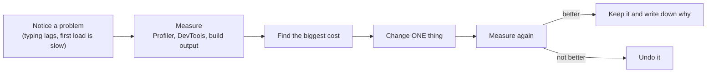
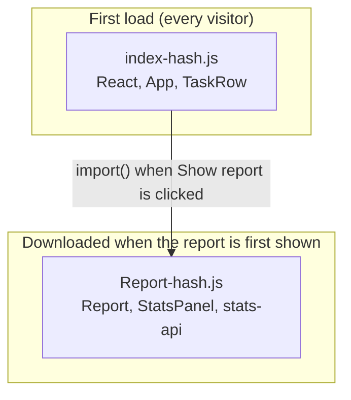

# 08. Performance (memo, code splitting, Suspense)

> **Draft: written but not yet run.** The code and the expected output in this lesson were prepared by reading the code and the official documentation. They have not been executed yet. If something does not behave as described, trust your tool's real output and report it.

## What you will be able to do
- measure before you optimise: React DevTools, the `Profiler` component and the build output;
- stop needless redraws with `memo`, `useCallback` and `useMemo`, and say why each one is needed;
- keep typing responsive with `useDeferredValue`;
- split code with `lazy` and show a loading state with `Suspense`, including data read with `use`.

## Recap
1. In lesson 01 `memo` skipped redraws only when the props were the same. What counts as "the same"? <details><summary>Answer</summary>Each prop is compared with <code>Object.is</code> (a shallow comparison): a new object, array or function on every draw counts as a change.</details>
2. Which statuses does `describeError` treat as retryable? <details><summary>Answer</summary>429, 5xx and network failures (lesson 07 recap).</details>

## Why it matters
Most React screens are fast without any tuning. Slow ones usually have one of three causes: a big list that redraws on every keystroke, a first download that is too large, or a screen that waits for data before it shows anything. Each has a different tool, and each tool has a cost (more code, stale values, harder reading). The rule of this lesson: **measure, change one thing, measure again**. The capstone's goal (TDD 3.3) is "initial JavaScript under 250 kB gzip, every route except login lazy-loaded"; you can only know whether you met it by reading the build output.

## What you will build
Project `perf-lab`: a list of 2000 tasks with a filter box, a click counter that has nothing to do with the list, a "Log row commits" button that counts how many rows were drawn, a lazily loaded **Report** panel and a **Suspense** boundary around data read with `use`. No backend is needed.

## Before you start
- Time: 80 minutes. New folder `code101/perf-lab`. Use a desktop browser with the **React Developer Tools** extension (optional but recommended).
- Unchanged: `vite.config.ts`, the three `tsconfig` files, `.gitignore` and `src/main.tsx` (lesson 07, which took them from lesson 01).
- Source pack (optional): every file is shown in full in this lesson, so you can follow without it. The finished code, the exercise starter and the solution are in the
  course repository https://github.com/Uee03/Code101 under `source/react/201-hero-to-super-hero/phase-3-architecture-and-quality/08-performance/` (on that page choose **Code, Download ZIP**, or run
  `git clone https://github.com/Uee03/Code101.git`).
- Tests are not part of this track; the counters in this lab are how you check your work.

## Steps

### Step 1. The measuring loop

| Tool | What it tells you | Where |
|---|---|---|
| React DevTools **Profiler** tab | Which components drew in a commit and how long each took | Browser extension, dev or profiling build |
| `<Profiler onRender>` component | The same numbers in code (you log them) | Built into React; **does nothing in a normal production build** |
| Browser **Performance** panel | The whole page: scripting, layout, paint | Browser DevTools |
| `npm run build` output | Size of each JavaScript file, gzip included | Terminal |

Numbers from your computer are only a comparison between your own "before" and "after". Do not copy numbers from a tutorial.

### Step 2. package.json and index.html
**File: `package.json`**
```json
{
  "name": "perf-lab",
  "private": true,
  "version": "1.0.0",
  "type": "module",
  "scripts": {
    "dev": "vite",
    "build": "tsc -b && vite build",
    "preview": "vite preview"
  },
  "dependencies": {
    "react": "19.3.1",
    "react-dom": "19.3.1"
  },
  "devDependencies": {
    "@types/node": "26.6.6",
    "@types/react": "19.3.0",
    "@types/react-dom": "19.3.0",
    "@vitejs/plugin-react": "6.3.0",
    "typescript": "5.9.3",
    "vite": "8.3.8"
  }
}
```

**File: `index.html`**
```html
<!doctype html>
<html lang="en">
  <head>
    <meta charset="UTF-8" />
    <meta name="viewport" content="width=device-width, initial-scale=1.0" />
    <title>Performance lab</title>
  </head>
  <body>
    <div id="root"></div>
    <script type="module" src="/src/main.tsx"></script>
  </body>
</html>
```
Run `npm install`. Expected result: `node_modules` and `package-lock.json` appear.

### Step 3. Data and a row counter
**File: `src/data.ts`**
```typescript
export type Task = {
  id: number;
  title: string;
  topic: string;
  done: boolean;
};

const topics = ['Write docs', 'Fix a bug', 'Review code', 'Plan the sprint', 'Update the roadmap'];

export function makeTasks(count: number): Task[] {
  return Array.from({ length: count }, (_, index) => {
    const topic = topics[index % topics.length] ?? 'Other';
    return { id: index + 1, title: `Task ${index + 1}: ${topic}`, topic, done: false };
  });
}
```
`makeTasks(2000)` makes 2000 tasks, 400 per topic. With `noUncheckedIndexedAccess` on, `topics[i]` may be `undefined` in the type, so the `?? 'Other'` keeps TypeScript happy.

**File: `src/perf.ts`**
```typescript
// Counts rows that ran their effect after a commit. A row skipped by memo does not run it.
let committedRows = 0;

export function noteRowCommit(): void {
  committedRows += 1;
}

export function takeRowCommits(): number {
  const value = committedRows;
  committedRows = 0;
  return value;
}
```
A function component that is **skipped** does not run its effects, so counting effect runs counts the rows that were really redrawn. (This is a teaching device. Never keep a counter like this in product code.)

### Step 4. The row, first without `memo`
Write the row the plain way first, so that you can see the problem.

**File: `src/components/TaskRow.tsx`** (first version, replaced in Step 9)
```tsx
import { useEffect } from 'react';
import type { Task } from '../data';
import { noteRowCommit } from '../perf';

type TaskRowProps = {
  task: Task;
  onToggle: (id: number) => void;
};

export default function TaskRow({ task, onToggle }: TaskRowProps) {
  useEffect(() => {
    noteRowCommit();
  });
  return (
    <li>
      <label>
        <input type="checkbox" checked={task.done} onChange={() => onToggle(task.id)} /> {task.title}
      </label>
    </li>
  );
}
```
The `useEffect` has **no dependency array**, so it runs after every draw of this row.

### Step 5. The lazy report and the Suspense data panel
Everything in these three files ends up in a **separate JavaScript file** that the browser downloads only when the report is first shown.

**File: `src/stats-api.ts`**
```typescript
export type Stats = {
  reviewers: number;
  averageDays: number;
};

let cached: Promise<Stats> | undefined;

// The promise is created once, outside rendering, so every render receives the same promise.
export function loadStats(): Promise<Stats> {
  cached ??= new Promise<Stats>((resolve) => {
    setTimeout(() => resolve({ reviewers: 4, averageDays: 2.5 }), 1200);
  });
  return cached;
}
```
`??=` assigns only when `cached` is still `undefined`. The 1200 ms timer stands in for a network call.

**File: `src/components/StatsPanel.tsx`**
```tsx
import { use } from 'react';
import { loadStats } from '../stats-api';

export default function StatsPanel() {
  const stats = use(loadStats());
  return (
    <p>
      {stats.reviewers} reviewers, average review time {stats.averageDays} days.
    </p>
  );
}
```
`use(promise)` reads the value of a promise **during rendering**. While the promise is pending, React **suspends** this component: it stops drawing it and shows the nearest `Suspense` fallback above it. When the promise resolves, React draws the component again with the value. There is no `useState`, no `useEffect` and no `isLoading` flag.

**File: `src/components/Report.tsx`**
```tsx
import { Suspense, useMemo } from 'react';
import type { Task } from '../data';
import StatsPanel from './StatsPanel';

type ReportProps = {
  tasks: Task[];
};

export default function Report({ tasks }: ReportProps) {
  const rows = useMemo(() => {
    const byTopic = new Map<string, { total: number; done: number }>();
    for (const task of tasks) {
      const entry = byTopic.get(task.topic) ?? { total: 0, done: 0 };
      entry.total += 1;
      if (task.done) {
        entry.done += 1;
      }
      byTopic.set(task.topic, entry);
    }
    return [...byTopic.entries()].sort(([a], [b]) => a.localeCompare(b));
  }, [tasks]);

  return (
    <section aria-labelledby="report-title" className="report">
      <h2 id="report-title">Report</h2>
      <table>
        <caption>Tasks per topic</caption>
        <thead>
          <tr>
            <th scope="col">Topic</th>
            <th scope="col">Total</th>
            <th scope="col">Done</th>
          </tr>
        </thead>
        <tbody>
          {rows.map(([topic, entry]) => (
            <tr key={topic}>
              <th scope="row">{topic}</th>
              <td>{entry.total}</td>
              <td>{entry.done}</td>
            </tr>
          ))}
        </tbody>
      </table>
      <Suspense fallback={<p role="status">Loading review statistics...</p>}>
        <StatsPanel />
      </Suspense>
    </section>
  );
}
```
The **inner** `Suspense` means the table shows at once and only the statistics line waits. Boundaries are how you decide *which part* of the page shows a loading state. `useMemo` caches the grouping until `tasks` changes.

### Step 6. The app
**File: `src/App.tsx`**
```tsx
import { Profiler, Suspense, lazy, useCallback, useDeferredValue, useMemo, useState } from 'react';
import TaskRow from './components/TaskRow';
import { makeTasks } from './data';
import { takeRowCommits } from './perf';

const Report = lazy(() => import('./components/Report'));

function logRender(id: string, phase: string, actualDuration: number) {
  console.log(`[Profiler] ${id} ${phase}: ${actualDuration.toFixed(1)} ms`);
}

export default function App() {
  const [tasks, setTasks] = useState(() => makeTasks(2000));
  const [query, setQuery] = useState('');
  const [clicks, setClicks] = useState(0);
  const [showReport, setShowReport] = useState(false);
  const deferredQuery = useDeferredValue(query);

  const visible = useMemo(() => {
    const needle = deferredQuery.trim().toLowerCase();
    return tasks.filter((task) => task.title.toLowerCase().includes(needle));
  }, [tasks, deferredQuery]);

  const toggle = useCallback((id: number) => {
    setTasks((current) => current.map((task) => (task.id === id ? { ...task, done: !task.done } : task)));
  }, []);

  return (
    <main>
      <h1>Performance lab</h1>
      <p>
        <label htmlFor="query">Filter tasks </label>
        <input id="query" value={query} onChange={(event) => setQuery(event.target.value)} />
      </p>
      <p className="toolbar">
        <button type="button" onClick={() => setClicks((count) => count + 1)}>
          Count clicks ({clicks})
        </button>
        <button type="button" onClick={() => console.log('Rows committed since the last reading:', takeRowCommits())}>
          Log row commits
        </button>
        <button type="button" aria-expanded={showReport} onClick={() => setShowReport((open) => !open)}>
          {showReport ? 'Hide report' : 'Show report'}
        </button>
      </p>
      <p>
        Showing {visible.length} of {tasks.length} tasks{query !== deferredQuery ? ' (updating...)' : ''}
      </p>
      {showReport && (
        <Suspense fallback={<p role="status">Loading report...</p>}>
          <Report tasks={tasks} />
        </Suspense>
      )}
      <Profiler id="task-list" onRender={logRender}>
        <ul className="list">
          {visible.map((task) => (
            <TaskRow key={task.id} task={task} onToggle={toggle} />
          ))}
        </ul>
      </Profiler>
    </main>
  );
}
```
Read it top to bottom once; each part is explained in the steps that follow.
- `lazy(() => import('./components/Report'))` is declared **outside** the component, once. It is not downloaded until `Report` is first drawn.
- `useDeferredValue(query)` returns the old text while React is busy drawing the list for the new text, so the input never lags.
- `useMemo` caches the filtered list while `tasks` and the deferred text stay the same.
- `useCallback` gives `toggle` one stable identity for the whole life of the component. It uses the **functional** form `setTasks((current) => ...)` so it does not need `tasks` in its dependency list.
- `Profiler` calls `logRender` after each commit inside it.

### Step 7. The styles and main.tsx
**File: `src/styles.css`**
```css
:root {
  color-scheme: light dark;
  font-family: system-ui, sans-serif;
}

main {
  max-width: 44rem;
  margin: 0 auto;
  padding: 1rem;
}

#query {
  font: inherit;
  padding: 0.4rem;
}

.toolbar {
  display: flex;
  flex-wrap: wrap;
  gap: 0.5rem;
}

button {
  font: inherit;
  padding: 0.4rem 0.8rem;
}

.list {
  max-height: 24rem;
  overflow: auto;
  margin: 1rem 0;
  padding: 0.5rem 1rem 0.5rem 2rem;
  border: 1px solid #6b7785;
  border-radius: 0.5rem;
}

.report {
  border: 1px solid #6b7785;
  border-radius: 0.5rem;
  padding: 0.5rem 1rem;
  margin: 1rem 0;
}

table {
  border-collapse: collapse;
  width: 100%;
}

th,
td {
  border: 1px solid #6b7785;
  padding: 0.3rem 0.5rem;
  text-align: left;
}

:focus-visible {
  outline: 3px solid #0759aa;
  outline-offset: 2px;
}
```
`src/main.tsx` is unchanged from lesson 07.

### Step 8. Measure the slow version
**Folder: `perf-lab`**
```powershell
npm run dev
```
Open `http://localhost:5173/` and DevTools (F12), tab **Console**. Expected, derived from the code:
1. A line like `[Profiler] task-list mount: N ms` (the number is yours). The page shows "Showing 2000 of 2000 tasks".
2. Click **Log row commits** once. Expected: `Rows committed since the last reading: <a number about twice the row count>`. In development `StrictMode` runs every effect twice on mount (lesson 01), so the first reading is high. Reading it **resets** the counter, which is why you click once now.
3. Click **Count clicks (0)**. The label changes to `(1)`. A `[Profiler] task-list update` line appears: **the list was drawn again** although nothing in it changed.
4. Click **Log row commits**. Expected: `Rows committed since the last reading: 2000`. Every row ran again. That is the problem: `App` drew again (its `clicks` state changed), so each `TaskRow` drew again, because by default a child is drawn whenever its parent is.
5. Tick one checkbox, then click **Log row commits**. Expected: `2000` again, although one task changed.

> The numbers 2000 are derived from the code, not measured here. The millisecond values in the Profiler lines depend on your computer; compare them with your own "after".

### Step 9. Skip the unchanged rows with `memo`
Replace the whole row file.

**File: `src/components/TaskRow.tsx`**
```tsx
import { memo, useEffect } from 'react';
import type { Task } from '../data';
import { noteRowCommit } from '../perf';

type TaskRowProps = {
  task: Task;
  onToggle: (id: number) => void;
};

const TaskRow = memo(function TaskRow({ task, onToggle }: TaskRowProps) {
  useEffect(() => {
    noteRowCommit();
  });
  return (
    <li>
      <label>
        <input type="checkbox" checked={task.done} onChange={() => onToggle(task.id)} /> {task.title}
      </label>
    </li>
  );
});

export default TaskRow;
```
`memo(Component)` remembers the last props and **skips drawing** when every prop is `Object.is`-equal to the last time. Look at what the parent passes:
- `task`: `toggle` replaces **only the changed task** (`{ ...task, done: !task.done }`) and keeps the other 1999 objects, so their identity does not change.
- `onToggle`: `useCallback` with an empty list returns the **same function** every time. Without it, `App` would create a new `toggle` on every draw, every prop would "change", and `memo` would do nothing but cost a comparison.

Save, wait for the page to reload, then repeat Step 8 items 2 to 5. Expected: after **Count clicks** the reading is `0`; after ticking one checkbox the reading is `1`. The `[Profiler]` line for the count click now takes less time (compare with your own earlier value).

### Step 10. Typing stays responsive: `useDeferredValue` and `useMemo`
Type `docs` in the filter box. Expected:
- The text appears in the box without waiting for the list. For a moment the line above the list reads "Showing 2000 of 2000 tasks (updating...)", then "Showing 400 of 2000 tasks" (400 tasks have the topic "Write docs").
- `query` is the **urgent** value (the box); `deferredQuery` is the **background** value that lags behind it. React draws the list for the old text first, keeps the input responsive, then draws the list for the new text, and it may **throw away** a background draw if you type again. That is why `query !== deferredQuery` is a reliable "still updating" signal.
- `useMemo` filters only when `tasks` or `deferredQuery` changes, not when you click **Count clicks**.

### Step 11. Split the code: `lazy` and `Suspense`
Click **Show report**. Expected: for a moment "Loading report..." (while the browser downloads the separate file; on `localhost` this is very quick), then the table "Tasks per topic" with five rows of 400 tasks each and 0 done, and under it "Loading review statistics..." for about 1.2 seconds, then "4 reviewers, average review time 2.5 days." Tick a few tasks, hide and show the report: the **Done** numbers follow your ticks, and the statistics appear **at once** the second time because `loadStats()` returns the same, already resolved promise.

Now stop the dev server (Ctrl+C) and build:
**Folder: `perf-lab`**
```powershell
npm run build
```
Expected (typical shape; names, hashes and sizes differ): a list of files under `dist/assets/`, including one `index-<hash>.js` and a **separate** `Report-<hash>.js`, each with a `gzip:` size. The separate file exists because `import('./components/Report')` is a **dynamic import**: the bundler cuts a new file there. In this lab the report is small, so the saving is small; the same pattern saves real weight for a chart library, a rich-text editor or a whole admin area.



## Run it
**Folder: `perf-lab`**
```powershell
npm run dev
```
Do this checklist once with the finished code (Step 9 applied). Expected results are derived from the code:
| Action | Console reading after "Log row commits" |
|---|---|
| Page load, then read once (reset) | a high number (StrictMode doubles the mount effects), ignore it |
| Click "Count clicks" | `0` |
| Tick one task | `1` |
| Type `docs` in the filter, then read | `0`: typing a longer text only removes rows, and the rows that stay keep their props, so `memo` skips them (deleting characters again would mount rows and give a positive number) |
| Show report | `0` (the report is outside the list) |

Then run `npm run build` and `npm run preview` (it serves the production build on port 4173 by default). Expected: the page works the same, but **no `[Profiler]` lines** appear, because `Profiler` is switched off in production builds.

## How it works
- **Render and commit.** *Rendering* is React calling your function to find out what the screen should look like. *Committing* is applying the difference to the page. A component can render without changing anything on screen; the cost you pay is the render. By default, when a component renders, **all its children render too**.
- **`memo`** skips the render of a child when its props are equal to last time. It is a hint plus a shallow comparison, not a guarantee.
- **Stable references.** `memo` only helps if the props really stay the same. Objects, arrays and functions created inside a component are new on every render. `useCallback` and `useMemo` keep one instance; in a functional `setState` you do not need the value in the dependency list.
- **`useDeferredValue`** lets a part of the screen lag behind a fast-changing value. It does not make work faster; it **reorders** work so the urgent part (the input) goes first.
- **`lazy` + `Suspense`.** `lazy` turns a dynamic `import()` into a component. While the file loads, React suspends the component and shows the fallback of the nearest `Suspense` above it. `lazy` needs a **default export**.
- **`use(promise)`** does the same for data. The promise must live **outside** the render function (a cache, a module, a library such as TanStack Query's `useSuspenseQuery`). A promise created inside the component is new on every render, so it never settles from React's point of view.
- **A rejected promise** is thrown to the nearest **error boundary** (lesson 05), so wrap the `Suspense` in one in a real app.

### Why this, not that
| Choice | Reason |
|---|---|
| Measure first | Optimising code that is not slow adds complexity and bugs for nothing |
| `memo` on the **row**, not on `App` | The row is repeated 2000 times; skipping it is where the saving is |
| `useCallback` only for a function passed to a `memo` child | A stable function that nothing compares is wasted code |
| `useDeferredValue` over a debounce timer | No guessed delay; React drops outdated background work itself. A debounce is still right when each change causes a **network request** |
| Virtualising (rendering only visible rows, for example TanStack Virtual) | The next step for lists of many thousands; more code, so do it only after the measurements above say so |
| React Compiler | A build tool that adds `memo`-like caching automatically (see https://react.dev/learn/react-compiler). It reduces hand-written `useMemo`/`useCallback`, but it needs a build setup and you still need to measure. This lab keeps the manual tools so that you understand what they do |
| `lazy` per **route** | A route is a natural boundary: nobody needs the admin screen to read the login page |

**Common misconception:** "wrap everything in `memo` and `useCallback`." Every `memo` costs a comparison on each render and makes code harder to read. Use it where a measurement shows a repeated component redrawing for nothing.

## Try it
Starter: `exercise/starter/src/App.tsx` (one TODO).
1. **Guided.** Load the report code **before** the click: give the import a name, pass it to `lazy`, and call it when the pointer enters or the keyboard focuses the "Show report" button. Expected: in the DevTools **Network** tab the `Report-<hash>.js` request appears when you hover the button (in development the file name is the source path), and the click then shows the report without the "Loading report..." line.
2. **Change.** In `App.tsx`, replace `onToggle={toggle}` with `onToggle={(id) => toggle(id)}`. **Predict** the reading after "Count clicks", then check it, then explain it and undo the change.
3. **Stretch (optional).** The list has 2000 rows. Find out (with the Profiler) how long a mount takes on your computer. Decide what you would do at 50,000 rows, and which of the tools in this lesson would **not** be enough.

<details><summary>Solution</summary>

**File: `exercise/solution/src/App.tsx`** (the part that changes; the rest of the file is as in Step 6)
```tsx
// Importing the same module twice is free: the second call returns the module that is already loading or loaded.
const loadReport = () => import('./components/Report');
const Report = lazy(loadReport);
```
and the button:
```tsx
        <button
          type="button"
          aria-expanded={showReport}
          onPointerEnter={() => void loadReport()}
          onFocus={() => void loadReport()}
          onClick={() => setShowReport((open) => !open)}
        >
          {showReport ? 'Hide report' : 'Show report'}
        </button>
```
Rung 2: the inline arrow function is a **new function on every render of `App`**, so every row's `onToggle` prop changes and `memo` skips nothing: the reading goes back to `2000`.
Rung 3: with 50,000 rows the DOM itself (50,000 list items) is the cost, which `memo` cannot remove; the answer is to render only the visible rows (virtualisation) or to page the data (the platform API pages with `limit` and `page.nextCursor`).

</details>

## Check yourself
1. Why does `Count clicks` redraw the list in the first version? <details><summary>Answer</summary>`App` re-renders because its state changed, and a re-rendering parent re-renders all its children unless they are wrapped in `memo` with unchanged props.</details>
2. What happens to `memo` if `App` creates `toggle` without `useCallback`? <details><summary>Answer</summary>A new function on every render makes the `onToggle` prop different every time, so every row renders again.</details>
3. Why must the promise for `use` be created outside the component? <details><summary>Answer</summary>A promise created in the render is a new promise on every render; React would suspend again and again and never finish.</details>
4. Predict: you remove `Suspense` from around `<Report>`. What does React report? <details><summary>Answer</summary>An error such as "A React component suspended while rendering, but no fallback UI was specified" (typical message): a suspending component needs a `Suspense` boundary above it.</details>

## Common mistakes
| Symptom or error text | Cause | Fix |
|---|---|---|
| `Element type is invalid. Received a promise that resolves to: [object Module]` (typical message) | The lazily imported file has no `export default` | Add a default export, or map it: `import('./X').then((m) => ({ default: m.X }))` |
| `A React component suspended while rendering, but no fallback UI was specified` (typical message) | No `Suspense` above a `lazy` or `use` component | Wrap it in `<Suspense fallback={...}>` |
| The report spinner never ends and the console warns about an uncached promise (typical) | `use(fetchStats())` where `fetchStats` creates a new promise each call | Cache the promise outside rendering, or use a library with Suspense support |
| `memo` seems to do nothing | An inline object, array or function is passed as a prop | Keep it stable with `useCallback`, `useMemo`, or move it outside the component |
| No `[Profiler]` lines in the console | You are looking at a production build (`npm run preview`) | Use `npm run dev` |
| The row counter shows a huge first number | `StrictMode` runs effects twice on mount in development | Read once to reset, then measure |
| `lazy` declared inside `App` | Each render creates a new lazy component, so the state resets and it reloads | Declare `lazy(...)` at module level |

## Best practice
Measure with the Profiler or the build output before and after each change, keep only changes that help, and split code at route or feature boundaries with `lazy` and `Suspense`. Source: React docs, `memo`, `lazy`, `Suspense`, `use`, `Profiler` and `useDeferredValue` references on https://react.dev/reference/react

## Going further
- Where the capstone lazy-loads every route and keeps its first download small: [web-react chapter 3](../../../../capstones/web-react/tutorials/phase-3-screens/03-screens-and-state.md).
- Vite, building for production and code splitting: https://vite.dev/guide/build.html
- Optional: React Compiler, https://react.dev/learn/react-compiler

## Summary
- You measured a redraw problem with a counter and the Profiler, then fixed it with `memo` plus stable props.
- You kept typing responsive with `useDeferredValue` and cached work with `useMemo`.
- You split code with `lazy`, showed loading states with `Suspense`, and read a promise with `use`.

## Next lesson
09. Accessibility: semantic structure, keyboard use, focus management, live regions and a native dialog.
