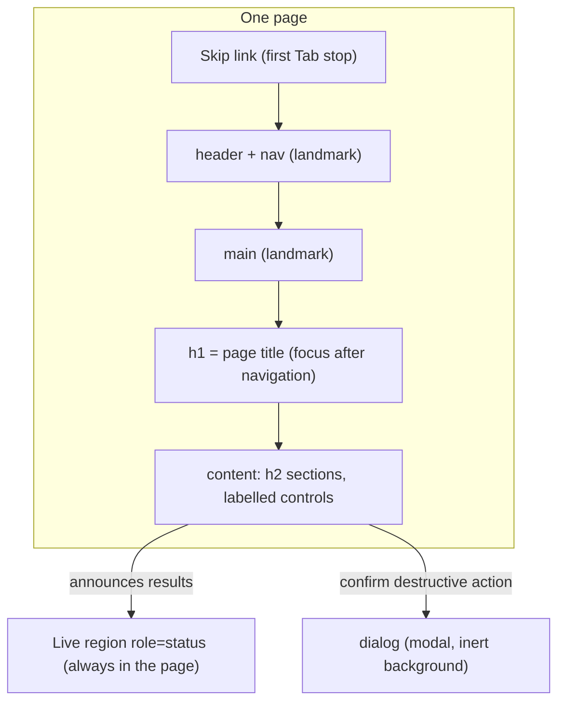

# 09. Accessibility

> **Draft: written but not yet run.** The code and the expected output in this lesson were prepared by reading the code and the official documentation. They have not been executed yet. If something does not behave as described, trust your tool's real output and report it.

## What you will be able to do
- build a page shell with a skip link, landmarks, one `h1` per page and a page title that changes on navigation;
- move keyboard focus on purpose after a route change, a move and a delete;
- announce changes with a live region that exists **before** the message;
- use the native `<dialog>` for confirmation, and replace drag and drop with a "Move to" select;
- check a screen by keyboard, zoom, colour scheme and an accessibility tree.

## Recap
1. In lesson 07, which element took focus after a failed submit, and why? <details><summary>Answer</summary>The error summary heading, so keyboard and screen reader users land on the problems; it has <code>tabIndex={-1}</code> so a script can focus it.</details>
2. Why is the red border not the only error signal? <details><summary>Answer</summary>Colour alone fails users who cannot see it; the message also has text and is tied to the field with <code>aria-describedby</code> (WCAG 1.4.1, 3.3.1).</details>

## Why it matters
Accessibility means that people who use a keyboard, a screen reader, zoom, a high-contrast mode or a small screen can do the same task as everyone else. It is also law or procurement policy in many places, and it is cheapest at the start: semantic HTML costs nothing, a bolted-on fix later costs a lot. The standard to aim for is **WCAG 2.2 level AA**. The capstone's section 7.5 lists the key criteria; this lesson builds each pattern once in a small app so that you can reuse it.

## What you will build
Project `a11y-lab`: a small task board with three columns, a "New task" form, a skip link, landmarks, route-change focus with a changing page title, a polite live region for messages, an icon-only delete button with an accessible name, a native confirmation dialog, and light, dark, reduced-motion and forced-colours styles. No backend is needed.

## Before you start
- Time: 90 minutes. New folder `code101/a11y-lab`.
- Unchanged: `vite.config.ts`, the three `tsconfig` files and `.gitignore` (lesson 01 and lesson 07).
- Icons: this course uses only its own CC0 icons from `assets/art`. You need three (`plus`, `x`, `check-circle`); their full text is in Step 3.
- Source pack (optional): every file is shown in full in this lesson, so you can follow without it. The finished code, the exercise starter and the solution are in the
  course repository https://github.com/Uee03/Code101 under `source/react/201-hero-to-super-hero/phase-3-architecture-and-quality/09-accessibility/` (on that page choose **Code, Download ZIP**, or run
  `git clone https://github.com/Uee03/Code101.git`).
- Tests are not part of this track; you check this lesson by hand, with the keyboard walk in Step 10.

## Steps

### Step 1. The checklist for this lab
| WCAG 2.2 criterion (level) | What it asks | Where this lab meets it |
|---|---|---|
| 1.1.1 Non-text content (A) | Pictures have a text alternative or are decorative | Icons are `aria-hidden`; the icon-only button has `aria-label` (Steps 3, 9) |
| 1.3.1 Info and relationships (A) | Structure is in the markup | Landmarks, headings in order, `label htmlFor` (Steps 7, 9) |
| 1.4.3, 1.4.11 Contrast (AA) | Text 4.5:1, icons and focus rings 3:1 | A small colour palette in CSS variables (Step 5) |
| 1.4.10 Reflow (AA) | Usable at 320 px width without sideways scrolling | A grid that wraps (Step 5) |
| 2.1.1, 2.1.2 Keyboard (A) | Everything works with a keyboard, no trap | Native elements; `<dialog>` (Steps 6, 9) |
| 2.4.1 Bypass blocks (A) | A way to skip repeated navigation | Skip link (Step 7) |
| 2.4.2 Page titled (A), 2.4.3 Focus order (A) | Each page has a title; focus order makes sense | `PageTitle` (Step 4) |
| 2.4.7 Focus visible (AA) | You can see where you are | `:focus-visible` outline (Step 5) |
| 2.4.11 Focus not obscured (AA, new in 2.2) | A focused item is not hidden under sticky content | No sticky header here; with one, use `scroll-padding-top` |
| 2.5.7 Dragging movements (AA, new in 2.2) | Anything done by dragging has a non-dragging alternative | "Move to" select instead of drag and drop (Step 9) |
| 2.5.8 Target size minimum (AA, new in 2.2) | Targets at least 24 by 24 CSS pixels | Buttons and selects 2.5 rem high (Step 5) |
| 3.3.1, 3.3.3 Errors (A, AA) | Say what is wrong in text and how to fix it | Field error tied with `aria-describedby` (Step 9) |
| 4.1.2 Name, role, value (A) | Controls have a name and a role | Native elements first, ARIA only when needed |
| 4.1.3 Status messages (AA) | Messages are announced without taking focus | `role="status"` region (Step 4) |

**Rule of thumb, "first rule of ARIA":** if a native element does the job (`button`, `a`, `select`, `dialog`, `label`), use it. ARIA attributes change what assistive technology is told, never what the browser does.

### Step 2. package.json and index.html
**File: `package.json`**
```json
{
  "name": "a11y-lab",
  "private": true,
  "version": "1.0.0",
  "type": "module",
  "scripts": {
    "dev": "vite",
    "build": "tsc -b && vite build",
    "preview": "vite preview"
  },
  "dependencies": {
    "react": "19.3.1",
    "react-dom": "19.3.1",
    "react-router": "8.5.2"
  },
  "devDependencies": {
    "@types/node": "26.6.6",
    "@types/react": "19.3.0",
    "@types/react-dom": "19.3.0",
    "@vitejs/plugin-react": "6.3.0",
    "typescript": "5.9.3",
    "vite": "8.3.8"
  }
}
```

**File: `index.html`**
```html
<!doctype html>
<html lang="en">
  <head>
    <meta charset="UTF-8" />
    <meta name="viewport" content="width=device-width, initial-scale=1.0" />
    <title>Accessibility lab</title>
  </head>
  <body>
    <div id="root"></div>
    <script type="module" src="/src/main.tsx"></script>
  </body>
</html>
```
`lang="en"` tells screen readers which language to speak (WCAG 3.1.1). Do not remove the `viewport` line, and never add `user-scalable=no` or `maximum-scale=1`: they block zoom. Run `npm install`. Expected result: `node_modules` and `package-lock.json` appear.

### Step 3. The icons
An SVG is a picture written as text. Create the folders `public/icons/ui` and these files; the contents are the course's CC0 (public domain) icons.

**File: `public/icons/ui/plus.svg`**
```xml
<svg xmlns="http://www.w3.org/2000/svg" viewBox="0 0 24 24" width="24" height="24" fill="none" stroke="currentColor" stroke-width="2" stroke-linecap="round" stroke-linejoin="round" role="img" aria-label="Plus">
  <line x1="12" y1="5" x2="12" y2="19"/><line x1="5" y1="12" x2="19" y2="12"/>
</svg>
```

**File: `public/icons/ui/x.svg`**
```xml
<svg xmlns="http://www.w3.org/2000/svg" viewBox="0 0 24 24" width="24" height="24" fill="none" stroke="currentColor" stroke-width="2" stroke-linecap="round" stroke-linejoin="round" role="img" aria-label="X">
  <line x1="18" y1="6" x2="6" y2="18"/><line x1="6" y1="6" x2="18" y2="18"/>
</svg>
```

**File: `public/icons/ui/check-circle.svg`**
```xml
<svg xmlns="http://www.w3.org/2000/svg" viewBox="0 0 24 24" width="24" height="24" fill="none" stroke="currentColor" stroke-width="2" stroke-linecap="round" stroke-linejoin="round" role="img" aria-label="Check Circle">
  <path d="M22 11.08V12a10 10 0 1 1-5.93-9.14"/><polyline points="22 4 12 14.01 9 11.01"/>
</svg>
```
Also copy `LICENSE-ICONS-CC0.txt` (from `assets/art` in the course repository, or from `public/icons` of your 101 lesson 10 project) to `public/icons/LICENSE-ICONS-CC0.txt` and keep it next to the icons. It is not shown here because it is only a licence text.

**File: `src/shared/Icon.tsx`**
```tsx
export type IconName = 'plus' | 'x' | 'check-circle';

type IconProps = {
  name: IconName;
};

export default function Icon({ name }: IconProps) {
  return <span className={`icon icon-${name}`} aria-hidden="true" />;
}
```
The component draws an empty `span`; CSS paints the shape (Step 5). `aria-hidden="true"` hides it from screen readers because it is **decorative**: the text beside it, or an `aria-label` on the button around it, says what it means.

### Step 4. The page heading and the live region
**File: `src/core/PageTitle.tsx`**
```tsx
import { useEffect, useRef } from 'react';
import { useNavigationType } from 'react-router';

type PageTitleProps = {
  children: string;
};

// The page heading: sets the document title and, after a link navigation, moves keyboard focus to the heading.
export default function PageTitle({ children }: PageTitleProps) {
  const heading = useRef<HTMLHeadingElement>(null);
  const navigationType = useNavigationType();

  useEffect(() => {
    document.title = `${children} - Task board`;
  }, [children]);

  useEffect(() => {
    if (navigationType !== 'POP') {
      heading.current?.focus();
    }
  }, [navigationType]);

  return (
    <h1 ref={heading} tabIndex={-1}>
      {children}
    </h1>
  );
}
```
A single-page app never reloads, so the browser does not do what it does on a normal page load (announce the new title, reset focus to the top). `PageTitle` does it by hand:
- the **title** changes (2.4.2) because it is what the browser tab, the history and screen readers use to name the page;
- after a **link click** (`PUSH` or `REPLACE`) the `h1` takes focus, so a screen reader reads the new page's heading and the next Tab starts below it. `tabIndex={-1}` makes it focusable by script without adding it to the Tab order;
- on the **first load** and on **back/forward** (`POP`) it does not steal focus.
Using the navigation type instead of "is this the first run?" also keeps it correct under `StrictMode`, which runs effects twice in development.

**File: `src/core/toast.tsx`**
```tsx
import { createContext, useCallback, useContext, useMemo, useRef, useState, type ReactNode } from 'react';
import Icon from '../shared/Icon';

type ToastApi = {
  show: (message: string) => void;
};

const ToastContext = createContext<ToastApi | null>(null);

export function ToastProvider({ children }: { children: ReactNode }) {
  const [message, setMessage] = useState('');
  const timer = useRef<number | undefined>(undefined);

  const show = useCallback((text: string) => {
    window.clearTimeout(timer.current);
    setMessage(text);
    timer.current = window.setTimeout(() => setMessage(''), 6000);
  }, []);
  const api = useMemo(() => ({ show }), [show]);

  return (
    <ToastContext.Provider value={api}>
      {children}
      <div role="status" className="toast-region">
        {message && (
          <p className="toast">
            <Icon name="check-circle" />
            {message}
          </p>
        )}
      </div>
    </ToastContext.Provider>
  );
}

export function useToast(): ToastApi {
  const value = useContext(ToastContext);
  if (!value) {
    throw new Error('useToast must be used inside ToastProvider');
  }
  return value;
}
```
- **`role="status"`** is a polite live region: screen readers say its new text after they finish what they are saying, without moving focus (4.1.3).
- The `div` with the role is **always** in the page; only the text inside appears and disappears. Screen readers watch an existing region for **changes**; a region that is created together with its text is often not announced. This is the most common live-region bug (the exercise starter has it).
- `useCallback` and `useMemo` keep `show` and the context value stable (lesson 08), so a component that only calls `show` does not redraw when the message changes.
- The message disappears after six seconds, which is only acceptable because the same information is not the **only** way to learn the result; anything the user must act on belongs in the page, not in a timed message.

### Step 5. Styles that carry accessibility
**File: `src/styles.css`**
```css
:root {
  color-scheme: light dark;
  --fg: #17212b;
  --bg: #ffffff;
  --header-bg: #e7f0fa;
  --link: #0759aa;
  --danger: #a11a1a;
  --border: #6b7785;
  --focus: #0759aa;
  font-family: system-ui, sans-serif;
}

@media (prefers-color-scheme: dark) {
  :root {
    --fg: #e6edf3;
    --bg: #0f1720;
    --header-bg: #1d2b3a;
    --link: #7db8ff;
    --danger: #ff9b9b;
    --border: #8b98a5;
    --focus: #7db8ff;
  }
}

body {
  margin: 0;
  color: var(--fg);
  background: var(--bg);
}

a {
  color: var(--link);
}

.skip-link {
  position: absolute;
  left: 0.5rem;
  top: -4rem;
  padding: 0.5rem 1rem;
  background: var(--bg);
  border: 2px solid var(--focus);
  z-index: 10;
}

.skip-link:focus {
  top: 0.5rem;
}

.visually-hidden {
  position: absolute;
  width: 1px;
  height: 1px;
  overflow: hidden;
  clip-path: inset(50%);
  white-space: nowrap;
}

header {
  padding: 0.5rem 1rem;
  background: var(--header-bg);
}

nav {
  display: flex;
  gap: 1rem;
}

nav a {
  display: inline-block;
  padding: 0.5rem 0.25rem;
}

nav a[aria-current='page'] {
  font-weight: bold;
  text-decoration: underline;
}

main {
  max-width: 60rem;
  margin: 0 auto;
  padding: 1rem;
}

main:focus {
  outline: none;
}

button,
select,
input {
  font: inherit;
  min-height: 2.5rem;
  box-sizing: border-box;
  color: var(--fg);
  background: var(--bg);
  border: 2px solid var(--border);
  border-radius: 0.4rem;
}

button {
  padding: 0.4rem 0.8rem;
  cursor: pointer;
}

input {
  display: block;
  width: 100%;
  max-width: 28rem;
  margin: 0.25rem 0 0.5rem;
  padding: 0.4rem;
}

label {
  font-weight: bold;
}

input[aria-invalid='true'] {
  border-color: var(--danger);
}

.error {
  margin: 0.25rem 0 0.5rem;
  color: var(--danger);
  font-weight: bold;
}

.columns {
  display: grid;
  grid-template-columns: repeat(auto-fit, minmax(14rem, 1fr));
  gap: 1rem;
}

.column ul {
  list-style: none;
  margin: 0;
  padding: 0;
}

.card {
  display: grid;
  grid-template-columns: 1fr auto;
  gap: 0.5rem;
  align-items: center;
  margin: 0.5rem 0;
  padding: 0.5rem;
  border: 1px solid var(--border);
  border-radius: 0.5rem;
}

.card-title {
  grid-column: 1 / -1;
}

.card select {
  max-width: 100%;
}

.icon-button {
  width: 2.5rem;
  padding: 0;
}

.icon {
  display: inline-block;
  width: 1.25rem;
  height: 1.25rem;
  margin-inline-end: 0.35rem;
  vertical-align: middle;
  background-color: currentColor;
  mask-size: contain;
  mask-repeat: no-repeat;
  mask-position: center;
}

.icon-button .icon {
  margin-inline-end: 0;
}

.icon-plus {
  mask-image: url('/icons/ui/plus.svg');
}

.icon-x {
  mask-image: url('/icons/ui/x.svg');
}

.icon-check-circle {
  mask-image: url('/icons/ui/check-circle.svg');
}

dialog {
  max-width: min(28rem, 90vw);
  color: var(--fg);
  background: var(--bg);
  border: 2px solid var(--border);
  border-radius: 0.5rem;
}

dialog::backdrop {
  background: rgb(0 0 0 / 50%);
}

.actions {
  display: flex;
  gap: 0.5rem;
  justify-content: flex-end;
}

.danger {
  border-color: var(--danger);
}

.toast-region {
  position: fixed;
  left: 1rem;
  bottom: 1rem;
  right: 1rem;
}

.toast {
  display: inline-block;
  margin: 0;
  padding: 0.5rem 1rem;
  color: var(--fg);
  background: var(--header-bg);
  border: 2px solid var(--border);
  border-radius: 0.5rem;
  animation: toast-in 200ms ease-out;
}

@keyframes toast-in {
  from {
    opacity: 0;
    transform: translateY(0.5rem);
  }
}

:focus-visible {
  outline: 3px solid var(--focus);
  outline-offset: 2px;
}

@media (prefers-reduced-motion: reduce) {
  .toast {
    animation: none;
  }
}

@media (forced-colors: active) {
  .icon {
    background-color: CanvasText;
    forced-color-adjust: none;
  }
}
```
What each group does:
- **Colour variables and `prefers-color-scheme`**: light and dark palettes with one set of names. The pairs were chosen to be well above the 4.5:1 text and 3:1 border/focus targets, but **you must check them**: in Chrome or Edge DevTools, select an element, open the **Styles** pane, click the colour swatch and read the contrast ratio.
- **`.skip-link`**: placed off screen at the top and moved on screen only while it has focus. It must be the **first** focusable element on the page.
- **`.visually-hidden`**: hides text from the eyes but keeps it for screen readers. (`display: none` and `visibility: hidden` hide it from both.)
- **`main:focus { outline: none }`**: `main` is focused only by script (the skip link), and it is not an interactive control, so no ring is needed. Never remove the outline from a control that a user can Tab to.
- **`min-height: 2.5rem`** on buttons, selects and inputs, and a 2.5 rem wide icon button: far above the 24 by 24 CSS pixel minimum (2.5.8).
- **`.columns`**: `repeat(auto-fit, minmax(14rem, 1fr))` puts as many columns as fit and wraps the rest below, so at 320 px width the columns stack and nothing scrolls sideways (1.4.10).
- **`.icon`** uses the SVG as a **mask** over `currentColor`, so the icon follows the text colour in light, dark and disabled states. The path starts with `/` so it is served from the `public` folder.
- **`:focus-visible`** draws the ring for keyboard focus and for script focus after keyboard use, and not for mouse clicks on buttons (2.4.7).
- **`prefers-reduced-motion`** turns the toast animation off for people who ask their system for less motion.
- **`forced-colors: active`** (Windows High Contrast): the browser replaces your colours with system colours; a mask icon painted with a background colour would disappear, so the icon uses the system colour `CanvasText`.

### Step 6. The dialog
**File: `src/shared/ConfirmDialog.tsx`**
```tsx
import { useEffect, useRef } from 'react';

type ConfirmDialogProps = {
  open: boolean;
  title: string;
  message: string;
  confirmLabel: string;
  onConfirm: () => void;
  onCancel: () => void;
};

export default function ConfirmDialog({ open, title, message, confirmLabel, onConfirm, onCancel }: ConfirmDialogProps) {
  const dialog = useRef<HTMLDialogElement>(null);

  useEffect(() => {
    const element = dialog.current;
    if (!element) {
      return;
    }
    if (open && !element.open) {
      element.showModal();
    }
    if (!open && element.open) {
      element.close();
    }
  }, [open]);

  return (
    <dialog
      ref={dialog}
      aria-labelledby="confirm-title"
      aria-describedby="confirm-message"
      onCancel={(event) => {
        event.preventDefault();
        onCancel();
      }}
    >
      <h2 id="confirm-title">{title}</h2>
      <p id="confirm-message">{message}</p>
      <div className="actions">
        <button type="button" onClick={onCancel}>
          Cancel
        </button>
        <button type="button" className="danger" onClick={onConfirm}>
          {confirmLabel}
        </button>
      </div>
    </dialog>
  );
}
```
`dialog.showModal()` gives you, for free: the rest of the page becomes **inert** (cannot be clicked, tabbed to or read in the page's reading order), focus moves **into** the dialog and cannot leave it, `Esc` closes it, and when it closes focus returns to the element that opened it. A hand-made `div` with `role="dialog"` needs a script for each of those.
- The effect keeps the browser's open state in sync with the React prop `open`.
- The browser fires a `cancel` event when `Esc` is pressed. We call `preventDefault()` and `onCancel()` so that **React state stays the single source of truth**: the parent sets `open` to `false` and the effect closes the dialog.
- The first focusable element, **Cancel**, gets the initial focus: for a destructive action the safe choice should be the default.
- `aria-labelledby` and `aria-describedby` give the dialog its name (the title) and description (the message).

### Step 7. The shell, the router and main.tsx
**File: `src/Shell.tsx`**
```tsx
import { NavLink, Outlet } from 'react-router';

export default function Shell() {
  return (
    <>
      <a className="skip-link" href="#main">
        Skip to main content
      </a>
      <header>
        <nav aria-label="Main">
          <NavLink to="/" end>
            Tasks
          </NavLink>
          <NavLink to="/help">Help</NavLink>
        </nav>
      </header>
      <main id="main" tabIndex={-1}>
        <Outlet />
      </main>
    </>
  );
}
```
- The **landmarks** `header`, `nav` and `main` let screen reader users jump straight to the part they want. A page has one `main`. `aria-label="Main"` names the navigation (useful once a page has more than one).
- `NavLink` adds `aria-current="page"` to the link of the current page, and the CSS in Step 5 uses it to mark the link in more than colour.
- The skip link points at `#main`; `tabIndex={-1}` on `main` lets the browser move focus there, so the **next Tab** goes to the first control inside it.

**File: `src/router.tsx`**
```tsx
import { createBrowserRouter } from 'react-router';
import Shell from './Shell';
import Help from './pages/Help';
import NotFound from './pages/NotFound';
import Tasks from './pages/Tasks';

export const router = createBrowserRouter([
  {
    element: <Shell />,
    children: [
      { index: true, element: <Tasks /> },
      { path: 'help', element: <Help /> },
      { path: '*', element: <NotFound /> },
    ],
  },
]);
```

**File: `src/main.tsx`**
```tsx
import { StrictMode } from 'react';
import { createRoot } from 'react-dom/client';
import { RouterProvider } from 'react-router/dom';
import { ToastProvider } from './core/toast';
import { router } from './router';
import './styles.css';

createRoot(document.getElementById('root')!).render(
  <StrictMode>
    <ToastProvider>
      <RouterProvider router={router} />
    </ToastProvider>
  </StrictMode>,
);
```
The toast provider is outside the router, so its live region stays in the page when the route changes.

### Step 8. The pages
**File: `src/pages/Help.tsx`**
```tsx
import PageTitle from '../core/PageTitle';

export default function Help() {
  return (
    <>
      <PageTitle>Help</PageTitle>
      <p>Use this page to practise the keyboard walk. Press Tab and watch where the focus ring goes.</p>
      <h2>Keyboard checklist</h2>
      <ol>
        <li>Press Tab once after the page loads: the "Skip to main content" link appears.</li>
        <li>Open a page from the menu with Enter: focus moves to the page heading.</li>
        <li>On the Tasks page, change a task with the select box only (no mouse).</li>
        <li>Press the delete button, then Escape: the dialog closes and focus returns to the button.</li>
      </ol>
    </>
  );
}
```

**File: `src/pages/NotFound.tsx`**
```tsx
import { Link } from 'react-router';
import PageTitle from '../core/PageTitle';

export default function NotFound() {
  return (
    <>
      <PageTitle>Not found</PageTitle>
      <p>This page is not available.</p>
      <Link to="/">Back to the tasks</Link>
    </>
  );
}
```

### Step 9. The Tasks page
**File: `src/pages/Tasks.tsx`**
```tsx
import { useEffect, useRef, useState, type FormEvent } from 'react';
import PageTitle from '../core/PageTitle';
import { useToast } from '../core/toast';
import ConfirmDialog from '../shared/ConfirmDialog';
import Icon from '../shared/Icon';

type Status = 'todo' | 'doing' | 'done';
type Task = { id: number; title: string; status: Status };

const columns: { value: Status; label: string }[] = [
  { value: 'todo', label: 'To do' },
  { value: 'doing', label: 'Doing' },
  { value: 'done', label: 'Done' },
];

const initialTasks: Task[] = [
  { id: 1, title: 'Write the release notes', status: 'todo' },
  { id: 2, title: 'Fix the login redirect', status: 'doing' },
  { id: 3, title: 'Review the pull request', status: 'doing' },
  { id: 4, title: 'Plan the sprint', status: 'done' },
];

function isStatus(value: string): value is Status {
  return value === 'todo' || value === 'doing' || value === 'done';
}

function labelOf(status: Status): string {
  return columns.find((column) => column.value === status)?.label ?? status;
}

export default function Tasks() {
  const [tasks, setTasks] = useState<Task[]>(initialTasks);
  const [title, setTitle] = useState('');
  const [error, setError] = useState('');
  const [pendingDelete, setPendingDelete] = useState<Task | null>(null);
  const toast = useToast();
  const titleInput = useRef<HTMLInputElement>(null);
  const nextId = useRef(initialTasks.length + 1);
  const focusAfterRender = useRef<string | null>(null);

  useEffect(() => {
    if (focusAfterRender.current) {
      document.getElementById(focusAfterRender.current)?.focus();
      focusAfterRender.current = null;
    }
  }, [tasks]);

  function addTask(event: FormEvent<HTMLFormElement>) {
    event.preventDefault();
    const clean = title.trim();
    if (clean === '') {
      setError('Enter a title.');
      titleInput.current?.focus();
      return;
    }
    setError('');
    const id = nextId.current;
    nextId.current += 1;
    setTasks((current) => [...current, { id, title: clean, status: 'todo' }]);
    setTitle('');
    toast.show(`Added "${clean}" to To do.`);
  }

  function moveTask(task: Task, status: Status) {
    focusAfterRender.current = `move-${task.id}`;
    setTasks((current) => current.map((item) => (item.id === task.id ? { ...item, status } : item)));
    toast.show(`Moved "${task.title}" to ${labelOf(status)}.`);
  }

  function confirmDelete() {
    if (!pendingDelete) {
      return;
    }
    const removed = pendingDelete;
    focusAfterRender.current = 'board-heading';
    setTasks((current) => current.filter((item) => item.id !== removed.id));
    setPendingDelete(null);
    toast.show(`Deleted "${removed.title}".`);
  }

  return (
    <>
      <PageTitle>Tasks</PageTitle>
      <section aria-labelledby="new-task-heading">
        <h2 id="new-task-heading">New task</h2>
        <form onSubmit={addTask} noValidate>
          <label htmlFor="new-title">Title</label>
          <input
            id="new-title"
            ref={titleInput}
            value={title}
            onChange={(event) => setTitle(event.target.value)}
            aria-invalid={error !== ''}
            aria-describedby={error ? 'new-title-error' : undefined}
            autoComplete="off"
          />
          {error && (
            <p id="new-title-error" className="error">
              <span className="visually-hidden">Error: </span>
              {error}
            </p>
          )}
          <button type="submit">
            <Icon name="plus" />
            Add task
          </button>
        </form>
      </section>
      <h2 id="board-heading" tabIndex={-1}>
        Board
      </h2>
      <div className="columns">
        {columns.map((column) => {
          const items = tasks.filter((task) => task.status === column.value);
          return (
            <section key={column.value} aria-labelledby={`column-${column.value}`} className="column">
              <h3 id={`column-${column.value}`}>
                {column.label} ({items.length})
              </h3>
              {items.length === 0 ? (
                <p>No tasks.</p>
              ) : (
                <ul>
                  {items.map((task) => (
                    <li key={task.id} className="card">
                      <span className="card-title">{task.title}</span>
                      <label htmlFor={`move-${task.id}`} className="visually-hidden">
                        Move {task.title} to
                      </label>
                      <select
                        id={`move-${task.id}`}
                        value={task.status}
                        onChange={(event) => {
                          const next = event.target.value;
                          if (isStatus(next)) {
                            moveTask(task, next);
                          }
                        }}
                      >
                        {columns.map((option) => (
                          <option key={option.value} value={option.value}>
                            {option.label}
                          </option>
                        ))}
                      </select>
                      <button
                        type="button"
                        className="icon-button"
                        aria-label={`Delete ${task.title}`}
                        onClick={() => setPendingDelete(task)}
                      >
                        <Icon name="x" />
                      </button>
                    </li>
                  ))}
                </ul>
              )}
            </section>
          );
        })}
      </div>
      <ConfirmDialog
        open={pendingDelete !== null}
        title="Delete this task?"
        message={pendingDelete ? `"${pendingDelete.title}" will be removed. This cannot be undone.` : ''}
        confirmLabel="Delete"
        onConfirm={confirmDelete}
        onCancel={() => setPendingDelete(null)}
      />
    </>
  );
}
```
Where each pattern is:
- **Structure.** `PageTitle` is the one `h1`; sections use `h2`; columns use `h3`. Headings are in order and each `section` is named by its heading with `aria-labelledby`.
- **Form error (3.3.1).** On an empty title the page sets `error`, **focuses the input** and ties the message to it with `aria-describedby`; `aria-invalid` marks the value; the word "Error:" is visually hidden but read aloud. The error is text, so colour is not the only signal.
- **No drag and drop (2.5.7).** Moving a card is a `select` with a hidden but real `label` ("Move Fix the login redirect to"). A select works with a keyboard, a screen reader, touch and voice control, which a drag does not.
- **Focus after a move.** When a task changes column, its `select` is removed from one list and created in another, so the browser loses the focus. `focusAfterRender` remembers the id, and the effect puts focus back on the new select after React has drawn it. Without this, a keyboard user is thrown back to the top of the page after every move.
- **Icon-only button.** The "x" has no visible text, so `aria-label="Delete Plan the sprint"` gives it a name that also says **which** task. `type="button"` stops it submitting a form.
- **Delete flow.** Pressing delete only stores the task in `pendingDelete`; the dialog opens; **Cancel** and `Esc` close it and focus returns to the button that opened it; **Delete** removes the task and sends focus to the "Board" heading (the button no longer exists, so "return focus to the opener" is impossible).
- **Messages.** Each action calls `toast.show(...)`, which the live region reads out.

### Step 10. Check by hand
This is the "test" for this lesson, and it takes about ten minutes. Run:
**Folder: `a11y-lab`**
```powershell
npm run dev
```
Open `http://localhost:5173/`. Put the mouse aside. Expected results, derived from the code:
1. **Tab** once: the "Skip to main content" link slides into the top-left corner with a border. Press **Enter**, then **Tab**: focus lands on the Title input (the first control in `main`).
2. Press **Tab** with the Title input empty, then Enter on **Add task**: the error "Error: Enter a title." appears in red under the field, and focus is back in the input. A screen reader typically reads the label, the field type and the error text.
3. Type `Test the form` and press **Enter**: the task appears under "To do (2)", the input empties and a toast "Added "Test the form" to To do." shows at the bottom left. A screen reader says the same text without moving focus.
4. Tab to a task's select. Open it with **Alt+Down** (or Space), choose another column and press Enter. Expected: the task jumps to that column, the toast says "Moved ... to ...", and **focus is still on that task's select**. Note: in some browsers the arrow keys on a **closed** select change the value at once; here that means each arrow press moves the task one column, and focus stays with it.
5. Tab to a delete button (a small "x"). Press Enter. Expected: a dialog opens in the middle over a dark backdrop and focus is on **Cancel**. Press **Tab** repeatedly: it cycles between Cancel and Delete and never reaches the page behind. Press **Esc**: the dialog closes and focus returns to the delete button. Open it again and press **Delete**: the task disappears, the "Board" heading takes focus and the toast says it was deleted.
6. Tab to **Help** and press Enter: the address changes to `/help`, the tab title reads "Help - Task board", and focus is on the "Help" heading. Use the browser's Back button: the Tasks page shows and focus is **not** forced anywhere.
7. **Zoom** the page to 200 percent, then 400 percent (Ctrl and +). Expected: no sideways scrolling at 400 percent in a 1280 px window (that equals about 320 CSS pixels); the three columns stack.
8. Switch the operating system to **dark** mode: the page follows it. In DevTools, open **Rendering** (three dots, More tools) and try **Emulate CSS media feature prefers-reduced-motion: reduce**: the toast no longer slides.
9. Optional: turn on a screen reader (Narrator on Windows with Win+Ctrl+Enter, VoiceOver on macOS with Cmd+F5) and repeat items 2 to 6. Also open the browser **Accessibility** pane in DevTools and look at the tree: you should see the landmarks, the headings, and the names "Delete Plan the sprint" and "Move Plan the sprint to".
10. Optional: an automated checker (for example the axe DevTools browser extension, or Lighthouse's Accessibility audit) finds **some** problems, such as missing labels and low contrast. It cannot tell you whether focus moves sensibly or whether the order makes sense. Use it as an addition to the walk above, not instead of it.

> This lesson's expected behaviour was derived from the code and the standards; it has not been observed in a browser or with a screen reader.

## How it works

- **Semantics first.** Native elements carry the role, name, state and keyboard behaviour for free. `label`, `button`, `select`, `dialog`, `nav`, `main` and headings are the whole toolbox of this lesson.
- **Name, role, value.** Every control must have an accessible **name** (label text, `aria-label`, or `aria-labelledby`), a **role** (what it is) and a **state** (`aria-invalid`, `aria-expanded`, `aria-current`).
- **Focus is the user's position.** When you remove or replace the element a user was on, you must put focus somewhere sensible. When you navigate, move focus to the new content's start.
- **Announce, do not interrupt.** A polite live region (`status`) reports results; an assertive one (`alert`) interrupts and is for errors that need attention now.

### Why this, not that
| Choice | Reason |
|---|---|
| Native `<dialog>` with `showModal()` | Focus trap, `Esc`, inert background and focus return are built in; a div-based dialog must re-implement and test all of them |
| "Move to" select over drag and drop | Meets WCAG 2.5.7; works with keyboard, touch, voice and screen readers. Drag may be added **in addition** |
| `aria-label` on an icon-only button | There is no visible text to name it; the label says what and which |
| Visually hidden `label` on the select | The control needs a name, and the card text already shows the title; the hidden text ties the two together |
| Always-present live region | Assistive technology listens for **changes** inside a region it already knows |
| Focus the heading after navigation | A single-page app has no page load, so you must tell users that the content changed |
| `role="status"` for messages, `role="alert"` for errors | Polite does not interrupt reading; assertive does, so keep it rare |

**Common misconception:** "accessibility is for blind users." People with low vision, motor difficulty, a broken arm, a bright sunny screen, a slow connection, a tremor, dyslexia or only a keyboard are all helped by the same patterns.

## Try it
Starter: `exercise/starter/src/core/toast.tsx` (one TODO).
1. **Guided.** The live region in the starter is created together with the message. Always render the `div` with `role="status"` and put only the message inside the condition. Expected: the page behaves as in Step 10 item 3, and a screen reader reliably announces the toast.
2. **Change.** Add a second kind of message: `show(message, 'error')`. Errors go to a `role="alert"` region, stay until the next message, and have no timer. Use it in `Tasks.tsx` when you decide a title longer than 80 characters is not allowed (you write that check).
3. **Stretch (optional).** Audit your own project from lesson 12 of the 101 course (or this one) with the Step 10 walk and write down three findings with the WCAG criterion each one breaks, and how you would fix it.

<details><summary>Solution</summary>

**File: `exercise/solution/src/core/toast.tsx`**
```tsx
import { createContext, useCallback, useContext, useMemo, useRef, useState, type ReactNode } from 'react';
import Icon from '../shared/Icon';

type ToastKind = 'status' | 'error';

type ToastApi = {
  show: (message: string, kind?: ToastKind) => void;
};

const ToastContext = createContext<ToastApi | null>(null);

export function ToastProvider({ children }: { children: ReactNode }) {
  const [messages, setMessages] = useState({ status: '', error: '' });
  const timer = useRef<number | undefined>(undefined);

  const show = useCallback((text: string, kind: ToastKind = 'status') => {
    window.clearTimeout(timer.current);
    setMessages({ status: kind === 'status' ? text : '', error: kind === 'error' ? text : '' });
    if (kind === 'status') {
      timer.current = window.setTimeout(() => setMessages({ status: '', error: '' }), 6000);
    }
  }, []);
  const api = useMemo(() => ({ show }), [show]);

  return (
    <ToastContext.Provider value={api}>
      {children}
      <div role="status" className="toast-region">
        {messages.status && (
          <p className="toast">
            <Icon name="check-circle" />
            {messages.status}
          </p>
        )}
      </div>
      <div role="alert" className="toast-region">
        {messages.error && <p className="toast">{messages.error}</p>}
      </div>
    </ToastContext.Provider>
  );
}

export function useToast(): ToastApi {
  const value = useContext(ToastContext);
  if (!value) {
    throw new Error('useToast must be used inside ToastProvider');
  }
  return value;
}
```
Both regions are always in the page. The default `kind` is `'status'`, so the existing `toast.show(message)` calls keep working. Errors have no timer because a message that vanishes by itself can be missed (WCAG 2.2.1 timing).

</details>

## Check yourself
1. Why is the `role="status"` element always rendered? <details><summary>Answer</summary>Screen readers announce changes in a live region they already know; a region created together with its text is often silent.</details>
2. After deleting a task, where does focus go and why not back to the delete button? <details><summary>Answer</summary>To the "Board" heading, because the delete button was removed with the task, so there is nothing to return to.</details>
3. A dialog made from a `div` lets Tab reach the page behind it. Which native element fixes that, and how? <details><summary>Answer</summary><code>&lt;dialog&gt;</code> opened with <code>showModal()</code>: the rest of the page becomes inert.</details>
4. Predict: you add `outline: none` to `button`. Which criterion breaks? <details><summary>Answer</summary>2.4.7 Focus visible: keyboard users can no longer see which button has focus.</details>

## Common mistakes
| Symptom or error text | Cause | Fix |
|---|---|---|
| Screen reader says nothing for a toast | The live region is created together with its message | Render the `role="status"` element always; change only its content |
| `Failed to execute 'showModal' on 'HTMLDialogElement': The element already has an 'open' attribute` (typical message) | `showModal()` called on an open dialog | Check `element.open` first, as the effect does |
| Focus jumps to the top of the page after an action | The focused element was removed or replaced | Put focus on a sensible element after the render (Step 9) |
| The page cannot be zoomed on a phone | `user-scalable=no` or `maximum-scale=1` in the viewport meta tag | Remove them |
| Icon disappears in Windows High Contrast | A mask icon painted with a background colour | Use `forced-colors: active` and a system colour (Step 5) |
| Two `h1` elements or a jump from `h1` to `h4` | Headings chosen by size | Use heading **levels** for structure; size with CSS |
| Link says only "click here" | The name does not say where it goes | Name links by their purpose ("Back to the tasks") |
| The skip link does nothing | The target `id` is missing, or the target cannot take focus | `id="main"` and `tabIndex={-1}` on `main` |

## Best practice
Start from native, semantic elements, give every control a name, keep a visible focus ring, move focus on purpose when content is added or removed, announce results in a live region that already exists, and check by keyboard and zoom before you ship. Source: WCAG 2.2 quick reference https://www.w3.org/WAI/WCAG22/quickref/ and the ARIA Authoring Practices Guide https://www.w3.org/WAI/ARIA/apg/

## Going further
- Where the capstone applies these patterns to every screen and checks them in a keyboard-only walk: [web-react chapter 4](../../../../capstones/web-react/tutorials/phase-4-errors/04-errors-and-accessibility.md).
- MDN on the dialog element: https://developer.mozilla.org/en-US/docs/Web/HTML/Reference/Elements/dialog
- WAI tutorials (forms, page structure, images): https://www.w3.org/WAI/tutorials/

## Summary
- You built a shell with a skip link, landmarks, a page title and focus management.
- You announced messages with a live region that always exists and used a native modal dialog.
- You replaced drag and drop with a select, named an icon-only button, and checked the result by keyboard, zoom and colour scheme.

## Next lesson
10. Project: a task board against the platform contract, which uses performance, forms and accessibility together with the typed client and sign-in.
