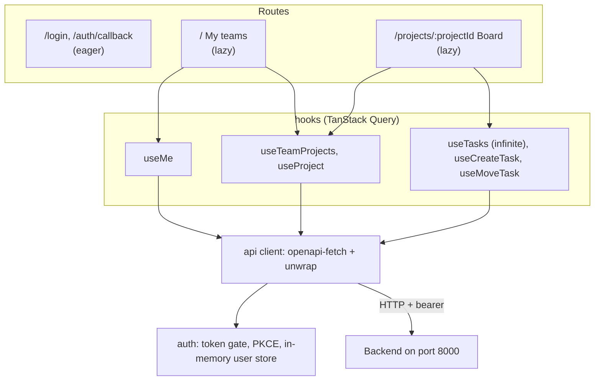
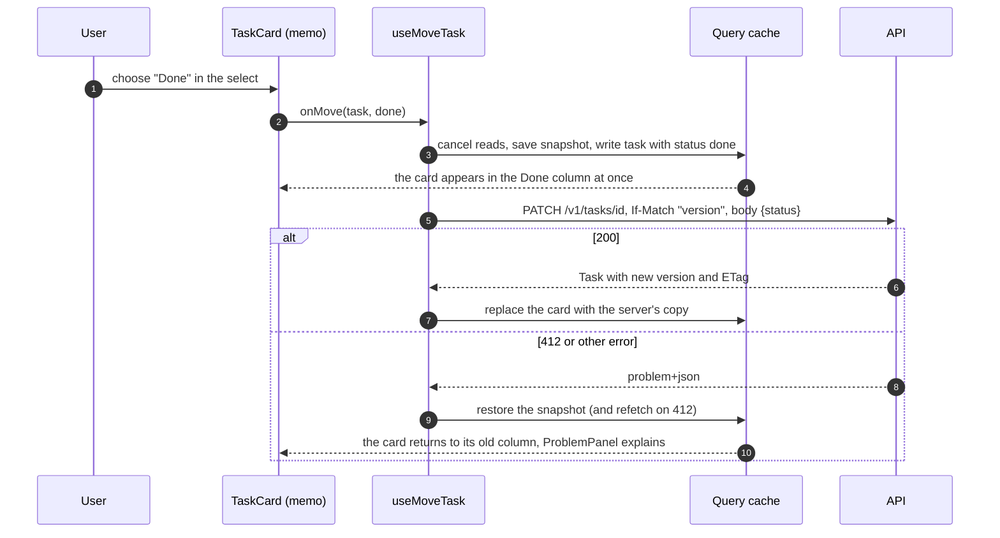

# 10. Project: a task board against the platform contract

> **Draft: written but not yet run.** The code and the expected output in this lesson were prepared by reading the code and the official documentation. They have not been executed yet. If something does not behave as described, trust your tool's real output and report it.

## What you will be able to do
- combine the typed client, sign-in, TanStack Query, forms, performance and accessibility patterns of this level in one app;
- read projects and an **infinite list** of tasks from the platform API and group them into board columns;
- move a task with an **optimistic update** that sends `If-Match`, rolls back on failure and handles a 412 conflict;
- create a task with an `Idempotency-Key` and map 422 pointers to fields;
- explain which parts of the app are the capstone's job next.

## Recap
1. Which header carries the version you are changing, and which status does the server answer when it is stale? <details><summary>Answer</summary><code>If-Match</code> with the quoted <code>ETag</code>; <code>412 Precondition Failed</code>.</details>
2. In lesson 08 `memo` only helped when props were stable. Which prop of a card must therefore be stable? <details><summary>Answer</summary>The <code>onMove</code> callback (wrap it in <code>useCallback</code>).</details>

## Why it matters
Real apps are not one technique; they are ten techniques that must not fight each other. This project is the bridge to the capstone: if you can build this board, you can follow the capstone's chapters, which add the remaining screens (teams, comments, audit log), the 412 conflict dialog and the production image.

## What you will build
Project `task-board`, a signed-in app with:
- **My teams** (`/`): your teams from `getMe` and the projects of each team (`listProjects`);
- **Board** (`/projects/:projectId`): five columns by status (`todo`, `in_progress`, `blocked`, `done`, `cancelled`), a "Load more tasks" button (cursor paging), a "Move to" select on each card (optimistic `updateTask`), and a "New task" form (`createTask` with an idempotency key, error summary, 422 mapping);
- shared pieces from earlier lessons: sign-in and the token gate (06), problem details and error panel (05), generated types (04), skip link, focus on the page heading and a polite live region (09), lazy routes and a memoised card (08).



## Before you start
- Time: 150 minutes. New folder `code101/task-board`.
- A live run needs the platform stack (Keycloak on **8180**) and one conformant backend on **8000**: follow the capstone's [Start here](../../../../capstones/web-react/README.md), exactly as in lesson 06. Use `http://localhost:5173` in the browser, never `127.0.0.1`. Without a backend you can still type and build the project, but you cannot run it.
- Local fixture accounts (fake, local only): `alice` / `alice-local-fake` (admin), `bob` / `bob-local-fake`, `carol` / `carol-local-fake`.
- The seed data of the platform has teams Platform Team and Mobile Team, projects `PLAT`, `DOCS` and `MOB`, and 8 tasks in every status except `cancelled`, so the Cancelled column is empty.
- Copy these files **unchanged** from your earlier projects (the lessons show them in full):

| Files | From |
|---|---|
| `contract/openapi.yaml` (never edit it), `.env.example`, `vite.config.ts`, the three `tsconfig` files, `.gitignore`, `src/config.ts` | [lesson 06](../phase-2-http-and-auth/06-oidc-login-and-protected-routes.md) |
| `src/api/client.ts`, `src/api/problem.ts`, `src/api/unwrap.ts`, `src/api/describe.ts` | lessons [04](../phase-2-http-and-auth/04-typed-api-client.md) and [05](../phase-2-http-and-auth/05-error-handling.md), as copied into lesson 06 |
| `src/auth/auth-middleware.ts`, `oidc-config.ts`, `RequireAuth.tsx`, `safe-route.ts`, `token-gate.ts`, `user-manager.ts`, `src/hooks/me.ts`, `src/pages/Login.tsx`, `src/pages/Callback.tsx` | lesson 06 |
| `src/shared/AppErrorBoundary.tsx`, `src/shared/ProblemPanel.tsx` | lessons 05 and 06 |
| `src/components/Field.tsx`, `src/components/ErrorSummary.tsx` | [lesson 07](07-forms-and-validation.md) |
| `src/core/PageTitle.tsx` | [lesson 09](09-accessibility.md) |

  `.env.example` has three lines: `VITE_API_BASE_URL=http://localhost:8000`, `VITE_OIDC_AUTHORITY=http://localhost:8180/realms/tasksteams`, `VITE_OIDC_CLIENT_ID=tasks-web`. Copy it to `.env` only if your values differ; `.env` is never committed.
- Source pack (optional): every new or changed file is shown in full in this lesson, so you can follow without it. The finished code, the exercise starter and the solution are in the
  course repository https://github.com/Uee03/Code101 under `source/react/201-hero-to-super-hero/phase-3-architecture-and-quality/10-project-task-board/` (on that page choose **Code, Download ZIP**, or run
  `git clone https://github.com/Uee03/Code101.git`).
- Tests are not part of this track; the manual run in "Run it" is the check.

## Steps

### Step 1. The plan: which operations, which files
| Screen | Operations (operationId) | Files |
|---|---|---|
| My teams | `getMe`, `listProjects` | `pages/Home.tsx`, `hooks/me.ts`, `hooks/projects.ts` |
| Board, read | `getProject`, `listTasks` (cursor paging) | `pages/Board.tsx`, `hooks/tasks.ts`, `board/columns.ts` |
| Board, move | `updateTask` with `If-Match` | `hooks/tasks.ts` (`useMoveTask`), `components/TaskCard.tsx` |
| Board, create | `createTask` with `Idempotency-Key` | `components/NewTaskForm.tsx`, `forms/validate.ts` |

Folder layout and the rules from the capstone (TDD 8.1): `pages` may import `hooks`, `shared`, `core`, `auth`, `api`; components never call `fetch`; only `auth/` touches tokens.
```text
task-board/
  contract/openapi.yaml            copied, never edited
  package.json  index.html  .env.example  vite.config.ts  tsconfig*.json  .gitignore
  src/
    main.tsx  router.tsx  Shell.tsx  config.ts  styles.css
    api/        schema.d.ts (generated)  client.ts  problem.ts  describe.ts  unwrap.ts  types.ts  etag.ts
    auth/       auth-middleware.ts  oidc-config.ts  RequireAuth.tsx  safe-route.ts  token-gate.ts  user-manager.ts
    board/      columns.ts
    components/ Field.tsx  ErrorSummary.tsx  NewTaskForm.tsx  TaskCard.tsx
    core/       PageTitle.tsx  toast.tsx
    forms/      validate.ts
    hooks/      me.ts  projects.ts  tasks.ts
    pages/      Home.tsx  Board.tsx  Login.tsx  Callback.tsx  NotFound.tsx
    shared/     AppErrorBoundary.tsx  ProblemPanel.tsx
```

### Step 2. package.json and index.html
**File: `package.json`**
```json
{
  "name": "task-board",
  "private": true,
  "version": "1.0.0",
  "type": "module",
  "scripts": {
    "api:gen": "openapi-typescript contract/openapi.yaml -o src/api/schema.d.ts",
    "predev": "npm run api:gen",
    "dev": "vite",
    "prebuild": "npm run api:gen",
    "build": "tsc -b && vite build",
    "preview": "vite preview"
  },
  "dependencies": {
    "@tanstack/react-query": "5.108.3",
    "oidc-client-ts": "3.5.0",
    "openapi-fetch": "0.17.0",
    "react": "19.3.1",
    "react-dom": "19.3.1",
    "react-oidc-context": "3.3.1",
    "react-router": "8.5.2"
  },
  "devDependencies": {
    "@types/node": "26.6.6",
    "@types/react": "19.3.0",
    "@types/react-dom": "19.3.0",
    "@vitejs/plugin-react": "6.3.0",
    "openapi-typescript": "7.13.0",
    "typescript": "5.9.3",
    "vite": "8.3.8"
  }
}
```
The only change from lesson 06 is `"name": "task-board"`.

**File: `index.html`**
```html
<!doctype html>
<html lang="en">
  <head>
    <meta charset="UTF-8" />
    <meta name="viewport" content="width=device-width, initial-scale=1.0" />
    <title>Task board</title>
  </head>
  <body>
    <div id="root"></div>
    <script type="module" src="/src/main.tsx"></script>
  </body>
</html>
```
Run `npm install`, then `npm run api:gen`. Expected result: `node_modules` and `package-lock.json` appear, and `src/api/schema.d.ts` is written (it is git-ignored and rebuilt by `predev` and `prebuild`). The generator prints a line naming the input and output files and a time (typical).

### Step 3. Types and the ETag helper
**File: `src/api/types.ts`**
```typescript
import type { components } from './schema';

export type Schemas = components['schemas'];
export type Health = Schemas['Health'];
export type Me = Schemas['Me'];
export type Team = Schemas['Team'];
export type Project = Schemas['Project'];
export type Task = Schemas['Task'];
export type TaskCreate = Schemas['TaskCreate'];
export type TaskPage = Schemas['TaskPage'];
export type TaskStatus = Schemas['TaskStatus'];
export type TaskPriority = Schemas['TaskPriority'];
```
There are no hand-written copies of the entities: `Task` is exactly what the contract says, and a contract change shows up as a compile error.

**File: `src/api/etag.ts`**
```typescript
// The contract defines the ETag as the quoted resource version, for example "3".
// The capstone keeps the header value it received; this project builds it from the version in the list.
export function etagFor(version: number): string {
  return `"${version}"`;
}
```
Every `Task` has a `version` that equals the number inside its `ETag`. Reading the header would need `getTask` per card; building it from `version` keeps this project short. The capstone stores the exact header value instead (TDD 6), which is the safer habit because the ETag format is the server's business.

### Step 4. Board helpers
**File: `src/board/columns.ts`**
```typescript
import type { Task, TaskStatus } from '../api/types';

export const statuses: TaskStatus[] = ['todo', 'in_progress', 'blocked', 'done', 'cancelled'];

export const statusLabels: Record<TaskStatus, string> = {
  todo: 'To do',
  in_progress: 'In progress',
  blocked: 'Blocked',
  done: 'Done',
  cancelled: 'Cancelled',
};

export function isTaskStatus(value: string): value is TaskStatus {
  return (statuses as string[]).includes(value);
}

export function groupByStatus(tasks: Task[]): Record<TaskStatus, Task[]> {
  const groups: Record<TaskStatus, Task[]> = { todo: [], in_progress: [], blocked: [], done: [], cancelled: [] };
  for (const task of tasks) {
    groups[task.status].push(task);
  }
  return groups;
}
```
`Record<TaskStatus, ...>` forces every status to be present: if the contract adds a status, the code stops compiling until you handle it. `isTaskStatus` is a **type guard**: it turns the `string` that a `select` gives you into a `TaskStatus` without a cast.

### Step 5. The data hooks
**File: `src/hooks/projects.ts`**
```typescript
import { useQuery } from '@tanstack/react-query';
import { api } from '../api/client';
import { unwrap } from '../api/unwrap';

export const projectKeys = {
  all: ['projects'] as const,
  byTeam: (teamId: string) => [...projectKeys.all, 'team', teamId] as const,
  detail: (projectId: string) => [...projectKeys.all, 'detail', projectId] as const,
};

export function useTeamProjects(teamId: string) {
  return useQuery({
    queryKey: projectKeys.byTeam(teamId),
    queryFn: async ({ signal }) =>
      unwrap(await api.GET('/v1/teams/{teamId}/projects', { params: { path: { teamId }, query: { limit: 25 } }, signal })),
  });
}

export function useProject(projectId: string) {
  return useQuery({
    queryKey: projectKeys.detail(projectId),
    queryFn: async ({ signal }) =>
      unwrap(await api.GET('/v1/projects/{projectId}', { params: { path: { projectId } }, signal })),
  });
}
```
The path string `'/v1/teams/{teamId}/projects'` is checked against the contract at compile time, and so are `path` and `query`. One **key factory** (`projectKeys`) keeps every query key in one place.

**File: `src/hooks/tasks.ts`**
```typescript
import { useInfiniteQuery, useMutation, useQueryClient, type InfiniteData, type QueryClient, type QueryKey } from '@tanstack/react-query';
import { api } from '../api/client';
import { etagFor } from '../api/etag';
import { ApiProblem } from '../api/problem';
import type { Task, TaskCreate, TaskPage, TaskStatus } from '../api/types';
import { unwrap } from '../api/unwrap';

export const taskKeys = {
  all: ['tasks'] as const,
  list: (projectId: string) => [...taskKeys.all, 'list', projectId] as const,
};

type TaskPages = InfiniteData<TaskPage, string | undefined>;
type MoveVariables = { task: Task; status: TaskStatus };
type CreateVariables = { body: TaskCreate; key: string };

export function useTasks(projectId: string) {
  return useInfiniteQuery({
    queryKey: taskKeys.list(projectId),
    initialPageParam: undefined as string | undefined,
    queryFn: async ({ pageParam, signal }) =>
      unwrap(
        await api.GET('/v1/projects/{projectId}/tasks', {
          params: { path: { projectId }, query: { limit: 25, cursor: pageParam } },
          signal,
        }),
      ),
    getNextPageParam: (lastPage) => lastPage.page.nextCursor ?? undefined,
  });
}

function replaceTask(client: QueryClient, key: QueryKey, saved: Task) {
  client.setQueryData<TaskPages>(key, (old) =>
    old
      ? {
          ...old,
          pages: old.pages.map((page) => ({
            ...page,
            items: page.items.map((item) => (item.id === saved.id ? saved : item)),
          })),
        }
      : old,
  );
}

export function useCreateTask(projectId: string) {
  const client = useQueryClient();
  return useMutation({
    mutationFn: async ({ body, key }: CreateVariables) =>
      unwrap(
        await api.POST('/v1/projects/{projectId}/tasks', {
          params: { path: { projectId }, header: { 'Idempotency-Key': key } },
          body,
        }),
      ),
    onSuccess: () => client.invalidateQueries({ queryKey: taskKeys.list(projectId) }),
  });
}

export function useMoveTask(projectId: string) {
  const client = useQueryClient();
  const key = taskKeys.list(projectId);
  return useMutation({
    mutationFn: async ({ task, status }: MoveVariables) =>
      unwrap(
        await api.PATCH('/v1/tasks/{taskId}', {
          params: { path: { taskId: task.id }, header: { 'If-Match': etagFor(task.version) } },
          body: { status },
        }),
      ),
    onMutate: async ({ task, status }) => {
      await client.cancelQueries({ queryKey: key });
      const previous = client.getQueryData<TaskPages>(key);
      replaceTask(client, key, { ...task, status });
      return { previous };
    },
    onSuccess: (saved) => replaceTask(client, key, saved),
    onError: (error, _variables, context) => {
      if (context?.previous) {
        client.setQueryData(key, context.previous);
      }
      if (error instanceof ApiProblem && error.status === 412) {
        void client.invalidateQueries({ queryKey: key });
      }
    },
  });
}
```
Read this file in four pieces:
- **`useTasks`** is an **infinite query**. The list is cursor-paged: each response has `items` and `page.nextCursor`. `getNextPageParam` returns the cursor for the next page, or `undefined` on the last page (`nextCursor` is `null` there), which makes `hasNextPage` false. The client **never builds or parses** a cursor; it copies it. The data is `{ pages: TaskPage[] }`.
- **`replaceTask`** rewrites one task inside every cached page. It returns a **new** object for the page that changed and for the changed item, and keeps the other items by reference. That keeps `memo` working on the cards that did not change.
- **`useCreateTask`** sends the `Idempotency-Key` header that the **form** chose (next step). After success it invalidates the list so it is fetched again.
- **`useMoveTask`** is the optimistic update from lesson 02 with the platform rules added: `If-Match` carries the version the user saw; `onMutate` cancels in-flight reads (they could overwrite the optimistic value), saves a snapshot, and writes the expected result; `onSuccess` replaces the card with the server's answer (new `version`); `onError` restores the snapshot, and a **412** also invalidates the list, so the card shows the current data on the next draw. The mutation never retries by itself (`retry: false` in `main.tsx`), because a retry with an old `If-Match` would only fail again.

### Step 6. The form
**File: `src/forms/validate.ts`**
```typescript
import type { ApiProblem } from '../api/problem';
import type { TaskCreate, TaskPriority } from '../api/types';

export type TaskValues = {
  title: string;
  description: string;
  priority: string;
  dueDate: string;
};

export type FieldName = keyof TaskValues;
export type FieldErrors = Partial<Record<FieldName, string>>;

export const priorities: readonly TaskPriority[] = ['low', 'medium', 'high', 'urgent'];

export function isPriority(value: string): value is TaskPriority {
  return (priorities as readonly string[]).includes(value);
}

export function readValues(form: HTMLFormElement): TaskValues {
  const data = new FormData(form);
  const text = (name: string) => String(data.get(name) ?? '');
  return {
    title: text('title').trim(),
    description: text('description'),
    priority: text('priority'),
    dueDate: text('dueDate'),
  };
}

export function validate(values: TaskValues): FieldErrors {
  const errors: FieldErrors = {};
  if (values.title === '') {
    errors.title = 'Enter a title.';
  } else if (values.title.length > 200) {
    errors.title = 'Use at most 200 characters.';
  }
  if (values.description.length > 10000) {
    errors.description = 'Use at most 10000 characters.';
  }
  if (!isPriority(values.priority)) {
    errors.priority = 'Choose a priority.';
  }
  if (values.dueDate !== '' && !/^\d{4}-\d{2}-\d{2}$/.test(values.dueDate)) {
    errors.dueDate = 'Use the format yyyy-mm-dd.';
  }
  return errors;
}

// Call only after validate returned no errors; the fallback keeps the types honest.
export function toCreateBody(values: TaskValues): TaskCreate {
  return {
    title: values.title,
    description: values.description,
    priority: isPriority(values.priority) ? values.priority : 'medium',
    dueDate: values.dueDate === '' ? null : values.dueDate,
  };
}

function isFieldName(value: string): value is FieldName {
  return value === 'title' || value === 'description' || value === 'priority' || value === 'dueDate';
}

export function fieldErrorsFromProblem(problem: ApiProblem): FieldErrors {
  const errors: FieldErrors = {};
  for (const item of problem.errors ?? []) {
    const name = item.pointer.replace(/^\//, '');
    if (isFieldName(name)) {
      errors[name] = item.detail;
    }
  }
  return errors;
}
```
This is lesson 07's file with the types now coming from the **contract** (`TaskPriority`, `TaskCreate`) and one new function, `toCreateBody`, which turns the form's text into the exact body the API expects (an empty due date becomes `null`, which the contract allows).

**File: `src/components/NewTaskForm.tsx`**
```tsx
import { useEffect, useRef, useState, type FormEvent } from 'react';
import { ApiProblem } from '../api/problem';
import { useToast } from '../core/toast';
import { fieldErrorsFromProblem, priorities, readValues, toCreateBody, validate, type FieldErrors } from '../forms/validate';
import { useCreateTask } from '../hooks/tasks';
import ProblemPanel from '../shared/ProblemPanel';
import ErrorSummary from './ErrorSummary';
import Field from './Field';

type NewTaskFormProps = {
  projectId: string;
};

export default function NewTaskForm({ projectId }: NewTaskFormProps) {
  const [errors, setErrors] = useState<FieldErrors>({});
  const [formError, setFormError] = useState<unknown>(null);
  const summaryRef = useRef<HTMLHeadingElement>(null);
  const keyRef = useRef<string | null>(null);
  const create = useCreateTask(projectId);
  const toast = useToast();

  useEffect(() => {
    if (Object.keys(errors).length > 0) {
      summaryRef.current?.focus();
    }
  }, [errors]);

  function handleSubmit(event: FormEvent<HTMLFormElement>) {
    event.preventDefault();
    const form = event.currentTarget;
    const values = readValues(form);
    const found = validate(values);
    setFormError(null);
    if (Object.keys(found).length > 0) {
      setErrors(found);
      return;
    }
    setErrors({});
    keyRef.current ??= crypto.randomUUID();
    create.mutate(
      { body: toCreateBody(values), key: keyRef.current },
      {
        onSuccess: (task) => {
          keyRef.current = null;
          form.reset();
          toast.show(`Created "${task.title}".`);
        },
        onError: (error) => {
          const uncertain = error instanceof TypeError || (error instanceof ApiProblem && error.status >= 500);
          if (!uncertain) {
            keyRef.current = null;
          }
          if (error instanceof ApiProblem && error.status === 422) {
            setErrors(fieldErrorsFromProblem(error));
          } else {
            setFormError(error);
          }
        },
      },
    );
  }

  return (
    <form onSubmit={handleSubmit} noValidate>
      <h2>New task</h2>
      <ErrorSummary errors={errors} headingRef={summaryRef} />
      {formError !== null && <ProblemPanel error={formError} />}
      <Field name="title" label="Title" hint="Required, up to 200 characters." error={errors.title}>
        {({ id, describedBy, invalid }) => (
          <input id={id} name="title" aria-describedby={describedBy} aria-invalid={invalid} autoComplete="off" />
        )}
      </Field>
      <Field name="description" label="Description" error={errors.description}>
        {({ id, describedBy, invalid }) => (
          <textarea id={id} name="description" rows={3} aria-describedby={describedBy} aria-invalid={invalid} />
        )}
      </Field>
      <Field name="priority" label="Priority" error={errors.priority}>
        {({ id, describedBy, invalid }) => (
          <select id={id} name="priority" defaultValue="medium" aria-describedby={describedBy} aria-invalid={invalid}>
            {priorities.map((value) => (
              <option key={value} value={value}>
                {value}
              </option>
            ))}
          </select>
        )}
      </Field>
      <Field name="dueDate" label="Due date" hint="Optional. Format yyyy-mm-dd." error={errors.dueDate}>
        {({ id, describedBy, invalid }) => (
          <input id={id} name="dueDate" type="date" aria-describedby={describedBy} aria-invalid={invalid} />
        )}
      </Field>
      <button type="submit" disabled={create.isPending}>
        {create.isPending ? 'Saving...' : 'Create task'}
      </button>
    </form>
  );
}
```
It is lesson 07's `TaskForm` with the fake server replaced by `useCreateTask`. The pattern for the idempotency key is unchanged: **one key per user action** (`keyRef.current ??= crypto.randomUUID()`), **kept** while the outcome is uncertain (a network `TypeError` or a 5xx), **dropped** after a definite answer. The per-call callbacks of `mutate` run after the mutation settles; `form` was read **before** anything asynchronous happened.

### Step 7. Card and toast
**File: `src/components/TaskCard.tsx`**
```tsx
import { memo } from 'react';
import type { Task, TaskStatus } from '../api/types';
import { isTaskStatus, statusLabels, statuses } from '../board/columns';

type TaskCardProps = {
  task: Task;
  moving: boolean;
  onMove: (task: Task, status: TaskStatus) => void;
};

const TaskCard = memo(function TaskCard({ task, moving, onMove }: TaskCardProps) {
  const selectId = `move-${task.id}`;
  return (
    <li className="card">
      <h4>{task.title}</h4>
      <p>
        Priority: {task.priority}
        {task.dueDate ? `, due ${task.dueDate}` : ''}
      </p>
      <label htmlFor={selectId} className="visually-hidden">
        Move {task.title} to
      </label>
      <select
        id={selectId}
        value={task.status}
        aria-busy={moving}
        onChange={(event) => {
          const next = event.target.value;
          if (!moving && isTaskStatus(next)) {
            onMove(task, next);
          }
        }}
      >
        {statuses.map((status) => (
          <option key={status} value={status}>
            {statusLabels[status]}
          </option>
        ))}
      </select>
    </li>
  );
});

export default TaskCard;
```
- **Lesson 08:** `memo` skips a card whose `task`, `moving` and `onMove` are unchanged.
- **Lesson 09:** the card moves by a labelled `select` (no dragging); the label names the task; `aria-busy` tells assistive technology that the card is saving. The select is **not** disabled while saving, because a disabled control cannot keep keyboard focus; the handler ignores a second change instead.

**File: `src/core/toast.tsx`**
```tsx
import { createContext, useCallback, useContext, useMemo, useRef, useState, type ReactNode } from 'react';

type ToastApi = {
  show: (message: string) => void;
};

const ToastContext = createContext<ToastApi | null>(null);

export function ToastProvider({ children }: { children: ReactNode }) {
  const [message, setMessage] = useState('');
  const timer = useRef<number | undefined>(undefined);

  const show = useCallback((text: string) => {
    window.clearTimeout(timer.current);
    setMessage(text);
    timer.current = window.setTimeout(() => setMessage(''), 6000);
  }, []);
  const api = useMemo(() => ({ show }), [show]);

  return (
    <ToastContext.Provider value={api}>
      {children}
      <div role="status" className="toast-region">
        {message && <p className="toast">{message}</p>}
      </div>
    </ToastContext.Provider>
  );
}

export function useToast(): ToastApi {
  const value = useContext(ToastContext);
  if (!value) {
    throw new Error('useToast must be used inside ToastProvider');
  }
  return value;
}
```
Lesson 09's toast without the icon, so this project needs no icon files. The live region is always rendered.

### Step 8. The pages
**File: `src/pages/Home.tsx`**
```tsx
import { Link } from 'react-router';
import type { Me } from '../api/types';
import PageTitle from '../core/PageTitle';
import { useMe } from '../hooks/me';
import { useTeamProjects } from '../hooks/projects';
import ProblemPanel from '../shared/ProblemPanel';

type TeamProjectsProps = {
  team: Me['teams'][number];
};

function TeamProjects({ team }: TeamProjectsProps) {
  const projects = useTeamProjects(team.teamId);
  return (
    <section aria-labelledby={`team-${team.teamId}`}>
      <h2 id={`team-${team.teamId}`}>
        {team.name} ({team.role})
      </h2>
      {projects.isPending && <p role="status">Loading projects...</p>}
      {projects.isError && <ProblemPanel error={projects.error} onRetry={() => void projects.refetch()} />}
      {projects.data &&
        (projects.data.items.length === 0 ? (
          <p>No projects yet.</p>
        ) : (
          <ul>
            {projects.data.items.map((project) => (
              <li key={project.id}>
                <Link to={`/projects/${project.id}`}>
                  {project.key}: {project.name}
                </Link>
              </li>
            ))}
          </ul>
        ))}
    </section>
  );
}

export default function Home() {
  const me = useMe();
  if (me.isPending) {
    return <p role="status">Loading your profile...</p>;
  }
  if (me.isError) {
    return <ProblemPanel error={me.error} onRetry={() => void me.refetch()} />;
  }
  return (
    <>
      <PageTitle>My teams</PageTitle>
      <p>Hello, {me.data.displayName}. Choose a project to open its board.</p>
      {me.data.teams.length === 0 ? (
        <p>You are not a member of any team yet.</p>
      ) : (
        me.data.teams.map((team) => <TeamProjects key={team.teamId} team={team} />)
      )}
    </>
  );
}
```
Each team gets its own small component with its own query, so the teams load **independently** and one failing team does not block the others. `Me['teams'][number]` is "the type of one element of the `teams` array".

**File: `src/pages/Board.tsx`**
```tsx
import { useCallback, useEffect, useMemo, useRef } from 'react';
import { useParams } from 'react-router';
import type { Task, TaskStatus } from '../api/types';
import { groupByStatus, statusLabels, statuses } from '../board/columns';
import NewTaskForm from '../components/NewTaskForm';
import TaskCard from '../components/TaskCard';
import PageTitle from '../core/PageTitle';
import { useToast } from '../core/toast';
import { useProject } from '../hooks/projects';
import { useMoveTask, useTasks } from '../hooks/tasks';
import ProblemPanel from '../shared/ProblemPanel';
import NotFound from './NotFound';

export default function Board() {
  const { projectId } = useParams();
  return projectId ? <BoardView projectId={projectId} /> : <NotFound />;
}

function BoardView({ projectId }: { projectId: string }) {
  const project = useProject(projectId);
  const tasks = useTasks(projectId);
  const move = useMoveTask(projectId);
  const toast = useToast();
  const { mutate } = move;
  const focusAfterRender = useRef<string | null>(null);

  const items = useMemo(() => tasks.data?.pages.flatMap((page) => page.items) ?? [], [tasks.data]);
  const groups = useMemo(() => groupByStatus(items), [items]);

  // A moved card is a new element in another column, so focus must be put back on its select.
  useEffect(() => {
    if (focusAfterRender.current) {
      document.getElementById(focusAfterRender.current)?.focus();
      focusAfterRender.current = null;
    }
  }, [tasks.data]);

  const onMove = useCallback(
    (task: Task, status: TaskStatus) => {
      focusAfterRender.current = `move-${task.id}`;
      mutate(
        { task, status },
        { onSuccess: () => toast.show(`Moved "${task.title}" to ${statusLabels[status]}.`) },
      );
    },
    [mutate, toast],
  );

  if (project.isError) {
    return <ProblemPanel error={project.error} onRetry={() => void project.refetch()} />;
  }

  return (
    <>
      <PageTitle>{project.data?.name ?? 'Project board'}</PageTitle>
      {project.data && (
        <p>
          Project {project.data.key}. {project.data.description}
        </p>
      )}
      <NewTaskForm projectId={projectId} />
      {move.isError && <ProblemPanel error={move.error} />}
      <h2 id="board-heading">Board</h2>
      {tasks.isPending && <p role="status">Loading tasks...</p>}
      {tasks.isError && <ProblemPanel error={tasks.error} onRetry={() => void tasks.refetch()} />}
      {tasks.data && (
        <>
          <p>{items.length} tasks loaded.</p>
          <div className="columns">
            {statuses.map((status) => (
              <section key={status} aria-labelledby={`column-${status}`} className="column">
                <h3 id={`column-${status}`}>{statusLabels[status]}</h3>
                {groups[status].length === 0 ? (
                  <p>No tasks.</p>
                ) : (
                  <ul>
                    {groups[status].map((task) => (
                      <TaskCard
                        key={task.id}
                        task={task}
                        moving={move.isPending && move.variables?.task.id === task.id}
                        onMove={onMove}
                      />
                    ))}
                  </ul>
                )}
              </section>
            ))}
          </div>
          {tasks.hasNextPage && (
            <button type="button" onClick={() => void tasks.fetchNextPage()} disabled={tasks.isFetchingNextPage}>
              {tasks.isFetchingNextPage ? 'Loading...' : 'Load more tasks'}
            </button>
          )}
        </>
      )}
    </>
  );
}
```
- `Board` only reads the route parameter. `BoardView` always has a real `projectId`, so its hooks never run with `undefined`.
- **Four query states** (lesson 02 and 05) are all handled: pending, error with retry, data, and "next page loading".
- `useMemo` caches the flat list and the grouping, so a re-draw caused by something else does not regroup.
- `onMove` is `useCallback`-stable because `mutate` (TanStack guarantees a stable reference) and `toast` (lesson 09) are stable. That is what lets `TaskCard`'s `memo` work.
- **Focus** after a move: the card moves to another column, which removes its `select` and creates a new one; the effect puts focus back after the data changed (lesson 09).
- If the project does not exist or you may not see it, the API answers 404 and `ProblemPanel` shows "Not found": the same text for "does not exist" and "not yours", by design.

**File: `src/pages/NotFound.tsx`**
```tsx
import { Link } from 'react-router';
import PageTitle from '../core/PageTitle';

export default function NotFound() {
  return (
    <>
      <PageTitle>Not found</PageTitle>
      <p>This page is not available.</p>
      <Link to="/">Back to my teams</Link>
    </>
  );
}
```

### Step 9. The shell, router, main and styles
**File: `src/Shell.tsx`**
```tsx
import { Suspense } from 'react';
import { NavLink, Outlet } from 'react-router';
import { useAuth } from 'react-oidc-context';
import { signOut } from './auth/user-manager';
import AppErrorBoundary from './shared/AppErrorBoundary';

export default function Shell() {
  const auth = useAuth();
  return (
    <>
      <a className="skip-link" href="#main">
        Skip to main content
      </a>
      <header>
        <nav aria-label="Main">
          <NavLink to="/" end>
            My teams
          </NavLink>
          {auth.isAuthenticated ? (
            <button type="button" onClick={() => void signOut()}>
              Sign out
            </button>
          ) : (
            <NavLink to="/login">Login</NavLink>
          )}
        </nav>
      </header>
      <main id="main" tabIndex={-1}>
        <AppErrorBoundary>
          <Suspense fallback={<p role="status">Loading page...</p>}>
            <Outlet />
          </Suspense>
        </AppErrorBoundary>
      </main>
    </>
  );
}
```
Three layers wrap every page: the **error boundary** (lesson 05: a crash on one screen shows a message, the header stays), the **Suspense boundary** (lesson 08: shows "Loading page..." while a lazy route downloads) and the **landmarks and skip link** (lesson 09).

**File: `src/router.tsx`**
```tsx
import { lazy } from 'react';
import { createBrowserRouter } from 'react-router';
import RequireAuth from './auth/RequireAuth';
import Shell from './Shell';
import Callback from './pages/Callback';
import Login from './pages/Login';
import NotFound from './pages/NotFound';

const Home = lazy(() => import('./pages/Home'));
const Board = lazy(() => import('./pages/Board'));

export const router = createBrowserRouter([
  {
    element: <Shell />,
    children: [
      { path: '/login', element: <Login /> },
      { path: '/auth/callback', element: <Callback /> },
      {
        element: <RequireAuth />,
        children: [
          { index: true, element: <Home /> },
          { path: 'projects/:projectId', element: <Board /> },
        ],
      },
      { path: '*', element: <NotFound /> },
    ],
  },
]);
```
The login pages are loaded at once (every visitor needs them); the two signed-in pages are separate files. `RequireAuth` is the guard from lesson 06: a signed-out visitor is sent to `/login?returnUrl=...`.

**File: `src/main.tsx`**
```tsx
import { StrictMode } from 'react';
import { createRoot } from 'react-dom/client';
import { QueryClient, QueryClientProvider } from '@tanstack/react-query';
import { AuthProvider } from 'react-oidc-context';
import { RouterProvider } from 'react-router/dom';
import { ApiProblem } from './api/problem';
import { manager, onSigninCallback } from './auth/user-manager';
import { ToastProvider } from './core/toast';
import { router } from './router';
import './styles.css';

const queryClient = new QueryClient({
  defaultOptions: {
    queries: {
      retry: (count, error) => count < 2 && (!(error instanceof ApiProblem) || error.status >= 500),
    },
    mutations: { retry: false },
  },
});

// A different user must never see the previous user's cached data.
manager.events.addUserUnloaded(() => queryClient.clear());
manager.events.addUserLoaded(() => queryClient.clear());

createRoot(document.getElementById('root')!).render(
  <StrictMode>
    <AuthProvider userManager={manager} onSigninCallback={onSigninCallback}>
      <QueryClientProvider client={queryClient}>
        <ToastProvider>
          <RouterProvider router={router} />
        </ToastProvider>
      </QueryClientProvider>
    </AuthProvider>
  </StrictMode>,
);
```
Lesson 06's file plus `ToastProvider`. The retry rule matches the capstone: never retry a 4xx (it would give the same answer), at most two retries for 5xx and network errors, and **no automatic retry for mutations**.

**File: `src/styles.css`**
```css
:root {
  color-scheme: light dark;
  --fg: #17212b;
  --bg: #ffffff;
  --header-bg: #e7f0fa;
  --link: #0759aa;
  --danger: #a11a1a;
  --border: #6b7785;
  --focus: #0759aa;
  font-family: system-ui, sans-serif;
}

@media (prefers-color-scheme: dark) {
  :root {
    --fg: #e6edf3;
    --bg: #0f1720;
    --header-bg: #1d2b3a;
    --link: #7db8ff;
    --danger: #ff9b9b;
    --border: #8b98a5;
    --focus: #7db8ff;
  }
}

body {
  margin: 0;
  color: var(--fg);
  background: var(--bg);
}

a {
  color: var(--link);
}

.skip-link {
  position: absolute;
  left: 0.5rem;
  top: -4rem;
  padding: 0.5rem 1rem;
  background: var(--bg);
  border: 2px solid var(--focus);
  z-index: 10;
}

.skip-link:focus {
  top: 0.5rem;
}

.visually-hidden {
  position: absolute;
  width: 1px;
  height: 1px;
  overflow: hidden;
  clip-path: inset(50%);
  white-space: nowrap;
}

header {
  padding: 0.5rem 1rem;
  background: var(--header-bg);
}

nav {
  display: flex;
  gap: 1rem;
  align-items: center;
}

nav a {
  display: inline-block;
  padding: 0.5rem 0.25rem;
}

nav a[aria-current='page'] {
  font-weight: bold;
  text-decoration: underline;
}

main {
  max-width: 70rem;
  margin: 0 auto;
  padding: 1rem;
}

main:focus {
  outline: none;
}

button,
select,
input,
textarea {
  font: inherit;
  min-height: 2.5rem;
  box-sizing: border-box;
  color: var(--fg);
  background: var(--bg);
  border: 2px solid var(--border);
  border-radius: 0.4rem;
}

button {
  padding: 0.4rem 0.8rem;
  cursor: pointer;
}

.field {
  margin: 1rem 0;
}

.field label {
  display: block;
  font-weight: bold;
}

.field input,
.field textarea,
.field select {
  width: 100%;
  max-width: 32rem;
  padding: 0.4rem;
}

.field [aria-invalid='true'] {
  border-color: var(--danger);
}

.hint {
  margin: 0.2rem 0;
  font-size: 0.9rem;
}

.error {
  margin: 0.2rem 0;
  color: var(--danger);
  font-weight: bold;
}

.summary,
.problem {
  border: 2px solid var(--danger);
  border-radius: 0.5rem;
  padding: 0.5rem 1rem;
  margin: 1rem 0;
}

.columns {
  display: grid;
  grid-template-columns: repeat(auto-fit, minmax(14rem, 1fr));
  gap: 1rem;
  margin: 1rem 0;
}

.column ul {
  list-style: none;
  margin: 0;
  padding: 0;
}

.card {
  margin: 0.5rem 0;
  padding: 0.5rem;
  border: 1px solid var(--border);
  border-radius: 0.5rem;
}

.card h4 {
  margin: 0 0 0.25rem;
}

.card p {
  margin: 0.25rem 0 0.5rem;
}

.card select {
  max-width: 100%;
}

.toast-region {
  position: fixed;
  left: 1rem;
  bottom: 1rem;
  right: 1rem;
}

.toast {
  display: inline-block;
  margin: 0;
  padding: 0.5rem 1rem;
  color: var(--fg);
  background: var(--header-bg);
  border: 2px solid var(--border);
  border-radius: 0.5rem;
  animation: toast-in 200ms ease-out;
}

@keyframes toast-in {
  from {
    opacity: 0;
    transform: translateY(0.5rem);
  }
}

:focus-visible {
  outline: 3px solid var(--focus);
  outline-offset: 2px;
}

@media (prefers-reduced-motion: reduce) {
  .toast {
    animation: none;
  }
}
```
The same palette and rules as lesson 09, plus the form, summary and card styles from lesson 07.

## Run it
Start the platform stack and a backend as in the capstone's Start here, then:
**Folder: `task-board`**
```powershell
npm run dev
```
`predev` regenerates the types first. Open `http://localhost:5173/`. Expected, derived from the code and the platform seed (not observed):
1. You are redirected to `/login`. Press **Sign in**, sign in as `alice` / `alice-local-fake` on the Keycloak page. You return to **My teams** (the tab title reads "My teams - Task board" and the heading has focus) and see "Hello, ..." and one section per team with the projects as links, for example `PLAT: ...`.
2. Open a project. The page heading is the project name and has focus. Under "Board" you see "N tasks loaded." and five columns; **Cancelled** says "No tasks." If the project has more than 25 tasks, **Load more tasks** appears and adds the next page.
3. Choose another column in a card's select. Expected: the card jumps at once (optimistic), a toast "Moved ... to ..." appears, and focus is still on that card's select. In DevTools, Network tab, you see a `PATCH` to `/v1/tasks/<id>` with the request header `If-Match: "N"` and a 200 answer.
4. Submit the form empty: the summary heading takes focus ("There is 1 problem with the form") and the Title field shows "Error: Enter a title.". Type a title and submit: "Saving...", then the toast `Created "..."`, the form is empty and the new task is in the **To do** column (the list was refetched).
5. **Conflict.** Open the same project in a second browser tab. In tab A move a task. In tab B (which still shows the old version) move the **same** task. Expected: tab B shows the card jumping back and the panel "Someone changed this first" with the advice to reload; a few moments later the list reloads and shows tab A's change. Behind it: the `PATCH` answered `412`, `onError` rolled back and invalidated the list.
6. **Retry safety.** In DevTools set Network to **Offline**, submit a valid new task: the panel "You may be offline" appears (a `TypeError`, an uncertain outcome, so the key is kept). Set the network back to **No throttling** and submit **again without changing anything**: the request uses the **same** `Idempotency-Key` header (compare the two requests).
7. Press **Sign out**: you return to `/login`, and the next visit to `/` sends you to the login page.

**Folder: `task-board`**
```powershell
npm run build
```
Expected: `tsc -b` finishes without errors, and Vite lists the output files; there is a separate JavaScript file for each lazy page (`Home-<hash>.js`, `Board-<hash>.js`; names and sizes differ). Read the gzip size of the largest file and compare it with the capstone's budget, 250 kB gzip for the initial JavaScript.

## How it works

- **Server state vs UI state.** The tasks live in the query cache and nowhere else (no copy in `useState`). The only local state is what belongs to the screen: form errors, which element should get focus.
- **Layers.** `pages` read hooks and render; `hooks` call the typed client; the client adds the token; nothing in a component knows a URL.
- **Optimistic update** trades a short wrong picture (the screen shows something the server has not confirmed) for speed. It is only safe because the rollback exists and the `If-Match` header stops the server from overwriting someone else's change.
- **Every layer shows an error.** 404 from `getProject`, any failure of `listTasks`, a failed move, a failed create and a crash in a page each end in a visible message with a way back or a retry (capstone requirement 3.3).

### Why this, not that
| Choice | Reason |
|---|---|
| Infinite query with a cursor | The API pages with opaque cursors; page numbers would break when rows are added |
| Optimistic move with rollback | The board feels instant; a refetch-only design waits for the network on every drag-free move |
| `If-Match` from `version` | Short and correct for this contract; storing the received `ETag` (capstone) is the more general habit |
| No automatic retry for mutations | A retry with the same stale `If-Match` cannot succeed; creates are retried by the **user** with the same idempotency key |
| One component per team on the home page | Independent loading and failure; React Query de-duplicates identical requests |
| Not disabling the select while saving | A disabled control drops keyboard focus; the handler ignores extra changes instead |
| No global store | TanStack Query owns server data and the page owns its form, so a store would only hold copies (lesson 03) |

**Common misconception:** "an optimistic update means we do not need to handle errors." It means the opposite: the error path (rollback and message) is what makes optimism safe.

## Try it
Starter: `exercise/starter/src/board/columns.ts` (one TODO).
1. **Guided.** Inside each column, show the most urgent tasks first (`urgent`, then `high`, `medium`, `low`) by sorting in `groupByStatus`. Expected: in a column with tasks of different priorities, the urgent ones are at the top; moving a task re-sorts the column.
2. **Change.** Show the number of tasks in each column heading, for example "To do (3)". Decide where the number should come from and edit `Board.tsx`.
3. **Stretch (optional).** Keep a priority filter in the address (`?priority=high`) with `useSearchParams` and send it to `listTasks` as a repeated `priority` query parameter. Explain what happens to the infinite query's key and to the cursor when the filter changes.

<details><summary>Solution</summary>

**File: `exercise/solution/src/board/columns.ts`**
```typescript
import type { Task, TaskPriority, TaskStatus } from '../api/types';

export const statuses: TaskStatus[] = ['todo', 'in_progress', 'blocked', 'done', 'cancelled'];

export const statusLabels: Record<TaskStatus, string> = {
  todo: 'To do',
  in_progress: 'In progress',
  blocked: 'Blocked',
  done: 'Done',
  cancelled: 'Cancelled',
};

export function isTaskStatus(value: string): value is TaskStatus {
  return (statuses as string[]).includes(value);
}

const priorityRank: Record<TaskPriority, number> = { urgent: 0, high: 1, medium: 2, low: 3 };

export function groupByStatus(tasks: Task[]): Record<TaskStatus, Task[]> {
  const groups: Record<TaskStatus, Task[]> = { todo: [], in_progress: [], blocked: [], done: [], cancelled: [] };
  for (const task of tasks) {
    groups[task.status].push(task);
  }
  for (const status of statuses) {
    groups[status].sort((a, b) => priorityRank[a.priority] - priorityRank[b.priority]);
  }
  return groups;
}
```
`Array.prototype.sort` is stable, so tasks of the same priority keep the order the server sent. It sorts the **new** arrays that `groupByStatus` just built, never the cached data.
Rung 2: in `Board.tsx` use `` {statusLabels[status]} ({groups[status].length}) `` in the `h3`; the count comes from the grouped data, not from a separate state.
Rung 3: the filter must be part of the **query key** (`taskKeys.list(projectId, filter)`), so a new filter is a new cache entry and the cursor restarts from the first page. The cursor belongs to one filtered list and must never be reused with another.

</details>

## Check yourself
1. Why does `onMutate` call `cancelQueries` before writing the optimistic value? <details><summary>Answer</summary>A read that is still in flight could finish afterwards and overwrite the optimistic value with the old data.</details>
2. A user moves a card in a stale tab. Which status comes back and what does the UI do? <details><summary>Answer</summary>412; the snapshot is restored, the list is refetched and a panel says someone changed the task first.</details>
3. Why is the `select` not disabled while the move is saving? <details><summary>Answer</summary>A disabled control cannot hold keyboard focus; the handler ignores changes while `moving` is true.</details>
4. Predict: `onMove` is rewritten without `useCallback`. What happens to the board's redraws? <details><summary>Answer</summary>Every card gets a new function on every render of `BoardView`, so `memo` skips nothing.</details>
5. Where would a new "assignee" filter go: component state or the URL? <details><summary>Answer</summary>The URL, so it can be shared and the Back button works (capstone TDD 4.1).</details>

## Common mistakes
| Symptom or error text | Cause | Fix |
|---|---|---|
| `Cannot find module './schema'` (typical message) | `src/api/schema.d.ts` was not generated | Run `npm run api:gen` (`npm run dev` and `npm run build` do it first) |
| Browser console: CORS error on the API call | You opened `127.0.0.1` or another port than 5173 | Use `http://localhost:5173`; the API allows only the registered origins |
| Redirect error from Keycloak (`Invalid parameter: redirect_uri`, typical) | The app runs on another origin than the realm client allows | Port 5173 and `localhost` exactly |
| 428 `Precondition Required` | `If-Match` missing | `useMoveTask` always sends it; check the header in the Network tab |
| 412 on every move after the first | The card kept an old `version` | Replace the card with the server's answer in `onSuccess` (the hook does) |
| The moved card loses keyboard focus | Its `select` was re-created in another column | Restore focus after the data changes (`focusAfterRender`) |
| Duplicate tasks after a flaky network | A new idempotency key per click | Keep the key while the outcome is uncertain (the form does) |
| `Type 'string' is not assignable to type 'TaskStatus'` (typical message) | Raw `select` text used as a status | Use `isTaskStatus` first |

## Best practice
Treat the contract as the single source of truth: generate types from it, call it only through the typed client, send `If-Match` and `Idempotency-Key` where it says so, and show every failure as a message. Sources: TanStack Query, optimistic updates https://tanstack.com/query/latest/docs/framework/react/guides/optimistic-updates and infinite queries https://tanstack.com/query/latest/docs/framework/react/guides/infinite-queries; RFC 9110, `If-Match` https://www.rfc-editor.org/rfc/rfc9110#name-if-match

## Going further
This is where the 201 React lessons end and the capstone begins. Continue with the [web-react capstone](../../../../capstones/web-react/README.md):
- [chapter 1, create the app](../../../../capstones/web-react/tutorials/phase-1-setup/01-create-app.md) and [chapter 2, sign in](../../../../capstones/web-react/tutorials/phase-2-auth/02-sign-in.md): the foundations that this lab re-used;
- [chapter 3, screens and state](../../../../capstones/web-react/tutorials/phase-3-screens/03-screens-and-state.md): teams, team detail, comments, the audit log and the filters in the URL;
- [chapter 4, errors and accessibility](../../../../capstones/web-react/tutorials/phase-4-errors/04-errors-and-accessibility.md): the 412 conflict dialog, 429 handling and the offline banner;
- [chapter 5, build, run, ship](../../../../capstones/web-react/tutorials/phase-5-ship/05-build-run-ship.md): the nginx image with a strict Content Security Policy.
Then try the same screens with another backend on port 8000: the client does not change, because it only knows the contract.

## Summary
- You built a signed-in task board from the platform contract: generated types, a typed client, cursor paging and key-based caching.
- You moved tasks optimistically with `If-Match`, rolled back on failure and handled a 412, and created tasks with a retry-safe idempotency key.
- You applied lazy routes, a memoised card, a skip link, focus management and a live region.

## Next lesson
There is no next 201 React lesson. Continue with the capstone `capstones/web-react` (chapter 1), or compare with the Angular client, which has the same screens and requirement ids.
