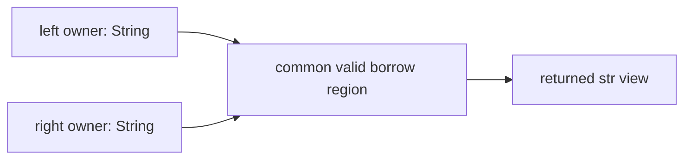

# 01. Lifetimes demystified

> **Draft: written but not yet run.** The code and the expected output in this lesson were prepared by reading the code and the official documentation. They have not been executed yet. If something does not behave as described, trust your tool's real output and report it.

## What you will be able to do
- Annotate a returned borrow that may come from either input.
- Explain why annotations cannot extend an owner's lifetime.
- Choose borrowing or ownership for a returned text value.

## Recap
1. What happens when a String is moved?
   <details><summary>Answer</summary>The new binding owns its allocation; the previous binding cannot use it.</details>

2. Can a reference outlive the value it refers to?
   <details><summary>Answer</summary>No. Rust rejects uses that could observe released storage.</details>

## Why it matters
You already borrow text in Rust 101. Returning a borrow becomes harder when it could refer to either of two inputs. A lifetime parameter expresses that relationship in the public signature; it is not a request to keep memory alive.

## What you will build
A library selects the longer of two borrowed strings and returns the first line of a note without allocating either result.

## Before you start
- Audience: finished [Rust 101](../../101-zero-to-hero/phase-3-real-programs/12-expense-tracker.md), with 1-2 years of practice. This is the start of 201; numbering restarts at 01.
- Target Rust/Cargo 1.100.0, edition 2024. Reuse the Rust 101 installation and editor. No tools were installed for this draft. Exact direct crate versions/features are in the full manifest, checked in official documentation; this is not a claim they are the latest releases.
- Time: 40-50 min. Allow extra time for the first future dependency download.
- Source pack (optional): every file is shown in full in this lesson, so you can follow without it. The finished code, the exercise starter and the solution are in the
  course repository https://github.com/Uee03/Code101 under `source/rust/201-hero-to-super-hero/phase-1-core-skills/01-lifetimes-demystified/` (on that page choose **Code, Download ZIP**, or run
  `git clone https://github.com/Uee03/Code101.git`).
- Extract a ZIP: Windows right-click **Extract All**; macOS double-click; Linux use your file manager's **Extract** action. Open the source path above. If copying instead of typing, copy code directly into `$HOME/code101/rust201`, rename the copy lesson01, and do not nest it inside an already-created destination.
- Save as UTF-8. On Windows enable **View, Show, File name extensions** so main.rs does not become main.rs.txt. Save every editor tab; a dot marks unsaved edits. Commands below are future learner instructions, not observed results.
- No Cargo.lock is supplied: Cargo creates it on the first build. Keep/review the generated application lock. Exact direct pins alone do not lock transitive dependencies.

## Steps
### Step 1. Create your project folders
Use the typed route below or the optional copy route, not both. Start in any terminal folder; these home-relative absolute paths recover from the wrong working directory. `$HOME` is your user home on all platforms.

**File: `terminal in any folder (Windows)`**
```powershell
New-Item -ItemType Directory -Force "$HOME/code101/rust201/lesson01/src"
Set-Location "$HOME/code101/rust201/lesson01"
```

**File: `terminal in any folder (macOS/Linux)`**
```bash
mkdir -p "$HOME/code101/rust201/lesson01/src"
cd "$HOME/code101/rust201/lesson01"
```

Expected result: the prompt ends in lesson01; src and the listed subfolders exist. PowerShell may print directory tables, not program output. Do not overwrite existing work; choose a different local folder name if needed.

### Step 2. Create the complete manifest
In the project root create Cargo.toml in your editor.

**File: `Cargo.toml`**
```toml
[package]
name = "lifetime_views"
version = "0.1.0"
edition = "2024"

[dependencies]
```

[package] names the package; 0.1.0 is its learning-project version and edition 2024 selects language rules. Cargo discovers src/lib.rs as the library and src/main.rs as the binary. [dependencies] lists external crates; an empty table uses std only. Exact = versions pin direct crates and features enable capabilities. No cargo add command is needed.

**Predict before you run:** For rust and lifetimes, which text is returned? Does first_line copy text into a new String? Write both answers before Run it.

Tests below use assert_eq for exact values, assert for conditions and matches for enum patterns. #[cfg(test)] includes a child test module for tests only; #[test] marks a normal test; #[tokio::test] supplies an async runtime where used. These are taught, not executed here. Lesson 09 explains unit, documentation and integration boundaries.

### Step 3. Create `src/lib.rs`
Create this exact file under $HOME/code101/rust201/lesson01; save the entire content, not a fragment.

**File: `src/lib.rs`**
```rust
pub fn longer<'a>(left: &'a str, right: &'a str) -> &'a str {
    if left.len() > right.len() { left } else { right }
}

pub fn first_line(text: &str) -> &str {
    text.lines().next().unwrap_or("")
}

#[cfg(test)]
mod tests {
    use super::*;

    #[test]
    fn chooses_by_byte_length() {
        assert_eq!(longer("rust", "lifetimes"), "lifetimes");
        assert_eq!(longer("lifetimes", "rust"), "lifetimes");
        assert_eq!(longer("", ""), "");
    }

    #[test]
    fn handles_empty_and_multiple_lines() {
        assert_eq!(first_line(""), "");
        assert_eq!(first_line("borrowed\nowned"), "borrowed");
    }
}
```

A **lifetime parameter** such as `'a` names a relationship between references. Both inputs must remain valid while the result is used. It does not require the String owners to be created or dropped together. The call can shorten either borrow to a common valid region.

longer compares UTF-8 byte lengths; equal lengths choose right. first_line has one borrowed input, so **lifetime elision**, Rust's signature inference rules, connects the output to that input without an annotation. unwrap_or supplies an empty view for an empty note; it does not panic. Tests cover both argument orders, equal empty inputs, an empty note and multiple lines.

### Step 4. Create `src/main.rs`
Create this exact file under $HOME/code101/rust201/lesson01; save the entire content, not a fragment.

**File: `src/main.rs`**
```rust
use lifetime_views::{first_line, longer};

fn main() {
    let left = String::from("rust");
    let right = String::from("lifetimes");
    let picked = longer(&left, &right);
    println!("picked: {picked}");
    let note = String::from("borrowed\nowned");
    println!("line: {}", first_line(&note));
}
```

The binary imports the library using its package name. It owns startup, demonstration output and top-level errors at the application boundary.

## Run it
Save every file. This command runs in the project root on Windows/macOS/Linux. It is for a future walk-through; no author runtime result is claimed.

**File: `terminal in $HOME/code101/rust201/lesson01`**
```powershell
cargo run --quiet
```

Expected output, not yet run (derived from source; Cargo download/build messages omitted):

**File: `terminal standard output`**
```text
picked: lifetimes
line: borrowed
```

### Check the supplied feature tests later
From this same project root, on all platforms:

**File: `terminal in $HOME/code101/rust201/lesson01`**
```powershell
cargo test
```

Expected result, not yet run: the finished example's assertions pass. Harness paths, timings and test order are not assumed. No test suite was run while authoring.


## How it works
main owns both Strings before borrowing them. picked views right, and both owners remain alive for its print. first_line borrows note through the print of its first line.

**Misconception:** writing `'a` makes an input live longer. It cannot. If right were created in an inner block and picked were used afterward, this signature would still reject the use. Move the owner outward, print while it lives, or return owned text.

**Why this, not that:** return &str when the caller can retain suitable source text. Return String when the result is newly assembled or must survive independently. Do not scatter clone or `'static` over lifetime errors. A `&'static str` refers to text valid for the entire program. A `T: 'static` bound instead says T contains no shorter-lived borrows; it does not require the value itself to live forever.

**Structure:**

**File: `lesson architecture diagram`**


## Try it
### Rung 1. Guided practice
Implement shorter in the starter. Return the input with fewer bytes, choosing left on equal lengths. The starter currently returns left unconditionally, so its reversed-argument test exposes the missing branch. Keep first_line unchanged.

Work separately in `$HOME/code101/rust201/try01`. Optional download route: from `source/rust/201-hero-to-super-hero/phase-1-core-skills/01-lifetimes-demystified/exercise`, copy starter directly into `$HOME/code101/rust201`, then rename the copied folder try01. Do not first create try01 and put starter inside it. Use this route only if the destination does not exist.

Typed route without a download: create the exact directories below, then every starter file shown. Start in any terminal folder.

**File: `terminal in any folder (Windows)`**
```powershell
New-Item -ItemType Directory -Force "$HOME/code101/rust201/try01/src"
Set-Location "$HOME/code101/rust201/try01"
```

**File: `terminal in any folder (macOS/Linux)`**
```bash
mkdir -p "$HOME/code101/rust201/try01/src"
cd "$HOME/code101/rust201/try01"
```

Expected result: a separate exercise root, not a nested starter directory.

**File: `try01/Cargo.toml (starter)`**
```toml
[package]
name = "lifetime_views"
version = "0.1.0"
edition = "2024"

[dependencies]
```

**File: `try01/src/lib.rs (starter)`**
```rust
pub fn shorter<'a>(left: &'a str, right: &'a str) -> &'a str {
    // TODO: return the shorter input; choose left on equal byte lengths.
    let _ = right;
    left
}

pub fn first_line(text: &str) -> &str {
    text.lines().next().unwrap_or("")
}

#[cfg(test)]
mod tests {
    use super::*;

    #[test]
    fn chooses_by_byte_length() {
        assert_eq!(shorter("rust", "lifetimes"), "rust");
        assert_eq!(shorter("lifetimes", "rust"), "rust");
        assert_eq!(shorter("", ""), "");
    }

    #[test]
    fn handles_empty_and_multiple_lines() {
        assert_eq!(first_line(""), "");
        assert_eq!(first_line("borrowed\nowned"), "borrowed");
    }
}
```

**File: `try01/src/main.rs (starter)`**
```rust
use lifetime_views::{first_line, shorter};

fn main() {
    let left = String::from("rust");
    let right = String::from("lifetimes");
    let picked = shorter(&left, &right);
    println!("picked: {picked}");
    let note = String::from("borrowed\nowned");
    println!("line: {}", first_line(&note));
}
```

Save the TODO changes, then use these commands in the exercise root (all platforms):

**File: `terminal in $HOME/code101/rust201/try01`**
```powershell
cargo run --quiet
cargo test
```

Expected output, not yet run (derived from source; Cargo download/build messages omitted):

**File: `terminal standard output`**
```text
picked: rust
line: borrowed
```

This is the completed guided target, not a claim the untouched starter satisfies it. The supplied assertions identify the policy to complete; do not delete them to get a green result.

### Rung 2. Change the behavior or coverage
Add a one-line-note test and a tie test with two different strings of equal byte length. The tie must choose left.

### Rung 3. Stretch (optional)
Design an owned version for callers that cannot retain both inputs. Explain where allocation occurs.

<details><summary>Solution: complete guided project</summary>

These files solve Rung 1 only. Compare after attempting the TODO. Supporting files are included so no download is required. Rung 2 and the optional design question remain your work.

**File: `exercise/solution/Cargo.toml`**
```toml
[package]
name = "lifetime_views"
version = "0.1.0"
edition = "2024"

[dependencies]
```

**File: `exercise/solution/src/lib.rs`**
```rust
pub fn shorter<'a>(left: &'a str, right: &'a str) -> &'a str {
    if left.len() <= right.len() { left } else { right }
}

pub fn first_line(text: &str) -> &str {
    text.lines().next().unwrap_or("")
}

#[cfg(test)]
mod tests {
    use super::*;

    #[test]
    fn chooses_by_byte_length() {
        assert_eq!(shorter("rust", "lifetimes"), "rust");
        assert_eq!(shorter("lifetimes", "rust"), "rust");
        assert_eq!(shorter("", ""), "");
    }

    #[test]
    fn handles_empty_and_multiple_lines() {
        assert_eq!(first_line(""), "");
        assert_eq!(first_line("borrowed\nowned"), "borrowed");
    }
}
```

**File: `exercise/solution/src/main.rs`**
```rust
use lifetime_views::{first_line, shorter};

fn main() {
    let left = String::from("rust");
    let right = String::from("lifetimes");
    let picked = shorter(&left, &right);
    println!("picked: {picked}");
    let note = String::from("borrowed\nowned");
    println!("line: {}", first_line(&note));
}
```

</details>

## Check yourself
1. Can this returned view be used after either possible source owner is dropped?
   <details><summary>Answer</summary>Not if its borrow is still needed. The signature constrains the result by both input borrows.</details>

2. Predict first_line on an empty string.
   <details><summary>Answer</summary>It returns the empty string view.</details>

3. When is String preferable?
   <details><summary>Answer</summary>When the result must own new text or outlive the source text.</details>

## Common mistakes
These are symptoms and fixes, not fabricated compiler transcripts. Read your tool's actual diagnostic and file/line first.

| Symptom | Cause | Fix |
|---|---|---|
| Wrong project runs or no manifest is found. | Terminal is outside this project. | Return to `$HOME/code101/rust201/lesson01`, next to Cargo.toml. |
| Your edit changes nothing. | The buffer was not saved. | Save all tabs, then run from the project root. |
| A returned view is rejected after an inner block. | A possible source owner was dropped. | Keep both owners alive through the last use or return owned text. |
| Adding a lifetime name changes nothing. | Annotations describe relationships, not storage duration. | Fix ownership or scope. |
| Accented text has a surprising length. | str::len counts bytes. | Use chars().count() for scalar values; neither is a grapheme count. |

## Best practice
Describe the actual relationship of references; use elision when its rules already express it. Source: [The Rust Book: lifetimes](https://doc.rust-lang.org/book/ch10-03-lifetime-syntax.html).

## Going further
- [The Rust Book: lifetimes](https://doc.rust-lang.org/book/ch10-03-lifetime-syntax.html) (official; version checked where applicable).
## Summary
- You practiced how to annotate a returned borrow that may come from either input.
- You practiced how to explain why annotations cannot extend an owner's lifetime.
- You practiced how to choose borrowing or ownership for a returned text value.
- You distinguished expected draft behavior from observed runtime evidence.

## Next lesson
[02. Traits and generics](02-traits-and-generics.md): reuse behavior without losing concrete types.
