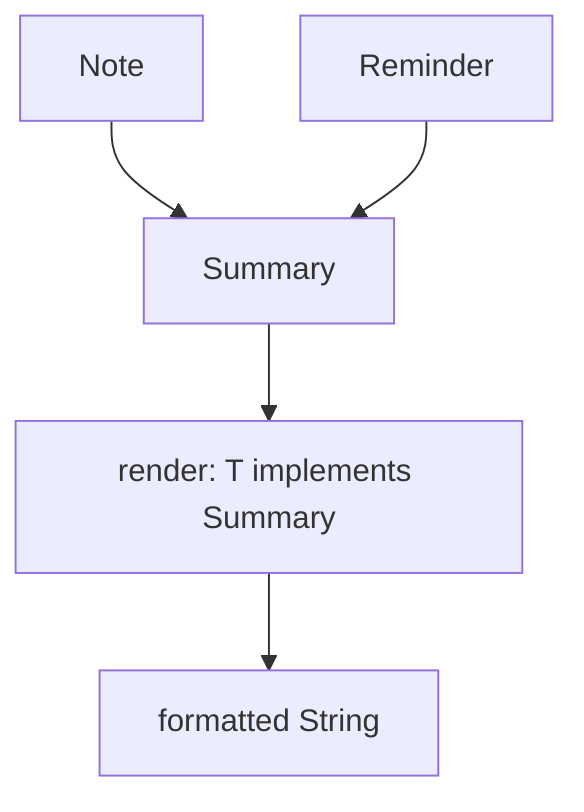

# 02. Traits and generics

> **Draft: written but not yet run.** The code and the expected output in this lesson were prepared by reading the code and the official documentation. They have not been executed yet. If something does not behave as described, trust your tool's real output and report it.

## What you will be able to do
- Implement one trait for two concrete types.
- Write a generic function constrained by a trait bound.
- Compare static dispatch with a trait-object alternative.

## Recap
1. Why does longer name a relationship between inputs?
   <details><summary>Answer</summary>Its output may borrow from either one.</details>

2. What does an impl block attach to a type?
   <details><summary>Answer</summary>Methods or associated functions; impl Trait for Type supplies a named capability.</details>

## Why it matters
Duplicating a formatting pipeline for every record type makes later changes drift apart. A trait describes the capability needed by the pipeline. A generic function reuses it while retaining concrete types at the call site.

## What you will build
Note and Reminder implement Summary and share one render function.

## Before you start
- Audience: finished [Rust 101](../../101-zero-to-hero/phase-3-real-programs/12-expense-tracker.md), with 1-2 years of practice. Finish lesson 01 first.
- Target Rust/Cargo 1.100.0, edition 2024. Reuse the Rust 101 installation and editor. No tools were installed for this draft. Exact direct crate versions/features are in the full manifest, checked in official documentation; this is not a claim they are the latest releases.
- Time: 40-50 min. Allow extra time for the first future dependency download.
- Source pack (optional): every file is shown in full in this lesson, so you can follow without it. The finished code, the exercise starter and the solution are in the
  course repository https://github.com/Uee03/Code101 under `source/rust/201-hero-to-super-hero/phase-1-core-skills/02-traits-and-generics/` (on that page choose **Code, Download ZIP**, or run
  `git clone https://github.com/Uee03/Code101.git`).
- Extract a ZIP: Windows right-click **Extract All**; macOS double-click; Linux use your file manager's **Extract** action. Open the source path above. If copying instead of typing, copy code directly into `$HOME/code101/rust201`, rename the copy lesson02, and do not nest it inside an already-created destination.
- Save as UTF-8. On Windows enable **View, Show, File name extensions** so main.rs does not become main.rs.txt. Save every editor tab; a dot marks unsaved edits. Commands below are future learner instructions, not observed results.
- No Cargo.lock is supplied: Cargo creates it on the first build. Keep/review the generated application lock. Exact direct pins alone do not lock transitive dependencies.

## Steps
### Step 1. Create your project folders
Use the typed route below or the optional copy route, not both. Start in any terminal folder; these home-relative absolute paths recover from the wrong working directory. `$HOME` is your user home on all platforms.

**File: `terminal in any folder (Windows)`**
```powershell
New-Item -ItemType Directory -Force "$HOME/code101/rust201/lesson02/src"
Set-Location "$HOME/code101/rust201/lesson02"
```

**File: `terminal in any folder (macOS/Linux)`**
```bash
mkdir -p "$HOME/code101/rust201/lesson02/src"
cd "$HOME/code101/rust201/lesson02"
```

Expected result: the prompt ends in lesson02; src and the listed subfolders exist. PowerShell may print directory tables, not program output. Do not overwrite existing work; choose a different local folder name if needed.

### Step 2. Create the complete manifest
In the project root create Cargo.toml in your editor.

**File: `Cargo.toml`**
```toml
[package]
name = "summary_traits"
version = "0.1.0"
edition = "2024"

[dependencies]
```

[package] names the package; 0.1.0 is its learning-project version and edition 2024 selects language rules. Cargo discovers src/lib.rs as the library and src/main.rs as the binary. [dependencies] lists external crates; an empty table uses std only. Exact = versions pin direct crates and features enable capabilities. No cargo add command is needed.

**Predict before you run:** Predict the two bracketed lines. Which method provides the content inside each pair of brackets?

Tests below use assert_eq for exact values, assert for conditions and matches for enum patterns. #[cfg(test)] includes a child test module for tests only; #[test] marks a normal test; #[tokio::test] supplies an async runtime where used. These are taught, not executed here. Lesson 09 explains unit, documentation and integration boundaries.

### Step 3. Create `src/lib.rs`
Create this exact file under $HOME/code101/rust201/lesson02; save the entire content, not a fragment.

**File: `src/lib.rs`**
```rust
pub trait Summary {
    fn summary(&self) -> String;
}

pub struct Note {
    pub title: String,
}

pub struct Reminder {
    pub minutes: u32,
}

impl Summary for Note {
    fn summary(&self) -> String {
        format!("note: {}", self.title)
    }
}

impl Summary for Reminder {
    fn summary(&self) -> String {
        format!("reminder: {} min", self.minutes)
    }
}

pub fn render<T: Summary>(item: &T) -> String {
    format!("[{}]", item.summary())
}

#[cfg(test)]
mod tests {
    use super::*;

    #[test]
    fn renders_two_implementations() {
        assert_eq!(render(&Note { title: "Rust".into() }), "[note: Rust]");
        assert_eq!(render(&Reminder { minutes: 5 }), "[reminder: 5 min]");
    }
}
```

A **trait bound**, T: Summary, limits T to types providing summary. Each impl Summary for Type fulfills that contract. A borrowed receiver lets the caller retain the record. render can call summary because of the bound, not because Rust examines which fields T happens to contain.

Each implementation returns a String. The generic wrapper owns shared decoration, while the implementation owns record-specific content. Tests assert both complete outputs. main lets Rust infer T separately at each call.

### Step 4. Create `src/main.rs`
Create this exact file under $HOME/code101/rust201/lesson02; save the entire content, not a fragment.

**File: `src/main.rs`**
```rust
use summary_traits::{render, Note, Reminder};

fn main() {
    let note = Note { title: "Rust".into() };
    let reminder = Reminder { minutes: 5 };
    println!("{}", render(&note));
    println!("{}", render(&reminder));
}
```

The binary imports the library using its package name. It owns startup, demonstration output and top-level errors at the application boundary.

## Run it
Save every file. This command runs in the project root on Windows/macOS/Linux. It is for a future walk-through; no author runtime result is claimed.

**File: `terminal in $HOME/code101/rust201/lesson02`**
```powershell
cargo run --quiet
```

Expected output, not yet run (derived from source; Cargo download/build messages omitted):

**File: `terminal standard output`**
```text
[note: Rust]
[reminder: 5 min]
```

### Check the supplied feature tests later
From this same project root, on all platforms:

**File: `terminal in $HOME/code101/rust201/lesson02`**
```powershell
cargo test
```

Expected result, not yet run: the finished example's assertions pass. Harness paths, timings and test order are not assumed. No test suite was run while authoring.


## How it works
**Static dispatch** selects a concrete implementation at compile time. **Monomorphization** creates concrete versions as needed and can increase compiled code size. Use this when each call's type is known and a small capability is enough.

A **trait object**, such as &dyn Summary, uses runtime method dispatch through a common interface. It helps when different implementations must occupy one collection element type. This trait supports that alternative because its method has a borrowed receiver and no generic type parameters.

**Why this, not that:** use generics for known call-site types; use an enum for a closed heterogeneous set or trait objects for an open one. Do not introduce dyn just to avoid writing a bound, or invent a trait for every one-off function.

**Misconception:** a generic T lets you access any fields found at a call site. Only the bound's promised methods are available. Also, you cannot implement somebody else's trait for somebody else's type; a local wrapper can provide a type you own.

**Structure:**

**File: `lesson architecture diagram`**


## Try it
### Rung 1. Guided practice
Change only render so both implementations gain the prefix entry: instead of brackets. Do not edit Summary implementations or add a type switch. Starter assertions express the new contract.

Work separately in `$HOME/code101/rust201/try02`. Optional download route: from `source/rust/201-hero-to-super-hero/phase-1-core-skills/02-traits-and-generics/exercise`, copy starter directly into `$HOME/code101/rust201`, then rename the copied folder try02. Do not first create try02 and put starter inside it. Use this route only if the destination does not exist.

Typed route without a download: create the exact directories below, then every starter file shown. Start in any terminal folder.

**File: `terminal in any folder (Windows)`**
```powershell
New-Item -ItemType Directory -Force "$HOME/code101/rust201/try02/src"
Set-Location "$HOME/code101/rust201/try02"
```

**File: `terminal in any folder (macOS/Linux)`**
```bash
mkdir -p "$HOME/code101/rust201/try02/src"
cd "$HOME/code101/rust201/try02"
```

Expected result: a separate exercise root, not a nested starter directory.

**File: `try02/Cargo.toml (starter)`**
```toml
[package]
name = "summary_traits"
version = "0.1.0"
edition = "2024"

[dependencies]
```

**File: `try02/src/lib.rs (starter)`**
```rust
pub trait Summary {
    fn summary(&self) -> String;
}

pub struct Note {
    pub title: String,
}

pub struct Reminder {
    pub minutes: u32,
}

impl Summary for Note {
    fn summary(&self) -> String {
        format!("note: {}", self.title)
    }
}

impl Summary for Reminder {
    fn summary(&self) -> String {
        format!("reminder: {} min", self.minutes)
    }
}

pub fn render<T: Summary>(item: &T) -> String {
    // TODO: add the entry: prefix in the generic function.
    item.summary()
}

#[cfg(test)]
mod tests {
    use super::*;

    #[test]
    fn renders_two_implementations() {
        assert_eq!(render(&Note { title: "Rust".into() }), "entry: note: Rust");
        assert_eq!(render(&Reminder { minutes: 5 }), "entry: reminder: 5 min");
    }
}
```

**File: `try02/src/main.rs (starter)`**
```rust
use summary_traits::{render, Note, Reminder};

fn main() {
    let note = Note { title: "Rust".into() };
    let reminder = Reminder { minutes: 5 };
    println!("{}", render(&note));
    println!("{}", render(&reminder));
}
```

Save the TODO changes, then use these commands in the exercise root (all platforms):

**File: `terminal in $HOME/code101/rust201/try02`**
```powershell
cargo run --quiet
cargo test
```

Expected output, not yet run (derived from source; Cargo download/build messages omitted):

**File: `terminal standard output`**
```text
entry: note: Rust
entry: reminder: 5 min
```

This is the completed guided target, not a claim the untouched starter satisfies it. The supplied assertions identify the policy to complete; do not delete them to get a green result.

### Rung 2. Change the behavior or coverage
Add a Bookmark type with an owned URL, implement Summary, and test that render works unchanged.

### Rung 3. Stretch (optional)
Explain when a Vec of boxed Summary trait objects would help, and why Vec<T> does not directly allow unrelated element types.

<details><summary>Solution: complete guided project</summary>

These files solve Rung 1 only. Compare after attempting the TODO. Supporting files are included so no download is required. Rung 2 and the optional design question remain your work.

**File: `exercise/solution/Cargo.toml`**
```toml
[package]
name = "summary_traits"
version = "0.1.0"
edition = "2024"

[dependencies]
```

**File: `exercise/solution/src/lib.rs`**
```rust
pub trait Summary {
    fn summary(&self) -> String;
}

pub struct Note {
    pub title: String,
}

pub struct Reminder {
    pub minutes: u32,
}

impl Summary for Note {
    fn summary(&self) -> String {
        format!("note: {}", self.title)
    }
}

impl Summary for Reminder {
    fn summary(&self) -> String {
        format!("reminder: {} min", self.minutes)
    }
}

pub fn render<T: Summary>(item: &T) -> String {
    format!("entry: {}", item.summary())
}

#[cfg(test)]
mod tests {
    use super::*;

    #[test]
    fn renders_two_implementations() {
        assert_eq!(render(&Note { title: "Rust".into() }), "entry: note: Rust");
        assert_eq!(render(&Reminder { minutes: 5 }), "entry: reminder: 5 min");
    }
}
```

**File: `exercise/solution/src/main.rs`**
```rust
use summary_traits::{render, Note, Reminder};

fn main() {
    let note = Note { title: "Rust".into() };
    let reminder = Reminder { minutes: 5 };
    println!("{}", render(&note));
    println!("{}", render(&reminder));
}
```

</details>

## Check yourself
1. What must a new type provide before render accepts it?
   <details><summary>Answer</summary>An implementation of Summary.</details>

2. Why can render not access item.title?
   <details><summary>Answer</summary>The bound promises summary, not a title field.</details>

3. When would dyn Summary help?
   <details><summary>Answer</summary>When different concrete implementing types need one runtime interface.</details>

## Common mistakes
These are symptoms and fixes, not fabricated compiler transcripts. Read your tool's actual diagnostic and file/line first.

| Symptom | Cause | Fix |
|---|---|---|
| Wrong project runs or no manifest is found. | Terminal is outside this project. | Return to `$HOME/code101/rust201/lesson02`, next to Cargo.toml. |
| Your edit changes nothing. | The buffer was not saved. | Save all tabs, then run from the project root. |
| A method is unavailable on T. | The bound does not promise it. | Use the promised method or a suitable bound. |
| A vector rejects unrelated concrete types. | Every vector has one element type. | Choose an enum or appropriate trait objects. |
| Formatting changes disagree across types. | Shared decoration was duplicated. | Keep it in render. |

## Best practice
State the behavior a generic function needs with a focused trait bound. Source: [The Rust Book: traits and trait bounds](https://doc.rust-lang.org/book/ch10-02-traits.html).

## Going further
- [The Rust Book: traits and trait bounds](https://doc.rust-lang.org/book/ch10-02-traits.html) (official; version checked where applicable).
## Summary
- You practiced how to implement one trait for two concrete types.
- You practiced how to write a generic function constrained by a trait bound.
- You practiced how to compare static dispatch with a trait-object alternative.
- You distinguished expected draft behavior from observed runtime evidence.

## Next lesson
[03. Iterators and closures](03-iterators-and-closures.md): apply trait-driven behavior to sequence transformations.
