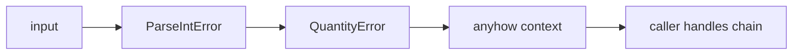

# 04. Error handling in libraries and apps

> **Draft: written but not yet run.** The code and the expected output in this lesson were prepared by reading the code and the official documentation. They have not been executed yet. If something does not behave as described, trust your tool's real output and report it.

## What you will be able to do
- Define a matchable library error with thiserror.
- Propagate a source error through the ? operator.
- Add application context with anyhow without discarding the cause.

## Recap
1. What does ? do to a Result?
   <details><summary>Answer</summary>It extracts Ok or returns an error converted into the surrounding function's error type.</details>

2. Why is an empty integer sum not a panic?
   <details><summary>Answer</summary>It has a defined identity of zero; absence is not automatically a bug.</details>

## Why it matters
Library callers need typed alternatives they can match. Application users need to know which operation failed. Preserving both the cause and the higher-level context supports those different audiences.

## What you will build
A quantity parser with distinct empty, number and zero errors, plus an order wrapper that adds context and prints the chain.

## Before you start
- Audience: finished [Rust 101](../../101-zero-to-hero/phase-3-real-programs/12-expense-tracker.md), with 1-2 years of practice. Finish lesson 03 first.
- Target Rust/Cargo 1.100.0, edition 2024. Reuse the Rust 101 installation and editor. No tools were installed for this draft. Exact direct crate versions/features are in the full manifest, checked in official documentation; this is not a claim they are the latest releases.
- Time: 45-55 min. Allow extra time for the first future dependency download.
- Source pack (optional): every file is shown in full in this lesson, so you can follow without it. The finished code, the exercise starter and the solution are in the
  course repository https://github.com/Uee03/Code101 under `source/rust/201-hero-to-super-hero/phase-1-core-skills/04-errors-in-libraries-and-apps/` (on that page choose **Code, Download ZIP**, or run
  `git clone https://github.com/Uee03/Code101.git`).
- Extract a ZIP: Windows right-click **Extract All**; macOS double-click; Linux use your file manager's **Extract** action. Open the source path above. If copying instead of typing, copy code directly into `$HOME/code101/rust201`, rename the copy lesson04, and do not nest it inside an already-created destination.
- Save as UTF-8. On Windows enable **View, Show, File name extensions** so main.rs does not become main.rs.txt. Save every editor tab; a dot marks unsaved edits. Commands below are future learner instructions, not observed results.
- No Cargo.lock is supplied: Cargo creates it on the first build. Keep/review the generated application lock. Exact direct pins alone do not lock transitive dependencies.

## Steps
### Step 1. Create your project folders
Use the typed route below or the optional copy route, not both. Start in any terminal folder; these home-relative absolute paths recover from the wrong working directory. `$HOME` is your user home on all platforms.

**File: `terminal in any folder (Windows)`**
```powershell
New-Item -ItemType Directory -Force "$HOME/code101/rust201/lesson04/src"
Set-Location "$HOME/code101/rust201/lesson04"
```

**File: `terminal in any folder (macOS/Linux)`**
```bash
mkdir -p "$HOME/code101/rust201/lesson04/src"
cd "$HOME/code101/rust201/lesson04"
```

Expected result: the prompt ends in lesson04; src and the listed subfolders exist. PowerShell may print directory tables, not program output. Do not overwrite existing work; choose a different local folder name if needed.

### Step 2. Create the complete manifest
In the project root create Cargo.toml in your editor.

**File: `Cargo.toml`**
```toml
[package]
name = "quantity_errors"
version = "0.1.0"
edition = "2024"

[dependencies]
anyhow = "=1.0.100"
thiserror = "=2.0.17"
```

[package] names the package; 0.1.0 is its learning-project version and edition 2024 selects language rules. Cargo discovers src/lib.rs as the library and src/main.rs as the binary. [dependencies] lists external crates; an empty table uses std only. Exact = versions pin direct crates and features enable capabilities. No cargo add command is needed.

**Predict before you run:** For 0, does parsing fail, or does a rule reject a successfully parsed number? Predict the two reason lines and their order.

Tests below use assert_eq for exact values, assert for conditions and matches for enum patterns. #[cfg(test)] includes a child test module for tests only; #[test] marks a normal test; #[tokio::test] supplies an async runtime where used. These are taught, not executed here. Lesson 09 explains unit, documentation and integration boundaries.

### Step 3. Create `src/lib.rs`
Create this exact file under $HOME/code101/rust201/lesson04; save the entire content, not a fragment.

**File: `src/lib.rs`**
```rust
use std::num::ParseIntError;
use thiserror::Error;

#[derive(Debug, Error)]
pub enum QuantityError {
    #[error("quantity is empty")]
    Empty,
    #[error("quantity is not a whole number")]
    Number(#[from] ParseIntError),
    #[error("quantity must be positive")]
    Zero,
}

pub fn parse_quantity(input: &str) -> Result<u16, QuantityError> {
    let input = input.trim();
    if input.is_empty() {
        return Err(QuantityError::Empty);
    }
    let quantity: u16 = input.parse()?;
    if quantity == 0 {
        return Err(QuantityError::Zero);
    }
    Ok(quantity)
}

#[cfg(test)]
mod tests {
    use super::*;

    #[test]
    fn accepts_trimmed_positive_numbers() {
        assert_eq!(parse_quantity(" 12 ").unwrap(), 12);
    }

    #[test]
    fn distinguishes_failures() {
        assert!(matches!(parse_quantity(" "), Err(QuantityError::Empty)));
        assert!(matches!(parse_quantity("abc"), Err(QuantityError::Number(_))));
        assert!(matches!(parse_quantity("0"), Err(QuantityError::Zero)));
    }
}
```

thiserror::Error derives standard Error and display implementations. #[from] generates conversion from ParseIntError to QuantityError::Number and preserves the source. Callers can match the enum without parsing human wording.

input.parse()? is an early return on Err, converting the parsing error through From. Empty and zero are explicit domain decisions. u16 also bounds accepted numbers; negatives and overflow become Number. Tests distinguish categories, not parser wording.

The binary imports anyhow::Context to enable context as an extension method. The failed order is deliberately handled in main, so this demonstration returns success after reporting its chain. An unhandled Err propagated from main would signal failure instead.

### Step 4. Create `src/main.rs`
Create this exact file under $HOME/code101/rust201/lesson04; save the entire content, not a fragment.

**File: `src/main.rs`**
```rust
use anyhow::{Context, Result};
use quantity_errors::parse_quantity;

fn order(input: &str) -> Result<u16> {
    let quantity = parse_quantity(input).context("reading order quantity")?;
    Ok(quantity)
}

fn main() -> Result<()> {
    println!("quantity: {}", order("12")?);
    if let Err(error) = order("0") {
        for cause in error.chain() {
            println!("reason: {cause}");
        }
    }
    Ok(())
}
```

The binary imports the library using its package name. It owns startup, demonstration output and top-level errors at the application boundary.

## Run it
Save every file. This command runs in the project root on Windows/macOS/Linux. It is for a future walk-through; no author runtime result is claimed.

**File: `terminal in $HOME/code101/rust201/lesson04`**
```powershell
cargo run --quiet
```

Expected output, not yet run (derived from source; Cargo download/build messages omitted):

**File: `terminal standard output`**
```text
quantity: 12
reason: reading order quantity
reason: quantity must be positive
```

### Check the supplied feature tests later
From this same project root, on all platforms:

**File: `terminal in $HOME/code101/rust201/lesson04`**
```powershell
cargo test
```

Expected result, not yet run: the finished example's assertions pass. Harness paths, timings and test order are not assumed. No test suite was run while authoring.


## How it works
order("12") gets a u16 and prints it. order("0") parses zero, then the library returns Zero. context adds reading order quantity, and ? returns that contextual failure. main handles it and visits the chain from outer context to original cause.

**Why this, not that:** expose typed errors from reusable libraries when recovery decisions matter. At an application boundary, anyhow reduces boilerplate while keeping context and sources. It does not replace a useful public library error contract. A hand-written Error implementation is an alternative; thiserror saves repetition without appearing as your public error type.

**Misconception:** ? catches or logs errors. It does neither. It returns control to the caller on failure. Do not unwrap user input or replace failure with a default success that hides damaged input. Avoid credentials and full request bodies in error context.

**Structure:**

**File: `lesson architecture diagram`**


## Try it
### Rung 1. Guided practice
Require at least two items. Keep the existing Zero variant for this small exercise, update its display message and reject both 0 and 1. The added assertion for 1 must pass; Number and Empty remain distinct.

Work separately in `$HOME/code101/rust201/try04`. Optional download route: from `source/rust/201-hero-to-super-hero/phase-1-core-skills/04-errors-in-libraries-and-apps/exercise`, copy starter directly into `$HOME/code101/rust201`, then rename the copied folder try04. Do not first create try04 and put starter inside it. Use this route only if the destination does not exist.

Typed route without a download: create the exact directories below, then every starter file shown. Start in any terminal folder.

**File: `terminal in any folder (Windows)`**
```powershell
New-Item -ItemType Directory -Force "$HOME/code101/rust201/try04/src"
Set-Location "$HOME/code101/rust201/try04"
```

**File: `terminal in any folder (macOS/Linux)`**
```bash
mkdir -p "$HOME/code101/rust201/try04/src"
cd "$HOME/code101/rust201/try04"
```

Expected result: a separate exercise root, not a nested starter directory.

**File: `try04/Cargo.toml (starter)`**
```toml
[package]
name = "quantity_errors"
version = "0.1.0"
edition = "2024"

[dependencies]
anyhow = "=1.0.100"
thiserror = "=2.0.17"
```

**File: `try04/src/lib.rs (starter)`**
```rust
use std::num::ParseIntError;
use thiserror::Error;

#[derive(Debug, Error)]
pub enum QuantityError {
    #[error("quantity is empty")]
    Empty,
    #[error("quantity is not a whole number")]
    Number(#[from] ParseIntError),
    #[error("quantity must be at least two")]
    Zero,
}

pub fn parse_quantity(input: &str) -> Result<u16, QuantityError> {
    let input = input.trim();
    if input.is_empty() {
        return Err(QuantityError::Empty);
    }
    let quantity: u16 = input.parse()?;
    // TODO: reject both zero and one with QuantityError::Zero.
    if quantity == 0 {
        return Err(QuantityError::Zero);
    }
    Ok(quantity)
}

#[cfg(test)]
mod tests {
    use super::*;

    #[test]
    fn accepts_trimmed_positive_numbers() {
        assert_eq!(parse_quantity(" 12 ").unwrap(), 12);
    }

    #[test]
    fn distinguishes_failures() {
        assert!(matches!(parse_quantity(" "), Err(QuantityError::Empty)));
        assert!(matches!(parse_quantity("abc"), Err(QuantityError::Number(_))));
        assert!(matches!(parse_quantity("0"), Err(QuantityError::Zero)));
        assert!(matches!(parse_quantity("1"), Err(QuantityError::Zero)));
    }
}
```

**File: `try04/src/main.rs (starter)`**
```rust
use anyhow::{Context, Result};
use quantity_errors::parse_quantity;

fn order(input: &str) -> Result<u16> {
    let quantity = parse_quantity(input).context("reading order quantity")?;
    Ok(quantity)
}

fn main() -> Result<()> {
    println!("quantity: {}", order("12")?);
    if let Err(error) = order("0") {
        for cause in error.chain() {
            println!("reason: {cause}");
        }
    }
    Ok(())
}
```

Save the TODO changes, then use these commands in the exercise root (all platforms):

**File: `terminal in $HOME/code101/rust201/try04`**
```powershell
cargo run --quiet
cargo test
```

Expected output, not yet run (derived from source; Cargo download/build messages omitted):

**File: `terminal standard output`**
```text
quantity: 12
reason: reading order quantity
reason: quantity must be at least two
```

This is the completed guided target, not a claim the untouched starter satisfies it. The supplied assertions identify the policy to complete; do not delete them to get a green result.

### Rung 2. Change the behavior or coverage
Rename Zero to BelowMinimum wherever it is matched. Explain why this is a public API change even if the display message stays identical.

### Rung 3. Stretch (optional)
Add a maximum order size as a separate domain error. Decide whether callers should receive the limit as a field.

<details><summary>Solution: complete guided project</summary>

These files solve Rung 1 only. Compare after attempting the TODO. Supporting files are included so no download is required. Rung 2 and the optional design question remain your work.

**File: `exercise/solution/Cargo.toml`**
```toml
[package]
name = "quantity_errors"
version = "0.1.0"
edition = "2024"

[dependencies]
anyhow = "=1.0.100"
thiserror = "=2.0.17"
```

**File: `exercise/solution/src/lib.rs`**
```rust
use std::num::ParseIntError;
use thiserror::Error;

#[derive(Debug, Error)]
pub enum QuantityError {
    #[error("quantity is empty")]
    Empty,
    #[error("quantity is not a whole number")]
    Number(#[from] ParseIntError),
    #[error("quantity must be at least two")]
    Zero,
}

pub fn parse_quantity(input: &str) -> Result<u16, QuantityError> {
    let input = input.trim();
    if input.is_empty() {
        return Err(QuantityError::Empty);
    }
    let quantity: u16 = input.parse()?;
    if quantity < 2 {
        return Err(QuantityError::Zero);
    }
    Ok(quantity)
}

#[cfg(test)]
mod tests {
    use super::*;

    #[test]
    fn accepts_trimmed_positive_numbers() {
        assert_eq!(parse_quantity(" 12 ").unwrap(), 12);
    }

    #[test]
    fn distinguishes_failures() {
        assert!(matches!(parse_quantity(" "), Err(QuantityError::Empty)));
        assert!(matches!(parse_quantity("abc"), Err(QuantityError::Number(_))));
        assert!(matches!(parse_quantity("0"), Err(QuantityError::Zero)));
        assert!(matches!(parse_quantity("1"), Err(QuantityError::Zero)));
    }
}
```

**File: `exercise/solution/src/main.rs`**
```rust
use anyhow::{Context, Result};
use quantity_errors::parse_quantity;

fn order(input: &str) -> Result<u16> {
    let quantity = parse_quantity(input).context("reading order quantity")?;
    Ok(quantity)
}

fn main() -> Result<()> {
    println!("quantity: {}", order("12")?);
    if let Err(error) = order("0") {
        for cause in error.chain() {
            println!("reason: {cause}");
        }
    }
    Ok(())
}
```

</details>

## Check yourself
1. Why use an enum instead of only a String message?
   <details><summary>Answer</summary>Callers can match recovery categories without parsing wording.</details>

2. Which conversion makes parse()? legal?
   <details><summary>Answer</summary>From<ParseIntError> for QuantityError, generated by #[from].</details>

3. Does anyhow context replace the cause?
   <details><summary>Answer</summary>No. It adds an outer context entry and preserves the source chain.</details>

## Common mistakes
These are symptoms and fixes, not fabricated compiler transcripts. Read your tool's actual diagnostic and file/line first.

| Symptom | Cause | Fix |
|---|---|---|
| Wrong project runs or no manifest is found. | Terminal is outside this project. | Return to `$HOME/code101/rust201/lesson04`, next to Cargo.toml. |
| Your edit changes nothing. | The buffer was not saved. | Save all tabs, then run from the project root. |
| The ? expression is rejected in a function returning (). | There is no compatible error-return path. | Return Result or match the failure explicitly. |
| A caller matches display text. | Human wording is treated as a machine contract. | Match the typed variant. |
| The demo exits successfully despite printing a reason. | main handled that failure and returned Ok. | Return Err when the application action must signal failure. |

## Best practice
Preserve source errors and add context where an operation gains meaning. Source: [thiserror 2.0.17](https://docs.rs/thiserror/2.0.17/thiserror/); [anyhow 1.0.100](https://docs.rs/anyhow/1.0.100/anyhow/).

## Going further
- [thiserror 2.0.17](https://docs.rs/thiserror/2.0.17/thiserror/) (official; version checked where applicable).
- [anyhow 1.0.100](https://docs.rs/anyhow/1.0.100/anyhow/) (official; version checked where applicable).

### Mixed phase review
1. Can a borrowed generic function return an owned typed error?
   <details><summary>Answer</summary>Yes. Borrowing its input and owning its error are independent choices.</details>

2. Does ? automatically choose an HTTP representation?
   <details><summary>Answer</summary>No. It needs a compatible return/conversion and the HTTP boundary still chooses representation.</details>

## Summary
- You practiced how to define a matchable library error with thiserror.
- You practiced how to propagate a source error through the ? operator.
- You practiced how to add application context with anyhow without discarding the cause.
- You distinguished expected draft behavior from observed runtime evidence.

## Next lesson
[05. Async Rust and Tokio](../phase-2-async-and-web/05-async-rust-and-tokio.md): apply ownership and error propagation across async work.
