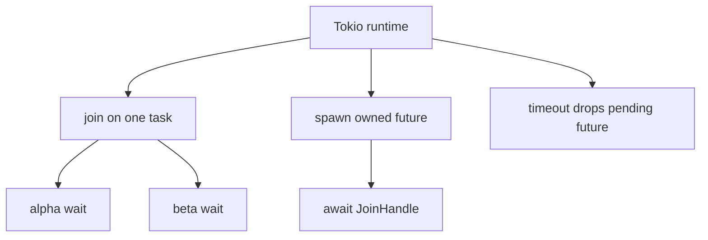

# 05. Async Rust and Tokio

> **Draft: written but not yet run.** The code and the expected output in this lesson were prepared by reading the code and the official documentation. They have not been executed yet. If something does not behave as described, trust your tool's real output and report it.

## What you will be able to do
- Drive async functions with a Tokio runtime.
- Compare joined futures with an owned spawned task.
- Apply a deadline and explain what cancellation does not guarantee.

## Recap
1. Why does moving a String into a task matter?
   <details><summary>Answer</summary>Ownership lets a task retain data independently of the caller's stack scope.</details>

2. How do propagation and handling differ?
   <details><summary>Answer</summary>Propagation returns failure to a caller; handling chooses a local response.</details>

## Why it matters
Network services spend much of their lives waiting. Async Rust overlaps those waits without dedicating a blocked operating-system thread to each request. It does not automatically parallelize computation or remove ownership rules.

## What you will build
Two waiting jobs joined concurrently, an independently scheduled owned job, and a deterministic timeout on work that never completes.

## Before you start
- Audience: finished [Rust 101](../../101-zero-to-hero/phase-3-real-programs/12-expense-tracker.md), with 1-2 years of practice. Finish lesson 04 first.
- Target Rust/Cargo 1.100.0, edition 2024. Reuse the Rust 101 installation and editor. No tools were installed for this draft. Exact direct crate versions/features are in the full manifest, checked in official documentation; this is not a claim they are the latest releases.
- Time: 50-65 min. Allow extra time for the first future dependency download.
- Source pack (optional): every file is shown in full in this lesson, so you can follow without it. The finished code, the exercise starter and the solution are in the
  course repository https://github.com/Uee03/Code101 under `source/rust/201-hero-to-super-hero/phase-2-async-and-web/05-async-rust-and-tokio/` (on that page choose **Code, Download ZIP**, or run
  `git clone https://github.com/Uee03/Code101.git`).
- Extract a ZIP: Windows right-click **Extract All**; macOS double-click; Linux use your file manager's **Extract** action. Open the source path above. If copying instead of typing, copy code directly into `$HOME/code101/rust201`, rename the copy lesson05, and do not nest it inside an already-created destination.
- Save as UTF-8. On Windows enable **View, Show, File name extensions** so main.rs does not become main.rs.txt. Save every editor tab; a dot marks unsaved edits. Commands below are future learner instructions, not observed results.
- No Cargo.lock is supplied: Cargo creates it on the first build. Keep/review the generated application lock. Exact direct pins alone do not lock transitive dependencies.

## Steps
### Step 1. Create your project folders
Use the typed route below or the optional copy route, not both. Start in any terminal folder; these home-relative absolute paths recover from the wrong working directory. `$HOME` is your user home on all platforms.

**File: `terminal in any folder (Windows)`**
```powershell
New-Item -ItemType Directory -Force "$HOME/code101/rust201/lesson05/src"
Set-Location "$HOME/code101/rust201/lesson05"
```

**File: `terminal in any folder (macOS/Linux)`**
```bash
mkdir -p "$HOME/code101/rust201/lesson05/src"
cd "$HOME/code101/rust201/lesson05"
```

Expected result: the prompt ends in lesson05; src and the listed subfolders exist. PowerShell may print directory tables, not program output. Do not overwrite existing work; choose a different local folder name if needed.

### Step 2. Create the complete manifest
In the project root create Cargo.toml in your editor.

**File: `Cargo.toml`**
```toml
[package]
name = "async_jobs"
version = "0.1.0"
edition = "2024"

[dependencies]
anyhow = "=1.0.100"
tokio = { version = "=1.48.0", features = ["macros", "rt-multi-thread", "time"] }
```

[package] names the package; 0.1.0 is its learning-project version and edition 2024 selects language rules. Cargo discovers src/lib.rs as the library and src/main.rs as the binary. [dependencies] lists external crates; an empty table uses std only. Exact = versions pin direct crates and features enable capabilities. No cargo add command is needed.

**Predict before you run:** Can the waits finish in either order while printed results remain ordered? Predict all three lines, but not elapsed milliseconds.

Tests below use assert_eq for exact values, assert for conditions and matches for enum patterns. #[cfg(test)] includes a child test module for tests only; #[test] marks a normal test; #[tokio::test] supplies an async runtime where used. These are taught, not executed here. Lesson 09 explains unit, documentation and integration boundaries.

### Step 3. Create `src/lib.rs`
Create this exact file under $HOME/code101/rust201/lesson05; save the entire content, not a fragment.

**File: `src/lib.rs`**
```rust
use std::time::Duration;

pub async fn label(name: &str) -> String {
    tokio::time::sleep(Duration::from_millis(5)).await;
    format!("{name} ready")
}

pub async fn pair() -> (String, String) {
    tokio::join!(label("alpha"), label("beta"))
}

pub async fn deadline_expires() -> bool {
    tokio::time::timeout(
        Duration::from_millis(5),
        std::future::pending::<()>(),
    ).await.is_err()
}

#[cfg(test)]
mod tests {
    use super::*;

    #[tokio::test]
    async fn pair_preserves_result_positions() {
        assert_eq!(pair().await, ("alpha ready".into(), "beta ready".into()));
    }

    #[tokio::test]
    async fn pending_work_has_a_deadline() {
        assert!(deadline_expires().await);
    }
}
```

An async function returns a **future**, a value representing work that progresses when polled. A **runtime** drives futures and their timer/I/O machinery. await lets the current task yield while waiting; it is not a blocking sleep.

join polls both branches on one task and returns results in argument order, regardless of completion order. pending never resolves. A timeout on that future therefore eventually returns an elapsed error; five milliseconds is a deadline setting, not a benchmark promise. Tests check result positions and eventual timeout, not exact wall-clock timing.

The main attribute supplies a runtime. The String moves into an async move block before spawn. Its task can safely borrow that owned value while label runs. Awaiting the JoinHandle reports completion or a JoinError, which ? propagates into anyhow.

### Step 4. Create `src/main.rs`
Create this exact file under $HOME/code101/rust201/lesson05; save the entire content, not a fragment.

**File: `src/main.rs`**
```rust
use anyhow::Result;
use async_jobs::{deadline_expires, label, pair};

#[tokio::main]
async fn main() -> Result<()> {
    let (left, right) = pair().await;
    println!("{left} | {right}");
    let owned = String::from("owned");
    let handle = tokio::spawn(async move { label(&owned).await });
    println!("{}", handle.await?);
    println!("deadline expired: {}", deadline_expires().await);
    Ok(())
}
```

The binary imports the library using its package name. It owns startup, demonstration output and top-level errors at the application boundary.

## Run it
Save every file. This command runs in the project root on Windows/macOS/Linux. It is for a future walk-through; no author runtime result is claimed.

**File: `terminal in $HOME/code101/rust201/lesson05`**
```powershell
cargo run --quiet
```

Expected output, not yet run (derived from source; Cargo download/build messages omitted):

**File: `terminal standard output`**
```text
alpha ready | beta ready
owned ready
deadline expired: true
```

### Check the supplied feature tests later
From this same project root, on all platforms:

**File: `terminal in $HOME/code101/rust201/lesson05`**
```powershell
cargo test
```

Expected result, not yet run: the finished example's assertions pass. Harness paths, timings and test order are not assumed. No test suite was run while authoring.


## How it works
pair joins two label futures, allowing their timers to wait concurrently. main prints only after both results exist, so completion lines cannot race. spawn schedules a separate owned task, then main awaits its handle. Finally timeout drops the never-completing future and yields true.

**Why this, not that:** join work that belongs to the current request and may borrow its data. Spawn when independent scheduling and owned state are needed, then retain and await the handle. spawn requires Send and 'static data. Send permits transfer between threads; 'static here means no shorter-lived borrowed stack data, not a task that lives forever.

**Concurrency** overlaps waits. **Parallelism** executes simultaneously on multiple cores. join alone does not provide parallelism. CPU loops and std::thread::sleep occupy a worker; use Tokio's blocking-work boundary for genuinely blocking operations and a bounded CPU strategy for sustained computation.

**Cancellation** usually drops a future. Timing out a database write does not prove that the server did not commit it. Dropping a JoinHandle detaches its task rather than cancelling it. Request abort when appropriate and await the handle; design external effects for safe retry. Runtime shutdown drops outstanding async tasks rather than guaranteeing they finish.

**Structure:**

**File: `lesson architecture diagram`**


## Try it
### Rung 1. Guided practice
Uppercase each job name inside label while preserving the ready suffix. Keep result order, task ownership and the deadline. The starter pair assertion expects uppercase names.

Work separately in `$HOME/code101/rust201/try05`. Optional download route: from `source/rust/201-hero-to-super-hero/phase-2-async-and-web/05-async-rust-and-tokio/exercise`, copy starter directly into `$HOME/code101/rust201`, then rename the copied folder try05. Do not first create try05 and put starter inside it. Use this route only if the destination does not exist.

Typed route without a download: create the exact directories below, then every starter file shown. Start in any terminal folder.

**File: `terminal in any folder (Windows)`**
```powershell
New-Item -ItemType Directory -Force "$HOME/code101/rust201/try05/src"
Set-Location "$HOME/code101/rust201/try05"
```

**File: `terminal in any folder (macOS/Linux)`**
```bash
mkdir -p "$HOME/code101/rust201/try05/src"
cd "$HOME/code101/rust201/try05"
```

Expected result: a separate exercise root, not a nested starter directory.

**File: `try05/Cargo.toml (starter)`**
```toml
[package]
name = "async_jobs"
version = "0.1.0"
edition = "2024"

[dependencies]
anyhow = "=1.0.100"
tokio = { version = "=1.48.0", features = ["macros", "rt-multi-thread", "time"] }
```

**File: `try05/src/lib.rs (starter)`**
```rust
use std::time::Duration;

pub async fn label(name: &str) -> String {
    tokio::time::sleep(Duration::from_millis(5)).await;
    // TODO: uppercase the name, preserving the ready suffix.
    format!("{name} ready")
}

pub async fn pair() -> (String, String) {
    tokio::join!(label("alpha"), label("beta"))
}

pub async fn deadline_expires() -> bool {
    tokio::time::timeout(
        Duration::from_millis(5),
        std::future::pending::<()>(),
    ).await.is_err()
}

#[cfg(test)]
mod tests {
    use super::*;

    #[tokio::test]
    async fn pair_preserves_result_positions() {
        assert_eq!(pair().await, ("ALPHA ready".into(), "BETA ready".into()));
    }

    #[tokio::test]
    async fn pending_work_has_a_deadline() {
        assert!(deadline_expires().await);
    }
}
```

**File: `try05/src/main.rs (starter)`**
```rust
use anyhow::Result;
use async_jobs::{deadline_expires, label, pair};

#[tokio::main]
async fn main() -> Result<()> {
    let (left, right) = pair().await;
    println!("{left} | {right}");
    let owned = String::from("owned");
    let handle = tokio::spawn(async move { label(&owned).await });
    println!("{}", handle.await?);
    println!("deadline expired: {}", deadline_expires().await);
    Ok(())
}
```

Save the TODO changes, then use these commands in the exercise root (all platforms):

**File: `terminal in $HOME/code101/rust201/try05`**
```powershell
cargo run --quiet
cargo test
```

Expected output, not yet run (derived from source; Cargo download/build messages omitted):

**File: `terminal standard output`**
```text
ALPHA ready | BETA ready
OWNED ready
deadline expired: true
```

This is the completed guided target, not a claim the untouched starter satisfies it. The supplied assertions identify the policy to complete; do not delete them to get a green result.

### Rung 2. Change the behavior or coverage
Add a third future to pair and return a three-element tuple. Update main and the assertion to print alpha, beta, gamma in argument order without printing inside jobs.

### Rung 3. Stretch (optional)
Design a retryable operation that cannot duplicate an external payment or insert. Explain why dropping a local future is not enough.

<details><summary>Solution: complete guided project</summary>

These files solve Rung 1 only. Compare after attempting the TODO. Supporting files are included so no download is required. Rung 2 and the optional design question remain your work.

**File: `exercise/solution/Cargo.toml`**
```toml
[package]
name = "async_jobs"
version = "0.1.0"
edition = "2024"

[dependencies]
anyhow = "=1.0.100"
tokio = { version = "=1.48.0", features = ["macros", "rt-multi-thread", "time"] }
```

**File: `exercise/solution/src/lib.rs`**
```rust
use std::time::Duration;

pub async fn label(name: &str) -> String {
    tokio::time::sleep(Duration::from_millis(5)).await;
    format!("{} ready", name.to_uppercase())
}

pub async fn pair() -> (String, String) {
    tokio::join!(label("alpha"), label("beta"))
}

pub async fn deadline_expires() -> bool {
    tokio::time::timeout(
        Duration::from_millis(5),
        std::future::pending::<()>(),
    ).await.is_err()
}

#[cfg(test)]
mod tests {
    use super::*;

    #[tokio::test]
    async fn pair_preserves_result_positions() {
        assert_eq!(pair().await, ("ALPHA ready".into(), "BETA ready".into()));
    }

    #[tokio::test]
    async fn pending_work_has_a_deadline() {
        assert!(deadline_expires().await);
    }
}
```

**File: `exercise/solution/src/main.rs`**
```rust
use anyhow::Result;
use async_jobs::{deadline_expires, label, pair};

#[tokio::main]
async fn main() -> Result<()> {
    let (left, right) = pair().await;
    println!("{left} | {right}");
    let owned = String::from("owned");
    let handle = tokio::spawn(async move { label(&owned).await });
    println!("{}", handle.await?);
    println!("deadline expired: {}", deadline_expires().await);
    Ok(())
}
```

</details>

## Check yourself
1. What drives async sleep?
   <details><summary>Answer</summary>The Tokio runtime created by main/test attributes.</details>

2. Can join!(a, b) return b's value in the first slot?
   <details><summary>Answer</summary>No. Tuple positions follow argument order.</details>

3. Does dropping a JoinHandle cancel its task?
   <details><summary>Answer</summary>No. It detaches the task; cancellation and external effects need separate reasoning.</details>

## Common mistakes
These are symptoms and fixes, not fabricated compiler transcripts. Read your tool's actual diagnostic and file/line first.

| Symptom | Cause | Fix |
|---|---|---|
| Wrong project runs or no manifest is found. | Terminal is outside this project. | Return to `$HOME/code101/rust201/lesson05`, next to Cargo.toml. |
| Your edit changes nothing. | The buffer was not saved. | Save all tabs, then run from the project root. |
| A spawned future borrows a disappearing local owner. | The task needs data independent of the calling stack. | Move owned data into it or join borrowed futures locally. |
| Other work stalls during sleep. | A blocking sleep or CPU loop occupies a worker. | Use async I/O/timers; isolate and bound blocking work. |
| Retrying after timeout duplicates a write. | Local cancellation did not roll back an external effect. | Use idempotency or query the operation outcome. |

## Best practice
Keep waits non-blocking and make task ownership and completion explicit. Source: [Tokio tutorial](https://tokio.rs/tokio/tutorial); [Tokio join](https://docs.rs/tokio/1.48.0/tokio/macro.join.html); [Tokio spawn](https://docs.rs/tokio/1.48.0/tokio/task/fn.spawn.html); [Tokio timeout](https://docs.rs/tokio/1.48.0/tokio/time/fn.timeout.html).

## Going further
- [Tokio tutorial](https://tokio.rs/tokio/tutorial) (official; version checked where applicable).
- [Tokio join](https://docs.rs/tokio/1.48.0/tokio/macro.join.html) (official; version checked where applicable).
- [Tokio spawn](https://docs.rs/tokio/1.48.0/tokio/task/fn.spawn.html) (official; version checked where applicable).
- [Tokio timeout](https://docs.rs/tokio/1.48.0/tokio/time/fn.timeout.html) (official; version checked where applicable).
## Summary
- You practiced how to drive async functions with a Tokio runtime.
- You practiced how to compare joined futures with an owned spawned task.
- You practiced how to apply a deadline and explain what cancellation does not guarantee.
- You distinguished expected draft behavior from observed runtime evidence.

## Next lesson
[06. A web API with Axum](06-a-web-api-with-axum.md): turn futures into typed HTTP handlers.
