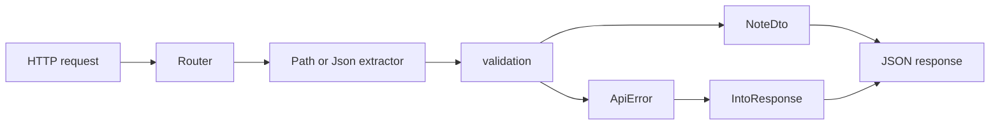

# 06. A web API with Axum

> **Draft: written but not yet run.** The code and the expected output in this lesson were prepared by reading the code and the official documentation. They have not been executed yet. If something does not behave as described, trust your tool's real output and report it.

## What you will be able to do
- Route HTTP requests using typed extractors.
- Separate request and response DTOs with Serde.
- Map domain failures into deliberate HTTP responses.

## Recap
1. Why may an async handler wait without blocking a worker?
   <details><summary>Answer</summary>Non-blocking futures yield through await so the runtime can schedule other work.</details>

2. Where should a domain error become HTTP?
   <details><summary>Answer</summary>At the application/transport boundary, not inside a reusable parser.</details>

## Why it matters
An API is a contract, not just a function returning text. Axum combines routing, typed extraction and response conversion to keep boundaries explicit. A contract prototype lets you decide shapes and failure statuses before adding persistence.

## What you will build
GET /notes/{id} reads one seed note and POST /notes validates a response. This prototype is stateless: every accepted POST returns id 8 and does not change GET. Lesson 10 supplies a real in-memory lifecycle.

## Before you start
- Audience: finished [Rust 101](../../101-zero-to-hero/phase-3-real-programs/12-expense-tracker.md), with 1-2 years of practice. Finish lesson 05 first.
- Target Rust/Cargo 1.100.0, edition 2024. Reuse the Rust 101 installation and editor. No tools were installed for this draft. Exact direct crate versions/features are in the full manifest, checked in official documentation; this is not a claim they are the latest releases.
- Time: 65-80 min. Allow extra time for the first future dependency download.
- Source pack (optional): every file is shown in full in this lesson, so you can follow without it. The finished code, the exercise starter and the solution are in the
  course repository https://github.com/Uee03/Code101 under `source/rust/201-hero-to-super-hero/phase-2-async-and-web/06-a-web-api-with-axum/` (on that page choose **Code, Download ZIP**, or run
  `git clone https://github.com/Uee03/Code101.git`).
- Extract a ZIP: Windows right-click **Extract All**; macOS double-click; Linux use your file manager's **Extract** action. Open the source path above. If copying instead of typing, copy code directly into `$HOME/code101/rust201`, rename the copy lesson06, and do not nest it inside an already-created destination.
- Save as UTF-8. On Windows enable **View, Show, File name extensions** so main.rs does not become main.rs.txt. Save every editor tab; a dot marks unsaved edits. Commands below are future learner instructions, not observed results.
- No Cargo.lock is supplied: Cargo creates it on the first build. Keep/review the generated application lock. Exact direct pins alone do not lock transitive dependencies.

## Steps
### Step 1. Create your project folders
Use the typed route below or the optional copy route, not both. Start in any terminal folder; these home-relative absolute paths recover from the wrong working directory. `$HOME` is your user home on all platforms.

**File: `terminal in any folder (Windows)`**
```powershell
New-Item -ItemType Directory -Force "$HOME/code101/rust201/lesson06/src"
Set-Location "$HOME/code101/rust201/lesson06"
```

**File: `terminal in any folder (macOS/Linux)`**
```bash
mkdir -p "$HOME/code101/rust201/lesson06/src"
cd "$HOME/code101/rust201/lesson06"
```

Expected result: the prompt ends in lesson06; src and the listed subfolders exist. PowerShell may print directory tables, not program output. Do not overwrite existing work; choose a different local folder name if needed.

### Step 2. Create the complete manifest
In the project root create Cargo.toml in your editor.

**File: `Cargo.toml`**
```toml
[package]
name = "axum_contract"
version = "0.1.0"
edition = "2024"

[dependencies]
anyhow = "=1.0.100"
axum = "=0.8.6"
serde = { version = "=1.0.228", features = ["derive"] }
serde_json = "=1.0.145"
tokio = { version = "=1.48.0", features = ["macros", "rt-multi-thread", "net"] }
tower = { version = "=0.5.2", features = ["util"] }
```

[package] names the package; 0.1.0 is its learning-project version and edition 2024 selects language rules. Cargo discovers src/lib.rs as the library and src/main.rs as the binary. [dependencies] lists external crates; an empty table uses std only. Exact = versions pin direct crates and features enable capabilities. No cargo add command is needed.

**Predict before you run:** Predict reading id 7, reading id 99 and posting a whitespace-only title. Which failures occur before the handler body runs?

Tests below use assert_eq for exact values, assert for conditions and matches for enum patterns. #[cfg(test)] includes a child test module for tests only; #[test] marks a normal test; #[tokio::test] supplies an async runtime where used. These are taught, not executed here. Lesson 09 explains unit, documentation and integration boundaries.

### Step 3. Create `src/lib.rs`
Create this exact file under $HOME/code101/rust201/lesson06; save the entire content, not a fragment.

**File: `src/lib.rs`**
```rust
use axum::{
    body::{to_bytes, Body},
    extract::{DefaultBodyLimit, Path},
    http::{Request, StatusCode},
    response::{IntoResponse, Response},
    routing::{get, post},
    Json, Router,
};
use serde::{Deserialize, Serialize};
use tower::ServiceExt;

#[derive(Deserialize)]
#[serde(deny_unknown_fields)]
pub struct CreateNote {
    pub title: String,
}

#[derive(Debug, Deserialize, Serialize)]
pub struct NoteDto {
    pub id: u64,
    pub title: String,
}

#[derive(Serialize)]
struct ErrorDto {
    code: &'static str,
}

pub enum ApiError {
    InvalidTitle,
    NotFound,
}

impl IntoResponse for ApiError {
    fn into_response(self) -> Response {
        let (status, code) = match self {
            Self::InvalidTitle => (StatusCode::UNPROCESSABLE_ENTITY, "invalid_title"),
            Self::NotFound => (StatusCode::NOT_FOUND, "not_found"),
        };
        (status, Json(ErrorDto { code })).into_response()
    }
}

pub fn valid_title(title: &str) -> bool {
    let length = title.trim().chars().count();
    (1..=80).contains(&length)
}

async fn read_note(Path(id): Path<u64>) -> Result<Json<NoteDto>, ApiError> {
    if id != 7 {
        return Err(ApiError::NotFound);
    }
    Ok(Json(NoteDto { id, title: "seed".into() }))
}

async fn create_note(Json(input): Json<CreateNote>) -> Result<(StatusCode, Json<NoteDto>), ApiError> {
    if !valid_title(&input.title) {
        return Err(ApiError::InvalidTitle);
    }
    let note = NoteDto { id: 8, title: input.title.trim().into() };
    Ok((StatusCode::CREATED, Json(note)))
}

pub fn app() -> Router {
    Router::new()
        .route("/notes/{id}", get(read_note))
        .route("/notes", post(create_note))
        .layer(DefaultBodyLimit::max(4096))
}

pub async fn self_check() -> anyhow::Result<()> {
    let response = app().oneshot(Request::builder().uri("/notes/7").body(Body::empty())?).await?;
    assert_eq!(response.status(), StatusCode::OK);
    let bytes = to_bytes(response.into_body(), 4096).await?;
    let note: NoteDto = serde_json::from_slice(&bytes)?;
    assert_eq!(note.title, "seed");
    let response = app().oneshot(Request::builder()
        .method("POST").uri("/notes").header("content-type", "application/json")
        .body(Body::from(r#"{"title":" "}"#))?).await?;
    assert_eq!(response.status(), StatusCode::UNPROCESSABLE_ENTITY);
    println!("GET seed: 200; POST blank: 422");
    Ok(())
}

#[cfg(test)]
mod tests {
    use super::*;

    #[test]
    fn title_boundaries() {
        assert!(!valid_title(" "));
        assert!(valid_title(&"a".repeat(80)));
        assert!(!valid_title(&"a".repeat(81)));
    }

    #[tokio::test]
    async fn routes_work_without_a_socket() {
        self_check().await.unwrap();
    }

    #[tokio::test]
    async fn post_returns_a_dto() {
        let response = app().oneshot(Request::builder()
            .method("POST").uri("/notes").header("content-type", "application/json")
            .body(Body::from(r#"{"title":" Rust "}"#)).unwrap()).await.unwrap();
        assert_eq!(response.status(), StatusCode::CREATED);
        let bytes = to_bytes(response.into_body(), 4096).await.unwrap();
        let note: NoteDto = serde_json::from_slice(&bytes).unwrap();
        assert_eq!(note.title, "Rust");
    }
}
```

An **extractor** reads typed parts of a request. Path<u64> converts a route segment to an integer. Axum 0.8 uses brace captures. Json<CreateNote> deserializes a request body; Json<NoteDto> serializes a response. **Serde** supplies Serialize and Deserialize; derive generates their implementations. A **DTO**, or data transfer object, defines a wire shape.

CreateNote has no id, so clients cannot choose a server-assigned identifier. deny_unknown_fields rejects unsupported fields. Validation trims whitespace and counts Unicode scalar values, allowing 1-80; it is not a user-perceived grapheme counter.

IntoResponse maps each domain error to a status plus a small machine-readable code. DefaultBodyLimit caps buffered JSON at 4096 bytes. Tests cover title boundaries, a valid POST and a router call without a socket. Tower oneshot constructs HTTP messages in memory and opens no listener.

The --self-check flag is checked before TcpListener::bind. Without it, the binary listens only on loopback. There is no database or separate server configuration.

### Step 4. Create `src/main.rs`
Create this exact file under $HOME/code101/rust201/lesson06; save the entire content, not a fragment.

**File: `src/main.rs`**
```rust
#[tokio::main]
async fn main() -> anyhow::Result<()> {
    if std::env::args().any(|arg| arg == "--self-check") {
        return axum_contract::self_check().await;
    }
    let listener = tokio::net::TcpListener::bind("127.0.0.1:3106").await?;
    println!("listening on http://127.0.0.1:3106");
    axum::serve(listener, axum_contract::app()).await?;
    Ok(())
}
```

The binary imports the library using its package name. It owns startup, demonstration output and top-level errors at the application boundary.

### Step 5. Create `blank.json`
Create this exact file under $HOME/code101/rust201/lesson06; save the entire content, not a fragment.

**File: `blank.json`**
```json
{"title":" "}
```

This full negative fixture contains valid JSON with a whitespace-only title. Domain validation rejects it.

### Step 6. Create `create.json`
Create this exact file under $HOME/code101/rust201/lesson06; save the entire content, not a fragment.

**File: `create.json`**
```json
{"title":" Rust "}
```

This full request fixture includes surrounding spaces. curl reads it as bytes so PowerShell and Unix shells do not disagree over JSON quotes.

## Run it
Save every file. This command runs in the project root on Windows/macOS/Linux. It is for a future walk-through; no author runtime result is claimed.

**File: `terminal in $HOME/code101/rust201/lesson06`**
```powershell
cargo run --quiet -- --self-check
```

Expected output, not yet run (derived from source; Cargo download/build messages omitted):

**File: `terminal standard output`**
```text
GET seed: 200; POST blank: 422
```

--self-check sends HTTP messages to a Router in memory, opens no socket and exits. This branch is also unrun in the draft; writing it is not runtime verification.

### Check the supplied feature tests later
From this same project root, on all platforms:

**File: `terminal in $HOME/code101/rust201/lesson06`**
```powershell
cargo test
```

Expected result, not yet run: the finished example's assertions pass. Harness paths, timings and test order are not assumed. No test suite was run while authoring.

### Optional HTTP walk-through
The self-check starts no server. To try real HTTP later, open two terminals in this project's root. In terminal A, all platforms:
**File: `terminal in $HOME/code101/rust201/lesson06`**
```powershell
cargo run --quiet
```

Expected output, not yet run (derived from source; build messages omitted):

**File: `terminal standard output`**
```text
listening on http://127.0.0.1:3106
```
Leave A running. In terminal B use the matching commands below. On Windows call curl.exe, not PowerShell's historical alias. --data-binary reads the shown file, avoiding JSON-quoting differences.
**File: `terminal in $HOME/code101/rust201/lesson06 (Windows B)`**
```powershell
curl.exe -sS -i http://127.0.0.1:3106/notes/7
curl.exe -sS -i http://127.0.0.1:3106/notes/99
curl.exe -sS -i -H "Content-Type: application/json" --data-binary "@create.json" http://127.0.0.1:3106/notes
curl.exe -sS -i -H "Content-Type: application/json" --data-binary "@blank.json" http://127.0.0.1:3106/notes
```
**File: `terminal in $HOME/code101/rust201/lesson06 (macOS/Linux B)`**
```bash
curl -sS -i http://127.0.0.1:3106/notes/7
curl -sS -i http://127.0.0.1:3106/notes/99
curl -sS -i -H "Content-Type: application/json" --data-binary "@create.json" http://127.0.0.1:3106/notes
curl -sS -i -H "Content-Type: application/json" --data-binary "@blank.json" http://127.0.0.1:3106/notes
```
Expected HTTP results, not yet run. Status numbers and bodies only, not captured header transcripts; Date and transport headers vary.

| Request | Status | Body |
|---|---|---|
| GET /notes/7 | 200 | `{"id":7,"title":"seed"}` |
| GET /notes/99 | 404 | `{"code":"not_found"}` |
| POST create.json | 201 | `{"id":8,"title":"Rust"}` |
| POST blank.json | 422 | `{"code":"invalid_title"}` |

Stop A with Ctrl+C. Expected result, not yet run: the process ends and the prompt returns; no shutdown message is printed. Keep no server running for the next lesson.

## How it works
Router matches method/path before extraction. Invalid integers or malformed JSON produce **extractor rejections** before a typed argument reaches the handler. Valid JSON reaches the domain rule: an empty trimmed title yields 422 and invalid_title; a missing seed yields 404 and not_found. A successful creation returns 201 and a DTO containing the trimmed title.

**Why this, not that:** typed DTOs make fields explicit and keep storage changes from silently becoming public API changes. Do not expose a database record automatically or use untyped JSON maps everywhere. Convert expected domain failures into responses rather than panicking per bad request.

**Misconception:** ApiError handles every malformed request here. It does not. Content-type, path, body-limit and JSON decode failures retain Axum's own response format; clients must not assume every error uses ErrorDto. The capstone develops a broader error contract.

This lesson has no browser UI. Status codes and text codes can be consumed by Flutter or web clients without relying on color. A future UI must render labeled errors and preserve keyboard access. This unauthenticated local prototype is not an internet service.

**Structure:**

**File: `lesson architecture diagram`**


## Try it
### Rung 1. Guided practice
Reduce the accepted maximum from 80 to 40 scalar values. Update the policy only; starter assertions already check 40 succeeds and 41 fails. Keep empty-title validation and response statuses.

Work separately in `$HOME/code101/rust201/try06`. Optional download route: from `source/rust/201-hero-to-super-hero/phase-2-async-and-web/06-a-web-api-with-axum/exercise`, copy starter directly into `$HOME/code101/rust201`, then rename the copied folder try06. Do not first create try06 and put starter inside it. Use this route only if the destination does not exist.

Typed route without a download: create the exact directories below, then every starter file shown. Start in any terminal folder.

**File: `terminal in any folder (Windows)`**
```powershell
New-Item -ItemType Directory -Force "$HOME/code101/rust201/try06/src"
Set-Location "$HOME/code101/rust201/try06"
```

**File: `terminal in any folder (macOS/Linux)`**
```bash
mkdir -p "$HOME/code101/rust201/try06/src"
cd "$HOME/code101/rust201/try06"
```

Expected result: a separate exercise root, not a nested starter directory.

**File: `try06/Cargo.toml (starter)`**
```toml
[package]
name = "axum_contract"
version = "0.1.0"
edition = "2024"

[dependencies]
anyhow = "=1.0.100"
axum = "=0.8.6"
serde = { version = "=1.0.228", features = ["derive"] }
serde_json = "=1.0.145"
tokio = { version = "=1.48.0", features = ["macros", "rt-multi-thread", "net"] }
tower = { version = "=0.5.2", features = ["util"] }
```

**File: `try06/src/lib.rs (starter)`**
```rust
use axum::{
    body::{to_bytes, Body},
    extract::{DefaultBodyLimit, Path},
    http::{Request, StatusCode},
    response::{IntoResponse, Response},
    routing::{get, post},
    Json, Router,
};
use serde::{Deserialize, Serialize};
use tower::ServiceExt;

#[derive(Deserialize)]
#[serde(deny_unknown_fields)]
pub struct CreateNote {
    pub title: String,
}

#[derive(Debug, Deserialize, Serialize)]
pub struct NoteDto {
    pub id: u64,
    pub title: String,
}

#[derive(Serialize)]
struct ErrorDto {
    code: &'static str,
}

pub enum ApiError {
    InvalidTitle,
    NotFound,
}

impl IntoResponse for ApiError {
    fn into_response(self) -> Response {
        let (status, code) = match self {
            Self::InvalidTitle => (StatusCode::UNPROCESSABLE_ENTITY, "invalid_title"),
            Self::NotFound => (StatusCode::NOT_FOUND, "not_found"),
        };
        (status, Json(ErrorDto { code })).into_response()
    }
}

pub fn valid_title(title: &str) -> bool {
    let length = title.trim().chars().count();
    // TODO: cap titles at 40 characters, still rejecting empty titles.
    (1..=80).contains(&length)
}

async fn read_note(Path(id): Path<u64>) -> Result<Json<NoteDto>, ApiError> {
    if id != 7 {
        return Err(ApiError::NotFound);
    }
    Ok(Json(NoteDto { id, title: "seed".into() }))
}

async fn create_note(Json(input): Json<CreateNote>) -> Result<(StatusCode, Json<NoteDto>), ApiError> {
    if !valid_title(&input.title) {
        return Err(ApiError::InvalidTitle);
    }
    let note = NoteDto { id: 8, title: input.title.trim().into() };
    Ok((StatusCode::CREATED, Json(note)))
}

pub fn app() -> Router {
    Router::new()
        .route("/notes/{id}", get(read_note))
        .route("/notes", post(create_note))
        .layer(DefaultBodyLimit::max(4096))
}

pub async fn self_check() -> anyhow::Result<()> {
    let response = app().oneshot(Request::builder().uri("/notes/7").body(Body::empty())?).await?;
    assert_eq!(response.status(), StatusCode::OK);
    let bytes = to_bytes(response.into_body(), 4096).await?;
    let note: NoteDto = serde_json::from_slice(&bytes)?;
    assert_eq!(note.title, "seed");
    let response = app().oneshot(Request::builder()
        .method("POST").uri("/notes").header("content-type", "application/json")
        .body(Body::from(r#"{"title":" "}"#))?).await?;
    assert_eq!(response.status(), StatusCode::UNPROCESSABLE_ENTITY);
    println!("GET seed: 200; POST blank: 422");
    Ok(())
}

#[cfg(test)]
mod tests {
    use super::*;

    #[test]
    fn title_boundaries() {
        assert!(!valid_title(" "));
        assert!(valid_title(&"a".repeat(40)));
        assert!(!valid_title(&"a".repeat(41)));
    }

    #[tokio::test]
    async fn routes_work_without_a_socket() {
        self_check().await.unwrap();
    }

    #[tokio::test]
    async fn post_returns_a_dto() {
        let response = app().oneshot(Request::builder()
            .method("POST").uri("/notes").header("content-type", "application/json")
            .body(Body::from(r#"{"title":" Rust "}"#)).unwrap()).await.unwrap();
        assert_eq!(response.status(), StatusCode::CREATED);
        let bytes = to_bytes(response.into_body(), 4096).await.unwrap();
        let note: NoteDto = serde_json::from_slice(&bytes).unwrap();
        assert_eq!(note.title, "Rust");
    }
}
```

**File: `try06/src/main.rs (starter)`**
```rust
#[tokio::main]
async fn main() -> anyhow::Result<()> {
    if std::env::args().any(|arg| arg == "--self-check") {
        return axum_contract::self_check().await;
    }
    let listener = tokio::net::TcpListener::bind("127.0.0.1:3106").await?;
    println!("listening on http://127.0.0.1:3106");
    axum::serve(listener, axum_contract::app()).await?;
    Ok(())
}
```

**File: `try06/blank.json (starter)`**
```json
{"title":" "}
```

**File: `try06/create.json (starter)`**
```json
{"title":" Rust "}
```

Save the TODO changes, then use these commands in the exercise root (all platforms):

**File: `terminal in $HOME/code101/rust201/try06`**
```powershell
cargo run --quiet -- --self-check
cargo test
```

Expected output, not yet run (derived from source; Cargo download/build messages omitted):

**File: `terminal standard output`**
```text
GET seed: 200; POST blank: 422
```

This is the completed guided target, not a claim the untouched starter satisfies it. The supplied assertions identify the policy to complete; do not delete them to get a green result.

### Rung 2. Change the behavior or coverage
Add a /notes/99 assertion checking both status and the JSON error code. Do not compare Date headers or JSON whitespace.

### Rung 3. Stretch (optional)
Decide whether framework rejections and domain errors should share a problem-details DTO. Continue with the capstone rather than implementing a second framework here.

<details><summary>Solution: complete guided project</summary>

These files solve Rung 1 only. Compare after attempting the TODO. Supporting files are included so no download is required. Rung 2 and the optional design question remain your work.

**File: `exercise/solution/Cargo.toml`**
```toml
[package]
name = "axum_contract"
version = "0.1.0"
edition = "2024"

[dependencies]
anyhow = "=1.0.100"
axum = "=0.8.6"
serde = { version = "=1.0.228", features = ["derive"] }
serde_json = "=1.0.145"
tokio = { version = "=1.48.0", features = ["macros", "rt-multi-thread", "net"] }
tower = { version = "=0.5.2", features = ["util"] }
```

**File: `exercise/solution/src/lib.rs`**
```rust
use axum::{
    body::{to_bytes, Body},
    extract::{DefaultBodyLimit, Path},
    http::{Request, StatusCode},
    response::{IntoResponse, Response},
    routing::{get, post},
    Json, Router,
};
use serde::{Deserialize, Serialize};
use tower::ServiceExt;

#[derive(Deserialize)]
#[serde(deny_unknown_fields)]
pub struct CreateNote {
    pub title: String,
}

#[derive(Debug, Deserialize, Serialize)]
pub struct NoteDto {
    pub id: u64,
    pub title: String,
}

#[derive(Serialize)]
struct ErrorDto {
    code: &'static str,
}

pub enum ApiError {
    InvalidTitle,
    NotFound,
}

impl IntoResponse for ApiError {
    fn into_response(self) -> Response {
        let (status, code) = match self {
            Self::InvalidTitle => (StatusCode::UNPROCESSABLE_ENTITY, "invalid_title"),
            Self::NotFound => (StatusCode::NOT_FOUND, "not_found"),
        };
        (status, Json(ErrorDto { code })).into_response()
    }
}

pub fn valid_title(title: &str) -> bool {
    let length = title.trim().chars().count();
    (1..=40).contains(&length)
}

async fn read_note(Path(id): Path<u64>) -> Result<Json<NoteDto>, ApiError> {
    if id != 7 {
        return Err(ApiError::NotFound);
    }
    Ok(Json(NoteDto { id, title: "seed".into() }))
}

async fn create_note(Json(input): Json<CreateNote>) -> Result<(StatusCode, Json<NoteDto>), ApiError> {
    if !valid_title(&input.title) {
        return Err(ApiError::InvalidTitle);
    }
    let note = NoteDto { id: 8, title: input.title.trim().into() };
    Ok((StatusCode::CREATED, Json(note)))
}

pub fn app() -> Router {
    Router::new()
        .route("/notes/{id}", get(read_note))
        .route("/notes", post(create_note))
        .layer(DefaultBodyLimit::max(4096))
}

pub async fn self_check() -> anyhow::Result<()> {
    let response = app().oneshot(Request::builder().uri("/notes/7").body(Body::empty())?).await?;
    assert_eq!(response.status(), StatusCode::OK);
    let bytes = to_bytes(response.into_body(), 4096).await?;
    let note: NoteDto = serde_json::from_slice(&bytes)?;
    assert_eq!(note.title, "seed");
    let response = app().oneshot(Request::builder()
        .method("POST").uri("/notes").header("content-type", "application/json")
        .body(Body::from(r#"{"title":" "}"#))?).await?;
    assert_eq!(response.status(), StatusCode::UNPROCESSABLE_ENTITY);
    println!("GET seed: 200; POST blank: 422");
    Ok(())
}

#[cfg(test)]
mod tests {
    use super::*;

    #[test]
    fn title_boundaries() {
        assert!(!valid_title(" "));
        assert!(valid_title(&"a".repeat(40)));
        assert!(!valid_title(&"a".repeat(41)));
    }

    #[tokio::test]
    async fn routes_work_without_a_socket() {
        self_check().await.unwrap();
    }

    #[tokio::test]
    async fn post_returns_a_dto() {
        let response = app().oneshot(Request::builder()
            .method("POST").uri("/notes").header("content-type", "application/json")
            .body(Body::from(r#"{"title":" Rust "}"#)).unwrap()).await.unwrap();
        assert_eq!(response.status(), StatusCode::CREATED);
        let bytes = to_bytes(response.into_body(), 4096).await.unwrap();
        let note: NoteDto = serde_json::from_slice(&bytes).unwrap();
        assert_eq!(note.title, "Rust");
    }
}
```

**File: `exercise/solution/src/main.rs`**
```rust
#[tokio::main]
async fn main() -> anyhow::Result<()> {
    if std::env::args().any(|arg| arg == "--self-check") {
        return axum_contract::self_check().await;
    }
    let listener = tokio::net::TcpListener::bind("127.0.0.1:3106").await?;
    println!("listening on http://127.0.0.1:3106");
    axum::serve(listener, axum_contract::app()).await?;
    Ok(())
}
```

**File: `exercise/solution/blank.json`**
```json
{"title":" "}
```

**File: `exercise/solution/create.json`**
```json
{"title":" Rust "}
```

</details>

## Check yourself
1. Why put a body-consuming Json extractor last when combined with other arguments?
   <details><summary>Answer</summary>It consumes the body; earlier part extractors can inspect request metadata without consuming it.</details>

2. Why separate CreateNote from NoteDto?
   <details><summary>Answer</summary>Only permitted input fields are writable; generated output fields do not become client input.</details>

3. Does ApiError handle malformed JSON here?
   <details><summary>Answer</summary>No. Axum rejects invalid extraction before this domain error path.</details>

## Common mistakes
These are symptoms and fixes, not fabricated compiler transcripts. Read your tool's actual diagnostic and file/line first.

| Symptom | Cause | Fix |
|---|---|---|
| Wrong project runs or no manifest is found. | Terminal is outside this project. | Return to `$HOME/code101/rust201/lesson06`, next to Cargo.toml. |
| Your edit changes nothing. | The buffer was not saved. | Save all tabs, then run from the project root. |
| An older colon-style capture is rejected. | The project uses Axum 0.8. | Use /notes/{id} exactly. |
| POST is rejected before validation. | Content type or JSON shape is wrong. | Send application/json with a title string using create.json. |
| GET /notes/8 is still missing after POST. | This is a stateless contract prototype. | Use lesson 10 for shared state. |

## Best practice
Extract and validate at the boundary, then return explicit DTOs and status codes. Source: [Axum 0.8.6 routing, extraction and responses](https://docs.rs/axum/0.8.6/axum/); [Serde 1.0.228](https://docs.rs/serde/1.0.228/serde/); [serde_json 1.0.145](https://docs.rs/serde_json/1.0.145/serde_json/); [DefaultBodyLimit](https://docs.rs/axum/0.8.6/axum/extract/struct.DefaultBodyLimit.html); [Tower ServiceExt](https://docs.rs/tower/0.5.2/tower/trait.ServiceExt.html).

## Going further
- [Axum 0.8.6 routing, extraction and responses](https://docs.rs/axum/0.8.6/axum/) (official; version checked where applicable).
- [Serde 1.0.228](https://docs.rs/serde/1.0.228/serde/) (official; version checked where applicable).
- [serde_json 1.0.145](https://docs.rs/serde_json/1.0.145/serde_json/) (official; version checked where applicable).
- [DefaultBodyLimit](https://docs.rs/axum/0.8.6/axum/extract/struct.DefaultBodyLimit.html) (official; version checked where applicable).
- [Tower ServiceExt](https://docs.rs/tower/0.5.2/tower/trait.ServiceExt.html) (official; version checked where applicable).
- [Rust backend capstone](../../../../capstones/backend-rust/README.md): data, identity and API hardening rather than a duplicate capstone inside this level.

### Mixed phase review
1. What changes between borrowing locally and spawning?
   <details><summary>Answer</summary>Joined futures may borrow locally; a spawned Tokio task cannot contain shorter-lived borrowed stack data.</details>

2. Where else can HTTP validation be checked?
   <details><summary>Answer</summary>Pure policy tests and in-memory Router contract checks.</details>

## Summary
- You practiced how to route HTTP requests using typed extractors.
- You practiced how to separate request and response DTOs with Serde.
- You practiced how to map domain failures into deliberate HTTP responses.
- You distinguished expected draft behavior from observed runtime evidence.

## Next lesson
[07. Postgres with SQLx](../phase-3-data-and-security/07-postgres-with-sqlx.md): use runtime database queries for persistence.
