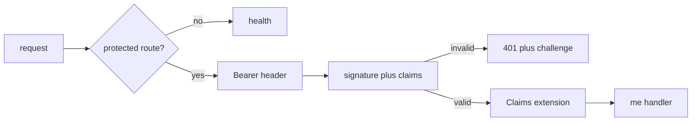

# 08. Authentication middleware with Tower

> **Draft: written but not yet run.** The code and the expected output in this lesson were prepared by reading the code and the official documentation. They have not been executed yet. If something does not behave as described, trust your tool's real output and report it.

## What you will be able to do
- Compose an Axum authentication layer through Tower.
- Validate a JWT signature and required issuer, audience and time claims.
- Separate validated identity from resource authorization.

## Recap
1. Where should an invalid protected request stop?
   <details><summary>Answer</summary>Before the protected handler performs work.</details>

2. Why is local cancellation insufficient to undo external effects?
   <details><summary>Answer</summary>Remote work may already have completed; checks should happen before side effects.</details>

## Why it matters
Repeating token checks inside handlers makes one easy to forget. Middleware centralizes the authentication boundary. A readable signed token is not trustworthy until its signature and intended use are validated.

## What you will build
A public /health and protected /me route. The layer verifies a local HS256 JWT and attaches typed Claims. This is not a login server, token issuer or Keycloak replacement.

## Before you start
- Audience: finished [Rust 101](../../101-zero-to-hero/phase-3-real-programs/12-expense-tracker.md), with 1-2 years of practice. Finish lesson 07 first.
- Target Rust/Cargo 1.100.0, edition 2024. Reuse the Rust 101 installation and editor. No tools were installed for this draft. Exact direct crate versions/features are in the full manifest, checked in official documentation; this is not a claim they are the latest releases.
- Time: 70-90 min. Allow extra time for the first future dependency download.
- Python 3 is optional only for the future random-secret command. The primary self-check needs no server secret or external issuer.
- Source pack (optional): every file is shown in full in this lesson, so you can follow without it. The finished code, the exercise starter and the solution are in the
  course repository https://github.com/Uee03/Code101 under `source/rust/201-hero-to-super-hero/phase-3-data-and-security/08-authentication-middleware-with-tower/` (on that page choose **Code, Download ZIP**, or run
  `git clone https://github.com/Uee03/Code101.git`).
- Extract a ZIP: Windows right-click **Extract All**; macOS double-click; Linux use your file manager's **Extract** action. Open the source path above. If copying instead of typing, copy code directly into `$HOME/code101/rust201`, rename the copy lesson08, and do not nest it inside an already-created destination.
- Save as UTF-8. On Windows enable **View, Show, File name extensions** so main.rs does not become main.rs.txt. Save every editor tab; a dot marks unsaved edits. Commands below are future learner instructions, not observed results.
- No Cargo.lock is supplied: Cargo creates it on the first build. Keep/review the generated application lock. Exact direct pins alone do not lock transitive dependencies.

## Steps
### Step 1. Create your project folders
Use the typed route below or the optional copy route, not both. Start in any terminal folder; these home-relative absolute paths recover from the wrong working directory. `$HOME` is your user home on all platforms.

**File: `terminal in any folder (Windows)`**
```powershell
New-Item -ItemType Directory -Force "$HOME/code101/rust201/lesson08/src"
Set-Location "$HOME/code101/rust201/lesson08"
```

**File: `terminal in any folder (macOS/Linux)`**
```bash
mkdir -p "$HOME/code101/rust201/lesson08/src"
cd "$HOME/code101/rust201/lesson08"
```

Expected result: the prompt ends in lesson08; src and the listed subfolders exist. PowerShell may print directory tables, not program output. Do not overwrite existing work; choose a different local folder name if needed.

### Step 2. Create the complete manifest
In the project root create Cargo.toml in your editor.

**File: `Cargo.toml`**
```toml
[package]
name = "jwt_middleware"
version = "0.1.0"
edition = "2024"

[dependencies]
anyhow = "=1.0.100"
axum = "=0.8.6"
jsonwebtoken = { version = "=10.1.0", default-features = false, features = ["rust_crypto"] }
serde = { version = "=1.0.228", features = ["derive"] }
tokio = { version = "=1.48.0", features = ["macros", "rt-multi-thread", "net"] }
tower = { version = "=0.5.2", features = ["util"] }
```

[package] names the package; 0.1.0 is its learning-project version and edition 2024 selects language rules. Cargo discovers src/lib.rs as the library and src/main.rs as the binary. [dependencies] lists external crates; an empty table uses std only. Exact = versions pin direct crates and features enable capabilities. No cargo add command is needed.

**Predict before you run:** Predict /me without Authorization and with an unsigned or malformed token. Can merely decoding a payload establish identity?

Tests below use assert_eq for exact values, assert for conditions and matches for enum patterns. #[cfg(test)] includes a child test module for tests only; #[test] marks a normal test; #[tokio::test] supplies an async runtime where used. These are taught, not executed here. Lesson 09 explains unit, documentation and integration boundaries.

### Step 3. Create `src/lib.rs`
Create this exact file under $HOME/code101/rust201/lesson08; save the entire content, not a fragment.

**File: `src/lib.rs`**
```rust
use axum::{
    body::Body,
    extract::{Request, State},
    http::{header, StatusCode},
    middleware::{self, Next},
    response::{IntoResponse, Response},
    routing::get,
    Extension, Json, Router,
};
use jsonwebtoken::{decode, Algorithm, DecodingKey, Validation};
use serde::{Deserialize, Serialize};
use tower::{ServiceBuilder, ServiceExt};

#[derive(Clone, Debug, Deserialize, Serialize)]
pub struct Claims {
    pub sub: String,
    pub exp: u64,
    pub nbf: u64,
    pub iss: String,
    pub aud: String,
}

#[derive(Clone)]
pub struct Auth {
    key: DecodingKey,
    validation: Validation,
}

impl Auth {
    pub fn new(secret: &[u8]) -> anyhow::Result<Self> {
        anyhow::ensure!(secret.len() >= 32, "JWT_SECRET needs at least 32 bytes");
        let mut validation = Validation::new(Algorithm::HS256);
        validation.set_issuer(&["code101-local"]);
        validation.set_audience(&["notes-api"]);
        validation.set_required_spec_claims(&["exp", "nbf", "iss", "aud", "sub"]);
        validation.validate_nbf = true;
        validation.leeway = 0;
        Ok(Self { key: DecodingKey::from_secret(secret), validation })
    }

    pub fn verify(&self, token: &str) -> Result<Claims, jsonwebtoken::errors::Error> {
        let data = decode::<Claims>(token, &self.key, &self.validation)?;
        Ok(data.claims)
    }
}

fn unauthorized() -> Response {
    let mut response = (StatusCode::UNAUTHORIZED, "unauthorized").into_response();
    response.headers_mut().insert(header::WWW_AUTHENTICATE, "Bearer".parse().unwrap());
    response
}

async fn authenticate(State(auth): State<Auth>, mut request: Request, next: Next) -> Response {
    let claims = request.headers().get(header::AUTHORIZATION)
        .and_then(|value| value.to_str().ok())
        .and_then(|value| value.strip_prefix("Bearer "))
        .and_then(|token| auth.verify(token).ok());
    match claims {
        Some(claims) if !claims.sub.trim().is_empty() => {
            request.extensions_mut().insert(claims);
            next.run(request).await
        }
        _ => unauthorized(),
    }
}

#[derive(Serialize)]
struct Me {
    subject: String,
}

async fn me(Extension(claims): Extension<Claims>) -> Json<Me> {
    Json(Me { subject: claims.sub })
}

pub fn app(auth: Auth) -> Router {
    let protected = Router::new().route("/me", get(me))
        .route_layer(ServiceBuilder::new().layer(middleware::from_fn_with_state(auth, authenticate)));
    Router::new().route("/health", get(|| async { "ok" })).merge(protected)
}

pub async fn self_check(auth: Auth) -> anyhow::Result<()> {
    let request = Request::builder().uri("/me").body(Body::empty())?;
    let response = app(auth).oneshot(request).await?;
    assert_eq!(response.status(), StatusCode::UNAUTHORIZED);
    println!("missing bearer: 401");
    Ok(())
}

#[cfg(test)]
mod tests {
    use super::*;
    use jsonwebtoken::{encode, EncodingKey, Header};

    fn bearer_headers(token: &str) -> axum::http::HeaderMap {
        let mut headers = axum::http::HeaderMap::new();
        headers.insert(header::AUTHORIZATION, format!("Bearer {token}").parse().unwrap());
        headers
    }


    // Public, test-only bytes; never used by the running server.
    const TEST_KEY: &[u8] = b"test-only-not-a-real-secret-32-bytes";

    fn claims() -> Claims {
        Claims { sub: "reader".into(), exp: 4_102_444_800, nbf: 0,
            iss: "code101-local".into(), aud: "notes-api".into() }
    }

    fn token(claims: &Claims, key: &[u8]) -> String {
        encode(&Header::new(Algorithm::HS256), claims, &EncodingKey::from_secret(key)).unwrap()
    }

    #[test]
    fn rejects_wrong_audience_expiry_and_signature() {
        let auth = Auth::new(TEST_KEY).unwrap();
        assert_eq!(auth.verify(&token(&claims(), TEST_KEY)).unwrap().sub, "reader");
        let mut wrong = claims();
        wrong.aud = "other-api".into();
        assert!(auth.verify(&token(&wrong, TEST_KEY)).is_err());
        wrong = claims();
        wrong.iss = "unknown-issuer".into();
        assert!(auth.verify(&token(&wrong, TEST_KEY)).is_err());
        wrong = claims();
        wrong.nbf = 4_102_444_800;
        assert!(auth.verify(&token(&wrong, TEST_KEY)).is_err());
        wrong = claims();
        wrong.exp = 1;
        assert!(auth.verify(&token(&wrong, TEST_KEY)).is_err());
        assert!(auth.verify(&token(&claims(), b"different-test-key-not-for-production")).is_err());
    }

    #[tokio::test]
    async fn layer_accepts_valid_token_and_rejects_missing_token() {
        let auth = Auth::new(TEST_KEY).unwrap();
        self_check(auth.clone()).await.unwrap();
        let signed = token(&claims(), TEST_KEY);
        let mut request = Request::builder().uri("/me").body(Body::empty()).unwrap();
        *request.headers_mut() = bearer_headers(&signed);
        assert_eq!(app(auth).oneshot(request).await.unwrap().status(), StatusCode::OK);
    }
}
```

A **JWT** (JSON Web Token) contains claims such as subject and expiry. **HS256** authenticates it with a shared symmetric key: everyone holding the verification secret can also sign tokens. This teaching key model is not a multi-service production key-sharing recommendation.

Auth creates one reusable DecodingKey and a Validation policy. It permits only HS256, requires exp/nbf/iss/aud/sub, checks issuer/audience against trusted configuration, enables not-before validation and uses zero clock leeway for clarity. exp is expiry, nbf not-before, iss issuer, aud audience and sub subject. Numeric dates are UTC seconds since the Unix epoch. Requiring a claim and validating its value are separate controls.

from_fn_with_state turns authenticate into a Tower-compatible **layer**, a wrapper adding behavior around a service. ServiceBuilder composes it. Only the protected router is wrapped before merge. Request extensions receive Claims only after verification; Extension extracts that type for the handler.

Tests sign fixtures with public test-only bytes and reject bad signatures, issuer, audience, expiry and not-before. Their expiry is January 2100, so update them before then. Fixtures are not deployable credentials. The only unwrap outside tests parses a hard-coded valid header, never user input.

The self-check uses a labeled throwaway key and exits before socket binding. The real server requires JWT_SECRET and cannot fall back to that key. The 32-byte minimum checks length, not entropy.

### Step 4. Create `src/main.rs`
Create this exact file under $HOME/code101/rust201/lesson08; save the entire content, not a fragment.

**File: `src/main.rs`**
```rust
use anyhow::{Context, Result};
use jwt_middleware::Auth;

#[tokio::main]
async fn main() -> Result<()> {
    if std::env::args().any(|arg| arg == "--self-check") {
        let auth = Auth::new(b"self-check-only-not-a-server-secret")?;
        return jwt_middleware::self_check(auth).await;
    }
    let secret = std::env::var("JWT_SECRET").context("set a private JWT_SECRET of at least 32 random bytes")?;
    let auth = Auth::new(secret.as_bytes())?;
    let listener = tokio::net::TcpListener::bind("127.0.0.1:3108").await?;
    println!("listening on http://127.0.0.1:3108");
    axum::serve(listener, jwt_middleware::app(auth)).await?;
    Ok(())
}
```

The binary imports the library using its package name. It owns startup, demonstration output and top-level errors at the application boundary.

### Step 5. Create `.env.example`
Create this exact file under $HOME/code101/rust201/lesson08; save the entire content, not a fragment.

**File: `.env.example`**
```dotenv
# Reference only: this program does not load .env automatically.
# Set a private value of at least 32 cryptographically random bytes in your shell.
JWT_SECRET=
```

This is the complete reference template, not a credential. Blank values are intentional. Never commit a private .env. Rust does not load it automatically.

### Step 6. Create `.gitignore`
Create this exact file under $HOME/code101/rust201/lesson08; save the entire content, not a fragment.

**File: `.gitignore`**
```text
/target/
.env
```

/target/ excludes generated Rust artifacts at the root; .env excludes local private configuration. Cargo.lock is not ignored by Git: Cargo creates it on first build, and applications should normally retain the reviewed generated lock.

## Run it
Save every file. This command runs in the project root on Windows/macOS/Linux. It is for a future walk-through; no author runtime result is claimed.

**File: `terminal in $HOME/code101/rust201/lesson08`**
```powershell
cargo run --quiet -- --self-check
```

Expected output, not yet run (derived from source; Cargo download/build messages omitted):

**File: `terminal standard output`**
```text
missing bearer: 401
```

--self-check sends HTTP messages to a Router in memory, opens no socket and exits. This branch is also unrun in the draft; writing it is not runtime verification.

### Check the supplied feature tests later
From this same project root, on all platforms:

**File: `terminal in $HOME/code101/rust201/lesson08`**
```powershell
cargo test
```

Expected result, not yet run: the finished example's assertions pass. Harness paths, timings and test order are not assumed. No test suite was run while authoring.

### Optional HTTP walk-through
The self-check rejects a missing header before any signature check. To exercise signature acceptance and negative claims later, use the included tests: they sign their own public test-only fixtures and need no issuer/network. Never use fixture keys in server configuration.

For a real local server, set a private random secret in terminal A. The optional helper uses Python's official secrets.token_hex API to make 32 random bytes represented as hex, not the ordinary random module. Python 3 must be installed; use python3 on macOS/Linux. Windows:
**File: `terminal in $HOME/code101/rust201/lesson08 (Windows A)`**
```powershell
$env:JWT_SECRET = python -c "import secrets; print(secrets.token_hex(32))"
cargo run --quiet
```
**File: `terminal in $HOME/code101/rust201/lesson08 (macOS/Linux A)`**
```bash
export JWT_SECRET="$(python3 -c 'import secrets; print(secrets.token_hex(32))')"
cargo run --quiet
```

Expected output, not yet run (derived from source; build messages omitted):

**File: `terminal standard output`**
```text
listening on http://127.0.0.1:3108
```
The assignment captures the secret rather than printing it into your terminal. .env.example is only a variable reference; no dotenv loader reads it. Generating in memory keeps the value out of the command text. A deployment needs a secrets manager and key lifecycle, not this teaching shell setup.

In terminal B, same project root, check public access, missing bearer credentials and an invalid token. Windows:
**File: `terminal in $HOME/code101/rust201/lesson08 (Windows B)`**
```powershell
curl.exe -sS -i http://127.0.0.1:3108/health
curl.exe -sS -i http://127.0.0.1:3108/me
curl.exe -sS -i -H "Authorization: Bearer not-a-jwt" http://127.0.0.1:3108/me
```
**File: `terminal in $HOME/code101/rust201/lesson08 (macOS/Linux B)`**
```bash
curl -sS -i http://127.0.0.1:3108/health
curl -sS -i http://127.0.0.1:3108/me
curl -sS -i -H "Authorization: Bearer not-a-jwt" http://127.0.0.1:3108/me
```
Expected results, not yet run: health is 200 with body ok. Both /me requests return 401 with body unauthorized and WWW-Authenticate: Bearer. No exact Date or transport headers are claimed. For the accepted path, the included layer_accepts_valid_token_and_rejects_missing_token test signs/submits a fixture in memory. This lesson exposes no token-issuing endpoint and never asks you to paste a bearer token into shell history.

Stop A with Ctrl+C; no application shutdown line is printed. Remove JWT_SECRET afterward in A. Windows:
**File: `terminal in $HOME/code101/rust201/lesson08 (Windows A)`**
```powershell
Remove-Item Env:JWT_SECRET
```
**File: `terminal in $HOME/code101/rust201/lesson08 (macOS/Linux A)`**
```bash
unset JWT_SECRET
```
Expected result: the variable is absent. Official helper reference: [Python secrets](https://docs.python.org/3/library/secrets.html). For actual identity issuance, use [the Rust capstone Keycloak chapter](../../../../capstones/backend-rust/tutorials/phase-3-identity/03-keycloak-token-validation.md).

## How it works
authenticate checks the Bearer header before protected work. This small parser accepts the exact Bearer prefix shown. Missing, malformed and invalid credentials all get the same 401 body with a WWW-Authenticate: Bearer challenge. No token or verifier detail is logged.

decode checks the signature and the configured claims. Merely base64-decoding or reading a header is never authentication. Never let a token choose an arbitrary accepted algorithm or remote key URL. Only a nonempty verified subject is attached before next.run.

**Why this, not that:** use Axum's function-to-layer adapter rather than hand-writing Tower poll_ready/call machinery for one request policy. It remains Tower middleware. A reusable protocol-generic wrapper may justify a manual implementation later.

**Authentication** establishes identity; **authorization** determines permission on a resource. A valid reader token must not grant access to everybody's notes. This lesson exposes only the caller's identity and has no roles, ownership, passwords, login or browser-token storage. Keycloak, asymmetric signatures, cached JWKS (public verification keys), scopes and roles belong in the capstone. Keep secrets and bearer tokens out of logs, URLs, source and images.

**Structure:**

**File: `lesson architecture diagram`**


## Try it
### Rung 1. Guided practice
For an intentionally single-subject exercise, restrict Validation.sub to reader. Keep every other validation enabled. The starter adds a correctly signed writer token that must be rejected; reader must still work. This fixed-subject claim policy is not general role/ownership authorization.

Work separately in `$HOME/code101/rust201/try08`. Optional download route: from `source/rust/201-hero-to-super-hero/phase-3-data-and-security/08-authentication-middleware-with-tower/exercise`, copy starter directly into `$HOME/code101/rust201`, then rename the copied folder try08. Do not first create try08 and put starter inside it. Use this route only if the destination does not exist.

Typed route without a download: create the exact directories below, then every starter file shown. Start in any terminal folder.

**File: `terminal in any folder (Windows)`**
```powershell
New-Item -ItemType Directory -Force "$HOME/code101/rust201/try08/src"
Set-Location "$HOME/code101/rust201/try08"
```

**File: `terminal in any folder (macOS/Linux)`**
```bash
mkdir -p "$HOME/code101/rust201/try08/src"
cd "$HOME/code101/rust201/try08"
```

Expected result: a separate exercise root, not a nested starter directory.

**File: `try08/Cargo.toml (starter)`**
```toml
[package]
name = "jwt_middleware"
version = "0.1.0"
edition = "2024"

[dependencies]
anyhow = "=1.0.100"
axum = "=0.8.6"
jsonwebtoken = { version = "=10.1.0", default-features = false, features = ["rust_crypto"] }
serde = { version = "=1.0.228", features = ["derive"] }
tokio = { version = "=1.48.0", features = ["macros", "rt-multi-thread", "net"] }
tower = { version = "=0.5.2", features = ["util"] }
```

**File: `try08/src/lib.rs (starter)`**
```rust
use axum::{
    body::Body,
    extract::{Request, State},
    http::{header, StatusCode},
    middleware::{self, Next},
    response::{IntoResponse, Response},
    routing::get,
    Extension, Json, Router,
};
use jsonwebtoken::{decode, Algorithm, DecodingKey, Validation};
use serde::{Deserialize, Serialize};
use tower::{ServiceBuilder, ServiceExt};

#[derive(Clone, Debug, Deserialize, Serialize)]
pub struct Claims {
    pub sub: String,
    pub exp: u64,
    pub nbf: u64,
    pub iss: String,
    pub aud: String,
}

#[derive(Clone)]
pub struct Auth {
    key: DecodingKey,
    validation: Validation,
}

impl Auth {
    pub fn new(secret: &[u8]) -> anyhow::Result<Self> {
        anyhow::ensure!(secret.len() >= 32, "JWT_SECRET needs at least 32 bytes");
        let mut validation = Validation::new(Algorithm::HS256);
        validation.set_issuer(&["code101-local"]);
        validation.set_audience(&["notes-api"]);
        validation.set_required_spec_claims(&["exp", "nbf", "iss", "aud", "sub"]);
        validation.validate_nbf = true;
        validation.leeway = 0;
        // TODO: restrict the subject to reader using Validation.sub.
        Ok(Self { key: DecodingKey::from_secret(secret), validation })
    }

    pub fn verify(&self, token: &str) -> Result<Claims, jsonwebtoken::errors::Error> {
        let data = decode::<Claims>(token, &self.key, &self.validation)?;
        Ok(data.claims)
    }
}

fn unauthorized() -> Response {
    let mut response = (StatusCode::UNAUTHORIZED, "unauthorized").into_response();
    response.headers_mut().insert(header::WWW_AUTHENTICATE, "Bearer".parse().unwrap());
    response
}

async fn authenticate(State(auth): State<Auth>, mut request: Request, next: Next) -> Response {
    let claims = request.headers().get(header::AUTHORIZATION)
        .and_then(|value| value.to_str().ok())
        .and_then(|value| value.strip_prefix("Bearer "))
        .and_then(|token| auth.verify(token).ok());
    match claims {
        Some(claims) if !claims.sub.trim().is_empty() => {
            request.extensions_mut().insert(claims);
            next.run(request).await
        }
        _ => unauthorized(),
    }
}

#[derive(Serialize)]
struct Me {
    subject: String,
}

async fn me(Extension(claims): Extension<Claims>) -> Json<Me> {
    Json(Me { subject: claims.sub })
}

pub fn app(auth: Auth) -> Router {
    let protected = Router::new().route("/me", get(me))
        .route_layer(ServiceBuilder::new().layer(middleware::from_fn_with_state(auth, authenticate)));
    Router::new().route("/health", get(|| async { "ok" })).merge(protected)
}

pub async fn self_check(auth: Auth) -> anyhow::Result<()> {
    let request = Request::builder().uri("/me").body(Body::empty())?;
    let response = app(auth).oneshot(request).await?;
    assert_eq!(response.status(), StatusCode::UNAUTHORIZED);
    println!("missing bearer: 401");
    Ok(())
}

#[cfg(test)]
mod tests {
    use super::*;
    use jsonwebtoken::{encode, EncodingKey, Header};

    fn bearer_headers(token: &str) -> axum::http::HeaderMap {
        let mut headers = axum::http::HeaderMap::new();
        headers.insert(header::AUTHORIZATION, format!("Bearer {token}").parse().unwrap());
        headers
    }


    // Public, test-only bytes; never used by the running server.
    const TEST_KEY: &[u8] = b"test-only-not-a-real-secret-32-bytes";

    fn claims() -> Claims {
        Claims { sub: "reader".into(), exp: 4_102_444_800, nbf: 0,
            iss: "code101-local".into(), aud: "notes-api".into() }
    }

    fn token(claims: &Claims, key: &[u8]) -> String {
        encode(&Header::new(Algorithm::HS256), claims, &EncodingKey::from_secret(key)).unwrap()
    }

    #[test]
    fn rejects_wrong_audience_expiry_and_signature() {
        let auth = Auth::new(TEST_KEY).unwrap();
        assert_eq!(auth.verify(&token(&claims(), TEST_KEY)).unwrap().sub, "reader");
        let mut wrong = claims();
        wrong.aud = "other-api".into();
        assert!(auth.verify(&token(&wrong, TEST_KEY)).is_err());
        wrong = claims();
        wrong.sub = "writer".into();
        assert!(auth.verify(&token(&wrong, TEST_KEY)).is_err());
        wrong = claims();
        wrong.iss = "unknown-issuer".into();
        assert!(auth.verify(&token(&wrong, TEST_KEY)).is_err());
        wrong = claims();
        wrong.nbf = 4_102_444_800;
        assert!(auth.verify(&token(&wrong, TEST_KEY)).is_err());
        wrong = claims();
        wrong.exp = 1;
        assert!(auth.verify(&token(&wrong, TEST_KEY)).is_err());
        assert!(auth.verify(&token(&claims(), b"different-test-key-not-for-production")).is_err());
    }

    #[tokio::test]
    async fn layer_accepts_valid_token_and_rejects_missing_token() {
        let auth = Auth::new(TEST_KEY).unwrap();
        self_check(auth.clone()).await.unwrap();
        let signed = token(&claims(), TEST_KEY);
        let mut request = Request::builder().uri("/me").body(Body::empty()).unwrap();
        *request.headers_mut() = bearer_headers(&signed);
        assert_eq!(app(auth).oneshot(request).await.unwrap().status(), StatusCode::OK);
    }
}
```

**File: `try08/src/main.rs (starter)`**
```rust
use anyhow::{Context, Result};
use jwt_middleware::Auth;

#[tokio::main]
async fn main() -> Result<()> {
    if std::env::args().any(|arg| arg == "--self-check") {
        let auth = Auth::new(b"self-check-only-not-a-server-secret")?;
        return jwt_middleware::self_check(auth).await;
    }
    let secret = std::env::var("JWT_SECRET").context("set a private JWT_SECRET of at least 32 random bytes")?;
    let auth = Auth::new(secret.as_bytes())?;
    let listener = tokio::net::TcpListener::bind("127.0.0.1:3108").await?;
    println!("listening on http://127.0.0.1:3108");
    axum::serve(listener, jwt_middleware::app(auth)).await?;
    Ok(())
}
```

**File: `try08/.env.example (starter)`**
```dotenv
# Reference only: this program does not load .env automatically.
# Set a private value of at least 32 cryptographically random bytes in your shell.
JWT_SECRET=
```

**File: `try08/.gitignore (starter)`**
```text
/target/
.env
```

Save the TODO changes, then use these commands in the exercise root (all platforms):

**File: `terminal in $HOME/code101/rust201/try08`**
```powershell
cargo run --quiet -- --self-check
cargo test
```

Expected output, not yet run (derived from source; Cargo download/build messages omitted):

**File: `terminal standard output`**
```text
missing bearer: 401
```

This is the completed guided target, not a claim the untouched starter satisfies it. The supplied assertions identify the policy to complete; do not delete them to get a green result.

### Rung 2. Change the behavior or coverage
Add rejection tests for an invalid algorithm and an empty subject. Assert the middleware boundary where appropriate; do not disable validation to make tests pass.

### Rung 3. Stretch (optional)
Explain why a service with an HS256 verification secret can mint tokens. Compare with Keycloak public-key validation and cached key rotation.

<details><summary>Solution: complete guided project</summary>

These files solve Rung 1 only. Compare after attempting the TODO. Supporting files are included so no download is required. Rung 2 and the optional design question remain your work.

**File: `exercise/solution/Cargo.toml`**
```toml
[package]
name = "jwt_middleware"
version = "0.1.0"
edition = "2024"

[dependencies]
anyhow = "=1.0.100"
axum = "=0.8.6"
jsonwebtoken = { version = "=10.1.0", default-features = false, features = ["rust_crypto"] }
serde = { version = "=1.0.228", features = ["derive"] }
tokio = { version = "=1.48.0", features = ["macros", "rt-multi-thread", "net"] }
tower = { version = "=0.5.2", features = ["util"] }
```

**File: `exercise/solution/src/lib.rs`**
```rust
use axum::{
    body::Body,
    extract::{Request, State},
    http::{header, StatusCode},
    middleware::{self, Next},
    response::{IntoResponse, Response},
    routing::get,
    Extension, Json, Router,
};
use jsonwebtoken::{decode, Algorithm, DecodingKey, Validation};
use serde::{Deserialize, Serialize};
use tower::{ServiceBuilder, ServiceExt};

#[derive(Clone, Debug, Deserialize, Serialize)]
pub struct Claims {
    pub sub: String,
    pub exp: u64,
    pub nbf: u64,
    pub iss: String,
    pub aud: String,
}

#[derive(Clone)]
pub struct Auth {
    key: DecodingKey,
    validation: Validation,
}

impl Auth {
    pub fn new(secret: &[u8]) -> anyhow::Result<Self> {
        anyhow::ensure!(secret.len() >= 32, "JWT_SECRET needs at least 32 bytes");
        let mut validation = Validation::new(Algorithm::HS256);
        validation.set_issuer(&["code101-local"]);
        validation.set_audience(&["notes-api"]);
        validation.set_required_spec_claims(&["exp", "nbf", "iss", "aud", "sub"]);
        validation.validate_nbf = true;
        validation.leeway = 0;
        validation.sub = Some("reader".into());
        Ok(Self { key: DecodingKey::from_secret(secret), validation })
    }

    pub fn verify(&self, token: &str) -> Result<Claims, jsonwebtoken::errors::Error> {
        let data = decode::<Claims>(token, &self.key, &self.validation)?;
        Ok(data.claims)
    }
}

fn unauthorized() -> Response {
    let mut response = (StatusCode::UNAUTHORIZED, "unauthorized").into_response();
    response.headers_mut().insert(header::WWW_AUTHENTICATE, "Bearer".parse().unwrap());
    response
}

async fn authenticate(State(auth): State<Auth>, mut request: Request, next: Next) -> Response {
    let claims = request.headers().get(header::AUTHORIZATION)
        .and_then(|value| value.to_str().ok())
        .and_then(|value| value.strip_prefix("Bearer "))
        .and_then(|token| auth.verify(token).ok());
    match claims {
        Some(claims) if !claims.sub.trim().is_empty() => {
            request.extensions_mut().insert(claims);
            next.run(request).await
        }
        _ => unauthorized(),
    }
}

#[derive(Serialize)]
struct Me {
    subject: String,
}

async fn me(Extension(claims): Extension<Claims>) -> Json<Me> {
    Json(Me { subject: claims.sub })
}

pub fn app(auth: Auth) -> Router {
    let protected = Router::new().route("/me", get(me))
        .route_layer(ServiceBuilder::new().layer(middleware::from_fn_with_state(auth, authenticate)));
    Router::new().route("/health", get(|| async { "ok" })).merge(protected)
}

pub async fn self_check(auth: Auth) -> anyhow::Result<()> {
    let request = Request::builder().uri("/me").body(Body::empty())?;
    let response = app(auth).oneshot(request).await?;
    assert_eq!(response.status(), StatusCode::UNAUTHORIZED);
    println!("missing bearer: 401");
    Ok(())
}

#[cfg(test)]
mod tests {
    use super::*;
    use jsonwebtoken::{encode, EncodingKey, Header};

    fn bearer_headers(token: &str) -> axum::http::HeaderMap {
        let mut headers = axum::http::HeaderMap::new();
        headers.insert(header::AUTHORIZATION, format!("Bearer {token}").parse().unwrap());
        headers
    }


    // Public, test-only bytes; never used by the running server.
    const TEST_KEY: &[u8] = b"test-only-not-a-real-secret-32-bytes";

    fn claims() -> Claims {
        Claims { sub: "reader".into(), exp: 4_102_444_800, nbf: 0,
            iss: "code101-local".into(), aud: "notes-api".into() }
    }

    fn token(claims: &Claims, key: &[u8]) -> String {
        encode(&Header::new(Algorithm::HS256), claims, &EncodingKey::from_secret(key)).unwrap()
    }

    #[test]
    fn rejects_wrong_audience_expiry_and_signature() {
        let auth = Auth::new(TEST_KEY).unwrap();
        assert_eq!(auth.verify(&token(&claims(), TEST_KEY)).unwrap().sub, "reader");
        let mut wrong = claims();
        wrong.aud = "other-api".into();
        assert!(auth.verify(&token(&wrong, TEST_KEY)).is_err());
        wrong = claims();
        wrong.sub = "writer".into();
        assert!(auth.verify(&token(&wrong, TEST_KEY)).is_err());
        wrong = claims();
        wrong.iss = "unknown-issuer".into();
        assert!(auth.verify(&token(&wrong, TEST_KEY)).is_err());
        wrong = claims();
        wrong.nbf = 4_102_444_800;
        assert!(auth.verify(&token(&wrong, TEST_KEY)).is_err());
        wrong = claims();
        wrong.exp = 1;
        assert!(auth.verify(&token(&wrong, TEST_KEY)).is_err());
        assert!(auth.verify(&token(&claims(), b"different-test-key-not-for-production")).is_err());
    }

    #[tokio::test]
    async fn layer_accepts_valid_token_and_rejects_missing_token() {
        let auth = Auth::new(TEST_KEY).unwrap();
        self_check(auth.clone()).await.unwrap();
        let signed = token(&claims(), TEST_KEY);
        let mut request = Request::builder().uri("/me").body(Body::empty()).unwrap();
        *request.headers_mut() = bearer_headers(&signed);
        assert_eq!(app(auth).oneshot(request).await.unwrap().status(), StatusCode::OK);
    }
}
```

**File: `exercise/solution/src/main.rs`**
```rust
use anyhow::{Context, Result};
use jwt_middleware::Auth;

#[tokio::main]
async fn main() -> Result<()> {
    if std::env::args().any(|arg| arg == "--self-check") {
        let auth = Auth::new(b"self-check-only-not-a-server-secret")?;
        return jwt_middleware::self_check(auth).await;
    }
    let secret = std::env::var("JWT_SECRET").context("set a private JWT_SECRET of at least 32 random bytes")?;
    let auth = Auth::new(secret.as_bytes())?;
    let listener = tokio::net::TcpListener::bind("127.0.0.1:3108").await?;
    println!("listening on http://127.0.0.1:3108");
    axum::serve(listener, jwt_middleware::app(auth)).await?;
    Ok(())
}
```

**File: `exercise/solution/.env.example`**
```dotenv
# Reference only: this program does not load .env automatically.
# Set a private value of at least 32 cryptographically random bytes in your shell.
JWT_SECRET=
```

**File: `exercise/solution/.gitignore`**
```text
/target/
.env
```

</details>

## Check yourself
1. Why does /health not require authentication?
   <details><summary>Answer</summary>Only the protected router is wrapped before merge.</details>

2. Is a correct signature enough?
   <details><summary>Answer</summary>No. The permitted algorithm and required issuer, audience, expiry, not-before and subject policies must hold.</details>

3. Does validated identity authorize any note id?
   <details><summary>Answer</summary>No. Resource ownership and permission checks are separate.</details>

## Common mistakes
These are symptoms and fixes, not fabricated compiler transcripts. Read your tool's actual diagnostic and file/line first.

| Symptom | Cause | Fix |
|---|---|---|
| Wrong project runs or no manifest is found. | Terminal is outside this project. | Return to `$HOME/code101/rust201/lesson08`, next to Cargo.toml. |
| Your edit changes nothing. | The buffer was not saved. | Save all tabs, then run from the project root. |
| A readable JWT payload is trusted. | Decoding was confused with verification. | Use decode with a trusted key and explicit policy. |
| Every route requires authentication. | The layer wrapped the combined router. | Wrap protected routes before merging public routes. |
| JWT_SECRET exists in .env but is unavailable. | There is deliberately no dotenv loader. | Set it in this terminal and keep any private file out of Git. |

## Best practice
Pin the accepted algorithm and validate token integrity and intended use before forwarding. Source: [jsonwebtoken Validation 10.1.0](https://docs.rs/jsonwebtoken/10.1.0/jsonwebtoken/struct.Validation.html); [jsonwebtoken crypto features](https://docs.rs/crate/jsonwebtoken/10.1.0/features); [Axum stateful middleware](https://docs.rs/axum/0.8.6/axum/middleware/fn.from_fn_with_state.html); [Tower services and layers](https://docs.rs/tower/0.5.2/tower/).

## Going further
- [jsonwebtoken Validation 10.1.0](https://docs.rs/jsonwebtoken/10.1.0/jsonwebtoken/struct.Validation.html) (official; version checked where applicable).
- [jsonwebtoken crypto features](https://docs.rs/crate/jsonwebtoken/10.1.0/features) (official; version checked where applicable).
- [Axum stateful middleware](https://docs.rs/axum/0.8.6/axum/middleware/fn.from_fn_with_state.html) (official; version checked where applicable).
- [Tower services and layers](https://docs.rs/tower/0.5.2/tower/) (official; version checked where applicable).
- [Rust backend capstone](../../../../capstones/backend-rust/README.md): data, identity and API hardening rather than a duplicate capstone inside this level.

### Mixed phase review
1. Why are parameter binding and JWT validation separate?
   <details><summary>Answer</summary>One protects SQL syntax, the other establishes intended identity; neither supplies resource authorization alone.</details>

2. Which needs a compile-time database in this phase?
   <details><summary>Answer</summary>Neither the runtime SQLx functions nor the authentication layer does.</details>

## Summary
- You practiced how to compose an Axum authentication layer through Tower.
- You practiced how to validate a JWT signature and required issuer, audience and time claims.
- You practiced how to separate validated identity from resource authorization.
- You distinguished expected draft behavior from observed runtime evidence.

## Next lesson
[09. Testing Rust code](../phase-4-quality-and-ship/09-testing-rust-code.md): organize the tests supplied with every feature.
