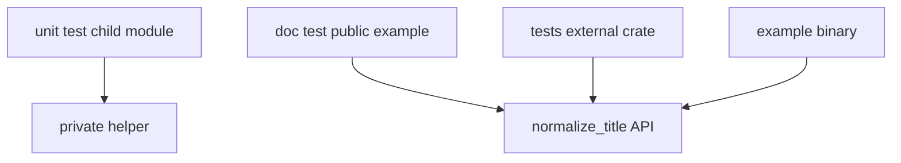

# 09. Testing Rust code

> **Draft: written but not yet run.** The code and the expected output in this lesson were prepared by reading the code and the official documentation. They have not been executed yet. If something does not behave as described, trust your tool's real output and report it.

## What you will be able to do
- Place focused unit tests beside private implementation details.
- Write an executable documentation example for a public function.
- Test the public contract from a separate tests crate.

## Recap
1. Why do pure title-policy tests need no database?
   <details><summary>Answer</summary>They operate on strings and return values without external I/O.</details>

2. What should token tests assert instead of exact library error prose?
   <details><summary>Answer</summary>Acceptance/rejection or a stable typed category, not incidental wording.</details>

## Why it matters
Useful tests tell you which contract changed. Rust has different boundaries for private logic, public examples and external callers. Organizing by those boundaries gives clearer feedback than putting all assertions in main.

## What you will build
A title-normalization library, two internal unit tests, one documentation test and two integration tests, plus a small example binary.

## Before you start
- Audience: finished [Rust 101](../../101-zero-to-hero/phase-3-real-programs/12-expense-tracker.md), with 1-2 years of practice. Finish lesson 08 first.
- Target Rust/Cargo 1.100.0, edition 2024. Reuse the Rust 101 installation and editor. No tools were installed for this draft. Exact direct crate versions/features are in the full manifest, checked in official documentation; this is not a claim they are the latest releases.
- Time: 50-65 min. Allow extra time for the first future dependency download.
- Source pack (optional): every file is shown in full in this lesson, so you can follow without it. The finished code, the exercise starter and the solution are in the
  course repository https://github.com/Uee03/Code101 under `source/rust/201-hero-to-super-hero/phase-4-quality-and-ship/09-testing-rust-code/` (on that page choose **Code, Download ZIP**, or run
  `git clone https://github.com/Uee03/Code101.git`).
- Extract a ZIP: Windows right-click **Extract All**; macOS double-click; Linux use your file manager's **Extract** action. Open the source path above. If copying instead of typing, copy code directly into `$HOME/code101/rust201`, rename the copy lesson09, and do not nest it inside an already-created destination.
- Save as UTF-8. On Windows enable **View, Show, File name extensions** so main.rs does not become main.rs.txt. Save every editor tab; a dot marks unsaved edits. Commands below are future learner instructions, not observed results.
- No Cargo.lock is supplied: Cargo creates it on the first build. Keep/review the generated application lock. Exact direct pins alone do not lock transitive dependencies.

## Steps
### Step 1. Create your project folders
Use the typed route below or the optional copy route, not both. Start in any terminal folder; these home-relative absolute paths recover from the wrong working directory. `$HOME` is your user home on all platforms.

**File: `terminal in any folder (Windows)`**
```powershell
New-Item -ItemType Directory -Force "$HOME/code101/rust201/lesson09/src"
New-Item -ItemType Directory -Force "$HOME/code101/rust201/lesson09/tests"
Set-Location "$HOME/code101/rust201/lesson09"
```

**File: `terminal in any folder (macOS/Linux)`**
```bash
mkdir -p "$HOME/code101/rust201/lesson09/src" "$HOME/code101/rust201/lesson09/tests"
cd "$HOME/code101/rust201/lesson09"
```

Expected result: the prompt ends in lesson09; src and the listed subfolders exist. PowerShell may print directory tables, not program output. Do not overwrite existing work; choose a different local folder name if needed.

### Step 2. Create the complete manifest
In the project root create Cargo.toml in your editor.

**File: `Cargo.toml`**
```toml
[package]
name = "tested_titles"
version = "0.1.0"
edition = "2024"

[dependencies]
```

[package] names the package; 0.1.0 is its learning-project version and edition 2024 selects language rules. Cargo discovers src/lib.rs as the library and src/main.rs as the binary. [dependencies] lists external crates; an empty table uses std only. Exact = versions pin direct crates and features enable capabilities. No cargo add command is needed.

**Predict before you run:** Should 80 copies of ? pass a chars().count() rule? Can tests/title_contract.rs call the private too_long helper?

Tests below use assert_eq for exact values, assert for conditions and matches for enum patterns. #[cfg(test)] includes a child test module for tests only; #[test] marks a normal test; #[tokio::test] supplies an async runtime where used. These are taught, not executed here. Lesson 09 explains unit, documentation and integration boundaries.

### Step 3. Create `src/lib.rs`
Create this exact file under $HOME/code101/rust201/lesson09; save the entire content, not a fragment.

**File: `src/lib.rs`**
```rust
#[derive(Debug, PartialEq, Eq)]
pub enum TitleError {
    Empty,
    TooLong,
}

fn too_long(title: &str) -> bool {
    title.chars().count() > 80
}

/// Trim a title and reject empty or oversized input.
///
/// ```
/// use tested_titles::{normalize_title, TitleError};
/// assert_eq!(normalize_title(" Rust "), Ok("Rust".to_string()));
/// assert_eq!(normalize_title(" "), Err(TitleError::Empty));
/// ```
pub fn normalize_title(input: &str) -> Result<String, TitleError> {
    let title = input.trim();
    if title.is_empty() {
        return Err(TitleError::Empty);
    }
    if too_long(title) {
        return Err(TitleError::TooLong);
    }
    Ok(title.to_owned())
}

#[cfg(test)]
mod tests {
    use super::*;

    #[test]
    fn private_length_policy_has_a_boundary() {
        assert!(!too_long(&"x".repeat(80)));
        assert!(too_long(&"x".repeat(81)));
    }

    #[test]
    fn rejects_empty_after_trimming() {
        assert_eq!(normalize_title("\t "), Err(TitleError::Empty));
    }
}
```

A **unit test** checks focused logic. The child tests module can reach private parent items through super. cfg(test) excludes it from ordinary builds, and test marks a function as a test.

A **documentation test** is a Rust fence in a /// comment. rustdoc compiles/runs it when requested by cargo test. The complete example imports the public API as readers do. Normal tests pass if they finish without panic; assert_eq compares both value and variant.

TitleError derives Debug for assertion reports and PartialEq/Eq for equality. normalize_title returns an owned String, independent of the input owner's later lifetime. The private helper counts scalar values, not bytes.

An **integration test** in tests/ is compiled as a separate crate and may use only public API paths. The example binary is a consumer, not a test-suite replacement. Its expect is for a built-in valid demonstration string, not user input.

### Step 4. Create `src/main.rs`
Create this exact file under $HOME/code101/rust201/lesson09; save the entire content, not a fragment.

**File: `src/main.rs`**
```rust
use tested_titles::normalize_title;

fn main() {
    let title = normalize_title(" Rust notes ").expect("valid built-in title");
    println!("title: {title}");
    println!("blank rejected: {}", normalize_title(" ").is_err());
}
```

The binary imports the library using its package name. It owns startup, demonstration output and top-level errors at the application boundary.

### Step 5. Create `tests/title_contract.rs`
Create this exact file under $HOME/code101/rust201/lesson09; save the entire content, not a fragment.

**File: `tests/title_contract.rs`**
```rust
use tested_titles::{normalize_title, TitleError};

#[test]
fn external_caller_gets_trimmed_owned_text() {
    assert_eq!(normalize_title(" Rust "), Ok("Rust".to_string()));
}

#[test]
fn external_caller_can_match_an_error() {
    assert_eq!(normalize_title(""), Err(TitleError::Empty));
}
```

Cargo discovers tests/ files as separate integration-test crates. They import the public library and each constructs isolated inputs/state.

## Run it
Save every file. This command runs in the project root on Windows/macOS/Linux. It is for a future walk-through; no author runtime result is claimed.

**File: `terminal in $HOME/code101/rust201/lesson09`**
```powershell
cargo run --quiet
```

Expected output, not yet run (derived from source; Cargo download/build messages omitted):

**File: `terminal standard output`**
```text
title: Rust notes
blank rejected: true
```

### Check the supplied feature tests later
From this same project root, on all platforms:

**File: `terminal in $HOME/code101/rust201/lesson09`**
```powershell
cargo test
```

Expected result, not yet run: the finished example's assertions pass. Harness paths, timings and test order are not assumed. No test suite was run while authoring.

### Select test boundaries deliberately
All commands run in this project's root, on all platforms:
**File: `terminal in $HOME/code101/rust201/lesson09`**
```powershell
cargo test --lib
cargo test --test title_contract
cargo test --doc
```
Expected results, not yet run: two unit tests, two integration tests and one documentation test respectively, with zero failures for the finished example. The completed guided solution has three integration tests because it adds the Unicode boundary. Harness paths, durations and build metadata have not been captured and are not reproduced here.

cargo test runs all three categories. Never infer that a TODO-only test is useful because its empty body passes; inspect the assertion and the boundary it distinguishes.

## How it works
Unit tests cover the private 80/81 boundary and empty-after-trimming behavior. The documentation example asserts a valid trimmed result and a typed empty error. Integration tests import tested_titles exactly like another package.

**Why this, not that:** use unit tests for precise local rules and integration tests for the public boundary callers depend on. Integration does not necessarily mean database or network: this one integrates public library behavior only. Do not export a helper just so a test can call it; a child module already has the required visibility.

Tests are independent and may run concurrently. Avoid ordering dependencies, shared mutable files, fixed ports and exact durations. The harness's hashes, times and test-line order are not reproduced here as captured output. A test containing only a TODO comment can pass while proving nothing; the starter makes this risk visible.

**Structure:**

**File: `lesson architecture diagram`**


## Try it
### Rung 1. Guided practice
Fill the TODO integration test: accept 80 copies of ? and reject 81 with TitleError::TooLong. Use repeat to construct input and compare Result values, not bytes or display wording. The empty test body compiles but proves nothing before you add assertions.

Work separately in `$HOME/code101/rust201/try09`. Optional download route: from `source/rust/201-hero-to-super-hero/phase-4-quality-and-ship/09-testing-rust-code/exercise`, copy starter directly into `$HOME/code101/rust201`, then rename the copied folder try09. Do not first create try09 and put starter inside it. Use this route only if the destination does not exist.

Typed route without a download: create the exact directories below, then every starter file shown. Start in any terminal folder.

**File: `terminal in any folder (Windows)`**
```powershell
New-Item -ItemType Directory -Force "$HOME/code101/rust201/try09/src"
New-Item -ItemType Directory -Force "$HOME/code101/rust201/try09/tests"
Set-Location "$HOME/code101/rust201/try09"
```

**File: `terminal in any folder (macOS/Linux)`**
```bash
mkdir -p "$HOME/code101/rust201/try09/src" "$HOME/code101/rust201/try09/tests"
cd "$HOME/code101/rust201/try09"
```

Expected result: a separate exercise root, not a nested starter directory.

**File: `try09/Cargo.toml (starter)`**
```toml
[package]
name = "tested_titles"
version = "0.1.0"
edition = "2024"

[dependencies]
```

**File: `try09/src/lib.rs (starter)`**
```rust
#[derive(Debug, PartialEq, Eq)]
pub enum TitleError {
    Empty,
    TooLong,
}

fn too_long(title: &str) -> bool {
    title.chars().count() > 80
}

/// Trim a title and reject empty or oversized input.
///
/// ```
/// use tested_titles::{normalize_title, TitleError};
/// assert_eq!(normalize_title(" Rust "), Ok("Rust".to_string()));
/// assert_eq!(normalize_title(" "), Err(TitleError::Empty));
/// ```
pub fn normalize_title(input: &str) -> Result<String, TitleError> {
    let title = input.trim();
    if title.is_empty() {
        return Err(TitleError::Empty);
    }
    if too_long(title) {
        return Err(TitleError::TooLong);
    }
    Ok(title.to_owned())
}

#[cfg(test)]
mod tests {
    use super::*;

    #[test]
    fn private_length_policy_has_a_boundary() {
        assert!(!too_long(&"x".repeat(80)));
        assert!(too_long(&"x".repeat(81)));
    }

    #[test]
    fn rejects_empty_after_trimming() {
        assert_eq!(normalize_title("\t "), Err(TitleError::Empty));
    }
}
```

**File: `try09/src/main.rs (starter)`**
```rust
use tested_titles::normalize_title;

fn main() {
    let title = normalize_title(" Rust notes ").expect("valid built-in title");
    println!("title: {title}");
    println!("blank rejected: {}", normalize_title(" ").is_err());
}
```

**File: `try09/tests/title_contract.rs (starter)`**
```rust
use tested_titles::{normalize_title, TitleError};

#[test]
fn external_caller_gets_trimmed_owned_text() {
    assert_eq!(normalize_title(" Rust "), Ok("Rust".to_string()));
}

#[test]
fn external_caller_can_match_an_error() {
    assert_eq!(normalize_title(""), Err(TitleError::Empty));
}

#[test]
fn unicode_boundary_counts_characters_not_bytes() {
    // TODO: accept 80 copies of ?, and reject 81 copies with TooLong.
}
```

Save the TODO changes, then use these commands in the exercise root (all platforms):

**File: `terminal in $HOME/code101/rust201/try09`**
```powershell
cargo run --quiet
cargo test
```

Expected output, not yet run (derived from source; Cargo download/build messages omitted):

**File: `terminal standard output`**
```text
title: Rust notes
blank rejected: true
```

This is the completed guided target, not a claim the untouched starter satisfies it. The TODO-only test may already pass; it establishes no Unicode behavior until assertions are added.

### Rung 2. Change the behavior or coverage
Add an integration test proving the returned String remains independent after the original input String is cleared. Keep borrowed input and owned output.

### Rung 3. Stretch (optional)
Add a public documentation example demonstrating ownership of the returned text. Explain why it belongs in docs instead of only an internal regression test.

<details><summary>Solution: complete guided project</summary>

These files solve Rung 1 only. Compare after attempting the TODO. Supporting files are included so no download is required. Rung 2 and the optional design question remain your work.

**File: `exercise/solution/Cargo.toml`**
```toml
[package]
name = "tested_titles"
version = "0.1.0"
edition = "2024"

[dependencies]
```

**File: `exercise/solution/src/lib.rs`**
```rust
#[derive(Debug, PartialEq, Eq)]
pub enum TitleError {
    Empty,
    TooLong,
}

fn too_long(title: &str) -> bool {
    title.chars().count() > 80
}

/// Trim a title and reject empty or oversized input.
///
/// ```
/// use tested_titles::{normalize_title, TitleError};
/// assert_eq!(normalize_title(" Rust "), Ok("Rust".to_string()));
/// assert_eq!(normalize_title(" "), Err(TitleError::Empty));
/// ```
pub fn normalize_title(input: &str) -> Result<String, TitleError> {
    let title = input.trim();
    if title.is_empty() {
        return Err(TitleError::Empty);
    }
    if too_long(title) {
        return Err(TitleError::TooLong);
    }
    Ok(title.to_owned())
}

#[cfg(test)]
mod tests {
    use super::*;

    #[test]
    fn private_length_policy_has_a_boundary() {
        assert!(!too_long(&"x".repeat(80)));
        assert!(too_long(&"x".repeat(81)));
    }

    #[test]
    fn rejects_empty_after_trimming() {
        assert_eq!(normalize_title("\t "), Err(TitleError::Empty));
    }
}
```

**File: `exercise/solution/src/main.rs`**
```rust
use tested_titles::normalize_title;

fn main() {
    let title = normalize_title(" Rust notes ").expect("valid built-in title");
    println!("title: {title}");
    println!("blank rejected: {}", normalize_title(" ").is_err());
}
```

**File: `exercise/solution/tests/title_contract.rs`**
```rust
use tested_titles::{normalize_title, TitleError};

#[test]
fn external_caller_gets_trimmed_owned_text() {
    assert_eq!(normalize_title(" Rust "), Ok("Rust".to_string()));
}

#[test]
fn external_caller_can_match_an_error() {
    assert_eq!(normalize_title(""), Err(TitleError::Empty));
}

#[test]
fn unicode_boundary_counts_characters_not_bytes() {
    let title = "?".repeat(80);
    assert_eq!(normalize_title(&title), Ok(title));
    assert_eq!(normalize_title(&"?".repeat(81)), Err(TitleError::TooLong));
}
```

</details>

## Check yourself
1. Can unit tests call private too_long?
   <details><summary>Answer</summary>Yes. The child module can access parent private items.</details>

2. What makes the /// Rust fence executable documentation?
   <details><summary>Answer</summary>rustdoc treats it as a documentation test under cargo test.</details>

3. Predict an import of too_long from tests/title_contract.rs.
   <details><summary>Answer</summary>It is inaccessible because that file is a separate crate and the helper is private.</details>

## Common mistakes
These are symptoms and fixes, not fabricated compiler transcripts. Read your tool's actual diagnostic and file/line first.

| Symptom | Cause | Fix |
|---|---|---|
| Wrong project runs or no manifest is found. | Terminal is outside this project. | Return to `$HOME/code101/rust201/lesson09`, next to Cargo.toml. |
| Your edit changes nothing. | The buffer was not saved. | Save all tabs, then run from the project root. |
| A starter test passes before behavior is checked. | Its body has only a TODO. | Add meaningful assertions with distinguishing inputs. |
| An integration test cannot import a helper. | Only the public contract is visible across crates. | Use the public function or a private unit module. |
| A test fails only with the whole suite. | It may rely on ordering or shared state. | Isolate state and assert contracts, not scheduling. |

## Best practice
Organize tests around the visibility and contract they exercise, keeping public examples executable. Source: [The Rust Book: test organization](https://doc.rust-lang.org/book/ch11-03-test-organization.html); [rustdoc: documentation tests](https://doc.rust-lang.org/rustdoc/write-documentation/documentation-tests.html).

## Going further
- [The Rust Book: test organization](https://doc.rust-lang.org/book/ch11-03-test-organization.html) (official; version checked where applicable).
- [rustdoc: documentation tests](https://doc.rust-lang.org/rustdoc/write-documentation/documentation-tests.html) (official; version checked where applicable).
- [Rust backend capstone](../../../../capstones/backend-rust/README.md): data, identity and API hardening rather than a duplicate capstone inside this level.
## Summary
- You practiced how to place focused unit tests beside private implementation details.
- You practiced how to write an executable documentation example for a public function.
- You practiced how to test the public contract from a separate tests crate.
- You distinguished expected draft behavior from observed runtime evidence.

## Next lesson
[10. Mini project: notes API](10-mini-project-notes-api.md): combine contracts, state, tests and packaging.
