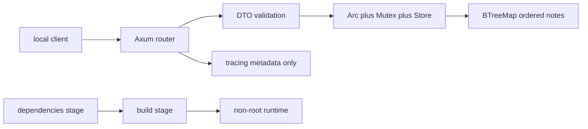

# 10. Mini project: notes API

> **Draft: written but not yet run.** The code and the expected output in this lesson were prepared by reading the code and the official documentation. They have not been executed yet. If something does not behave as described, trust your tool's real output and report it.

## What you will be able to do
- Build a bounded notes lifecycle API with isolated shared state.
- Exercise its HTTP contract without opening a socket.
- Explain a cached multi-stage non-root container build.

## Recap
1. Why use stable HTTP error codes?
   <details><summary>Answer</summary>Clients can handle the contract without parsing incidental prose.</details>

2. What should a shared store avoid during external I/O?
   <details><summary>Answer</summary>Holding a guard across slow I/O or unrelated awaits, which serializes work and risks deadlocks.</details>

## Why it matters
A small project reveals whether individual techniques fit together. A bounded in-memory API practices ownership, async handlers, DTOs, errors, tests and packaging without recreating the backend capstone. Its limits make the next design decisions visible.

## What you will build
Create, list, read and delete local notes. Store at most 100 records, list in deterministic id order, log metadata rather than contents, and describe a dependency-cached non-root Linux image. There is no database, identity provider, update route or persistence.

## Before you start
- Audience: finished [Rust 101](../../101-zero-to-hero/phase-3-real-programs/12-expense-tracker.md), with 1-2 years of practice. Finish lesson 09 first.
- Target Rust/Cargo 1.100.0, edition 2024. Reuse the Rust 101 installation and editor. No tools were installed for this draft. Exact direct crate versions/features are in the full manifest, checked in official documentation; this is not a claim they are the latest releases.
- Time: 100-130 min, two sittings. Two sittings: stop after the no-socket self-check, then return to the container instructions.
- Source pack (optional): every file is shown in full in this lesson, so you can follow without it. The finished code, the exercise starter and the solution are in the
  course repository https://github.com/Uee03/Code101 under `source/rust/201-hero-to-super-hero/phase-4-quality-and-ship/10-mini-project-notes-api/` (on that page choose **Code, Download ZIP**, or run
  `git clone https://github.com/Uee03/Code101.git`).
- Extract a ZIP: Windows right-click **Extract All**; macOS double-click; Linux use your file manager's **Extract** action. Open the source path above. If copying instead of typing, copy code directly into `$HOME/code101/rust201`, rename the copy lesson10, and do not nest it inside an already-created destination.
- Save as UTF-8. On Windows enable **View, Show, File name extensions** so main.rs does not become main.rs.txt. Save every editor tab; a dot marks unsaved edits. Commands below are future learner instructions, not observed results.
- No Cargo.lock is supplied: Cargo creates it on the first build. Keep/review the generated application lock. Exact direct pins alone do not lock transitive dependencies.

## Steps
### Step 1. Create your project folders
Use the typed route below or the optional copy route, not both. Start in any terminal folder; these home-relative absolute paths recover from the wrong working directory. `$HOME` is your user home on all platforms.

**File: `terminal in any folder (Windows)`**
```powershell
New-Item -ItemType Directory -Force "$HOME/code101/rust201/lesson10/build-stub"
New-Item -ItemType Directory -Force "$HOME/code101/rust201/lesson10/src"
New-Item -ItemType Directory -Force "$HOME/code101/rust201/lesson10/tests"
Set-Location "$HOME/code101/rust201/lesson10"
```

**File: `terminal in any folder (macOS/Linux)`**
```bash
mkdir -p "$HOME/code101/rust201/lesson10/build-stub" "$HOME/code101/rust201/lesson10/src" "$HOME/code101/rust201/lesson10/tests"
cd "$HOME/code101/rust201/lesson10"
```

Expected result: the prompt ends in lesson10; src and the listed subfolders exist. PowerShell may print directory tables, not program output. Do not overwrite existing work; choose a different local folder name if needed.

### Step 2. Create the complete manifest
In the project root create Cargo.toml in your editor.

**File: `Cargo.toml`**
```toml
[package]
name = "notes_api"
version = "0.1.0"
edition = "2024"

[dependencies]
anyhow = "=1.0.100"
axum = "=0.8.6"
serde = { version = "=1.0.228", features = ["derive"] }
serde_json = "=1.0.145"
tokio = { version = "=1.48.0", features = ["macros", "rt-multi-thread", "net", "sync", "signal"] }
tower = { version = "=0.5.2", features = ["util"] }
tracing = "=0.1.41"
tracing-subscriber = { version = "=0.3.20", features = ["json"] }
```

[package] names the package; 0.1.0 is its learning-project version and edition 2024 selects language rules. Cargo discovers src/lib.rs as the library and src/main.rs as the binary. [dependencies] lists external crates; an empty table uses std only. Exact = versions pin direct crates and features enable capabilities. No cargo add command is needed.

**Predict before you run:** In a fresh app predict create/read/delete/read status codes. If you call app() twice rather than cloning one Router, do they share notes?

Tests below use assert_eq for exact values, assert for conditions and matches for enum patterns. #[cfg(test)] includes a child test module for tests only; #[test] marks a normal test; #[tokio::test] supplies an async runtime where used. These are taught, not executed here. Lesson 09 explains unit, documentation and integration boundaries.

### Step 3. Create `src/lib.rs`
Create this exact file under $HOME/code101/rust201/lesson10; save the entire content, not a fragment.

**File: `src/lib.rs`**
```rust
use axum::{
    body::{to_bytes, Body},
    extract::{DefaultBodyLimit, Path, State},
    http::{Request, StatusCode},
    response::{IntoResponse, Response},
    routing::get,
    Json, Router,
};
use serde::{Deserialize, Serialize};
use std::{collections::BTreeMap, sync::Arc};
use tokio::sync::Mutex;
use tower::ServiceExt;

const MAX_NOTES: usize = 100;

#[derive(Clone, Debug, Deserialize, Serialize)]
pub struct Note {
    pub id: u64,
    pub title: String,
}

#[derive(Deserialize)]
#[serde(deny_unknown_fields)]
pub struct CreateNote {
    pub title: String,
}

#[derive(Default)]
struct Store {
    next_id: u64,
    notes: BTreeMap<u64, Note>,
}

type Shared = Arc<Mutex<Store>>;

pub enum ApiError {
    InvalidTitle,
    NotFound,
    Full,
}

#[derive(Serialize)]
struct ErrorDto {
    code: &'static str,
}

impl IntoResponse for ApiError {
    fn into_response(self) -> Response {
        let (status, code) = match self {
            Self::InvalidTitle => (StatusCode::UNPROCESSABLE_ENTITY, "invalid_title"),
            Self::NotFound => (StatusCode::NOT_FOUND, "not_found"),
            Self::Full => (StatusCode::CONFLICT, "store_full"),
        };
        (status, Json(ErrorDto { code })).into_response()
    }
}

pub fn normalize_title(input: &str) -> Result<String, ApiError> {
    let title = input.trim();
    if !(1..=80).contains(&title.chars().count()) {
        return Err(ApiError::InvalidTitle);
    }
    Ok(title.to_owned())
}

async fn create(State(state): State<Shared>, Json(input): Json<CreateNote>)
    -> Result<(StatusCode, Json<Note>), ApiError>
{
    let title = normalize_title(&input.title)?;
    let note = {
        let mut store = state.lock().await;
        if store.notes.len() >= MAX_NOTES {
            return Err(ApiError::Full);
        }
        store.next_id = store.next_id.checked_add(1).ok_or(ApiError::Full)?;
        let note = Note { id: store.next_id, title };
        store.notes.insert(note.id, note.clone());
        note
    };
    tracing::info!(note_id = note.id, "note_created");
    Ok((StatusCode::CREATED, Json(note)))
}

async fn list(State(state): State<Shared>) -> Json<Vec<Note>> {
    let notes = state.lock().await.notes.values().cloned().collect();
    Json(notes)
}

async fn read(State(state): State<Shared>, Path(id): Path<u64>) -> Result<Json<Note>, ApiError> {
    let store = state.lock().await;
    store.notes.get(&id).cloned().map(Json).ok_or(ApiError::NotFound)
}

async fn remove(State(state): State<Shared>, Path(id): Path<u64>) -> Result<StatusCode, ApiError> {
    let mut store = state.lock().await;
    store.notes.remove(&id).ok_or(ApiError::NotFound)?;
    Ok(StatusCode::NO_CONTENT)
}

pub fn app() -> Router {
    Router::new()
        .route("/health", get(|| async { "ok" }))
        .route("/notes", get(list).post(create))
        .route("/notes/{id}", get(read).delete(remove))
        .layer(DefaultBodyLimit::max(4096))
        .with_state(Arc::new(Mutex::new(Store::default())))
}

pub async fn self_check() -> anyhow::Result<()> {
    let app = app();
    let response = app.clone().oneshot(Request::builder()
        .method("POST").uri("/notes").header("content-type", "application/json")
        .body(Body::from(r#"{"title":" Rust "}"#))?).await?;
    assert_eq!(response.status(), StatusCode::CREATED);
    let bytes = to_bytes(response.into_body(), 4096).await?;
    let note: Note = serde_json::from_slice(&bytes)?;
    assert_eq!(note.id, 1);
    assert_eq!(note.title, "Rust");
    let response = app.clone().oneshot(Request::builder().uri("/notes/1").body(Body::empty())?).await?;
    assert_eq!(response.status(), StatusCode::OK);
    let response = app.clone().oneshot(Request::builder()
        .method("DELETE").uri("/notes/1").body(Body::empty())?).await?;
    assert_eq!(response.status(), StatusCode::NO_CONTENT);
    let response = app.oneshot(Request::builder().uri("/notes/1").body(Body::empty())?).await?;
    assert_eq!(response.status(), StatusCode::NOT_FOUND);
    println!("create: 201; read: 200; delete: 204; missing: 404");
    Ok(())
}

#[cfg(test)]
mod tests {
    use super::*;

    #[test]
    fn title_policy() {
        assert!(normalize_title(" Rust ").is_ok());
        assert!(normalize_title(" ").is_err());
        assert!(normalize_title(&"a".repeat(81)).is_err());
    }
}
```

Arc is an atomically reference-counted shared owner. Cloned routers share an Arc pointing to one Store; independent app() calls create fresh stores. A **mutex** grants one task exclusive access to shared mutable data. Tokio lock().await yields while waiting. A standard mutex can also suit very short critical sections with no await; this lesson makes waiting explicit with the async form.

BTreeMap orders keys for deterministic lists. checked_add prevents the identifier from wrapping on overflow. MAX_NOTES bounds retained records, and each title is bounded too. A full teaching store returns 409 by this contract, not as a universal recommendation for every capacity error.

The scoped creation guard ends before logging/returning. There is no database or network operation while holding a store guard. Read/list clone small response DTOs so guards do not escape into serialization. Domain errors become JSON codes; extractor failures retain Axum's format.

self_check uses one app and cloned routers to exercise a lifecycle in memory. tests/ adds an invalid-input HTTP check, and a unit test covers title policy. Do not construct a fresh app for every request in a test meant to share state.

The no-socket branch runs before tracing initialization, making its stdout deterministic. Real startup installs a JSON tracing subscriber, reads optional BIND_ADDR, and defaults to loopback. **Tracing** records structured diagnostic events; only note_id, not title or credentials, is logged. **Graceful shutdown** stops accepting work and lets in-flight work finish after Ctrl+C. The container uses SIGINT to match this handler. Larger services need a shutdown deadline and other deployment signals.

### Step 4. Create `src/main.rs`
Create this exact file under $HOME/code101/rust201/lesson10; save the entire content, not a fragment.

**File: `src/main.rs`**
```rust
#[tokio::main]
async fn main() -> anyhow::Result<()> {
    if std::env::args().any(|arg| arg == "--self-check") {
        return notes_api::self_check().await;
    }
    tracing_subscriber::fmt().json().with_target(false).init();
    let address = std::env::var("BIND_ADDR").unwrap_or_else(|_| "127.0.0.1:3110".into());
    let listener = tokio::net::TcpListener::bind(&address).await?;
    tracing::info!(%address, "listening");
    axum::serve(listener, notes_api::app())
        .with_graceful_shutdown(async { let _ = tokio::signal::ctrl_c().await; })
        .await?;
    Ok(())
}
```

The binary imports the library using its package name. It owns startup, demonstration output and top-level errors at the application boundary.

### Step 5. Create `tests/http_contract.rs`
Create this exact file under $HOME/code101/rust201/lesson10; save the entire content, not a fragment.

**File: `tests/http_contract.rs`**
```rust
use axum::{body::Body, http::{Request, StatusCode}};
use tower::ServiceExt;

#[tokio::test]
async fn lifecycle() {
    notes_api::self_check().await.unwrap();
}

#[tokio::test]
async fn empty_title_is_rejected() {
    let response = notes_api::app().oneshot(Request::builder()
        .method("POST").uri("/notes").header("content-type", "application/json")
        .body(Body::from(r#"{"title":" "}"#)).unwrap()).await.unwrap();
    assert_eq!(response.status(), StatusCode::UNPROCESSABLE_ENTITY);
}
```

Cargo discovers tests/ files as separate integration-test crates. They import the public library and each constructs isolated inputs/state.

### Step 6. Create `build-stub/main.rs`
Create this exact file under $HOME/code101/rust201/lesson10; save the entire content, not a fragment.

**File: `build-stub/main.rs`**
```rust
fn main() {}
```

This minimal executable lets the dependency stage build before the real sources are copied.

### Step 7. Create `build-stub/lib.rs`
Create this exact file under $HOME/code101/rust201/lesson10; save the entire content, not a fragment.

**File: `build-stub/lib.rs`**
```rust
// Empty library target used only for dependency caching.
```

This comment-only empty library is valid Rust used only by the dependency stage, not the application.

### Step 8. Create `Dockerfile`
Create this exact file under $HOME/code101/rust201/lesson10; save the entire content, not a fragment.

**File: `Dockerfile`**
```dockerfile
FROM rust:1.100.0-bookworm AS dependencies
WORKDIR /app
COPY Cargo.toml ./
COPY build-stub ./src
RUN cargo build --release

FROM dependencies AS build
COPY src ./src
RUN touch src/main.rs src/lib.rs && cargo build --release --locked

FROM debian:bookworm-20261104-slim AS runtime
WORKDIR /app
COPY --from=build /app/target/release/notes_api /app/notes_api
ENV BIND_ADDR=0.0.0.0:3110
USER 10001:10001
EXPOSE 3110
STOPSIGNAL SIGINT
ENTRYPOINT ["/app/notes_api"]
```

This full multi-stage configuration is explained instruction by instruction in Run it. For your later walk-through, use Linux containers, the shown build context and a disposable local service.

### Step 9. Create `.dockerignore`
Create this exact file under $HOME/code101/rust201/lesson10; save the entire content, not a fragment.

**File: `.dockerignore`**
```text
target
.git
.env
.env.*
Cargo.lock
tests
```

These entries exclude host target output, Git metadata, private env files, a host-generated lock and tests from the Docker context. Unlike .gitignore this controls what Docker receives, not what Git tracks. Source and placeholder files remain included.

### Step 10. Create `.gitignore`
Create this exact file under $HOME/code101/rust201/lesson10; save the entire content, not a fragment.

**File: `.gitignore`**
```text
/target/
.env
```

/target/ excludes generated Rust artifacts at the root; .env excludes local private configuration. Cargo.lock is not ignored by Git: Cargo creates it on first build, and applications should normally retain the reviewed generated lock.

### Step 11. Create `create.json`
Create this exact file under $HOME/code101/rust201/lesson10; save the entire content, not a fragment.

**File: `create.json`**
```json
{"title":" Rust "}
```

This full request fixture includes surrounding spaces. curl reads it as bytes so PowerShell and Unix shells do not disagree over JSON quotes.

## Run it
Save every file. This command runs in the project root on Windows/macOS/Linux. It is for a future walk-through; no author runtime result is claimed.

**File: `terminal in $HOME/code101/rust201/lesson10`**
```powershell
cargo run --quiet -- --self-check
```

Expected output, not yet run (derived from source; Cargo download/build messages omitted):

**File: `terminal standard output`**
```text
create: 201; read: 200; delete: 204; missing: 404
```

--self-check sends HTTP messages to a Router in memory, opens no socket and exits. This branch is also unrun in the draft; writing it is not runtime verification.

### Check the supplied feature tests later
From this same project root, on all platforms:

**File: `terminal in $HOME/code101/rust201/lesson10`**
```powershell
cargo test
```

Expected result, not yet run: the finished example's assertions pass. Harness paths, timings and test order are not assumed. No test suite was run while authoring.

**Break point:** end the first sitting after the no-socket self-check above. Resume with the container boundary below for the second sitting.

### Second sitting: inspect the container boundary
The complete Dockerfile and both build-stub files are in Steps. Each instruction has a purpose:

| Instruction | Meaning; consequence of changing it |
|---|---|
| FROM rust:1.100.0-bookworm AS dependencies | Checked official toolchain image; changing it invalidates dependent cache layers. |
| WORKDIR /app | Sets the build directory for relative paths. |
| COPY Cargo.toml ./ | Copies declarations before frequently changing sources. |
| COPY build-stub ./src | Supplies minimal targets so Cargo compiles dependencies before real application sources. |
| RUN cargo build --release | Builds dependency artifacts and generates Cargo.lock inside this stage. |
| FROM dependencies AS build | Reuses the compiled dependency layer. |
| COPY src ./src | Replaces both placeholders with the full application. |
| RUN touch ... and cargo build --release --locked | Forces real targets to rebuild with the dependency stage's resolution. |
| FROM debian:bookworm-20261104-slim AS runtime | Uses a checked dated Debian runtime tag compatible with the Bookworm builder. |
| WORKDIR /app | Defines the runtime working directory. |
| COPY --from=build ... | Copies only the release executable, not target caches or source. |
| ENV BIND_ADDR=0.0.0.0:3110 | Listens on the container interface; container loopback would prevent published-port access. |
| USER 10001:10001 | Uses a numeric unprivileged user/group without requiring a named account. No writable application directory is needed. |
| EXPOSE 3110 | Documents the internal port; does not publish it. |
| STOPSIGNAL SIGINT | Makes docker stop trigger the Ctrl+C handler. |
| ENTRYPOINT | Executes directly so the binary receives signals. |

.dockerignore excludes host target files, Git, private env files, host Cargo.lock and tests. The container creates its own lock in the dependency stage. This is intentionally a first-build teaching image: direct versions are pinned but an empty-cache rebuild can resolve newer transitive dependencies. Before a real release, generate/review Cargo.lock, retain it in version control, include it in the dependency-stage COPY and stop excluding it. Do not claim fully reproducible releases from this draft. Tags are checked but not digest-pinned; production promotion should record reviewed image digests too.

For a future Docker walk-through, stop any host copy using port 3110. All commands below run in the project root identically on Windows/macOS/Linux with Linux containers enabled:
**File: `terminal in $HOME/code101/rust201/lesson10`**
```powershell
docker build -t code101/notes201:local .
docker run -d --name rust201-notes -p 127.0.0.1:3110:3110 --read-only --cap-drop ALL --security-opt no-new-privileges code101/notes201:local
docker ps --filter name=rust201-notes
docker logs --tail 20 rust201-notes
docker exec rust201-notes id -u
```
Expected output, not yet run: build reports completed stages, run prints an id, ps lists this container running, and logs contain a JSON listening event. Identifiers, timings and timestamps vary and are not invented here. id -u should print:
**File: `terminal standard output for runtime uid`**
```text
10001
```
From that same project folder send requests. Windows:
**File: `terminal in $HOME/code101/rust201/lesson10 (Windows)`**
```powershell
curl.exe -sS http://127.0.0.1:3110/health
curl.exe -sS -i -H "Content-Type: application/json" --data-binary "@create.json" http://127.0.0.1:3110/notes
curl.exe -sS http://127.0.0.1:3110/notes
curl.exe -sS -i -X DELETE http://127.0.0.1:3110/notes/1
curl.exe -sS -i http://127.0.0.1:3110/notes/1
```
**File: `terminal in $HOME/code101/rust201/lesson10 (macOS/Linux)`**
```bash
curl -sS http://127.0.0.1:3110/health
curl -sS -i -H "Content-Type: application/json" --data-binary "@create.json" http://127.0.0.1:3110/notes
curl -sS http://127.0.0.1:3110/notes
curl -sS -i -X DELETE http://127.0.0.1:3110/notes/1
curl -sS -i http://127.0.0.1:3110/notes/1
```
Expected HTTP results, not yet run, for a fresh process with no other requests: health returns 200/ok; POST returns 201 with {"id":1,"title":"Rust"}; list returns [{"id":1,"title":"Rust"}]; DELETE returns 204 with no body; the last read returns 404 with {"code":"not_found"}. JSON may not end with a newline, so successive curl outputs can touch the next shell prompt. No Date or timestamp output is assumed.

Stop, inspect status and remove only this named lesson container/image:
**File: `terminal in $HOME/code101/rust201/lesson10`**
```powershell
docker stop rust201-notes
docker ps -a --filter name=rust201-notes
docker rm rust201-notes
docker image rm code101/notes201:local
```
Expected output, not yet run: stop reports the name; ps -a shows it exited; rm reports removal; image rm removes the application tag and unshared layers. Base images/cache may remain but no service is left running. No volume stores notes. Avoid broad prune commands that might delete unrelated work.

Optional host alternative, before container startup: cargo run --quiet starts loopback port 3110, prints a structured listening event, and Ctrl+C stops it gracefully. It serves the same API and loses notes on exit. Never expose this unauthenticated project publicly. Continue with [backend-rust](../../../../capstones/backend-rust/README.md) for durable data, Keycloak, ownership checks and deployment hardening.

Sources for checked image tags: [official Rust image manifest](https://raw.githubusercontent.com/docker-library/official-images/master/library/rust) and [Debian official image](https://hub.docker.com/_/debian).

## How it works
POST validates before locking, then assigns an id under exclusive access. GET /notes lists in key order; GET /notes/{id} returns one DTO or 404. DELETE removes a note and returns 204 with no body; a later read returns 404. The router caps buffered bodies at 4096 bytes. Storage bounds are not rate limiting.

**Why this, not that:** this store practices synchronization and contracts without a database. It cannot support durable notes, private user data or multiple replicas. Restart loses notes, replicas disagree, and callers are unauthenticated. Lesson 07 introduces persistence; lesson 08 introduces identity; the capstone combines them with broader policies.

A **multi-stage build** separates compilation tools from runtime files. A **dependency cache layer** can be reused while Cargo.toml and placeholder targets stay unchanged. Real src replaces the placeholders in the next stage; touch makes replacement targets unambiguously newer before rebuilding. --locked uses the lock generated inside that dependency stage, not a shipped lockfile.

The final stage copies only the executable and runs as an unprivileged numeric user. It has no outbound HTTPS requirement, so this example adds no TLS client certificates. Revisit runtime dependencies when that changes. Host publication remains loopback-only even though a container must bind all interfaces internally.

**Structure:**

**File: `lesson architecture diagram`**


## Try it
### Rung 1. Guided practice
Add GET /version returning plain text 0.1.0 next to health. Do not allocate a new store per request or change notes. The supplied integration test checks status/body and currently fails because the route is absent. Leave lifecycle output unchanged.

Work separately in `$HOME/code101/rust201/try10`. Optional download route: from `source/rust/201-hero-to-super-hero/phase-4-quality-and-ship/10-mini-project-notes-api/exercise`, copy starter directly into `$HOME/code101/rust201`, then rename the copied folder try10. Do not first create try10 and put starter inside it. Use this route only if the destination does not exist.

Typed route without a download: create the exact directories below, then every starter file shown. Start in any terminal folder.

**File: `terminal in any folder (Windows)`**
```powershell
New-Item -ItemType Directory -Force "$HOME/code101/rust201/try10/build-stub"
New-Item -ItemType Directory -Force "$HOME/code101/rust201/try10/src"
New-Item -ItemType Directory -Force "$HOME/code101/rust201/try10/tests"
Set-Location "$HOME/code101/rust201/try10"
```

**File: `terminal in any folder (macOS/Linux)`**
```bash
mkdir -p "$HOME/code101/rust201/try10/build-stub" "$HOME/code101/rust201/try10/src" "$HOME/code101/rust201/try10/tests"
cd "$HOME/code101/rust201/try10"
```

Expected result: a separate exercise root, not a nested starter directory.

**File: `try10/Cargo.toml (starter)`**
```toml
[package]
name = "notes_api"
version = "0.1.0"
edition = "2024"

[dependencies]
anyhow = "=1.0.100"
axum = "=0.8.6"
serde = { version = "=1.0.228", features = ["derive"] }
serde_json = "=1.0.145"
tokio = { version = "=1.48.0", features = ["macros", "rt-multi-thread", "net", "sync", "signal"] }
tower = { version = "=0.5.2", features = ["util"] }
tracing = "=0.1.41"
tracing-subscriber = { version = "=0.3.20", features = ["json"] }
```

**File: `try10/src/lib.rs (starter)`**
```rust
use axum::{
    body::{to_bytes, Body},
    extract::{DefaultBodyLimit, Path, State},
    http::{Request, StatusCode},
    response::{IntoResponse, Response},
    routing::get,
    Json, Router,
};
use serde::{Deserialize, Serialize};
use std::{collections::BTreeMap, sync::Arc};
use tokio::sync::Mutex;
use tower::ServiceExt;

const MAX_NOTES: usize = 100;

#[derive(Clone, Debug, Deserialize, Serialize)]
pub struct Note {
    pub id: u64,
    pub title: String,
}

#[derive(Deserialize)]
#[serde(deny_unknown_fields)]
pub struct CreateNote {
    pub title: String,
}

#[derive(Default)]
struct Store {
    next_id: u64,
    notes: BTreeMap<u64, Note>,
}

type Shared = Arc<Mutex<Store>>;

pub enum ApiError {
    InvalidTitle,
    NotFound,
    Full,
}

#[derive(Serialize)]
struct ErrorDto {
    code: &'static str,
}

impl IntoResponse for ApiError {
    fn into_response(self) -> Response {
        let (status, code) = match self {
            Self::InvalidTitle => (StatusCode::UNPROCESSABLE_ENTITY, "invalid_title"),
            Self::NotFound => (StatusCode::NOT_FOUND, "not_found"),
            Self::Full => (StatusCode::CONFLICT, "store_full"),
        };
        (status, Json(ErrorDto { code })).into_response()
    }
}

pub fn normalize_title(input: &str) -> Result<String, ApiError> {
    let title = input.trim();
    if !(1..=80).contains(&title.chars().count()) {
        return Err(ApiError::InvalidTitle);
    }
    Ok(title.to_owned())
}

async fn create(State(state): State<Shared>, Json(input): Json<CreateNote>)
    -> Result<(StatusCode, Json<Note>), ApiError>
{
    let title = normalize_title(&input.title)?;
    let note = {
        let mut store = state.lock().await;
        if store.notes.len() >= MAX_NOTES {
            return Err(ApiError::Full);
        }
        store.next_id = store.next_id.checked_add(1).ok_or(ApiError::Full)?;
        let note = Note { id: store.next_id, title };
        store.notes.insert(note.id, note.clone());
        note
    };
    tracing::info!(note_id = note.id, "note_created");
    Ok((StatusCode::CREATED, Json(note)))
}

async fn list(State(state): State<Shared>) -> Json<Vec<Note>> {
    let notes = state.lock().await.notes.values().cloned().collect();
    Json(notes)
}

async fn read(State(state): State<Shared>, Path(id): Path<u64>) -> Result<Json<Note>, ApiError> {
    let store = state.lock().await;
    store.notes.get(&id).cloned().map(Json).ok_or(ApiError::NotFound)
}

async fn remove(State(state): State<Shared>, Path(id): Path<u64>) -> Result<StatusCode, ApiError> {
    let mut store = state.lock().await;
    store.notes.remove(&id).ok_or(ApiError::NotFound)?;
    Ok(StatusCode::NO_CONTENT)
}

pub fn app() -> Router {
    Router::new()
        .route("/health", get(|| async { "ok" }))
        // TODO: add GET /version returning the plain text 0.1.0.
        .route("/notes", get(list).post(create))
        .route("/notes/{id}", get(read).delete(remove))
        .layer(DefaultBodyLimit::max(4096))
        .with_state(Arc::new(Mutex::new(Store::default())))
}

pub async fn self_check() -> anyhow::Result<()> {
    let app = app();
    let response = app.clone().oneshot(Request::builder()
        .method("POST").uri("/notes").header("content-type", "application/json")
        .body(Body::from(r#"{"title":" Rust "}"#))?).await?;
    assert_eq!(response.status(), StatusCode::CREATED);
    let bytes = to_bytes(response.into_body(), 4096).await?;
    let note: Note = serde_json::from_slice(&bytes)?;
    assert_eq!(note.id, 1);
    assert_eq!(note.title, "Rust");
    let response = app.clone().oneshot(Request::builder().uri("/notes/1").body(Body::empty())?).await?;
    assert_eq!(response.status(), StatusCode::OK);
    let response = app.clone().oneshot(Request::builder()
        .method("DELETE").uri("/notes/1").body(Body::empty())?).await?;
    assert_eq!(response.status(), StatusCode::NO_CONTENT);
    let response = app.oneshot(Request::builder().uri("/notes/1").body(Body::empty())?).await?;
    assert_eq!(response.status(), StatusCode::NOT_FOUND);
    println!("create: 201; read: 200; delete: 204; missing: 404");
    Ok(())
}

#[cfg(test)]
mod tests {
    use super::*;

    #[test]
    fn title_policy() {
        assert!(normalize_title(" Rust ").is_ok());
        assert!(normalize_title(" ").is_err());
        assert!(normalize_title(&"a".repeat(81)).is_err());
    }
}
```

**File: `try10/src/main.rs (starter)`**
```rust
#[tokio::main]
async fn main() -> anyhow::Result<()> {
    if std::env::args().any(|arg| arg == "--self-check") {
        return notes_api::self_check().await;
    }
    tracing_subscriber::fmt().json().with_target(false).init();
    let address = std::env::var("BIND_ADDR").unwrap_or_else(|_| "127.0.0.1:3110".into());
    let listener = tokio::net::TcpListener::bind(&address).await?;
    tracing::info!(%address, "listening");
    axum::serve(listener, notes_api::app())
        .with_graceful_shutdown(async { let _ = tokio::signal::ctrl_c().await; })
        .await?;
    Ok(())
}
```

**File: `try10/tests/http_contract.rs (starter)`**
```rust
use axum::{body::Body, http::{Request, StatusCode}};
use tower::ServiceExt;

#[tokio::test]
async fn lifecycle() {
    notes_api::self_check().await.unwrap();
}

#[tokio::test]
async fn empty_title_is_rejected() {
    let response = notes_api::app().oneshot(Request::builder()
        .method("POST").uri("/notes").header("content-type", "application/json")
        .body(Body::from(r#"{"title":" "}"#)).unwrap()).await.unwrap();
    assert_eq!(response.status(), StatusCode::UNPROCESSABLE_ENTITY);
}

#[tokio::test]
async fn version_is_available() {
    let response = notes_api::app().oneshot(Request::builder()
        .uri("/version").body(Body::empty()).unwrap()).await.unwrap();
    assert_eq!(response.status(), StatusCode::OK);
    let bytes = axum::body::to_bytes(response.into_body(), 4096).await.unwrap();
    assert_eq!(bytes.as_ref(), b"0.1.0");
}
```

**File: `try10/build-stub/main.rs (starter)`**
```rust
fn main() {}
```

**File: `try10/build-stub/lib.rs (starter)`**
```rust
// Empty library target used only for dependency caching.
```

**File: `try10/Dockerfile (starter)`**
```dockerfile
FROM rust:1.100.0-bookworm AS dependencies
WORKDIR /app
COPY Cargo.toml ./
COPY build-stub ./src
RUN cargo build --release

FROM dependencies AS build
COPY src ./src
RUN touch src/main.rs src/lib.rs && cargo build --release --locked

FROM debian:bookworm-20261104-slim AS runtime
WORKDIR /app
COPY --from=build /app/target/release/notes_api /app/notes_api
ENV BIND_ADDR=0.0.0.0:3110
USER 10001:10001
EXPOSE 3110
STOPSIGNAL SIGINT
ENTRYPOINT ["/app/notes_api"]
```

**File: `try10/.dockerignore (starter)`**
```text
target
.git
.env
.env.*
Cargo.lock
tests
```

**File: `try10/.gitignore (starter)`**
```text
/target/
.env
```

**File: `try10/create.json (starter)`**
```json
{"title":" Rust "}
```

Save the TODO changes, then use these commands in the exercise root (all platforms):

**File: `terminal in $HOME/code101/rust201/try10`**
```powershell
cargo run --quiet -- --self-check
cargo test
```

Expected output, not yet run (derived from source; Cargo download/build messages omitted):

**File: `terminal standard output`**
```text
create: 201; read: 200; delete: 204; missing: 404
```

This is the completed guided target, not a claim the untouched starter satisfies it. The supplied assertions identify the policy to complete; do not delete them to get a green result.

### Rung 2. Change the behavior or coverage
Create two notes, list them in id order, and verify independent app() instances do not share data. Also test that deleting an already-deleted id returns 404.

### Rung 3. Stretch (optional)
Write a one-page design note replacing Store with SQLx. Identify transaction boundaries, ownership authorization and migrations; use the capstone for implementation.

<details><summary>Solution: complete guided project</summary>

These files solve Rung 1 only. Compare after attempting the TODO. Supporting files are included so no download is required. Rung 2 and the optional design question remain your work.

**File: `exercise/solution/Cargo.toml`**
```toml
[package]
name = "notes_api"
version = "0.1.0"
edition = "2024"

[dependencies]
anyhow = "=1.0.100"
axum = "=0.8.6"
serde = { version = "=1.0.228", features = ["derive"] }
serde_json = "=1.0.145"
tokio = { version = "=1.48.0", features = ["macros", "rt-multi-thread", "net", "sync", "signal"] }
tower = { version = "=0.5.2", features = ["util"] }
tracing = "=0.1.41"
tracing-subscriber = { version = "=0.3.20", features = ["json"] }
```

**File: `exercise/solution/src/lib.rs`**
```rust
use axum::{
    body::{to_bytes, Body},
    extract::{DefaultBodyLimit, Path, State},
    http::{Request, StatusCode},
    response::{IntoResponse, Response},
    routing::get,
    Json, Router,
};
use serde::{Deserialize, Serialize};
use std::{collections::BTreeMap, sync::Arc};
use tokio::sync::Mutex;
use tower::ServiceExt;

const MAX_NOTES: usize = 100;

#[derive(Clone, Debug, Deserialize, Serialize)]
pub struct Note {
    pub id: u64,
    pub title: String,
}

#[derive(Deserialize)]
#[serde(deny_unknown_fields)]
pub struct CreateNote {
    pub title: String,
}

#[derive(Default)]
struct Store {
    next_id: u64,
    notes: BTreeMap<u64, Note>,
}

type Shared = Arc<Mutex<Store>>;

pub enum ApiError {
    InvalidTitle,
    NotFound,
    Full,
}

#[derive(Serialize)]
struct ErrorDto {
    code: &'static str,
}

impl IntoResponse for ApiError {
    fn into_response(self) -> Response {
        let (status, code) = match self {
            Self::InvalidTitle => (StatusCode::UNPROCESSABLE_ENTITY, "invalid_title"),
            Self::NotFound => (StatusCode::NOT_FOUND, "not_found"),
            Self::Full => (StatusCode::CONFLICT, "store_full"),
        };
        (status, Json(ErrorDto { code })).into_response()
    }
}

pub fn normalize_title(input: &str) -> Result<String, ApiError> {
    let title = input.trim();
    if !(1..=80).contains(&title.chars().count()) {
        return Err(ApiError::InvalidTitle);
    }
    Ok(title.to_owned())
}

async fn create(State(state): State<Shared>, Json(input): Json<CreateNote>)
    -> Result<(StatusCode, Json<Note>), ApiError>
{
    let title = normalize_title(&input.title)?;
    let note = {
        let mut store = state.lock().await;
        if store.notes.len() >= MAX_NOTES {
            return Err(ApiError::Full);
        }
        store.next_id = store.next_id.checked_add(1).ok_or(ApiError::Full)?;
        let note = Note { id: store.next_id, title };
        store.notes.insert(note.id, note.clone());
        note
    };
    tracing::info!(note_id = note.id, "note_created");
    Ok((StatusCode::CREATED, Json(note)))
}

async fn list(State(state): State<Shared>) -> Json<Vec<Note>> {
    let notes = state.lock().await.notes.values().cloned().collect();
    Json(notes)
}

async fn read(State(state): State<Shared>, Path(id): Path<u64>) -> Result<Json<Note>, ApiError> {
    let store = state.lock().await;
    store.notes.get(&id).cloned().map(Json).ok_or(ApiError::NotFound)
}

async fn remove(State(state): State<Shared>, Path(id): Path<u64>) -> Result<StatusCode, ApiError> {
    let mut store = state.lock().await;
    store.notes.remove(&id).ok_or(ApiError::NotFound)?;
    Ok(StatusCode::NO_CONTENT)
}

pub fn app() -> Router {
    Router::new()
        .route("/health", get(|| async { "ok" }))
        .route("/version", get(|| async { "0.1.0" }))
        .route("/notes", get(list).post(create))
        .route("/notes/{id}", get(read).delete(remove))
        .layer(DefaultBodyLimit::max(4096))
        .with_state(Arc::new(Mutex::new(Store::default())))
}

pub async fn self_check() -> anyhow::Result<()> {
    let app = app();
    let response = app.clone().oneshot(Request::builder()
        .method("POST").uri("/notes").header("content-type", "application/json")
        .body(Body::from(r#"{"title":" Rust "}"#))?).await?;
    assert_eq!(response.status(), StatusCode::CREATED);
    let bytes = to_bytes(response.into_body(), 4096).await?;
    let note: Note = serde_json::from_slice(&bytes)?;
    assert_eq!(note.id, 1);
    assert_eq!(note.title, "Rust");
    let response = app.clone().oneshot(Request::builder().uri("/notes/1").body(Body::empty())?).await?;
    assert_eq!(response.status(), StatusCode::OK);
    let response = app.clone().oneshot(Request::builder()
        .method("DELETE").uri("/notes/1").body(Body::empty())?).await?;
    assert_eq!(response.status(), StatusCode::NO_CONTENT);
    let response = app.oneshot(Request::builder().uri("/notes/1").body(Body::empty())?).await?;
    assert_eq!(response.status(), StatusCode::NOT_FOUND);
    println!("create: 201; read: 200; delete: 204; missing: 404");
    Ok(())
}

#[cfg(test)]
mod tests {
    use super::*;

    #[test]
    fn title_policy() {
        assert!(normalize_title(" Rust ").is_ok());
        assert!(normalize_title(" ").is_err());
        assert!(normalize_title(&"a".repeat(81)).is_err());
    }
}
```

**File: `exercise/solution/src/main.rs`**
```rust
#[tokio::main]
async fn main() -> anyhow::Result<()> {
    if std::env::args().any(|arg| arg == "--self-check") {
        return notes_api::self_check().await;
    }
    tracing_subscriber::fmt().json().with_target(false).init();
    let address = std::env::var("BIND_ADDR").unwrap_or_else(|_| "127.0.0.1:3110".into());
    let listener = tokio::net::TcpListener::bind(&address).await?;
    tracing::info!(%address, "listening");
    axum::serve(listener, notes_api::app())
        .with_graceful_shutdown(async { let _ = tokio::signal::ctrl_c().await; })
        .await?;
    Ok(())
}
```

**File: `exercise/solution/tests/http_contract.rs`**
```rust
use axum::{body::Body, http::{Request, StatusCode}};
use tower::ServiceExt;

#[tokio::test]
async fn lifecycle() {
    notes_api::self_check().await.unwrap();
}

#[tokio::test]
async fn empty_title_is_rejected() {
    let response = notes_api::app().oneshot(Request::builder()
        .method("POST").uri("/notes").header("content-type", "application/json")
        .body(Body::from(r#"{"title":" "}"#)).unwrap()).await.unwrap();
    assert_eq!(response.status(), StatusCode::UNPROCESSABLE_ENTITY);
}

#[tokio::test]
async fn version_is_available() {
    let response = notes_api::app().oneshot(Request::builder()
        .uri("/version").body(Body::empty()).unwrap()).await.unwrap();
    assert_eq!(response.status(), StatusCode::OK);
    let bytes = axum::body::to_bytes(response.into_body(), 4096).await.unwrap();
    assert_eq!(bytes.as_ref(), b"0.1.0");
}
```

**File: `exercise/solution/build-stub/main.rs`**
```rust
fn main() {}
```

**File: `exercise/solution/build-stub/lib.rs`**
```rust
// Empty library target used only for dependency caching.
```

**File: `exercise/solution/Dockerfile`**
```dockerfile
FROM rust:1.100.0-bookworm AS dependencies
WORKDIR /app
COPY Cargo.toml ./
COPY build-stub ./src
RUN cargo build --release

FROM dependencies AS build
COPY src ./src
RUN touch src/main.rs src/lib.rs && cargo build --release --locked

FROM debian:bookworm-20261104-slim AS runtime
WORKDIR /app
COPY --from=build /app/target/release/notes_api /app/notes_api
ENV BIND_ADDR=0.0.0.0:3110
USER 10001:10001
EXPOSE 3110
STOPSIGNAL SIGINT
ENTRYPOINT ["/app/notes_api"]
```

**File: `exercise/solution/.dockerignore`**
```text
target
.git
.env
.env.*
Cargo.lock
tests
```

**File: `exercise/solution/.gitignore`**
```text
/target/
.env
```

**File: `exercise/solution/create.json`**
```json
{"title":" Rust "}
```

</details>

## Check yourself
1. Will independent app() calls share notes?
   <details><summary>Answer</summary>No. Each builds a new Arc/Store; clones of one Router share state.</details>

2. Why does the lifecycle self-check need no server?
   <details><summary>Answer</summary>Tower oneshot calls the Router service with in-memory HTTP messages.</details>

3. What is cached for a src-only edit and who runs the final process?
   <details><summary>Answer</summary>The dependencies stage can be reused. Runtime uid/gid is 10001, not root.</details>

## Common mistakes
These are symptoms and fixes, not fabricated compiler transcripts. Read your tool's actual diagnostic and file/line first.

| Symptom | Cause | Fix |
|---|---|---|
| Wrong project runs or no manifest is found. | Terminal is outside this project. | Return to `$HOME/code101/rust201/lesson10`, next to Cargo.toml. |
| Your edit changes nothing. | The buffer was not saved. | Save all tabs, then run from the project root. |
| New notes vanish between test requests. | Each request may use a fresh app. | Build once and clone that Router. |
| A running container cannot be reached. | The process bound container loopback or no port was published. | Bind 0.0.0.0 internally, publish 127.0.0.1:3110:3110 on the host. |
| An image still behaves like a placeholder. | Real sources were not rebuilt, or an older container was queried. | Keep the complete Dockerfile sequence and recreate this lesson container. |
| Restart loses notes. | The store is intentionally in-memory. | Use disposable data here; continue to the capstone for persistence. |

## Best practice
Keep build tools out of runtime, run without root and make cache invalidation boundaries explicit. Source: [Docker multi-stage builds](https://docs.docker.com/build/building/multi-stage/); [Docker cache optimization](https://docs.docker.com/build/cache/optimize/); [Dockerfile USER](https://docs.docker.com/reference/dockerfile/#user); [tracing 0.1.41](https://docs.rs/tracing/0.1.41/tracing/); [tracing-subscriber 0.3.20](https://docs.rs/tracing-subscriber/0.3.20/tracing_subscriber/).

## Going further
- [Docker multi-stage builds](https://docs.docker.com/build/building/multi-stage/) (official; version checked where applicable).
- [Docker cache optimization](https://docs.docker.com/build/cache/optimize/) (official; version checked where applicable).
- [Dockerfile USER](https://docs.docker.com/reference/dockerfile/#user) (official; version checked where applicable).
- [tracing 0.1.41](https://docs.rs/tracing/0.1.41/tracing/) (official; version checked where applicable).
- [tracing-subscriber 0.3.20](https://docs.rs/tracing-subscriber/0.3.20/tracing_subscriber/) (official; version checked where applicable).
- [Rust backend capstone](../../../../capstones/backend-rust/README.md): data, identity and API hardening rather than a duplicate capstone inside this level.

### Mixed phase review
1. Can a unit test prove an image runs non-root?
   <details><summary>Answer</summary>No. That needs a later image/runtime inspection; source review is not runtime evidence.</details>

2. Which work belongs in the capstone?
   <details><summary>Answer</summary>Durability, identity/key rotation, resource permissions, migrations and deployment hardening.</details>

## Summary
- You practiced how to build a bounded notes lifecycle API with isolated shared state.
- You practiced how to exercise its HTTP contract without opening a socket.
- You practiced how to explain a cached multi-stage non-root container build.
- You distinguished expected draft behavior from observed runtime evidence.

## Next lesson
Continue with [backend-rust](../../../../capstones/backend-rust/README.md), especially its data and Keycloak chapters. It owns the full backend design; this level deliberately stops short of duplicating it.
