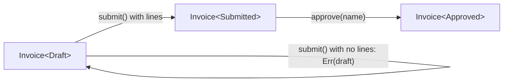

# 01. Advanced traits and the type-state pattern

> **Draft: written but not yet run.** The code and the expected output in this lesson were prepared by reading the code and the official documentation. They have not been executed yet. If something does not behave as described, trust your tool's real output and report it.

## What you will be able to do
- Design a type-state API in which an illegal call order does not compile.
- Seal a trait so that only your crate can add implementations.
- Choose between an associated type, a generic parameter, an enum state machine and a type-state design, and name the cost of each.
- Review a trait-heavy API for failure modes: error ergonomics, semver churn and compile time.

## Recap
1. In Rust 201 lesson 02, why can a generic function call `item.summary()` but not read `item.title`?
   <details><summary>Answer</summary>The trait bound promises only the methods of the trait, not fields of the concrete type.</details>

2. In Rust 201 lesson 04, why does a library return a typed error while an application may return `anyhow`?
   <details><summary>Answer</summary>Library callers need to match on causes; an application mostly reports and exits.</details>

## Why it matters
Every production service has objects that must go through steps in order: an invoice is drafted, submitted, approved, paid. Checking the order with runtime `if` statements means a wrong call is found by a test, a user or an auditor. A type-state design moves that check to the compiler, so the wrong order cannot be shipped. The price is a more complex API, so a 301 engineer must know when it earns its cost.

## What you will build
An `invoice_states` library: `Invoice<Draft>` becomes `Invoice<Submitted>` becomes `Invoice<Approved>`. An empty draft cannot be submitted and is handed back, a draft cannot be approved (a `compile_fail` doc test proves it), and nobody outside the crate can invent a new state.

## Before you start
- Audience: finished [Rust 201](../../201-hero-to-super-hero/phase-1-core-skills/02-traits-and-generics.md) and, for the production context, the [backend-rust capstone](../../../../capstones/backend-rust/README.md).
- Target Rust/Cargo 1.100.0, edition 2024. No crates are needed: this lesson uses only `std`. No tools were installed for this draft.
- Time: 55-70 min.
- Source pack (optional): every file is shown in full in this lesson, so you can follow without it. The finished code, the exercise starter and the solution are in the
  course repository https://github.com/Uee03/Code101 under `source/rust/301-super-hero-to-legendary/phase-1-advanced-language/01-advanced-traits-and-type-state/` (on that page choose **Code, Download ZIP**, or run
  `git clone https://github.com/Uee03/Code101.git`).
- Save as UTF-8 and save every editor tab (a dot on the tab means unsaved). No `Cargo.lock` is supplied: cargo creates it on the first build. With no dependencies it records only your own package.

## Steps
### Step 1. Create the project folders
Start in any terminal folder; these paths are relative to your home folder, so they also recover from the wrong working directory.

**File: `terminal in any folder (Windows PowerShell)`**
```powershell
New-Item -ItemType Directory -Force "$HOME/code101/rust301/lesson01/src"
Set-Location "$HOME/code101/rust301/lesson01"
```

**File: `terminal in any folder (macOS/Linux)`**
```bash
mkdir -p "$HOME/code101/rust301/lesson01/src"
cd "$HOME/code101/rust301/lesson01"
```
Expected result: the prompt ends in `lesson01`. PowerShell may print a folder table; that is not program output.

### Step 2. Create the manifest
**File: `Cargo.toml`**
```toml
[package]
name = "invoice_states"
version = "0.1.0"
edition = "2024"

[dependencies]

[lints.rust]
unsafe_code = "forbid"
```
`[lints.rust]` sets compiler lint levels for the whole package, in one reviewable place. `unsafe_code = "forbid"` makes any `unsafe` block in this crate a compile error that cannot be overridden by an inner `#[allow]`. That is the unsafe policy for a crate that does not need unsafe (lesson 02 covers crates that do).

### Step 3. Create the library
The library has four ideas, in this order: a sealed `State` trait, three state types, one generic `Invoice<S>`, and one `impl` block per state.

**File: `src/lib.rs`**
```rust
use std::fmt;

mod sealed {
    pub trait Sealed {}
}

/// A state an invoice can be in. The trait is sealed: only this crate can add states.
pub trait State: sealed::Sealed {
    const NAME: &'static str;
}

#[derive(Debug)]
pub struct Draft;

#[derive(Debug)]
pub struct Submitted;

#[derive(Debug)]
pub struct Approved {
    approver: String,
}

impl sealed::Sealed for Draft {}
impl sealed::Sealed for Submitted {}
impl sealed::Sealed for Approved {}

impl State for Draft {
    const NAME: &'static str = "Draft";
}

impl State for Submitted {
    const NAME: &'static str = "Submitted";
}

impl State for Approved {
    const NAME: &'static str = "Approved";
}

#[derive(Debug)]
pub struct Invoice<S: State> {
    number: u32,
    lines: Vec<(String, u64)>,
    state: S,
}

impl Invoice<Draft> {
    pub fn new(number: u32) -> Self {
        Invoice {
            number,
            lines: Vec::new(),
            state: Draft,
        }
    }

    pub fn add_line(mut self, description: &str, cents: u64) -> Self {
        self.lines.push((description.to_string(), cents));
        self
    }

    /// An empty draft is handed back to the caller instead of being lost.
    pub fn submit(self) -> Result<Invoice<Submitted>, Invoice<Draft>> {
        if self.lines.is_empty() {
            return Err(self);
        }
        Ok(Invoice {
            number: self.number,
            lines: self.lines,
            state: Submitted,
        })
    }
}

impl Invoice<Submitted> {
    /// Only a submitted invoice can be approved. Approving a draft does not compile:
    ///
    /// ```compile_fail
    /// use invoice_states::Invoice;
    /// let draft = Invoice::new(1).add_line("work", 100);
    /// let _approved = draft.approve("ana");
    /// ```
    pub fn approve(self, approver: &str) -> Invoice<Approved> {
        Invoice {
            number: self.number,
            lines: self.lines,
            state: Approved {
                approver: approver.to_string(),
            },
        }
    }
}

impl Invoice<Approved> {
    pub fn approver(&self) -> &str {
        &self.state.approver
    }
}

impl<S: State> Invoice<S> {
    pub fn number(&self) -> u32 {
        self.number
    }

    pub fn total_cents(&self) -> u64 {
        self.lines.iter().map(|(_, cents)| cents).sum()
    }
}

impl<S: State> fmt::Display for Invoice<S> {
    fn fmt(&self, f: &mut fmt::Formatter<'_>) -> fmt::Result {
        let total = self.total_cents();
        write!(
            f,
            "invoice #{} [{}] total {}.{:02}",
            self.number,
            S::NAME,
            total / 100,
            total % 100
        )
    }
}

#[cfg(test)]
mod tests {
    use super::*;

    #[test]
    fn total_adds_all_lines() {
        let draft = Invoice::new(7).add_line("a", 100).add_line("b", 250);
        assert_eq!(draft.total_cents(), 350);
    }

    #[test]
    fn empty_draft_is_returned_not_lost() {
        match Invoice::new(2).submit() {
            Ok(_) => panic!("an empty draft must not be submitted"),
            Err(draft) => assert_eq!(draft.number(), 2),
        }
    }

    #[test]
    fn full_flow_reaches_approved() {
        let submitted = match Invoice::new(3).add_line("work", 1999).submit() {
            Ok(submitted) => submitted,
            Err(_) => panic!("the draft has a line"),
        };
        let approved = submitted.approve("ana");
        assert_eq!(approved.approver(), "ana");
        assert_eq!(approved.to_string(), "invoice #3 [Approved] total 19.99");
    }
}
```

### Step 4. Create the program
**Predict before you run:** this program prints four lines. Which line uses the `Submitted` name, and why does the last line still show `Draft` for invoice 2?

**File: `src/main.rs`**
```rust
use invoice_states::Invoice;

fn main() {
    let draft = Invoice::new(1)
        .add_line("rust training", 120_000)
        .add_line("code review", 4_550);
    println!("{draft}");

    let submitted = match draft.submit() {
        Ok(submitted) => submitted,
        Err(draft) => {
            println!("rejected: {draft}");
            return;
        }
    };
    println!("{submitted}");

    let approved = submitted.approve("ana");
    println!("{approved} by {}", approved.approver());

    match Invoice::new(2).submit() {
        Ok(submitted) => println!("unexpected: {submitted}"),
        Err(draft) => println!("rejected: {draft}"),
    }
}
```

## Run it
**File: `terminal in $HOME/code101/rust301/lesson01 (all platforms)`**
```powershell
cargo run --quiet
```
Expected output, not yet run (derived from the code; cargo build messages omitted):
```text
invoice #1 [Draft] total 1245.50
invoice #1 [Submitted] total 1245.50
invoice #1 [Approved] total 1245.50 by ana
rejected: invoice #2 [Draft] total 0.00
```
Then run the feature tests and the `compile_fail` doc test:

**File: `terminal in $HOME/code101/rust301/lesson01 (all platforms)`**
```powershell
cargo test
```
Expected result, not yet run: the three unit tests pass, and the doc test marked `compile_fail` passes because its code fails to compile. Harness wording, timings and test order are not claimed.

## How it works
**Type-state** means a value's current state is part of its type. `draft.submit()` takes `self` by value, so the draft is consumed and the old state cannot be used again; it returns a value of a different type. `approve` exists only in `impl Invoice<Submitted>`, so the compiler cannot find it on `Invoice<Draft>`.

**Sealed trait**: `State` requires `sealed::Sealed`, and `Sealed` lives in a private module. Code outside the crate can name `State` but cannot implement `Sealed`, therefore cannot implement `State`. Without sealing, a downstream crate could add a state such as `Paid` and bypass your rules. A sealed trait is also a semver promise: adding a state is not a breaking change for downstream code.

**Associated const**: `S::NAME` is resolved at compile time from the state type. Inside the generic `Display` impl the compiler generates one version per state (monomorphization), so there is no runtime lookup.

**Private fields make states unforgeable.** `Approved` has a private `approver` field and `Invoice` has private fields, so outside code cannot build `Invoice<Approved>` by hand; the only path is `submit` then `approve`.

**Returning the draft in `Err`.** A consuming method moves the value. If it fails, the caller would lose the draft. Returning `Err(self)` gives it back so the caller can add a line and retry.

**Misconception:** "type-state is a runtime state machine with extra steps". It is the opposite: the transitions cost nothing at runtime beyond moving the fields, and an illegal transition is a compile error, not a runtime error.



### Trade-offs: the trait toolbox in one table
Snippets below are illustrations, not part of the pack.

| Tool | Use it when | Failure mode and cost |
|---|---|---|
| Generic parameter `trait Convert<T>` | One type can implement the trait several times with different `T` (`From<u8>` and `From<u16>`) | Callers must often annotate the type; inference errors get long |
| Associated type `trait Iterator { type Item; }` | Each implementor has exactly one such type | You cannot implement it twice for one type; that is the point |
| Supertrait `trait Repo: Send + Sync` | Every implementor must provide capabilities the API relies on | Bounds spread to every generic user and to every mock |
| Blanket impl `impl<T: Display> Describe for T` | You add behaviour to a whole family of types | It can conflict with later impls (coherence); adding one is a semver risk for downstream crates |
| Sealed trait | You must control the set of implementors | Users cannot extend it; document that this is deliberate |
| `dyn Trait` | The set of types is open at runtime | Only dyn-compatible traits (no generic methods, no `Self` returns); a vtable call per method |
| Generic associated type (GAT), e.g. `type Item<'a> where Self: 'a;` | An associated type must borrow from `&self` (lending iterators) | Harder error messages; use it only when a plain associated type cannot express the borrow |

### Why this, not that
- **Enum state machine** (`enum InvoiceState { Draft, Submitted, Approved }` plus a `status` field): states can be loaded from a database, stored in one `Vec`, and matched on. Choose it when the state is *data* that arrives at runtime.
- **Type-state**: choose it when the state is *control flow inside one program* and a wrong order is a bug you want impossible: builders with required fields, connection or transaction handles, protocol steps.
- **Runtime checks returning `Result`**: choose them when callers cannot know the state at compile time anyway.

### When not to use type-state
- The state comes from a database row or a network message. You will convert it to an enum at the boundary and then convert into type-state, doubling the code.
- You need a collection of mixed states. `Vec<Invoice<?>>` cannot exist; you need an enum wrapper `enum AnyInvoice { Draft(Invoice<Draft>), ... }`, which brings back the match you wanted to avoid.
- The API has more than about four states or many branches. The number of `impl` blocks and conversions grows quickly and error messages become hard for newcomers.
- The crate is a public library and the states are likely to change: every new or removed state is a breaking change unless the trait is sealed and the states are non-exhaustive by design.

### Failure modes to review
- Compile errors name `Invoice<Draft>` with no method `approve`; this is understandable for you but opaque for a newcomer. Document the legal order in the type docs.
- Generic code multiplies. Every `impl<S: State>` is compiled once per state; heavy generic code increases compile time and binary size.
- Moving the value is mandatory. Consuming `self` forces callers to rebind (`let draft = draft.add_line(..)`), which fits builders but not long-lived shared objects behind `Arc<Mutex<..>>`.

### Measurements to take (do not guess)
- Compile time before and after the design on your real crate: `cargo build --timings` writes an HTML report of per-crate and per-step time.
- Binary size of a release build: `cargo build --release` and compare the file size on disk; for a per-function view, a tool such as `cargo bloat` can be installed separately.
- Review checklist: can a caller outside the crate create an `Invoice<Approved>` another way? (Try in a scratch crate.) Does every consuming method return the old value in its error?

## Try it
### Rung 1. Guided practice
Work in a separate folder so the finished project stays intact.

**File: `terminal in any folder (Windows PowerShell)`**
```powershell
New-Item -ItemType Directory -Force "$HOME/code101/rust301/try01/src"
Set-Location "$HOME/code101/rust301/try01"
```

**File: `terminal in any folder (macOS/Linux)`**
```bash
mkdir -p "$HOME/code101/rust301/try01/src"
cd "$HOME/code101/rust301/try01"
```
Optional download route: copy the `starter` folder from `exercise` directly into `$HOME/code101/rust301` and rename the copy `try01`; do not create `try01` first and copy into it.

The exercise models a network connection with two states, `Closed` and `Open`, using `PhantomData` markers (zero-size types that only exist in the type). Two methods are left as TODOs: `close`, and a `sent` counter that works in every state. The `todo!()` macro lets the starter compile; it panics if the line runs.

**File: `try01/Cargo.toml (starter)`**
```toml
[package]
name = "connection_states"
version = "0.1.0"
edition = "2024"

[dependencies]
```

**File: `try01/src/main.rs (starter)`**
```rust
use std::marker::PhantomData;

pub struct Closed;
pub struct Open;

pub struct Connection<S> {
    host: String,
    sent: u32,
    state: PhantomData<S>,
}

impl Connection<Closed> {
    pub fn new(host: &str) -> Self {
        Connection {
            host: host.to_string(),
            sent: 0,
            state: PhantomData,
        }
    }

    pub fn open(self) -> Connection<Open> {
        Connection {
            host: self.host,
            sent: self.sent,
            state: PhantomData,
        }
    }
}

impl Connection<Open> {
    pub fn send(mut self, _message: &str) -> Self {
        self.sent += 1;
        self
    }

    // TODO 1: make close() return a Connection<Closed> that keeps host and sent.
    pub fn close(self) -> Connection<Closed> {
        todo!("move host and sent into a Connection<Closed>")
    }
}

impl<S> Connection<S> {
    pub fn host(&self) -> &str {
        &self.host
    }

    // TODO 2: return how many messages were sent so far, in every state.
    pub fn sent(&self) -> u32 {
        todo!("return the sent counter")
    }
}

fn main() {
    let conn = Connection::new("db.internal").open().send("hello").send("again");
    let closed = conn.close();
    println!("{} sent {} message(s)", closed.host(), closed.sent());
    let reopened = closed.open();
    println!("reopened, still {} sent", reopened.sent());
}
```
Run `cargo run --quiet` in `try01`. The target output after your edits is:
```text
db.internal sent 2 message(s)
reopened, still 2 sent
```

### Rung 2. Change the behaviour
Add an `Authenticated` state between `Open` and sending, so `send` exists only on `Connection<Authenticated>`. Decide where `sent` is allowed and write one test.

### Rung 3. Stretch (optional design decision)
Your team wants to load connection states from a config file and keep them in one `Vec`. Write down (five lines) whether you would keep type-state, switch to an enum, or wrap type-state in an enum, and which failure mode from this lesson decided it.

<details><summary>Solution for Rung 1</summary>

`Cargo.toml` is identical to the starter. Only `close` and `sent` change; this is the complete file.

**File: `exercise/solution/src/main.rs`**
```rust
use std::marker::PhantomData;

pub struct Closed;
pub struct Open;

pub struct Connection<S> {
    host: String,
    sent: u32,
    state: PhantomData<S>,
}

impl Connection<Closed> {
    pub fn new(host: &str) -> Self {
        Connection {
            host: host.to_string(),
            sent: 0,
            state: PhantomData,
        }
    }

    pub fn open(self) -> Connection<Open> {
        Connection {
            host: self.host,
            sent: self.sent,
            state: PhantomData,
        }
    }
}

impl Connection<Open> {
    pub fn send(mut self, _message: &str) -> Self {
        self.sent += 1;
        self
    }

    pub fn close(self) -> Connection<Closed> {
        Connection {
            host: self.host,
            sent: self.sent,
            state: PhantomData,
        }
    }
}

impl<S> Connection<S> {
    pub fn host(&self) -> &str {
        &self.host
    }

    pub fn sent(&self) -> u32 {
        self.sent
    }
}

fn main() {
    let conn = Connection::new("db.internal").open().send("hello").send("again");
    let closed = conn.close();
    println!("{} sent {} message(s)", closed.host(), closed.sent());
    let reopened = closed.open();
    println!("reopened, still {} sent", reopened.sent());
}
```
</details>

## Check yourself
1. Why does `Invoice::approve` not exist for `Invoice<Draft>`?
   <details><summary>Answer</summary>It is defined only in `impl Invoice<Submitted>`; methods of one concrete instantiation are not visible on another.</details>
2. What stops a downstream crate from adding a `Paid` state?
   <details><summary>Answer</summary>`State` requires the sealed supertrait `Sealed`, which sits in a private module and so cannot be implemented outside the crate.</details>
3. Predict: what does `Invoice::new(5).submit()` return and what does the caller still own afterwards?
   <details><summary>Answer</summary>`Err(draft)`: the caller owns the returned draft; nothing is lost.</details>
4. Name two situations where an enum state machine beats type-state.
   <details><summary>Answer</summary>States loaded from a database or network at runtime; mixed states in one collection.</details>

## Common mistakes
These are symptoms and fixes, not fabricated compiler transcripts. Read your tool's real diagnostic first.

| Symptom | Cause | Fix |
|---|---|---|
| "no method named `approve` found" for a draft | The method exists only for `Invoice<Submitted>` | Call `submit()` first and use the returned value |
| "use of moved value" after `draft.submit()` | `submit` takes `self` by value | Use the returned `Ok`/`Err` value, or clone before if you really need both |
| Downstream crate cannot implement `State` | The trait is sealed on purpose | Add the state inside this crate |
| The doc test marked `compile_fail` fails | The code in it compiles after all | Make sure it calls a method that truly does not exist for that state |
| Wrong project runs, no manifest found | Terminal is not in `lesson01` | `cd "$HOME/code101/rust301/lesson01"` |

## Best practice
Use the type system for rules that are always true within one program, seal traits whose implementor set you must control, and prefer enums when the state is runtime data. Source: [Rust API Guidelines: sealed traits protect against downstream implementations (C-SEALED)](https://rust-lang.github.io/api-guidelines/future-proofing.html).

## Going further
- [The Rust Book: advanced traits](https://doc.rust-lang.org/book/ch20-02-advanced-traits.html) (associated types, default type parameters, supertraits, newtype).
- [Rust Reference: traits and dyn compatibility](https://doc.rust-lang.org/reference/items/traits.html).
- [Rust API Guidelines](https://rust-lang.github.io/api-guidelines/) for public type design.

## Summary
- You designed a type-state API in which `approve` on a draft does not compile.
- You sealed a trait so that only your crate can add states.
- You compared associated types, generic parameters, enums and type-state with their costs.
- You listed failure modes and measurements (`cargo build --timings`, release size) instead of guessing.

## Next lesson
[02. Unsafe Rust and FFI](02-unsafe-rust-and-ffi.md): what `unsafe` really promises, how to wrap it in a safe API, and how to call C from Rust with a build script.
