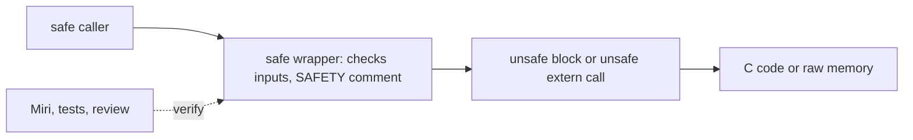

# 02. Unsafe Rust and FFI

> **Draft: written but not yet run.** The code and the expected output in this lesson were prepared by reading the code and the official documentation. They have not been executed yet. If something does not behave as described, trust your tool's real output and report it.

## What you will be able to do
- Explain what `unsafe` promises and what it does not turn off.
- Wrap an unsafe operation in a safe function and write the `SAFETY` argument that justifies it.
- Call a C function from Rust through a Cargo build script and an `unsafe extern` block.
- Apply a team unsafe policy: lint levels, review rules and tools such as Miri.

## Recap
1. From lesson 01: why does a sealed trait protect an API?
   <details><summary>Answer</summary>Only the defining crate can implement it, so downstream code cannot add states or implementations that break your invariants.</details>
2. From Rust 101 lesson 10: what does a `&mut` borrow guarantee?
   <details><summary>Answer</summary>Exclusive access: no other reference to the same data is alive while it is used.</details>

## Why it matters
Safe Rust cannot express everything: calling C libraries, talking to hardware, building data structures such as `Vec` itself. `unsafe` is the hatch for those cases. It is also the one place where Rust's guarantees become *your* responsibility: a mistake there is undefined behaviour, which may look fine for months and then corrupt memory in production. A 301 engineer keeps unsafe small, wraps it in a safe API, justifies each block in writing and lets tools check it.

## What you will build
A crate `checksum_ffi` that (1) compiles a small C function (Adler-32) with a build script and calls it through a safe Rust function, (2) exports a Rust function with a C name, and (3) implements a safe `split_halves_mut` on top of raw pointers, with a written safety argument.

## Before you start
- Audience: finished lesson 01 and [Rust 101](../../101-zero-to-hero/phase-3-real-programs/12-expense-tracker.md).
- Target Rust/Cargo 1.100.0, edition 2024. **A C compiler is required** by the build script: on Windows the MSVC Build Tools you installed in Rust 101 lesson 01; on macOS the Xcode command line tools (`xcode-select --install`); on Linux `gcc` or `clang` (for example `sudo apt install build-essential`). The `cc` crate finds the compiler itself.
- Direct crate: `cc` 1.11.3, pinned exactly, checked on crates.io for this draft. This is not a claim that it is the latest release or free of advisories (lesson 08 teaches how to check).
- Time: 65-80 min.
- Source pack (optional): every file is shown in full in this lesson, so you can follow without it. The finished code, the exercise starter and the solution are in the
  course repository https://github.com/Uee03/Code101 under `source/rust/301-super-hero-to-legendary/phase-1-advanced-language/02-unsafe-rust-and-ffi/` (on that page choose **Code, Download ZIP**, or run
  `git clone https://github.com/Uee03/Code101.git`).
- Save every file as UTF-8 and save every tab. No `Cargo.lock` is supplied: cargo creates it on the first build; keep it for an application.

## Steps
### Step 1. Create the folders
**File: `terminal in any folder (Windows PowerShell)`**
```powershell
New-Item -ItemType Directory -Force "$HOME/code101/rust301/lesson02/src", "$HOME/code101/rust301/lesson02/csrc"
Set-Location "$HOME/code101/rust301/lesson02"
```

**File: `terminal in any folder (macOS/Linux)`**
```bash
mkdir -p "$HOME/code101/rust301/lesson02/src" "$HOME/code101/rust301/lesson02/csrc"
cd "$HOME/code101/rust301/lesson02"
```
Expected result: the prompt ends in `lesson02`; it contains the empty folders `src` and `csrc`.

### Step 2. The manifest
**File: `Cargo.toml`**
```toml
[package]
name = "checksum_ffi"
version = "0.1.0"
edition = "2024"

[dependencies]

[build-dependencies]
cc = "=1.11.3"

[lints.rust]
unsafe_op_in_unsafe_fn = "deny"

[lints.clippy]
undocumented_unsafe_blocks = "deny"
```
- `[build-dependencies]` are crates for `build.rs`, compiled for your machine and **not** linked into your program. `cc` drives the C compiler. The `=` pins the exact version.
- `unsafe_op_in_unsafe_fn = "deny"`: inside an `unsafe fn`, every unsafe operation still needs its own `unsafe { }` block. That keeps the dangerous lines visible and individually justified.
- `undocumented_unsafe_blocks = "deny"` is a **Clippy** lint (it runs with `cargo clippy`, not `cargo build`): every `unsafe` block must be preceded by a `// SAFETY:` comment.
- Cargo discovers `build.rs` in the package root automatically; no `build =` key is needed.

### Step 3. The C code
The header declares the function, the source implements it. The header is the contract; the Rust side in Step 5 must repeat it exactly, and nothing checks that for you.

**File: `csrc/checksum.h`**
```c
#ifndef C101_CHECKSUM_H
#define C101_CHECKSUM_H

#include <stddef.h>
#include <stdint.h>

/* Adler-32 of len bytes at data. data may be NULL only when len is 0. */
uint32_t c101_checksum(const uint8_t *data, size_t len);

#endif
```

**File: `csrc/checksum.c`**
```c
#include "checksum.h"

#define ADLER_MOD 65521u

uint32_t c101_checksum(const uint8_t *data, size_t len) {
    uint32_t a = 1;
    uint32_t b = 0;
    for (size_t i = 0; i < len; i++) {
        a = (a + data[i]) % ADLER_MOD;
        b = (b + a) % ADLER_MOD;
    }
    return (b << 16) | a;
}
```
Adler-32 keeps two running sums, `a` (sum of bytes plus 1) and `b` (sum of all `a` values), both modulo 65521, and packs them as `b << 16 | a`.

### Step 4. The build script
A **build script** is a Rust program named `build.rs` that Cargo compiles and runs *before* compiling your crate. Lines it prints that start with `cargo::` are instructions to Cargo.

**File: `build.rs`**
```rust
fn main() {
    println!("cargo::rerun-if-changed=csrc/checksum.c");
    println!("cargo::rerun-if-changed=csrc/checksum.h");
    cc::Build::new()
        .file("csrc/checksum.c")
        .warnings(true)
        .compile("c101_checksum");
}
```
- `cargo::rerun-if-changed=PATH` tells Cargo to rerun the script only when that file changes. Without any such line Cargo reruns it whenever any file in the package changes.
- `cc::Build::new().file(..).compile("c101_checksum")` compiles the C file into a static library named `libc101_checksum.a` (`c101_checksum.lib` with MSVC) in Cargo's output folder and prints the `cargo::rustc-link-lib` and `cargo::rustc-link-search` lines that make the linker use it.
- `.warnings(true)` lets C compiler warnings through.
- **Security note:** a build script is arbitrary code that runs on your machine at build time, as does every dependency's build script and every procedural macro. Lesson 08 returns to this.

### Step 5. The library
**Predict before you run:** for `b"abc"` the sums are `a = 1+97+98+99 = 295` and `b = 98+196+295 = 589`. In hex, what is `b << 16 | a`? (Answer in the output below.)

**File: `src/lib.rs`**
```rust
unsafe extern "C" {
    fn c101_checksum(data: *const u8, len: usize) -> u32;
}

/// Adler-32 checksum of `data`, computed by the C code in `csrc/`.
pub fn checksum(data: &[u8]) -> u32 {
    // SAFETY: `data.as_ptr()` is valid for reads of `data.len()` bytes for the whole call.
    // The C function only reads that range and keeps no pointer after it returns.
    unsafe { c101_checksum(data.as_ptr(), data.len()) }
}

/// Callable from C as `int32_t c101_double(int32_t value)`.
#[unsafe(no_mangle)]
pub extern "C" fn c101_double(value: i32) -> i32 {
    value.wrapping_mul(2)
}

/// Splits a slice into two non-overlapping mutable halves. The left half is `len / 2` long.
pub fn split_halves_mut<T>(items: &mut [T]) -> (&mut [T], &mut [T]) {
    let len = items.len();
    let mid = len / 2;
    let ptr = items.as_mut_ptr();
    // SAFETY: `mid <= len`, so both ranges lie inside `items`. They do not overlap: the first
    // is `0..mid` and the second is `mid..len`. The input borrow is not used again while the
    // two returned borrows live, so nothing else can alias them.
    unsafe {
        (
            std::slice::from_raw_parts_mut(ptr, mid),
            std::slice::from_raw_parts_mut(ptr.add(mid), len - mid),
        )
    }
}

#[cfg(test)]
mod tests {
    use super::*;

    #[test]
    fn checksum_matches_known_values() {
        assert_eq!(checksum(b""), 1);
        assert_eq!(checksum(b"abc"), 0x024d_0127);
        assert_eq!(checksum(b"Wikipedia"), 0x11e6_0398);
    }

    #[test]
    fn halves_do_not_overlap() {
        let mut values = [1, 2, 3, 4, 5];
        let (left, right) = split_halves_mut(&mut values);
        left[0] = 10;
        right[0] = 30;
        assert_eq!(values, [10, 2, 30, 4, 5]);
    }

    #[test]
    fn empty_slice_gives_two_empty_halves() {
        let mut values: [u8; 0] = [];
        let (left, right) = split_halves_mut(&mut values);
        assert!(left.is_empty() && right.is_empty());
    }

    #[test]
    fn exported_function_doubles() {
        assert_eq!(c101_double(21), 42);
    }
}
```

### Step 6. The program
**File: `src/main.rs`**
```rust
use checksum_ffi::{checksum, split_halves_mut};

fn main() {
    println!("abc -> {:#010x}", checksum(b"abc"));
    println!("Wikipedia -> {:#010x}", checksum(b"Wikipedia"));

    let mut values = [1, 2, 3, 4, 5];
    let (left, right) = split_halves_mut(&mut values);
    left[0] = 10;
    right[0] = 30;
    println!("{values:?}");
}
```
`{:#010x}` prints hexadecimal with a `0x` prefix, zero-padded to a total width of 10 characters.

## Run it
**File: `terminal in $HOME/code101/rust301/lesson02 (all platforms)`**
```powershell
cargo run --quiet
```
Expected output, not yet run (derived from the code; build messages omitted). `0x024d0127` is `589 << 16 | 295`:
```text
abc -> 0x024d0127
Wikipedia -> 0x11e60398
[10, 2, 30, 4, 5]
```
Then the tests, and the unsafe-policy lint:

**File: `terminal in $HOME/code101/rust301/lesson02 (all platforms)`**
```powershell
cargo test
cargo clippy
```
Expected result, not yet run: four tests pass; Clippy reports nothing about missing `SAFETY` comments. Remove one `// SAFETY:` comment and run `cargo clippy` again to see the lint fire (the exact text is whatever your Clippy prints).

## How it works
**What `unsafe` means.** It unlocks five extra operations: dereference a raw pointer, call an unsafe function (including every foreign function), access or modify a mutable `static`, implement an unsafe trait, and access union fields. It does **not** switch off the borrow checker or type checks. Inside an unsafe block, normal references are still checked; only the five listed operations are yours to vouch for.

**Undefined behaviour (UB)** is any program state the language says must never happen: a dangling or misaligned dereference, two live `&mut` to the same data, an invalid value such as a `bool` that is 2, a data race. The compiler assumes UB never occurs, so a violation can change code far from the bug. That is why unsafe code is judged by an argument, not by "it worked on my machine".

**Soundness** is the property that no *safe* caller can trigger UB through your API. `checksum` and `split_halves_mut` are sound if the `SAFETY` arguments hold for every possible input, including the empty slice (the test covers it). An `unsafe fn` instead puts the proof on the caller and documents it in a `# Safety` section.

**`unsafe extern "C"`.** In edition 2024 a foreign block must be written `unsafe extern`, because the compiler cannot check that the declaration matches the real function. If the Rust declaration disagrees with the C header (wrong size or type), it still compiles and links and then misbehaves at runtime. This is the main FFI failure mode; reduce it by generating declarations from the header (the `bindgen` tool does this for C headers) and by testing known values as we did.

**Exporting to C.** `#[unsafe(no_mangle)]` keeps the symbol name `c101_double`; `extern "C"` selects the C calling convention. A panic must not unwind into C: a panic in an `extern "C"` function aborts the process, so catch errors and return codes instead. To produce a library for C callers you would set `crate-type = ["cdylib"]` (dynamic) or `["staticlib"]` under `[lib]` in `Cargo.toml`. **cbindgen** is a separate tool that reads such a crate and writes the C header for you, so the header cannot drift from the Rust signature. Illustration, not part of the pack:

```text
[lib]
crate-type = ["cdylib", "rlib"]
```
```text
cbindgen --crate checksum_ffi --lang c --output checksum_rust.h
```

**Ownership across the boundary.** Decide and document who frees what. Memory allocated by Rust must be freed by Rust (`Box::from_raw` on a pointer from `Box::into_raw`), memory from C's `malloc` by C's `free`. Mixing allocators is UB. Use `std::ffi::CStr` and `CString` for NUL-terminated strings; Rust strings are not NUL-terminated and may contain NUL bytes. Mark shared structs `#[repr(C)]`, because Rust's default layout is unspecified.

**Misconception:** "unsafe code is the code that is dangerous". The dangerous code is the safe code *around* it that breaks the assumptions the unsafe block relies on. A bad `mid` computed three lines above the block is the bug. Keep the unsafe block and every fact it depends on in one small function.



### Trade-offs and when not to use unsafe
- **Do not write `split_halves_mut` in real code.** The standard library already has `split_at_mut`, which has been reviewed and is exercised by Miri. This lesson uses it only because it is the smallest example with a real aliasing argument. Search the standard library and well-used crates first.
- **Do not use `get_unchecked` or `unsafe` to "make it faster" without a measurement** that shows the safe version is the bottleneck. Bounds checks are often optimised away; lesson 06 shows how to measure.
- **Do use unsafe** for FFI, for a proven hot spot after profiling, for data structures that safe Rust cannot express, and for thin wrappers around operating-system APIs.
- **Prefer a maintained `-sys` plus safe-wrapper crate** over a hand-written binding when one exists. Hand-written FFI is a long-term maintenance and security burden.
- **Build scripts cost build time and portability.** Compiling C requires a toolchain on every build machine, complicates cross-compilation and static images (lesson 08 and 09), and runs arbitrary code.

### Failure modes to review
- Declaration drift between header and Rust `extern` block (no compile error).
- Lifetime assumptions: a C library that stores the pointer you passed. Passing `data.as_ptr()` of a temporary is UB if C keeps it.
- Panics across the boundary, integer width differences (`long` is 32 bits on 64-bit Windows and 64 bits on 64-bit Linux), `size_t` vs `usize` (match here), `bool` representation, and uninitialised memory.
- Thread safety of the C library: if it keeps global state, you may need a `Mutex` around calls even though Rust cannot see the problem.

### Unsafe policy for a team (checklist)
1. `#![forbid(unsafe_code)]` (or `[lints.rust] unsafe_code = "forbid"`, as in lesson 01) in every crate that does not need unsafe; isolate unsafe in one small crate or module.
2. `unsafe_op_in_unsafe_fn` and `clippy::undocumented_unsafe_blocks` at `deny` (this lesson).
3. Every unsafe block states the facts it relies on and where they are established.
4. Tests include the edges: empty input, maximum length, unaligned or odd sizes.
5. Run **Miri** on tests that touch unsafe code. Miri is an interpreter that detects many kinds of UB; it runs on the nightly toolchain: `rustup +nightly component add miri` then `cargo +nightly miri test`. It cannot run foreign C code, so the `checksum` test would be skipped or fail under Miri; test the pure-Rust unsafe (`split_halves_mut`) under Miri and the FFI by known values.
6. Measure unsafe usage in dependencies with a tool such as `cargo geiger` (installed separately) and review the result when adding crates.
7. Fuzz parsers that call unsafe or C code (`cargo fuzz`), and run sanitizers on CI where available.

### Measurements to take
- Before replacing safe code with unsafe: a Criterion benchmark of both versions on realistic input (lesson 06). Keep unsafe only if the difference matters for your service level.
- The number of `unsafe` blocks in your crate and your dependency tree, tracked per release.
- Clean build time with and without the C build script (`cargo build --timings`).

## Try it
### Rung 1. Guided practice
Implement `pair_mut`, a safe function that returns two mutable references to *different* elements of a slice, in a separate folder.

**File: `terminal in any folder (Windows PowerShell)`**
```powershell
New-Item -ItemType Directory -Force "$HOME/code101/rust301/try02/src"
Set-Location "$HOME/code101/rust301/try02"
```

**File: `terminal in any folder (macOS/Linux)`**
```bash
mkdir -p "$HOME/code101/rust301/try02/src"
cd "$HOME/code101/rust301/try02"
```
Optional download route: copy the `starter` folder from `exercise` directly into `$HOME/code101/rust301` and rename the copy `try02`.

**File: `try02/Cargo.toml (starter)`**
```toml
[package]
name = "pair_mut"
version = "0.1.0"
edition = "2024"

[dependencies]

[lints.rust]
unsafe_op_in_unsafe_fn = "deny"

[lints.clippy]
undocumented_unsafe_blocks = "deny"
```

**File: `try02/src/main.rs (starter)`**
```rust
/// Returns mutable references to two different elements.
/// Returns None when an index is out of range or when both indexes are equal.
pub fn pair_mut<T>(items: &mut [T], i: usize, j: usize) -> Option<(&mut T, &mut T)> {
    // TODO 1: return None unless i and j are different and both are below items.len().
    // TODO 2: then take items.as_mut_ptr(), build both references in one unsafe block
    // and write a SAFETY comment that names the two facts which make it sound.
    todo!("implement pair_mut for {} items, indexes {i} and {j}", items.len())
}

fn main() {
    let mut scores = [10, 20, 30, 40];
    if let Some((a, b)) = pair_mut(&mut scores, 0, 3) {
        std::mem::swap(a, b);
    }
    println!("{scores:?}");
    println!("same index: {}", pair_mut(&mut scores, 2, 2).is_none());
    println!("out of range: {}", pair_mut(&mut scores, 1, 9).is_none());
}
```
Run `cargo run --quiet`. The target output after your edits:
```text
[40, 20, 30, 10]
same index: true
out of range: true
```
Hint (not the answer): which two facts must be true so that two `&mut T` from one pointer do not alias?

### Rung 2. Change the behaviour
Make `pair_mut` return a `Result` with a small error enum (`Same`, `OutOfRange`) instead of `None`, so callers learn why it failed. Keep the safety argument unchanged.

### Rung 3. Stretch (optional)
Write a short review note (five lines) for a pull request that adds `get_unchecked` to a parser "because it is faster". List the three questions you would ask before approving.

<details><summary>Solution for Rung 1</summary>

`Cargo.toml` is identical to the starter.

**File: `exercise/solution/src/main.rs`**
```rust
/// Returns mutable references to two different elements.
/// Returns None when an index is out of range or when both indexes are equal.
pub fn pair_mut<T>(items: &mut [T], i: usize, j: usize) -> Option<(&mut T, &mut T)> {
    if i == j || i >= items.len() || j >= items.len() {
        return None;
    }
    let ptr = items.as_mut_ptr();
    // SAFETY: both indexes are below `items.len()`, so both pointers are in bounds, and
    // `i != j`, so the two references point at different elements and never alias.
    unsafe { Some((&mut *ptr.add(i), &mut *ptr.add(j))) }
}

fn main() {
    let mut scores = [10, 20, 30, 40];
    if let Some((a, b)) = pair_mut(&mut scores, 0, 3) {
        std::mem::swap(a, b);
    }
    println!("{scores:?}");
    println!("same index: {}", pair_mut(&mut scores, 2, 2).is_none());
    println!("out of range: {}", pair_mut(&mut scores, 1, 9).is_none());
}
```
</details>

## Check yourself
1. Name two things `unsafe` does *not* turn off.
   <details><summary>Answer</summary>The borrow checker for ordinary references and type checking. It only permits the five unsafe operations.</details>
2. Why must the `extern` declaration be inside an `unsafe extern` block in edition 2024?
   <details><summary>Answer</summary>The compiler cannot verify that the declaration matches the foreign function; the author vouches for it.</details>
3. What does `cargo::rerun-if-changed` do?
   <details><summary>Answer</summary>Limits rerunning the build script to when the named file changes.</details>
4. Predict: what does `checksum(b"")` return and why?
   <details><summary>Answer</summary>1, because `a` starts at 1, `b` at 0, and the loop does not run: `0 << 16 | 1`.</details>
5. Why is "it works in tests" not enough for unsafe code?
   <details><summary>Answer</summary>UB can pass tests and fail under another compiler version, optimisation level or input; the proof must hold for every input.</details>

## Common mistakes
Only messages known exactly from the tool documentation would be quoted; the rest are described as typical.

| Symptom | Cause | Fix |
|---|---|---|
| Linker error: typically "undefined reference to `c101_checksum`" (GNU linkers) or "unresolved external symbol c101_checksum" (MSVC) | The build script did not run or compile the C file: wrong path, or `cc` missing under `[build-dependencies]` | Check `csrc/checksum.c` exists and `cc` is in `[build-dependencies]`, not `[dependencies]` |
| Build script error saying the C compiler cannot be found (typical message mentions a missing `cc`, `gcc` or `cl.exe`) | No C toolchain installed | Install MSVC Build Tools, Xcode command line tools or `build-essential` |
| Garbage values or crashes at runtime | Rust `extern` declaration differs from the C header | Compare types; add a known-value test; consider `bindgen` |
| Clippy reports an undocumented unsafe block | A `// SAFETY:` comment is missing or not directly above the block | Add or move the comment |
| `use of unsafe block` in a function marked `unsafe fn` flagged by `unsafe_op_in_unsafe_fn` | The lint is set to `deny` on purpose | Wrap the operation in its own `unsafe { }` with a comment |
| Wrong project runs | Terminal is not in `lesson02` | `cd "$HOME/code101/rust301/lesson02"` |

## Best practice
Keep every unsafe block as small as possible, put it behind a safe function whose contract you can state in two sentences, and write the safety argument next to the block. Source: [The Rustonomicon: meet safe and unsafe](https://doc.rust-lang.org/nomicon/meet-safe-and-unsafe.html).

## Going further
- [The Rustonomicon](https://doc.rust-lang.org/nomicon/) (aliasing, layout, FFI chapters).
- [The Rust Book: unsafe Rust](https://doc.rust-lang.org/book/ch20-01-unsafe-rust.html).
- [Cargo book: build scripts](https://doc.rust-lang.org/cargo/reference/build-scripts.html).
- [Microsoft Rust guidelines](https://microsoft.github.io/rust-guidelines/) (unsafe and FFI guidance for production code).
- [cc crate documentation](https://docs.rs/cc/1.11.3/cc/).

## Summary
- You explained that `unsafe` unlocks five operations and nothing else, and that soundness is a promise to safe callers.
- You wrapped a foreign function and a raw-pointer routine in safe functions with written safety arguments.
- You compiled C from a build script with `cc` and called it through `unsafe extern "C"`.
- You applied an unsafe policy: lints, review rules, Miri and measurement before optimisation.

## Next lesson
[03. Declarative and procedural macros](03-macros.md): generate code at compile time with `macro_rules!` and a derive macro.
