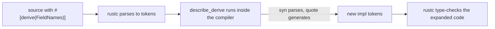

# 03. Declarative and procedural macros

> **Draft: written but not yet run.** The code and the expected output in this lesson were prepared by reading the code and the official documentation. They have not been executed yet. If something does not behave as described, trust your tool's real output and report it.

## What you will be able to do
- Write `macro_rules!` macros with fragment specifiers, repetition, recursion and `$crate`.
- Predict how macro hygiene treats a local variable.
- Build a workspace with a procedural derive macro using `syn` and `quote`, and report errors through `compile_error!`.
- Decide when a macro is justified and when a function, trait or generic is better.

## Recap
1. From lesson 02: why is each `unsafe` block preceded by a `SAFETY` comment?
   <details><summary>Answer</summary>It states the facts the block relies on, so a reviewer (and Clippy) can check them.</details>
2. From lesson 01: what does `S::NAME` cost at runtime in the generic `Display` impl?
   <details><summary>Answer</summary>Nothing: each state gets its own compiled copy and the constant is resolved at compile time.</details>

## Why it matters
Macros write code before the compiler checks it. They remove repetition that functions and generics cannot (a new type per id kind, a trait impl per struct field list) and they power `println!`, `vec!`, `#[derive(Debug)]`, `serde` and `tokio::main`. They also hide code, slow builds, produce harder error messages and, for procedural macros, run arbitrary code inside your compiler. A 301 engineer can write both kinds and, more often, can say "a function is enough".

## What you will build
A Cargo **workspace** (one folder, several packages sharing one `Cargo.lock` and one `target/`) with two packages: `describe_derive`, a procedural macro crate with `#[derive(FieldNames)]`, and `macro_demo`, a library and binary with four `macro_rules!` macros and one struct that uses the derive.

## Before you start
- **Prerequisites:** Rust 301 lessons [01, advanced traits and type-state](01-advanced-traits-and-type-state.md) and [02, unsafe Rust and FFI](02-unsafe-rust-and-ffi.md).
- Audience: finished lessons 01 and 02.
- Target Rust/Cargo 1.100.0, edition 2024. Direct crates: `syn` 3.0.10 and `quote` 1.0.47, pinned exactly and checked on crates.io for this draft (not a claim that they are the latest or advisory-free).
- Time: 70-90 min. Two sittings are fine; break after Step 4.
- Source pack (optional): every file is shown in full in this lesson, so you can follow without it. The finished code, the exercise starter and the solution are in the
  course repository https://github.com/Uee03/Code101 under `source/rust/301-super-hero-to-legendary/phase-1-advanced-language/03-macros/` (on that page choose **Code, Download ZIP**, or run
  `git clone https://github.com/Uee03/Code101.git`).
- Save every tab. No `Cargo.lock` is supplied: cargo creates one for the whole workspace on first build.

## Steps
### Step 1. Create the folders
**File: `terminal in any folder (Windows PowerShell)`**
```powershell
New-Item -ItemType Directory -Force "$HOME/code101/rust301/lesson03/macro_demo/src", "$HOME/code101/rust301/lesson03/describe_derive/src"
Set-Location "$HOME/code101/rust301/lesson03"
```

**File: `terminal in any folder (macOS/Linux)`**
```bash
mkdir -p "$HOME/code101/rust301/lesson03/macro_demo/src" "$HOME/code101/rust301/lesson03/describe_derive/src"
cd "$HOME/code101/rust301/lesson03"
```
Expected result: the prompt ends in `lesson03`.

### Step 2. The workspace manifest
A **virtual manifest** has `[workspace]` but no `[package]`.

**File: `Cargo.toml`**
```toml
[workspace]
resolver = "3"
members = ["macro_demo", "describe_derive"]
```
`resolver = "3"` selects Cargo's dependency-resolver version 3; a virtual workspace must say so explicitly because there is no package edition to infer it from. `members` lists the packages.

### Step 3. The procedural macro crate
A procedural macro must live in its own crate with `proc-macro = true`, because the compiler loads that crate as a plugin and runs it while compiling *other* crates.

**File: `describe_derive/Cargo.toml`**
```toml
[package]
name = "describe_derive"
version = "0.1.0"
edition = "2024"

[lib]
proc-macro = true

[dependencies]
quote = "=1.0.47"
syn = "=3.0.10"
```
`syn` parses Rust tokens into a syntax tree; `quote` turns a template with `#variables` back into tokens. Both are compile-time-only tools.

**File: `describe_derive/src/lib.rs`**
```rust
use proc_macro::TokenStream;
use quote::quote;
use syn::{Data, DeriveInput, Fields, parse_macro_input};

/// Adds `pub const FIELD_NAMES: &'static [&'static str]` to a struct with named fields.
#[proc_macro_derive(FieldNames)]
pub fn derive_field_names(input: TokenStream) -> TokenStream {
    let input = parse_macro_input!(input as DeriveInput);
    let name = &input.ident;

    let Data::Struct(data) = &input.data else {
        return syn::Error::new_spanned(name, "FieldNames can only be derived for structs")
            .to_compile_error()
            .into();
    };
    let Fields::Named(fields) = &data.fields else {
        return syn::Error::new_spanned(name, "FieldNames needs a struct with named fields")
            .to_compile_error()
            .into();
    };

    let names: Vec<String> = fields
        .named
        .iter()
        .filter_map(|field| field.ident.as_ref())
        .map(|ident| ident.to_string())
        .collect();
    let (impl_generics, ty_generics, where_clause) = input.generics.split_for_impl();

    quote! {
        impl #impl_generics #name #ty_generics #where_clause {
            pub const FIELD_NAMES: &'static [&'static str] = &[#(#names),*];
        }
    }
    .into()
}
```

### Step 4. The `macro_rules!` library
First the manifest, then the macros. Read each macro's *pattern* (left of `=>`) and *transcriber* (right).

**File: `macro_demo/Cargo.toml`**
```toml
[package]
name = "macro_demo"
version = "0.1.0"
edition = "2024"

[dependencies]
describe_derive = { path = "../describe_derive" }
```

**File: `macro_demo/src/lib.rs`**
```rust
pub use describe_derive::FieldNames;

/// Builds a `BTreeMap<String, V>` from `key => value` pairs. A trailing comma is allowed.
#[macro_export]
macro_rules! string_map {
    ($($key:expr => $value:expr),* $(,)?) => {{
        #[allow(unused_mut)]
        let mut map = ::std::collections::BTreeMap::new();
        $( map.insert(($key).to_string(), $value); )*
        map
    }};
}

/// Counts the token trees it is given, at compile time.
#[macro_export]
macro_rules! count {
    () => { 0usize };
    ($head:tt $($tail:tt)*) => { 1usize + $crate::count!($($tail)*) };
}

/// Shows hygiene: the `temp` inside the macro is not the caller's `temp`.
#[macro_export]
macro_rules! with_temp {
    ($e:expr) => {{
        let temp = 100;
        $e + temp
    }};
}

/// Declares a numeric id newtype that prints as `prefix-0042`.
#[macro_export]
macro_rules! id_type {
    ($name:ident, $prefix:literal) => {
        #[derive(Debug, Clone, Copy, PartialEq, Eq, PartialOrd, Ord)]
        pub struct $name(pub u32);

        impl ::std::fmt::Display for $name {
            fn fmt(&self, f: &mut ::std::fmt::Formatter<'_>) -> ::std::fmt::Result {
                write!(f, "{}-{:04}", $prefix, self.0)
            }
        }
    };
}

id_type!(UserId, "usr");
id_type!(OrderId, "ord");

#[derive(FieldNames)]
pub struct Order {
    pub id: OrderId,
    pub user: UserId,
    pub total_cents: u64,
}

#[cfg(test)]
mod tests {
    use super::*;

    #[test]
    fn string_map_sorts_and_allows_a_trailing_comma() {
        let map = string_map! { "b" => 2, "a" => 1, };
        assert_eq!(format!("{map:?}"), r#"{"a": 1, "b": 2}"#);
    }

    #[test]
    fn count_counts_token_trees() {
        assert_eq!(count!(x y z), 3);
        assert_eq!(count!(), 0);
    }

    #[test]
    fn temp_is_hygienic() {
        let temp = 1;
        assert_eq!(with_temp!(temp * 2), 102);
    }

    #[test]
    fn ids_are_zero_padded() {
        assert_eq!(UserId(42).to_string(), "usr-0042");
        assert_eq!(OrderId(7).to_string(), "ord-0007");
    }

    #[test]
    fn derive_lists_field_names() {
        assert_eq!(Order::FIELD_NAMES, &["id", "user", "total_cents"]);
    }
}
```

### Step 5. The program
**Predict before you run:** `with_temp!(temp * 2)` is called where `temp` is 1, and the macro itself declares `temp = 100`. Is the result `102` or `300`? Why?

**File: `macro_demo/src/main.rs`**
```rust
use macro_demo::{Order, OrderId, UserId, count, string_map, with_temp};

fn main() {
    let ages = string_map! { "carol" => 31, "alice" => 29 };
    println!("{ages:?}");
    println!("tokens: {}", count!(a b c d));

    let temp = 1;
    println!("hygiene: {}", with_temp!(temp * 2));

    println!("{} {}", UserId(42), OrderId(7));
    println!("order fields: {:?}", Order::FIELD_NAMES);
}
```

## Run it
**File: `terminal in $HOME/code101/rust301/lesson03 (all platforms)`**
```powershell
cargo run --quiet -p macro_demo
```
`-p macro_demo` selects the package; a workspace root has no binary of its own. Expected output, not yet run (derived from the code):
```text
{"alice": 29, "carol": 31}
tokens: 4
hygiene: 102
usr-0042 ord-0007
order fields: ["id", "user", "total_cents"]
```
Run the tests of both packages:

**File: `terminal in $HOME/code101/rust301/lesson03 (all platforms)`**
```powershell
cargo test --workspace
```
Expected result, not yet run: five unit tests pass in `macro_demo`; `describe_derive` has none.

## How it works
### `macro_rules!`
- A macro is a list of **arms**: `(pattern) => { transcriber }`. The compiler tries the arms top to bottom and uses the first pattern that matches the input tokens.
- **Fragment specifiers** say what a `$name:kind` captures: `expr` (an expression), `ident` (a name), `ty` (a type), `literal`, `pat`, `path`, `block`, `item`, and `tt` (one token tree: a single token or a bracketed group, the most flexible). An `expr` capture is parsed as a whole, so `$e * 2` with `$e = a + b` means `(a + b) * 2`, never `a + b * 2`.
- **Repetition** `$( ... ) sep rep` repeats the pattern; `rep` is `*` (zero or more), `+` (one or more) or `?` (zero or one). `$(,)?` is the common way to allow a trailing comma. The transcriber repeats with the same variables: `$( map.insert(..); )*`.
- **Recursion**: `count!` peels one token off each time. It is simple but the compiler limits macro recursion depth (the `recursion_limit` attribute, 128 by default), so long inputs need a different technique or a procedural macro.
- **`$crate`** is the path to the defining crate. Use it for every item a macro refers to so that the macro works when called from another crate, which may not have the same imports. Similarly the macros use `::std::...` absolute paths.
- **`#[macro_export]`** places the macro at the crate root so that callers write `use macro_demo::count;`. Without it the macro exists only textually after its definition inside the same crate.
- **Hygiene.** Local variables created by a `macro_rules!` macro live in their own naming scope. The `temp` declared inside `with_temp!` is invisible to the caller's expression, so `temp * 2` still means the caller's `temp` (1): `1 * 2 + 100 = 102`. Hygiene covers local variables and labels, **not** types, functions or modules: `id_type!` creates real items in the caller's scope.
- Empty input to `string_map!` would leave the map's key and value types unknown and fail to compile unless the caller annotates the type; that is a limit of the design, not a bug.

### Procedural macros
- Three kinds exist: **derive** (`#[derive(Name)]`, adds items next to a struct or enum), **attribute** (`#[name]`, may rewrite the item it is attached to) and **function-like** (`name!(...)`). All are ordinary Rust functions from `TokenStream` to `TokenStream`, compiled into a shared library that the compiler loads.
- `parse_macro_input!(input as DeriveInput)` parses and turns a parse failure into a spanned compile error. `syn::Error::new_spanned(..).to_compile_error()` returns a `compile_error!` invocation pointing at the relevant tokens, which gives users a readable error at the right place instead of a panic inside the macro.
- `quote!` builds output tokens. `#name` inserts a variable; `#(#names),*` repeats a list with a comma separator. `split_for_impl` gives generics pieces so that the derive works for `struct Page<'a, T> where T: Clone` as well.
- `input.ident` is the struct's name; `Data::Struct(..)` and `Fields::Named(..)` let us reject enums and tuple structs with a clear message.

**Misconception:** "macros are functions that run at runtime". They run during compilation, before type checking of their output, and produce source code. A macro cannot see types, only tokens: a derive cannot know that a field's type is `String`, only that the tokens say `String`.



### Trade-offs: when not to use a macro
- **A function or generic does the job.** If the arms differ only by value or type, write a function with a parameter or a generic. Macros are for syntax that functions cannot take (variable number of arguments, new declaration forms, code per field).
- **IDE and diagnostics suffer.** Errors inside expanded code point at the macro call; autocomplete may not see generated items; debugging needs `cargo expand` (a separately installed tool) or the nightly-only `trace_macros!`.
- **Compile time grows.** Heavy `macro_rules!` recursion and proc-macro crates with `syn` "full" parsing add build time; the proc-macro crate itself must be compiled for the host before your crate.
- **Security: a proc macro is arbitrary code that runs at build time with your user's permissions**, exactly like a `build.rs` (lesson 02). It can read files, use the network and write anywhere. Treat adding a proc-macro crate like adding a program to your CI. Lesson 08 shows how to audit and restrict them.
- **API stability.** A derive's output is public API. Changing generated items can break users; document what is generated.

### Failure modes to review
- Macro captures that parse differently than you expect (`expr` vs `tt`).
- Non-hygienic items colliding with the caller's names (generate unique names, or take the name as a parameter as `id_type!` does).
- Proc-macro and `syn` major versions: a macro crate compiled against `syn` 3 with a downstream crate also using `syn` 2 compiles both; this is fine but doubles build work.
- `compile_error!` messages written for macro authors, not users.

### Measurements to take
- `cargo build --timings` before and after adding the macro crate, and per crate; look at the proc-macro crate's compile time on a clean build and on an incremental rebuild.
- The expanded size: `cargo expand` output length for one call; very large expansions point to a design that should be a generic function.
- Test macros: use ordinary unit tests for `macro_rules!`, and `trybuild` (a separate crate, concept only here) for proc macros that must fail with a good message.

## Try it
### Rung 1. Guided practice
Write `max_of!(a, b, c, ...)` that returns the largest of one or more expressions. The starter has the single-expression arm and a wrong recursive arm.

**File: `terminal in any folder (Windows PowerShell)`**
```powershell
New-Item -ItemType Directory -Force "$HOME/code101/rust301/try03/src"
Set-Location "$HOME/code101/rust301/try03"
```

**File: `terminal in any folder (macOS/Linux)`**
```bash
mkdir -p "$HOME/code101/rust301/try03/src"
cd "$HOME/code101/rust301/try03"
```
Optional download route: copy the `starter` folder from `exercise` directly into `$HOME/code101/rust301` and rename the copy `try03`.

**File: `try03/Cargo.toml (starter)`**
```toml
[package]
name = "max_of_macro"
version = "0.1.0"
edition = "2024"

[dependencies]
```

**File: `try03/src/main.rs (starter)`**
```rust
macro_rules! max_of {
    // A single expression is its own maximum.
    ($x:expr) => {
        $x
    };
    // TODO: compare the first expression with max_of! of the rest and return the larger one.
    // For now this arm returns only the first expression, so the output below is wrong.
    ($x:expr, $($rest:expr),+) => {
        $x
    };
}

fn main() {
    println!("{}", max_of!(7));
    println!("{}", max_of!(3, 9, 4));
    println!("{}", max_of!(1.5, 0.5));
}
```
Run `cargo run --quiet`. The untouched starter prints `7`, `3`, `1.5`. Target output after your edit:
```text
7
9
1.5
```

### Rung 2. Change the behaviour
Add `min_of!` the same way, then try to merge both into one macro `pick!(max, ...)`. Note what becomes harder to read.

### Rung 3. Stretch (optional)
Extend `FieldNames` to skip fields marked `#[field_names(skip)]`. List which `syn` types you would need (attributes on `Field`) and how you would report an unknown option with `syn::Error`.

<details><summary>Solution for Rung 1</summary>

`Cargo.toml` is identical to the starter.

**File: `exercise/solution/src/main.rs`**
```rust
macro_rules! max_of {
    // A single expression is its own maximum.
    ($x:expr) => {
        $x
    };
    // Compare the first expression with the maximum of the rest.
    ($x:expr, $($rest:expr),+) => {{
        let first = $x;
        let others = max_of!($($rest),+);
        if first > others { first } else { others }
    }};
}

fn main() {
    println!("{}", max_of!(7));
    println!("{}", max_of!(3, 9, 4));
    println!("{}", max_of!(1.5, 0.5));
}
```
Each `let` evaluates its expression once, so `max_of!(f(), g())` calls each function exactly once. A version that wrote `if $x > ...` twice would evaluate the expression twice.
</details>

## Check yourself
1. Why does `with_temp!(temp * 2)` produce 102 and not 300?
   <details><summary>Answer</summary>Hygiene: the macro's `temp` is a different variable from the caller's, so the caller's expression still reads the caller's `temp` (1).</details>
2. Why must a procedural macro live in its own crate?
   <details><summary>Answer</summary>The compiler builds it as a plugin for the host and runs it while compiling other crates; it is a different kind of artifact.</details>
3. Predict: what does `count!(a b c)` expand to before evaluation?
   <details><summary>Answer</summary>`1usize + 1usize + 1usize + 0usize`, which is 3.</details>
4. Give two reasons to prefer a generic function to a macro.
   <details><summary>Answer</summary>Better error messages and tooling; no extra compile-time machinery; types are checked at the definition, not at each use.</details>
5. What is the security risk of adding a proc-macro dependency?
   <details><summary>Answer</summary>It runs arbitrary code at build time with your permissions.</details>

## Common mistakes
| Symptom | Cause | Fix |
|---|---|---|
| Typical message: "no rules expected the token ..." | The call does not match any arm | Compare your call with each pattern; check commas and separators |
| Typical message: "recursion limit reached while expanding ..." | A recursive macro got long input | Shorten the input, use a non-recursive design, or a proc macro; `#![recursion_limit = "256"]` is a last resort |
| `cargo run` in the workspace root says it cannot decide what to run, or finds no binary | A virtual workspace has no binary at the root | Use `cargo run --quiet -p macro_demo` |
| Typical message: "cannot find macro ... in this scope" | Macro used before its definition, or not imported | Define it earlier in the file, or `use macro_demo::name;` for an exported macro |
| `proc-macro` crate errors when a normal function is `pub` and not a macro | Proc-macro crates can export only macros | Move helper functions to a normal crate |
| Wrong folder | Terminal not in `lesson03` | `cd "$HOME/code101/rust301/lesson03"` |

## Best practice
Prefer functions and generics; use `macro_rules!` for syntax and repetition they cannot express, use `$crate` and absolute paths so a macro works from any crate, and return spanned `compile_error!` errors from proc macros. Source: [The Rust Book: macros](https://doc.rust-lang.org/book/ch20-05-macros.html) and [Rust API Guidelines: macros](https://rust-lang.github.io/api-guidelines/macros.html).

## Going further
- [The Rust Reference: macros by example](https://doc.rust-lang.org/reference/macros-by-example.html) (hygiene and fragment rules in full).
- [The Rust Reference: procedural macros](https://doc.rust-lang.org/reference/procedural-macros.html).
- [syn documentation](https://docs.rs/syn/3.0.10/syn/) and [quote documentation](https://docs.rs/quote/1.0.47/quote/).

## Summary
- You wrote four `macro_rules!` macros using fragments, repetition, recursion and `$crate`, and predicted hygiene.
- You built a workspace with a derive macro that reads a struct and emits an `impl`.
- You returned spanned compile errors instead of panicking.
- You listed when a macro is not justified and what to measure.

## Next lesson
[04. Send, Sync and fearless concurrency](04-send-sync-and-fearless-concurrency.md): the traits that make thread safety a compile-time property.
