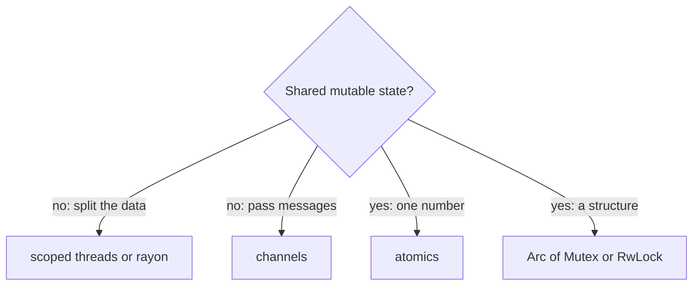

# 04. Send, Sync and fearless concurrency

> **Draft: written but not yet run.** The code and the expected output in this lesson were prepared by reading the code and the official documentation. They have not been executed yet. If something does not behave as described, trust your tool's real output and report it.

## What you will be able to do
- Explain `Send` and `Sync` and predict which types have them.
- Share data between threads with scoped threads, channels, `Arc<Mutex<T>>` and atomics, and pick the right one.
- Name the failure modes of each tool: poisoning, deadlock, contention and wrong memory ordering.
- Decide between threads and async for a given workload, with the measurements that would settle it.

## Recap
1. From Rust 201 lesson 05: why must a spawned Tokio task own its data?
   <details><summary>Answer</summary>The task may outlive the function that created it, so it cannot borrow local variables (`'static` requirement).</details>
2. From lesson 02: what is a data race and why is it undefined behaviour?
   <details><summary>Answer</summary>Two threads access the same memory at once, at least one writes, without synchronisation; the language gives no meaning to such a program.</details>

## Why it matters
Most languages let you share mutable data between threads and leave correctness to discipline, tests and luck. Rust makes a data race a compile error in safe code. The mechanism is two marker traits, `Send` and `Sync`, that the compiler derives automatically and that every thread API demands. Knowing them lets you read the error messages, design types that cross threads, and avoid the problems the compiler does *not* catch: deadlocks, contention and logic races.

## What you will build
A library `fearless` that sums squares with scoped threads, collects results over a channel, and counts to 4000 with an `Arc<Mutex<usize>>` and with an `AtomicUsize`, plus two compile-time helpers that prove a type is `Send` or `Sync`.

## Before you start
- Audience: finished lesson 02 and [Rust 201 lesson 05](../../201-hero-to-super-hero/phase-2-async-and-web/05-async-rust-and-tokio.md).
- Target Rust/Cargo 1.100.0, edition 2024. No crates are needed: `std` only.
- Time: 65-85 min.
- Source pack (optional): every file is shown in full in this lesson, so you can follow without it. The finished code, the exercise starter and the solution are in the
  course repository https://github.com/Uee03/Code101 under `source/rust/301-super-hero-to-legendary/phase-1-advanced-language/04-send-sync-and-fearless-concurrency/` (on that page choose **Code, Download ZIP**, or run
  `git clone https://github.com/Uee03/Code101.git`).
- Save every tab. No `Cargo.lock` is supplied: cargo creates it on first build.

## Steps
### Step 1. Create the folders
**File: `terminal in any folder (Windows PowerShell)`**
```powershell
New-Item -ItemType Directory -Force "$HOME/code101/rust301/lesson04/src"
Set-Location "$HOME/code101/rust301/lesson04"
```

**File: `terminal in any folder (macOS/Linux)`**
```bash
mkdir -p "$HOME/code101/rust301/lesson04/src"
cd "$HOME/code101/rust301/lesson04"
```

### Step 2. The manifest
**File: `Cargo.toml`**
```toml
[package]
name = "fearless"
version = "0.1.0"
edition = "2024"

[dependencies]

[lints.rust]
unsafe_code = "forbid"
```
Concurrency in safe Rust never needs `unsafe`, so the crate forbids it (lesson 02's policy).

### Step 3. The library
Read it in four parts: the two proof helpers, scoped threads, a channel, and the two counters.

**Predict before you run:** `count_with_mutex(4, 1000)` starts four threads that each add 1000. What is the result, and could it ever be less than 4000?

**File: `src/lib.rs`**
```rust
use std::sync::atomic::{AtomicUsize, Ordering};
use std::sync::mpsc;
use std::sync::{Arc, Mutex};
use std::thread;

/// Compiles only when `T` is `Send`: its values may move to another thread.
///
/// ```compile_fail
/// use std::rc::Rc;
/// fearless::assert_send::<Rc<u32>>();
/// ```
pub fn assert_send<T: Send>() {}

/// Compiles only when `T` is `Sync`: `&T` may be shared between threads.
pub fn assert_sync<T: Sync>() {}

/// Sum of squares, split into chunks that scoped threads work on in parallel.
pub fn parallel_sum_of_squares(values: &[u64], workers: usize) -> u64 {
    let chunk = values.len().div_ceil(workers.max(1)).max(1);
    thread::scope(|scope| {
        let handles: Vec<_> = values
            .chunks(chunk)
            .map(|part| scope.spawn(move || part.iter().map(|v| v * v).sum::<u64>()))
            .collect();
        handles
            .into_iter()
            .map(|handle| handle.join().expect("worker panicked"))
            .sum()
    })
}

/// One thread per value; results come back over a channel in arrival order, so we sort.
pub fn squares_via_channel(values: Vec<u64>) -> Vec<u64> {
    let (tx, rx) = mpsc::channel();
    let mut handles = Vec::new();
    for value in values {
        let tx = tx.clone();
        handles.push(thread::spawn(move || {
            tx.send(value * value).expect("receiver is alive");
        }));
    }
    // The receiver iterator ends only when every sender is gone, including this one.
    drop(tx);
    let mut squares: Vec<u64> = rx.iter().collect();
    for handle in handles {
        handle.join().expect("worker panicked");
    }
    squares.sort_unstable();
    squares
}

/// A shared counter behind `Arc<Mutex<_>>`: every increment takes the lock.
pub fn count_with_mutex(threads: usize, per_thread: usize) -> usize {
    let counter = Arc::new(Mutex::new(0usize));
    let handles: Vec<_> = (0..threads)
        .map(|_| {
            let counter = Arc::clone(&counter);
            thread::spawn(move || {
                for _ in 0..per_thread {
                    *counter.lock().expect("lock poisoned") += 1;
                }
            })
        })
        .collect();
    for handle in handles {
        handle.join().expect("worker panicked");
    }
    let guard = counter.lock().expect("lock poisoned");
    *guard
}

/// The same counter as one atomic: no lock, borrowed by scoped threads instead of an `Arc`.
pub fn count_with_atomic(threads: usize, per_thread: usize) -> usize {
    let counter = AtomicUsize::new(0);
    thread::scope(|scope| {
        for _ in 0..threads {
            scope.spawn(|| {
                for _ in 0..per_thread {
                    // Relaxed is enough: only the final total matters, and the scope joins
                    // every thread before we read it.
                    counter.fetch_add(1, Ordering::Relaxed);
                }
            });
        }
    });
    counter.load(Ordering::Relaxed)
}

#[cfg(test)]
mod tests {
    use super::*;

    #[test]
    fn auto_traits_hold_for_common_types() {
        assert_send::<Vec<String>>();
        assert_send::<Arc<Mutex<u32>>>();
        assert_sync::<Arc<Mutex<u32>>>();
    }

    #[test]
    fn parallel_sum_matches_the_sequential_sum() {
        let values: Vec<u64> = (1..=100).collect();
        let expected: u64 = values.iter().map(|v| v * v).sum();
        for workers in [1, 3, 4, 200] {
            assert_eq!(parallel_sum_of_squares(&values, workers), expected);
        }
    }

    #[test]
    fn parallel_sum_of_nothing_is_zero() {
        assert_eq!(parallel_sum_of_squares(&[], 4), 0);
    }

    #[test]
    fn channel_collects_every_square() {
        assert_eq!(squares_via_channel(vec![3, 1, 2]), vec![1, 4, 9]);
    }

    #[test]
    fn both_counters_reach_the_same_total() {
        assert_eq!(count_with_mutex(4, 1000), 4000);
        assert_eq!(count_with_atomic(4, 1000), 4000);
    }

    #[test]
    fn a_panic_while_locked_poisons_the_mutex() {
        let shared = Arc::new(Mutex::new(0));
        let clone = Arc::clone(&shared);
        let result = thread::spawn(move || {
            let _guard = clone.lock().expect("lock");
            panic!("worker failed while holding the lock");
        })
        .join();
        assert!(result.is_err());
        assert!(shared.lock().is_err());
    }
}
```

### Step 4. The program
**File: `src/main.rs`**
```rust
use fearless::{
    count_with_atomic, count_with_mutex, parallel_sum_of_squares, squares_via_channel,
};

fn main() {
    let values: Vec<u64> = (1..=100).collect();
    println!(
        "sum of squares 1..=100 with 4 workers: {}",
        parallel_sum_of_squares(&values, 4)
    );
    println!("squares via channel: {:?}", squares_via_channel(vec![3, 1, 2]));
    println!("mutex counter: {}", count_with_mutex(4, 1000));
    println!("atomic counter: {}", count_with_atomic(4, 1000));
}
```

## Run it
**File: `terminal in $HOME/code101/rust301/lesson04 (all platforms)`**
```powershell
cargo run --quiet
```
Expected output, not yet run (the sum is `100*101*201/6`; every line is deterministic even though thread scheduling is not):
```text
sum of squares 1..=100 with 4 workers: 338350
squares via channel: [1, 4, 9]
mutex counter: 4000
atomic counter: 4000
```
Then the tests, including the `compile_fail` doc test:

**File: `terminal in $HOME/code101/rust301/lesson04 (all platforms)`**
```powershell
cargo test
```
Expected result, not yet run: six unit tests and one doc test pass. The poisoning test prints a panic message to the test's captured output; that is intended.

## How it works
**`Send`** means "a value of this type can be moved to another thread". **`Sync`** means "a shared reference `&T` can be used from several threads at once"; formally `T: Sync` exactly when `&T: Send`. Both are **auto traits**: the compiler implements them for your struct when all fields have them, and you never write `impl Send` in normal code. Typical members and non-members:

| Type | Send | Sync | Why |
|---|---|---|---|
| `i32`, `String`, `Vec<T>` (of Send T) | yes | yes | plain owned data |
| `Rc<T>` | no | no | the reference count is not atomic |
| `Arc<T>` | if `T: Send + Sync` | if `T: Send + Sync` | atomic count; shares the `T` |
| `Cell<T>`, `RefCell<T>` | yes (if T) | no | interior mutability without locking |
| `Mutex<T>` | if `T: Send` | if `T: Send` | the lock makes shared access safe |
| `MutexGuard<'_, T>` | no | if `T: Sync` | some platforms require unlocking on the locking thread |
| raw pointers `*const T` | no | no | the compiler knows nothing about them |

`thread::spawn` requires its closure to be `Send + 'static`. Because the new thread may outlive the caller, it cannot borrow locals (`'static`). `thread::scope` removes that restriction: the scope guarantees every spawned thread ends before it returns, so closures may borrow local data, which is why `parallel_sum_of_squares` borrows `values` and `count_with_atomic` borrows `counter` with no `Arc` and no `move`.

**Tool choice**

| Tool | Use it when | Failure modes |
|---|---|---|
| Scoped threads and plain borrows | The work is a bounded fork and join over local data | Uneven chunk sizes leave threads idle |
| Channels (`mpsc`) | Work or results flow in one direction between stages | Unbounded channels hide a slow consumer and grow memory; `sync_channel(n)` gives back-pressure; a forgotten sender keeps `rx.iter()` open forever (see `drop(tx)`) |
| `Arc<Mutex<T>>` | Several threads mutate one value in short critical sections | Lock contention; deadlock if two locks are taken in different orders; **poisoning** after a panic while locked (`lock()` returns `Err`); holding a guard while doing slow work |
| `RwLock<T>` | Many readers, rare writers | Writer starvation or reader-heavy contention is platform dependent; measure before choosing it over `Mutex` |
| Atomics (`AtomicUsize`, ...) | A single counter or flag | Wrong `Ordering` gives a logic race that the compiler cannot see; only works for one value, not for invariants across two fields |

**Memory ordering in one paragraph.** `Relaxed` guarantees only that this one atomic operation is indivisible; it creates no ordering with other memory. That is enough for a statistics counter that is read after all threads are joined (thread join already synchronises). If one thread must *publish* data for another (set a flag after writing a buffer), use `Release` on the store and `Acquire` on the load. When unsure, `SeqCst` is the simplest to reason about. Never pick an ordering by "it worked".

**Misconception:** "Rust prevents all concurrency bugs". It prevents *data races* in safe code. It does not prevent deadlocks, starvation, lost wake-ups, priority inversion or logic races (check-then-act across two separate lock acquisitions).



### Threads or async?
| Question | Threads | Async (Tokio) |
|---|---|---|
| Workload | CPU-bound: hashing, compression, parsing, image work | I/O-bound: many sockets, timers, database calls |
| Count of concurrent tasks | Dozens to a few hundred | Thousands to millions |
| Cost per task | An OS thread: a stack (megabytes of address space reserved) and scheduler work | A heap-allocated state machine: bytes to kilobytes |
| Blocking calls | Natural | Block a worker thread and stall other tasks: use `tokio::task::spawn_blocking` |
| Complexity | Plain functions, `Send` and `'static` rules | Function colouring, cancellation by dropping, `Send` futures, `.await` while holding a lock |

A common production shape combines both: an async server that hands CPU-heavy work to a thread pool (`spawn_blocking` or a `rayon` pool) and awaits the result over a channel. Holding a `std::sync::MutexGuard` across `.await` makes the future not `Send`, which is exactly the safety net working (Rust 201 lesson 05).

### When not to use these tools
- Do not use `Arc<Mutex<T>>` as the default design. Ask first whether ownership can be split (each thread gets its own chunk) or whether a channel expresses the flow.
- Do not use atomics for anything with an invariant across more than one variable.
- Do not use `unsafe impl Send` to silence an error. The error means the compiler found a sharing rule you break; `unsafe impl Send` is a promise you must prove, as in lesson 02.
- Do not spawn one OS thread per request; use a bounded pool.

### Failure modes to review
- Lock ordering: document a global order for any code that takes two locks.
- `lock().unwrap()` everywhere turns one panic into a cascade of panics because of poisoning; decide per lock whether to propagate, recover with `into_inner`, or abort.
- Unbounded queues and unbounded thread counts.
- Detached threads: a `JoinHandle` that is dropped without `join` hides panics. Join, or report errors over a channel.
- Using `Relaxed` to publish data.

### Measurements to take
- Scaling: run the same job with 1, 2, 4, 8 and N workers on your hardware and plot elapsed time. Stop adding threads where the curve flattens. Use the Criterion setup from lesson 06 so the numbers are statistically meaningful.
- Lock contention: compare the mutex counter against the atomic counter with your real thread count and critical-section length; for deeper analysis use an OS profiler (`perf` on Linux, Windows Performance Recorder, Instruments on macOS) and look for time spent waiting on locks.
- For async services, `tokio-console` (a separate tool) shows tasks that are busy or never yield.
- For correctness: run tests under `loom` (a crate that explores thread interleavings; concept) and, on nightly, under ThreadSanitizer.

## Try it
### Rung 1. Guided practice
Finish `parallel_max`, which finds the largest element with scoped threads.

**File: `terminal in any folder (Windows PowerShell)`**
```powershell
New-Item -ItemType Directory -Force "$HOME/code101/rust301/try04/src"
Set-Location "$HOME/code101/rust301/try04"
```

**File: `terminal in any folder (macOS/Linux)`**
```bash
mkdir -p "$HOME/code101/rust301/try04/src"
cd "$HOME/code101/rust301/try04"
```
Optional download route: copy the `starter` folder from `exercise` directly into `$HOME/code101/rust301` and rename the copy `try04`.

**File: `try04/Cargo.toml (starter)`**
```toml
[package]
name = "parallel_max"
version = "0.1.0"
edition = "2024"

[dependencies]
```

**File: `try04/src/main.rs (starter)`**
```rust
use std::thread;

/// Largest value of `values`, found by scoped threads that each take one chunk.
/// Returns None for an empty slice.
pub fn parallel_max(values: &[i32], workers: usize) -> Option<i32> {
    let chunk = values.len().div_ceil(workers.max(1)).max(1);
    thread::scope(|scope| {
        let handles: Vec<_> = values
            .chunks(chunk)
            .map(|part| scope.spawn(move || part.iter().copied().max()))
            .collect();
        // TODO: join every handle, then combine the per-chunk maximums into one Option<i32>.
        let _ = handles;
        None
    })
}

fn main() {
    let values = [4, 17, -3, 9, 25, 8, 25, 1];
    println!("max: {:?}", parallel_max(&values, 3));
    println!("empty: {:?}", parallel_max(&[], 3));
}
```
Run `cargo run --quiet`. The untouched starter prints `max: None` and `empty: None`. Target output:
```text
max: Some(25)
empty: None
```

### Rung 2. Change the behaviour
Add a variant that sends each chunk's maximum over a channel instead of joining handles. Which version is simpler to read, and which would you pick if chunks arrived from different stages?

### Rung 3. Stretch (optional)
Write a design note for a service that must resize 10,000 uploaded images per hour, with image metadata in Postgres. Decide threads, async or both, name the bounded resources (queue length, pool size) and list the three measurements you would take before shipping.

<details><summary>Solution for Rung 1</summary>

`Cargo.toml` is identical to the starter.

**File: `exercise/solution/src/main.rs`**
```rust
use std::thread;

/// Largest value of `values`, found by scoped threads that each take one chunk.
/// Returns None for an empty slice.
pub fn parallel_max(values: &[i32], workers: usize) -> Option<i32> {
    let chunk = values.len().div_ceil(workers.max(1)).max(1);
    thread::scope(|scope| {
        let handles: Vec<_> = values
            .chunks(chunk)
            .map(|part| scope.spawn(move || part.iter().copied().max()))
            .collect();
        handles
            .into_iter()
            .filter_map(|handle| handle.join().expect("worker panicked"))
            .max()
    })
}

fn main() {
    let values = [4, 17, -3, 9, 25, 8, 25, 1];
    println!("max: {:?}", parallel_max(&values, 3));
    println!("empty: {:?}", parallel_max(&[], 3));
}
```
Each `join()` returns `Result<Option<i32>, _>`; `expect` turns a worker panic into a panic here, `filter_map` drops empty chunks, and `max()` picks the winner.
</details>

## Check yourself
1. Why is `Rc<u32>` not `Send`?
   <details><summary>Answer</summary>Its reference count is updated without atomic operations; two threads could corrupt it.</details>
2. Why can `thread::scope` closures borrow local variables while `thread::spawn` closures cannot?
   <details><summary>Answer</summary>The scope joins every thread before returning, so borrows cannot outlive their data; `spawn` threads may outlive the caller and need `'static` data.</details>
3. Predict: what happens to `rx.iter()` if you forget `drop(tx)` in `squares_via_channel`?
   <details><summary>Answer</summary>It never ends: the original sender is still alive, so the iterator keeps waiting and the function hangs.</details>
4. When is `Ordering::Relaxed` enough for an atomic counter?
   <details><summary>Answer</summary>When only the counter's own value matters and it is read after the threads are joined (or no other data depends on it).</details>
5. Name two problems Rust does not prevent in concurrent code.
   <details><summary>Answer</summary>Deadlocks and logic races (also starvation and unbounded queues).</details>

## Common mistakes
| Symptom | Cause | Fix |
|---|---|---|
| Typical message: "`Rc<...>` cannot be sent between threads safely" | A non-`Send` type was moved into a spawned closure | Use `Arc` instead of `Rc`, or keep the value on one thread |
| Typical message: "closure may outlive the current function, but it borrows ..." | Plain `thread::spawn` borrows a local | `move` the data in (clone an `Arc`), or use `thread::scope` |
| The program never finishes after collecting from a channel | A sender is still alive | `drop(tx)` after cloning for the workers |
| `PoisonError` from `lock()` | Another thread panicked while holding the lock | Decide: propagate, recover with `into_inner()`, or restructure so panics cannot happen under the lock |
| The test result differs between runs | Output order depends on thread scheduling | Collect then sort, or compare totals as this lesson does |
| Wrong project runs | Terminal not in `lesson04` | `cd "$HOME/code101/rust301/lesson04"` |

## Best practice
Prefer ownership transfer and message passing; use shared state only when needed, keep critical sections tiny, and choose atomics' memory ordering from a written reason. Source: [The Rust Book: fearless concurrency](https://doc.rust-lang.org/book/ch16-00-concurrency.html) and [std::sync::atomic ordering](https://doc.rust-lang.org/std/sync/atomic/enum.Ordering.html).

## Going further
- [The Rustonomicon: Send and Sync](https://doc.rust-lang.org/nomicon/send-and-sync.html) and [atomics](https://doc.rust-lang.org/nomicon/atomics.html).
- [std::thread::scope](https://doc.rust-lang.org/std/thread/fn.scope.html).
- [Tokio: spawn_blocking](https://docs.rs/tokio/1.54.1/tokio/task/fn.spawn_blocking.html) and the [Tokio tutorial](https://tokio.rs/tokio/tutorial).

## Summary
- You explained `Send` and `Sync` and read which types have them.
- You shared data with scoped threads, a channel, a mutex and an atomic, and saw all four counters agree.
- You named poisoning, deadlock, contention and ordering mistakes.
- You compared threads and async and listed the measurements that decide.

## Next lesson
[05. Hexagonal architecture in Rust](../phase-2-architecture-and-performance/05-hexagonal-architecture.md): keep business rules free of frameworks by using traits as ports.
