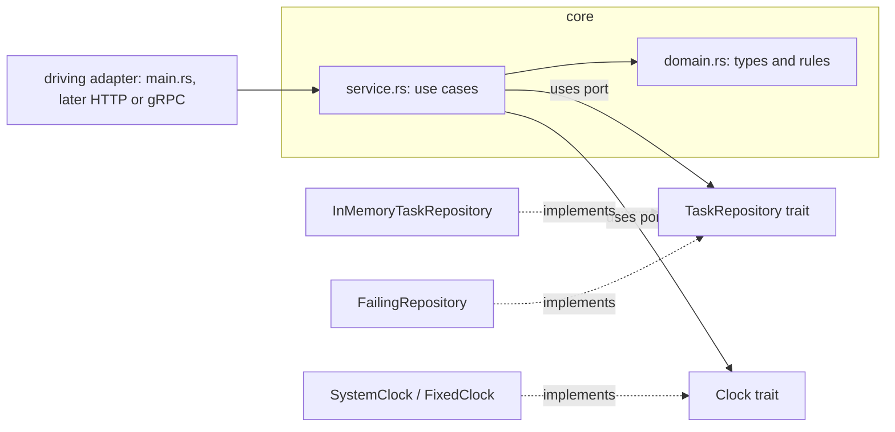

# 05. Hexagonal architecture in Rust

> **Draft: written but not yet run.** The code and the expected output in this lesson were prepared by reading the code and the official documentation. They have not been executed yet. If something does not behave as described, trust your tool's real output and report it.

## What you will be able to do
- Split a service into a domain core, ports (traits) and adapters, with dependencies pointing inward.
- Choose between generics (static dispatch) and `dyn` (dynamic dispatch) for a port, and justify it.
- Test application logic with fake adapters, and guard the dependency direction with a test.
- Decide when hexagonal architecture is worth its ceremony and when it is not.

## Recap
1. From Rust 201 lesson 02: when is `dyn Trait` better than a generic parameter?
   <details><summary>Answer</summary>When the set of implementing types is open or chosen at run time, or when different types must live in one collection.</details>
2. From lesson 04: what must a port's implementation be if the service is shared between threads?
   <details><summary>Answer</summary>`Send` (and `Sync` for shared `&` use), which can be added as supertrait bounds on the port.</details>

## Why it matters
Frameworks and databases change faster than business rules. If your pricing logic imports `sqlx` and `axum`, you cannot test it without a database, cannot move it to a batch job, and cannot upgrade a framework without touching it. **Hexagonal architecture** (also called ports and adapters) puts the rules in a core that depends on nothing, describes what the core needs from the outside as traits (**ports**), and implements those traits in separate **adapters**. Rust is a good fit: traits are the ports, generics make them free at run time, and crates and modules enforce boundaries.

## What you will build
A `hexagon` library with a task service. The core is `domain.rs` (types and the title rule) and `service.rs` (the use cases). The ports are two traits in `ports.rs`: `TaskRepository` and `Clock`. The adapters in `adapters.rs` are an in-memory repository, a repository that always fails, a system clock and a fixed clock. `main.rs` is the **composition root**: it picks adapters and wires them in. A test fails if the domain imports another layer.

## Before you start
- **Prerequisites:** Rust 301 lessons [01, advanced traits and type-state](../phase-1-advanced-language/01-advanced-traits-and-type-state.md) and [04, Send, Sync and fearless concurrency](../phase-1-advanced-language/04-send-sync-and-fearless-concurrency.md); Rust 201 lessons [02, traits and generics](../../201-hero-to-super-hero/phase-1-core-skills/02-traits-and-generics.md) and [09, testing Rust code](../../201-hero-to-super-hero/phase-4-quality-and-ship/09-testing-rust-code.md).
- Audience: finished lessons 01-04. This lesson uses only `std`.
- Target Rust/Cargo 1.100.0, edition 2024.
- Time: 70-90 min. Two sittings are fine; break after Step 5.
- Source pack (optional): every file is shown in full in this lesson, so you can follow without it. The finished code, the exercise starter and the solution are in the
  course repository https://github.com/Uee03/Code101 under `source/rust/301-super-hero-to-legendary/phase-2-architecture-and-performance/05-hexagonal-architecture/` (on that page choose **Code, Download ZIP**, or run
  `git clone https://github.com/Uee03/Code101.git`).
- Save every tab. No `Cargo.lock` is supplied: cargo creates it on first build.


Driving adapters (HTTP handlers, CLIs, message consumers) call the core. Driven adapters (databases, clocks, mail senders) are called *by* the core through ports. All arrows across the hexagon edge point at the core.

## Steps
### Step 1. Create the folders
**File: `terminal in any folder (Windows PowerShell)`**
```powershell
New-Item -ItemType Directory -Force "$HOME/code101/rust301/lesson05/src"
Set-Location "$HOME/code101/rust301/lesson05"
```

**File: `terminal in any folder (macOS/Linux)`**
```bash
mkdir -p "$HOME/code101/rust301/lesson05/src"
cd "$HOME/code101/rust301/lesson05"
```

### Step 2. The manifest
**File: `Cargo.toml`**
```toml
[package]
name = "hexagon"
version = "0.1.0"
edition = "2024"

[dependencies]

[lints.rust]
unsafe_code = "forbid"
```
There are no dependencies on purpose: the whole core and its ports compile with `std` only.

### Step 3. The domain (innermost layer)
Types and rules that a business expert would recognise. Nothing here knows about storage, time or I/O.

**File: `src/domain.rs`**
```rust
use std::fmt;

pub const MAX_TITLE_CHARS: usize = 40;

#[derive(Debug, Clone, PartialEq, Eq)]
pub struct Task {
    pub id: u32,
    pub title: String,
    pub created_at: u64,
    pub done: bool,
}

#[derive(Debug, Clone, PartialEq, Eq)]
pub enum TaskError {
    EmptyTitle,
    TitleTooLong { max: usize },
    NotFound(u32),
    Storage(String),
}

impl fmt::Display for TaskError {
    fn fmt(&self, f: &mut fmt::Formatter<'_>) -> fmt::Result {
        match self {
            TaskError::EmptyTitle => write!(f, "title is empty"),
            TaskError::TitleTooLong { max } => {
                write!(f, "title is longer than {max} characters")
            }
            TaskError::NotFound(id) => write!(f, "task {id} not found"),
            TaskError::Storage(reason) => write!(f, "storage failed: {reason}"),
        }
    }
}

impl std::error::Error for TaskError {}

/// Business rule: a title is trimmed, not empty and at most 40 characters long.
pub fn validate_title(raw: &str) -> Result<String, TaskError> {
    let title = raw.trim();
    if title.is_empty() {
        return Err(TaskError::EmptyTitle);
    }
    if title.chars().count() > MAX_TITLE_CHARS {
        return Err(TaskError::TitleTooLong {
            max: MAX_TITLE_CHARS,
        });
    }
    Ok(title.to_string())
}

#[cfg(test)]
mod tests {
    use super::*;

    #[test]
    fn titles_are_trimmed() {
        assert_eq!(validate_title("  hello  "), Ok("hello".to_string()));
    }

    #[test]
    fn blank_titles_are_rejected() {
        assert_eq!(validate_title(" \t "), Err(TaskError::EmptyTitle));
    }

    #[test]
    fn length_counts_characters_not_bytes() {
        let forty = "é".repeat(40);
        assert!(validate_title(&forty).is_ok());
        let forty_one = "é".repeat(41);
        assert_eq!(
            validate_title(&forty_one),
            Err(TaskError::TitleTooLong { max: 40 })
        );
    }
}
```
`TaskError::Storage(String)` carries a *reason as text*, not a database error type. The domain must not name `sqlx::Error`; an adapter converts its own errors into the domain's vocabulary at the boundary.

### Step 4. The ports
A port is a trait written **in the language of the core**: `insert`, `mark_done`, `list`, not `execute_sql`. The core owns these traits.

**File: `src/ports.rs`**
```rust
use crate::domain::{Task, TaskError};

/// Driven port: how the application stores tasks.
pub trait TaskRepository {
    fn insert(&mut self, title: &str, created_at: u64) -> Result<Task, TaskError>;
    fn mark_done(&mut self, id: u32) -> Result<Task, TaskError>;
    fn list(&self) -> Result<Vec<Task>, TaskError>;
}

/// Driven port: where the application gets the current time (seconds since 1970).
pub trait Clock {
    fn now(&self) -> u64;
}

// A boxed repository is a repository, so one service type serves both a concrete
// adapter chosen at compile time and a `Box<dyn TaskRepository>` chosen at run time.
impl<T: TaskRepository + ?Sized> TaskRepository for Box<T> {
    fn insert(&mut self, title: &str, created_at: u64) -> Result<Task, TaskError> {
        (**self).insert(title, created_at)
    }

    fn mark_done(&mut self, id: u32) -> Result<Task, TaskError> {
        (**self).mark_done(id)
    }

    fn list(&self) -> Result<Vec<Task>, TaskError> {
        (**self).list()
    }
}
```
The `Box<T>` impl is the bridge between the two dispatch styles; the table "Generics or `dyn` for a port?" in How it works explains the choice.

### Step 5. The adapters
**File: `src/adapters.rs`**
```rust
use std::time::{SystemTime, UNIX_EPOCH};

use crate::domain::{Task, TaskError};
use crate::ports::{Clock, TaskRepository};

#[derive(Debug, Default)]
pub struct InMemoryTaskRepository {
    tasks: Vec<Task>,
}

impl TaskRepository for InMemoryTaskRepository {
    fn insert(&mut self, title: &str, created_at: u64) -> Result<Task, TaskError> {
        let count = u32::try_from(self.tasks.len())
            .map_err(|_| TaskError::Storage("too many tasks".to_string()))?;
        let task = Task {
            id: count + 1,
            title: title.to_string(),
            created_at,
            done: false,
        };
        self.tasks.push(task.clone());
        Ok(task)
    }

    fn mark_done(&mut self, id: u32) -> Result<Task, TaskError> {
        match self.tasks.iter_mut().find(|task| task.id == id) {
            Some(task) => {
                task.done = true;
                Ok(task.clone())
            }
            None => Err(TaskError::NotFound(id)),
        }
    }

    fn list(&self) -> Result<Vec<Task>, TaskError> {
        Ok(self.tasks.clone())
    }
}

/// A repository whose storage is always down, to exercise the error path.
pub struct FailingRepository;

impl TaskRepository for FailingRepository {
    fn insert(&mut self, _title: &str, _created_at: u64) -> Result<Task, TaskError> {
        Err(TaskError::Storage("disk offline".to_string()))
    }

    fn mark_done(&mut self, _id: u32) -> Result<Task, TaskError> {
        Err(TaskError::Storage("disk offline".to_string()))
    }

    fn list(&self) -> Result<Vec<Task>, TaskError> {
        Err(TaskError::Storage("disk offline".to_string()))
    }
}

pub struct SystemClock;

impl Clock for SystemClock {
    fn now(&self) -> u64 {
        SystemTime::now()
            .duration_since(UNIX_EPOCH)
            .map(|elapsed| elapsed.as_secs())
            .unwrap_or(0)
    }
}

/// A clock that never moves, so tests and demos are deterministic.
pub struct FixedClock(pub u64);

impl Clock for FixedClock {
    fn now(&self) -> u64 {
        self.0
    }
}
```
A Postgres adapter would live in the same place (or its own crate), implement `TaskRepository` with SQL, and map `sqlx::Error` to `TaskError::Storage` (Rust 201 lesson 07 shows the SQL side; the [backend-rust capstone](../../../../capstones/backend-rust/README.md) shows a complete one).

### Step 6. The application service
The service orchestrates: validate with a domain rule, ask the clock, ask the repository. It is generic over both ports.

**File: `src/service.rs`**
```rust
use crate::domain::{Task, TaskError, validate_title};
use crate::ports::{Clock, TaskRepository};

/// The application service: orchestrates domain rules and ports, knows no adapter.
pub struct TaskService<R: TaskRepository, C: Clock> {
    repo: R,
    clock: C,
}

impl<R: TaskRepository, C: Clock> TaskService<R, C> {
    pub fn new(repo: R, clock: C) -> Self {
        TaskService { repo, clock }
    }

    pub fn add_task(&mut self, raw_title: &str) -> Result<Task, TaskError> {
        let title = validate_title(raw_title)?;
        self.repo.insert(&title, self.clock.now())
    }

    pub fn complete(&mut self, id: u32) -> Result<Task, TaskError> {
        self.repo.mark_done(id)
    }

    pub fn open_titles(&self) -> Result<Vec<String>, TaskError> {
        let tasks = self.repo.list()?;
        Ok(tasks
            .into_iter()
            .filter(|task| !task.done)
            .map(|task| task.title)
            .collect())
    }
}

#[cfg(test)]
mod tests {
    use super::*;
    use crate::adapters::{FailingRepository, FixedClock, InMemoryTaskRepository};

    #[test]
    fn add_validates_and_stamps_the_time() {
        let mut service = TaskService::new(InMemoryTaskRepository::default(), FixedClock(500));
        let task = service.add_task("  write tests  ").expect("valid title");
        assert_eq!((task.id, task.title.as_str(), task.created_at), (1, "write tests", 500));
        assert_eq!(service.add_task("   "), Err(TaskError::EmptyTitle));
    }

    #[test]
    fn completed_tasks_leave_the_open_list() {
        let mut service = TaskService::new(InMemoryTaskRepository::default(), FixedClock(1));
        service.add_task("one").expect("valid title");
        service.add_task("two").expect("valid title");
        service.complete(1).expect("task one exists");
        assert_eq!(service.open_titles(), Ok(vec!["two".to_string()]));
    }

    #[test]
    fn unknown_ids_are_not_found() {
        let mut service = TaskService::new(InMemoryTaskRepository::default(), FixedClock(1));
        assert_eq!(service.complete(9), Err(TaskError::NotFound(9)));
    }

    #[test]
    fn storage_failures_reach_the_caller() {
        let mut service = TaskService::new(FailingRepository, FixedClock(1));
        assert_eq!(
            service.add_task("valid"),
            Err(TaskError::Storage("disk offline".to_string()))
        );
    }

    #[test]
    fn the_same_service_works_with_a_boxed_trait_object() {
        let repo: Box<dyn TaskRepository> = Box::new(InMemoryTaskRepository::default());
        let mut service = TaskService::new(repo, FixedClock(1));
        assert!(service.add_task("boxed").is_ok());
    }
}
```
The tests need no database and no real clock; they run in milliseconds. That is the practical payoff.

### Step 7. The crate root and the architecture test
**File: `src/lib.rs`**
```rust
pub mod adapters;
pub mod domain;
pub mod ports;
pub mod service;

#[cfg(test)]
mod architecture_tests {
    // A fitness function: it fails the build when the domain starts importing other layers.
    #[test]
    fn domain_does_not_import_other_layers() {
        let source = include_str!("domain.rs");
        for layer in ["ports", "adapters", "service"] {
            assert!(
                !source.contains(&format!("crate::{layer}")),
                "domain.rs must not use crate::{layer}"
            );
        }
    }
}
```
`include_str!` embeds the text of `domain.rs` at compile time. A string test is crude but cheap. In a bigger system make the layers separate crates (a workspace): the domain crate then simply has no dependency on the others and Cargo itself rejects the import.

### Step 8. The composition root
**Predict before you run:** the third title is three spaces. Which message does it print, and does it reach the repository?

**File: `src/main.rs`**
```rust
use hexagon::adapters::{FailingRepository, FixedClock, InMemoryTaskRepository};
use hexagon::ports::TaskRepository;
use hexagon::service::TaskService;

fn main() {
    // Composition root: the only place that knows which adapters are used.
    let storage = std::env::args()
        .nth(1)
        .unwrap_or_else(|| "memory".to_string());
    let repo: Box<dyn TaskRepository> = match storage.as_str() {
        "failing" => Box::new(FailingRepository),
        _ => Box::new(InMemoryTaskRepository::default()),
    };
    let mut service = TaskService::new(repo, FixedClock(1_700_000_000));

    for title in ["Write hexagon lesson", "Review ports", "   "] {
        match service.add_task(title) {
            Ok(task) => println!(
                "added #{} \"{}\" at {}",
                task.id, task.title, task.created_at
            ),
            Err(err) => println!("rejected: {err}"),
        }
    }
    match service.complete(1) {
        Ok(task) => println!("completed #{}", task.id),
        Err(err) => println!("failed: {err}"),
    }
    match service.open_titles() {
        Ok(titles) => println!("open: {titles:?}"),
        Err(err) => println!("failed: {err}"),
    }
}
```
Here the adapter is chosen from a command-line word, so the type is only known at run time: that is the case for `Box<dyn TaskRepository>`.

## Run it
**File: `terminal in $HOME/code101/rust301/lesson05 (all platforms)`**
```powershell
cargo run --quiet
```
Expected output, not yet run (derived from the code):
```text
added #1 "Write hexagon lesson" at 1700000000
added #2 "Review ports" at 1700000000
rejected: title is empty
completed #1
open: ["Review ports"]
```
Now swap the adapter without touching the core:

**File: `terminal in $HOME/code101/rust301/lesson05 (all platforms)`**
```powershell
cargo run --quiet -- failing
```
Expected output, not yet run: the blank title is still rejected by the **domain** before storage is asked; the other calls fail in the **adapter**.
```text
rejected: storage failed: disk offline
rejected: storage failed: disk offline
rejected: title is empty
failed: storage failed: disk offline
failed: storage failed: disk offline
```
And the tests, which include the architecture check:

**File: `terminal in $HOME/code101/rust301/lesson05 (all platforms)`**
```powershell
cargo test
```
Expected result, not yet run: nine tests pass (three in `domain`, five in `service`, one in `architecture_tests`).

## How it works
**The dependency rule:** source-code dependencies point inward. `domain.rs` imports only `std`. `service.rs` imports the domain and the ports. `adapters.rs` imports the domain and the ports. Only `main.rs` imports adapters, and it is the only code allowed to know the whole picture.

**Who owns the trait?** The core. A port is shaped by what the core *needs*, not by what a database offers. If you design `TaskRepository` by copying the methods of your ORM you have the ORM, with extra steps.

### Generics or `dyn` for a port?
| | Generic `TaskService<R, C>` | `Box<dyn TaskRepository>` |
|---|---|---|
| Dispatch | static: the compiler knows the type, may inline | dynamic: one pointer call through a vtable |
| Binary | one copy of the service per type pair (code grows) | one copy |
| Choice made | at compile time | at run time (config, feature flag, tests swapping) |
| Trait rules | any trait, including generic methods and `async fn` | dyn-compatible traits only (no generic methods, no `Self` return, `async fn` needs a boxed future) |
| Errors | long generic types in messages | simple types |

Decision for this lesson (ADR style): *services are generic over ports in library code so tests use concrete fakes; the composition root may box adapters when the choice is made at run time.* The `Box<T>` impl makes both work with one service type. Revisit if compile times or binary size grow noticeably, measured (below).

For async ports, `async fn` in traits is supported in modern Rust, but such traits are not dyn-compatible; use generics, an enum of known adapters, or a boxed-future crate such as `async-trait` when you need dynamic dispatch. The cost of a vtable call is usually negligible next to a network or disk round trip; verify with lesson 06's method before arguing about it.

**Misconception:** "a trait with one implementation is a port". It is only an abstraction waiting to be proven. A port earns its keep when there are two real implementations (production and a fake count) or when it protects the core from a volatile dependency.

### When not to use hexagonal architecture
- A thin CRUD service where each handler maps a request to a SQL statement. The "domain" is the database, and ports add files without removing risk. Use a straightforward layered module and test it against a real database.
- Prototypes and scripts you will delete.
- When the team cannot yet read generic Rust comfortably: the indirection will cost more than it saves.
- Do not create one trait per struct "for testing". Mock the boundary (storage, clock, outbound HTTP), not every internal helper.

### Failure modes to review
- **Leaky ports:** a port returning `sqlx::Row` or `reqwest::Response`. Return domain types.
- **Anemic core:** all logic ends up in adapters because "it was easier". The test for this is whether business rules are testable with no adapter at all.
- **Error mapping loss:** an adapter that turns every database error into `Storage(String)` can hide cases the caller should handle (unique violation, timeout). Add variants when a caller needs to behave differently.
- **Transaction boundaries:** a port with three methods cannot express "do these three atomically". Add a unit-of-work style method or a port at the use-case level.
- **Time and randomness** are hidden dependencies; inject them (as `Clock`) or tests are flaky.

### Measurements to take
- Test speed: time `cargo test` with fakes versus the same cases against a real database; keep a small number of slow adapter tests and many fast core tests.
- Build impact of generics: `cargo build --timings` and release binary size before and after making a port generic; compare with the boxed variant.
- Layer leaks: a count of `use` lines that point from inner modules to outer ones (the fitness test above automates the most important one).

## Try it
### Rung 1. Guided practice
Implement a deterministic fake clock whose time advances on every call. It needs *interior mutability* because `Clock::now` takes `&self`.

**File: `terminal in any folder (Windows PowerShell)`**
```powershell
New-Item -ItemType Directory -Force "$HOME/code101/rust301/try05/src"
Set-Location "$HOME/code101/rust301/try05"
```

**File: `terminal in any folder (macOS/Linux)`**
```bash
mkdir -p "$HOME/code101/rust301/try05/src"
cd "$HOME/code101/rust301/try05"
```
Optional download route: copy the `starter` folder from `exercise` directly into `$HOME/code101/rust301` and rename the copy `try05`.

**File: `try05/Cargo.toml (starter)`**
```toml
[package]
name = "step_clock"
version = "0.1.0"
edition = "2024"

[dependencies]
```

**File: `try05/src/main.rs (starter)`**
```rust
use std::cell::Cell;

pub trait Clock {
    fn now(&self) -> u64;
}

/// A fake clock for tests: every call to now() returns the next step.
pub struct StepClock {
    next: Cell<u64>,
    step: u64,
}

impl StepClock {
    pub fn new(start: u64, step: u64) -> Self {
        StepClock {
            next: Cell::new(start),
            step,
        }
    }
}

impl Clock for StepClock {
    fn now(&self) -> u64 {
        // TODO: return the current value of `next`, then advance `next` by `step`.
        0
    }
}

pub fn stamp_all<C: Clock>(clock: &C, labels: &[&str]) -> Vec<String> {
    labels
        .iter()
        .map(|label| format!("{label}@{}", clock.now()))
        .collect()
}

fn main() {
    let clock = StepClock::new(100, 10);
    println!("{:?}", stamp_all(&clock, &["a", "b", "c"]));
    println!("next: {}", clock.now());
}
```
Run `cargo run --quiet`. The untouched starter prints `["a@0", "b@0", "c@0"]` and `next: 0`. Target output:
```text
["a@100", "b@110", "c@120"]
next: 130
```

### Rung 2. Change the behaviour
`Cell` is not `Sync` (lesson 04), so a `StepClock` cannot be shared between threads. Replace it with an `AtomicU64` and add `Send + Sync` as supertraits of `Clock`. What changes for existing implementors?

### Rung 3. Stretch (optional)
Write a short ADR (context, decision, consequences) for adding a Postgres adapter: do you add `sqlx` to this crate, to a new `hexagon-postgres` crate, or to a binary crate? State what the dependency graph looks like and how you would keep the domain free of `sqlx` types.

<details><summary>Solution for Rung 1</summary>

`Cargo.toml` is identical to the starter.

**File: `exercise/solution/src/main.rs`**
```rust
use std::cell::Cell;

pub trait Clock {
    fn now(&self) -> u64;
}

/// A fake clock for tests: every call to now() returns the next step.
pub struct StepClock {
    next: Cell<u64>,
    step: u64,
}

impl StepClock {
    pub fn new(start: u64, step: u64) -> Self {
        StepClock {
            next: Cell::new(start),
            step,
        }
    }
}

impl Clock for StepClock {
    fn now(&self) -> u64 {
        let current = self.next.get();
        self.next.set(current + self.step);
        current
    }
}

pub fn stamp_all<C: Clock>(clock: &C, labels: &[&str]) -> Vec<String> {
    labels
        .iter()
        .map(|label| format!("{label}@{}", clock.now()))
        .collect()
}

fn main() {
    let clock = StepClock::new(100, 10);
    println!("{:?}", stamp_all(&clock, &["a", "b", "c"]));
    println!("next: {}", clock.now());
}
```
</details>

## Check yourself
1. Who owns a port trait, the core or the adapter?
   <details><summary>Answer</summary>The core; it is written in the core's vocabulary and adapters implement it.</details>
2. Name one thing that works with generics but not with `dyn`.
   <details><summary>Answer</summary>Generic methods or returning `Self` in the trait (also `async fn` without boxing); also inlining across the call.</details>
3. Predict: in `cargo run --quiet -- failing`, why is `title is empty` printed instead of the storage error for the blank title?
   <details><summary>Answer</summary>`validate_title` runs in the core before the repository is called.</details>
4. What does the `domain_does_not_import_other_layers` test protect?
   <details><summary>Answer</summary>The dependency direction: the domain must not depend on ports, adapters or services.</details>
5. Give two situations where hexagonal architecture is not worth it.
   <details><summary>Answer</summary>Thin CRUD over a database where the database is the domain; short-lived prototypes.</details>

## Common mistakes
| Symptom | Cause | Fix |
|---|---|---|
| Typical message: "the trait `TaskRepository` is not dyn compatible" (wording varies) after adding a generic method | A dyn-incompatible method was added to a trait used as `dyn` | Remove the generic, use an associated type or enum, or keep that port generic |
| Typical message about `Box<dyn TaskRepository>` not implementing `TaskRepository` | The blanket `impl ... for Box<T>` was not added or `?Sized` is missing | Restore the impl in `ports.rs` with `T: ?Sized` |
| Domain starts importing `sqlx`, `serde_json` or `reqwest` types | A port leaked an adapter type | Map to domain types in the adapter |
| Tests are slow or flaky | The real clock, network or database is used in core tests | Inject fakes through ports |
| The architecture test passes though a layer is imported | The import is written with `super::` or a path the test does not look for | Extend the test or split layers into crates |
| Wrong project runs | Terminal not in `lesson05` | `cd "$HOME/code101/rust301/lesson05"` |

## Best practice
Define ports in the vocabulary of the core, depend inward only, and wire adapters in one composition root; use generics by default and `dyn` where the choice is made at run time. Source: [Rust API Guidelines: generics and trait objects](https://rust-lang.github.io/api-guidelines/flexibility.html) and [The Rust Book: trait objects](https://doc.rust-lang.org/book/ch18-02-trait-objects.html).

## Going further
- [The Rust Reference: dyn compatibility](https://doc.rust-lang.org/reference/items/traits.html#dyn-compatibility).
- [Microsoft Rust guidelines](https://microsoft.github.io/rust-guidelines/) for library design advice.
- The [backend-rust capstone](../../../../capstones/backend-rust/README.md): read its data layer chapter with this lesson in mind and write down where a port would go and what it would cost.

## Summary
- You separated a core (domain and service) from ports (traits) and adapters (implementations).
- You compared generics with `dyn` for a port and recorded the decision as an ADR.
- You tested use cases with fake adapters and guarded the dependency direction with a test.
- You listed when the pattern is not worth it and what to measure.

## Next lesson
[06. Performance and benchmarks](06-performance-and-benchmarks.md): measure allocation, loops and iterators with Criterion before changing code.
