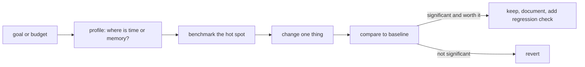

# 06. Performance and benchmarks

> **Draft: written but not yet run.** The code and the expected output in this lesson were prepared by reading the code and the official documentation. They have not been executed yet. If something does not behave as described, trust your tool's real output and report it.

## What you will be able to do
- Measure before changing code: write a Criterion benchmark and read its report.
- Count allocations with a small counting allocator and explain what `with_capacity` changes.
- Compare an explicit loop with an iterator chain and say when the difference matters.
- Set up a performance workflow: release builds, baselines, profiling and a regression budget.

## Recap
1. From Rust 201 lesson 03: what does an iterator adapter such as `map` do until you call `sum`?
   <details><summary>Answer</summary>Nothing: iterators are lazy; work happens when a consumer pulls items.</details>
2. From lesson 02: why does a custom `GlobalAlloc` need `unsafe impl`?
   <details><summary>Answer</summary>The compiler cannot check that it returns valid, aligned, non-overlapping memory; the implementer promises it.</details>

## Why it matters
Performance folklore ("iterators are slow", "clone is evil", "unsafe is faster") is wrong often enough to be dangerous and right often enough to survive. A 301 engineer does not argue; they measure. This lesson gives you one measurement tool for time (Criterion) and one for allocation (a counting allocator), then a workflow and a checklist. **This lesson prints no timing numbers on purpose:** the numbers depend on your CPU, compiler version, build profile and background load, so you must take them on your own machine.

## What you will build
A `perf_lab` crate with three pairs of functions (loop or iterator, `push` or `with_capacity`, `format!` or `push_str`), a program that proves the results agree and counts allocator calls, and a Criterion benchmark that times each pair.

## Before you start
- **Prerequisites:** Rust 301 lessons [02, unsafe Rust and FFI](../phase-1-advanced-language/02-unsafe-rust-and-ffi.md) and [04, Send, Sync and fearless concurrency](../phase-1-advanced-language/04-send-sync-and-fearless-concurrency.md); [Rust 201 lesson 03, iterators and closures](../../201-hero-to-super-hero/phase-1-core-skills/03-iterators-and-closures.md).
- Audience: finished lessons 01-05. [Rust 201 lesson 03](../../201-hero-to-super-hero/phase-1-core-skills/03-iterators-and-closures.md) (iterators) helps.
- Target Rust/Cargo 1.100.0, edition 2024. Direct dev-dependency: `criterion` 0.8.2 (minimum Rust 1.86 on crates.io), pinned exactly and checked for this draft; the first `cargo bench` downloads it and its dependencies. Criterion's default features draw charts with a pure-Rust library, so no extra program is needed for the HTML report.
- Time: 70-90 min including your own measurements. Benchmarks need a quiet machine: close browsers and builds first.
- Source pack (optional): every file is shown in full in this lesson, so you can follow without it. The finished code, the exercise starter and the solution are in the
  course repository https://github.com/Uee03/Code101 under `source/rust/301-super-hero-to-legendary/phase-2-architecture-and-performance/06-performance-and-benchmarks/` (on that page choose **Code, Download ZIP**, or run
  `git clone https://github.com/Uee03/Code101.git`).
- Save every tab. No `Cargo.lock` is supplied: cargo creates it on first build.

## Steps
### Step 1. Create the folders
**File: `terminal in any folder (Windows PowerShell)`**
```powershell
New-Item -ItemType Directory -Force "$HOME/code101/rust301/lesson06/src", "$HOME/code101/rust301/lesson06/benches"
Set-Location "$HOME/code101/rust301/lesson06"
```

**File: `terminal in any folder (macOS/Linux)`**
```bash
mkdir -p "$HOME/code101/rust301/lesson06/src" "$HOME/code101/rust301/lesson06/benches"
cd "$HOME/code101/rust301/lesson06"
```

### Step 2. The manifest
**File: `Cargo.toml`**
```toml
[package]
name = "perf_lab"
version = "0.1.0"
edition = "2024"

[dependencies]

[dev-dependencies]
criterion = "=0.8.2"

[[bench]]
name = "compare"
harness = false

[profile.release]
lto = "thin"
codegen-units = 1
debug = "line-tables-only"

[lints.rust]
unsafe_op_in_unsafe_fn = "deny"

[lints.clippy]
undocumented_unsafe_blocks = "deny"
```
- `[dev-dependencies]` are used only by tests, examples and benchmarks, never by your released program.
- `[[bench]] name = "compare"` declares the benchmark file `benches/compare.rs`. `harness = false` switches off Rust's built-in test harness for that file, because Criterion provides its own `main` (with the `criterion_main!` macro).
- `[profile.release]` shapes `cargo build --release` and `cargo bench`. `lto = "thin"` enables link-time optimisation across crates (usually faster code, longer link). `codegen-units = 1` lets LLVM see the whole crate at once (often faster code, slower compile, less parallelism). `debug = "line-tables-only"` keeps line numbers so profilers can show source lines without making the binary large. Each of these is a trade-off to **measure**, not a free win; Step "Measurements" below says how.
- The lint tables repeat lesson 02's unsafe policy because this lesson's `main.rs` has one `unsafe impl`.

### Step 3. The functions to compare
**File: `src/lib.rs`**
```rust
/// Sum of the squares of the even numbers, written as an explicit loop.
pub fn sum_even_squares_loop(values: &[u64]) -> u64 {
    let mut total = 0;
    for &value in values {
        if value % 2 == 0 {
            total += value * value;
        }
    }
    total
}

/// The same result written as an iterator chain.
pub fn sum_even_squares_iter(values: &[u64]) -> u64 {
    values
        .iter()
        .filter(|value| **value % 2 == 0)
        .map(|value| value * value)
        .sum()
}

/// Squares of 0..n, letting the vector grow as items are pushed.
pub fn squares_push(n: u32) -> Vec<u32> {
    let mut out = Vec::new();
    for i in 0..n {
        out.push(i * i);
    }
    out
}

/// Squares of 0..n, reserving the capacity first. `n` must be at most 65_535.
pub fn squares_with_capacity(n: u32) -> Vec<u32> {
    let mut out = Vec::with_capacity(n as usize);
    for i in 0..n {
        out.push(i * i);
    }
    out
}

/// Words followed by a comma each, rebuilding the whole string on every word.
pub fn join_words_format(words: &[&str]) -> String {
    let mut out = String::new();
    for word in words {
        out = format!("{out}{word},");
    }
    out
}

/// The same text built in one buffer that is sized up front.
pub fn join_words_push(words: &[&str]) -> String {
    let needed: usize = words.iter().map(|word| word.len() + 1).sum();
    let mut out = String::with_capacity(needed);
    for word in words {
        out.push_str(word);
        out.push(',');
    }
    out
}

#[cfg(test)]
mod tests {
    use super::*;

    #[test]
    fn loop_and_iterator_agree() {
        let values: Vec<u64> = (0..100).collect();
        assert_eq!(sum_even_squares_loop(&values), sum_even_squares_iter(&values));
        assert_eq!(sum_even_squares_loop(&[1, 2, 3, 4]), 20);
    }

    #[test]
    fn both_vector_builders_give_the_same_squares() {
        assert_eq!(squares_push(5), vec![0, 1, 4, 9, 16]);
        assert_eq!(squares_with_capacity(5), vec![0, 1, 4, 9, 16]);
    }

    #[test]
    fn both_joiners_give_the_same_text() {
        let words = ["a", "b", "c"];
        assert_eq!(join_words_format(&words), "a,b,c,");
        assert_eq!(join_words_push(&words), "a,b,c,");
        assert_eq!(join_words_push(&[]), "");
    }
}
```
Rule one of benchmarking: **prove the two versions compute the same thing** before timing them. A fast wrong function wins every race. The `squares_*` functions multiply `u32`, so `n` must stay small enough not to overflow (in a debug build overflow panics; in a release build it wraps silently, which is itself a failure mode to know).

### Step 4. The allocation counter
**Predict before you run:** the program makes four statements about the code. Which of the four do you expect to print `true`? Write your guesses down, then compare with the output.

**File: `src/main.rs`**
```rust
use std::alloc::{GlobalAlloc, Layout, System};
use std::sync::atomic::{AtomicUsize, Ordering};

use perf_lab::{
    join_words_format, join_words_push, squares_push, squares_with_capacity,
    sum_even_squares_iter, sum_even_squares_loop,
};

/// Counts every call into the allocator, then forwards the call to the system allocator.
struct CountingAllocator;

static ALLOCATOR_CALLS: AtomicUsize = AtomicUsize::new(0);

// SAFETY: every method forwards its arguments unchanged to `System`, which upholds the
// `GlobalAlloc` contract. The counter is an atomic, so it cannot cause a data race.
unsafe impl GlobalAlloc for CountingAllocator {
    unsafe fn alloc(&self, layout: Layout) -> *mut u8 {
        ALLOCATOR_CALLS.fetch_add(1, Ordering::Relaxed);
        // SAFETY: the caller of `alloc` guarantees that `layout` is valid for `System.alloc`.
        unsafe { System.alloc(layout) }
    }

    unsafe fn dealloc(&self, ptr: *mut u8, layout: Layout) {
        // SAFETY: the caller guarantees that `ptr` and `layout` match an earlier allocation.
        unsafe { System.dealloc(ptr, layout) }
    }

    unsafe fn realloc(&self, ptr: *mut u8, layout: Layout, new_size: usize) -> *mut u8 {
        ALLOCATOR_CALLS.fetch_add(1, Ordering::Relaxed);
        // SAFETY: the caller guarantees `ptr`, `layout` and `new_size` satisfy `realloc`'s rules.
        unsafe { System.realloc(ptr, layout, new_size) }
    }
}

#[global_allocator]
static GLOBAL: CountingAllocator = CountingAllocator;

/// Runs `work` and returns its result with the number of allocator calls it made.
fn calls_during<T>(work: impl FnOnce() -> T) -> (T, usize) {
    let before = ALLOCATOR_CALLS.load(Ordering::Relaxed);
    let result = work();
    let after = ALLOCATOR_CALLS.load(Ordering::Relaxed);
    (result, after - before)
}

fn main() {
    let values: Vec<u64> = (0..1000).collect();
    println!(
        "loop and iter agree: {}",
        sum_even_squares_loop(&values) == sum_even_squares_iter(&values)
    );

    let (_, push_calls) = calls_during(|| squares_push(1000));
    let (_, reserved_calls) = calls_during(|| squares_with_capacity(1000));
    println!("push made more than one allocator call: {}", push_calls > 1);
    println!(
        "with_capacity made exactly one allocator call: {}",
        reserved_calls == 1
    );

    let words = ["alpha", "beta", "gamma"];
    println!(
        "format! and push_str agree: {}",
        join_words_format(&words) == join_words_push(&words)
    );
}
```
- `#[global_allocator]` replaces the allocator for the whole program. Our `CountingAllocator` counts `alloc` and `realloc` calls (a growing `Vec` calls `realloc`) and forwards everything to the operating system's allocator (`System`).
- We print **comparisons**, not raw counts: "more than one" and "exactly one" are properties that follow from how `Vec` grows (it reserves a small initial capacity and then enlarges geometrically) and do not depend on a particular machine. The exact number of reallocations is an implementation detail of the standard library that may change between versions; do not hard-code it in a test.
- The counter is global, so counting in parallel tests would be flaky. That is why counting lives in `main` and not in unit tests.

### Step 5. The benchmark
**File: `benches/compare.rs`**
```rust
use std::hint::black_box;

use criterion::{Criterion, criterion_group, criterion_main};
use perf_lab::{
    join_words_format, join_words_push, squares_push, squares_with_capacity,
    sum_even_squares_iter, sum_even_squares_loop,
};

fn sums(c: &mut Criterion) {
    let values: Vec<u64> = (0..10_000).collect();
    let mut group = c.benchmark_group("even_squares");
    group.bench_function("loop", |b| b.iter(|| sum_even_squares_loop(black_box(&values))));
    group.bench_function("iter", |b| b.iter(|| sum_even_squares_iter(black_box(&values))));
    group.finish();
}

fn vectors(c: &mut Criterion) {
    let mut group = c.benchmark_group("squares");
    group.bench_function("push", |b| b.iter(|| squares_push(black_box(1000))));
    group.bench_function("with_capacity", |b| {
        b.iter(|| squares_with_capacity(black_box(1000)))
    });
    group.finish();
}

fn strings(c: &mut Criterion) {
    let words = ["alpha", "beta", "gamma", "delta", "epsilon", "zeta", "eta", "theta"];
    let mut group = c.benchmark_group("join_words");
    group.bench_function("format", |b| b.iter(|| join_words_format(black_box(&words))));
    group.bench_function("push_str", |b| b.iter(|| join_words_push(black_box(&words))));
    group.finish();
}

criterion_group!(benches, sums, vectors, strings);
criterion_main!(benches);
```
- `black_box` hides a value from the optimiser. Without it, the compiler may notice that the input is constant, compute the answer at compile time and delete the loop, and you would be timing nothing.
- `b.iter(|| ...)` runs the closure many times and Criterion measures it statistically: warm-up, many samples, then confidence intervals.
- A benchmark group puts related measurements side by side in the report.
- The benchmark runs in a **release-like** profile (`cargo bench` uses the `bench` profile, which inherits `release`). Never benchmark a debug build: debug code can be an order of magnitude slower, and optimisations change *which* version wins.

## Run it
**File: `terminal in $HOME/code101/rust301/lesson06 (all platforms)`**
```powershell
cargo run --release --quiet
```
Expected output, not yet run (derived from the code and the documented behaviour of `Vec`):
```text
loop and iter agree: true
push made more than one allocator call: true
with_capacity made exactly one allocator call: true
format! and push_str agree: true
```
Run the tests and then the benchmark (the benchmark takes a while because it takes many samples per case):

**File: `terminal in $HOME/code101/rust301/lesson06 (all platforms)`**
```powershell
cargo test
cargo bench
```
Expected result of `cargo test`, not yet run: three tests pass. Expected shape of `cargo bench`: for each of the six cases a block that names the case and a line of the form below, where the three values are the lower bound, the estimate and the upper bound of a confidence interval on **your** machine. After the first run, later runs also print a line comparing with the previous run (change in time and whether it is statistically significant). No numbers are shown here because none were measured.
```text
even_squares/loop       time:   [LOW  ESTIMATE  HIGH]
```
Criterion also writes an HTML report to `target/criterion/report/index.html`; open it in a browser.

## How it works
**The measurement protocol (do this every time):**
1. **State the question and the budget**: "p99 latency of this endpoint must stay under X ms" or "this batch must finish within the nightly window". Without a target you will optimise forever.
2. **Profile first** to find where time goes (a sampling profiler or flame graph: `perf` on Linux, Windows Performance Recorder or Visual Studio profiler on Windows, Instruments on macOS; `cargo flamegraph` and `samply` are separate tools you can install). A micro-benchmark answers "which of these two is faster", the profiler answers "what is worth optimising".
3. **Write the benchmark with realistic input sizes and data.** A function that is fast on 8 elements may lose on 8 million; use several sizes (Criterion's `BenchmarkId` lets one group sweep sizes).
4. **Prove equivalence** with a test (done above).
5. **Release build, quiet machine, same power mode.** Laptops throttle; virtual machines are noisy; CI runners vary between jobs.
6. **Save a baseline, change one thing, compare.** `cargo bench -- --save-baseline before`, edit, then `cargo bench -- --baseline before`. Criterion reports whether the change is significant.
7. **Check the cost elsewhere**: binary size, compile time, memory, readability.
8. **Write down the result** (ADR style) including the hardware and compiler version, so the next person can reproduce it.

**Loops versus iterators.** In Rust, iterator chains are *zero-cost abstractions*: the compiler usually generates the same machine code as the hand-written loop, and sometimes better code because it can prove bounds checks are unnecessary. "Usually" is the key word; the benchmark above lets you see the answer for your compiler and CPU. Choose by clarity first. When a hot loop is ten lines of index arithmetic, the iterator version is often shorter and as fast.

**Allocation.** Each `Vec` growth step asks the allocator for a bigger block and copies the old contents; `with_capacity` asks once when you know the size. `format!("{out}{word},")` allocates a brand new `String` and copies the old text each time, so building a long string this way takes time that grows with the *square* of the number of words; `push_str` into a sized buffer is linear. Other allocation levers, each to be measured before use: reuse a buffer across iterations (`clear()` keeps capacity), borrow instead of clone (`&str`, `Cow<str>`), `Vec::extend` instead of repeated `push`, an arena or small-vector crate for many short-lived objects.

**Build profile levers** (all trade something): `opt-level` (3 is fastest code, `"s"` or `"z"` smaller code), `lto`, `codegen-units`, `panic = "abort"` (smaller and sometimes faster, but panics no longer unwind, so `catch_unwind` and destructors on panic stop working), and `RUSTFLAGS="-C target-cpu=native"` (can be faster, but the binary may crash with an illegal-instruction error on an older CPU: never ship it to unknown hardware).

**Misconception:** "if it is faster in the micro-benchmark, it is faster in the program". Micro-benchmarks keep data hot in the CPU cache and run in isolation; the real program shares caches, allocators and locks. Confirm in an end-to-end measurement.



### When not to optimise
- Before you have a measured problem, a target and a profile.
- When the code runs once at start-up, or waits on a network or disk (the CPU is idle; optimise the round trips, not the loop).
- When the change makes the code unsafe or unreadable for a few percent. Lesson 02's rule applies: unsafe needs a measured, material gain.
- When the "slow" part is in a dependency; check for a configuration option, then an alternative crate, then your own code, in that order.

### Failure modes to review
- Benchmarking a debug build, or benchmarking with a constant that the optimiser folds away (no `black_box`).
- Comparing runs taken on different power states, with background load, or after the machine cooled or heated.
- A benchmark that includes setup (allocating test data inside the timed closure) or excludes real costs (the clone you forgot).
- Optimising average time when the requirement is tail latency (p99); averages hide the pauses that users notice.
- Regressions that nobody notices: add a benchmark job that compares to a stored baseline and flags large changes. Hosted CI machines are noisy, so use a generous threshold and run the benchmark on dedicated hardware if it gates releases.

### Production checklist: performance
- [ ] Budgets stated per endpoint or job (latency percentile, throughput, memory).
- [ ] Release profile reviewed with measurements (`lto`, `codegen-units`, `opt-level`, `panic`).
- [ ] Hot paths have a benchmark; changes record before and after on named hardware.
- [ ] Allocation-heavy paths reviewed (`with_capacity`, buffer reuse, avoid needless `clone`).
- [ ] A profile (flame graph) of the real service under realistic load is stored with the release notes.
- [ ] `target-cpu=native` is not used for artefacts that run elsewhere.

### Measurements to take (your homework from this lesson)
1. Run `cargo bench` three times on a quiet machine and note the spread between runs.
2. Change `lto` to `false` and `codegen-units` to `16` in `[profile.release]` and compare build time and benchmark results against the baseline.
3. Make the string benchmark use 8, 80 and 800 words; plot time against count for `format` and `push_str`.
4. Count allocator calls for your own function with `calls_during`.

## Try it
### Rung 1. Guided practice
Rewrite `csv_line` so that it builds the result in one `String` with exactly the capacity it needs.

**File: `terminal in any folder (Windows PowerShell)`**
```powershell
New-Item -ItemType Directory -Force "$HOME/code101/rust301/try06/src"
Set-Location "$HOME/code101/rust301/try06"
```

**File: `terminal in any folder (macOS/Linux)`**
```bash
mkdir -p "$HOME/code101/rust301/try06/src"
cd "$HOME/code101/rust301/try06"
```
Optional download route: copy the `starter` folder from `exercise` directly into `$HOME/code101/rust301` and rename the copy `try06`.

**File: `try06/Cargo.toml (starter)`**
```toml
[package]
name = "csv_line"
version = "0.1.0"
edition = "2024"

[dependencies]
```

**File: `try06/src/main.rs (starter)`**
```rust
/// Joins fields with commas, so ["a", "b"] becomes "a,b".
/// This starter allocates a String per field plus a Vec for the list.
pub fn csv_line(fields: &[&str]) -> String {
    // TODO: build the result in ONE String created with the exact capacity needed,
    // using push_str and push. Do not allocate anything else.
    fields
        .iter()
        .map(|field| field.to_string())
        .collect::<Vec<String>>()
        .join(",")
}

fn main() {
    println!("{}", csv_line(&["id", "name", "role"]));
    println!("[{}]", csv_line(&[]));
    println!("{}", csv_line(&["only"]));
}

#[cfg(test)]
mod tests {
    use super::*;

    #[test]
    fn joins_with_commas() {
        assert_eq!(csv_line(&["a", "b", "c"]), "a,b,c");
    }

    #[test]
    fn handles_empty_and_single_lists() {
        assert_eq!(csv_line(&[]), "");
        assert_eq!(csv_line(&["x"]), "x");
    }
}
```
The starter already prints the right text, because the *output does not change*; only the allocation behaviour does. Run `cargo run --quiet` and `cargo test` before and after your edit: both must stay green. Target output (before and after):
```text
id,name,role
[]
only
```

### Rung 2. Change the behaviour
Add Criterion to `try06` (the manifest lines from Step 2 and a `benches/` file) and benchmark the starter against your version with 3, 300 and 30,000 fields. Report the three results as ratios, with your hardware and `rustc --version`.

### Rung 3. Stretch (optional)
Your version is not safe CSV: a field containing a comma, a quote or a newline corrupts the row, and a field starting with `=` can run as a formula when the file is opened in a spreadsheet. Write down the rules a correct writer must follow, and decide whether to implement them or use a maintained CSV crate. Which choice would you defend in review, and why?

<details><summary>Solution for Rung 1</summary>

`Cargo.toml` is identical to the starter.

**File: `exercise/solution/src/main.rs`**
```rust
/// Joins fields with commas, so ["a", "b"] becomes "a,b".
/// One String with the exact capacity: a single allocation.
pub fn csv_line(fields: &[&str]) -> String {
    let separators = fields.len().saturating_sub(1);
    let needed: usize = fields.iter().map(|field| field.len()).sum::<usize>() + separators;
    let mut line = String::with_capacity(needed);
    for (index, field) in fields.iter().enumerate() {
        if index > 0 {
            line.push(',');
        }
        line.push_str(field);
    }
    line
}

fn main() {
    println!("{}", csv_line(&["id", "name", "role"]));
    println!("[{}]", csv_line(&[]));
    println!("{}", csv_line(&["only"]));
}

#[cfg(test)]
mod tests {
    use super::*;

    #[test]
    fn joins_with_commas() {
        assert_eq!(csv_line(&["a", "b", "c"]), "a,b,c");
    }

    #[test]
    fn handles_empty_and_single_lists() {
        assert_eq!(csv_line(&[]), "");
        assert_eq!(csv_line(&["x"]), "x");
    }
}
```
`saturating_sub(1)` avoids underflow for an empty list (there are no separators). The capacity is the sum of the field lengths plus one comma between each pair.
</details>

## Check yourself
1. Why does the benchmark call `black_box`?
   <details><summary>Answer</summary>To stop the optimiser from folding constant inputs and removing the work being timed.</details>
2. Why does the lesson print `push_calls > 1` and not the exact count?
   <details><summary>Answer</summary>The exact number of reallocations is an implementation detail of `Vec` growth; the comparison is what follows from the design and what the lesson can state without measuring.</details>
3. Predict: why is repeated `out = format!("{out}{word},")` slower than `push_str` as the word list grows?
   <details><summary>Answer</summary>Each step allocates and copies the whole string so far, so the total work grows with the square of the length.</details>
4. Name two reasons a micro-benchmark result may not hold in production.
   <details><summary>Answer</summary>Cache and allocator state differ; real inputs differ; contention and I/O are absent; the machine or build profile differs.</details>
5. Why is `target-cpu=native` dangerous for a released binary?
   <details><summary>Answer</summary>It may use CPU instructions that older machines lack, causing illegal-instruction crashes.</details>

## Common mistakes
| Symptom | Cause | Fix |
|---|---|---|
| Benchmark results look absurdly fast | Work optimised away (no `black_box`), or the input is a constant | Wrap inputs (and sometimes outputs) in `black_box` |
| Results differ wildly between runs | Debug build, background load, power saving, noisy VM | Release profile, quiet machine, repeat and compare spreads |
| Typical message: "can't find crate for `criterion`" in `benches/` | Criterion missing from `[dev-dependencies]` | Add it as in Step 2 |
| Typical message: benchmark target runs the default harness and shows "no tests" | `harness = false` missing from `[[bench]]` | Add `harness = false` |
| `cargo bench` seems to hang for a minute | Criterion collects many samples per case | Wait, or use `-- --quick` for a rough look (less reliable) |
| The counting allocator reports different counts in a test | Parallel tests share the global counter | Count in a single-threaded program, as `main` does |
| Wrong project runs | Terminal not in `lesson06` | `cd "$HOME/code101/rust301/lesson06"` |

## Best practice
Profile to find the hot spot, benchmark in release mode with `black_box`, change one thing at a time, compare to a saved baseline, and record hardware and compiler version with the result. Source: [The Rust Performance Book](https://nnethercote.github.io/perf-book/benchmarking.html) and [Criterion.rs user guide](https://criterion-rs.github.io/book/index.html); build-profile settings: [The Cargo Book: profiles](https://doc.rust-lang.org/cargo/reference/profiles.html).

## Going further
- [Microsoft Rust guidelines](https://microsoft.github.io/rust-guidelines/): performance and library guidance for production Rust.
- [Rust Reference: the `global_allocator` attribute](https://doc.rust-lang.org/reference/runtime.html#the-global_allocator-attribute) and [`std::alloc::GlobalAlloc`](https://doc.rust-lang.org/std/alloc/trait.GlobalAlloc.html).
- [`std::hint::black_box`](https://doc.rust-lang.org/std/hint/fn.black_box.html), including its caveats.

## Summary
- You wrote a Criterion benchmark and learned how to read its report without trusting a single run.
- You counted allocator calls with a counting allocator and explained the effect of `with_capacity`.
- You compared a loop with an iterator chain and an `O(n^2)` string build with a linear one, and listed when each result may not transfer.
- You have a performance workflow and a production checklist, and a list of measurements to take yourself.

## Next lesson
[07. gRPC with tonic](07-grpc-with-tonic.md): define a service in a `.proto` file and generate Rust client and server code with a build script.
