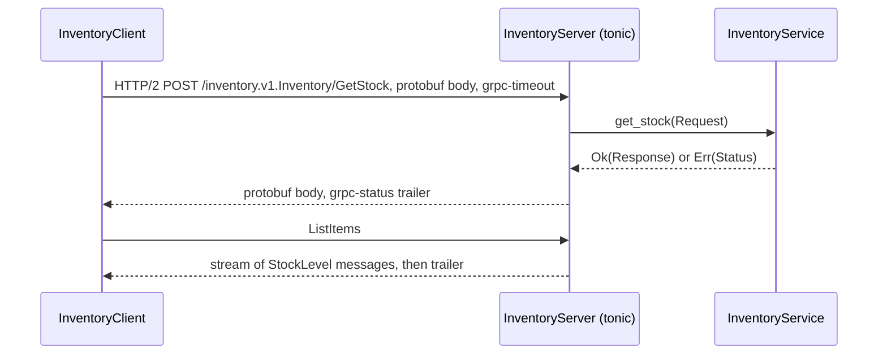

# 07. gRPC with tonic

> **Draft: written but not yet run.** The code and the expected output in this lesson were prepared by reading the code and the official documentation. They have not been executed yet. If something does not behave as described, trust your tool's real output and report it.

## What you will be able to do
- Write a `.proto` file with a unary and a server-streaming call and evolve it without breaking clients.
- Generate Rust client and server code with a build script and implement the service trait.
- Map errors to gRPC status codes, set a client deadline and shut a server down gracefully.
- Decide between gRPC and a REST/JSON API and list the production settings gRPC needs.

## Recap
1. From lesson 02: what does a build script do and when does Cargo run it?
   <details><summary>Answer</summary>It is a Rust program (`build.rs`) compiled and run before the crate; Cargo reruns it when its inputs named by `rerun-if-changed` change.</details>
2. From Rust 201 lesson 05: why must a spawned task own its data?
   <details><summary>Answer</summary>It may outlive the caller, so it cannot borrow locals.</details>
3. From lesson 05: which side owns a port trait, and what does the generated `Inventory` trait become in a hexagon?
   <details><summary>Answer</summary>The core owns ports. The generated trait is part of a *driving adapter*: it translates gRPC messages into calls on the application service.</details>

## Why it matters
Services in a company talk to each other thousands of times per second. gRPC gives them a typed contract (`.proto`), compact binary messages, streaming, deadlines and code generation for many languages over HTTP/2. In Rust, **tonic** generates traits you implement and clients you call, on top of Tokio. It is the usual choice for internal service-to-service calls, and a poor choice for public browser APIs. A 301 engineer knows both sides of that statement.

## What you will build
An `inventory_grpc` crate with a protobuf service `inventory.v1.Inventory` (one unary call `GetStock`, one server-streaming call `ListItems`), a `build.rs` that generates the Rust code, an implementation that returns proper status codes, and a `main` that starts the server on a free loopback port, calls it as a client, and stops it.

## Before you start
- **Prerequisites:** Rust 301 lessons [02, unsafe Rust and FFI](../phase-1-advanced-language/02-unsafe-rust-and-ffi.md) and [05, hexagonal architecture](05-hexagonal-architecture.md); [Rust 201 lesson 05, async Rust and Tokio](../../201-hero-to-super-hero/phase-2-async-and-web/05-async-rust-and-tokio.md).
- Audience: finished lessons 05 and 06 and Rust 201 lessons [05, async Rust and Tokio](../../201-hero-to-super-hero/phase-2-async-and-web/05-async-rust-and-tokio.md) and [06, a web API with Axum](../../201-hero-to-super-hero/phase-2-async-and-web/06-a-web-api-with-axum.md).
- Target Rust/Cargo 1.100.0, edition 2024. Direct crates, all pinned exactly and checked on crates.io for this draft (not a claim that they are the latest or advisory-free): `tonic` 0.14.9, `tonic-prost` 0.14.9, `prost` 0.14.6, `tokio` 1.54.1, `tokio-stream` 0.1.19; build-time: `tonic-prost-build` 0.14.9 and `protoc-bin-vendored` 3.3.0.
- The first build downloads and compiles many crates; allow several minutes. No separate install of `protoc` is needed because `protoc-bin-vendored` supplies it (a prebuilt executable; see the supply-chain note below).
- Time: 75-95 min. Two sittings are fine; break after Step 5.
- Source pack (optional): every file is shown in full in this lesson, so you can follow without it. The finished code, the exercise starter and the solution are in the
  course repository https://github.com/Uee03/Code101 under `source/rust/301-super-hero-to-legendary/phase-2-architecture-and-performance/07-grpc-with-tonic/` (on that page choose **Code, Download ZIP**, or run
  `git clone https://github.com/Uee03/Code101.git`).
- Save every tab. No `Cargo.lock` is supplied: cargo creates it on first build and you should commit it for an application.
- The program opens a TCP port on `127.0.0.1` only (your own machine) and closes it when it ends. It is not reachable from other computers.

## Steps
### Step 1. Create the folders
**File: `terminal in any folder (Windows PowerShell)`**
```powershell
New-Item -ItemType Directory -Force "$HOME/code101/rust301/lesson07/src", "$HOME/code101/rust301/lesson07/proto"
Set-Location "$HOME/code101/rust301/lesson07"
```

**File: `terminal in any folder (macOS/Linux)`**
```bash
mkdir -p "$HOME/code101/rust301/lesson07/src" "$HOME/code101/rust301/lesson07/proto"
cd "$HOME/code101/rust301/lesson07"
```

### Step 2. The manifest
**File: `Cargo.toml`**
```toml
[package]
name = "inventory_grpc"
version = "0.1.0"
edition = "2024"

[dependencies]
prost = "=0.14.6"
tokio = { version = "=1.54.1", features = ["macros", "rt-multi-thread", "net", "sync"] }
tokio-stream = { version = "=0.1.19", features = ["net"] }
tonic = "=0.14.9"
tonic-prost = "=0.14.9"

[build-dependencies]
protoc-bin-vendored = "=3.3.0"
tonic-prost-build = "=0.14.9"
```
- `tonic` is the gRPC runtime (server, client, `Status`). `prost` implements Protocol Buffers messages; the generated code derives `prost::Message`. `tonic-prost` connects the two (the codec).
- `tokio` features: `macros` for `#[tokio::main]` and `#[tokio::test]`, `rt-multi-thread` for the runtime, `net` for `TcpListener`, `sync` for the `oneshot` channel.
- `tokio-stream` with `net` provides `TcpListenerStream`, which adapts a listener to the stream type the server wants, and the `iter` helper used for the response stream.
- `[build-dependencies]` run at build time only: `tonic-prost-build` generates Rust from `.proto`, and `protoc-bin-vendored` provides the `protoc` compiler binary.

### Step 3. The contract
The `.proto` file is the contract and the single source of truth. Every language generates its code from this file.

**File: `proto/inventory.proto`**
```proto
syntax = "proto3";

package inventory.v1;

// Stock levels for the items of a warehouse.
service Inventory {
  // Returns the stock level of one item. Fails with NOT_FOUND for an unknown item
  // and with INVALID_ARGUMENT for an empty or too long item id.
  rpc GetStock(GetStockRequest) returns (StockLevel);

  // Streams the stock level of every known item, ordered by item id.
  rpc ListItems(ListItemsRequest) returns (stream StockLevel);
}

message GetStockRequest {
  string item_id = 1;
}

message ListItemsRequest {}

message StockLevel {
  string item_id = 1;
  uint32 quantity = 2;

  // Field 3 once existed and was removed. Reserving it stops anyone from reusing the
  // number or the name with a different meaning, which would corrupt old clients.
  reserved 3;
  reserved "reorder_point";
}
```
Line by line:
- `syntax = "proto3";` selects the language version of the file format.
- `package inventory.v1;` namespaces the messages and becomes part of every call's URL path (`/inventory.v1.Inventory/GetStock`). The `v1` is your major API version: a breaking redesign becomes `inventory.v2`, served beside `v1` during migration.
- `service Inventory { rpc ... }` declares calls. `returns (stream StockLevel)` makes `ListItems` **server-streaming**: one request, many responses. (The other two shapes are client-streaming and bidirectional; tonic supports all four.)
- Each `message` is a record. The numbers `= 1`, `= 2` are **field numbers**; they, not the names, identify fields on the wire. **Never change or reuse a field number.** To remove a field, delete it and `reserved` its number and name, as shown.
- `ListItemsRequest {}` is an empty message because every rpc needs a request type, and an empty one can gain fields later without breaking callers (do not use a bare scalar as a request for that reason).
- proto3 fields all have defaults (empty string, 0): a missing `item_id` is indistinguishable from an empty one, which is why the server validates it.

### Step 4. The build script
**File: `build.rs`**
```rust
fn main() -> Result<(), Box<dyn std::error::Error>> {
    println!("cargo::rerun-if-changed=proto/inventory.proto");

    // Use the protoc compiler shipped by protoc-bin-vendored, so no separate install is needed.
    let protoc = protoc_bin_vendored::protoc_bin_path()?;
    // SAFETY: a build script runs this code on its single main thread before any other thread
    // exists, so nothing can read the environment while it is being changed.
    unsafe {
        std::env::set_var("PROTOC", protoc);
    }

    tonic_prost_build::compile_protos("proto/inventory.proto")?;
    Ok(())
}
```
- `cargo::rerun-if-changed` reruns code generation only when the `.proto` file changes.
- `PROTOC` is the environment variable that the prost build tooling reads to find the compiler. In edition 2024 `set_var` is `unsafe` because changing the environment while another thread reads it is undefined behaviour; a build script's `main` is single-threaded here, which the comment says (lesson 02's rule: write the argument).
- `compile_protos` runs `protoc` and writes `inventory.v1.rs` into Cargo's build output folder (`OUT_DIR`). It generates message structs, a **client** `inventory_client::InventoryClient`, a **server trait** `inventory_server::Inventory` and a wrapper `inventory_server::InventoryServer`.
- **Supply-chain note:** `protoc-bin-vendored` ships prebuilt `protoc` binaries inside a crate. That is convenient and means your build runs an executable that you did not compile. Lesson 08 shows how to review such dependencies. If your organisation forbids it, install `protoc` from your platform's package manager or the official release, set `PROTOC` yourself, and remove the `protoc-bin-vendored` dependency together with the `let protoc` line and the `unsafe` block from `build.rs`.

### Step 5. The service implementation
This is the driving-adapter layer of lesson 05: it translates a gRPC call into work on your own data and returns gRPC status codes.

**Predict before you run:** the `main` in Step 6 asks for `widget`, `missing` and the empty string. Which status code do you expect for each, and from which line of this file does it come?

**File: `src/lib.rs`**
```rust
use std::collections::BTreeMap;

use tonic::{Request, Response, Status};

pub mod pb {
    tonic::include_proto!("inventory.v1");
}

use pb::inventory_server::Inventory;
use pb::{GetStockRequest, ListItemsRequest, StockLevel};

const MAX_ITEM_ID_LEN: usize = 64;

/// In-memory implementation of the generated `Inventory` service trait.
pub struct InventoryService {
    items: BTreeMap<String, u32>,
}

impl InventoryService {
    pub fn new(items: BTreeMap<String, u32>) -> Self {
        InventoryService { items }
    }
}

#[tonic::async_trait]
impl Inventory for InventoryService {
    async fn get_stock(
        &self,
        request: Request<GetStockRequest>,
    ) -> Result<Response<StockLevel>, Status> {
        let item_id = request.into_inner().item_id;
        if item_id.is_empty() || item_id.len() > MAX_ITEM_ID_LEN {
            return Err(Status::invalid_argument(
                "item_id must be 1 to 64 characters",
            ));
        }
        match self.items.get(&item_id) {
            Some(quantity) => Ok(Response::new(StockLevel {
                item_id,
                quantity: *quantity,
            })),
            None => Err(Status::not_found(format!("unknown item {item_id}"))),
        }
    }

    type ListItemsStream = tokio_stream::Iter<std::vec::IntoIter<Result<StockLevel, Status>>>;

    async fn list_items(
        &self,
        _request: Request<ListItemsRequest>,
    ) -> Result<Response<Self::ListItemsStream>, Status> {
        let levels: Vec<Result<StockLevel, Status>> = self
            .items
            .iter()
            .map(|(item_id, quantity)| {
                Ok(StockLevel {
                    item_id: item_id.clone(),
                    quantity: *quantity,
                })
            })
            .collect();
        Ok(Response::new(tokio_stream::iter(levels)))
    }
}

#[cfg(test)]
mod tests {
    use super::*;
    use tokio_stream::StreamExt;

    fn service() -> InventoryService {
        InventoryService::new(BTreeMap::from([
            ("widget".to_string(), 12),
            ("gadget".to_string(), 0),
            ("gizmo".to_string(), 3),
        ]))
    }

    fn request(item_id: &str) -> Request<GetStockRequest> {
        Request::new(GetStockRequest {
            item_id: item_id.to_string(),
        })
    }

    #[tokio::test]
    async fn a_known_item_returns_its_quantity() {
        let reply = service().get_stock(request("widget")).await.expect("known item");
        assert_eq!(reply.into_inner().quantity, 12);
    }

    #[tokio::test]
    async fn an_unknown_item_is_not_found() {
        let status = service().get_stock(request("nope")).await.expect_err("unknown item");
        assert_eq!(status.code(), tonic::Code::NotFound);
    }

    #[tokio::test]
    async fn an_empty_id_is_an_invalid_argument() {
        let status = service().get_stock(request("")).await.expect_err("empty id");
        assert_eq!(status.code(), tonic::Code::InvalidArgument);
    }

    #[tokio::test]
    async fn the_stream_is_ordered_by_item_id() {
        let stream = service()
            .list_items(Request::new(ListItemsRequest {}))
            .await
            .expect("list")
            .into_inner();
        let levels: Vec<StockLevel> = stream
            .map(|item| item.expect("no stream error"))
            .collect()
            .await;
        let ids: Vec<&str> = levels.iter().map(|level| level.item_id.as_str()).collect();
        assert_eq!(ids, ["gadget", "gizmo", "widget"]);
    }
}
```
- `tonic::include_proto!("inventory.v1")` pastes the generated file into `mod pb`. The argument is the **proto package name**, not a file name.
- `#[tonic::async_trait]` lets a trait have `async fn` methods that work behind a pointer (it boxes the returned future). The trait was generated from your `service` block.
- Every method receives a `Request<T>` (message plus metadata, the gRPC equivalent of headers) and returns `Result<Response<T>, Status>`. A `Status` carries a **code** and a message. `invalid_argument` and `not_found` map to the standard gRPC codes `INVALID_ARGUMENT` and `NOT_FOUND`; clients on any language see the same codes.
- For a server-streaming call the response type is a stream. We use `tokio_stream::iter` on a vector, which is fine for a bounded list. For large or slow sources use a bounded `tokio::sync::mpsc` channel wrapped in `ReceiverStream`, so a slow client applies back-pressure instead of making the server buffer everything.
- The tests call the trait methods directly, with no network: a unit test of the adapter's logic. `#[tokio::test]` provides a runtime for each async test.

### Step 6. The program: server and client in one process
**File: `src/main.rs`**
```rust
use std::collections::BTreeMap;
use std::time::Duration;

use inventory_grpc::InventoryService;
use inventory_grpc::pb::inventory_client::InventoryClient;
use inventory_grpc::pb::inventory_server::InventoryServer;
use inventory_grpc::pb::{GetStockRequest, ListItemsRequest};
use tokio::net::TcpListener;
use tokio::sync::oneshot;
use tokio_stream::wrappers::TcpListenerStream;
use tonic::Request;
use tonic::transport::Server;

#[tokio::main]
async fn main() -> Result<(), Box<dyn std::error::Error>> {
    let items = BTreeMap::from([
        ("widget".to_string(), 12),
        ("gadget".to_string(), 0),
        ("gizmo".to_string(), 3),
    ]);

    // Port 0 asks the operating system for a free port; the loopback address keeps it local.
    let listener = TcpListener::bind("127.0.0.1:0").await?;
    let addr = listener.local_addr()?;
    let (stop_tx, stop_rx) = oneshot::channel::<()>();
    let server = tokio::spawn(async move {
        Server::builder()
            .add_service(InventoryServer::new(InventoryService::new(items)))
            .serve_with_incoming_shutdown(TcpListenerStream::new(listener), async {
                let _ = stop_rx.await;
            })
            .await
    });

    let mut client = InventoryClient::connect(format!("http://{addr}")).await?;

    for item_id in ["widget", "missing", ""] {
        let mut request = Request::new(GetStockRequest {
            item_id: item_id.to_string(),
        });
        request.set_timeout(Duration::from_secs(2));
        match client.get_stock(request).await {
            Ok(reply) => {
                let level = reply.into_inner();
                println!("get_stock {}: {}", level.item_id, level.quantity);
            }
            Err(status) => println!(
                "get_stock {item_id:?}: {:?}: {}",
                status.code(),
                status.message()
            ),
        }
    }

    let mut stream = client.list_items(ListItemsRequest {}).await?.into_inner();
    let mut listed = Vec::new();
    while let Some(level) = stream.message().await? {
        listed.push(format!("{}={}", level.item_id, level.quantity));
    }
    println!("list_items: {}", listed.join(" "));

    drop(client);
    let _ = stop_tx.send(());
    server.await??;
    println!("server stopped cleanly");
    Ok(())
}
```
- The server task owns the listener and the service (`async move`). `serve_with_incoming_shutdown` serves on our own listener (so we know the port) and stops accepting new work when the shutdown future (waiting on the `oneshot` receiver) completes; in-flight calls finish first. A real service would put `tokio::signal::ctrl_c()` (and SIGTERM on Unix) in that future.
- `request.set_timeout(..)` sets a **deadline** sent to the server in the `grpc-timeout` header. Always set deadlines on client calls: without one, a call to a stuck server waits forever and ties up your resources.
- `Err(status)` handling prints the code with `{:?}` (the enum name) and the message. Never print or return internal error text to remote callers in a real service; map internal failures to `Status::internal("...")` with a generic message and log the details.
- `stream.message().await?` returns `Ok(Some(item))` for each streamed message and `Ok(None)` when the server ends the stream.
- We `drop(client)` before stopping the server: a graceful shutdown waits for open connections, so a client that stays connected can delay it.

## Run it
**File: `terminal in $HOME/code101/rust301/lesson07 (all platforms)`**
```powershell
cargo run --quiet
```
Expected output, not yet run (derived from the code; the first build is slow and prints nothing with `--quiet`). A firewall prompt can appear on Windows or macOS the first time a program listens on a port; the program binds only the loopback address, so you may deny network access and it still works:
```text
get_stock widget: 12
get_stock "missing": NotFound: unknown item missing
get_stock "": InvalidArgument: item_id must be 1 to 64 characters
list_items: gadget=0 gizmo=3 widget=12
server stopped cleanly
```
And the tests:

**File: `terminal in $HOME/code101/rust301/lesson07 (all platforms)`**
```powershell
cargo test
```
Expected result, not yet run: four tests pass.

## How it works

**Protobuf on the wire** encodes each field as a tag (field number plus type) followed by a value, so messages are small and parsing is fast; unknown field numbers are skipped, which is what lets old clients talk to new servers. **gRPC** puts calls in HTTP/2 streams on one long-lived connection, with the status in HTTP trailers (that is why plain browsers cannot call it directly: use gRPC-Web through a proxy, or a REST gateway).

**Evolving the contract safely**
- Safe: add a new field with a new number, add a new rpc, add a new message. Old clients ignore what they do not know.
- Breaking: change a field number or type, reuse a reserved number, rename an rpc or service, change streaming shape, tighten validation. Make breaking changes in `v2`.
- Enforce it: a linter and breaking-change detector (`buf lint` and `buf breaking`, separate tools) can run in CI against the previous version of your `.proto`.

### gRPC or REST/JSON?
| | gRPC (tonic) | REST/JSON (Axum, Rust 201 lesson 06) |
|---|---|---|
| Contract | `.proto`, code generated, compile-time checked | OpenAPI (optional) and hand-written or generated types |
| Payload | binary, compact | text, larger, human-readable |
| Streaming | built in (4 shapes) | server-sent events or WebSockets, separately |
| Browsers | needs gRPC-Web proxy | native |
| Debugging | needs tools (grpcurl, BloomRPC-like clients) | curl and a browser |
| Caching, CDNs, proxies | poor fit (POST over HTTP/2) | good fit (GET, ETag) |
| Best for | service-to-service, polyglot, streaming | public APIs, browsers, third parties |

### When not to use gRPC
- Public APIs consumed by browsers, partners or scripts: JSON over HTTP is simpler for them.
- A single service with a single client, no streaming, in one repository: a function call or a plain HTTP endpoint is less machinery.
- When your team cannot yet operate HTTP/2 load balancing (below).

### Production checklist: gRPC
- [ ] **Deadlines** on every client call; the server checks cancellation on long work (tonic drops the handler future when the client cancels).
- [ ] **Message size limits**: tonic limits decoded message size by default; set limits explicitly (`max_decoding_message_size`) and cap list sizes in the API. Streams are for volume, unary messages are not.
- [ ] **TLS everywhere** between services, and mutual TLS (mTLS) where services authenticate each other. tonic's TLS needs one of its `tls-*` features (such as `tls-ring`) and certificates; a service mesh or sidecar can terminate it instead.
- [ ] **Authentication and authorisation**: carry a token in metadata (`authorization`) and verify it in an interceptor or Tower layer ([Rust 201 lesson 08](../../201-hero-to-super-hero/phase-3-data-and-security/08-authentication-middleware-with-tower.md) shows the pattern for HTTP). Validate input in the handler; the type system does not stop a 10 MB string.
- [ ] **Load balancing**: gRPC reuses one long-lived HTTP/2 connection, so a layer-4 balancer pins all of a client's calls to one backend. Use a layer-7 (HTTP/2-aware) balancer or client-side balancing.
- [ ] **Health checking** and (in non-production only, or behind auth) **reflection**: the `tonic-health` and `tonic-reflection` crates exist for these; exposing reflection publicly shows your entire API.
- [ ] **Graceful shutdown** on SIGTERM and a shutdown timeout, so deploys do not drop in-flight calls.
- [ ] **Observability**: a tracing layer with request ids and the status code as a metric label; do not log message bodies that contain personal data.
- [ ] **Compatibility checks** in CI (`buf breaking` or an equivalent) and versioned packages (`v1`, `v2`).
- [ ] **Bind addresses**: loopback for local tools, the container interface only behind your network policy.

### Failure modes to review
- A server that returns `Status::internal(err.to_string())` leaks internals. Map errors deliberately.
- Streams without back-pressure: a slow consumer makes the server hold the whole response in memory.
- Reusing a field number after a "cleanup" (silent data corruption between old and new clients).
- `Option`-like semantics: proto3 scalars cannot say "absent"; use wrapper messages or `optional` fields when absence matters.
- Time and deadlines mis-set: a client deadline shorter than the server's retry loop causes duplicated work.

### Measurements to take
- Latency percentiles (p50, p95, p99) and error rate per rpc under realistic concurrency, using a load tool such as `ghz` (separately installed) against a staging deployment.
- Serialized size of your real messages in protobuf versus the same data as JSON.
- Number of connections per client and per server, and how evenly requests spread across backends.
- Build time of the `proto` crate (`cargo build --timings`): generated code can be large; consider a separate crate for generated types in a workspace so it does not recompile with your logic.

## Try it
### Rung 1. Guided practice
Add a server-computed flag `low_stock` to `StockLevel` (true when the quantity is below 5). The starter's `.proto` already contains the new field and the `main` prints the low-stock items; the starter's service sets the flag to `false` everywhere. Make `is_low` correct.

**File: `terminal in any folder (Windows PowerShell)`**
```powershell
New-Item -ItemType Directory -Force "$HOME/code101/rust301/try07/src", "$HOME/code101/rust301/try07/proto"
Set-Location "$HOME/code101/rust301/try07"
```

**File: `terminal in any folder (macOS/Linux)`**
```bash
mkdir -p "$HOME/code101/rust301/try07/src" "$HOME/code101/rust301/try07/proto"
cd "$HOME/code101/rust301/try07"
```
Optional download route: copy the `starter` folder from `exercise` directly into `$HOME/code101/rust301` and rename the copy `try07`.

`try07/Cargo.toml` and `try07/build.rs` are **identical** to the lesson's `Cargo.toml` (Step 2) and `build.rs` (Step 4); copy them unchanged. The three files that differ follow.

**File: `try07/proto/inventory.proto (starter)`**
```proto
syntax = "proto3";

package inventory.v1;

// Stock levels for the items of a warehouse.
service Inventory {
  // Returns the stock level of one item. Fails with NOT_FOUND for an unknown item
  // and with INVALID_ARGUMENT for an empty or too long item id.
  rpc GetStock(GetStockRequest) returns (StockLevel);

  // Streams the stock level of every known item, ordered by item id.
  rpc ListItems(ListItemsRequest) returns (stream StockLevel);
}

message GetStockRequest {
  string item_id = 1;
}

message ListItemsRequest {}

message StockLevel {
  string item_id = 1;
  uint32 quantity = 2;

  // Field 3 once existed and was removed, so the new field takes number 4.
  reserved 3;
  reserved "reorder_point";

  // True when quantity is below the low-stock threshold chosen by the server.
  bool low_stock = 4;
}
```
The new field takes number **4**, not 3: number 3 is reserved and must never come back.

**File: `try07/src/lib.rs (starter)`**
```rust
use std::collections::BTreeMap;

use tonic::{Request, Response, Status};

pub mod pb {
    tonic::include_proto!("inventory.v1");
}

use pb::inventory_server::Inventory;
use pb::{GetStockRequest, ListItemsRequest, StockLevel};

const MAX_ITEM_ID_LEN: usize = 64;
const LOW_STOCK_BELOW: u32 = 5;

/// In-memory implementation of the generated `Inventory` service trait.
pub struct InventoryService {
    items: BTreeMap<String, u32>,
}

impl InventoryService {
    pub fn new(items: BTreeMap<String, u32>) -> Self {
        InventoryService { items }
    }
}

// TODO: a stock level is "low" when its quantity is below LOW_STOCK_BELOW.
fn is_low(quantity: u32) -> bool {
    let _ = (quantity, LOW_STOCK_BELOW);
    false
}

#[tonic::async_trait]
impl Inventory for InventoryService {
    async fn get_stock(
        &self,
        request: Request<GetStockRequest>,
    ) -> Result<Response<StockLevel>, Status> {
        let item_id = request.into_inner().item_id;
        if item_id.is_empty() || item_id.len() > MAX_ITEM_ID_LEN {
            return Err(Status::invalid_argument(
                "item_id must be 1 to 64 characters",
            ));
        }
        match self.items.get(&item_id) {
            Some(quantity) => Ok(Response::new(StockLevel {
                item_id,
                quantity: *quantity,
                low_stock: is_low(*quantity),
            })),
            None => Err(Status::not_found(format!("unknown item {item_id}"))),
        }
    }

    type ListItemsStream = tokio_stream::Iter<std::vec::IntoIter<Result<StockLevel, Status>>>;

    async fn list_items(
        &self,
        _request: Request<ListItemsRequest>,
    ) -> Result<Response<Self::ListItemsStream>, Status> {
        let levels: Vec<Result<StockLevel, Status>> = self
            .items
            .iter()
            .map(|(item_id, quantity)| {
                Ok(StockLevel {
                    item_id: item_id.clone(),
                    quantity: *quantity,
                    low_stock: is_low(*quantity),
                })
            })
            .collect();
        Ok(Response::new(tokio_stream::iter(levels)))
    }
}
```

**File: `try07/src/main.rs (starter)`**
```rust
use std::collections::BTreeMap;

use inventory_grpc::InventoryService;
use inventory_grpc::pb::inventory_client::InventoryClient;
use inventory_grpc::pb::inventory_server::InventoryServer;
use inventory_grpc::pb::ListItemsRequest;
use tokio::net::TcpListener;
use tokio::sync::oneshot;
use tokio_stream::wrappers::TcpListenerStream;
use tonic::transport::Server;

#[tokio::main]
async fn main() -> Result<(), Box<dyn std::error::Error>> {
    let items = BTreeMap::from([
        ("widget".to_string(), 12),
        ("gadget".to_string(), 0),
        ("gizmo".to_string(), 3),
    ]);

    let listener = TcpListener::bind("127.0.0.1:0").await?;
    let addr = listener.local_addr()?;
    let (stop_tx, stop_rx) = oneshot::channel::<()>();
    let server = tokio::spawn(async move {
        Server::builder()
            .add_service(InventoryServer::new(InventoryService::new(items)))
            .serve_with_incoming_shutdown(TcpListenerStream::new(listener), async {
                let _ = stop_rx.await;
            })
            .await
    });

    let mut client = InventoryClient::connect(format!("http://{addr}")).await?;
    let mut stream = client.list_items(ListItemsRequest {}).await?.into_inner();
    let mut low = Vec::new();
    while let Some(level) = stream.message().await? {
        if level.low_stock {
            low.push(level.item_id);
        }
    }
    println!("low: {}", low.join(" "));

    drop(client);
    let _ = stop_tx.send(());
    server.await??;
    Ok(())
}
```
Run `cargo run --quiet` in `try07`. The untouched starter prints `low: ` (nothing after it). Target output:
```text
low: gadget gizmo
```

### Rung 2. Change the behaviour
Add a unary `rpc Reserve(ReserveRequest) returns (ReserveReply)` that decreases a quantity and returns `FAILED_PRECONDITION` when stock is too low. You must put the map behind a `tokio::sync::Mutex` (or `std::sync::Mutex` with a short critical section, lesson 04). Which status code do you choose for an unknown item, and why not `INTERNAL`?

### Rung 3. Stretch (optional)
Write the `buf breaking`-style rule list you would enforce for this `.proto` in CI (five rules), and say which of the edits you made in Rung 1 and Rung 2 each rule would allow or forbid.

<details><summary>Solution for Rung 1</summary>

Only `is_low` changes; `Cargo.toml`, `build.rs`, the `.proto` and `main.rs` are identical to the starter. This is the complete solution file; the other functions are unchanged from the starter.

**File: `exercise/solution/src/lib.rs`**
```rust
use std::collections::BTreeMap;

use tonic::{Request, Response, Status};

pub mod pb {
    tonic::include_proto!("inventory.v1");
}

use pb::inventory_server::Inventory;
use pb::{GetStockRequest, ListItemsRequest, StockLevel};

const MAX_ITEM_ID_LEN: usize = 64;
const LOW_STOCK_BELOW: u32 = 5;

/// In-memory implementation of the generated `Inventory` service trait.
pub struct InventoryService {
    items: BTreeMap<String, u32>,
}

impl InventoryService {
    pub fn new(items: BTreeMap<String, u32>) -> Self {
        InventoryService { items }
    }
}

fn is_low(quantity: u32) -> bool {
    quantity < LOW_STOCK_BELOW
}

#[tonic::async_trait]
impl Inventory for InventoryService {
    async fn get_stock(
        &self,
        request: Request<GetStockRequest>,
    ) -> Result<Response<StockLevel>, Status> {
        let item_id = request.into_inner().item_id;
        if item_id.is_empty() || item_id.len() > MAX_ITEM_ID_LEN {
            return Err(Status::invalid_argument(
                "item_id must be 1 to 64 characters",
            ));
        }
        match self.items.get(&item_id) {
            Some(quantity) => Ok(Response::new(StockLevel {
                item_id,
                quantity: *quantity,
                low_stock: is_low(*quantity),
            })),
            None => Err(Status::not_found(format!("unknown item {item_id}"))),
        }
    }

    type ListItemsStream = tokio_stream::Iter<std::vec::IntoIter<Result<StockLevel, Status>>>;

    async fn list_items(
        &self,
        _request: Request<ListItemsRequest>,
    ) -> Result<Response<Self::ListItemsStream>, Status> {
        let levels: Vec<Result<StockLevel, Status>> = self
            .items
            .iter()
            .map(|(item_id, quantity)| {
                Ok(StockLevel {
                    item_id: item_id.clone(),
                    quantity: *quantity,
                    low_stock: is_low(*quantity),
                })
            })
            .collect();
        Ok(Response::new(tokio_stream::iter(levels)))
    }
}
```
Quantities 0 (gadget) and 3 (gizmo) are below 5; 12 (widget) is not.
</details>

## Check yourself
1. Why must a removed protobuf field's number be `reserved`?
   <details><summary>Answer</summary>Reusing it with a different meaning would make old clients or stored data misread the new field.</details>
2. Which status code does the server return for an unknown item, and who chooses it?
   <details><summary>Answer</summary>`NOT_FOUND`; the handler chooses it with `Status::not_found`.</details>
3. Why is `drop(client)` called before stopping the server?
   <details><summary>Answer</summary>A graceful shutdown waits for open connections; an idle client connection could delay it.</details>
4. Predict: what happens to a client call that has no deadline when the server hangs?
   <details><summary>Answer</summary>It can wait indefinitely, holding resources; always set a deadline.</details>
5. Why can a layer-4 load balancer defeat gRPC load balancing?
   <details><summary>Answer</summary>All calls travel on one long-lived HTTP/2 connection, which the balancer pins to one backend.</details>

## Common mistakes
| Symptom | Cause | Fix |
|---|---|---|
| The build fails inside `build.rs` with a message about `protoc` | The compiler was not found or could not run (for example the vendored binary is blocked by a security tool) | Install `protoc` yourself and set the `PROTOC` environment variable, or allow the build folder |
| Typical message: "cannot find module or crate `pb`" or missing `inventory_server` | `include_proto!` argument does not match the `package` line | Use the exact package name, `"inventory.v1"` |
| Changes to the `.proto` have no effect | `rerun-if-changed` names a different path | Match the path in `build.rs` to the file |
| Client call fails with a connection error (typical: "transport error") | Server not yet listening, wrong address or scheme | Use `http://` for plain text; make sure the listener is bound before connecting (as in Step 6) |
| Program hangs at the end | A client connection is still open during graceful shutdown | `drop(client)` first, and use a shutdown timeout in production |
| Wrong project runs | Terminal not in `lesson07` | `cd "$HOME/code101/rust301/lesson07"` |

## Best practice
Treat the `.proto` file as a public API: number fields once, reserve removed ones, version by package, validate input in handlers, set deadlines on clients, and map internal errors to generic status messages. Source: [Protocol Buffers: language guide (proto3), updating a message type](https://protobuf.dev/programming-guides/proto3/#updating) and [gRPC: status codes](https://grpc.io/docs/guides/status-codes/).

## Going further
- [tonic documentation](https://docs.rs/tonic/0.14.9/tonic/) and the [tonic examples](https://github.com/hyperium/tonic/tree/master/examples) (interceptors, TLS, health, reflection, load balancing).
- [tonic-prost-build documentation](https://docs.rs/tonic-prost-build/0.14.9/tonic_prost_build/).
- [gRPC: deadlines](https://grpc.io/docs/guides/deadlines/) and [Tokio tutorial](https://tokio.rs/tokio/tutorial).

## Summary
- You wrote a `.proto` with a unary and a streaming call and the rules for evolving it.
- You generated Rust code in `build.rs`, implemented the server trait and mapped errors to status codes.
- You called the service as a client with a deadline and shut the server down gracefully.
- You compared gRPC with REST and wrote a production checklist and the measurements to take.

## Next lesson
[08. Supply chain and security](../phase-3-production/08-supply-chain-and-security.md): audit dependencies, enforce policy with `cargo deny` and build a minimal, reproducible image.
