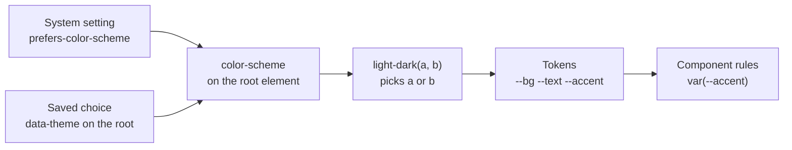

# 01. Custom properties and theming

> **Draft: written but not yet run.** The code and the expected output in this lesson were prepared by reading the code and the official documentation. They have not been executed yet. If something does not behave as described, trust your tool's real output and report it.

## What you will be able to do
By the end of this lesson you will be able to:
- Declare design tokens as CSS custom properties and use them with `var()` and a fallback.
- Build a light and dark theme from one set of tokens with `color-scheme` and `light-dark()`.
- Explain why a custom property can be overridden for one component without touching its rules.
- Let a visitor override the system theme with an accessible toggle that remembers the choice.

## Recap
From Web 101. Try to answer first, then open the answer.
1. In lesson 04 (CSS basics), what does the cascade decide? <details><summary>Answer</summary>Which declaration wins when several rules set the same property on one element (origin, specificity, then source order).</details>
2. In lesson 07, why does a page need `<meta name="viewport" ...>`? <details><summary>Answer</summary>Without it, phones lay the page out at a wide virtual width and shrink it, so media queries and responsive layouts do not behave as designed.</details>
3. In lesson 09, what does `addEventListener("click", ...)` do? <details><summary>Answer</summary>Registers a function that the browser calls each time the click event reaches that element.</details>

## Why it matters
In 101 you wrote the same colour values in many rules. Change the brand colour and you hunt through the whole stylesheet. A **design token** is a named design decision ("the accent colour", "the large gap") stored once. **Custom properties** (also called CSS variables) are how CSS stores tokens: they cascade and inherit like any property, and the browser recomputes everything that uses them when one changes. That makes theming (light, dark, a high-contrast variant, a per-component tweak) a matter of changing a few tokens, not rewriting rules.

## What you will build
A one-page "Theme lab" with a header, three cards and a palette. It follows the visitor's system light or dark setting, has a "Dark mode" toggle button that overrides it and remembers the choice, and one card that overrides two tokens for itself only.



## Before you start
- A current Edge, Chrome, Firefox or Safari and VS Code (from Web 101 lesson 01). No terminal and no Node in this lesson.
- Time: 45 minutes. Two idea groups: tokens (Steps 1 to 4), toggle (Steps 5 to 7).
- Browser notes in this lesson describe what the CSS tells the browser to draw. They were derived from the code, not from a screenshot; if your screen differs, trust the screen and report it.
- Source pack (optional): every file is shown in full in this lesson, so you can follow without it. The finished code, the exercise starter and the solution are in the
  course repository https://github.com/Uee03/Code101 under `source/web/201-hero-to-super-hero/phase-1-modern-css/01-custom-properties-and-theming/` (on that page choose **Code, Download ZIP**, or run
  `git clone https://github.com/Uee03/Code101.git`).
- Glossary: keep the [Web glossary](../../GLOSSARY.md) nearby.

## Steps

### Step 1. Create the folder
Create `code101/web201/lesson01` inside your user folder (the same place you used for Web 101) and open it in VS Code with **File > Open Folder**.

**Folder: your user folder** (Windows PowerShell shown; macOS and Linux use the same `mkdir -p`)
```powershell
mkdir code101\web201\lesson01
```
```bash
mkdir -p ~/code101/web201/lesson01
```
Expected result: the VS Code Explorer shows an empty `lesson01` folder. If a terminal prompt does not end in `lesson01`, you are in another folder; recover with `cd ~/code101/web201/lesson01` (Windows: `Set-Location "$HOME\code101\web201\lesson01"`).

### Step 2. Write the page structure
Create `index.html` and save this full file. Notice three things: the tiny `theme-init.js` script is in `<head>` **without** `defer` (Step 6 explains why), `theme-toggle.js` is deferred, and both icons are inline SVG so they can use `currentColor` (the CC0 sun and moon icons from the course art library, with `aria-hidden="true"` because the button text already names the action).

**File: `index.html`**
```html
<!doctype html>
<html lang="en">
<head>
  <meta charset="utf-8">
  <meta name="viewport" content="width=device-width, initial-scale=1">
  <title>Theme lab</title>
  <script src="theme-init.js"></script>
  <link rel="stylesheet" href="styles.css">
  <script src="theme-toggle.js" defer></script>
</head>
<body>
  <header class="site-header">
    <h1>Theme lab</h1>
    <button id="theme-toggle" class="theme-toggle" type="button" aria-pressed="false">
      <svg class="theme-toggle__icon theme-toggle__icon--sun" xmlns="http://www.w3.org/2000/svg" viewBox="0 0 24 24" width="24" height="24" fill="none" stroke="currentColor" stroke-width="2" stroke-linecap="round" stroke-linejoin="round" aria-hidden="true" focusable="false">
        <circle cx="12" cy="12" r="5"/>
        <line x1="12" y1="1" x2="12" y2="3"/>
        <line x1="12" y1="21" x2="12" y2="23"/>
        <line x1="4.22" y1="4.22" x2="5.64" y2="5.64"/>
        <line x1="18.36" y1="18.36" x2="19.78" y2="19.78"/>
        <line x1="1" y1="12" x2="3" y2="12"/>
        <line x1="21" y1="12" x2="23" y2="12"/>
        <line x1="4.22" y1="19.78" x2="5.64" y2="18.36"/>
        <line x1="18.36" y1="5.64" x2="19.78" y2="4.22"/>
      </svg>
      <svg class="theme-toggle__icon theme-toggle__icon--moon" xmlns="http://www.w3.org/2000/svg" viewBox="0 0 24 24" width="24" height="24" fill="none" stroke="currentColor" stroke-width="2" stroke-linecap="round" stroke-linejoin="round" aria-hidden="true" focusable="false">
        <path d="M21 12.79A9 9 0 1 1 11.21 3 7 7 0 0 0 21 12.79z"/>
      </svg>
      <span>Dark mode</span>
    </button>
  </header>

  <main>
    <section class="card">
      <h2>One set of tokens</h2>
      <p>Every colour, space and corner on this page comes from a custom property declared once on the root element.</p>
      <p class="muted">Muted text uses its own token, so it changes with the theme too.</p>
      <p><a href="#palette">Jump to the palette</a></p>
      <button class="button" type="button">Primary action</button>
    </section>

    <section class="card" id="palette">
      <h2>Palette</h2>
      <ul class="swatches">
        <li class="swatch swatch--bg">--bg</li>
        <li class="swatch swatch--surface">--surface</li>
        <li class="swatch swatch--muted">--muted</li>
        <li class="swatch swatch--accent">--accent</li>
      </ul>
    </section>

    <section class="card card--warning card--compact">
      <h2>Scoped override</h2>
      <p>This card redefines <code>--accent</code> and <code>--card-padding</code> for itself only.</p>
      <button class="button" type="button">Warning action</button>
    </section>
  </main>
</body>
</html>
```
Expected result: the file is saved. The page is unstyled until `styles.css` exists.

### Step 3. Declare the tokens
Create `styles.css`. Read the first block slowly; the rest of the file only *uses* tokens. Save the whole file.

**File: `styles.css`**
```css
:root {
  color-scheme: light dark;

  --bg: light-dark(#ffffff, #0b1220);
  --surface: light-dark(#f1f5f9, #172033);
  --text: light-dark(#0f172a, #e2e8f0);
  --muted: light-dark(#475569, #a7b3c7);
  --border: light-dark(#cbd5e1, #334155);
  --accent: light-dark(#1d4ed8, #7cb0ff);
  --on-accent: light-dark(#ffffff, #0b1220);
  --focus: light-dark(#b45309, #fbbf24);

  --space-1: 0.5rem;
  --space-2: 1rem;
  --space-3: 1.5rem;
  --radius: 0.5rem;
  --font: system-ui, -apple-system, "Segoe UI", Roboto, sans-serif;
}

:root[data-theme="light"] {
  color-scheme: light;
}

:root[data-theme="dark"] {
  color-scheme: dark;
}

*,
*::before,
*::after {
  box-sizing: border-box;
}

body {
  margin: 0;
  font-family: var(--font);
  line-height: 1.5;
  background: var(--bg);
  color: var(--text);
}

a {
  color: var(--accent);
}

:focus-visible {
  outline: 3px solid var(--focus);
  outline-offset: 2px;
}

.site-header {
  display: flex;
  align-items: center;
  justify-content: space-between;
  gap: var(--space-2);
  padding: var(--space-2) var(--space-3);
  border-bottom: 1px solid var(--border);
  background: var(--surface);
}

.site-header h1 {
  margin: 0;
  font-size: 1.5rem;
}

main {
  display: grid;
  gap: var(--space-3);
  max-width: 48rem;
  margin: 0 auto;
  padding: var(--space-3);
}

.card {
  padding: var(--card-padding, var(--space-3));
  border: 1px solid var(--border);
  border-radius: var(--radius);
  background: var(--surface);
}

.card h2 {
  margin-top: 0;
}

.card--compact {
  --card-padding: var(--space-2);
}

.card--warning {
  --accent: light-dark(#9a3412, #fdba74);
}

.muted {
  color: var(--muted);
}

.button,
.theme-toggle {
  min-height: 2.75rem;
  padding: 0 var(--space-2);
  border: 1px solid var(--accent);
  border-radius: var(--radius);
  font: inherit;
  cursor: pointer;
}

.button {
  background: var(--accent);
  color: var(--on-accent);
}

.theme-toggle {
  display: inline-flex;
  align-items: center;
  gap: var(--space-1);
  border-color: var(--border);
  background: transparent;
  color: var(--text);
}

.theme-toggle[aria-pressed="false"] .theme-toggle__icon--moon,
.theme-toggle[aria-pressed="true"] .theme-toggle__icon--sun {
  display: none;
}

.swatches {
  display: grid;
  grid-template-columns: repeat(auto-fill, minmax(8rem, 1fr));
  gap: var(--space-1);
  margin: 0;
  padding: 0;
  list-style: none;
}

.swatch {
  padding: var(--space-2);
  border: 1px solid var(--border);
  border-radius: var(--radius);
  font-family: ui-monospace, monospace;
  font-size: 0.875rem;
}

.swatch--bg {
  background: var(--bg);
  color: var(--text);
}

.swatch--surface {
  background: var(--surface);
  color: var(--text);
}

.swatch--muted {
  background: var(--bg);
  color: var(--muted);
}

.swatch--accent {
  background: var(--accent);
  color: var(--on-accent);
}
```
Expected result: open `index.html` in the browser (right-click the file, **Open with** your browser, or use Live Server from Web 101). With a light system theme you should see a white page, a pale blue-grey header and cards, dark navy text and a blue button. With a dark system theme the same page is near-black navy with light text and a light-blue button. The toggle does nothing yet.

### Step 4. Predict, then verify
Before you change your system theme, predict: **the page is in dark mode and you press F12 and delete the line `color-scheme: light dark;` from `:root` in the DevTools Styles pane. Does the page stay dark?** Then try it.

<details><summary>Answer</summary>

It turns light. `light-dark()` only works when the element's used `color-scheme` includes both schemes; without `color-scheme: light dark` the root is `normal`, which counts as light, so every `light-dark()` returns its first value. `color-scheme` is the switch; `light-dark()` is the selector. (The page background also depends on this: it is what tells the browser to draw built-in controls and scrollbars dark.)

</details>

### Step 5. Write the toggle
Create `theme-toggle.js`. The button reports its state with `aria-pressed` (a toggle button that is "pressed" means dark mode is on); the label never changes, so a screen reader says "Dark mode, toggle button, pressed" or "not pressed".

**File: `theme-toggle.js`**
```js
const root = document.documentElement;
const toggle = document.querySelector("#theme-toggle");
const darkQuery = window.matchMedia("(prefers-color-scheme: dark)");

function currentTheme() {
  const chosen = root.dataset.theme;
  if (chosen === "light" || chosen === "dark") {
    return chosen;
  }
  return darkQuery.matches ? "dark" : "light";
}

function showTheme() {
  toggle.setAttribute("aria-pressed", String(currentTheme() === "dark"));
}

function saveTheme(theme) {
  try {
    localStorage.setItem("theme", theme);
  } catch {
    // Not saved: the choice still applies until the page closes.
  }
}

toggle.addEventListener("click", () => {
  const next = currentTheme() === "dark" ? "light" : "dark";
  root.dataset.theme = next;
  saveTheme(next);
  showTheme();
});

darkQuery.addEventListener("change", showTheme);
showTheme();
```
Expected result: reload the page; clicking **Dark mode** flips the colours at once, swaps the sun icon for the moon, and the choice survives a reload.

### Step 6. Write the early script that stops the flash
Create `theme-init.js`. It runs *before* the first paint, reads the saved choice and sets `data-theme` on `<html>`. If this ran in a deferred script, a visitor who saved "dark" with a light system theme would see a white flash first. The script is tiny and external (not inline) so a strict Content Security Policy can allow it (lesson 10).

**File: `theme-init.js`**
```js
(function () {
  try {
    const saved = localStorage.getItem("theme");
    if (saved === "light" || saved === "dark") {
      document.documentElement.dataset.theme = saved;
    }
  } catch {
    // Storage can be blocked (private mode, strict settings): keep the system theme.
  }
})();
```
Expected result: no visible change; this removes the flash on reload.

### Step 7. Check the three override levels
Open DevTools (F12, or Command+Option+I on macOS), choose **Elements**, click `<html>` and look at the **Styles** pane.
1. Click the toggle and watch `data-theme="dark"` appear on `<html>`.
2. Select the third card (`.card--warning`) and find `--accent` and `--card-padding` in the Styles pane: they are declared on the card, not on `:root`.
3. In the **Computed** tab of that card's button, `background-color` resolves to the *card's* accent, because `var(--accent)` is looked up from the element, upward.

## Run it
There is no build. Open the file and test four situations:

| Situation | What the CSS and script tell the browser to do |
|---|---|
| System light, nothing saved | Light colours, toggle not pressed, sun icon visible |
| System dark, nothing saved | Dark colours, toggle pressed, moon icon visible |
| Click the toggle, reload | The saved choice wins over the system setting |
| Change the OS theme while the page is open and nothing is saved | The page follows it (`change` listener updates the button state) |

## How it works
- **Custom property**: a name starting with `--`. You declare it (`--accent: ...`) and read it with `var(--accent)`. Unlike Sass variables, it exists at run time in the browser, so it cascades, inherits and can change per element or at run time.
- **Token tiers**: this lesson uses *raw* tokens (`--accent`) and component rules. Larger systems add a *semantic* layer (`--button-bg: var(--accent)`) so a component can be retuned alone.
- **Fallback**: `var(--card-padding, var(--space-3))` uses the second value when `--card-padding` is not set on that element. The compact card sets it, so only that card shrinks.
- **`light-dark(a, b)`** returns `a` when the element's used colour scheme is light and `b` when it is dark. It works for colour values only.
- **`color-scheme`** says which schemes the page supports; browsers also use it for built-in controls. `:root[data-theme="dark"]` narrows it to one value, which is how the toggle overrides the system.
- **Misconception to correct:** custom properties are *not* constants replaced at build time. `color: var(--text)` on `body` is computed once and the *computed colour* is inherited. That is why a card that changes `--text` must also set `color: var(--text)` again (you do this in the exercise).

**Why this, not that**

| Choice | Instead of | Why |
|---|---|---|
| `light-dark()` plus `color-scheme` | Two copies of every token, one in `@media (prefers-color-scheme: dark)` and one in `[data-theme="dark"]` | One declaration per token; a second copy drifts out of sync |
| Custom properties | Sass or Less variables | The browser can change them live (theme switch, per-component override); Sass values are fixed at compile time |
| `data-theme` on `<html>` | A class on `<body>` | `<html>` is set before the body exists, so the early script can avoid the flash |
| `aria-pressed` on a `<button>` | A custom switch built from `<div>` | A native button already has focus, Enter and Space; ARIA only adds the state |

## Try it
Copy your finished `lesson01` folder to `lesson01-try`. Work in the copy. The starter file in the pack, `exercise/starter/exercise.css`, is shown here.

**File: `exercise.css`** (starter; in the pack as `exercise/starter/exercise.css`)
```css
/* Exercise 01. Link this file after styles.css in index.html. */

:root {
  /* TODO 1: add a --success token with light-dark(<value for light>, <value for dark>) */
}

.badge {
  /* TODO 2: draw a pill: padding, a 1px border and text colour from --success, radius 999px */
}

.card--inverted {
  /* TODO 3: swap --surface, --text, --muted and --border for this card only, then re-apply color */
}
```
1. **Guided.** Add `<link rel="stylesheet" href="exercise.css">` after the `styles.css` link. Add `<span class="badge">Saved</span>` after the first paragraph of the first card. Complete TODO 1 and 2 with a dark green for light mode and a light green for dark mode. Goal: a pill that is readable in both themes.
2. **Change.** Add `card--inverted` to the palette card's classes and complete TODO 3 so that card is dark in light mode and light in dark mode, with the swatches still readable.
3. **Stretch (design choice).** The toggle has two states, but "follow the system" is a third one the visitor cannot return to once they click. Design a three-way control (system, light, dark). Decide what to store, what `data-theme` is when the choice is "system", and which control (a `<select>`, radio buttons, or a button that cycles) is most accessible. No single right answer; write down the trade-offs.

<details><summary>Solution</summary>

**File: `exercise.css`** (solution)
```css
/* Exercise 01 solution. Link this file after styles.css in index.html. */

:root {
  --success: light-dark(#166534, #86efac);
}

.badge {
  display: inline-block;
  padding: 0.125rem var(--space-1);
  border: 1px solid var(--success);
  border-radius: 999px;
  color: var(--success);
  font-size: 0.875rem;
}

.card--inverted {
  --surface: light-dark(#172033, #f1f5f9);
  --text: light-dark(#e2e8f0, #0f172a);
  --muted: light-dark(#a7b3c7, #475569);
  --border: light-dark(#334155, #cbd5e1);
  color: var(--text);
}
```
`color: var(--text)` is needed because the card's text colour was inherited from `body` as an already-computed colour. For the stretch: store `"light"`, `"dark"` or nothing (system); with nothing saved, remove `data-theme` from `<html>`; radio buttons in a `<fieldset>` are the most explicit control, a single cycling button is smallest but hides the options.

</details>

## Check yourself
1. Name the two things you must set on `:root` so that `light-dark()` can switch. <details><summary>Answer</summary>`color-scheme: light dark` (the schemes the page supports), and the colour tokens written with `light-dark(light value, dark value)`. A `data-theme` rule can then narrow `color-scheme` to one.</details>
2. **Predict:** a card sets `--accent: red` in `.card--alert`. A button *outside* that card uses `var(--accent)`. Which colour does it get? <details><summary>Answer</summary>The root's accent. The override applies only to `.card--alert` and its descendants.</details>
3. Why is `theme-init.js` loaded without `defer`? <details><summary>Answer</summary>It must run before the first paint so the saved theme is on `<html>` already; a deferred script runs after parsing and the visitor sees a flash of the wrong theme.</details>
4. What does `var(--card-padding, var(--space-3))` do when `--card-padding` is not defined? <details><summary>Answer</summary>It uses the fallback, `var(--space-3)`.</details>
5. Why does the toggle use `aria-pressed` and a constant label instead of changing its text between "Dark" and "Light"? <details><summary>Answer</summary>A changing label plus a changing state is confusing ("Light mode, pressed" is ambiguous). A fixed name with a pressed state announces exactly what is on.</details>

## Common mistakes
| Symptom | Cause | Fix |
|---|---|---|
| Page never turns dark | `color-scheme: light dark` missing, or `light-dark()` used with a non-colour value | Keep `color-scheme` on `:root`; use `light-dark()` only for colours |
| Toggle does nothing, console shows an error naming `toggle` or `null` | The script ran before the button existed, or the id is mistyped | Keep `defer` on `theme-toggle.js` and `id="theme-toggle"` identical in HTML and JS (typical message: `Cannot read properties of null`) |
| White flash on reload in dark mode | `theme-init.js` was deferred or removed | Load it in `<head>` without `defer` |
| An override card keeps the old text colour | `color` was inherited as a computed value | Re-apply `color: var(--text)` inside the overriding rule |
| A token seems ignored | Typo in the name (`--acent`) falls back silently | Compare names in the DevTools Styles pane; invalid `var()` makes the property compute to its inherited or initial value |
| Saved choice lost each reload when opening the file directly | Some browsers treat each `file://` page differently for storage | Serve the folder with Live Server (Web 101 lesson 03) |

## Best practice
Define design decisions once as tokens, theme through `color-scheme` and tokens (not by rewriting rules), respect the visitor's system setting by default, and always give a way to override it. Keep text and focus colours at WCAG contrast ratios (4.5:1 for normal text, 3:1 for focus indicators) and check them in DevTools. Source: MDN, `light-dark()` https://developer.mozilla.org/en-US/docs/Web/CSS/color_value/light-dark and WCAG 2.2, Contrast (Minimum) https://www.w3.org/WAI/WCAG22/Understanding/contrast-minimum.html

## Going further
- MDN: [Using CSS custom properties](https://developer.mozilla.org/en-US/docs/Web/CSS/Guides/Cascading_variables/Using_custom_properties) and the `@property` rule, which lets you give a custom property a type so it can animate.
- web.dev: [Learn CSS: Color](https://web.dev/learn/css/color) for how modern colour spaces work.
- The capstones [web-angular](../../../../capstones/web-angular/) and [web-react](../../../../capstones/web-react/) apply the same token approach in a full application.

## Summary
- You declared design tokens as custom properties and used `var()` with a fallback.
- You built a light and dark theme from one set of tokens with `color-scheme` and `light-dark()`.
- You overrode tokens for one card without touching component rules.
- You added an accessible theme toggle that saves the choice and avoids a flash.

## Next lesson
02. Modern layout: container queries, `clamp()` and logical properties, so components adapt to the space they are given rather than the screen.
