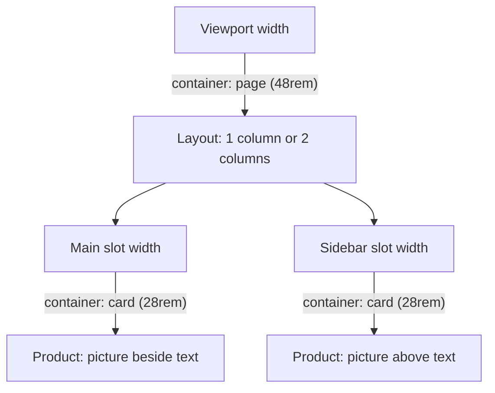

# 02. Modern layout: container queries, clamp() and logical properties

> **Draft: written but not yet run.** The code and the expected output in this lesson were prepared by reading the code and the official documentation. They have not been executed yet. If something does not behave as described, trust your tool's real output and report it.

## What you will be able to do
By the end of this lesson you will be able to:
- Make a component respond to the width of its container with `@container`, and explain why that differs from a media query.
- Write fluid sizes with `clamp()` that still respect the visitor's zoom and font settings.
- Replace physical properties (`left`, `margin-right`) with logical ones so a layout mirrors for right-to-left languages.
- Predict which layout a component gets from its container width alone.

## Recap
1. In Web 101 lesson 07, what does a media query test? <details><summary>Answer</summary>Conditions of the viewing environment, most often the viewport width (`@media (min-width: 700px)`).</details>
2. In lesson 01 of this level, which declaration makes a custom property apply to one card only? <details><summary>Answer</summary>Declaring it on that card's selector (for example `.card--warning { --accent: ... }`); descendants inherit it, siblings do not.</details>
3. In Web 101 lesson 05, what does `box-sizing: border-box` change? <details><summary>Answer</summary>`width` includes padding and border instead of only the content.</details>

## Why it matters
A media query asks "how wide is the **screen**?". But a product card does not live on the screen: it lives in a main column, a sidebar, a dialog or a grid cell, and each is a different width on the same screen. If the card's layout depends on the viewport, you write special-case CSS for every place it appears. A **container query** asks "how wide is the **box I am in**?", so the component carries its own responsive rules wherever it is placed. Pair that with fluid sizing and logical properties and the same CSS works on any screen, zoom level and writing direction.

## What you will build
A page with one `product` component placed twice: in a wide main column and in a narrow sidebar. The wide copy shows the picture beside the text, the narrow copy stacks it above. Below it, two notes demonstrate logical properties, one left to right and one right to left (Arabic), using identical CSS.



## Before you start
- **Prerequisites:** [Web 201 lesson 01, custom properties and theming](01-custom-properties-and-theming.md).
- Lesson 01 of this level done (tokens and `light-dark()` are reused here). Browser only; no terminal.
- Time: 45 minutes.
- Source pack (optional): every file is shown in full in this lesson, so you can follow without it. The finished code, the exercise starter and the solution are in the
  course repository https://github.com/Uee03/Code101 under `source/web/201-hero-to-super-hero/phase-1-modern-css/02-modern-layout/` (on that page choose **Code, Download ZIP**, or run
  `git clone https://github.com/Uee03/Code101.git`).
- Browser notes describe what the CSS asks for; they come from reading the code, not from a screenshot.

## Steps

### Step 1. Create the folder
**Folder: your user folder**
```powershell
mkdir code101\web201\lesson02
```
```bash
mkdir -p ~/code101/web201/lesson02
```
Open `lesson02` in VS Code (**File > Open Folder**). Expected result: an empty folder in the Explorer.

### Step 2. Write the page
Create `index.html`. The same `article.product` markup appears twice on purpose: once inside `<main>`, once inside `<aside>`. The empty `.product__media` block is a stand-in for a picture and is hidden from assistive technology. The second `.note` has `dir="rtl"` and `lang="ar"`: `dir` sets the direction, `lang` lets browsers and screen readers choose fonts and pronunciation.

**File: `index.html`**
```html
<!doctype html>
<html lang="en">
<head>
  <meta charset="utf-8">
  <meta name="viewport" content="width=device-width, initial-scale=1">
  <title>Layout lab</title>
  <link rel="stylesheet" href="styles.css">
</head>
<body>
  <header class="site-header">
    <h1 class="site-header__title">Layout lab: components that adapt to their space</h1>
  </header>

  <div class="page">
    <div class="layout">
      <main>
        <h2>Featured</h2>
        <div class="slot">
          <article class="product">
            <div class="product__media" aria-hidden="true"></div>
            <div class="product__body">
              <h3>Trail lamp</h3>
              <p>The same component in a wide container: the picture sits beside the text.</p>
              <p class="product__meta"><span>Price: 29</span> <span>In stock</span></p>
            </div>
          </article>
        </div>
      </main>

      <aside>
        <h2>Also popular</h2>
        <div class="slot">
          <article class="product">
            <div class="product__media" aria-hidden="true"></div>
            <div class="product__body">
              <h3>Camp stove</h3>
              <p>The same markup in a narrow container: the picture stacks above the text.</p>
              <p class="product__meta"><span>Price: 45</span> <span>Low stock</span></p>
            </div>
          </article>
        </div>
      </aside>
    </div>

    <section>
      <h2>Logical properties</h2>
      <div class="note-grid">
        <div class="note" dir="ltr">
          <span class="note__tag">ltr</span>
          <p class="note__title">Left to right</p>
          <p>The accent bar is on the start edge and the tag is on the end edge.</p>
        </div>
        <div class="note" dir="rtl" lang="ar">
          <span class="note__tag">rtl</span>
          <p class="note__title">بطاقة المنتج</p>
          <p>هذا مثال على تخطيط من اليمين إلى اليسار.</p>
        </div>
      </div>
    </section>
  </div>
</body>
</html>
```
Expected result: saved. Without CSS the page is plain text; the Arabic lines are right-aligned by the browser because of `dir="rtl"`.

### Step 3. Write the stylesheet
Create `styles.css`. Read it in four groups: tokens and the fluid gap, containers and the layout, the product component and its query, then the logical-property notes. Save the whole file.

**File: `styles.css`**
```css
:root {
  color-scheme: light dark;

  --bg: light-dark(#ffffff, #0b1220);
  --surface: light-dark(#f1f5f9, #172033);
  --text: light-dark(#0f172a, #e2e8f0);
  --muted: light-dark(#475569, #a7b3c7);
  --border: light-dark(#cbd5e1, #334155);
  --accent: light-dark(#1d4ed8, #7cb0ff);

  --gap: clamp(1rem, 0.5rem + 2vw, 2rem);
}

*,
*::before,
*::after {
  box-sizing: border-box;
}

body {
  margin: 0;
  font-family: system-ui, -apple-system, "Segoe UI", Roboto, sans-serif;
  line-height: 1.5;
  background: var(--bg);
  color: var(--text);
}

.site-header {
  padding-block: var(--gap);
  padding-inline: var(--gap);
  border-block-end: 1px solid var(--border);
  background: var(--surface);
}

.site-header__title {
  margin: 0;
  font-size: clamp(1.5rem, 1rem + 2.5vw, 2.5rem);
  line-height: 1.2;
  text-wrap: balance;
}

.page {
  container: page / inline-size;
  max-inline-size: 70rem;
  margin-inline: auto;
  padding: var(--gap);
}

.layout {
  display: grid;
  gap: var(--gap);
}

@container page (min-width: 48rem) {
  .layout {
    grid-template-columns: 2fr 1fr;
  }
}

.slot {
  container: card / inline-size;
}

.product {
  display: grid;
  gap: 1rem;
  padding: 1rem;
  border: 1px solid var(--border);
  border-radius: 0.5rem;
  background: var(--surface);
}

.product__media {
  aspect-ratio: 16 / 9;
  border-radius: 0.375rem;
  background: linear-gradient(135deg, var(--accent), transparent);
}

.product h3,
.product p {
  margin-block: 0 0.5rem;
}

.product__meta {
  display: flex;
  flex-wrap: wrap;
  gap: 0.5rem 1rem;
  color: var(--muted);
}

@container card (min-width: 28rem) {
  .product {
    grid-template-columns: 10rem 1fr;
    align-items: start;
  }

  .product__media {
    aspect-ratio: 1;
  }
}

.note-grid {
  display: grid;
  grid-template-columns: repeat(auto-fit, minmax(min(100%, 16rem), 1fr));
  gap: var(--gap);
}

.note {
  position: relative;
  padding-block: 1.75rem 0.75rem;
  padding-inline: 1rem;
  border-inline-start: 0.25rem solid var(--accent);
  background: var(--surface);
  text-align: start;
}

.note__tag {
  position: absolute;
  inset-block-start: 0.25rem;
  inset-inline-end: 0.5rem;
  font-size: 0.75rem;
  color: var(--muted);
}

.note__title {
  margin-block: 0 0.25rem;
  font-weight: 700;
}
```
Expected result: the page has a header with a large heading that scales with the window, then (on a wide window) two columns: the left card with a square gradient picture beside its text, the right card with a wide picture above its text. Below, two notes: the first has its accent bar on the left and its tag at the top right; the second has the bar on the **right** and the tag at the top **left**, with the Arabic text right-aligned.

### Step 4. Predict, then resize
Before you resize, write down your answers. The `page` container switches to two columns at 48rem (768px at the default font size). The `card` container switches to "picture beside text" at 28rem (448px).
1. At a window about 600px wide, is the sidebar card stacked or side by side?
2. At 1200px wide, which card is stacked?
3. At about 400px wide?

Now drag the window edge (or use DevTools device mode, F12, then the device toolbar button) and check.

<details><summary>Answer</summary>

1. **Side by side.** Below 768px the layout is one column, so the "sidebar" slot is as wide as the page (about 560px), which is at least 448px. A viewport media query would have kept it stacked because it only knows the screen is "small". The card reacted to its own space.
2. The **sidebar** card (its slot is about a third of the page, roughly 350px, under 448px). The main card is wide enough for two columns.
3. **Both stacked**: the single column is about 360px wide, under 448px.

</details>

### Step 5. Read the fluid sizes
`clamp(min, preferred, max)` returns the preferred value but never below `min` or above `max`. In `--gap: clamp(1rem, 0.5rem + 2vw, 2rem)` the gap grows with the window between 1rem and 2rem. Why `0.5rem + 2vw` and not just `4vw`? `vw` alone does not respond to the visitor's zoom or font-size setting; adding a `rem` part keeps some of the size tied to the root font size, so zooming still enlarges the text. WCAG success criterion 1.4.4 requires text to be resizable to 200 percent. Test: press **Ctrl +** (macOS **Command +**) to zoom to 200 percent and confirm the heading and gaps get larger.

## Run it
Open `index.html` in the browser. Resize the window, zoom in and out, and compare the two notes at the bottom. To prove the notes use one set of CSS rules, open DevTools **Elements**, select `.note` in each, and compare the **Styles** pane: the same rules apply, and only `dir` differs.

## How it works
- **Container.** `container: card / inline-size` is a shorthand for `container-name: card` and `container-type: inline-size`. The element becomes a **query container**: its inline size (width in horizontal writing) can be tested. An element cannot query itself, which is why `.slot` is the container and `.product` is styled by the query.
- **Containment cost.** `inline-size` containment means the container's width must not depend on its children (the browser must know it before laying out the children). That is why a container often needs a wrapper element and why you cannot put the query on `.product` itself.
- **Logical properties** replace "left/right/top/bottom" with "start/end" along the **inline** axis (the direction text flows) and the **block** axis (the direction blocks stack). In left-to-right English, `inline-start` is left. In Arabic, it is right. So `border-inline-start`, `padding-inline`, `margin-block` and `inset-inline-end` mirror automatically, with no second stylesheet.
- **`min()` inside `minmax()`.** `minmax(min(100%, 16rem), 1fr)` says "columns of at least 16rem, but never wider than the container", which prevents horizontal scrolling on very narrow screens.
- **Misconception to correct:** container queries do not replace media queries. Use a media query for page-level concerns (user preferences, print, the overall shell); use container queries for components that are reused in different places.

**Why this, not that**

| Choice | Instead of | Why |
|---|---|---|
| `@container card (min-width: 28rem)` | `@media (min-width: 900px)` with sidebar overrides | One rule works in the main column, the sidebar, a modal, anywhere |
| `clamp()` with a `rem` part | `font-size: 4vw` | Pure `vw` ignores zoom and can fail WCAG 1.4.4 |
| `margin-inline-start` | `margin-left` plus an `[dir="rtl"]` override | The browser mirrors it; no duplicate rules to keep in sync |
| `min(100%, 16rem)` | A fixed `16rem` minimum | A fixed minimum overflows containers narrower than 16rem |

## Try it
Copy your finished `lesson02` folder to `lesson02-try` and work there. The starter file `exercise/starter/exercise.css` is below. Link it after `styles.css` in `index.html`.

**File: `exercise.css`** (starter)
```css
/* Exercise 02. Link this file after styles.css in index.html. */

/* TODO 1 (guided): add a third tier. When the card container is at least 36rem wide,
   make .product use grid-template-columns: 14rem 1fr and .product__media use aspect-ratio: 4 / 3. */

/* TODO 2 (change): rewrite this rule with logical properties so it mirrors in a dir="rtl" parent. */
.legacy-note {
  margin-left: 1rem;
  padding-right: 1rem;
  border-left: 4px solid currentColor;
  text-align: left;
}

/* TODO 3 (stretch): make .page padding and .layout gap scale with clamp() in your own steps. */
```
1. **Guided.** Complete TODO 1. Goal: at a viewport near 1100px the main card gets a larger picture; the sidebar card does not change.
2. **Change.** Add `<p class="legacy-note">A note that should mirror.</p>` inside `<main>`, add `dir="rtl"` to `<body>` and watch it fail to mirror, then fix it (TODO 2). Goal: the bar and indent move to the right edge.
3. **Stretch (design choice).** Choose your own `clamp()` ranges for page padding and layout gap (TODO 3). Decide the smallest and largest values and what the preferred value should be. Defend the choice: what happens at 200 percent zoom on a 1280px window (that behaves like a 640px viewport)?

<details><summary>Solution</summary>

**File: `exercise.css`** (solution)
```css
/* Exercise 02 solution. Link this file after styles.css in index.html. */

@container card (min-width: 36rem) {
  .product {
    grid-template-columns: 14rem 1fr;
  }

  .product__media {
    aspect-ratio: 4 / 3;
  }
}

.legacy-note {
  margin-inline-start: 1rem;
  padding-inline-end: 1rem;
  border-inline-start: 4px solid currentColor;
  text-align: start;
}

.page {
  padding: clamp(0.75rem, 0.25rem + 3vw, 3rem);
}

.layout {
  gap: clamp(0.75rem, 0.25rem + 3vw, 3rem);
}
```
A `@container` rule later in the cascade with a larger `min-width` overrides the 28rem tier only where it applies, because both rules have equal specificity and the later one wins. The stretch values are one reasonable answer, not the only one.

</details>

## Check yourself
1. Why can a component not use `@container` to query its own width? <details><summary>Answer</summary>A query container must be an ancestor; the browser needs to know the container's size before laying out its children, so the queried element is always a descendant of the container.</details>
2. **Predict:** `.slot` gets `container-type: normal` by mistake. What happens to the product cards? <details><summary>Answer</summary>Nothing is a query container, so `@container card` never matches and both cards stay in the stacked layout.</details>
3. What does `clamp(1rem, 0.5rem + 2vw, 2rem)` return in a 400px wide viewport, and why? <details><summary>Answer</summary>`0.5rem + 2vw` is 8px + 8px = 16px, which equals the minimum 1rem at a 16px root size, so about 16px.</details>
4. In a `dir="rtl"` parent, where does `border-inline-start` draw? <details><summary>Answer</summary>On the right edge.</details>
5. Why is `font-size: 4vw` a risk? <details><summary>Answer</summary>Text sized only in viewport units does not enlarge with browser zoom or the user's font-size preference, which breaks resizable text requirements.</details>

## Common mistakes
| Symptom | Cause | Fix |
|---|---|---|
| The container query never matches | The queried element is the container itself, or no ancestor has `container-type` | Put `container` on a wrapper and style a descendant |
| The container collapses to zero width | `inline-size` containment on an element sized by its content (for example a `display: inline-block` or a flex item without a width) | Give the container a width from its context (block, grid cell or flex item with `flex: 1`) |
| Layout is correct in English and wrong in Arabic | Physical properties (`margin-left`, `float: left`) | Switch to logical properties |
| Text does not grow when zooming | Font size set in `vw` only | Add a `rem` component to `clamp()` |
| Horizontal scrollbar on phones | A fixed `minmax(16rem, 1fr)` minimum wider than the screen | `minmax(min(100%, 16rem), 1fr)` |

## Best practice
Give reusable components their own container and size them with container queries; keep media queries for page-level concerns. Use logical properties by default, and size text with `clamp()` that includes a `rem` term. Source: MDN, Container queries https://developer.mozilla.org/en-US/docs/Web/CSS/Guides/Containment/Container_queries and web.dev, Learn CSS: Logical properties https://web.dev/learn/css/logical-properties

## Going further
- MDN: [CSS logical properties and values](https://developer.mozilla.org/en-US/docs/Web/CSS/Guides/Logical_properties_and_values) and [container size and style queries](https://developer.mozilla.org/en-US/docs/Web/CSS/Guides/Containment/Container_queries).
- WCAG 2.2, [Resize Text (1.4.4)](https://www.w3.org/WAI/WCAG22/Understanding/resize-text.html) and [Reflow (1.4.10)](https://www.w3.org/WAI/WCAG22/Understanding/reflow.html).
- Capstones [web-angular](../../../../capstones/web-angular/) and [web-react](../../../../capstones/web-react/) use component-level responsive rules like these.

## Summary
- You made one component respond to its container with `@container` and predicted its layout from the container width.
- You wrote fluid sizes with `clamp()` that keep a `rem` term so zoom works.
- You used logical properties so the same CSS mirrors for right-to-left text.
- You explained when to choose a container query and when a media query.

## Next lesson
03. CSS architecture and animation: cascade layers and BEM naming to keep large stylesheets predictable, plus transitions and animations that respect `prefers-reduced-motion`.
