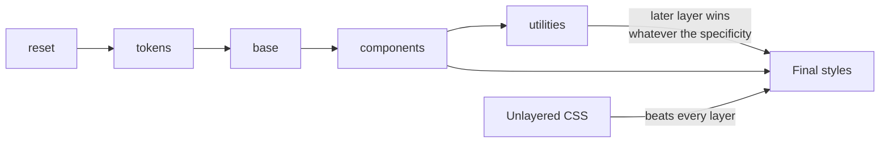

# 03. CSS architecture and animation

> **Draft: written but not yet run.** The code and the expected output in this lesson were prepared by reading the code and the official documentation. They have not been executed yet. If something does not behave as described, trust your tool's real output and report it.

## What you will be able to do
By the end of this lesson you will be able to:
- Order a stylesheet with `@layer` so that a low-specificity rule can beat a high-specificity one on purpose.
- Name components with BEM (block, element, modifier) so selectors stay flat.
- Write transitions and keyframe animations that only change `opacity` and `transform`.
- Honour `prefers-reduced-motion` with a token instead of scattering overrides.

## Recap
1. In lesson 01, why does a card that overrides `--text` also need `color: var(--text)`? <details><summary>Answer</summary>`color` was inherited as an already computed value from `body`; the new token value only takes effect where `var(--text)` is used again.</details>
2. In lesson 02, why is `font-size: 4vw` risky? <details><summary>Answer</summary>It does not scale with zoom or the font-size setting, so text may not be resizable.</details>
3. In Web 101 lesson 04, which of `.card` and `#main .card` wins for the same property? <details><summary>Answer</summary>`#main .card`: higher specificity beats lower, regardless of order.</details>

## Why it matters
Small stylesheets are easy. At 5,000 lines two things break: you cannot tell which rule wins (so people raise specificity with `#id` or `!important`), and you cannot find where a component's styles live. Two tools fix this. **Cascade layers** let you declare the *order* of groups of rules, so "utilities beat components" is a fact of the file, not a specificity race. **BEM** (Block, Element, Modifier) is a naming convention that keeps every selector to one class, so specificity stays equal and layers do the ordering. Animation then needs the same discipline: motion that is cheap to render and that respects people who ask for less of it.

## What you will build
A "Motion and architecture lab" page with three BEM components (`btn`, `toast`, `toast-region`) in a layered stylesheet. Buttons lift slightly on hover; clicking them adds a message (a toast) that slides in. A line on the page tells you whether your system asks for reduced motion.



## Before you start
- **Prerequisites:** Web 201 lessons [01, custom properties and theming](01-custom-properties-and-theming.md) and [02, modern layout](02-modern-layout.md).
- Lessons 01 and 02 of this level. Browser only; no terminal.
- Time: 50 minutes. Two idea groups: architecture (Steps 2 to 4), motion (Steps 5 to 7).
- Source pack (optional): every file is shown in full in this lesson, so you can follow without it. The finished code, the exercise starter and the solution are in the
  course repository https://github.com/Uee03/Code101 under `source/web/201-hero-to-super-hero/phase-1-modern-css/03-css-architecture-and-animation/` (on that page choose **Code, Download ZIP**, or run
  `git clone https://github.com/Uee03/Code101.git`).
- Browser notes describe what the CSS asks for; they come from reading the code, not from a screenshot.

## Steps

### Step 1. Create the folder
**Folder: your user folder**
```powershell
mkdir code101\web201\lesson03
```
```bash
mkdir -p ~/code101/web201/lesson03
```
Open it in VS Code. Expected result: an empty `lesson03` folder.

### Step 2. Write the page
Create `index.html`. Class names follow BEM: `btn` is a block; `btn--primary` and `btn--ghost` are modifiers (variants of the block); `u-full-width` is a utility (one job, no component). The toast region has `role="status"`, which tells screen readers to announce content added to it politely, without moving focus.

**File: `index.html`**
```html
<!doctype html>
<html lang="en">
<head>
  <meta charset="utf-8">
  <meta name="viewport" content="width=device-width, initial-scale=1">
  <title>Motion and architecture lab</title>
  <link rel="stylesheet" href="styles.css">
  <script src="app.js" defer></script>
</head>
<body>
  <main class="stack">
    <h1>Motion and architecture lab</h1>
    <p class="note">Your system motion setting: <strong id="motion-state">unknown</strong></p>
    <div class="actions">
      <button type="button" class="btn btn--primary" data-toast="info">Show info message</button>
      <button type="button" class="btn btn--ghost" data-toast="warning">Show warning message</button>
    </div>
    <button type="button" class="btn btn--primary u-full-width" data-toast="info">Full-width button (utility)</button>
  </main>

  <div class="toast-region" role="status"></div>
</body>
</html>
```
Expected result: saved.

### Step 3. Write the layered stylesheet
Create `styles.css`. The first line declares the layer order: later layers win over earlier ones. After that, each `@layer name { ... }` block adds rules to that layer. Save the whole file.

**File: `styles.css`**
```css
@layer reset, tokens, base, components, utilities;

@layer reset {
  *,
  *::before,
  *::after {
    box-sizing: border-box;
  }

  body,
  h1,
  p {
    margin: 0;
  }
}

@layer tokens {
  :root {
    color-scheme: light dark;

    --bg: light-dark(#ffffff, #0b1220);
    --surface: light-dark(#f1f5f9, #172033);
    --text: light-dark(#0f172a, #e2e8f0);
    --muted: light-dark(#475569, #a7b3c7);
    --border: light-dark(#cbd5e1, #334155);
    --accent: light-dark(#1d4ed8, #7cb0ff);
    --on-accent: light-dark(#ffffff, #0b1220);
    --warning: light-dark(#9a3412, #fdba74);
    --focus: light-dark(#b45309, #fbbf24);

    --duration: 200ms;
    --ease: cubic-bezier(0.2, 0, 0, 1);
    --shift: 0.75rem;
  }

  @media (prefers-reduced-motion: reduce) {
    :root {
      --duration: 100ms;
      --shift: 0rem;
    }
  }
}

@layer base {
  body {
    font-family: system-ui, -apple-system, "Segoe UI", Roboto, sans-serif;
    line-height: 1.5;
    background: var(--bg);
    color: var(--text);
  }

  h1 {
    font-size: 1.75rem;
    line-height: 1.2;
  }

  :focus-visible {
    outline: 3px solid var(--focus);
    outline-offset: 2px;
  }
}

@layer components {
  .stack {
    display: grid;
    gap: 1rem;
    max-inline-size: 40rem;
    margin-inline: auto;
    padding: 1.5rem;
  }

  .note {
    color: var(--muted);
  }

  .actions {
    display: flex;
    flex-wrap: wrap;
    gap: 0.75rem;
  }

  .btn {
    display: inline-flex;
    align-items: center;
    justify-content: center;
    inline-size: fit-content;
    min-block-size: 2.75rem;
    padding-inline: 1rem;
    border: 1px solid var(--accent);
    border-radius: 0.5rem;
    font: inherit;
    cursor: pointer;
    transition:
      background-color var(--duration) var(--ease),
      transform var(--duration) var(--ease);
  }

  .btn:hover {
    transform: translateY(-1px);
  }

  .btn--primary {
    background: var(--accent);
    color: var(--on-accent);
  }

  .btn--primary:hover {
    background: color-mix(in srgb, var(--accent) 85%, var(--text));
  }

  .btn--ghost {
    background: transparent;
    color: var(--text);
    border-color: var(--border);
  }

  .btn--ghost:hover {
    background: var(--surface);
  }

  @keyframes toast-in {
    from {
      opacity: 0;
      transform: translateY(var(--shift));
    }

    to {
      opacity: 1;
      transform: translateY(0);
    }
  }

  .toast-region {
    position: fixed;
    inset-block-end: 1rem;
    inset-inline-end: 1rem;
    display: grid;
    gap: 0.5rem;
    inline-size: min(22rem, calc(100vw - 2rem));
  }

  .toast {
    display: flex;
    align-items: center;
    justify-content: space-between;
    gap: 0.75rem;
    padding: 0.75rem 1rem;
    border: 1px solid var(--border);
    border-inline-start: 0.375rem solid var(--toast-color, var(--accent));
    border-radius: 0.5rem;
    background: var(--surface);
    box-shadow: 0 0.25rem 1rem rgb(0 0 0 / 0.15);
    animation: toast-in var(--duration) var(--ease) both;
  }

  .toast--info {
    --toast-color: var(--accent);
  }

  .toast--warning {
    --toast-color: var(--warning);
  }

  .toast__close {
    min-block-size: 2.25rem;
  }
}

@layer utilities {
  .u-full-width {
    inline-size: 100%;
  }
}
```
Expected result: the page shows a heading, a motion-setting line, two buttons side by side (blue filled, and outlined) and a full-width blue button below them. Nothing happens on click yet because `app.js` does not exist.

### Step 4. Predict, then test the layers
`.btn` (in `components`) sets `inline-size: fit-content`. `.u-full-width` (in `utilities`) sets `inline-size: 100%`. Both have the same specificity (one class). Predict:
1. If you move the `.u-full-width` rule into `@layer base`, is the last button still full width?
2. If you remove the `@layer utilities { }` wrapper so the rule is unlayered, is it full width?

Try both, then undo.

<details><summary>Answer</summary>

1. **No.** `base` comes *before* `components` in the layer order, so `.btn { inline-size: fit-content }` wins and the button shrinks. Layer order beats source order and equal specificity.
2. **Yes.** Unlayered styles beat every layered style (for normal, non-`!important` rules). That makes unlayered CSS a trap: a stray unlayered rule from a third-party stylesheet or your own mistake overrides your whole layered system. Put third-party CSS in an early layer with `@import url(...) layer(vendor);`.

</details>

### Step 5. Write the script that adds messages
Create `app.js`. It builds each toast with DOM calls and `textContent` (never `innerHTML`), adds a **Dismiss** button, and moves focus back to the button that opened it so keyboard users do not lose their place. The toast does not time out on its own: a message that disappears can be missed (WCAG 2.2.1, Timing Adjustable).

**File: `app.js`**
```js
const region = document.querySelector(".toast-region");
const motionState = document.querySelector("#motion-state");
const motionQuery = window.matchMedia("(prefers-reduced-motion: reduce)");

const MESSAGES = {
  info: "Draft saved.",
  warning: "Connection is slow; changes will sync later.",
};

function showToast(kind, trigger) {
  const message = MESSAGES[kind];
  if (!message) {
    return;
  }

  const toast = document.createElement("div");
  toast.className = `toast toast--${kind}`;

  const text = document.createElement("span");
  text.className = "toast__text";
  text.textContent = message;

  const close = document.createElement("button");
  close.className = "btn btn--ghost toast__close";
  close.type = "button";
  close.textContent = "Dismiss";
  close.addEventListener("click", () => {
    toast.remove();
    trigger.focus();
  });

  toast.append(text, close);
  region.append(toast);
}

for (const button of document.querySelectorAll("[data-toast]")) {
  button.addEventListener("click", () => showToast(button.dataset.toast, button));
}

function showMotionState() {
  motionState.textContent = motionQuery.matches ? "reduced" : "no preference";
}

motionQuery.addEventListener("change", showMotionState);
showMotionState();
```
Expected result: reload. The motion line reads **no preference** or **reduced** depending on your system. Clicking "Show info message" adds a card at the bottom right that fades in while sliding up about 0.75rem over 200ms; clicking **Dismiss** removes it and focus returns to the button you clicked.

### Step 6. Turn reduced motion on and compare
Switch your system on: **Windows 11** Settings > Accessibility > Visual effects > Animation effects (off); **macOS** System Settings > Accessibility > Display > Reduce motion; **Linux/GNOME** Settings > Accessibility > Seeing > Reduce animation. Names vary by version; the browser reads the system setting. In Chrome DevTools you can also emulate it: **More tools > Rendering > Emulate CSS media feature prefers-reduced-motion**.

Predict before you do: which of the three values changes: `--duration`, `--shift` or `--ease`? What will the toast do?

<details><summary>Answer</summary>

`--duration` becomes 100ms and `--shift` becomes 0rem. The toast now **fades in only**, with no sliding. The page text should read **reduced**. Reduced motion does not mean no feedback: removing large movement is what protects people with vestibular disorders; a short fade is generally fine.

</details>

### Step 7. Inspect what is animated
Open DevTools **Elements**, select `.toast`, and in **Styles** find `animation: toast-in ...`. The keyframes animate only `opacity` and `transform`. Browsers can animate these on the compositor (the GPU), without recalculating layout or repainting, so they stay smooth even when the main thread is busy. Animating `width`, `height`, `top` or `margin` forces layout each frame. Lesson 11 measures why that matters.

## Run it
Open `index.html`. Test: hover each button (a 1px lift and a colour change over 200ms), tab through the page with the keyboard (a 3px outline on focus, from `:focus-visible`), show two toasts, dismiss them, then repeat with reduced motion on.

## How it works
- **`@layer a, b, c;`** declares the order up front. A rule in `c` beats a rule in `a` whatever their specificity. Within one layer, normal specificity and source order apply. `!important` reverses the layer order (earlier layers win), which is why you should avoid it.
- **Layer roles.** `reset` removes browser quirks; `tokens` holds custom properties and the motion switch; `base` styles bare elements; `components` has the BEM blocks; `utilities` are single-purpose overrides that must always win.
- **BEM.** `block` (`toast`), `block__element` (`toast__close`), `block--modifier` (`toast--warning`). Every selector is one class, so specificity is always (0,1,0) and nothing needs `#id` or nesting. A BEM class describes *what it is* (a toast), not *how it looks* (`red-box`). A *mix* such as `btn btn--ghost toast__close` lets an element be a button and also a part of a toast.
- **Transitions** animate a property from its current to its new value (`transition: transform 200ms`). **Keyframe animations** (`@keyframes` plus `animation`) describe steps and run on their own, such as on insertion. `both` fills the start and end values so the toast does not flash at full opacity before the animation begins.
- **One motion token.** Setting `--duration` and `--shift` once in `@media (prefers-reduced-motion: reduce)` means every animation in the stylesheet adapts. The alternative, a global `* { animation-duration: 0.01ms !important }`, removes feedback people may still want and uses `!important`.
- **Misconception to correct:** layers do not "scope" CSS. A layered rule still applies to the whole document; layers only decide the order of conflict resolution.

**Why this, not that**

| Choice | Instead of | Why |
|---|---|---|
| `@layer` plus flat BEM selectors | Nested selectors, `#ids` and `!important` | Order is explicit; specificity stays equal; overrides are predictable |
| BEM class names | Long descendant selectors (`.page .sidebar ul li a`) | Selectors do not break when markup nests differently |
| Motion tokens in a `prefers-reduced-motion` query | A per-animation override | One place; new animations get it for free |
| `transform` and `opacity` | `top`, `left`, `width`, `height` | No layout or paint work per frame |
| Toast stays until dismissed | Auto-hide after 3 seconds | Timed messages can be missed (WCAG 2.2.1) |

## Try it
Copy your finished `lesson03` folder to `lesson03-try`. Link `exercise.css` after `styles.css` (that is, **after** it in `<head>`).

**File: `exercise.css`** (starter)
```css
/* Exercise 03. Link this file after styles.css in index.html. */

/* TODO 1 (guided): this rule is outside every layer, so it beats the whole stylesheet.
   Wrap it in @layer components { ... } so it takes part in the layer order. */
.btn--danger {
  background: light-dark(#b91c1c, #fca5a5);
  color: light-dark(#ffffff, #1a0505);
  border-color: transparent;
}

/* TODO 2 (change): add a .toast--error modifier that sets --toast-color, inside the same layer. */

/* TODO 3 (stretch): decide how a toast could animate out when dismissed, without ever
   waiting for an animation that reduced-motion visitors do not get. Write your plan here. */
```
1. **Guided.** Add `<button type="button" class="btn btn--danger" data-toast="error">Show error message</button>` inside `.actions`, and complete TODO 1. Goal: the danger button looks red. Then prove the gotcha: add `inline-size: 6rem;` to the `.btn--danger` rule and add the class `u-full-width` to that button. Compare its width with the rule inside the layer and with the `@layer` wrapper removed. Which rule wins each time, and why does it matter?
2. **Change.** Add `error: "Could not save the draft."` to `MESSAGES` in `app.js` and complete TODO 2. Goal: clicking the red button shows a toast with a red accent bar.
3. **Stretch (design choice).** Write your plan for an exit animation (TODO 3): what must `app.js` wait for before it calls `toast.remove()`, and what must it do when reduced motion is on? List two risks of waiting on `animationend`.

<details><summary>Solution</summary>

**File: `exercise.css`** (solution)
```css
/* Exercise 03 solution. Link this file after styles.css in index.html. */

@layer components {
  .btn--danger {
    background: light-dark(#b91c1c, #fca5a5);
    color: light-dark(#ffffff, #1a0505);
    border-color: transparent;
  }

  .toast--error {
    --toast-color: light-dark(#b91c1c, #fca5a5);
  }
}
```
Declaring `@layer components { ... }` in a second file *adds* rules to the existing layer; because `exercise.css` comes later, its equal-specificity rules win within that layer. Unlayered, `.btn--danger` would also win, but it would beat everything, including utilities. For the stretch: add a class, wait for `animationend` or a timeout, then remove; if reduced motion is on (or the duration is 0), remove at once. Risks: `animationend` never fires if the element is hidden or the animation is disabled, and a stuck toast stays forever, so always add a timeout fallback.

</details>

## Check yourself
1. In which order do these win: `utilities`, `base`, `components`? <details><summary>Answer</summary>`utilities` over `components` over `base`, following the declared order (later wins).</details>
2. **Predict:** a stylesheet has `@layer a, b;` and `.x { color: red }` in `a`, `.x { color: blue }` in `b`, and `.x { color: green }` with no layer. What colour is `.x`? <details><summary>Answer</summary>Green: unlayered styles beat all layers.</details>
3. What does the `--modifier` part of a BEM name tell you? <details><summary>Answer</summary>That it is a variant of the block or element (for example `btn--ghost` is a ghost-style button) that is used together with the base class.</details>
4. Why animate `transform` and `opacity` instead of `top` and `width`? <details><summary>Answer</summary>They can be handled by the compositor without layout or paint on every frame.</details>
5. How does the page respond when `prefers-reduced-motion: reduce` matches? <details><summary>Answer</summary>`--duration` becomes 100ms and `--shift` becomes 0rem, so toasts fade in without moving and transitions are shorter.</details>

## Common mistakes
| Symptom | Cause | Fix |
|---|---|---|
| A rule that "should win" loses | It sits in an earlier layer than the rule it fights | Check the `@layer` order line; move the rule to the right layer |
| A rule beats everything, including utilities | It is unlayered | Wrap it in a layer, or load third-party CSS into an early layer |
| `@layer` line placed after other rules | The first mention of a layer name fixes its order | Keep the order declaration as the first statement of the file (after `@charset` or `@import`) |
| Toast jumps instead of sliding | `animation` is missing `both` or the keyframes name is misspelled | Compare the name in `animation:` and `@keyframes` |
| Hover movement visible with reduced motion on | Motion is hard-coded rather than using `--shift` | Route every distance through a token that the media query zeroes |
| Focus lost after dismissing a toast | The removed element had focus | Return focus to the trigger, as `app.js` does |

## Best practice
Declare the layer order first, keep selectors to one class, and make motion respect the user's setting from one token. Animate `opacity` and `transform` only, and never auto-dismiss important messages. Source: MDN, `@layer` https://developer.mozilla.org/en-US/docs/Web/CSS/@layer and web.dev, Learn CSS: Animations https://web.dev/learn/css/animations

## Going further
- MDN: [`prefers-reduced-motion`](https://developer.mozilla.org/en-US/docs/Web/CSS/Reference/At-rules/@media/prefers-reduced-motion) and [Using CSS transitions](https://developer.mozilla.org/en-US/docs/Web/CSS/Guides/Transitions/Using).
- WCAG 2.2: [Animation from Interactions (2.3.3)](https://www.w3.org/WAI/WCAG22/Understanding/animation-from-interactions.html).
- Where layers and tokens reappear: lesson 12 (task board styles) and the [web-react](../../../../capstones/web-react/) and [web-angular](../../../../capstones/web-angular/) capstones.

## Summary
- You declared a layer order and predicted which rule wins from it.
- You wrote BEM class names that keep every selector one class deep.
- You animated `opacity` and `transform` with a transition and keyframes.
- You made all motion respect `prefers-reduced-motion` through two tokens.

## Next lesson
04. Unions, narrowing and utility types: the start of Phase 2, TypeScript in depth.
