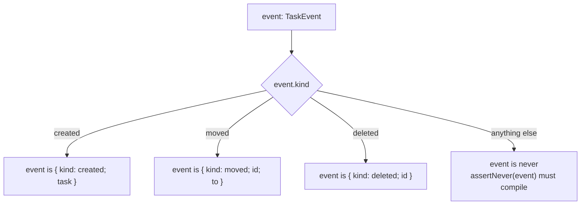

# 04. Unions, narrowing and utility types

> **Draft: written but not yet run.** The code and the expected output in this lesson were prepared by reading the code and the official documentation. They have not been executed yet. If something does not behave as described, trust your tool's real output and report it.

## What you will be able to do
By the end of this lesson you will be able to:
- Model "one of several shapes" with a discriminated union and make the compiler prove you handled every case.
- Narrow a value from `unknown` or a wide union with `typeof`, `in`, `Array.isArray` and a type predicate.
- Derive new types with `Partial`, `Pick`, `Omit`, `Record`, `Extract` and `satisfies` instead of copying fields.
- Predict which line the compiler rejects when you add a new case to a union.

## Recap
1. In Web 101 lesson 10, what does an `interface` describe? <details><summary>Answer</summary>The expected shape of an object: its property names and their types.</details>
2. What does `npx tsc` do when `noEmitOnError` is `true` and the code has a type error? <details><summary>Answer</summary>It reports the error and does not write the JavaScript output.</details>
3. Lesson 03 of this level: why does the toast code use `textContent` and not `innerHTML`? <details><summary>Answer</summary>`textContent` inserts text only; it never interprets HTML, so user text cannot inject markup (lesson 10 goes deeper).</details>

## Why it matters
In 101 a type said "this is a string". Real programs deal with data that can be one of several things: a task event that is *created*, *moved* or *deleted*; an API reply that is *success* or *failure*; a form value that might be missing. If you describe those as one wide type with many optional fields, the compiler cannot help, and bugs appear at run time ("cannot read `to` of undefined"). A **union** type says "exactly one of these", and **narrowing** lets the compiler follow your `if` and `switch` checks to know which one you have. Utility types then let you derive related types (a patch, a summary, a lookup table) from one source of truth.

## What you will build
A small Node program, no browser, that applies a list of task events (`created`, `moved`, `deleted`) to a list of tasks, prints a line per event, groups the result by status, and shows narrowing and utility types at work. This `Task` model returns in lessons 05, 08 and 12.



## Before you start
- **Prerequisites:** Web 101 lessons [10, TypeScript first steps](../../101-zero-to-hero/phase-3-typescript-and-project/10-typescript-first-steps.md) and [11, TypeScript in the browser](../../101-zero-to-hero/phase-3-typescript-and-project/11-typescript-in-the-browser.md).
- Node and npm from Web 101 lesson 08 (any Node 22.12 or newer; the course uses 26.13.1 and npm 11.20.0). Check: `node --version` and `npm --version`.
- Time: 50 minutes.
- Source pack (optional): every file is shown in full in this lesson, so you can follow without it. The finished code, the exercise starter and the solution are in the
  course repository https://github.com/Uee03/Code101 under `source/web/201-hero-to-super-hero/phase-2-typescript-in-depth/04-unions-narrowing-utility-types/` (on that page choose **Code, Download ZIP**, or run
  `git clone https://github.com/Uee03/Code101.git`).
- Windows PowerShell trap: if `npm` fails with `npm.ps1 cannot be loaded because running scripts is disabled on this system`, use `npm.cmd` and `npx.cmd` for every command in this level instead of changing your execution policy.

## Steps

### Step 1. Create the project folder and open a terminal
Create `code101/web201/lesson04`, open it in VS Code, then choose **Terminal > New Terminal**. The prompt must end in `lesson04`.

**Folder: your user folder**
```powershell
mkdir code101\web201\lesson04
```
```bash
mkdir -p ~/code101/web201/lesson04
```
If the prompt is elsewhere: `Set-Location "$HOME\code101\web201\lesson04"` (Windows) or `cd ~/code101/web201/lesson04` (macOS, Linux).

### Step 2. Write package.json
This manifest pins the compiler exactly (`7.0.2`, no `^`) so everyone gets the same diagnostics. `"type": "module"` makes Node treat `.js` files as ES modules, which is what the compiler writes. `engines` documents the minimum Node. Save the file in `lesson04`.

**File: `package.json`**
```json
{
  "name": "web201-lesson-04",
  "version": "1.0.0",
  "private": true,
  "type": "module",
  "scripts": {
    "build": "tsc",
    "start": "node dist/app.js"
  },
  "engines": {
    "node": ">=22.12.0"
  },
  "devDependencies": {
    "typescript": "7.0.2"
  }
}
```

### Step 3. Write tsconfig.json
Same compiler configuration as Web 101 lesson 10: sources in `src`, output in `dist`, `strict` on, no output if there are errors.

**File: `tsconfig.json`**
```json
{
  "compilerOptions": {
    "target": "ES2022",
    "module": "ES2022",
    "moduleResolution": "Bundler",
    "lib": [
      "ES2022",
      "DOM"
    ],
    "rootDir": "src",
    "outDir": "dist",
    "strict": true,
    "noEmitOnError": true,
    "skipLibCheck": true
  },
  "include": [
    "src/**/*.ts"
  ]
}
```
If you kept your Web 101 lesson 10 folder, this file is identical to its `tsconfig.json`.

### Step 4. Ignore generated folders and install
Create `.gitignore` so generated folders never reach version control, then install.

**File: `.gitignore`**
```text
node_modules/
dist/
```

**Folder: `lesson04`**
```bash
npm install --no-audit --no-fund
```
Expected result: a short summary such as `added N packages` (N depends on the compiler's platform packages), a new `node_modules` folder and a new `package-lock.json`. The lockfile records the exact versions that were installed; commit it in a real project.

### Step 5. Write the model: src/tasks.ts
Create the folder `src` and the file `src/tasks.ts`. Read it top to bottom: types first, then functions. The sections after the code explain each part.

**File: `src/tasks.ts`**
```ts
export type TaskStatus = "todo" | "doing" | "done";

export interface Task {
  readonly id: number;
  title: string;
  status: TaskStatus;
  note?: string;
}

export type TaskEvent =
  | { kind: "created"; task: Task }
  | { kind: "moved"; id: number; to: TaskStatus }
  | { kind: "deleted"; id: number };

export type TaskPatch = Partial<Omit<Task, "id">>;
export type TaskSummary = Pick<Task, "id" | "title">;
export type TasksByStatus = Record<TaskStatus, Task[]>;

const STATUSES: readonly TaskStatus[] = ["todo", "doing", "done"];

export const STATUS_LABELS = {
  todo: "To do",
  doing: "In progress",
  done: "Done",
} satisfies Record<TaskStatus, string>;

export function isTaskStatus(value: unknown): value is TaskStatus {
  return STATUSES.some((status) => status === value);
}

export function parseStatus(input: unknown): TaskStatus {
  if (!isTaskStatus(input)) {
    throw new Error(`Not a task status: ${String(input)}`);
  }
  return input;
}

export function assertNever(value: never): never {
  throw new Error("Unhandled case: " + JSON.stringify(value));
}

export function describeEvent(event: TaskEvent): string {
  switch (event.kind) {
    case "created":
      return `Created "${event.task.title}" (#${event.task.id})`;
    case "moved":
      return `Moved #${event.id} to ${event.to}`;
    case "deleted":
      return `Deleted #${event.id}`;
    default:
      return assertNever(event);
  }
}

export function applyEvent(tasks: readonly Task[], event: TaskEvent): Task[] {
  switch (event.kind) {
    case "created":
      return [...tasks, event.task];
    case "moved": {
      const { id, to } = event;
      return tasks.map((task) => (task.id === id ? { ...task, status: to } : task));
    }
    case "deleted": {
      const { id } = event;
      return tasks.filter((task) => task.id !== id);
    }
    default:
      return assertNever(event);
  }
}

export function updateTask(task: Task, patch: TaskPatch): Task {
  return { ...task, ...patch };
}

export function toSummary(task: Task): TaskSummary {
  return { id: task.id, title: task.title };
}

export function statusLabel(item: Task | TaskSummary): string {
  return "status" in item ? STATUS_LABELS[item.status] : "Unknown";
}

export function groupByStatus(tasks: readonly Task[]): TasksByStatus {
  const groups: TasksByStatus = { todo: [], doing: [], done: [] };
  for (const task of tasks) {
    groups[task.status].push(task);
  }
  return groups;
}

export function formatNote(note: string | string[] | undefined): string {
  if (note === undefined) {
    return "no note";
  }
  if (Array.isArray(note)) {
    return note.join("; ");
  }
  return note;
}
```

### Step 6. Write the program: src/app.ts
**File: `src/app.ts`**
```ts
import {
  STATUS_LABELS,
  applyEvent,
  describeEvent,
  formatNote,
  groupByStatus,
  parseStatus,
  statusLabel,
  toSummary,
  updateTask,
  type Task,
  type TaskEvent,
} from "./tasks.js";

const events: TaskEvent[] = [
  { kind: "created", task: { id: 1, title: "Write lesson", status: "todo" } },
  { kind: "created", task: { id: 2, title: "Review lesson", status: "todo", note: "ask a colleague" } },
  { kind: "moved", id: 1, to: "doing" },
  { kind: "moved", id: 2, to: parseStatus("done") },
  { kind: "deleted", id: 2 },
];

let tasks: Task[] = [];
for (const event of events) {
  console.log(describeEvent(event));
  tasks = applyEvent(tasks, event);
}

const groups = groupByStatus(tasks);
for (const status of ["todo", "doing", "done"] as const) {
  console.log(`${STATUS_LABELS[status]}: ${groups[status].length}`);
}

console.log(JSON.stringify(tasks.map(toSummary)));
console.log(statusLabel(tasks[0]), statusLabel({ id: 9, title: "Loose" }));

const renamed = updateTask(tasks[0], { title: "Write lesson 04", note: "draft" });
console.log(renamed.title, "|", formatNote(renamed.note));
console.log(formatNote(undefined));
console.log(formatNote(["a", "b"]));

try {
  parseStatus("blocked");
} catch (error) {
  if (error instanceof Error) {
    console.log(error.message);
  }
}
```
Note that the file imports `./tasks.js` although the source is `tasks.ts`: TypeScript maps the written extension to the source file, and the compiled JavaScript really is `tasks.js`, which Node needs.

### Step 7. Predict, then run
Before you run, predict how many lines the program prints and what the last one says. Then build and run.

**Folder: `lesson04`**
```bash
npx tsc
node dist/app.js
```
(`npm run build` and `npm start` do the same, with an extra header line from npm.) If `npx` asks "Need to install the following packages", answer `n`: you are in the wrong folder or `npm install` has not run.

Expected output (14 lines; not yet run, derived from the code):
```text
Created "Write lesson" (#1)
Created "Review lesson" (#2)
Moved #1 to doing
Moved #2 to done
Deleted #2
To do: 0
In progress: 1
Done: 0
[{"id":1,"title":"Write lesson"}]
In progress Unknown
Write lesson 04 | draft
no note
a; b
Not a task status: blocked
```
`npx tsc` prints nothing when the compile is clean.

### Step 8. Break it on purpose
Add a fourth case to the union in `src/tasks.ts` and **do not** touch the functions:

```ts
  | { kind: "deleted"; id: number }
  | { kind: "archived"; id: number };
```
Run `npx tsc` again. Predict: which lines does the compiler flag, and what is the point? Then remove the line.

<details><summary>Answer</summary>

Two lines: the `return assertNever(event);` in `describeEvent` and in `applyEvent`. In the `default` branch `event` is no longer `never` (it is the `archived` shape), so passing it to a parameter of type `never` is an error. The typical message (the exact wording and path prefix depend on the compiler version) is: `error TS2345: Argument of type '{ kind: "archived"; id: number; }' is not assignable to parameter of type 'never'.` That is the exhaustiveness check working: adding a case makes every `switch` that forgot it fail to compile, which beats finding out in production.

</details>

## Run it
```bash
npx tsc
node dist/app.js
```
The output is the 14 lines from Step 7. Delete `dist` and run `npx tsc` again whenever you want a clean build.

## How it works
- **Union type** `A | B`: a value is exactly one member. A **literal type** such as `"todo"` is a type with a single value, so `"todo" | "doing" | "done"` is a closed set, safer than a plain `string` and lighter than an `enum`.
- **Discriminated union**: every member has the same property (here `kind`) with a different literal value. Checking that property (`switch (event.kind)`) narrows the whole object, so inside `case "moved"` the compiler knows `event.to` exists.
- **Narrowing** is the compiler following your checks. The tools in this lesson:

| You write | The compiler concludes |
|---|---|
| `typeof x === "string"` | `x` is `string` inside the branch |
| `Array.isArray(note)` | `note` is `string[]` inside; `string` after the `if` returns |
| `"status" in item` | `item` is the union member that has `status` |
| `event.kind === "moved"` | `event` is the `moved` member |
| `isTaskStatus(value)` (returns `value is TaskStatus`) | `value` is `TaskStatus` where the guard is true |

- **`unknown`** is the safe type for data you do not control (JSON, user input): you must narrow it before use. `any` switches the checks off. A **type predicate** (`value is TaskStatus`) is a promise *you* make: the compiler trusts the function body, so write it carefully.
- **Exhaustiveness check**: `never` is the empty type. After every case is handled, `event` has type `never`, so `assertNever(event)` compiles. The `default` branch also throws at run time in case untyped data slips in.
- **Utility types** are generic helpers that build one type from another:

| Utility | Result in this lesson |
|---|---|
| `Omit<Task, "id">` | `Task` without `id` |
| `Partial<...>` | all properties optional: `TaskPatch` for updates |
| `Pick<Task, "id" \| "title">` | only those two properties: `TaskSummary` |
| `Record<TaskStatus, Task[]>` | an object with exactly the keys `todo`, `doing`, `done`, each a task list |
| `Extract<TaskEvent, { kind: "moved" }>` | the `moved` member of the union (exercise) |
| `satisfies` (operator) | checks `STATUS_LABELS` has every status while keeping its precise type |

- **`readonly`** on `Task.id` stops code from reassigning `task.id`. The typical message is `Cannot assign to 'id' because it is a read-only property.` Types are erased when compiled, so it protects you only at compile time.
- **Misconception to correct:** types do not exist at run time. `isTaskStatus` is a real function because the compiler cannot check data that arrives from outside; types alone never validate JSON (lesson 05).

**Why this, not that**

| Choice | Instead of | Why |
|---|---|---|
| Discriminated union | One interface with many optional fields | The compiler knows which fields exist in each case; impossible states cannot be written |
| String literal union | `enum` | No extra generated JavaScript, values are plain strings in JSON |
| `unknown` plus a guard | `any` or `as TaskStatus` | A cast silences the compiler; a guard checks the value |
| `Record<TaskStatus, ...>` | `{ [key: string]: ... }` | Missing and misspelled keys become compile errors |
| `satisfies` | A type annotation on the constant | An annotation widens the value; `satisfies` checks without widening |

## Try it
Work in a copy: copy `lesson04` to `lesson04-try` (without `node_modules`), run `npm install` there, and replace `src/app.ts` with the starter below. The pack file is `exercise/starter/src/app.ts`.

**File: `src/app.ts`** (starter)
```ts
import { applyEvent, groupByStatus, type Task, type TaskEvent, type TaskStatus } from "./tasks.js";

const events: TaskEvent[] = [
  { kind: "created", task: { id: 1, title: "Write lesson", status: "todo" } },
  { kind: "created", task: { id: 2, title: "Review lesson", status: "todo" } },
  { kind: "moved", id: 1, to: "doing" },
  { kind: "moved", id: 2, to: "doing" },
  { kind: "moved", id: 2, to: "done" },
];

// TODO 1: return the titles for each status, for example { todo: [], doing: ["A"], done: ["B"] }.
function titlesByStatus(tasks: readonly Task[]): Record<TaskStatus, string[]> {
  throw new Error("TODO 1");
}

// TODO 2: define MovedEvent with Extract<TaskEvent, { kind: "moved" }> and finish the type guard.
type MovedEvent = never;
function isMoved(event: TaskEvent): event is MovedEvent {
  throw new Error("TODO 2");
}

const tasks = events.reduce<Task[]>((current, event) => applyEvent(current, event), []);
console.log(JSON.stringify(titlesByStatus(tasks)));
console.log(`Moved events: ${events.filter(isMoved).length}`);
```
1. **Guided.** Complete TODO 1 using `groupByStatus`. Goal: the first line printed is a JSON object with `todo` empty, `doing` holding `Write lesson` and `done` holding `Review lesson`.
2. **Change.** Complete TODO 2. Goal: the second line reads `Moved events: 3`, and `events.filter(isMoved)` is typed as a list of moved events (hover the call in your editor to check).
3. **Stretch (design choice).** Add a `retitled` event kind to `TaskEvent` (in `tasks.ts`). Decide what it carries (the new title only, or old and new) and update every function the compiler flags. Write down why carrying the old title might help an undo feature and what it costs.

<details><summary>Solution</summary>

**File: `src/app.ts`** (solution)
```ts
import { applyEvent, groupByStatus, type Task, type TaskEvent, type TaskStatus } from "./tasks.js";

const events: TaskEvent[] = [
  { kind: "created", task: { id: 1, title: "Write lesson", status: "todo" } },
  { kind: "created", task: { id: 2, title: "Review lesson", status: "todo" } },
  { kind: "moved", id: 1, to: "doing" },
  { kind: "moved", id: 2, to: "doing" },
  { kind: "moved", id: 2, to: "done" },
];

function titlesByStatus(tasks: readonly Task[]): Record<TaskStatus, string[]> {
  const groups = groupByStatus(tasks);
  return {
    todo: groups.todo.map((task) => task.title),
    doing: groups.doing.map((task) => task.title),
    done: groups.done.map((task) => task.title),
  };
}

type MovedEvent = Extract<TaskEvent, { kind: "moved" }>;
function isMoved(event: TaskEvent): event is MovedEvent {
  return event.kind === "moved";
}

const tasks = events.reduce<Task[]>((current, event) => applyEvent(current, event), []);
console.log(JSON.stringify(titlesByStatus(tasks)));
console.log(`Moved events: ${events.filter(isMoved).length}`);
```
Expected output (not yet run):
```text
{"todo":[],"doing":["Write lesson"],"done":["Review lesson"]}
Moved events: 3
```
`filter` has an overload that accepts a type predicate, which is why the result is typed `MovedEvent[]`. For the stretch: the compiler flags `describeEvent` and `applyEvent` (the `assertNever` lines); an event that carries both titles can be reversed without looking anything up, at the cost of a larger event and a stale `from` value if events arrive out of order.

</details>

## Check yourself
1. Why is `{ kind: "moved"; id: number; to: TaskStatus }` easier to use than one interface with optional `task`, `id` and `to`? <details><summary>Answer</summary>Each case has exactly the fields it needs, and checking `kind` makes those fields available without null checks; the optional version allows impossible combinations.</details>
2. **Predict:** in `formatNote(note: string | string[] | undefined)`, what is the type of `note` on the last line (`return note;`)? <details><summary>Answer</summary>`string`: the `undefined` and `Array.isArray` branches have returned.</details>
3. What does a `value is TaskStatus` return type promise, and who checks the promise? <details><summary>Answer</summary>That when the function returns `true`, `value` really is a `TaskStatus`. The compiler does not check the body against it; you must write the check correctly.</details>
4. What happens to the program if you add a `"archived"` event kind and forget a `switch`? <details><summary>Answer</summary>`npx tsc` fails at the `assertNever(event)` call in that `switch` because `event` is no longer `never`.</details>
5. Which utility type gives you "all fields optional, no `id`"? <details><summary>Answer</summary>`Partial<Omit<Task, "id">>`, named `TaskPatch` in this lesson.</details>

## Common mistakes
| Symptom | Cause | Fix |
|---|---|---|
| `npm.ps1 cannot be loaded because running scripts is disabled on this system` | PowerShell policy blocks the npm launcher script | Use `npm.cmd` and `npx.cmd` |
| `npx` asks to install a package named `tsc` | You are not in the folder with `package.json`, or `npm install` has not run | `cd` into `lesson04`, run `npm install` |
| Node reports `Cannot find module` for `./tasks` | The import is missing the `.js` extension, which Node ESM requires | Write `from "./tasks.js"` |
| `Property 'to' does not exist on type ...` (typical message) | Using a field before narrowing `kind` | Check `event.kind` first (`switch` or `if`) |
| A cast `as TaskStatus` "fixes" an error but bad data gets through | A cast removes the check | Use a type guard such as `isTaskStatus` |
| `node dist/app.js` runs old code | `dist` was not rebuilt after an error (`noEmitOnError`) | Fix the type error, run `npx tsc` again |

## Best practice
Model alternatives as discriminated unions, validate data you do not control as `unknown`, and add an exhaustiveness check so new cases break the build instead of production. Source: TypeScript Handbook, Narrowing https://www.typescriptlang.org/docs/handbook/2/narrowing.html and Utility Types https://www.typescriptlang.org/docs/handbook/utility-types.html

## Going further
- Handbook: [Creating Types from Types](https://www.typescriptlang.org/docs/handbook/2/types-from-types.html) (`keyof`, mapped and conditional types).
- tsconfig reference: [`noUncheckedIndexedAccess`](https://www.typescriptlang.org/tsconfig/#noUncheckedIndexedAccess), which makes `tasks[0]` typed `Task | undefined` and would flag the two `tasks[0]` uses here. It is a worthwhile setting once you are comfortable with narrowing.
- The task board in lesson 12 is built on this model.

## Summary
- You modelled task events as a discriminated union and proved every case is handled with `assertNever`.
- You narrowed values with `typeof`, `in`, `Array.isArray`, equality and a type predicate.
- You derived `TaskPatch`, `TaskSummary` and `TasksByStatus` with utility types and used `satisfies`.
- You predicted which lines the compiler rejects when the union grows.

## Next lesson
05. Generics and type-safe API clients: write functions and classes that work for many types, and build a typed client whose responses are validated rather than assumed.
