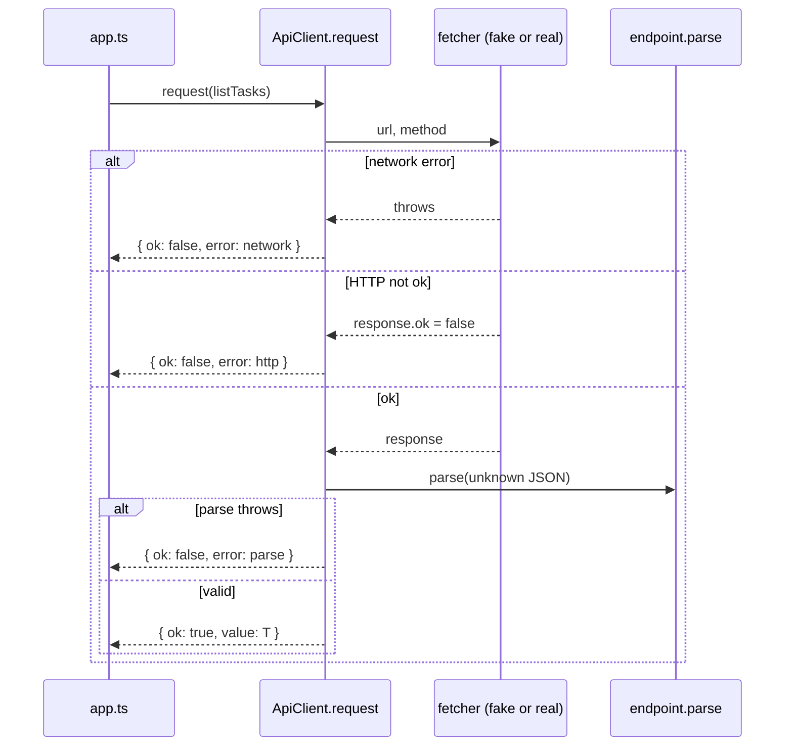

# 05. Generics and type-safe API clients

> **Draft: written but not yet run.** The code and the expected output in this lesson were prepared by reading the code and the official documentation. They have not been executed yet. If something does not behave as described, trust your tool's real output and report it.

## What you will be able to do
By the end of this lesson you will be able to:
- Write generic functions and interfaces with type parameters, constraints (`extends`) and `keyof`.
- Design a small API client where each endpoint carries the type of its response.
- Explain why `response.json() as T` is a lie and replace it with a validating parser.
- Represent success and failure as a `Result<T, E>` union and handle both without exceptions.

## Recap
1. Lesson 04: what does `assertNever(event)` prove when it compiles? <details><summary>Answer</summary>That every member of the union was handled, because `event` has type `never` in the `default` branch.</details>
2. Lesson 04: why is `unknown` safer than `any`? <details><summary>Answer</summary>You must narrow `unknown` before using it; `any` switches type checking off.</details>
3. Web 101 lesson 11: what does `await` do? <details><summary>Answer</summary>Pauses an async function until a promise settles, then continues with its result (or throws its error).</details>

## Why it matters
A function that returns the first item of a list should work for lists of numbers, strings and tasks, and the compiler should know which. Copying the function for each type is wasteful; typing it `any` throws safety away. **Generics** are type-level parameters: you write the function once with a placeholder `T`, and each call fills it in. They are also how almost every typed library works (arrays, promises, `fetch` helpers, `Map`). The most useful application on the web is the API client: the code that talks to the server should return typed, *checked* data, not "whatever the server sent, trust me".

## What you will build
A Node program with a typed API client built from small generic parts, driven by a fake network function so the output is the same every time. It lists tasks, fetches one task, then shows three kinds of failure (invalid data, HTTP 404, network error) as normal values. Lesson 07 uses the same ideas with the browser's real `fetch`.



## Before you start
- **Prerequisites:** [Web 201 lesson 04, unions, narrowing and utility types](04-unions-narrowing-utility-types.md).
- Lesson 04 done (the `Task` idea returns here). Node 22.12 or newer and npm.
- Time: 55 minutes. Two idea groups: generics (Steps 4 and 5), the client (Steps 6 to 8).
- Source pack (optional): every file is shown in full in this lesson, so you can follow without it. The finished code, the exercise starter and the solution are in the
  course repository https://github.com/Uee03/Code101 under `source/web/201-hero-to-super-hero/phase-2-typescript-in-depth/05-generics-and-typed-api-clients/` (on that page choose **Code, Download ZIP**, or run
  `git clone https://github.com/Uee03/Code101.git`).
- Windows PowerShell: if `npm.ps1` is blocked, use `npm.cmd` and `npx.cmd` as in lesson 04.

## Steps

### Step 1. Create the project folder
**Folder: your user folder**
```powershell
mkdir code101\web201\lesson05
```
```bash
mkdir -p ~/code101/web201/lesson05
```
Open `lesson05` in VS Code and a terminal whose prompt ends in `lesson05`.

### Step 2. Write the project files
The three project files are the same as lesson 04 except the `name` in `package.json`. Create them in `lesson05`.

**File: `package.json`**
```json
{
  "name": "web201-lesson-05",
  "version": "1.0.0",
  "private": true,
  "type": "module",
  "scripts": {
    "build": "tsc",
    "start": "node dist/app.js"
  },
  "engines": {
    "node": ">=22.12.0"
  },
  "devDependencies": {
    "typescript": "7.0.2"
  }
}
```

**File: `tsconfig.json`** (identical to lesson 04, Step 3)
```json
{
  "compilerOptions": {
    "target": "ES2022",
    "module": "ES2022",
    "moduleResolution": "Bundler",
    "lib": [
      "ES2022",
      "DOM"
    ],
    "rootDir": "src",
    "outDir": "dist",
    "strict": true,
    "noEmitOnError": true,
    "skipLibCheck": true
  },
  "include": [
    "src/**/*.ts"
  ]
}
```

**File: `.gitignore`**
```text
node_modules/
dist/
```

**Folder: `lesson05`**
```bash
npm install --no-audit --no-fund
```
Expected result: an install summary, a `node_modules` folder and a `package-lock.json`.

### Step 3. Write the model with a validating parser
Create `src/model.ts`. `parseTask` takes `unknown` and either returns a `Task` or throws. It is the only place in the program that decides what a valid task is. Note it checks *each field*, because a TypeScript type says nothing about real JSON.

**File: `src/model.ts`**
```ts
export type TaskStatus = "todo" | "doing" | "done";

export interface Task {
  readonly id: number;
  title: string;
  status: TaskStatus;
}

export function isTaskStatus(value: unknown): value is TaskStatus {
  return value === "todo" || value === "doing" || value === "done";
}

export function parseTask(data: unknown): Task {
  if (typeof data !== "object" || data === null) {
    throw new Error("Task must be an object");
  }
  const { id, title, status } = data as Record<string, unknown>;
  if (typeof id !== "number") {
    throw new Error("Task.id must be a number");
  }
  if (typeof title !== "string") {
    throw new Error("Task.title must be a string");
  }
  if (!isTaskStatus(status)) {
    throw new Error("Task.status is not valid");
  }
  return { id, title, status };
}
```
The one `as Record<string, unknown>` is deliberate: after the `object` and `null` checks we only need to *read* unknown properties, and each is checked before use.

### Step 4. Write the generic helpers
Create `src/generics.ts`. Predict first: for `firstOr([], "none")` what is `T`? For `getProp(obj, "title")` what is the return type?

**File: `src/generics.ts`**
```ts
export function firstOr<T>(items: readonly T[], fallback: T): T {
  return items.length > 0 ? items[0] : fallback;
}

export function getProp<T, K extends keyof T>(obj: T, key: K): T[K] {
  return obj[key];
}

export function parseArray<T>(parseItem: (item: unknown) => T): (data: unknown) => T[] {
  return (data) => {
    if (!Array.isArray(data)) {
      throw new Error("Expected an array");
    }
    return data.map((item) => parseItem(item));
  };
}
```
<details><summary>Answer</summary>

`T` is `string` for `firstOr([], "none")`: the empty array gives no information, and the fallback `"none"` does. `getProp({ id: 7, title: "Ship it" }, "title")` returns `string`, because `K` is inferred as the literal `"title"` and `T[K]` looks that property up in `T`.

</details>

### Step 5. Write the client
Create `src/client.ts`. Read it in three parts: the types that describe the network (so tests and Node can supply a fake), `Endpoint<T>` (a description of one call that remembers its response type), and `ApiClient.request` (which turns every outcome into a `Result`).

**File: `src/client.ts`**
```ts
export interface FetchResponse {
  readonly ok: boolean;
  readonly status: number;
  json(): Promise<unknown>;
}

export type FetchLike = (url: string, init?: { method?: string }) => Promise<FetchResponse>;

export interface ApiError {
  kind: "network" | "http" | "parse";
  message: string;
}

export type Result<T, E = ApiError> = { ok: true; value: T } | { ok: false; error: E };

export interface Endpoint<T> {
  readonly method: "GET" | "POST";
  readonly path: string;
  readonly parse: (data: unknown) => T;
}

export function endpoint<T>(
  method: "GET" | "POST",
  path: string,
  parse: (data: unknown) => T,
): Endpoint<T> {
  return { method, path, parse };
}

function errorMessage(error: unknown): string {
  return error instanceof Error ? error.message : String(error);
}

export class ApiClient {
  private readonly baseUrl: string;
  private readonly fetcher: FetchLike;

  constructor(baseUrl: string, fetcher: FetchLike) {
    this.baseUrl = baseUrl;
    this.fetcher = fetcher;
  }

  async request<T>(target: Endpoint<T>): Promise<Result<T>> {
    let response: FetchResponse;
    try {
      response = await this.fetcher(this.baseUrl + target.path, { method: target.method });
    } catch (error) {
      return { ok: false, error: { kind: "network", message: errorMessage(error) } };
    }
    if (!response.ok) {
      return { ok: false, error: { kind: "http", message: `HTTP ${response.status}` } };
    }
    try {
      const data: unknown = await response.json();
      return { ok: true, value: target.parse(data) };
    } catch (error) {
      return { ok: false, error: { kind: "parse", message: errorMessage(error) } };
    }
  }
}
```

### Step 6. Write the program with a fake network
Create `src/app.ts`. `fakeFetch` pretends to be a server: it answers `/tasks`, `/tasks/1` (valid), `/tasks/2` (status `"archived"`, which is not a valid status), throws for `/offline` and returns 404 for anything else. A fake like this makes the program deterministic, which is also how you test clients (lesson 12).

**File: `src/app.ts`**
```ts
import { ApiClient, endpoint, type FetchLike, type FetchResponse, type Result } from "./client.js";
import { firstOr, getProp, parseArray } from "./generics.js";
import { parseTask } from "./model.js";

function jsonResponse(status: number, body: unknown): FetchResponse {
  return { ok: status >= 200 && status < 300, status, json: async () => body };
}

const fakeFetch: FetchLike = async (url) => {
  if (url.endsWith("/tasks")) {
    return jsonResponse(200, [
      { id: 1, title: "Write lesson", status: "todo" },
      { id: 2, title: "Review lesson", status: "done" },
    ]);
  }
  if (url.endsWith("/tasks/1")) {
    return jsonResponse(200, { id: 1, title: "Write lesson", status: "todo" });
  }
  if (url.endsWith("/tasks/2")) {
    return jsonResponse(200, { id: 2, title: "Broken", status: "archived" });
  }
  if (url.endsWith("/offline")) {
    throw new Error("socket closed");
  }
  return jsonResponse(404, { message: "not found" });
};

function show<T>(label: string, result: Result<T>, format: (value: T) => string): void {
  if (result.ok) {
    console.log(`${label}: ${format(result.value)}`);
  } else {
    console.log(`${label}: ${result.error.kind} error - ${result.error.message}`);
  }
}

console.log(firstOr([], "none"));
console.log(firstOr([3, 4], 0));
console.log(getProp({ id: 7, title: "Ship it" }, "title"));

const client = new ApiClient("https://api.example.test", fakeFetch);
const listTasks = endpoint("GET", "/tasks", parseArray(parseTask));
const getTask = (id: number) => endpoint("GET", `/tasks/${id}`, parseTask);
const offline = endpoint("GET", "/offline", parseTask);

show("list", await client.request(listTasks), (tasks) => tasks.map((task) => task.title).join(", "));
show("task 1", await client.request(getTask(1)), (task) => `${task.title} [${task.status}]`);
show("task 2", await client.request(getTask(2)), (task) => task.title);
show("task 99", await client.request(getTask(99)), (task) => task.title);
show("offline", await client.request(offline), (task) => task.title);
```
The address `api.example.test` uses the reserved `.test` top-level domain, which never resolves on the real internet, so nothing here can reach a real server.

### Step 7. Predict, then run
Before running, predict the eight output lines, especially what `task 2` prints (the data *arrives* fine).

**Folder: `lesson05`**
```bash
npx tsc
node dist/app.js
```
Expected output (not yet run, derived from the code):
```text
none
3
Ship it
list: Write lesson, Review lesson
task 1: Write lesson [todo]
task 2: parse error - Task.status is not valid
task 99: http error - HTTP 404
offline: network error - socket closed
```
`task 2` fails as a *parse* error: the network call succeeded (HTTP 200) but the data is not a valid task, and the client refuses to pass it on.

### Step 8. Make a type error on purpose
In `src/app.ts`, change `"title"` in the `getProp` line to `"titel"` and run `npx tsc`. Predict the complaint, then fix the typo.

<details><summary>Answer</summary>

The compiler rejects the call because `K extends keyof T` and the object's keys are `"id" | "title"`. Typical message (wording may differ slightly): `error TS2345: Argument of type '"titel"' is not assignable to parameter of type '"id" | "title"'.` The typo is caught at compile time, with the valid keys listed.

</details>

## Run it
```bash
npx tsc
node dist/app.js
```
The output is the eight lines from Step 7.

## How it works
- **Type parameter.** `function firstOr<T>(...)` declares `T` like a function parameter, but for types. At each call the compiler **infers** `T` from the arguments, so you rarely write `firstOr<string>(...)` yourself.
- **Constraint.** `K extends keyof T` limits `K` to the property names of `T`. `keyof T` is the union of those names. `T[K]` (an indexed access type) is the type of that property.
- **Generic types.** `Result<T, E = ApiError>` is a type that takes parameters, and `E` has a **default**, so `Result<Task>` means `Result<Task, ApiError>`. `Endpoint<T>` carries `T` in its `parse` function: that is how the client knows what `request` returns without being told.
- **Higher-order generics.** `parseArray(parseTask)` takes a parser for one item and returns a parser for a list of items; `T` flows from `parseTask`'s return type to the `Task[]` result. `endpoint("GET", "/tasks", parseArray(parseTask))` is therefore an `Endpoint<Task[]>` with no annotations.
- **Why errors are values.** `request` never throws. Callers must look at `result.ok`, and the compiler narrows `result` to the success or failure shape. A thrown error can be forgotten; a union that must be checked cannot.
- **The lie to avoid.** Writing `const data = (await response.json()) as T` compiles, but it only *asserts* the type. If the server sends something else, the program carries a wrong value deep into your code before failing. A generic client must be paired with a runtime check, here `parse`. Libraries such as Zod or Valibot generate such parsers from a schema; the idea is the same.
- **Dependency injection.** The client takes `fetcher` as a constructor argument instead of calling a global `fetch`. In the browser you pass the real one, in tests or this lesson a fake.
- **Misconception to correct:** generics do not exist at run time. `T` is erased when the code is compiled, so you cannot write `if (x instanceof T)`; any run-time decision needs a real value such as the `parse` function.

**Why this, not that**

| Choice | Instead of | Why |
|---|---|---|
| `Result<T>` return | `throw` on every failure | Failure becomes part of the type; callers cannot ignore it |
| Parser per endpoint | `response.json() as T` | The type is verified against the real data |
| Inject `fetcher` | Calling global `fetch` inside the class | Deterministic tests and demos; one place to add auth or retries |
| Generic `Endpoint<T>` | One method per endpoint on the client | New endpoints are data, not new code |
| `unknown` into `parse` | `any` | Forces each field to be checked |

## Try it
Copy `lesson05` to `lesson05-try` (without `node_modules`), run `npm install` there, then add the two starter files below (they replace/extend `src`). The pack folder is `exercise/starter/src`.

**File: `src/page.ts`** (starter)
```ts
import { parseArray } from "./generics.js";

export interface Page<T> {
  items: T[];
  total: number;
}

// TODO 1: return a parser for { items: [...], total: number }.
// Reuse parseArray for the items and throw an Error when total is not a number.
export function parsePage<T>(parseItem: (item: unknown) => T): (data: unknown) => Page<T> {
  return () => {
    throw new Error("TODO 1");
  };
}
```

**File: `src/app.ts`** (starter; this replaces the lesson's `app.ts`)
```ts
import { ApiClient, endpoint, type FetchLike } from "./client.js";
import { parseTask } from "./model.js";
import { parsePage } from "./page.js";

const fakeFetch: FetchLike = async () => ({
  ok: true,
  status: 200,
  json: async () => ({
    items: [
      { id: 1, title: "Write lesson", status: "todo" },
      { id: 2, title: "Review lesson", status: "done" },
    ],
    total: 5,
  }),
});

const client = new ApiClient("https://api.example.test", fakeFetch);
const listPage = endpoint("GET", "/tasks?page=1", parsePage(parseTask));

const result = await client.request(listPage);
if (result.ok) {
  console.log(`Showing ${result.value.items.length} of ${result.value.total} tasks`);
} else {
  console.log(`${result.error.kind} error - ${result.error.message}`);
}
```
1. **Guided.** Complete TODO 1. Before it, the program prints `parse error - TODO 1`. Goal: it prints `Showing 2 of 5 tasks`.
2. **Change.** Give `ApiClient.request` a second parameter `retries = 0`. When the fetcher *throws* (a network error), try again up to `retries` times before returning the failure. To test it, make `fakeFetch` throw on its first call only. Goal: with `retries = 1` the program prints `Showing 2 of 5 tasks`; with `0` it prints a network error.
3. **Stretch (design choice).** `POST` endpoints need a request body whose type must match the endpoint. Sketch the types: should `Endpoint` get a second type parameter for the body, or should you make `postEndpoint<TBody, TResponse>` a separate function? Which keeps `GET` endpoints simpler? No single answer.

<details><summary>Solution</summary>

**File: `src/page.ts`** (solution)
```ts
import { parseArray } from "./generics.js";

export interface Page<T> {
  items: T[];
  total: number;
}

export function parsePage<T>(parseItem: (item: unknown) => T): (data: unknown) => Page<T> {
  const parseItems = parseArray(parseItem);
  return (data) => {
    if (typeof data !== "object" || data === null) {
      throw new Error("Page must be an object");
    }
    const { items, total } = data as Record<string, unknown>;
    if (typeof total !== "number") {
      throw new Error("Page.total must be a number");
    }
    return { items: parseItems(items), total };
  };
}
```
Expected output (not yet run):
```text
Showing 2 of 5 tasks
```
For the change rung, wrap the `await this.fetcher(...)` in a loop: `for (let attempt = 0; ; attempt += 1) { try { response = await ...; break; } catch (error) { if (attempt >= retries) return network error; } }`. Retry only network errors and idempotent methods like `GET`; retrying a `POST` can create duplicates.

</details>

## Check yourself
1. What does the compiler infer for `T` in `firstOr([3, 4], 0)`? <details><summary>Answer</summary>`number`.</details>
2. **Predict:** what is the type of `result` after `if (result.ok) { ... }` inside the block, and what is `result.error` outside it? <details><summary>Answer</summary>Inside the block it is the success member (`value` is available); in the `else` branch it is the failure member and `result.error` is an `ApiError`.</details>
3. Why is `(await response.json()) as Task` a problem? <details><summary>Answer</summary>It tells the compiler to trust the type without checking; invalid data would flow into the program unnoticed.</details>
4. What does `K extends keyof T` buy you in `getProp`? <details><summary>Answer</summary>`key` can only be a real property name of `obj`, and the return type becomes exactly that property's type.</details>
5. Why does `ApiClient` take the fetch function as a constructor argument? <details><summary>Answer</summary>So the real `fetch`, a test double or a demo fake can be used without changing the class.</details>

## Common mistakes
| Symptom | Cause | Fix |
|---|---|---|
| `npx` asks to install `tsc` | Wrong folder or no `npm install` | `cd lesson05`, `npm install` |
| `Top-level 'await' expressions are only allowed when the 'module' option is set ...` (typical message) | `module` in `tsconfig.json` is too old (for example `commonjs`) | Use the `tsconfig.json` from Step 2 |
| The program prints `parse error` for valid-looking data | `parseTask` rejects a field (a number sent as a string, a new status) | Read the message: it names the field |
| All results look correct but types are wrong at run time | A cast `as T` replaced the parser | Return `parse(data)`; never cast `json()` |

## Best practice
Keep the boundary between untyped data and typed code in one place (parsers), make failure part of the return type, and inject the network function so the client is testable. Source: TypeScript Handbook, Generics https://www.typescriptlang.org/docs/handbook/2/generics.html and MDN, Using the Fetch API https://developer.mozilla.org/en-US/docs/Web/API/Fetch_API/Using_Fetch

## Going further
- Handbook: [Generic constraints](https://www.typescriptlang.org/docs/handbook/2/generics.html#generic-constraints) and [Keyof type operator](https://www.typescriptlang.org/docs/handbook/2/keyof-types.html).
- Schema validation libraries (Zod, Valibot) generate `parse` functions and their TypeScript types from one schema; read their docs when you outgrow hand-written parsers.
- Lesson 07 uses this client shape with the browser's real `fetch`, `AbortController` and loading states. The capstones [web-angular](../../../../capstones/web-angular/) and [web-react](../../../../capstones/web-react/) type a client against the platform contract.

## Summary
- You wrote generic functions with constraints and `keyof`, and predicted what the compiler infers.
- You built an `Endpoint<T>` and `ApiClient` whose results are `Result<T>` values.
- You replaced a type cast with a validating parser and saw invalid data become a `parse` error.
- You injected a fake network function to make the program deterministic.

## Next lesson
06. Modules, Vite and the dev workflow: leave the compile-and-run loop for a dev server with hot reload and a production build.
