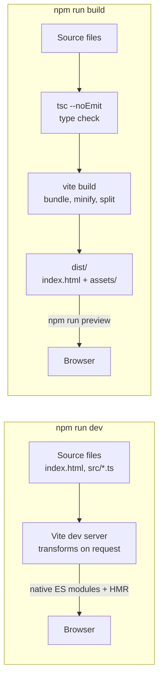

# 06. Modules, Vite and the dev workflow

> **Draft: written but not yet run.** The code and the expected output in this lesson were prepared by reading the code and the official documentation. They have not been executed yet. If something does not behave as described, trust your tool's real output and report it.

## What you will be able to do
By the end of this lesson you will be able to:
- Split code into ES modules and explain how the browser and a bundler resolve `import` and dynamic `import()`.
- Set up a Vite and TypeScript project by hand, with a complete `vite.config.ts`, and say what each setting does.
- Run the dev server, the type check, the production build and the preview server, and say what each is for.
- Expose a setting to the browser with `import.meta.env`, and explain why it is never a place for secrets.

## Recap
1. Lesson 04/05: why does `tsc` need `.js` in `import ... from "./tasks.js"` for Node? <details><summary>Answer</summary>Node's ES module loader needs the real file name of the compiled output, `tasks.js`; TypeScript maps it back to `tasks.ts` when type checking.</details>
2. Web 101 lesson 11: why did opening `index.html` by double-click fail to load a module script or JSON file? <details><summary>Answer</summary>Browsers block module scripts and `fetch` from `file://` pages (origin rules); you need a local web server.</details>
3. Lesson 03: which CSS file feature keeps `utilities` winning over `components`? <details><summary>Answer</summary>`@layer` order: later layers win regardless of specificity.</details>

## Why it matters
In Web 101 you compiled with `tsc` and served files with Live Server. That works for tiny pages, but real projects need more: many files, a dev server that updates the page when you save, environment settings, minified production files, and one command that checks everything. **Vite** is the standard tool for this on the web. In development it serves your source files as native ES modules and transforms them on demand, which starts in a moment and updates the browser without a full reload (hot module replacement, HMR). For production it bundles, minifies and splits your code. You will use this setup for the rest of the level.

## What you will build
A "Release notes" page written as five small modules. The page shows three notes, a "Mode" line (`development` or `production`), an optional title from an environment file, and a **Load details** button that loads one more module *on demand*. You will run it three ways: dev server, type check and production build, then the built site with the preview server.



## Before you start
- **Prerequisites:** Web 201 lessons [04, unions, narrowing and utility types](04-unions-narrowing-utility-types.md) and [05, generics and typed API clients](05-generics-and-typed-api-clients.md).
- Lessons 04 and 05. Node 22.12 or newer (course target: 26.13.1) and npm 11.20.0. Vite 8.3.8 needs Node 20.19+ or 22.12+.
- Time: 60 minutes. Two sittings: break after Step 9 (the dev server works), continue with the build.
- Source pack (optional): every file is shown in full in this lesson, so you can follow without it. The finished code, the exercise starter and the solution are in the
  course repository https://github.com/Uee03/Code101 under `source/web/201-hero-to-super-hero/phase-2-typescript-in-depth/06-modules-vite-and-dev-workflow/` (on that page choose **Code, Download ZIP**, or run
  `git clone https://github.com/Uee03/Code101.git`).
- Windows PowerShell: if `npm.ps1` is blocked use `npm.cmd` for the commands below.
- A note on `npm create vite`: the official scaffolder is `npm create vite@latest`. This lesson writes every file by hand so you meet each one. At the end you can scaffold a comparison project with a pinned version (see "Going further").

## Steps

### Step 1. Create the folder
**Folder: your user folder**
```powershell
mkdir code101\web201\lesson06
```
```bash
mkdir -p ~/code101/web201/lesson06
```
Open it in VS Code and open a terminal; the prompt must end in `lesson06`.

### Step 2. Write package.json
`scripts` are named commands you run with `npm run <name>`. The versions are exact so everyone gets the same behaviour: `vite` is the tool, `typescript` the type checker, `@types/node` supplies type definitions that Vite's own typings refer to (it does not add Node globals to your browser code, because `tsconfig.json` limits `types`).

**File: `package.json`**
```json
{
  "name": "web201-lesson-06",
  "version": "1.0.0",
  "private": true,
  "type": "module",
  "scripts": {
    "dev": "vite",
    "typecheck": "tsc --noEmit",
    "build": "tsc --noEmit && vite build",
    "preview": "vite preview"
  },
  "engines": {
    "node": ">=22.12.0"
  },
  "devDependencies": {
    "@types/node": "26.6.6",
    "typescript": "7.0.2",
    "vite": "8.3.8"
  }
}
```
Why `build` runs `tsc --noEmit` first: Vite transpiles TypeScript but **does not type check** it. Without the first half, a type error would not stop a production build.

### Step 3. Write tsconfig.json
This differs from lessons 04 and 05: the compiler no longer writes JavaScript (`noEmit`), because Vite does that. `moduleResolution: "Bundler"` matches how Vite resolves imports (extensionless paths allowed). `verbatimModuleSyntax` forces you to write `import type` for type-only imports, so the bundler never sees imports that exist only for types. `types: ["vite/client"]` loads Vite's typings (`import.meta.env`, asset imports) and nothing else.

**File: `tsconfig.json`**
```json
{
  "compilerOptions": {
    "target": "ES2022",
    "lib": ["ES2022", "DOM", "DOM.Iterable"],
    "module": "ESNext",
    "moduleResolution": "Bundler",
    "moduleDetection": "force",
    "types": ["vite/client"],
    "strict": true,
    "noEmit": true,
    "verbatimModuleSyntax": true,
    "isolatedModules": true,
    "skipLibCheck": true,
    "noUnusedLocals": true,
    "noUnusedParameters": true,
    "noFallthroughCasesInSwitch": true
  },
  "include": ["src", "vite.config.ts"]
}
```

### Step 4. Write vite.config.ts
This is the whole configuration. Everything not listed uses Vite's defaults.

**File: `vite.config.ts`**
```ts
import { defineConfig } from "vite";

export default defineConfig({
  server: {
    port: 5173,
    strictPort: true,
  },
  preview: {
    port: 4173,
    strictPort: true,
  },
  build: {
    outDir: "dist",
    sourcemap: true,
    target: "baseline-widely-available",
  },
});
```
Line by line:
- `defineConfig` does nothing at run time; it only gives your editor type help for the object.
- `server.port` is where `npm run dev` listens. `strictPort: true` makes Vite exit with an error if 5173 is busy, instead of silently moving to 5174 (which would break any bookmark, CORS rule or test that expects 5173; lesson 10 depends on this).
- `preview.port` is the same for `npm run preview`; 4173 is Vite's default.
- `build.outDir` is where the production files go (default `dist`).
- `build.sourcemap: true` writes `.map` files so browser DevTools can show your original TypeScript for production code. Source maps reveal your source to anyone who downloads them; use `"hidden"` and upload them to an error tracker if that matters.
- `build.target: "baseline-widely-available"` is Vite's default: it compiles for browser versions that support features considered Baseline Widely Available. Lowering it makes bigger bundles; raising it (`"esnext"`) assumes very new browsers.

### Step 5. Write index.html
In a Vite project `index.html` sits in the project root and **is the entry point**: Vite reads it, finds the `<script type="module" src="/src/main.ts">` and the stylesheet link, and builds from there. A leading `/` in `/src/...` means "from the project root". The `data:,` icon stops the browser asking the server for `/favicon.ico` (which would be a harmless 404 noise otherwise).

**File: `index.html`**
```html
<!doctype html>
<html lang="en">
<head>
  <meta charset="utf-8">
  <meta name="viewport" content="width=device-width, initial-scale=1">
  <title>Release notes</title>
  <link rel="icon" href="data:,">
  <link rel="stylesheet" href="/src/style.css">
</head>
<body>
  <main class="shell">
    <h1 id="title">Release notes</h1>
    <p class="muted">Mode: <strong id="mode"></strong></p>
    <ul id="notes" class="notes"></ul>
    <button id="details-button" class="button" type="button">Load details</button>
    <p id="details-output" class="muted" role="status"></p>
  </main>
  <script type="module" src="/src/main.ts"></script>
</body>
</html>
```

### Step 6. Write the stylesheet
Create the folder `src` and `src/style.css`. (Tokens as in lesson 01; the file is small on purpose.)

**File: `src/style.css`**
```css
:root {
  color-scheme: light dark;
  --bg: light-dark(#ffffff, #0b1220);
  --text: light-dark(#0f172a, #e2e8f0);
  --muted: light-dark(#475569, #a7b3c7);
  --accent: light-dark(#1d4ed8, #7cb0ff);
  --on-accent: light-dark(#ffffff, #0b1220);
  --border: light-dark(#cbd5e1, #334155);
}

body {
  margin: 0;
  font-family: system-ui, -apple-system, "Segoe UI", Roboto, sans-serif;
  line-height: 1.5;
  background: var(--bg);
  color: var(--text);
}

.shell {
  max-inline-size: 40rem;
  margin-inline: auto;
  padding: 1.5rem;
}

.muted {
  color: var(--muted);
}

.notes {
  padding-inline-start: 1.25rem;
}

.notes li {
  margin-block-end: 0.5rem;
}

.button {
  min-block-size: 2.75rem;
  padding-inline: 1rem;
  border: 1px solid var(--accent);
  border-radius: 0.5rem;
  background: var(--accent);
  color: var(--on-accent);
  font: inherit;
  cursor: pointer;
}

:focus-visible {
  outline: 3px solid var(--accent);
  outline-offset: 2px;
}
```

### Step 7. Write the typed environment, the data and the DOM helper
`src/env.d.ts` tells TypeScript which `VITE_` variables exist (it **merges** with Vite's own `ImportMetaEnv` interface). `src/notes.ts` is plain data. `src/dom.ts` is a generic helper you will reuse in every later lesson: it finds an element and *proves* its type with `instanceof`, throwing a clear error otherwise, so no `as HTMLButtonElement` cast is needed.

**File: `src/env.d.ts`**
```ts
/// <reference types="vite/client" />

interface ImportMetaEnv {
  readonly VITE_APP_TITLE?: string;
}
```

**File: `src/notes.ts`**
```ts
export interface ReleaseNote {
  readonly version: string;
  readonly date: string;
  readonly summary: string;
}

export const notes: readonly ReleaseNote[] = [
  { version: "1.2.0", date: "2026-11-02", summary: "Dark mode and a faster search." },
  { version: "1.1.0", date: "2026-09-14", summary: "Keyboard shortcuts for the task list." },
  { version: "1.0.0", date: "2026-06-30", summary: "First public release." },
];
```

**File: `src/dom.ts`**
```ts
export function requireElement<T extends Element>(selector: string, type: new () => T): T {
  const element = document.querySelector(selector);
  if (!(element instanceof type)) {
    throw new Error(`Expected ${selector} to be a ${type.name}`);
  }
  return element;
}
```
`type: new () => T` means "a constructor that makes a `T`", such as `HTMLButtonElement`. The `instanceof` check narrows `element` to `T`, and also rejects `null`.

### Step 8. Write the render module, the lazy module and main
`render.ts` builds list items with `textContent`. `details.ts` is imported only when the button is clicked, with `await import("./details")`; Vite builds it into its own file. `main.ts` is the entry that wires everything. The `import type` line in `render.ts` is erased completely at build time.

**File: `src/render.ts`**
```ts
import type { ReleaseNote } from "./notes";

export function renderNotes(list: HTMLElement, items: readonly ReleaseNote[]): void {
  const rows = items.map((note) => {
    const item = document.createElement("li");
    const heading = document.createElement("strong");
    heading.textContent = `${note.version} (${note.date})`;
    const summary = document.createElement("span");
    summary.textContent = ` - ${note.summary}`;
    item.append(heading, summary);
    return item;
  });
  list.replaceChildren(...rows);
}
```

**File: `src/details.ts`**
```ts
export function explain(count: number): string {
  return `This build ships ${count} release notes. This sentence came from a separately loaded module.`;
}
```

**File: `src/main.ts`**
```ts
import { requireElement } from "./dom";
import { notes } from "./notes";
import { renderNotes } from "./render";

requireElement("#title", HTMLHeadingElement).textContent = import.meta.env.VITE_APP_TITLE ?? "Release notes";
requireElement("#mode", HTMLElement).textContent = import.meta.env.MODE;
renderNotes(requireElement("#notes", HTMLUListElement), notes);

const output = requireElement("#details-output", HTMLParagraphElement);
requireElement("#details-button", HTMLButtonElement).addEventListener("click", async () => {
  const { explain } = await import("./details");
  output.textContent = explain(notes.length);
});
```

### Step 9. Ignore generated files, install, run the dev server
The `.gitignore` keeps dependencies, build output and your real `.env` out of version control. `.env.example` documents the setting without being a secret; you copy it to `.env`.

**File: `.gitignore`**
```text
node_modules/
dist/
.env
.env.*.local
```

**File: `.env.example`**
```text
VITE_APP_TITLE=Release notes (from .env)
```

**Folder: `lesson06`**
```bash
npm install --no-audit --no-fund
npm run dev
```
Expected result (typical Vite output; exact lines and timing depend on the version): the first command prints a short install summary and creates `package-lock.json`. The second prints a banner with the Vite version and a line such as `Local:   http://localhost:5173/`. Leave the terminal running and open that address in the browser.

You should see: the heading **Release notes**, a line `Mode: development`, three list items (`1.2.0 (2026-11-02) - Dark mode and a faster search.` and so on), and a **Load details** button. Clicking the button writes the sentence from `details.ts` under it.

**Predict, then do:** what will the heading say after you copy `.env.example` to a new file named `.env` (same folder) *without* restarting the server? Then restart and look again.

<details><summary>Answer</summary>

Without a restart the heading stays **Release notes**: Vite reads `.env` files when it starts (its documentation says to restart the server after changing them). After `Ctrl+C` and `npm run dev` it reads **Release notes (from .env)**. The `??` in `main.ts` is the fallback for when the variable is not set.

</details>

**Break point: you can stop here and resume later.**

### Step 10. See hot reload
With the dev server running, edit `src/notes.ts`: change `"First public release."` to `"First public release (edited)."` and save. The browser list updates within a moment, usually without a full page reload (HMR); some changes (like editing `index.html`) do trigger a full reload.

### Step 11. Type check and production build
Stop the server (`Ctrl+C`). Then:

**Folder: `lesson06`**
```bash
npm run typecheck
npm run build
```
Expected result: `typecheck` prints nothing apart from npm's script header lines when there are no errors. `build` runs the type check, then Vite prints the list of files it wrote under `dist/` with their sizes: `dist/index.html`, one `.css` file and at least two `.js` files in `dist/assets/` (the main code and the `details` module that loads on demand) plus `.map` files. File names carry a hash of their contents so browsers can cache them forever (typical output; hashes and sizes vary).

### Step 12. Preview the build
**Folder: `lesson06`**
```bash
npm run preview
```
Open `http://localhost:4173/`. The page looks the same, but now `Mode: production`. In DevTools **Network** (reload with the panel open) click **Load details** and watch a second JavaScript file load only then: that is the dynamic `import()`. Stop the server with `Ctrl+C`.

## Run it
Three commands, three purposes:

| Command | Use it for | What runs |
|---|---|---|
| `npm run dev` | Writing code | Dev server, source modules on demand, HMR |
| `npm run build` | Before you ship | Type check, then the bundle in `dist/` |
| `npm run preview` | Checking the build locally | A static server for `dist/`, **not** for production |

## How it works
- **ES modules** (`import`/`export`) are part of JavaScript. A browser can load them natively with `<script type="module">`; each import is a separate request. That is fine for development but slow for production, hence a bundle.
- **Dev server.** Vite serves each source file as a module and transforms TypeScript to JavaScript when the browser asks for it. Only the modules the page needs are processed, so startup does not grow with project size. When you save, Vite tells the page to swap just the changed module (HMR).
- **Build.** `vite build` follows imports from `index.html`, bundles with Rolldown, minifies, splits dynamic imports into their own chunks and writes hashed file names. A **chunk** is one output JavaScript file.
- **Dynamic import.** `import("./details")` returns a promise for the module. It is the unit of **code splitting**: code the visitor may never need is not downloaded up front (lesson 11 measures the effect).
- **Type check is separate.** Vite uses a fast transpiler that deletes types without checking them. `tsc --noEmit` is the type checker. This split is why `build` runs both.
- **Environment variables.** `import.meta.env.VITE_*` values are *replaced by their text* at build time and end up in the JavaScript anyone can download. Vite only exposes names that start with `VITE_`, as a guard. Never put an API secret there; secrets belong on a server (lesson 10).
- **Misconception to correct:** `npm run preview` is not a production server. It is a convenience to test the built files; deployment (lesson 12) uses a real static server.

**Why this, not that**

| Choice | Instead of | Why |
|---|---|---|
| Vite | Hand-configured webpack or no bundler | Fast dev server, sane defaults, one small config |
| Vite plus `tsc --noEmit` | Trusting Vite to catch type errors | Vite does not type check |
| `import type` (`verbatimModuleSyntax`) | Plain `import` of types | The bundler never sees imports that only exist for types |
| Exact versions in `package.json` and a lockfile | `^` ranges only | Same install on every machine; upgrades are deliberate |
| `strictPort: true` | Letting Vite pick another port | Predictable origin for bookmarks, tests and CORS settings |

## Try it
Copy `lesson06` to `lesson06-try` (without `node_modules` and `dist`), run `npm install` there, then overlay the two starter files (`src/stats.ts` and `src/main.ts`).

**File: `src/stats.ts`** (starter)
```ts
import type { ReleaseNote } from "./notes";

// TODO 1: return the version of the first (newest) note, or "none" when the list is empty.
// Rename _items to items when you use it (the underscore tells the compiler it is unused for now).
export function latestVersion(_items: readonly ReleaseNote[]): string {
  throw new Error("TODO 1");
}
```

**File: `src/main.ts`** (starter; replaces the lesson's `main.ts`)
```ts
import { requireElement } from "./dom";
import { notes } from "./notes";
import { renderNotes } from "./render";
import { latestVersion } from "./stats";

requireElement("#title", HTMLHeadingElement).textContent = import.meta.env.VITE_APP_TITLE ?? "Release notes";
requireElement("#mode", HTMLElement).textContent = import.meta.env.MODE;
renderNotes(requireElement("#notes", HTMLUListElement), notes);

const output = requireElement("#details-output", HTMLParagraphElement);
requireElement("#details-button", HTMLButtonElement).addEventListener("click", async () => {
  const { explain } = await import("./details");
  output.textContent = `${explain(notes.length)} Latest version: ${latestVersion(notes)}.`;
});
```
1. **Guided.** Complete TODO 1 and run `npm run dev`. Goal: clicking **Load details** adds `Latest version: 1.2.0.` to the sentence. Before it, the click throws `TODO 1` in the console.
2. **Change.** Create `.env.production` containing `VITE_APP_TITLE=Release notes (production build)`. Goal: the dev server shows the title from `.env`, while `npm run build` followed by `npm run preview` shows the production title. Explain which file wins in each mode.
3. **Stretch (design choice).** The `details` chunk is tiny. When would manual chunking or more dynamic imports be worth the extra requests? Decide a rule of thumb (size, frequency of use, shared dependencies) and note what you would measure first.

<details><summary>Solution</summary>

**File: `src/stats.ts`** (solution)
```ts
import type { ReleaseNote } from "./notes";

export function latestVersion(items: readonly ReleaseNote[]): string {
  return items[0]?.version ?? "none";
}
```
**File: `.env.production`** (solution)
```text
VITE_APP_TITLE=Release notes (production build)
```
Vite loads `.env` in every mode, then the mode-specific file (`.env.production` in a build, `.env.development` in dev); values in the mode-specific file win. So `npm run dev` shows the `.env` title and the production build shows the production title. If you have no `.env`, the dev server falls back to the `??` text. For the stretch, a common rule is "split by route or rarely used feature, not by size alone, and measure first".

</details>

## Check yourself
1. Why does the `build` script run `tsc --noEmit` before `vite build`? <details><summary>Answer</summary>Vite removes types without checking them, so only `tsc` catches type errors.</details>
2. **Predict:** you add `SECRET_KEY=abc` to `.env` and read `import.meta.env.SECRET_KEY` in `main.ts`. What do you get in the browser? <details><summary>Answer</summary>`undefined`: only variables starting with `VITE_` are exposed. (If you named it `VITE_SECRET_KEY` it would be exposed, and visible to every visitor.)</details>
3. What does `strictPort: true` change? <details><summary>Answer</summary>Vite exits with an error if the port is taken instead of picking the next free one.</details>
4. What is the difference between `npm run dev` and `npm run preview`? <details><summary>Answer</summary>`dev` serves source modules with HMR for development; `preview` serves the already built `dist/` folder to check it locally.</details>
5. Where in the build output would you look to confirm that `details.ts` is lazily loaded? <details><summary>Answer</summary>`dist/assets/` has a separate `.js` file for it, and the Network panel shows it loading only after the button click.</details>

## Common mistakes
| Symptom | Cause | Fix |
|---|---|---|
| `npm.ps1 cannot be loaded because running scripts is disabled on this system` | PowerShell execution policy | Use `npm.cmd run dev` etc. |
| Vite exits saying port 5173 is in use (typical message: `Port 5173 is already in use`) | Another dev server is running and `strictPort` is on | Stop the other server, or change `server.port` |
| `Failed to resolve import "./notez" from "src/main.ts". Does the file exist?` (typical message) | Typo in an import path | Fix the path; it is relative to the importing file |
| The heading ignores `.env` | The server was not restarted, the file is not named exactly `.env`, or the variable lacks the `VITE_` prefix | Restart `npm run dev`; check name and prefix |
| `Property 'env' does not exist on type 'ImportMeta'.` (typical message) | `types: ["vite/client"]` missing, or `env.d.ts` not inside `src` | Check `tsconfig.json` and the file location |
| `'ReleaseNote' is a type and must be imported using a type-only import when 'verbatimModuleSyntax' is enabled.` (typical message) | A type was imported with plain `import { ReleaseNote }` | Use `import type { ReleaseNote }` |
| `npm run preview` shows an empty page or an error about missing `dist` | You have not built yet | Run `npm run build` first |

## Best practice
Treat the type check and the build as separate steps, pin tool versions, keep secrets out of anything that reaches the browser, and test the built output (`preview`) before shipping. Source: Vite documentation, Getting Started https://vite.dev/guide/ and Building for Production https://vite.dev/guide/build

## Going further
- Compare with the official template: in a different folder run `npm create vite@9.3.4 compare-app -- --template vanilla-ts --no-interactive` (create-vite 9.3.4 was the latest when this lesson was written; template contents change between versions, so read, do not copy).
- Vite docs: [Env variables and modes](https://vite.dev/guide/env-and-mode), [Features](https://vite.dev/guide/features), [Config reference](https://vite.dev/config/).
- Where this setup reappears: lessons 07 to 12 use this exact project shape. The [web-react](../../../../capstones/web-react/) capstone uses Vite as its build tool.

## Summary
- You split an app into ES modules and used a dynamic `import()` for code that loads on demand.
- You wrote `package.json`, `tsconfig.json` and a complete `vite.config.ts` and said what each setting does.
- You ran the dev server, the type check, the production build and the preview server.
- You exposed a `VITE_` setting through `import.meta.env` and explained why it must not hold secrets.

## Next lesson
07. Fetching data: `fetch`, `AbortController`, loading and error states, and a typed client in the browser, using this project shape.
