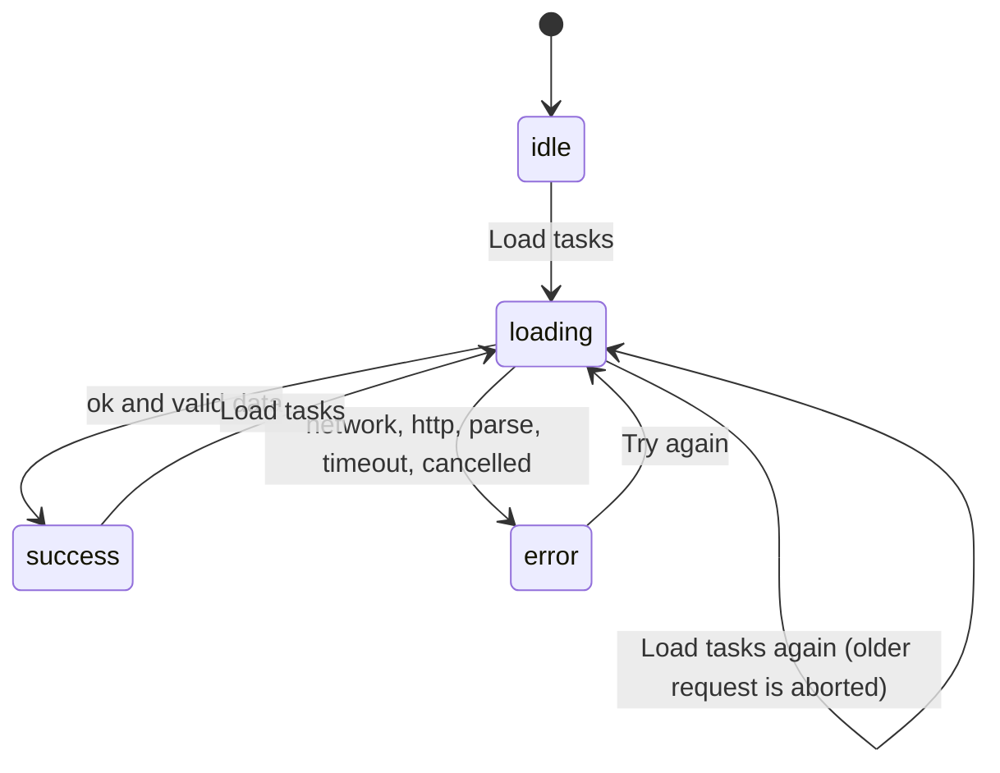

# 07. Fetching data: fetch, AbortController, loading and error states

> **Draft: written but not yet run.** The code and the expected output in this lesson were prepared by reading the code and the official documentation. They have not been executed yet. If something does not behave as described, trust your tool's real output and report it.

## What you will be able to do
By the end of this lesson you will be able to:
- Call `fetch`, check `response.ok`, and say which failures make `fetch` reject and which do not.
- Cancel a request and add a timeout with `AbortController` and `AbortSignal`.
- Model idle, loading, success and error as one union type and render each state accessibly.
- Prevent a slow, old response from overwriting a newer one.

## Recap
1. Lesson 05: why does the client return `Result<T>` instead of throwing? <details><summary>Answer</summary>Failure becomes part of the return type, so callers must handle it and the compiler narrows success and failure.</details>
2. Lesson 06: what does `npm run dev` serve, and from which folder does Vite serve files such as `/api/tasks.json` as-is? <details><summary>Answer</summary>Source modules transformed on demand with HMR; files in the `public/` folder are served unchanged from the site root.</details>
3. Lesson 04: how does a discriminated union help a `switch`? <details><summary>Answer</summary>Checking the tag narrows the object so only that case's fields are available, and `assertNever` can prove every case is handled.</details>

## Why it matters
Almost every real page loads data. A page that only handles the happy path shows a blank area when the network is slow, a blank area when it fails, and sometimes the *wrong* data when two requests finish out of order. Three facts of `fetch` surprise people: it **resolves** (does not throw) for HTTP 404 and 500 responses, it takes a second `await` to read the body, and it never times out on its own. Treating these as first-class states is the difference between a demo and a product.

## What you will build
A "Tasks from a server" page: a **Scenario** drop-down (normal, slow, server error, network error, bad data, stalled), a **Load tasks** button, a **Cancel** button while loading, a live status line and an error panel with **Try again**. The "normal" scenario really fetches `/api/tasks.json`; the others are simulated by a wrapper so you can see every state on demand.



## Before you start
- Lesson 06 done. Use the same tools. Time: 60 minutes; break after Step 9.
- This project starts from lesson 06's setup. Create `code101/web201/lesson07` and copy these four files from `lesson06` without changes (they are identical): `tsconfig.json`, `vite.config.ts`, `.gitignore`, and `src/dom.ts`. If you do not have them, create them from [lesson 06, Step 3](../phase-2-typescript-in-depth/06-modules-vite-and-dev-workflow.md#step-3-write-tsconfigjson), [Step 4](../phase-2-typescript-in-depth/06-modules-vite-and-dev-workflow.md#step-4-write-viteconfigts), [Step 9](../phase-2-typescript-in-depth/06-modules-vite-and-dev-workflow.md#step-9-ignore-generated-files-install-run-the-dev-server) and [Step 7](../phase-2-typescript-in-depth/06-modules-vite-and-dev-workflow.md#step-7-write-the-typed-environment-the-data-and-the-dom-helper). The only file that differs is `package.json` (the name).
- Source pack (optional): every file is shown in full in this lesson, so you can follow without it. The finished code, the exercise starter and the solution are in the
  course repository https://github.com/Uee03/Code101 under `source/web/201-hero-to-super-hero/phase-3-app-patterns/07-fetching-data/` (on that page choose **Code, Download ZIP**, or run
  `git clone https://github.com/Uee03/Code101.git`).
- Windows PowerShell: use `npm.cmd` if `npm.ps1` is blocked.

## Steps

### Step 1. Create the folder and the copied files
**Folder: your user folder**
```powershell
mkdir code101\web201\lesson07\src
mkdir code101\web201\lesson07\public\api
```
```bash
mkdir -p ~/code101/web201/lesson07/src ~/code101/web201/lesson07/public/api
```
Copy the four identical files from the list above. Open `lesson07` in VS Code and a terminal ending in `lesson07`.

### Step 2. Write package.json
Same as lesson 06 except `name`.

**File: `package.json`**
```json
{
  "name": "web201-lesson-07",
  "version": "1.0.0",
  "private": true,
  "type": "module",
  "scripts": {
    "dev": "vite",
    "typecheck": "tsc --noEmit",
    "build": "tsc --noEmit && vite build",
    "preview": "vite preview"
  },
  "engines": {
    "node": ">=22.12.0"
  },
  "devDependencies": {
    "@types/node": "26.6.6",
    "typescript": "7.0.2",
    "vite": "8.3.8"
  }
}
```

### Step 3. Write the data the page fetches
Files in `public/` are copied to the site root as they are, so this file is served at `/api/tasks.json`. It stands in for a real server endpoint.

**File: `public/api/tasks.json`**
```json
[
  { "id": 1, "title": "Write the fetch lesson", "status": "doing" },
  { "id": 2, "title": "Review the error states", "status": "todo" },
  { "id": 3, "title": "Ship the task board", "status": "todo" }
]
```

### Step 4. Write the page
The status line has `role="status"` (a polite live region: screen readers announce changes without moving focus). The error panel has `role="alert"` (announced immediately) and starts `hidden`. The warning icon is the CC0 `ui/alert-triangle` icon from the course art library, marked decorative with `aria-hidden="true"` because the text already says what happened. The `<label for="scenario">` ties the visible text to the `<select>` (lesson 09 covers forms in depth).

**File: `index.html`**
```html
<!doctype html>
<html lang="en">
<head>
  <meta charset="utf-8">
  <meta name="viewport" content="width=device-width, initial-scale=1">
  <title>Tasks from a server</title>
  <link rel="icon" href="data:,">
  <link rel="stylesheet" href="/src/style.css">
</head>
<body>
  <main class="shell">
    <h1>Tasks from a server</h1>

    <div class="controls">
      <label for="scenario">Scenario</label>
      <select id="scenario">
        <option value="normal">Normal</option>
        <option value="slow">Slow (2.5 seconds)</option>
        <option value="server-error">Server error (500)</option>
        <option value="offline">Network error</option>
        <option value="bad-data">Bad data</option>
        <option value="stalled">Stalled (times out after 8 seconds)</option>
      </select>
      <button id="load" class="button" type="button">Load tasks</button>
      <button id="cancel" class="button button--ghost" type="button" hidden>Cancel</button>
    </div>

    <p id="status" role="status">Nothing loaded yet.</p>

    <div id="error" class="panel" role="alert" hidden>
      <svg xmlns="http://www.w3.org/2000/svg" viewBox="0 0 24 24" width="24" height="24" fill="none" stroke="currentColor" stroke-width="2" stroke-linecap="round" stroke-linejoin="round" aria-hidden="true" focusable="false">
        <path d="M10.29 3.86L1.82 18a2 2 0 0 0 1.71 3h16.94a2 2 0 0 0 1.71-3L13.71 3.86a2 2 0 0 0-3.42 0z"/>
        <line x1="12" y1="9" x2="12" y2="13"/>
        <line x1="12" y1="17" x2="12.01" y2="17"/>
      </svg>
      <p id="error-text"></p>
      <button id="retry" class="button" type="button">Try again</button>
    </div>

    <ul id="tasks" class="tasks"></ul>
  </main>
  <script type="module" src="/src/main.ts"></script>
</body>
</html>
```

### Step 5. Write the stylesheet
`[hidden] { display: none !important; }` matters: an author rule such as `.panel { display: grid }` would otherwise beat the browser's built-in `[hidden]` style and the "hidden" panel would stay visible.

**File: `src/style.css`**
```css
:root {
  color-scheme: light dark;
  --bg: light-dark(#ffffff, #0b1220);
  --surface: light-dark(#f1f5f9, #172033);
  --text: light-dark(#0f172a, #e2e8f0);
  --muted: light-dark(#475569, #a7b3c7);
  --accent: light-dark(#1d4ed8, #7cb0ff);
  --on-accent: light-dark(#ffffff, #0b1220);
  --danger: light-dark(#b91c1c, #fca5a5);
  --border: light-dark(#cbd5e1, #334155);
}

[hidden] {
  display: none !important;
}

body {
  margin: 0;
  font-family: system-ui, -apple-system, "Segoe UI", Roboto, sans-serif;
  line-height: 1.5;
  background: var(--bg);
  color: var(--text);
}

.shell {
  max-inline-size: 40rem;
  margin-inline: auto;
  padding: 1.5rem;
}

.controls {
  display: flex;
  flex-wrap: wrap;
  align-items: center;
  gap: 0.75rem;
}

select {
  min-block-size: 2.75rem;
  padding-inline: 0.5rem;
  border: 1px solid var(--border);
  border-radius: 0.5rem;
  background: var(--surface);
  color: var(--text);
  font: inherit;
}

.button {
  min-block-size: 2.75rem;
  padding-inline: 1rem;
  border: 1px solid var(--accent);
  border-radius: 0.5rem;
  background: var(--accent);
  color: var(--on-accent);
  font: inherit;
  cursor: pointer;
}

.button--ghost {
  background: transparent;
  color: var(--text);
  border-color: var(--border);
}

.panel {
  display: grid;
  grid-template-columns: auto 1fr;
  align-items: center;
  gap: 0.5rem 0.75rem;
  padding: 1rem;
  border: 2px solid var(--danger);
  border-radius: 0.5rem;
  color: var(--danger);
}

.panel p {
  margin: 0;
}

.panel .button {
  grid-column: 1 / -1;
  justify-self: start;
}

.tasks {
  padding-inline-start: 1.25rem;
}

:focus-visible {
  outline: 3px solid var(--accent);
  outline-offset: 2px;
}
```

### Step 6. Write the model and the HTTP message helper
`model.ts` is lesson 05's parser, plus `parseTasks` for a list. `messages.ts` turns an HTTP status into a sentence a person can read; it is deliberately tiny, because the exercise improves it.

**File: `src/model.ts`**
```ts
export type TaskStatus = "todo" | "doing" | "done";

export interface Task {
  readonly id: number;
  title: string;
  status: TaskStatus;
}

export function isTaskStatus(value: unknown): value is TaskStatus {
  return value === "todo" || value === "doing" || value === "done";
}

export function parseTask(data: unknown): Task {
  if (typeof data !== "object" || data === null) {
    throw new Error("Task must be an object");
  }
  const { id, title, status } = data as Record<string, unknown>;
  if (typeof id !== "number") {
    throw new Error("Task.id must be a number");
  }
  if (typeof title !== "string") {
    throw new Error("Task.title must be a string");
  }
  if (!isTaskStatus(status)) {
    throw new Error("Task.status is not valid");
  }
  return { id, title, status };
}

export function parseTasks(data: unknown): Task[] {
  if (!Array.isArray(data)) {
    throw new Error("Expected a list of tasks");
  }
  return data.map((item) => parseTask(item));
}
```

**File: `src/messages.ts`**
```ts
export function httpMessage(status: number): string {
  return `The server answered ${status}`;
}
```

### Step 7. Write the request function
Read `getJson` slowly; it is the heart of the lesson.
- `AbortSignal.timeout(ms)` makes a signal that aborts itself after `ms` milliseconds with a `TimeoutError`.
- `AbortSignal.any([...])` combines signals: the result aborts when *any* input aborts, so the caller's **Cancel** and the timeout both work.
- `fetch` rejects only when the request could not complete (network down, aborted, blocked). A 404 or 500 **resolves**, so `response.ok` (true for 200 to 299) must be checked.
- `response.json()` is a second promise and can reject: the body might not be JSON, or the request may be aborted mid-body.
- Every outcome is mapped to the `Result` type from lesson 05, now with `aborted` and `timeout` kinds.

**File: `src/api.ts`**
```ts
import { httpMessage } from "./messages";

export interface ApiError {
  kind: "network" | "http" | "parse" | "aborted" | "timeout";
  message: string;
}

export type Result<T> = { ok: true; value: T } | { ok: false; error: ApiError };

export type Fetcher = (input: string, init?: RequestInit) => Promise<Response>;

export interface RequestOptions {
  fetcher?: Fetcher;
  signal?: AbortSignal;
  timeoutMs?: number;
}

function classify(error: unknown): ApiError {
  if (error instanceof DOMException && error.name === "AbortError") {
    return { kind: "aborted", message: "Request cancelled" };
  }
  if (error instanceof DOMException && error.name === "TimeoutError") {
    return { kind: "timeout", message: "The server took too long to answer" };
  }
  return { kind: "network", message: error instanceof Error ? error.message : "Network error" };
}

export async function getJson<T>(
  url: string,
  parse: (data: unknown) => T,
  options: RequestOptions = {},
): Promise<Result<T>> {
  const fetcher: Fetcher = options.fetcher ?? fetch;
  const signals: AbortSignal[] = [AbortSignal.timeout(options.timeoutMs ?? 8000)];
  if (options.signal) {
    signals.push(options.signal);
  }
  const signal = AbortSignal.any(signals);

  let response: Response;
  try {
    response = await fetcher(url, { signal, headers: { Accept: "application/json" } });
  } catch (error) {
    return { ok: false, error: classify(error) };
  }
  if (!response.ok) {
    return { ok: false, error: { kind: "http", message: httpMessage(response.status) } };
  }
  try {
    const data: unknown = await response.json();
    return { ok: true, value: parse(data) };
  } catch (error) {
    if (error instanceof DOMException) {
      return { ok: false, error: classify(error) };
    }
    const message = error instanceof Error ? error.message : "Unreadable response";
    return { ok: false, error: { kind: "parse", message } };
  }
}
```

### Step 8. Write the scenario simulator
`fetcherFor(scenario)` returns a `Fetcher` with the same shape as the real `fetch`. `wait(ms, signal)` is a delay that **honours the abort signal**, so Cancel and timeouts work even for simulated waits. A `TypeError("Failed to fetch")` is what Chromium browsers throw for a network failure (the exact text differs by browser, which is why `getJson` shows the error's message only as a hint).

**File: `src/scenarios.ts`**
```ts
import type { Fetcher } from "./api";

export const SCENARIOS = ["normal", "slow", "server-error", "offline", "bad-data", "stalled"] as const;
export type Scenario = (typeof SCENARIOS)[number];

export function isScenario(value: string): value is Scenario {
  return SCENARIOS.some((scenario) => scenario === value);
}

function wait(ms: number, signal?: AbortSignal | null): Promise<void> {
  return new Promise((resolve, reject) => {
    if (signal?.aborted) {
      reject(signal.reason);
      return;
    }
    const timer = setTimeout(resolve, ms);
    signal?.addEventListener(
      "abort",
      () => {
        clearTimeout(timer);
        reject(signal?.reason);
      },
      { once: true },
    );
  });
}

export function fetcherFor(scenario: Scenario): Fetcher {
  return async (input, init): Promise<Response> => {
    switch (scenario) {
      case "normal":
        return fetch(input, init);
      case "slow":
        await wait(2500, init?.signal);
        return fetch(input, init);
      case "server-error":
        await wait(300, init?.signal);
        return new Response("Internal Server Error", { status: 500 });
      case "offline":
        await wait(300, init?.signal);
        throw new TypeError("Failed to fetch");
      case "bad-data":
        await wait(300, init?.signal);
        return new Response(JSON.stringify({ message: "this is not a task list" }), {
          headers: { "Content-Type": "application/json" },
        });
      case "stalled":
        await wait(60_000, init?.signal);
        return fetch(input, init);
    }
  };
}
```

### Step 9. Write the page logic
`LoadState` is the union from the diagram. `render(state)` is the *only* function that touches the page for loading, so the UI always matches the state. `load()` aborts any request still in flight, remembers its own controller, and after the `await` checks that it is still the **current** request; if not, the answer is stale and is dropped.

**File: `src/main.ts`**
```ts
import { getJson } from "./api";
import { requireElement } from "./dom";
import { parseTasks, type Task } from "./model";
import { fetcherFor, isScenario, type Scenario } from "./scenarios";

type LoadState =
  | { status: "idle" }
  | { status: "loading" }
  | { status: "success"; tasks: Task[] }
  | { status: "error"; message: string };

const scenarioSelect = requireElement("#scenario", HTMLSelectElement);
const loadButton = requireElement("#load", HTMLButtonElement);
const cancelButton = requireElement("#cancel", HTMLButtonElement);
const retryButton = requireElement("#retry", HTMLButtonElement);
const statusLine = requireElement("#status", HTMLParagraphElement);
const errorPanel = requireElement("#error", HTMLDivElement);
const errorText = requireElement("#error-text", HTMLParagraphElement);
const list = requireElement("#tasks", HTMLUListElement);

function taskItem(task: Task): HTMLLIElement {
  const item = document.createElement("li");
  item.textContent = `${task.title} (${task.status})`;
  return item;
}

function render(state: LoadState): void {
  cancelButton.hidden = state.status !== "loading";
  errorPanel.hidden = state.status !== "error";
  list.replaceChildren();

  switch (state.status) {
    case "idle":
      statusLine.textContent = "Nothing loaded yet.";
      break;
    case "loading":
      statusLine.textContent = "Loading tasks...";
      break;
    case "success":
      statusLine.textContent = `Loaded ${state.tasks.length} tasks.`;
      list.replaceChildren(...state.tasks.map(taskItem));
      break;
    case "error":
      statusLine.textContent = "";
      errorText.textContent = state.message;
      break;
  }
}

let current: AbortController | null = null;

async function load(): Promise<void> {
  current?.abort();
  const controller = new AbortController();
  current = controller;
  render({ status: "loading" });

  const chosen = scenarioSelect.value;
  const scenario: Scenario = isScenario(chosen) ? chosen : "normal";
  const result = await getJson("/api/tasks.json", parseTasks, {
    fetcher: fetcherFor(scenario),
    signal: controller.signal,
    timeoutMs: 8000,
  });

  if (current !== controller) {
    return;
  }
  current = null;
  if (result.ok) {
    render({ status: "success", tasks: result.value });
  } else {
    render({ status: "error", message: result.error.message });
  }
}

loadButton.addEventListener("click", () => void load());
retryButton.addEventListener("click", () => void load());
cancelButton.addEventListener("click", () => current?.abort());
render({ status: "idle" });
```
**Break point: you can stop here and resume later.**

## Run it
**Folder: `lesson07`**
```bash
npm install --no-audit --no-fund
npm run typecheck
npm run dev
```
Expected result: `typecheck` is silent apart from npm's header lines; the dev server prints a `Local:` address (typical: `http://localhost:5173/`). Open it. Before you click anything, predict what each scenario will show, then verify:

| Scenario | What the code does | You should see |
|---|---|---|
| Normal | Real `fetch` of `/api/tasks.json` | `Loaded 3 tasks.` and the three tasks, each shown as `title (status)` |
| Slow | Waits 2.5 s, then real fetch | `Loading tasks...` and a **Cancel** button for about 2.5 seconds, then the same result |
| Slow, then click **Cancel** | `controller.abort()` | Error panel: `Request cancelled` with **Try again** |
| Server error | Simulated response with status 500 | Error panel: `The server answered 500` |
| Network error | Simulated `TypeError` | Error panel with the text `Failed to fetch` |
| Bad data | Valid JSON of the wrong shape | Error panel: `Expected a list of tasks` |
| Stalled | Never answers; the 8 s timeout fires | After about 8 seconds: `The server took too long to answer` |

Then click **Load tasks** twice quickly on **Slow**: the first request is aborted by the second and only one result appears.

You can also test a *real* failure: with the Normal scenario selected, open DevTools > **Network**, set throttling to **Offline** and click **Load tasks**. You should see an error panel with your browser's own network-error text.

## How it works
- **`fetch` outcomes.** Network failure or abort: the promise rejects. Any HTTP response, including 404 and 500: the promise resolves; `response.ok` is `false` for those. Reading the body (`json()`, `text()`) is another promise. The code checks each step.
- **AbortController.** You create a controller, pass `controller.signal` to `fetch`, and call `controller.abort()` to cancel. The signal is single-use: once aborted it stays aborted, so each load needs a **new** controller.
- **Timeouts.** `AbortSignal.timeout(8000)` aborts with a `TimeoutError`; a manual `abort()` produces an `AbortError`. `classify` tells them apart by `error.name` so the message can be specific.
- **State as data.** Instead of scattered booleans (`isLoading`, `hasError`), one union says which of four situations holds, and `render` is a pure mapping from state to page. Impossible combinations ("loading and error") cannot be represented.
- **Race conditions.** If request A is slow and request B is fast, B can finish first and A overwrite it later. Aborting the previous request and comparing `current !== controller` makes "the latest request wins".
- **Accessibility.** `role="status"` announces progress politely; `role="alert"` announces the error; the **Try again** button is a real `<button>`, reachable and activatable with the keyboard. Loading text is real text, not only a spinner.
- **Misconception to correct:** "`catch` handles server errors". It does not; a 500 never reaches `catch`. Only `response.ok` (or `status`) tells you.

**Why this, not that**

| Choice | Instead of | Why |
|---|---|---|
| `AbortController` | Ignoring the old response with a flag only | Aborting also frees the connection and stops work; the flag alone leaves it running |
| `AbortSignal.timeout` | `setTimeout` that calls `abort` | Built in, cleans up after itself |
| One `LoadState` union | Several booleans | No impossible combinations; `switch` is checkable |
| `Result<T>` from `getJson` | Throwing and `try/catch` in every caller | Callers cannot forget failure |
| Simulated scenarios | Waiting for real outages | Every state is reachable in a second, and testable (lesson 12) |

## Try it
Copy `lesson07` to `lesson07-try` (without `node_modules` and `dist`), run `npm install`, and replace `src/messages.ts` with the starter below. The pack file is `exercise/starter/src/messages.ts`.

**File: `src/messages.ts`** (starter)
```ts
// TODO 1: return a helpful sentence for the status:
//   404 -> "Not found: the address may have changed."
//   429 -> "Too many requests: wait a moment and try again."
//   500 or more -> `The server had a problem (${status}). Try again later.`
//   anything else -> `The server answered ${status}`
export function httpMessage(status: number): string {
  return `The server answered ${status}`;
}
```
1. **Guided.** Complete TODO 1. Goal: with the **Server error** scenario the panel reads `The server had a problem (500). Try again later.`
2. **Change.** Add a scenario `not-found` that returns a response with status 404: add its name to `SCENARIOS` and a `case` in `fetcherFor` in `src/scenarios.ts`, and an `<option>` in `index.html`. Goal: the panel reads `Not found: the address may have changed.` What does the compiler flag if you add the name to `SCENARIOS` but forget the `case`?
3. **Stretch (design choice).** Add a cache so that going from `success` to **Load tasks** again shows the old list immediately while it reloads (stale-while-revalidate). Where does the cached list live, what new state do you need, and how does the user know the data may be old? No single answer.

<details><summary>Solution</summary>

**File: `src/messages.ts`** (solution)
```ts
export function httpMessage(status: number): string {
  if (status === 404) {
    return "Not found: the address may have changed.";
  }
  if (status === 429) {
    return "Too many requests: wait a moment and try again.";
  }
  if (status >= 500) {
    return `The server had a problem (${status}). Try again later.`;
  }
  return `The server answered ${status}`;
}
```
For rung 2, the new case in `fetcherFor` is `case "not-found": await wait(300, init?.signal); return new Response("Not Found", { status: 404 });`. If you forget it, the compiler reports that the arrow function lacks an ending return statement (typical message wording differs): the `switch` over the union is no longer exhaustive, so a path returns nothing. For rung 3, a sensible design adds `{ status: "refreshing"; tasks: Task[] }` to `LoadState` so the old list stays on screen with a visible "Updating..." note.

</details>

## Check yourself
1. Does `fetch("/missing")` reject when the server answers 404? <details><summary>Answer</summary>No. It resolves with `response.ok === false`; only network failures and aborts reject.</details>
2. **Predict:** you click **Load tasks** on **Slow**, then immediately click it again. How many results are rendered and why? <details><summary>Answer</summary>One. The second click aborts the first request (`current?.abort()`); the first call's `getJson` returns an aborted result, but `current !== controller`, so it returns without rendering.</details>
3. Why does each load create a new `AbortController`? <details><summary>Answer</summary>An aborted signal stays aborted; reusing it would cancel every later request immediately.</details>
4. What is the difference between `role="status"` and `role="alert"` for screen readers? <details><summary>Answer</summary>`status` is announced politely when the user is idle; `alert` is announced assertively right away, so reserve it for errors.</details>
5. Why is `LoadState` a union rather than `isLoading` and `error` booleans? <details><summary>Answer</summary>The union makes impossible combinations unrepresentable and lets `switch` prove all states are rendered.</details>

## Common mistakes
| Symptom | Cause | Fix |
|---|---|---|
| Errors from the server never show | Only `catch` is used and `response.ok` is not checked | Check `response.ok` before reading the body |
| The "hidden" error panel is visible | An author `display` rule overrides `[hidden]` | Keep `[hidden] { display: none !important; }` |
| Every second request is cancelled at once | One `AbortController` reused for many requests | Create a new controller per request |
| Old data appears after a newer load | No stale-response check | Compare the controller or a request id after `await` |
| `npm.ps1 cannot be loaded because running scripts is disabled on this system` | PowerShell policy | Use `npm.cmd` |
| Page stays on `Nothing loaded yet.` and the console shows `Expected #status to be a HTMLParagraphElement` (the id and type vary) | An `id` or element type in `index.html` does not match `main.ts` | Compare every `#id` in both files |
| `/api/tasks.json` shows a 404 page | The file is not in `public/api/` | Check the folder name and spelling |

## Best practice
Treat loading, success and failure as explicit states, cancel what you no longer need, always set a timeout, and never trust the shape of a response without validating it. Source: MDN, Using the Fetch API https://developer.mozilla.org/en-US/docs/Web/API/Fetch_API/Using_Fetch and MDN, AbortController https://developer.mozilla.org/en-US/docs/Web/API/AbortController

## Going further
- MDN: [`AbortSignal.any()`](https://developer.mozilla.org/en-US/docs/Web/API/AbortSignal/any_static) and [`AbortSignal.timeout()`](https://developer.mozilla.org/en-US/docs/Web/API/AbortSignal/timeout_static).
- web.dev: [Learn Accessibility: Dynamic content](https://web.dev/learn/accessibility) (live regions).
- Lesson 10 explains why a cross-origin `fetch` can fail even when the server answers (CORS). The capstones [web-angular](../../../../capstones/web-angular/) and [web-react](../../../../capstones/web-react/) put loading and error states around the platform API.

## Summary
- You called `fetch`, checked `response.ok`, and mapped every outcome to a `Result`.
- You cancelled requests and added a timeout with `AbortController` and `AbortSignal`.
- You modelled four load states as a union and rendered each accessibly.
- You stopped stale responses from overwriting newer ones.

## Next lesson
08. State and events without a framework: a small typed store, custom events and event delegation.
