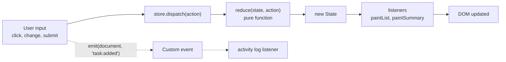

# 08. State and events without a framework

> **Draft: written but not yet run.** The code and the expected output in this lesson were prepared by reading the code and the official documentation. They have not been executed yet. If something does not behave as described, trust your tool's real output and report it.

## What you will be able to do
By the end of this lesson you will be able to:
- Keep application state in one place and change it only through a pure reducer.
- Write a small generic store with `getState`, `dispatch` and `subscribe`.
- Use event delegation and typed custom events so parts of a page stay decoupled.
- Explain what a framework gives you on top of this pattern, and when you do not need one.

## Recap
1. Lesson 07: why did the page use one `LoadState` union instead of several booleans? <details><summary>Answer</summary>A union cannot represent impossible combinations and lets `switch` check that every state is rendered.</details>
2. Lesson 05: what does `K extends keyof T` do? <details><summary>Answer</summary>It limits `K` to the property names of `T`, so a key must be a real property and the result type is that property's type.</details>
3. Web 101 lesson 09: what does `event.preventDefault()` do on a form's `submit` event? <details><summary>Answer</summary>It stops the browser's default action (sending the form and reloading the page) so your code can handle it.</details>

## Why it matters
Once a page has a list, a counter, a filter and an activity log, the same fact (the list of tasks) is needed in several places. If each place keeps its own copy, they drift apart. The remedy is old and simple: keep **one source of truth** (the *state*), change it through one narrow door (an *action* handled by a *reducer*), and let anything that cares *subscribe* to changes. React, Angular signals and Redux are variations on this idea. Building it once by hand, in about 30 lines, makes every framework easier to understand.

## What you will build
A task list with a filter (All, Open, Done), an "Add" form, check boxes, "Remove" buttons, a polite live summary ("1 open of 2") and an activity log that is fed by custom events. The pieces do not know about each other: the log knows nothing about the store, and the store knows nothing about the page.



## Before you start
- Lessons 04, 05 and 06. Same tools as lesson 06. Time: 60 minutes; break after Step 8.
- Create `code101/web201/lesson08` with `src` inside. Copy from lesson 06 these identical files: `tsconfig.json`, `vite.config.ts`, `.gitignore` and `src/dom.ts` (steps in lesson 06: [Step 3](../phase-2-typescript-in-depth/06-modules-vite-and-dev-workflow.md#step-3-write-tsconfigjson), [Step 4](../phase-2-typescript-in-depth/06-modules-vite-and-dev-workflow.md#step-4-write-viteconfigts), [Step 9](../phase-2-typescript-in-depth/06-modules-vite-and-dev-workflow.md#step-9-ignore-generated-files-install-run-the-dev-server), [Step 7](../phase-2-typescript-in-depth/06-modules-vite-and-dev-workflow.md#step-7-write-the-typed-environment-the-data-and-the-dom-helper)). Only `package.json` differs (the `name`).
- Source pack (optional): every file is shown in full in this lesson, so you can follow without it. The finished code, the exercise starter and the solution are in the
  course repository https://github.com/Uee03/Code101 under `source/web/201-hero-to-super-hero/phase-3-app-patterns/08-state-and-events-without-a-framework/` (on that page choose **Code, Download ZIP**, or run
  `git clone https://github.com/Uee03/Code101.git`).
- Windows PowerShell: use `npm.cmd` if `npm.ps1` is blocked.

## Steps

### Step 1. Create the folders and package.json
**Folder: your user folder**
```powershell
mkdir code101\web201\lesson08\src
```
```bash
mkdir -p ~/code101/web201/lesson08/src
```

**File: `package.json`**
```json
{
  "name": "web201-lesson-08",
  "version": "1.0.0",
  "private": true,
  "type": "module",
  "scripts": {
    "dev": "vite",
    "typecheck": "tsc --noEmit",
    "build": "tsc --noEmit && vite build",
    "preview": "vite preview"
  },
  "engines": {
    "node": ">=22.12.0"
  },
  "devDependencies": {
    "@types/node": "26.6.6",
    "typescript": "7.0.2",
    "vite": "8.3.8"
  }
}
```
Add the four copied files, then run `npm install --no-audit --no-fund` in `lesson08`.

### Step 2. Write the page
The filter buttons form a group (`role="group"` with an `aria-label`) and report their state with `aria-pressed`. The summary line is a polite live region, so a screen reader announces "2 open of 3" after each change. `required` on the input makes the browser block an empty submit with its own message.

**File: `index.html`**
```html
<!doctype html>
<html lang="en">
<head>
  <meta charset="utf-8">
  <meta name="viewport" content="width=device-width, initial-scale=1">
  <title>Task list with a store</title>
  <link rel="icon" href="data:,">
  <link rel="stylesheet" href="/src/style.css">
</head>
<body>
  <main class="shell">
    <h1>Task list</h1>

    <form id="add-form" class="add-form">
      <label for="title">New task</label>
      <input id="title" name="title" type="text" required autocomplete="off">
      <button class="button" type="submit">Add</button>
    </form>

    <div id="filters" class="filters" role="group" aria-label="Show tasks">
      <button type="button" class="button button--ghost" data-filter="all" aria-pressed="true">All</button>
      <button type="button" class="button button--ghost" data-filter="open" aria-pressed="false">Open</button>
      <button type="button" class="button button--ghost" data-filter="done" aria-pressed="false">Done</button>
    </div>

    <p id="summary" role="status"></p>
    <ul id="tasks" class="tasks"></ul>

    <h2>Activity</h2>
    <ul id="activity" class="activity"></ul>
  </main>
  <script type="module" src="/src/main.ts"></script>
</body>
</html>
```

### Step 3. Write the stylesheet
Controls are at least 2.75rem (44px) tall, bigger than the 24px minimum of WCAG 2.2 success criterion 2.5.8 (Target Size).

**File: `src/style.css`**
```css
:root {
  color-scheme: light dark;
  --bg: light-dark(#ffffff, #0b1220);
  --surface: light-dark(#f1f5f9, #172033);
  --text: light-dark(#0f172a, #e2e8f0);
  --muted: light-dark(#475569, #a7b3c7);
  --accent: light-dark(#1d4ed8, #7cb0ff);
  --on-accent: light-dark(#ffffff, #0b1220);
  --border: light-dark(#cbd5e1, #334155);
}

body {
  margin: 0;
  font-family: system-ui, -apple-system, "Segoe UI", Roboto, sans-serif;
  line-height: 1.5;
  background: var(--bg);
  color: var(--text);
}

.shell {
  max-inline-size: 40rem;
  margin-inline: auto;
  padding: 1.5rem;
}

.add-form {
  display: flex;
  flex-wrap: wrap;
  align-items: center;
  gap: 0.75rem;
}

input[type="text"] {
  flex: 1;
  min-inline-size: 12rem;
  min-block-size: 2.75rem;
  padding-inline: 0.75rem;
  border: 1px solid var(--border);
  border-radius: 0.5rem;
  background: var(--surface);
  color: var(--text);
  font: inherit;
}

.button {
  min-block-size: 2.75rem;
  padding-inline: 1rem;
  border: 1px solid var(--accent);
  border-radius: 0.5rem;
  background: var(--accent);
  color: var(--on-accent);
  font: inherit;
  cursor: pointer;
}

.button--ghost {
  background: transparent;
  color: var(--text);
  border-color: var(--border);
}

.button--ghost[aria-pressed="true"] {
  border-color: var(--accent);
  box-shadow: inset 0 -3px 0 var(--accent);
}

.filters {
  display: flex;
  gap: 0.5rem;
  margin-block: 1rem;
}

.tasks,
.activity {
  padding: 0;
  list-style: none;
}

.task {
  display: flex;
  align-items: center;
  justify-content: space-between;
  gap: 0.75rem;
  border-block-end: 1px solid var(--border);
}

.task label {
  display: flex;
  flex: 1;
  align-items: center;
  gap: 0.5rem;
  min-block-size: 2.75rem;
}

.task input[type="checkbox"] {
  inline-size: 1.25rem;
  block-size: 1.25rem;
}

.activity li {
  color: var(--muted);
}

:focus-visible {
  outline: 3px solid var(--accent);
  outline-offset: 2px;
}
```

### Step 4. Write the state module
Everything about *what the data is* and *how it can change* lives here, with no DOM. The `reduce` function takes the old state and an action and returns the **new** state; it never modifies the old one (spread `...state` copies, `map` and `filter` build new arrays) and never touches the page. That makes it trivially testable (lesson 12). When nothing changes it returns the *same* object, which the store uses to skip needless updates.

**File: `src/tasks.ts`**
```ts
export type Filter = "all" | "open" | "done";

export interface Task {
  readonly id: number;
  readonly title: string;
  readonly done: boolean;
}

export interface State {
  readonly tasks: readonly Task[];
  readonly nextId: number;
  readonly filter: Filter;
}

export type Action =
  | { type: "added"; title: string }
  | { type: "toggled"; id: number }
  | { type: "removed"; id: number }
  | { type: "filter-changed"; filter: Filter };

export const initialState: State = {
  tasks: [
    { id: 1, title: "Read the store lesson", done: true },
    { id: 2, title: "Write a reducer", done: false },
  ],
  nextId: 3,
  filter: "all",
};

export function reduce(state: State, action: Action): State {
  switch (action.type) {
    case "added": {
      const title = action.title.trim();
      if (title === "") {
        return state;
      }
      const task: Task = { id: state.nextId, title, done: false };
      return { ...state, tasks: [...state.tasks, task], nextId: state.nextId + 1 };
    }
    case "toggled": {
      const { id } = action;
      return {
        ...state,
        tasks: state.tasks.map((task) => (task.id === id ? { ...task, done: !task.done } : task)),
      };
    }
    case "removed": {
      const { id } = action;
      return { ...state, tasks: state.tasks.filter((task) => task.id !== id) };
    }
    case "filter-changed":
      return state.filter === action.filter ? state : { ...state, filter: action.filter };
  }
}

export function visibleTasks(state: State): readonly Task[] {
  switch (state.filter) {
    case "all":
      return state.tasks;
    case "open":
      return state.tasks.filter((task) => !task.done);
    case "done":
      return state.tasks.filter((task) => task.done);
  }
}

export function openCount(state: State): number {
  return state.tasks.filter((task) => !task.done).length;
}
```

### Step 5. Write the store
`createStore` is generic in the state `S` and action `A`, so it works for any reducer. `subscribe` returns an **unsubscribe function**, the conventional way to stop listening. `dispatch` copies the listener set before looping (`[...listeners]`) so a listener that unsubscribes while being notified cannot break the loop.

**File: `src/store.ts`**
```ts
export type Listener<S> = (state: S) => void;

export interface Store<S, A> {
  getState(): S;
  dispatch(action: A): void;
  subscribe(listener: Listener<S>): () => void;
}

export function createStore<S, A>(reducer: (state: S, action: A) => S, initial: S): Store<S, A> {
  let state = initial;
  const listeners = new Set<Listener<S>>();

  return {
    getState: () => state,
    dispatch(action) {
      const next = reducer(state, action);
      if (Object.is(next, state)) {
        return;
      }
      state = next;
      for (const listener of [...listeners]) {
        listener(state);
      }
    },
    subscribe(listener) {
      listeners.add(listener);
      return () => {
        listeners.delete(listener);
      };
    },
  };
}
```
A **closure** (the variables `state` and `listeners` stay alive inside the returned object) keeps the state private: outside code can only read it with `getState()` and change it with `dispatch`.

### Step 6. Write the typed custom events
A **custom event** is an event you invent (`task:added`) and dispatch yourself on any `EventTarget`. The `AppEvents` interface maps each event name to the type of its `detail` payload, and the generic helpers `emit` and `on` use that map so the compiler checks both the name and the payload. The one cast, `event as CustomEvent<...>`, is the single place the code trusts the map; `on` returns an unsubscribe function like the store does.

**File: `src/events.ts`**
```ts
export interface AppEvents {
  "task:added": { title: string };
  "task:removed": { id: number };
}

export function emit<K extends keyof AppEvents>(
  target: EventTarget,
  name: K,
  detail: AppEvents[K],
): void {
  target.dispatchEvent(new CustomEvent(name, { detail, bubbles: true }));
}

export function on<K extends keyof AppEvents>(
  target: EventTarget,
  name: K,
  handler: (detail: AppEvents[K]) => void,
): () => void {
  const listener = (event: Event): void => {
    handler((event as CustomEvent<AppEvents[K]>).detail);
  };
  target.addEventListener(name, listener);
  return () => target.removeEventListener(name, listener);
}
```

### Step 7. Write the view helpers
`renderTasks` rebuilds the whole list on every change, which is simple and fine for small lists. It has one subtle job: replacing the DOM destroys the element that has keyboard focus. The function remembers the focused element's `data-focus-key` and focuses the new element with the same key, so someone toggling a check box with the Space bar keeps their place. Every piece of text is set with `textContent`.

**File: `src/view.ts`**
```ts
import { openCount, type Filter, type State, type Task } from "./tasks";

function taskRow(task: Task): HTMLLIElement {
  const item = document.createElement("li");
  item.className = "task";

  const label = document.createElement("label");
  const checkbox = document.createElement("input");
  checkbox.type = "checkbox";
  checkbox.checked = task.done;
  checkbox.dataset.action = "toggle";
  checkbox.dataset.id = String(task.id);
  checkbox.dataset.focusKey = `toggle-${task.id}`;
  label.append(checkbox, ` ${task.title}`);

  const remove = document.createElement("button");
  remove.type = "button";
  remove.className = "button button--ghost";
  remove.textContent = "Remove";
  remove.setAttribute("aria-label", `Remove ${task.title}`);
  remove.dataset.action = "remove";
  remove.dataset.id = String(task.id);
  remove.dataset.focusKey = `remove-${task.id}`;

  item.append(label, remove);
  return item;
}

export function renderTasks(list: HTMLElement, tasks: readonly Task[]): void {
  const active = document.activeElement;
  const focusKey = active instanceof HTMLElement && list.contains(active) ? active.dataset.focusKey : undefined;

  list.replaceChildren(...tasks.map(taskRow));

  if (focusKey !== undefined) {
    list.querySelector<HTMLElement>(`[data-focus-key="${focusKey}"]`)?.focus();
  }
}

export function renderSummary(element: HTMLElement, state: State): void {
  element.textContent = `${openCount(state)} open of ${state.tasks.length}`;
}

export function renderFilters(group: HTMLElement, filter: Filter): void {
  for (const button of group.querySelectorAll<HTMLButtonElement>("button[data-filter]")) {
    button.setAttribute("aria-pressed", String(button.dataset.filter === filter));
  }
}

export function appendActivity(log: HTMLElement, message: string): void {
  const item = document.createElement("li");
  item.textContent = message;
  log.prepend(item);
}
```
The remove button's accessible name (`aria-label`) *starts with its visible text* "Remove", which keeps the spoken name and the visible label consistent (WCAG 2.5.3, Label in Name).

### Step 8. Write main.ts
`main.ts` is the only place that knows everything. It creates the store, subscribes two painters, and attaches **delegated** listeners: one `change` and one `click` listener on the list, not one per row. **Event delegation** relies on events bubbling: a click on a button inside the list also reaches the list, where `event.target` tells you which button. It keeps working when rows are replaced.

**File: `src/main.ts`**
```ts
import { requireElement } from "./dom";
import { emit, on } from "./events";
import { createStore } from "./store";
import { initialState, reduce, visibleTasks, type Filter, type State } from "./tasks";
import { appendActivity, renderFilters, renderSummary, renderTasks } from "./view";

const store = createStore(reduce, initialState);

const form = requireElement("#add-form", HTMLFormElement);
const titleInput = requireElement("#title", HTMLInputElement);
const list = requireElement("#tasks", HTMLUListElement);
const summary = requireElement("#summary", HTMLParagraphElement);
const filters = requireElement("#filters", HTMLDivElement);
const log = requireElement("#activity", HTMLUListElement);

function isFilter(value: string | undefined): value is Filter {
  return value === "all" || value === "open" || value === "done";
}

function paintList(state: State): void {
  renderTasks(list, visibleTasks(state));
  renderFilters(filters, state.filter);
}

function paintSummary(state: State): void {
  renderSummary(summary, state);
}

store.subscribe(paintList);
store.subscribe(paintSummary);
paintList(store.getState());
paintSummary(store.getState());

form.addEventListener("submit", (event) => {
  event.preventDefault();
  const title = titleInput.value.trim();
  if (title === "") {
    titleInput.focus();
    return;
  }
  store.dispatch({ type: "added", title });
  emit(document, "task:added", { title });
  form.reset();
  titleInput.focus();
});

list.addEventListener("change", (event) => {
  const target = event.target;
  if (target instanceof HTMLInputElement && target.dataset.action === "toggle") {
    store.dispatch({ type: "toggled", id: Number(target.dataset.id) });
  }
});

list.addEventListener("click", (event) => {
  const target = event.target;
  if (!(target instanceof Element)) {
    return;
  }
  const button = target.closest<HTMLButtonElement>("button[data-action='remove']");
  if (button === null) {
    return;
  }
  const id = Number(button.dataset.id);
  store.dispatch({ type: "removed", id });
  emit(document, "task:removed", { id });
  titleInput.focus();
});

filters.addEventListener("click", (event) => {
  const target = event.target;
  if (!(target instanceof HTMLButtonElement)) {
    return;
  }
  const wanted = target.dataset.filter;
  if (isFilter(wanted)) {
    store.dispatch({ type: "filter-changed", filter: wanted });
  }
});

on(document, "task:added", ({ title }) => appendActivity(log, `Added "${title}"`));
on(document, "task:removed", ({ id }) => appendActivity(log, `Removed task #${id}`));
```
After a removal the row that had focus no longer exists, so the code moves focus to the "New task" field instead of letting it fall back to the top of the page.

## Run it
**Folder: `lesson08`**
```bash
npm run typecheck
npm run dev
```
`typecheck` should print nothing but npm's header lines. The dev server prints a `Local:` address (typical: `http://localhost:5173/`).

**Predict first:** from the code, what do the summary and the list show on load, and what appears in Activity? Then check.

<details><summary>Answer</summary>

Summary: `1 open of 2`. List: "Read the store lesson" (checked) and "Write a reducer" (unchecked), each with a **Remove** button. Activity is empty, because the log only reacts to `task:added` and `task:removed` events, and none has been emitted yet. The **All** filter is pressed.

</details>

Then try, and compare with the expected result:

| Action | Expected result |
|---|---|
| Type `Buy milk`, press Enter | A third row appears, the field is cleared and focused, summary `2 open of 3`, Activity gets `Added "Buy milk"` |
| Press Add with an empty field | The browser shows its own "Please fill out this field" style message and nothing is added |
| Tick "Write a reducer" with the Space bar | It becomes checked, summary `1 open of 3`, and keyboard focus stays on that check box |
| Click **Open** | Only unchecked tasks are listed; **Open** is pressed |
| Click **Remove** on a task | The row disappears, Activity gets `Removed task #<id>`, focus moves to the "New task" field |

## How it works
- **Single source of truth.** The task list exists once, inside the store. The list, the summary and the filter buttons are *derived* from it. Nothing else holds a copy, so nothing can disagree.
- **Action, reducer, state.** An **action** is a plain object that says what happened (`{ type: "toggled", id: 2 }`). The **reducer** is a pure function: same inputs, same output, no side effects. A reducer is easy to test and makes time-travel features (undo) possible.
- **Immutability.** Each change builds a new state object. `Object.is(next, state)` in the store is then a cheap "did anything change?" check. If you *mutated* the old state (`state.tasks.push(...)`), that check would be wrong and listeners would not run.
- **Subscribe.** The store knows nothing about the DOM; it just calls functions. That is the observer pattern.
- **Custom events vs the store.** The store holds state that other code needs to *read*. A custom event announces something that *happened*, for any interested party, and holds no state. The activity log is the second kind: you can delete it without touching the rest.
- **Delegation.** Attaching one listener to the list, not to every button, means rows can be replaced freely. `closest()` walks up from the clicked element to find the button even if the click landed on text or an icon inside it.
- **Misconception to correct:** "a framework is required for reactive UI". The loop (dispatch, reduce, notify, repaint) is small. A framework adds efficient partial updates, components, templates and tooling, which matter as the UI grows. Redrawing a 20-row list is fine; redrawing 5,000 rows is not.

**Why this, not that**

| Choice | Instead of | Why |
|---|---|---|
| Reducer plus store | Mutating variables and calling `render()` from handlers | One place changes data; testable; subscribers cannot be forgotten |
| Immutable updates | `push`, `splice`, assigning fields | Cheap change detection, no hidden shared mutation |
| Delegated listeners | A listener per row | Fewer listeners; survives re-rendering |
| Custom events for the log | Calling `appendActivity` from the form handler | Decoupling: add listeners without editing the emitter |
| Full re-render with focus restore | Patching the DOM by hand | Simple and correct; optimise only when measured |

## Try it
Copy `lesson08` to `lesson08-try` (without `node_modules`), run `npm install`, and add the starter file below as `src/select.ts` (pack: `exercise/starter/src/select.ts`).

**File: `src/select.ts`** (starter)
```ts
import type { Store } from "./store";

// TODO 1: call listener with select(state) once now, and again only when the selected value changes
// (compare with Object.is). Return the unsubscribe function from store.subscribe.
export function subscribeTo<S, A, T>(
  _store: Store<S, A>,
  _select: (state: S) => T,
  _listener: (value: T) => void,
): () => void {
  throw new Error("TODO 1");
}
```
1. **Guided.** Complete TODO 1 (rename the `_` parameters as you use them). Then use it in `main.ts` for the summary: replace the two `paintSummary` lines (the `store.subscribe(paintSummary);` line and the `paintSummary(store.getState());` line) with the call below, import `openCount` from `./tasks`, and remove the now unused `paintSummary` function and `renderSummary` import. Goal: the summary reads `1 open` on load, and changing only the **filter** no longer rewrites the summary text (add a `console.log` inside the listener to see it run only when the count changes).
```ts
subscribeTo(store, openCount, (count) => {
  summary.textContent = `${count} open`;
});
```
2. **Change.** Add a "Clear completed" feature: a new action `{ type: "cleared-done" }`, a branch in `reduce`, and a button wired in `main.ts`. What does the compiler flag as soon as you add the action to the union?
3. **Stretch (design choice).** Make the tasks survive a page reload by saving to `localStorage` on every change. Where should the code live (inside the store, as a subscriber, or as middleware that wraps `dispatch`)? What must you do when the saved data is corrupt? Lesson 12 does this; compare your design with it afterwards.

<details><summary>Solution</summary>

**File: `src/select.ts`** (solution)
```ts
import type { Store } from "./store";

export function subscribeTo<S, A, T>(
  store: Store<S, A>,
  select: (state: S) => T,
  listener: (value: T) => void,
): () => void {
  let previous = select(store.getState());
  listener(previous);
  return store.subscribe((state) => {
    const next = select(state);
    if (!Object.is(next, previous)) {
      previous = next;
      listener(next);
    }
  });
}
```
The finished `main.ts` is in `exercise/solution/src/main.ts`; its only differences from the lesson are the `subscribeTo` call replacing `paintSummary`, and the imports. For rung 2: after adding `{ type: "cleared-done" }` to `Action`, the `switch` in `reduce` no longer returns on every path and the compiler reports that the function lacks an ending return statement (typical message). The new branch is `case "cleared-done": return { ...state, tasks: state.tasks.filter((task) => !task.done) };`.

</details>

## Check yourself
1. Why must `reduce` return a *new* object instead of editing `state`? <details><summary>Answer</summary>The store detects change with `Object.is(next, state)`; an edited object is the same object, so listeners would not run, and other code holding the old state would see it change.</details>
2. **Predict:** the user clicks the *text* "Remove" inside a remove button. Why does the delegated handler still find the button? <details><summary>Answer</summary>`event.target.closest("button[data-action='remove']")` walks up from the clicked element to the nearest matching button.</details>
3. What does the function returned by `store.subscribe` do? <details><summary>Answer</summary>It removes that listener, so it is no longer called; call it when a component goes away to avoid leaks.</details>
4. Why does `renderTasks` save and restore a focus key? <details><summary>Answer</summary>Replacing the list's children removes the focused element; restoring focus keeps keyboard users in place.</details>
5. When would you choose a custom event over a store subscription? <details><summary>Answer</summary>When announcing something that happened to parts of the page that need no shared state (a log, analytics, a toast), or across components that should not import each other.</details>

## Common mistakes
| Symptom | Cause | Fix |
|---|---|---|
| The list does not update after a change | `reduce` mutated the old state and returned it | Return a new object (`{ ...state, ... }`, `map`, `filter`) |
| Clicks on a newly added row do nothing | Listeners attached to each row only once | Use delegation on the list, as in `main.ts` |
| Keyboard focus jumps to the top after toggling | The list was rebuilt and focus was not restored | Keep the focus-key logic in `renderTasks` |
| TypeScript: `Argument of type '"task:ad"' is not assignable to parameter of type 'keyof AppEvents'` (typical message) | Event name typo | Use a name from `AppEvents` |
| Activity never updates | `on(...)` registered for a different event name than `emit` | Compare names; the compiler normally catches this |
| `npm.ps1 cannot be loaded because running scripts is disabled on this system` | PowerShell policy | Use `npm.cmd` |

## Best practice
Keep state in one place, change it only through pure functions, and let the DOM be a function of the state. Use delegation for dynamic lists and keep focus intact when you re-render. Source: MDN, Event delegation / Event bubbling https://developer.mozilla.org/en-US/docs/Learn_web_development/Core/Scripting/Event_bubbling and MDN, CustomEvent https://developer.mozilla.org/en-US/docs/Web/API/CustomEvent

## Going further
- The Redux documentation's [core concepts](https://redux.js.org/introduction/core-concepts) describe the same loop with more tooling.
- MDN: [`EventTarget`](https://developer.mozilla.org/en-US/docs/Web/API/EventTarget) (you can extend it to build your own event emitters).
- Lesson 12 reuses this reducer idea for the task board and adds tests. The [web-react](../../../../capstones/web-react/) and [web-angular](../../../../capstones/web-angular/) capstones show how a framework manages the same loop for you.

## Summary
- You kept state in one store and changed it only through a pure reducer.
- You wrote a generic store with `dispatch` and `subscribe`, and typed custom events with `emit` and `on`.
- You used event delegation and restored focus after re-rendering.
- You explained what a framework adds to this pattern.

## Next lesson
09. Forms and accessibility: labels, error messages, focus management, keyboard use, and ARIA only where HTML is not enough.
