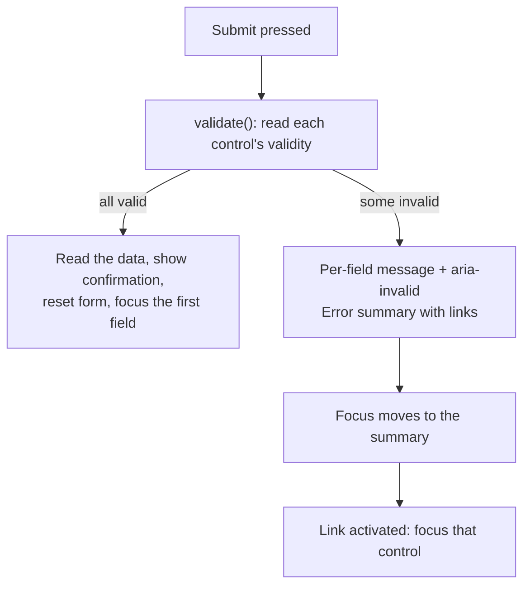

# 09. Forms and accessibility

> **Draft: written but not yet run.** The code and the expected output in this lesson were prepared by reading the code and the official documentation. They have not been executed yet. If something does not behave as described, trust your tool's real output and report it.

## What you will be able to do
By the end of this lesson you will be able to:
- Build a form whose every control has a visible, programmatically linked label, hint and error message.
- Validate with the browser's constraint validation API and show your own messages, an error summary and a sensible focus move.
- Test a form with the keyboard alone and explain what each result proves.
- Decide when ARIA is needed and when a native HTML element already does the job.

## Recap
1. Web 101 lesson 03: how does a `<label>` connect to an `<input>`? <details><summary>Answer</summary>`for` on the label equals `id` on the input (or the input is inside the label); clicking the label focuses the input and screen readers read it as the input's name.</details>
2. Lesson 07: what do `role="status"` and `role="alert"` do? <details><summary>Answer</summary>They create live regions: `status` announces changes politely, `alert` announces them immediately.</details>
3. Lesson 08: why does `renderTasks` restore focus after re-rendering? <details><summary>Answer</summary>Replacing DOM nodes drops focus; keyboard and screen reader users would lose their place.</details>

## Why it matters
Forms are where users give you their data and where inaccessible design costs the most: a screen reader user who is not told *which* field failed, a keyboard user who cannot reach the error, or a person who sees red text but cannot tell it from normal text. The fix is mostly *using HTML properly* (labels, fieldsets, buttons) plus a few careful extras. This also makes forms easier for everyone: bigger click targets, clear hints, errors that say what to do. WCAG 2.2 level A and AA contain several rules that apply directly (1.3.1, 1.4.1, 3.3.1, 3.3.2, 3.3.3, 2.4.7, 2.5.8).

## What you will build
A "New task" form with a text field, a date field, a group of three radio buttons and an optional text area. Submitting a bad form shows an **error summary** at the top (links that jump to each problem), an error message beside each field and focus on the summary. Fixing a field removes its message as you type. A good submit shows a confirmation sentence.



## Before you start
- Lessons 06 to 08. Same tools. Time: 65 minutes; break after Step 7.
- Create `code101/web201/lesson09` with `src` inside and copy the identical files `tsconfig.json`, `vite.config.ts`, `.gitignore`, `src/dom.ts` from lesson 06 (links: [Step 3](../phase-2-typescript-in-depth/06-modules-vite-and-dev-workflow.md#step-3-write-tsconfigjson), [Step 4](../phase-2-typescript-in-depth/06-modules-vite-and-dev-workflow.md#step-4-write-viteconfigts), [Step 9](../phase-2-typescript-in-depth/06-modules-vite-and-dev-workflow.md#step-9-ignore-generated-files-install-run-the-dev-server), [Step 7](../phase-2-typescript-in-depth/06-modules-vite-and-dev-workflow.md#step-7-write-the-typed-environment-the-data-and-the-dom-helper)). Only `package.json` differs.
- Source pack (optional): every file is shown in full in this lesson, so you can follow without it. The finished code, the exercise starter and the solution are in the
  course repository https://github.com/Uee03/Code101 under `source/web/201-hero-to-super-hero/phase-3-app-patterns/09-forms-and-accessibility/` (on that page choose **Code, Download ZIP**, or run
  `git clone https://github.com/Uee03/Code101.git`).
- Windows PowerShell: use `npm.cmd` if `npm.ps1` is blocked. A screen reader (NVDA on Windows, VoiceOver on macOS) is useful but optional; the keyboard test needs nothing.

## Steps

### Step 1. Create the folders and package.json
**Folder: your user folder**
```powershell
mkdir code101\web201\lesson09\src
```
```bash
mkdir -p ~/code101/web201/lesson09/src
```

**File: `package.json`**
```json
{
  "name": "web201-lesson-09",
  "version": "1.0.0",
  "private": true,
  "type": "module",
  "scripts": {
    "dev": "vite",
    "typecheck": "tsc --noEmit",
    "build": "tsc --noEmit && vite build",
    "preview": "vite preview"
  },
  "engines": {
    "node": ">=22.12.0"
  },
  "devDependencies": {
    "@types/node": "26.6.6",
    "typescript": "7.0.2",
    "vite": "8.3.8"
  }
}
```
Add the four copied files, then run `npm install --no-audit --no-fund` in `lesson09`.

### Step 2. Write the HTML (the accessibility work happens here)
Read the markup before the script. Everything below works *before* any JavaScript runs.
- Every control has a `<label for>`. The radio group is a `<fieldset>` with a `<legend>`, which gives the group a name ("Priority") that screen readers read with each radio.
- Hints and errors are `<p>` elements **referenced by `aria-describedby`**, so a screen reader reads them after the label. The error elements start `hidden` and empty.
- `novalidate` on the form turns off the browser's pop-up validation bubbles; the attributes `required` and `minlength` still describe the rules and still drive the validity API. Your own messages replace the bubbles, so you control the wording, the position and the focus.
- The error summary is a `<section>` with `aria-labelledby` (its accessible name is its heading) and `tabindex="-1"`: it can receive focus from a script but is not in the Tab order.
- `<details>` and `<summary>` give a keyboard-accessible disclosure widget with no JavaScript and no ARIA.

**File: `index.html`**
```html
<!doctype html>
<html lang="en">
<head>
  <meta charset="utf-8">
  <meta name="viewport" content="width=device-width, initial-scale=1">
  <title>New task form</title>
  <link rel="icon" href="data:,">
  <link rel="stylesheet" href="/src/style.css">
</head>
<body>
  <main class="shell">
    <h1>New task</h1>

    <section id="error-summary" class="error-summary" aria-labelledby="error-summary-title" tabindex="-1" hidden>
      <h2 id="error-summary-title">There is a problem</h2>
      <ul id="error-list"></ul>
    </section>

    <form id="task-form" novalidate>
      <div class="field">
        <label for="title">Title</label>
        <p id="title-hint" class="hint">At least 3 characters.</p>
        <p id="title-error" class="error" hidden></p>
        <input id="title" name="title" type="text" required minlength="3" autocomplete="off" aria-describedby="title-hint title-error">
      </div>

      <div class="field">
        <label for="due">Due date</label>
        <p id="due-error" class="error" hidden></p>
        <input id="due" name="due" type="date" required aria-describedby="due-error">
      </div>

      <fieldset class="field" aria-describedby="priority-error">
        <legend>Priority</legend>
        <p id="priority-error" class="error" hidden></p>
        <label class="choice"><input id="priority-low" type="radio" name="priority" value="low" required> Low</label>
        <label class="choice"><input id="priority-normal" type="radio" name="priority" value="normal"> Normal</label>
        <label class="choice"><input id="priority-high" type="radio" name="priority" value="high"> High</label>
      </fieldset>

      <div class="field">
        <label for="notes">Notes (optional)</label>
        <p id="notes-hint" class="hint">Up to 140 characters.</p>
        <textarea id="notes" name="notes" rows="3" maxlength="140" aria-describedby="notes-hint"></textarea>
      </div>

      <details class="help">
        <summary>How to write a good title</summary>
        <p>Start with a verb and name the result, for example "Draft the release notes".</p>
      </details>

      <button class="button" type="submit">Save task</button>
    </form>

    <p id="saved" role="status"></p>
  </main>
  <script type="module" src="/src/main.ts"></script>
</body>
</html>
```
Why there is no `placeholder` as a label: placeholders disappear when you type, usually have low contrast, and are not a reliable accessible name. Hints live in real text, always visible.

### Step 3. Write the stylesheet
Accessibility in CSS: the border colour `--border` is chosen to be clearly visible against the page (WCAG 1.4.11, Non-text Contrast asks 3:1 for control boundaries); invalid fields get a **thicker border and an "Error:" text prefix**, not colour alone (1.4.1, Use of Color); `:focus-visible` gives a clear outline (2.4.7); controls are at least 2.75rem tall (2.5.8, Target Size).

**File: `src/style.css`**
```css
:root {
  color-scheme: light dark;
  --bg: light-dark(#ffffff, #0b1220);
  --surface: light-dark(#f1f5f9, #172033);
  --text: light-dark(#0f172a, #e2e8f0);
  --muted: light-dark(#475569, #a7b3c7);
  --accent: light-dark(#1d4ed8, #7cb0ff);
  --on-accent: light-dark(#ffffff, #0b1220);
  --danger: light-dark(#b91c1c, #fca5a5);
  --border: light-dark(#64748b, #94a3b8);
}

[hidden] {
  display: none !important;
}

body {
  margin: 0;
  font-family: system-ui, -apple-system, "Segoe UI", Roboto, sans-serif;
  line-height: 1.5;
  background: var(--bg);
  color: var(--text);
}

.shell {
  max-inline-size: 36rem;
  margin-inline: auto;
  padding: 1.5rem;
}

.field {
  margin-block-end: 1.25rem;
  padding: 0;
  border: 0;
}

label,
legend {
  display: block;
  margin-block-end: 0.25rem;
  font-weight: 600;
}

.hint {
  margin: 0 0 0.25rem;
  color: var(--muted);
}

.error {
  margin: 0 0 0.25rem;
  color: var(--danger);
  font-weight: 600;
}

input[type="text"],
input[type="date"],
textarea {
  box-sizing: border-box;
  inline-size: 100%;
  min-block-size: 2.75rem;
  padding: 0.5rem 0.75rem;
  border: 1px solid var(--border);
  border-radius: 0.5rem;
  background: var(--surface);
  color: var(--text);
  font: inherit;
}

[aria-invalid="true"] {
  border: 3px solid var(--danger);
}

.choice {
  display: flex;
  align-items: center;
  gap: 0.5rem;
  min-block-size: 2.75rem;
  font-weight: 400;
}

.choice input {
  inline-size: 1.25rem;
  block-size: 1.25rem;
}

.error-summary {
  margin-block-end: 1.5rem;
  padding: 1rem;
  border: 3px solid var(--danger);
  border-radius: 0.5rem;
}

.error-summary h2 {
  margin-block-start: 0;
  font-size: 1.125rem;
}

.error-summary a {
  color: var(--danger);
  font-weight: 600;
}

.help {
  margin-block-end: 1.25rem;
}

.button {
  min-block-size: 2.75rem;
  padding-inline: 1.25rem;
  border: 1px solid var(--accent);
  border-radius: 0.5rem;
  background: var(--accent);
  color: var(--on-accent);
  font: inherit;
  cursor: pointer;
}

:focus-visible {
  outline: 3px solid var(--accent);
  outline-offset: 2px;
}
```

### Step 4. Write the validation messages
The browser tells you *which rule failed* through `ValidityState` flags (`valueMissing`, `tooShort`, `rangeUnderflow`...). This module maps each flag to a human sentence per field. `ValidityFlag` is derived from the DOM type itself, so a misspelt flag is a compile error. `messageFor` returns the first rule that applies, or `null` for a valid field. `summaryTitle` is a placeholder the exercise improves.

**File: `src/validation.ts`**
```ts
export type ValidityFlag = Exclude<keyof ValidityState, "valid">;
type Rule = readonly [flag: ValidityFlag, message: string];

const RULES: Readonly<Record<string, readonly Rule[]>> = {
  title: [
    ["valueMissing", "Enter a title."],
    ["tooShort", "The title must be at least 3 characters."],
    ["customError", "Enter at least 3 characters that are not spaces."],
  ],
  due: [
    ["valueMissing", "Choose a due date."],
    ["badInput", "Enter a valid date."],
    ["rangeUnderflow", "The due date cannot be in the past."],
  ],
  priority: [["valueMissing", "Choose a priority."]],
};

export function messageFor(name: string, validity: ValidityState): string | null {
  if (validity.valid) {
    return null;
  }
  for (const [flag, message] of RULES[name] ?? []) {
    if (validity[flag]) {
      return message;
    }
  }
  return "Check this field.";
}

export function summaryTitle(_count: number): string {
  return "There is a problem";
}
```
Good error messages say **what to do** ("Enter a title"), name the field, and avoid blaming the user (WCAG 3.3.1 error identification, 3.3.3 error suggestion). `tooShort` only fires when a person typed the value; the `customError` rule covers the "three spaces" case, which the browser counts as long enough.

### Step 5. Write the data helper
`readDraft` reads the form with `FormData` and checks every value's type, because `FormData.get` returns `string | File | null`. `todayLocal` builds today's date in the **local** time zone. (`new Date().toISOString()` is UTC and can be yesterday or tomorrow for part of the day, which would make the "not in the past" rule wrong.)

**File: `src/draft.ts`**
```ts
export type Priority = "low" | "normal" | "high";

export interface TaskDraft {
  title: string;
  due: string;
  priority: Priority;
  notes: string;
}

function isPriority(value: unknown): value is Priority {
  return value === "low" || value === "normal" || value === "high";
}

export function readDraft(form: HTMLFormElement): TaskDraft | null {
  const data = new FormData(form);
  const title = data.get("title");
  const due = data.get("due");
  const priority = data.get("priority");
  const notes = data.get("notes");
  if (typeof title !== "string" || typeof due !== "string" || !isPriority(priority)) {
    return null;
  }
  return { title: title.trim(), due, priority, notes: typeof notes === "string" ? notes.trim() : "" };
}

export function todayLocal(): string {
  const now = new Date();
  const month = String(now.getMonth() + 1).padStart(2, "0");
  const day = String(now.getDate()).padStart(2, "0");
  return `${now.getFullYear()}-${month}-${day}`;
}
```

### Step 6. Write main.ts
Read it in three parts.
1. **Field table.** `fields` lists each validated control with its error element. The radio group uses its first radio as the control: if none is selected, every radio in a `required` group reports `valueMissing`. `marksInvalid` is `false` for the radio because `aria-invalid` is not defined for an individual radio button.
2. **Show and clear.** `showFieldError` sets the message (prefixed `Error:` so it is not colour alone) and `aria-invalid="true"`; `showSummary` builds the list of links.
3. **Events.** `submit` validates, then either focuses the summary or saves. After the first failed submit, every `input` and `change` event re-validates, so messages disappear as soon as the problem is fixed. Clicking a link in the summary focuses the control; a plain `#id` link would scroll but might not move focus.

**File: `src/main.ts`**
```ts
import { readDraft, todayLocal } from "./draft";
import { requireElement } from "./dom";
import { messageFor, summaryTitle } from "./validation";

interface FieldRef {
  readonly name: string;
  readonly control: HTMLInputElement;
  readonly error: HTMLParagraphElement;
  readonly marksInvalid: boolean;
}

interface Problem {
  readonly field: FieldRef;
  readonly message: string;
}

const form = requireElement("#task-form", HTMLFormElement);
const summary = requireElement("#error-summary", HTMLElement);
const summaryHeading = requireElement("#error-summary-title", HTMLHeadingElement);
const errorList = requireElement("#error-list", HTMLUListElement);
const saved = requireElement("#saved", HTMLParagraphElement);
const titleInput = requireElement("#title", HTMLInputElement);
const dueInput = requireElement("#due", HTMLInputElement);

const fields: readonly FieldRef[] = [
  { name: "title", control: titleInput, error: requireElement("#title-error", HTMLParagraphElement), marksInvalid: true },
  { name: "due", control: dueInput, error: requireElement("#due-error", HTMLParagraphElement), marksInvalid: true },
  {
    name: "priority",
    control: requireElement("#priority-low", HTMLInputElement),
    error: requireElement("#priority-error", HTMLParagraphElement),
    marksInvalid: false,
  },
];

let submitted = false;
dueInput.min = todayLocal();

function showFieldError(field: FieldRef, message: string | null): void {
  field.error.hidden = message === null;
  field.error.textContent = message === null ? "" : `Error: ${message}`;
  if (field.marksInvalid) {
    if (message === null) {
      field.control.removeAttribute("aria-invalid");
    } else {
      field.control.setAttribute("aria-invalid", "true");
    }
  }
}

function showSummary(problems: readonly Problem[]): void {
  summary.hidden = problems.length === 0;
  summaryHeading.textContent = summaryTitle(problems.length);
  const items = problems.map(({ field, message }) => {
    const item = document.createElement("li");
    const link = document.createElement("a");
    link.href = `#${field.control.id}`;
    link.textContent = message;
    item.append(link);
    return item;
  });
  errorList.replaceChildren(...items);
}

function validate(): Problem[] {
  titleInput.setCustomValidity(titleInput.value.trim().length >= 3 ? "" : "Too short");
  const problems: Problem[] = [];
  for (const field of fields) {
    const message = messageFor(field.name, field.control.validity);
    showFieldError(field, message);
    if (message !== null) {
      problems.push({ field, message });
    }
  }
  return problems;
}

function clearErrors(): void {
  for (const field of fields) {
    showFieldError(field, null);
  }
  showSummary([]);
}

form.addEventListener("submit", (event) => {
  event.preventDefault();
  submitted = true;
  const problems = validate();
  showSummary(problems);
  if (problems.length > 0) {
    saved.textContent = "";
    summary.focus();
    return;
  }
  const draft = readDraft(form);
  if (draft === null) {
    return;
  }
  saved.textContent = `Saved "${draft.title}", due ${draft.due}, ${draft.priority} priority.`;
  form.reset();
  submitted = false;
  clearErrors();
  titleInput.focus();
});

form.addEventListener("input", () => {
  if (submitted) {
    showSummary(validate());
  }
});

form.addEventListener("change", () => {
  if (submitted) {
    showSummary(validate());
  }
});

errorList.addEventListener("click", (event) => {
  const target = event.target;
  if (!(target instanceof HTMLAnchorElement)) {
    return;
  }
  event.preventDefault();
  const control = document.getElementById(target.hash.slice(1));
  if (control instanceof HTMLElement) {
    control.focus();
  }
});
```
**Break point: you can stop here and resume later.**

### Step 7. Run it
**Folder: `lesson09`**
```bash
npm run typecheck
npm run dev
```
`typecheck` prints only npm's header lines when clean. Open the `Local:` address the dev server prints (typical: `http://localhost:5173/`).

**Predict, then try.** Without typing anything, click **Save task**. Predict: how many entries are in the summary, which text is on the first one, where is keyboard focus, and what does the first field show?

<details><summary>Answer</summary>

Three entries: `Enter a title.`, `Choose a due date.` and `Choose a priority.`. The summary heading reads `There is a problem` (the exercise makes it plural-aware). Focus is on the summary box (its border is highlighted by the focus outline). Under the "Title" label, below the hint, the text `Error: Enter a title.` appears in red and the input has a thick red border. The date field shows `Error: Choose a due date.` and the priority group shows `Error: Choose a priority.`

</details>

Then check each row of this table:

| Action | Expected result |
|---|---|
| Press Tab from the summary | Focus goes to the first **link** in the summary, then the next, then the Title field |
| Press Enter on the link `Enter a title.` | Focus moves into the Title field |
| Type `ab` | The message changes to `Error: The title must be at least 3 characters.` as you type |
| Type `abc` | The Title error and its red border disappear; the summary loses that entry |
| Type spaces only (`   `) | `Error: Enter at least 3 characters that are not spaces.` |
| In the radio group, select one radio, then use the arrow keys | The selection moves between Low, Normal and High (native behaviour) |
| Fill everything validly and press Enter in the Title field | A line such as `Saved "Draft the notes", due 2026-12-01, high priority.` appears (date and priority are what you chose), the form is cleared and focus returns to Title |

### Step 8. Test with the keyboard and a checklist
Unplug the mouse mentally and run this list. Each line is something an automated tool cannot fully check.
1. **Tab order** follows the visual order and every control, link and the summary link is reachable.
2. **Focus is always visible** (a 3px outline).
3. **Labels:** clicking the text "Title" focuses the Title field.
4. **Errors:** after a failed submit, a screen reader (if you have one) reads the summary heading and its content as focus lands on it; moving to a field reads the label, then the hint, then the error.
5. **Zoom to 200 percent** (Ctrl and +): nothing is cut off or overlaps.
6. **Colour alone** is never the only signal: the "Error:" text and thick border are present even in a greyscale view.

## Run it
This lesson's "run" is Step 7 and the checklist in Step 8. A production check: `npm run build` runs the type check and then builds to `dist/`.

## How it works
- **Accessible name and description.** The *name* of a control (label) says what it is; the *description* (`aria-describedby`) adds hints and errors. A screen reader reads name, role, state and description in that order.
- **Constraint validation API.** The attributes `required`, `minlength`, `type="date"` and `min` define rules declaratively. The browser exposes the result as `element.validity` and lets you add your own with `setCustomValidity`. `novalidate` only stops the browser's *bubbles*; the API still works, which is what the code uses.
- **Error summary pattern.** Long forms need one place to read everything that is wrong. Moving focus to the summary tells assistive technology that the page state changed. Each entry is a link to its field. This is the pattern used by large public-service sites.
- **When ARIA.** The first rule of ARIA is *do not use ARIA if a native element does the job*. This lesson uses ARIA for exactly three things HTML cannot say: `aria-describedby` (extra descriptions), `aria-invalid` (the field is in error) and `aria-labelledby` (the summary's name). Everything else is native: `<label>`, `<fieldset>`, `<legend>`, `<button>`, `<details>`.
- **Timing of validation.** Validating on *submit* first and on *input* afterwards avoids shouting "invalid" at someone who has only typed one letter, and still lets them see the error vanish as they fix it.
- **Misconception to correct:** "ARIA makes things accessible". ARIA only changes what assistive technology is *told*; it adds no behaviour. A `<div role="button">` is not focusable and does not react to Enter or Space until you code all of that. A native `<button>` does it all.

**Why this, not that**

| Choice | Instead of | Why |
|---|---|---|
| Visible `<label>` plus hint text | `placeholder` as the label | Placeholders vanish, often fail contrast and are not reliably announced |
| `novalidate` plus the validity API | Browser bubbles only | Consistent wording, position and focus; bubbles vary by browser and vanish on blur |
| Error summary with links | Only inline messages | One place to see all problems; keyboard users can jump to each |
| Native `<fieldset>` and radios | A custom radio widget with ARIA | Arrow-key behaviour and announcements come free |
| "Error:" text and a thick border | Red text only | Meets 1.4.1 (not colour alone) |

## Try it
Copy `lesson09` to `lesson09-try` (without `node_modules`), run `npm install`. The starter replaces one function in `src/validation.ts` (pack: `exercise/starter/src/validation.ts`; everything else in the file is unchanged):

**File: `src/validation.ts`** (starter; replace the last function)
```ts
// TODO 1: return "There is 1 problem" for one problem and "There are N problems" otherwise.
// Rename _count to count when you use it.
export function summaryTitle(_count: number): string {
  return "There is a problem";
}
```
1. **Guided.** Complete TODO 1. Goal: submitting the empty form shows the heading `There are 3 problems`; after you fix two fields the heading reads `There is 1 problem`.
2. **Change.** Add a maximum due date one year from today: set `dueInput.max` in `main.ts` (build the date like `todayLocal` does, with the year plus one), add a `rangeOverflow` rule to `due` in `validation.ts` with a message of your own wording. Goal: picking a date two years away shows your message.
3. **Stretch (design choice).** Decide *when* to validate each field: on submit only, on blur, or on every keystroke. Write a short rule that covers the title (typing), the date (a picker) and the radio group, and say what happens for a screen reader user if every keystroke announced an error.

<details><summary>Solution</summary>

**File: `src/validation.ts`** (solution, last function)
```ts
export function summaryTitle(count: number): string {
  return count === 1 ? "There is 1 problem" : `There are ${count} problems`;
}
```
For rung 2, one correct approach: in `main.ts` add `const nextYear = new Date(); nextYear.setFullYear(nextYear.getFullYear() + 1);` and format it with the same padStart logic (extract a `formatLocal(date: Date)` helper from `todayLocal`), then `dueInput.max = formatLocal(nextYear);` and in `RULES.due` add `["rangeOverflow", "Choose a date within the next year."]`. For the stretch, a common rule is: validate on submit first; after that re-validate a field on `input` for text fields and on `change` for pickers and groups; never announce errors for a field the user has not finished with.

</details>

## Check yourself
1. What is the difference between an accessible *name* and an accessible *description*? <details><summary>Answer</summary>The name says what the control is (from the label); the description gives extra help such as hints and errors (from `aria-describedby`).</details>
2. **Predict:** the title field contains `ab` (typed by the user). Which `ValidityState` flag is set and which message shows? <details><summary>Answer</summary>`tooShort` (and `customError`, but `tooShort` comes first in the rule list), so `Error: The title must be at least 3 characters.`</details>
3. Why does the summary receive focus after a failed submit? <details><summary>Answer</summary>So keyboard and screen reader users are taken to the list of problems; otherwise nothing signals that the submit failed.</details>
4. Why is a `placeholder` not enough as a label? <details><summary>Answer</summary>It disappears when typing, often has weak contrast and is not a dependable accessible name.</details>
5. Name one thing in this form where ARIA is *needed* and one where a native element replaced it. <details><summary>Answer</summary>Needed: `aria-describedby` to attach hints and errors (or `aria-invalid`). Native: `<fieldset>`/`<legend>` for the radio group, `<button>` for submit, `<details>` for the help text.</details>

## Common mistakes
| Symptom | Cause | Fix |
|---|---|---|
| Browser pop-up bubbles still appear | `novalidate` is missing on the form | Add `novalidate` to `<form>` |
| Error messages are never read by a screen reader | Error element is not referenced by `aria-describedby`, or its id is misspelt | Compare ids in `index.html` |
| Hidden error stays visible | An author `display` rule overrides `hidden` | Keep `[hidden] { display: none !important; }` |
| The date rule says "past" for today | `toISOString()` (UTC) used for the minimum | Use `todayLocal()` |
| Error message does not clear after fixing | `submitted` is false, or validation only runs on submit | Re-validate on `input` and `change` after the first submit |
| Clicking a summary link scrolls but focus stays | Using a plain `#id` link without script | Keep the `click` handler that calls `focus()` |
| `Expected #title to be a HTMLInputElement` in the console | `id` or element type mismatch between HTML and `main.ts` | Compare `index.html` and `main.ts` |
| `npm.ps1 cannot be loaded because running scripts is disabled on this system` | PowerShell policy | Use `npm.cmd` |

## Best practice
Start from native HTML, add ARIA only for what HTML cannot express, give every field a visible label, hint and error that say what to do, and test with the keyboard and a screen reader, not only with a tool. Source: W3C WAI, Forms tutorial https://www.w3.org/WAI/tutorials/forms/ and WCAG 2.2, Error Identification https://www.w3.org/WAI/WCAG22/Understanding/error-identification.html

## Going further
- W3C WAI: [Notifications and error summaries in forms](https://www.w3.org/WAI/tutorials/forms/notifications/) and [ARIA Authoring Practices](https://www.w3.org/WAI/ARIA/apg/).
- MDN: [Client-side form validation](https://developer.mozilla.org/en-US/docs/Learn_web_development/Extensions/Forms/Form_validation) and [`ValidityState`](https://developer.mozilla.org/en-US/docs/Web/API/ValidityState).
- Lesson 12 uses a simplified version of this form for the task board; the [web-angular](../../../../capstones/web-angular/) and [web-react](../../../../capstones/web-react/) capstones build accessible forms against the platform API.

## Summary
- You built a form with linked labels, hints and errors, and wrote your own validation messages from the validity API.
- You added an error summary with links and moved focus sensibly.
- You tested the form with the keyboard against a checklist.
- You said where ARIA is needed and where native HTML replaces it.

## Next lesson
10. Web security basics: XSS, safe DOM APIs, Content Security Policy and CORS, in a small comment wall.
