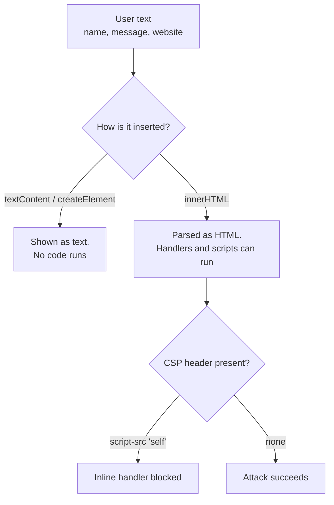

# 10. Web security basics: XSS, CSP, CORS and safe DOM APIs

> **Draft: written but not yet run.** The code and the expected output in this lesson were prepared by reading the code and the official documentation. They have not been executed yet. If something does not behave as described, trust your tool's real output and report it.

## What you will be able to do
By the end of this lesson you will be able to:
- Explain how cross-site scripting (XSS) happens and fix it by using safe DOM APIs instead of `innerHTML`.
- Allow-list a URL scheme so a user-supplied link cannot run script.
- Write a Content Security Policy (CSP) header and explain what each directive blocks.
- Explain what CORS does and does not protect, and predict whether a cross-origin `fetch` is readable.

## Recap
1. Lesson 03/08: why do our render functions set `textContent` and not `innerHTML`? <details><summary>Answer</summary>`textContent` inserts text; it never parses it as HTML, so user text cannot create elements or handlers.</details>
2. Lesson 06: why must a `VITE_` variable never hold a secret? <details><summary>Answer</summary>Vite replaces it with its text in the JavaScript sent to every visitor.</details>
3. Lesson 07: what is an origin? <details><summary>Answer</summary>The combination of scheme, host and port, for example `http://localhost:5173`.</details>

## Why it matters
A web page runs code from many places and shows text typed by many people. If one of those texts is treated as *code* (HTML or script) the attacker's code runs with your page's powers: it can read what the user sees, send requests as the user, change the page. That is **XSS**, and it has been one of the most common web vulnerabilities for two decades. Two more mechanisms define what a page may do: the browser's **same-origin policy**, which stops a page reading responses from other origins (CORS is the controlled way to relax it), and **Content Security Policy**, a header that tells the browser which sources of script, images and connections the page accepts. Security is taught inside capstones as well; this lesson gives you the front-end foundations.

## What you will build
A "Comment wall" that renders every comment **twice**: once safely (DOM APIs and a URL allow-list) and once unsafely (`innerHTML`), side by side. A button fills in a harmless "attack sample" so you can see the difference. Then you run the production build with a CSP header (via `vite preview`) and see the browser refuse the injected handler, and you run a tiny second server to see CORS allow one request and hide another.



## Before you start
- Lessons 06 to 09. Same tools. Time: 70 minutes in two sittings; break after Step 9.
- Two terminals will be open at once in the last part (dev server and demo server). Use **Terminal > New Terminal** twice.
- This lesson's project is again lesson 06's setup: create `code101/web201/lesson10` with `src` and `server` folders inside; copy `tsconfig.json`, `.gitignore` and `src/dom.ts` unchanged from lesson 06 ([Step 3](../phase-2-typescript-in-depth/06-modules-vite-and-dev-workflow.md#step-3-write-tsconfigjson), [Step 9](../phase-2-typescript-in-depth/06-modules-vite-and-dev-workflow.md#step-9-ignore-generated-files-install-run-the-dev-server), [Step 7](../phase-2-typescript-in-depth/06-modules-vite-and-dev-workflow.md#step-7-write-the-typed-environment-the-data-and-the-dom-helper)). `package.json` and `vite.config.ts` are shown below because they differ.
- Source pack (optional): every file is shown in full in this lesson, so you can follow without it. The finished code, the exercise starter and the solution are in the
  course repository https://github.com/Uee03/Code101 under `source/web/201-hero-to-super-hero/phase-4-quality-and-ship/10-web-security-basics/` (on that page choose **Code, Download ZIP**, or run
  `git clone https://github.com/Uee03/Code101.git`).
- Windows PowerShell: use `npm.cmd` if `npm.ps1` is blocked.
- Safety note: the "attack sample" is a harmless message box (`alert`). It only runs in your own browser, on your own page, from text you typed. Never test XSS on sites you do not own.

## Steps

### Step 1. Create the folders and package.json
Same as lesson 06 plus a `cors-server` script.

**Folder: your user folder**
```powershell
mkdir code101\web201\lesson10\src
mkdir code101\web201\lesson10\server
```
```bash
mkdir -p ~/code101/web201/lesson10/src ~/code101/web201/lesson10/server
```

**File: `package.json`**
```json
{
  "name": "web201-lesson-10",
  "version": "1.0.0",
  "private": true,
  "type": "module",
  "scripts": {
    "dev": "vite",
    "typecheck": "tsc --noEmit",
    "build": "tsc --noEmit && vite build",
    "preview": "vite preview",
    "cors-server": "node server/cors-server.mjs"
  },
  "engines": {
    "node": ">=22.12.0"
  },
  "devDependencies": {
    "@types/node": "26.6.6",
    "typescript": "7.0.2",
    "vite": "8.3.8"
  }
}
```
Add the copied files, then run `npm install --no-audit --no-fund` in `lesson10`.

### Step 2. Write vite.config.ts with a Content Security Policy
This is lesson 06's config plus `preview.headers`, so the **built** site (served by `vite preview`) sends security headers. The development server is left without CSP on purpose: Vite's hot reload uses inline code and a WebSocket that a strict policy would block, and you want to see the difference.

**File: `vite.config.ts`**
```ts
import { defineConfig } from "vite";

const csp = [
  "default-src 'self'",
  "script-src 'self'",
  "style-src 'self'",
  "img-src 'self' data:",
  "connect-src 'self'",
  "object-src 'none'",
  "base-uri 'self'",
  "form-action 'self'",
  "frame-ancestors 'none'",
].join("; ");

export default defineConfig({
  server: {
    port: 5173,
    strictPort: true,
  },
  preview: {
    port: 4173,
    strictPort: true,
    headers: {
      "Content-Security-Policy": csp,
      "X-Content-Type-Options": "nosniff",
      "Referrer-Policy": "strict-origin-when-cross-origin",
    },
  },
  build: {
    outDir: "dist",
    sourcemap: true,
    target: "baseline-widely-available",
  },
});
```
What each directive does (a CSP is a list of rules; the browser enforces them for the document that received the header):

| Directive | Meaning here | If an attacker injects something that breaks it |
|---|---|---|
| `default-src 'self'` | Fallback: only load things from the page's own origin | Third-party loads are blocked unless another directive allows them |
| `script-src 'self'` | Scripts only from our own files; **no inline scripts or inline `onerror=` handlers**, no `eval` | Injected `<script>` or `onerror="..."` does not run |
| `style-src 'self'` | Styles only from our own files | Injected `<style>` or `style="..."` attributes are blocked |
| `img-src 'self' data:` | Images from us or inline `data:` URLs | Tracking pixels from other sites are blocked |
| `connect-src 'self'` | `fetch`, WebSocket and XHR only to our origin | Stolen data cannot be sent to another site with `fetch` |
| `object-src 'none'` | No plugins | Blocks legacy plugin injection |
| `base-uri 'self'` | A `<base>` tag cannot redirect relative URLs | Injected `<base>` is ignored |
| `form-action 'self'` | Forms can only submit to us | Injected forms cannot post to an attacker |
| `frame-ancestors 'none'` | Nobody may put our page in a frame | Prevents clickjacking |

`X-Content-Type-Options: nosniff` stops the browser guessing a file's type (a text file served as script). `Referrer-Policy` limits what address is sent to other sites when someone follows a link.

### Step 3. Write the page
**File: `index.html`**
```html
<!doctype html>
<html lang="en">
<head>
  <meta charset="utf-8">
  <meta name="viewport" content="width=device-width, initial-scale=1">
  <title>Comment wall</title>
  <link rel="icon" href="data:,">
  <link rel="stylesheet" href="/src/style.css">
</head>
<body>
  <main class="shell">
    <h1>Comment wall</h1>

    <form id="comment-form" class="stack">
      <div>
        <label for="name">Name</label>
        <input id="name" name="name" type="text" required maxlength="40" autocomplete="off">
      </div>
      <div>
        <label for="message">Message (wrap a word in *stars* for bold)</label>
        <textarea id="message" name="message" rows="3" required maxlength="200"></textarea>
      </div>
      <div>
        <label for="website">Website (optional, must start with http:// or https://)</label>
        <input id="website" name="website" type="url" autocomplete="off">
      </div>
      <div class="actions">
        <button class="button" type="submit">Add comment</button>
        <button id="attack" class="button button--ghost" type="button">Fill in the attack sample</button>
      </div>
    </form>

    <section class="columns">
      <div>
        <h2>Safe rendering</h2>
        <ul id="safe-list" class="comments"></ul>
      </div>
      <div class="danger-zone">
        <h2>Unsafe rendering</h2>
        <p class="muted">Demonstration only: this list inserts text as HTML.</p>
        <ul id="unsafe-list" class="comments"></ul>
      </div>
    </section>

    <section>
      <h2>Cross-origin requests (CORS)</h2>
      <p class="muted">Needs the demo server: run <code>npm run cors-server</code> in a second terminal.</p>
      <button id="cors-button" class="button" type="button">Run the CORS checks</button>
      <ul id="cors-result" class="comments" role="status"></ul>
    </section>
  </main>
  <script type="module" src="/src/main.ts"></script>
</body>
</html>
```

### Step 4. Write the stylesheet
**File: `src/style.css`**
```css
:root {
  color-scheme: light dark;
  --bg: light-dark(#ffffff, #0b1220);
  --surface: light-dark(#f1f5f9, #172033);
  --text: light-dark(#0f172a, #e2e8f0);
  --muted: light-dark(#475569, #a7b3c7);
  --accent: light-dark(#1d4ed8, #7cb0ff);
  --on-accent: light-dark(#ffffff, #0b1220);
  --danger: light-dark(#b91c1c, #fca5a5);
  --border: light-dark(#64748b, #94a3b8);
}

body {
  margin: 0;
  font-family: system-ui, -apple-system, "Segoe UI", Roboto, sans-serif;
  line-height: 1.5;
  background: var(--bg);
  color: var(--text);
}

.shell {
  max-inline-size: 48rem;
  margin-inline: auto;
  padding: 1.5rem;
}

.stack {
  display: grid;
  gap: 1rem;
}

label {
  display: block;
  margin-block-end: 0.25rem;
  font-weight: 600;
}

input[type="text"],
input[type="url"],
textarea {
  box-sizing: border-box;
  inline-size: 100%;
  min-block-size: 2.75rem;
  padding: 0.5rem 0.75rem;
  border: 1px solid var(--border);
  border-radius: 0.5rem;
  background: var(--surface);
  color: var(--text);
  font: inherit;
}

.actions {
  display: flex;
  flex-wrap: wrap;
  gap: 0.75rem;
}

.button {
  min-block-size: 2.75rem;
  padding-inline: 1rem;
  border: 1px solid var(--accent);
  border-radius: 0.5rem;
  background: var(--accent);
  color: var(--on-accent);
  font: inherit;
  cursor: pointer;
}

.button--ghost {
  background: transparent;
  color: var(--text);
  border-color: var(--border);
}

.columns {
  display: grid;
  grid-template-columns: repeat(auto-fit, minmax(16rem, 1fr));
  gap: 1.5rem;
}

.danger-zone {
  padding: 0.75rem;
  border: 2px dashed var(--danger);
  border-radius: 0.5rem;
}

.muted {
  color: var(--muted);
}

.comments {
  padding-inline-start: 1.25rem;
}

:focus-visible {
  outline: 3px solid var(--accent);
  outline-offset: 2px;
}
```

### Step 5. Write the data and the safe rendering
`cleanComment` trims and limits length. That is **good hygiene, not the XSS defence**: you cannot list every dangerous input, so the real defence is how you *output* (next files). `renderRichText` lets users write `*bold*` but still builds DOM nodes from text. `safeUrl` is an **allow-list**: it accepts only the schemes `http:` and `https:`, so `javascript:alert(1)` and `data:` links are dropped. `renderComment` builds elements with `createElement` and fills them with `textContent`; links get `rel="noopener noreferrer nofollow ugc"` (do not leak `window.opener`, do not pass the referrer, tell search engines the link is user-generated).

**File: `src/comments.ts`**
```ts
export interface Comment {
  readonly name: string;
  readonly message: string;
  readonly website: string;
}

export function cleanComment(name: string, message: string, website: string): Comment | null {
  const cleaned = { name: name.trim(), message: message.trim(), website: website.trim() };
  if (cleaned.name === "" || cleaned.message === "") {
    return null;
  }
  if (cleaned.name.length > 40 || cleaned.message.length > 200) {
    return null;
  }
  return cleaned;
}
```

**File: `src/rich-text.ts`**
```ts
export function renderRichText(text: string): DocumentFragment {
  const fragment = document.createDocumentFragment();
  fragment.append(document.createTextNode(text));
  return fragment;
}
```
(For now `renderRichText` shows plain text only. The exercise adds `*bold*` support the safe way.)

**File: `src/safe-dom.ts`**
```ts
import type { Comment } from "./comments";
import { renderRichText } from "./rich-text";

export function safeUrl(value: string): string | null {
  try {
    const url = new URL(value);
    return url.protocol === "https:" || url.protocol === "http:" ? url.href : null;
  } catch {
    return null;
  }
}

export function renderComment(comment: Comment): HTMLLIElement {
  const item = document.createElement("li");

  const name = document.createElement("strong");
  name.textContent = comment.name;

  const message = document.createElement("span");
  message.append(": ", renderRichText(comment.message));
  item.append(name, message);

  const href = safeUrl(comment.website);
  if (href !== null) {
    const link = document.createElement("a");
    link.href = href;
    link.textContent = "website";
    link.rel = "noopener noreferrer nofollow ugc";
    item.append(" ", link);
  }
  return item;
}
```

### Step 6. Write the unsafe version (for demonstration)
This is the bug, written on purpose in a file with a loud comment. `innerHTML` takes a string and **parses it as HTML**, so any `<` in the name or message becomes markup.

**File: `src/unsafe-demo.ts`**
```ts
import type { Comment } from "./comments";

// DEMONSTRATION ONLY. Never ship code like this: it inserts user-controlled text as HTML.
export function renderCommentUnsafe(comment: Comment): HTMLLIElement {
  const item = document.createElement("li");
  item.innerHTML = `<strong>${comment.name}</strong>: ${comment.message}`;
  return item;
}
```

### Step 7. Write main.ts
`main.ts` renders each comment twice, fills in the attack sample on request, and runs three cross-origin requests to the demo server. `probe` returns a line of text for the result; when the browser blocks a read it rejects with a `TypeError`, and the code reports that.

**File: `src/main.ts`**
```ts
import { cleanComment, type Comment } from "./comments";
import { requireElement } from "./dom";
import { renderComment } from "./safe-dom";
import { renderCommentUnsafe } from "./unsafe-demo";

const ATTACK_NAME = "<b>Mallory</b>";
const ATTACK_MESSAGE = ``;
const ATTACK_WEBSITE = "javascript:alert(1)";
const CORS_BASE = "http://127.0.0.1:4000";

const form = requireElement("#comment-form", HTMLFormElement);
const nameInput = requireElement("#name", HTMLInputElement);
const messageInput = requireElement("#message", HTMLTextAreaElement);
const websiteInput = requireElement("#website", HTMLInputElement);
const safeList = requireElement("#safe-list", HTMLUListElement);
const unsafeList = requireElement("#unsafe-list", HTMLUListElement);
const corsButton = requireElement("#cors-button", HTMLButtonElement);
const corsResult = requireElement("#cors-result", HTMLUListElement);

function addComment(comment: Comment): void {
  safeList.append(renderComment(comment));
  unsafeList.append(renderCommentUnsafe(comment));
}

addComment({ name: "Ada", message: "Safe rendering shows *text* as text.", website: "https://developer.mozilla.org/" });

form.addEventListener("submit", (event) => {
  event.preventDefault();
  const comment = cleanComment(nameInput.value, messageInput.value, websiteInput.value);
  if (comment === null) {
    return;
  }
  addComment(comment);
  form.reset();
  nameInput.focus();
});

requireElement("#attack", HTMLButtonElement).addEventListener("click", () => {
  nameInput.value = ATTACK_NAME;
  messageInput.value = ATTACK_MESSAGE;
  websiteInput.value = ATTACK_WEBSITE;
});

async function probe(path: string, init?: RequestInit): Promise<string> {
  try {
    const response = await fetch(`${CORS_BASE}${path}`, init);
    const data: unknown = await response.json();
    return `${path}: ${JSON.stringify(data)}`;
  } catch (error) {
    return `${path}: blocked (${error instanceof Error ? error.name : "error"})`;
  }
}

corsButton.addEventListener("click", async () => {
  const lines = [
    await probe("/allowed"),
    await probe("/blocked"),
    await probe("/preflight", {
      method: "POST",
      headers: { "Content-Type": "application/json" },
      body: JSON.stringify({ hello: "world" }),
    }),
  ];
  corsResult.replaceChildren(
    ...lines.map((line) => {
      const item = document.createElement("li");
      item.textContent = line;
      return item;
    }),
  );
});
```

### Step 8. Write the demo server (CORS)
A tiny Node server with no dependencies. It listens only on `127.0.0.1` (your own machine). `/allowed` sends `Access-Control-Allow-Origin` for exactly `http://localhost:5173`; `/blocked` sends nothing; `/preflight` answers the browser's pre-check (an `OPTIONS` request) and then the real `POST`.

**File: `server/cors-server.mjs`**
```js
import { createServer } from "node:http";

const ORIGIN = "http://localhost:5173";

function sendJson(response, status, body, headers = {}) {
  response.writeHead(status, { "Content-Type": "application/json", ...headers });
  response.end(JSON.stringify(body));
}

const server = createServer((request, response) => {
  const url = new URL(request.url ?? "/", "http://127.0.0.1:4000");
  const allow = { "Access-Control-Allow-Origin": ORIGIN };

  if (url.pathname === "/allowed") {
    sendJson(response, 200, { message: "CORS allowed" }, allow);
    return;
  }
  if (url.pathname === "/blocked") {
    sendJson(response, 200, { message: "the browser hides this from the page" });
    return;
  }
  if (url.pathname === "/preflight" && request.method === "OPTIONS") {
    response.writeHead(204, {
      ...allow,
      "Access-Control-Allow-Methods": "POST",
      "Access-Control-Allow-Headers": "Content-Type",
      "Access-Control-Max-Age": "600",
    });
    response.end();
    return;
  }
  if (url.pathname === "/preflight" && request.method === "POST") {
    sendJson(response, 200, { ok: true }, allow);
    return;
  }
  sendJson(response, 404, { message: "not found" });
});

server.listen(4000, "127.0.0.1", () => {
  console.log("CORS demo server listening on http://127.0.0.1:4000");
});
```
**Break point: you can stop here and resume later.**

### Step 9. Run the dev server and meet XSS
**Folder: `lesson10`**
```bash
npm run typecheck
npm run dev
```
Open `http://localhost:5173/` (use `localhost`, not `127.0.0.1`: the CORS part depends on it). Click **Fill in the attack sample**, then **Add comment**.

**Predict first** (write down three things): (1) what the *Safe rendering* list shows for the new comment, and whether it has a link; (2) what the *Unsafe rendering* list shows; (3) whether a message box appears.

<details><summary>Answer</summary>

(1) One line showing the text literally: `<b>Mallory</b>: `. There is **no link**, because `javascript:alert(1)` is not `http:` or `https:`, so `safeUrl` returned `null`. (2) A line with **Mallory** in bold (the `<b>` tag was parsed) followed by a broken-image placeholder or nothing visible (the `` failed to load). (3) Yes: a message box with `XSS: this script ran` appears, because the image failed to load and its `onerror` handler ran. On this dev server there is no CSP, so nothing stops it. Close the message box.

</details>

The safe list proves the lesson: the same bytes, inserted as *text*, are harmless.

### Step 10. Run the production build with the CSP
Stop the dev server (`Ctrl+C`), then:

**Folder: `lesson10`**
```bash
npm run build
npm run preview
```
Open `http://localhost:4173/`, repeat the attack sample and **Add comment**. Open DevTools **Console** (F12).

Expected result: the lists look the same as before, but **no message box appears**. The browser blocks the inline `onerror` handler because `script-src 'self'` allows no inline code, and the Console shows a message that begins with `Refused to` in Chromium browsers (Firefox words it differently; the exact text varies by browser). In DevTools **Network**, select the page request (`localhost`) and open **Headers**: under **Response headers** you should see `Content-Security-Policy`, `X-Content-Type-Options` and `Referrer-Policy`.

This is **defence in depth**: the correct fix is the safe renderer; the CSP is a second wall in case someone, somewhere, forgets.

### Step 11. See CORS
Stop the preview server. Start the demo server in the *first* terminal and the dev server in a *second* terminal:

**Folder: `lesson10`, terminal 1**
```bash
npm run cors-server
```
Expected output (derived from the code; the exact `npm` header lines before it vary):
```text
CORS demo server listening on http://127.0.0.1:4000
```
**Folder: `lesson10`, terminal 2**
```bash
npm run dev
```
Open `http://localhost:5173/`, scroll to **Cross-origin requests (CORS)** and click **Run the CORS checks**.

Expected result, three lines:
```text
/allowed: {"message":"CORS allowed"}
/blocked: blocked (TypeError)
/preflight: {"ok":true}
```
In DevTools **Network** you will see that `/blocked` returned status 200 (the server did answer, the request *reached* it) but the page may not read it; and `/preflight` shows **two** requests, an `OPTIONS` then a `POST`. Stop both servers with `Ctrl+C` when done.

## Run it
The commands in order: `npm run dev` (attack, no CSP), `npm run build` then `npm run preview` (attack blocked by CSP), `npm run cors-server` plus `npm run dev` (CORS). The type check `npm run typecheck` should print nothing but npm's header lines.

## How it works
- **XSS** happens when untrusted text reaches a **sink** that interprets it as code. Dangerous sinks: `innerHTML`, `outerHTML`, `insertAdjacentHTML`, `document.write`, `eval`/`new Function`, `setTimeout("string")`, `href`/`src` set to a `javascript:` URL, and inline event-handler attributes. Safe sinks: `textContent`, `createElement` with `setAttribute` for known attributes, `element.value`. If you must insert HTML (for example a rich-text editor), pass it through a maintained sanitiser such as DOMPurify and keep the CSP as backup; do not write your own regular-expression filter.
- **Encode on output, not only validate on input.** Input checks cannot predict every attack and also reject legitimate text (a name with `<`). The rule is: treat all external data as text and let the browser's text APIs do the "encoding".
- **URL allow-list.** Block lists (`javascript:`) fail because of creative spellings; an allow-list of schemes (`http:` and `https:`) is simple and safe. `new URL(value)` normalises the value before the check, so `JaVaScRiPt:` is also rejected.
- **CSP.** The server sends `Content-Security-Policy`; the browser then refuses loads and executions that violate it and logs a message. Strict CSP removes whole attack classes (no inline script means injected handlers do not run). When a page legitimately needs an inline script, use a per-response **nonce** or a **hash** rather than `'unsafe-inline'`, which switches the protection off. A CSP can also arrive in a `<meta http-equiv>` tag, but some directives (`frame-ancestors`, `report-uri`, `sandbox`) do not work there; send a header. Start new policies with `Content-Security-Policy-Report-Only` to see violations without breaking the site.
- **Same-origin policy and CORS.** By default a page can *send* requests to other origins but cannot *read* the answers. **CORS** (Cross-Origin Resource Sharing) lets the **server** say which origins may read its responses, with `Access-Control-Allow-Origin`. The browser enforces it, not the server. A **simple** request (such as a plain `GET`) is sent at once and the browser checks the headers afterwards. A **non-simple** request (a `POST` with `Content-Type: application/json`, custom headers, methods like `PUT`) first triggers a **preflight**: an automatic `OPTIONS` request asking "may I?"; only if the answer is yes is the real request sent.
- **What CORS is not.** It is not authentication, and it does not stop requests being *sent*; the server still receives and processes them (see `/blocked`). Servers must authorise every request themselves. It does not protect against attackers who use `curl`; it protects *users' browsers* from malicious pages reading data they are logged in to.
- **Credentials.** If a request includes cookies (`credentials: "include"`), the server must send `Access-Control-Allow-Credentials: true` **and** a specific origin; `*` is rejected by the browser in that case.
- **Cookies and secrets.** Session cookies should be `HttpOnly` (JavaScript cannot read them, so XSS cannot steal them directly), `Secure` (HTTPS only) and `SameSite=Lax` or `Strict` (limits cross-site sending). Anything shipped to the browser is public: API keys in `VITE_` variables, comments in source, source maps.
- **Supply chain.** Third-party scripts run with full power. Prefer packages you install and bundle (pinned by lockfile) to scripts loaded from other sites; if you must load one, use Subresource Integrity (`integrity="sha384-..."` plus `crossorigin`). Run `npm audit` to see known vulnerabilities in dependencies.
- **Misconception to correct:** "my framework handles XSS, so I am safe". Frameworks escape text by default but offer escape hatches (`innerHTML`, `dangerouslySetInnerHTML`, `bypassSecurityTrust...`), and a third-party library or a `javascript:` link can bring the bug back.

**Why this, not that**

| Choice | Instead of | Why |
|---|---|---|
| `textContent` and `createElement` | `innerHTML` with escaped strings | No escaping step to forget |
| Allow-list of URL schemes | Block-list of bad schemes | Unknown spellings and new schemes fail closed |
| CSP header with no `'unsafe-inline'` | CSP with `'unsafe-inline'` or none | Inline handlers and scripts are blocked even if an injection slips in |
| Specific `Access-Control-Allow-Origin` | `*` for everything | `*` lets any site read the response; it also cannot be used with credentials |
| HttpOnly cookies for sessions | Token in `localStorage` | `localStorage` is readable by any script that runs on the page |

## Try it
Copy `lesson10` to `lesson10-try` (without `node_modules` and `dist`), run `npm install`. The starter file replaces `src/rich-text.ts` (pack: `exercise/starter/src/rich-text.ts`).

**File: `src/rich-text.ts`** (starter)
```ts
// TODO 1: support *bold*. Split the text on "*"; every odd-numbered piece becomes a <strong>
// element whose textContent is the piece. Everything else stays a text node.
// Never use innerHTML. If the stars are unbalanced, the last piece (with its star) stays plain text.
export function renderRichText(text: string): DocumentFragment {
  const fragment = document.createDocumentFragment();
  fragment.append(document.createTextNode(text));
  return fragment;
}
```
1. **Guided.** Complete TODO 1. Goal: the first comment (`Safe rendering shows *text* as text.`) shows the word *text* in bold in the safe list; `a *b` (one star) shows as `a *b` with no bold; the attack sample still shows as literal text.
2. **Change.** Add a path `/credentials` to `server/cors-server.mjs` that works with `fetch(url, { credentials: "include" })` from the dev page. Which two response headers does it need, and why can `Access-Control-Allow-Origin` not be `*` here?
3. **Stretch (design choice).** Users ask for links to be allowed only for a list of trusted domains, such as `developer.mozilla.org`. Sketch `safeUrl` with a host allow-list. Decide how to treat subdomains and lookalike hosts (`developer.mozilla.org.evil.example`), and whether you compare `url.hostname` exactly or by suffix.

<details><summary>Solution</summary>

**File: `src/rich-text.ts`** (solution)
```ts
export function renderRichText(text: string): DocumentFragment {
  const fragment = document.createDocumentFragment();
  const parts = text.split("*");
  const lastIndex = parts.length - 1;
  const unclosed = parts.length % 2 === 0;

  parts.forEach((part, index) => {
    const odd = index % 2 === 1;
    const isUnclosedLast = unclosed && index === lastIndex;
    if (odd && !isUnclosedLast) {
      const strong = document.createElement("strong");
      strong.textContent = part;
      fragment.append(strong);
    } else {
      const prefix = odd && isUnclosedLast ? "*" : "";
      fragment.append(document.createTextNode(prefix + part));
    }
  });
  return fragment;
}
```
Rung 2: the response needs `Access-Control-Allow-Origin: http://localhost:5173` (one exact origin) and `Access-Control-Allow-Credentials: true`. Browsers refuse the wildcard `*` when credentials are included, because it would let every site read a logged-in user's data. Rung 3: compare `url.hostname` for exact equality with an allow-list entry (or require `hostname.endsWith("." + entry)` for subdomains); never use `includes()` or `startsWith()` on the whole URL, which lookalike hosts defeat.

</details>

## Check yourself
1. Why is `item.textContent = comment.name` safe while `item.innerHTML = comment.name` is not? <details><summary>Answer</summary>`textContent` stores the string as a text node; `innerHTML` parses it as HTML, so markup and event-handler attributes in it become real elements and handlers.</details>
2. **Predict:** on the preview server (with the CSP), the unsafe list still shows bold **Mallory**. Why does the `<b>` still work while the `onerror` does not? <details><summary>Answer</summary>The CSP blocks *scripts and inline handlers*, not HTML tags; `<b>` is plain markup. The CSP limited the damage but did not fix the bug.</details>
3. What does `script-src 'self'` forbid that `script-src 'self' 'unsafe-inline'` allows? <details><summary>Answer</summary>Inline `<script>` blocks and inline handler attributes such as `onerror="..."`; allowing them defeats most of the CSP's XSS protection.</details>
4. The `/blocked` response had status 200. Why did the page still get a `TypeError`? <details><summary>Answer</summary>The browser withholds the response from the page because it lacks an allowing `Access-Control-Allow-Origin`; the request itself did reach the server.</details>
5. Name two reasons CORS is not a security control for your server. <details><summary>Answer</summary>It is enforced only by browsers (any other client ignores it), and requests are still sent and processed; the server must authenticate and authorise each request itself.</details>

## Common mistakes
| Symptom | Cause | Fix |
|---|---|---|
| All three CORS lines say `blocked (TypeError)` | The page was opened at `http://127.0.0.1:5173`, so its origin differs from the server's allowed `http://localhost:5173`; or the demo server is not running | Use `localhost`; start `npm run cors-server` |
| All three CORS lines blocked on port 4173 | The CSP `connect-src 'self'` blocks any other origin | Run the CORS check on the dev server (5173), as in Step 11 |
| The message box does not appear on the dev server | The `onerror` handler needs the image to fail; a browser extension or content blocker may interfere | Try a private window without extensions |
| CSP header not visible in the dev server's response | `headers` was added under `server`, or you are not on the preview server | Check `preview.headers` and use port 4173 |
| `Port 4000 is in use` style error from the demo server (typical `EADDRINUSE`) | Another program uses port 4000 | Stop it or change the port in both `cors-server.mjs` and `main.ts` |
| `npm.ps1 cannot be loaded because running scripts is disabled on this system` | PowerShell policy | Use `npm.cmd` |
| Safe list shows a link for `javascript:` after your change | `safeUrl` was edited to a block list or removed | Restore the allow-list |

## Best practice
Treat every external string as data: insert it with text APIs, allow-list what you will link to, send a strict CSP as a second layer, and never rely on CORS or client-side checks to protect a server. Source: OWASP, Cross Site Scripting Prevention Cheat Sheet https://cheatsheetseries.owasp.org/cheatsheets/Cross_Site_Scripting_Prevention_Cheat_Sheet.html and MDN, Content Security Policy https://developer.mozilla.org/en-US/docs/Web/HTTP/Guides/CSP

## Going further
- MDN: [CORS](https://developer.mozilla.org/en-US/docs/Web/HTTP/Guides/CORS) and [Same-origin policy](https://developer.mozilla.org/en-US/docs/Web/Security/Same-origin_policy).
- web.dev: [Content Security Policy](https://web.dev/articles/csp) and the browser API Trusted Types (check the MDN compatibility table before relying on it).
- Authentication, sessions, tokens and server-side authorisation are taught in the capstones (platform contract and backends); the [web-angular](../../../../capstones/web-angular/) and [web-react](../../../../capstones/web-react/) clients show how the browser side uses them.

## Summary
- You saw XSS happen through `innerHTML` and fixed it with `textContent`, `createElement` and a URL allow-list.
- You wrote a CSP header and saw the browser refuse an inline handler.
- You predicted which cross-origin requests the page can read and saw a preflight.
- You listed what CORS does not protect.

## Next lesson
11. Performance and Core Web Vitals: images, lazy loading, bundle size and Lighthouse.
