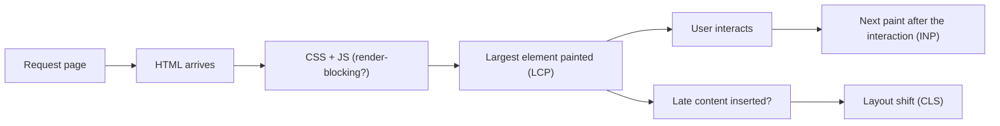

# 11. Performance and Core Web Vitals

> **Draft: written but not yet run.** The code and the expected output in this lesson were prepared by reading the code and the official documentation. They have not been executed yet. If something does not behave as described, trust your tool's real output and report it.

## What you will be able to do
By the end of this lesson you will be able to:
- Name the three Core Web Vitals, what each measures and its "good" threshold.
- Prevent layout shift and speed up loading with image dimensions, `loading="lazy"` and `fetchpriority`.
- Keep a page responsive by splitting long tasks and by loading code on demand.
- Run a Lighthouse audit on a production build and read it without over-trusting the score.

## Recap
1. Lesson 06: what does `import("./details")` do at build time and at run time? <details><summary>Answer</summary>Build time: the bundler puts the module in its own chunk. Run time: the browser fetches that chunk only when the line runs.</details>
2. Lesson 03: why animate `transform` and `opacity` instead of `width` or `top`? <details><summary>Answer</summary>They can run on the compositor without recalculating layout or repainting each frame.</details>
3. Lesson 07: why is `role="status"` used on loading text? <details><summary>Answer</summary>It is a polite live region: changes are announced to screen reader users without moving focus.</details>

## Why it matters
Slow pages lose people: they leave before content appears, they tap again because nothing reacted, they lose their place when text jumps. Google's **Core Web Vitals** turn those experiences into three numbers that you can measure in your own page. This lesson is about *measure, then fix the biggest thing*, not about folklore tricks. It also reinforces earlier lessons: image dimensions and animation choices are performance features.

| Metric | Measures | "Good" (at the 75th percentile of real visits) |
|---|---|---|
| **LCP** Largest Contentful Paint | How soon the biggest visible element (often a hero image or heading) is drawn | 2.5 seconds or less |
| **INP** Interaction to Next Paint | How quickly the page responds visually after taps, clicks and key presses (the slow ones count) | 200 milliseconds or less |
| **CLS** Cumulative Layout Shift | How much visible content unexpectedly moves | 0.1 or less |

## What you will build
A "Performance lab" page with a live readout of LCP, a simplified CLS and the slowest interaction (using the browser's `PerformanceObserver`), two buttons that do the same 300 ms of work in a blocking and a sliced way, two "late banner" buttons that do and do not reserve space, a lazy-loaded code module and a gallery of 12 lazily loaded images. Then you build, preview and audit it with Lighthouse.



## Before you start
- Lessons 06 to 10. Same tools. A Chromium browser (Chrome or Edge) for Lighthouse. Time: 65 minutes; break after Step 7.
- Create `code101/web201/lesson11` with `src` and `public/images` inside. Copy `tsconfig.json`, `vite.config.ts`, `.gitignore` and `src/dom.ts` unchanged from lesson 06 ([Step 3](../phase-2-typescript-in-depth/06-modules-vite-and-dev-workflow.md#step-3-write-tsconfigjson), [Step 4](../phase-2-typescript-in-depth/06-modules-vite-and-dev-workflow.md#step-4-write-viteconfigts), [Step 9](../phase-2-typescript-in-depth/06-modules-vite-and-dev-workflow.md#step-9-ignore-generated-files-install-run-the-dev-server), [Step 7](../phase-2-typescript-in-depth/06-modules-vite-and-dev-workflow.md#step-7-write-the-typed-environment-the-data-and-the-dom-helper)).
- Source pack (optional): every file is shown in full in this lesson, so you can follow without it. The finished code, the exercise starter and the solution are in the
  course repository https://github.com/Uee03/Code101 under `source/web/201-hero-to-super-hero/phase-4-quality-and-ship/11-performance-and-core-web-vitals/` (on that page choose **Code, Download ZIP**, or run
  `git clone https://github.com/Uee03/Code101.git`).
- Windows PowerShell: use `npm.cmd` if `npm.ps1` is blocked.
- Numbers on your machine will differ from anyone else's. Performance is *measured*, and this lesson does not state numbers it did not measure.

## Steps

### Step 1. Create the folders and package.json
**Folder: your user folder**
```powershell
mkdir code101\web201\lesson11\src
mkdir code101\web201\lesson11\public\images
```
```bash
mkdir -p ~/code101/web201/lesson11/src ~/code101/web201/lesson11/public/images
```

**File: `package.json`**
```json
{
  "name": "web201-lesson-11",
  "version": "1.0.0",
  "private": true,
  "type": "module",
  "scripts": {
    "dev": "vite",
    "typecheck": "tsc --noEmit",
    "build": "tsc --noEmit && vite build",
    "preview": "vite preview"
  },
  "engines": {
    "node": ">=22.12.0"
  },
  "devDependencies": {
    "@types/node": "26.6.6",
    "typescript": "7.0.2",
    "vite": "8.3.8"
  }
}
```
Add the four copied files, then run `npm install --no-audit --no-fund` in `lesson11`.

### Step 2. Write the sample picture
A small vector picture (about 500 bytes of text). The page loads it under 14 different addresses (`?tile=0`, `?tile=1`, ...) so the browser treats each as a separate request, like 14 different photos. Vector images scale without extra files; photographs need the raster techniques in "How it works".

**File: `public/images/tile.svg`**
```svg
<svg xmlns="http://www.w3.org/2000/svg" viewBox="0 0 320 200" width="320" height="200">
  <defs>
    <linearGradient id="g" x1="0" y1="0" x2="1" y2="1">
      <stop offset="0" stop-color="#1d4ed8"/>
      <stop offset="1" stop-color="#7cb0ff"/>
    </linearGradient>
  </defs>
  <rect width="320" height="200" fill="url(#g)"/>
  <circle cx="240" cy="60" r="28" fill="#ffffff" fill-opacity="0.8"/>
  <path d="M0 200 L110 90 L180 160 L230 110 L320 200 Z" fill="#0b1220" fill-opacity="0.55"/>
</svg>
```

### Step 3. Write the page
Notice the hero image first: `width="960" height="320"` lets the browser reserve a 3:1 box *before* the image arrives; `fetchpriority="high"` tells it this is the most important image; `alt=""` marks it decorative. The hero is *not* lazy: lazy-loading the main above-the-fold image makes LCP worse.

**File: `index.html`**
```html
<!doctype html>
<html lang="en">
<head>
  <meta charset="utf-8">
  <meta name="viewport" content="width=device-width, initial-scale=1">
  <title>Performance lab</title>
  <link rel="icon" href="data:,">
  <link rel="stylesheet" href="/src/style.css">
</head>
<body>
  <header class="hero">
    
    <h1 class="hero__title">Performance lab</h1>
  </header>

  <main class="shell">
    <section aria-labelledby="vitals-title">
      <h2 id="vitals-title">Live measurements for this visit</h2>
      <dl class="vitals">
        <dt>Largest Contentful Paint (LCP)</dt>
        <dd id="lcp">waiting...</dd>
        <dt>Cumulative Layout Shift (CLS, simplified)</dt>
        <dd id="cls">0.000</dd>
        <dt>Slowest interaction (like INP)</dt>
        <dd id="inp">no interaction yet</dd>
      </dl>
    </section>

    <section aria-labelledby="interaction-title">
      <h2 id="interaction-title">Responsiveness</h2>
      <div class="actions">
        <button id="slow" class="button" type="button">Slow click (blocks 300 ms)</button>
        <button id="fast" class="button button--ghost" type="button">Fast click (same work, in slices)</button>
      </div>
      <p id="work-status" role="status">Click a button, then read "Slowest interaction" above.</p>
    </section>

    <section aria-labelledby="shift-title">
      <h2 id="shift-title">Layout stability</h2>
      <div class="actions">
        <button id="banner-a" class="button" type="button">Insert banner A after 1 second</button>
        <button id="banner-b" class="button button--ghost" type="button">Insert banner B after 1 second</button>
      </div>
      <div id="slot-a" class="slot"></div>
      <p class="muted">Content below slot A. Slot A reserves no space.</p>
      <div id="slot-b" class="slot slot--reserved"></div>
      <p class="muted">Content below slot B. Slot B reserves space (dashed box).</p>
      <p class="muted">Reload the page to reset.</p>
    </section>

    <section aria-labelledby="report-title">
      <h2 id="report-title">Code splitting</h2>
      <button id="report-button" class="button" type="button">Load report module</button>
      <pre id="report" class="report" role="status"></pre>
    </section>

    <section aria-labelledby="gallery-title">
      <h2 id="gallery-title">Gallery (lazy images)</h2>
      <ul id="gallery" class="gallery"></ul>
    </section>
  </main>
  <script type="module" src="/src/main.ts"></script>
</body>
</html>
```

### Step 4. Write the stylesheet
`img { max-inline-size: 100%; block-size: auto; }` is the key rule for responsive images: with `width` and `height` attributes in the HTML, the browser computes the aspect ratio from them, so the image can shrink with its container and still reserves the right height.

**File: `src/style.css`**
```css
:root {
  color-scheme: light dark;
  --bg: light-dark(#ffffff, #0b1220);
  --surface: light-dark(#f1f5f9, #172033);
  --text: light-dark(#0f172a, #e2e8f0);
  --muted: light-dark(#475569, #a7b3c7);
  --accent: light-dark(#1d4ed8, #7cb0ff);
  --on-accent: light-dark(#ffffff, #0b1220);
  --border: light-dark(#64748b, #94a3b8);
}

body {
  margin: 0;
  font-family: system-ui, -apple-system, "Segoe UI", Roboto, sans-serif;
  line-height: 1.5;
  background: var(--bg);
  color: var(--text);
}

img {
  max-inline-size: 100%;
  block-size: auto;
}

.hero {
  position: relative;
}

.hero__image {
  display: block;
  inline-size: 100%;
}

.hero__title {
  position: absolute;
  inset-block-end: 1rem;
  inset-inline-start: 1.5rem;
  margin: 0;
  padding: 0.25rem 0.75rem;
  border-radius: 0.5rem;
  background: var(--bg);
}

.shell {
  max-inline-size: 60rem;
  margin-inline: auto;
  padding: 1.5rem;
}

.vitals {
  display: grid;
  grid-template-columns: max-content 1fr;
  gap: 0.25rem 1rem;
}

.vitals dt {
  font-weight: 600;
}

.vitals dd {
  margin: 0;
  font-variant-numeric: tabular-nums;
}

.actions {
  display: flex;
  flex-wrap: wrap;
  gap: 0.75rem;
}

.button {
  min-block-size: 2.75rem;
  padding-inline: 1rem;
  border: 1px solid var(--accent);
  border-radius: 0.5rem;
  background: var(--accent);
  color: var(--on-accent);
  font: inherit;
  cursor: pointer;
}

.button--ghost {
  background: transparent;
  color: var(--text);
  border-color: var(--border);
}

.muted {
  color: var(--muted);
}

.slot--reserved {
  min-block-size: 4rem;
  border: 1px dashed var(--border);
}

.banner {
  margin: 0;
  padding: 0.75rem 1rem;
  background: var(--surface);
}

.report {
  min-block-size: 1.5rem;
  white-space: pre-wrap;
}

.gallery {
  display: grid;
  grid-template-columns: repeat(auto-fill, minmax(10rem, 1fr));
  gap: 0.75rem;
  margin: 0;
  padding: 0;
  list-style: none;
}

:focus-visible {
  outline: 3px solid var(--accent);
  outline-offset: 2px;
}
```

### Step 5. Write the measuring code
`PerformanceObserver` asks the browser to report performance entries of one type. `buffered: true` also delivers entries from *before* the observer was created. Entry types differ: `largest-contentful-paint` entries each carry a `startTime`; `layout-shift` entries carry a `value` and `hadRecentInput` (shifts within half a second of a click or key press are expected, so they are excluded); `event` entries carry the `duration` of an interaction (from the input until the next paint, rounded to 8 ms) and only appear above `durationThreshold` (16 ms is the minimum). Some browsers do not support some types, so each is guarded with `supportedEntryTypes`.

This is a *teaching* version. The real CLS adds shifts in "session windows" and reports the worst window; the real INP picks a high percentile of all interactions. In production, use Google's `web-vitals` library or your monitoring tool; this code shows how the numbers come about.

**File: `src/vitals.ts`**
```ts
interface LayoutShiftEntry extends PerformanceEntry {
  readonly value: number;
  readonly hadRecentInput: boolean;
}

export interface VitalsOutputs {
  readonly lcp: HTMLElement;
  readonly cls: HTMLElement;
  readonly inp: HTMLElement;
}

function observe(
  type: string,
  handle: (entries: PerformanceEntry[]) => void,
  options: { durationThreshold?: number } = {},
): boolean {
  if (!PerformanceObserver.supportedEntryTypes.includes(type)) {
    return false;
  }
  const observer = new PerformanceObserver((list) => handle(list.getEntries()));
  observer.observe({ type, buffered: true, ...options });
  return true;
}

export function observeVitals(outputs: VitalsOutputs): void {
  let layoutShift = 0;
  let slowest = 0;

  const lcpSupported = observe("largest-contentful-paint", (entries) => {
    const latest = entries[entries.length - 1];
    if (latest !== undefined) {
      outputs.lcp.textContent = `${Math.round(latest.startTime)} ms`;
    }
  });
  if (!lcpSupported) {
    outputs.lcp.textContent = "not supported in this browser";
  }

  const clsSupported = observe("layout-shift", (entries) => {
    for (const entry of entries as LayoutShiftEntry[]) {
      if (!entry.hadRecentInput) {
        layoutShift += entry.value;
      }
    }
    outputs.cls.textContent = layoutShift.toFixed(3);
  });
  if (!clsSupported) {
    outputs.cls.textContent = "not supported in this browser";
  }

  const eventSupported = observe(
    "event",
    (entries) => {
      for (const entry of entries) {
        slowest = Math.max(slowest, entry.duration);
      }
      outputs.inp.textContent = `${Math.round(slowest)} ms`;
    },
    { durationThreshold: 16 },
  );
  if (!eventSupported) {
    outputs.inp.textContent = "not supported in this browser";
  }
}
```

### Step 6. Write the gallery and the lazy module
Compare the three attributes in `renderGallery` to the HTML you would write by hand: `loading="lazy"` makes the browser fetch an image only when it is near the viewport; `width` and `height` reserve its space (so nothing jumps when it arrives); `decoding="async"` lets the browser decode it off the critical path. `loading` is set **before** `src` because the browser reads it when the source is set. `report.ts` is the module that main loads only when the button is pressed.

**File: `src/gallery.ts`**
```ts
const TILE_COUNT = 12;

export function renderGallery(list: HTMLElement): void {
  const items = Array.from({ length: TILE_COUNT }, (_, index) => {
    const item = document.createElement("li");
    const image = document.createElement("img");
    image.loading = "lazy";
    image.decoding = "async";
    image.width = 320;
    image.height = 200;
    image.alt = `Sample picture ${index + 1}`;
    image.src = `/images/tile.svg?tile=${index + 1}`;
    item.append(image);
    return item;
  });
  list.replaceChildren(...items);
}
```

**File: `src/report.ts`**
```ts
export function buildReport(count: number): string {
  const rows = Array.from({ length: count }, (_, index) => `Picture ${index + 1}: loaded lazily`);
  return rows.join("\n");
}
```

### Step 7. Write main.ts
Two handlers do the **same 300 ms of work**:
- **Slow:** one `blockFor(300)` call inside the click handler. The browser cannot paint or react until it returns, so the click's next paint is at least 300 ms late.
- **Fast:** ten slices of 30 ms. After each slice `await nextTask()` hands control back to the browser (a `setTimeout(0)` ends the current task), so it can paint and handle other input between slices. The total work is the same, but no single task is long (a task over 50 ms is called a *long task*).

The banner buttons insert a late element after one second (long enough that it is not counted as input-caused). Slot A has no reserved space, so everything below moves. Slot B has a `min-block-size` of 4rem and the banner is shorter (padding plus one line is about 3rem), so nothing moves.

**File: `src/main.ts`**
```ts
import { requireElement } from "./dom";
import { renderGallery } from "./gallery";
import { observeVitals } from "./vitals";

observeVitals({
  lcp: requireElement("#lcp", HTMLElement),
  cls: requireElement("#cls", HTMLElement),
  inp: requireElement("#inp", HTMLElement),
});
renderGallery(requireElement("#gallery", HTMLUListElement));

const workStatus = requireElement("#work-status", HTMLParagraphElement);

function blockFor(ms: number): void {
  const end = performance.now() + ms;
  while (performance.now() < end) {
    // Busy wait: the main thread cannot respond to anything else meanwhile.
  }
}

function nextTask(): Promise<void> {
  return new Promise((resolve) => setTimeout(resolve, 0));
}

requireElement("#slow", HTMLButtonElement).addEventListener("click", () => {
  blockFor(300);
  workStatus.textContent = "Slow click finished: the page was frozen for 300 ms.";
});

requireElement("#fast", HTMLButtonElement).addEventListener("click", async () => {
  workStatus.textContent = "Fast click: working in 30 ms slices...";
  for (let done = 0; done < 300; done += 30) {
    blockFor(30);
    await nextTask();
  }
  workStatus.textContent = "Fast click finished: the same 300 ms of work, in slices.";
});

function insertBanner(slotSelector: string): void {
  const slot = requireElement(slotSelector, HTMLDivElement);
  const banner = document.createElement("p");
  banner.className = "banner";
  banner.textContent = "A late banner, like an advert or a cookie notice.";
  slot.replaceChildren(banner);
}

requireElement("#banner-a", HTMLButtonElement).addEventListener("click", () => {
  setTimeout(() => insertBanner("#slot-a"), 1000);
});

requireElement("#banner-b", HTMLButtonElement).addEventListener("click", () => {
  setTimeout(() => insertBanner("#slot-b"), 1000);
});

const report = requireElement("#report", HTMLPreElement);
requireElement("#report-button", HTMLButtonElement).addEventListener("click", async () => {
  const { buildReport } = await import("./report");
  report.textContent = buildReport(12);
});
```
**Break point: you can stop here and resume later.**

## Run it
**Folder: `lesson11`**
```bash
npm run typecheck
npm run dev
```
Open the `Local:` address (typical: `http://localhost:5173/`). **Reload the page before each experiment** (the measurements accumulate during a visit).

**Predict, then try:**

| Experiment | Your prediction | What the code should produce |
|---|---|---|
| Reload, wait, read the panel | Which element is the LCP? | The hero picture (the largest visible element); the panel shows a millisecond value that depends on your machine |
| Reload, press **Slow click** | What will "Slowest interaction" show? | At least about 300 ms, because the handler blocks the main thread for 300 ms before the browser can paint |
| Reload, press **Fast click** | Higher or lower than slow? | Much lower: each task is about 30 ms, so the click is painted after the first slice. (Exact number varies; the value excludes the timer tasks, which are not interactions.) |
| Reload, press **Insert banner A**, wait 1 s | CLS? | Above `0.000`: the banner pushed the content below it down without warning |
| Reload, press **Insert banner B**, wait 1 s | CLS? | Stays `0.000`: the space was already reserved |
| Press **Load report module** | What happens in the Network panel? | A request for a small JavaScript file appears only now (in dev, a module request such as `report.ts`) |
| Scroll down | When do the gallery images load? | As they near the viewport; Network shows `tile.svg?tile=N` requests appearing as you scroll |

### Step 8. Build, preview and audit with Lighthouse
Measure the production build, not the dev server (the dev server does not minify and serves many small modules).

**Folder: `lesson11`**
```bash
npm run build
npm run preview
```
`build` prints a table of files with sizes (and gzip sizes): `dist/index.html`, one CSS file and two or more JavaScript files, one of which is the small `report` chunk (typical output; names have hashes and sizes vary). Open `http://localhost:4173/` in Chrome or Edge in a **private (incognito) window** so extensions do not distort the result.

1. Open DevTools (F12) and choose the **Lighthouse** panel.
2. Choose mode **Navigation**, device **Mobile** (then repeat with Desktop), and check at least **Performance** and **Accessibility**.
3. Click **Analyze page load** and wait for the report.
4. Read the report from the top: the score is a summary; the useful part is the **metrics** (LCP, Total Blocking Time, CLS) and the **Opportunities and Diagnostics** list with its explanations.

Panel and button names change between Chrome versions; if yours differs, follow the current guide linked in "Going further".

Things to expect (from the code, not from a run): the report will list the hero image as the LCP element; it should not flag the image dimensions (they are set); the layout-shift section should be empty until you press a banner button (Lighthouse does not click anything). Run it three times and compare: scores vary from run to run.

## How it works
- **Lab vs field.** Lighthouse and your DevTools run *lab* tests: one machine, one network profile, repeatable. *Field* data is what real users experienced (the Chrome User Experience Report, or your own monitoring). Core Web Vitals pass or fail on field data at the 75th percentile; lab data helps you find causes. Use both.
- **LCP** is mostly about *getting the largest element to the screen*: send HTML fast, do not block rendering with unneeded CSS or script, and prioritise the LCP image (`fetchpriority="high"`, never `loading="lazy"` for it).
- **CLS** comes from content that appears without reserved space: images and iframes without dimensions, late banners and ads, web fonts that swap with a different size. Fix by giving boxes a size (`width`/`height`, `aspect-ratio`, `min-block-size`) before the content arrives.
- **INP** is about main-thread availability. JavaScript runs on one thread shared with painting and input handling. Work longer than 50 ms blocks them. Fixes: do less, split work into slices and yield, move heavy work to a Web Worker, avoid layout thrash (reading and writing layout properties in a loop).
- **Bundle size.** Every kilobyte of JavaScript must be downloaded, parsed and run, which costs most on slow phones. Tactics: ship less (avoid large dependencies and import only what you use so the bundler can drop the rest, called *tree shaking*); load on demand with `import()`; serve compressed (gzip or Brotli) and cacheable (hashed file names with long `Cache-Control`, as lesson 12's server does). Read the build table: sort by size and ask "does the first screen need this?".
- **Responsive raster images.** For photographs, offer several widths and formats and let the browser pick. This is an illustration only (not part of the project files):
```html
<picture>
  <source type="image/avif" srcset="photo-480.avif 480w, photo-960.avif 960w" sizes="(min-width: 60rem) 30rem, 100vw">
  <source type="image/webp" srcset="photo-480.webp 480w, photo-960.webp 960w" sizes="(min-width: 60rem) 30rem, 100vw">
  
</picture>
```
`srcset` lists files and their real widths; `sizes` tells the browser how wide the image will be shown, so it can choose before layout; `<source type>` lets browsers that understand AVIF or WebP take the smaller file and everything else fall back to the JPEG.
- **Misconception to correct:** "a 100 Lighthouse score means a fast site". The score is one lab run on one simulated device. A page can score 100 and still frustrate real users (or the reverse). Treat the score as a smoke alarm, not as the goal.

**Why this, not that**

| Choice | Instead of | Why |
|---|---|---|
| Measure first, fix the biggest item | Applying every tip you have read | Most tips do nothing for your page; the biggest bottleneck usually is one thing |
| `width`/`height` on images | Fixing layout jumps with JavaScript | The browser reserves space before download with no code |
| `loading="lazy"` below the fold, `fetchpriority="high"` for the hero | Lazy-loading everything | Lazy-loading the LCP image delays the metric you want to improve |
| Yield in slices | One long handler | Keeps input and painting responsive |
| `import()` for rarely used features | One big bundle | The first screen downloads less |

## Try it
Copy `lesson11` to `lesson11-try` (without `node_modules` and `dist`), run `npm install`, then replace `src/gallery.ts` with the starter. The pack file is `exercise/starter/src/gallery.ts`. This version is slower and less stable on purpose.

**File: `src/gallery.ts`** (starter)
```ts
const TILE_COUNT = 12;

// TODO 1: this version makes the page jump while images load, and fetches all 12 at once. Fix it:
//   - give every image width and height (320 and 200)
//   - load images lazily (loading = "lazy") and decode them off the main thread (decoding = "async")
// Set loading before src: the browser reads it when the source is set.
export function renderGallery(list: HTMLElement): void {
  const items = Array.from({ length: TILE_COUNT }, (_, index) => {
    const item = document.createElement("li");
    const image = document.createElement("img");
    image.alt = `Sample picture ${index + 1}`;
    image.src = `/images/tile.svg?tile=${index + 1}`;
    item.append(image);
    return item;
  });
  list.replaceChildren(...items);
}
```
1. **Guided.** Complete TODO 1. Goal: in DevTools Network, with the page scrolled to the top, only the hero image is requested at first and the `tile.svg?tile=N` requests appear as you scroll. To see the layout-shift difference between the starter and your fix, set DevTools **Network** throttling to a slow profile before reloading, and compare the CLS readout.
2. **Change.** Load the report module *before* it is needed but without blocking startup: after the page has loaded, call `import("./report")` from `requestIdleCallback` (or `setTimeout` if you prefer) so the click feels instant. What do you gain and what do you pay?
3. **Stretch (design choice).** Write a small **performance budget** for this page: a maximum for the main JavaScript chunk, a target for LCP and CLS, and how you would enforce it (for example `build.chunkSizeWarningLimit` in `vite.config.ts` and a Lighthouse run in the build pipeline). Decide who is told when the budget is exceeded.

<details><summary>Solution</summary>

**File: `src/gallery.ts`** (solution)
```ts
const TILE_COUNT = 12;

export function renderGallery(list: HTMLElement): void {
  const items = Array.from({ length: TILE_COUNT }, (_, index) => {
    const item = document.createElement("li");
    const image = document.createElement("img");
    image.loading = "lazy";
    image.decoding = "async";
    image.width = 320;
    image.height = 200;
    image.alt = `Sample picture ${index + 1}`;
    image.src = `/images/tile.svg?tile=${index + 1}`;
    item.append(image);
    return item;
  });
  list.replaceChildren(...items);
}
```
For rung 2: prefetching during idle time trades a little bandwidth (the module is fetched even if nobody clicks) for a faster first click; do it only for things users very likely need. `requestIdleCallback` is not available in every browser, so fall back to `setTimeout`. For rung 3, a budget is only useful if something fails when it is broken, such as a CI step.

</details>

## Check yourself
1. Which metric would a late-loading cookie banner that pushes the page down worsen, and how do you prevent it? <details><summary>Answer</summary>CLS. Reserve the space (`min-block-size` or a fixed-size container) before the banner arrives, or overlay it without moving content.</details>
2. **Predict:** you add `loading="lazy"` to the hero image. What happens to LCP and why? <details><summary>Answer</summary>It gets worse: the browser delays fetching the most important image until layout shows it is near the viewport, so the biggest element paints later.</details>
3. Why does splitting 300 ms of work into 30 ms slices improve INP although the total work is the same? <details><summary>Answer</summary>Between slices the browser can paint and handle input, so the visible response to the click is no longer waiting for all 300 ms.</details>
4. What is the difference between lab data and field data? <details><summary>Answer</summary>Lab data is a controlled test run (Lighthouse); field data is measured from real users' visits. The Core Web Vitals thresholds apply to field data.</details>
5. Why measure the production build, not the dev server? <details><summary>Answer</summary>The dev server serves unminified modules individually with extra tooling code; production builds are what users receive.</details>

## Common mistakes
| Symptom | Cause | Fix |
|---|---|---|
| Panel shows `not supported in this browser` for a metric | The browser does not expose that entry type | Use a Chromium browser for this lab |
| CLS stays `0.000` after banner A | The banner was inserted within 500 ms of your click, or the window is too short to move | Wait the full second; reload and retry |
| Slowest interaction stays high after the fast click | The readout keeps the maximum since the page loaded | Reload between experiments |
| Gallery images all load at once | `loading="lazy"` was set after `src`, or the images are already inside the viewport | Set `loading` before `src`; make the window shorter |
| Lighthouse scores differ every run | Normal variation in lab tests (CPU, network, extensions) | Run several times in a private window; compare medians |
| `npm.ps1 cannot be loaded because running scripts is disabled on this system` | PowerShell policy | Use `npm.cmd` |
| `Expected #lcp to be a HTMLElement` in the console | `id` in `index.html` does not match `main.ts` | Compare the two files |

## Best practice
Measure with real tools, fix the largest cost first, reserve space for anything that arrives late, keep tasks short, and ship less JavaScript. Source: web.dev, Web Vitals https://web.dev/articles/vitals and web.dev, Optimize Largest Contentful Paint https://web.dev/articles/optimize-lcp

## Going further
- web.dev: [Optimize INP](https://web.dev/articles/optimize-inp), [Optimize CLS](https://web.dev/articles/optimize-cls) and the [`web-vitals` library](https://github.com/GoogleChrome/web-vitals).
- Chrome for Developers: [Lighthouse overview](https://developer.chrome.com/docs/lighthouse/overview) and MDN: [`PerformanceObserver`](https://developer.mozilla.org/en-US/docs/Web/API/PerformanceObserver).
- Lesson 12 serves a production build with compression and long cache lifetimes. The [web-react](../../../../capstones/web-react/) and [web-angular](../../../../capstones/web-angular/) capstones add route-level code splitting.

## Summary
- You named the three Core Web Vitals and their thresholds.
- You measured LCP, layout shift and slow interactions with `PerformanceObserver`.
- You prevented layout shift, lazy-loaded images and code, and sliced a long task.
- You audited a production build with Lighthouse and described what a score can and cannot tell you.

## Next lesson
12. Testing with Vitest and a mini project: a typed, accessible task board, tested, built and served by nginx in a container.
