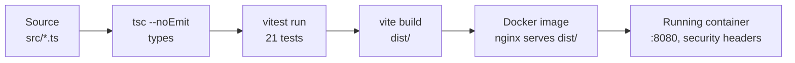
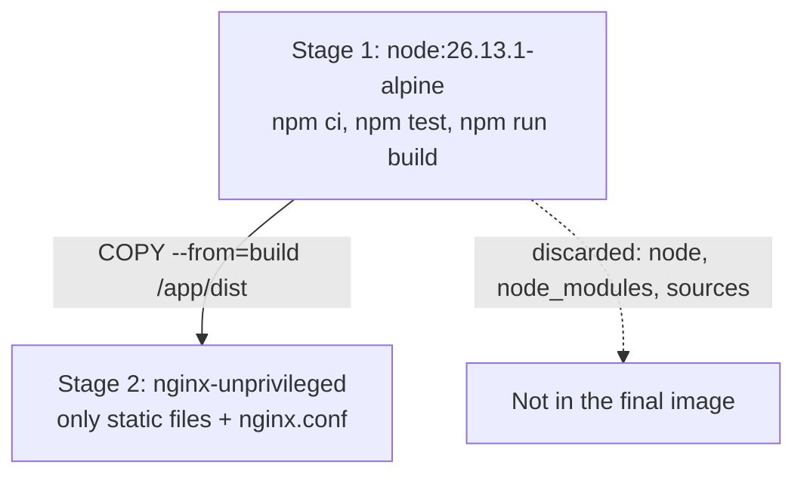

# 12. Testing with Vitest, and a mini project: the task board

> **Draft: written but not yet run.** The code and the expected output in this lesson were prepared by reading the code and the official documentation. They have not been executed yet. If something does not behave as described, trust your tool's real output and report it.

## What you will be able to do
By the end of this lesson you will be able to:
- Write unit and DOM tests with Vitest, and say what each test proves and what it cannot.
- Build a typed, accessible, persistent task board from the pieces of this level.
- Run the type check, the tests and the production build as one gate.
- Package the build in a multi-stage Docker image served by nginx with security and caching headers, and check the headers.

## Recap
1. Lesson 08: why must a reducer return a *new* object? <details><summary>Answer</summary>The store compares old and new state with `Object.is`; mutating and returning the same object looks like "no change".</details>
2. Lesson 09: name two uses of ARIA in a form and one place where native HTML replaced it. <details><summary>Answer</summary>`aria-describedby` for hints and errors and `aria-invalid` for a field in error; native `<fieldset>`/`<legend>`, `<button>` and `<details>` replaced ARIA widgets.</details>
3. Lesson 10: which header limited the damage of the injected `onerror` handler? <details><summary>Answer</summary>`Content-Security-Policy` with `script-src 'self'` (no inline handlers).</details>

## Why it matters
Code you cannot test is code you are afraid to change. Tests are executable documentation: each one states a rule of the program and fails when the rule breaks. Together with the type checker and the build they form a **gate**: nothing ships unless all three pass. This lesson also asks you to bring the whole level together in one small product, then ship it the way real front ends are shipped: a container with a static web server, not a development server.

## What you will build
A **task board** with three columns (To do, In progress, Done). You can add a task, move it between columns with buttons (keyboard and screen-reader friendly, no drag and drop required), delete it, and the board is remembered in `localStorage`. It has 21 automated tests in 4 files, a production build and a Docker image served by nginx. Related capstones for full applications are linked at the end: [web-angular](../../../../capstones/web-angular/) and [web-react](../../../../capstones/web-react/).





## Before you start
- **Prerequisites:** Web 201 lessons [04, unions, narrowing and utility types](../phase-2-typescript-in-depth/04-unions-narrowing-utility-types.md), [06, modules, Vite and the dev workflow](../phase-2-typescript-in-depth/06-modules-vite-and-dev-workflow.md), [08, state and events without a framework](../phase-3-app-patterns/08-state-and-events-without-a-framework.md), [09, forms and accessibility](../phase-3-app-patterns/09-forms-and-accessibility.md), [10, web security basics](10-web-security-basics.md) and [11, performance and Core Web Vitals](11-performance-and-core-web-vitals.md).
- Lessons 04 to 11. Node 22.12 or newer (course target 26.13.1), npm 11.20.0, a modern browser. **Docker** (Docker Desktop on Windows and macOS, or Docker Engine on Linux) is needed for Steps 22 to 24 only; everything before runs without it.
- Time: allow **two sittings, about 150 minutes in total**. Sitting 1: Steps 1 to 15 (the project and a manual check). Sitting 2: Steps 16 to 24 (tests, build, container). A marked break is at the end of Step 15, and another before the container steps.
- Source pack (optional): every file is shown in full in this lesson, so you can follow without it. The finished code, the exercise starter and the solution are in the
  course repository https://github.com/Uee03/Code101 under `source/web/201-hero-to-super-hero/phase-4-quality-and-ship/12-testing-and-task-board-project/` (on that page choose **Code, Download ZIP**, or run
  `git clone https://github.com/Uee03/Code101.git`).
- Windows PowerShell: use `npm.cmd`/`npx.cmd` if `npm.ps1` is blocked; use `curl.exe` (not `curl`, which is an alias for another command) in Step 24.
- Browser notes describe what the code asks the browser to do, derived from reading it, not from a screenshot.

## Steps

### Step 1. Create the folders
**Folder: your user folder**
```powershell
mkdir code101\web201\task-board\src
```
```bash
mkdir -p ~/code101/web201/task-board/src
```
Open `task-board` in VS Code and open a terminal; its prompt must end in `task-board`.

### Step 2. Write package.json
Compared with lesson 06 it adds `vitest` (the test runner) and `jsdom` (a simulated browser document for DOM tests) with exact versions, plus the `test` scripts. `vitest run` runs once and exits (right for CI and Docker); `vitest` alone stays in watch mode and reruns when you save.

**File: `package.json`**
```json
{
  "name": "web201-task-board",
  "version": "1.0.0",
  "private": true,
  "type": "module",
  "scripts": {
    "dev": "vite",
    "typecheck": "tsc --noEmit",
    "test": "vitest run",
    "test:watch": "vitest",
    "build": "tsc --noEmit && vite build",
    "preview": "vite preview"
  },
  "engines": {
    "node": ">=22.12.0"
  },
  "devDependencies": {
    "@types/node": "26.6.6",
    "jsdom": "31.0.1",
    "typescript": "7.0.2",
    "vite": "8.3.8",
    "vitest": "5.1.1"
  }
}
```

### Step 3. Write tsconfig.json
Identical to lesson 06 (test files live in `src` and are type-checked too).

**File: `tsconfig.json`**
```json
{
  "compilerOptions": {
    "target": "ES2022",
    "lib": ["ES2022", "DOM", "DOM.Iterable"],
    "module": "ESNext",
    "moduleResolution": "Bundler",
    "moduleDetection": "force",
    "types": ["vite/client"],
    "strict": true,
    "noEmit": true,
    "verbatimModuleSyntax": true,
    "isolatedModules": true,
    "skipLibCheck": true,
    "noUnusedLocals": true,
    "noUnusedParameters": true,
    "noFallthroughCasesInSwitch": true
  },
  "include": ["src", "vite.config.ts"]
}
```

### Step 4. Write vite.config.ts (now with test settings)
`defineConfig` now comes from `vitest/config`, which accepts everything Vite's does plus a `test` block. `environment: "node"` is the default for every test file (fast, no browser needed); a test that needs a document opts in with a first-line comment `// @vitest-environment jsdom`. `include` says which files are tests. `build.sourcemap` is `false` here: source maps would be copied into the image and served to everyone.

**File: `vite.config.ts`**
```ts
import { defineConfig } from "vitest/config";

export default defineConfig({
  server: {
    port: 5173,
    strictPort: true,
  },
  preview: {
    port: 4173,
    strictPort: true,
  },
  build: {
    outDir: "dist",
    sourcemap: false,
    target: "baseline-widely-available",
  },
  test: {
    environment: "node",
    include: ["src/**/*.test.ts"],
  },
});
```

### Step 5. Ignore generated files and install
**File: `.gitignore`**
```text
node_modules/
dist/
.env
.env.*.local
```

**Folder: `task-board`**
```bash
npm install --no-audit --no-fund
```
Expected result: an install summary, a `node_modules` folder and a new `package-lock.json`. **Keep the lockfile**: the Docker build in Step 22 uses `npm ci`, which installs exactly the versions it records and fails if it is missing or out of date.

### Step 6. Write the model and the reducer: src/board.ts
All rules of the board live in this one file with no DOM: statuses, the task shape, the actions and `reduceBoard`. It uses lesson 04 (union types, `satisfies`) and lesson 08 (reducer). The reducer returns the **same** state object for anything that changes nothing (blank title, a move past the last column, an unknown id), which the store uses to skip repainting and the tests use to check "no change".

**File: `src/board.ts`**
```ts
export const MAX_TITLE = 80;

export type Status = "todo" | "doing" | "done";
export type Direction = "forward" | "back";

export const STATUSES: readonly Status[] = ["todo", "doing", "done"];

export const STATUS_LABELS = {
  todo: "To do",
  doing: "In progress",
  done: "Done",
} satisfies Record<Status, string>;

export interface Task {
  readonly id: number;
  readonly title: string;
  readonly status: Status;
}

export interface BoardState {
  readonly tasks: readonly Task[];
  readonly nextId: number;
}

export type BoardAction =
  | { type: "added"; title: string }
  | { type: "moved"; id: number; direction: Direction }
  | { type: "removed"; id: number };

export const emptyBoard: BoardState = { tasks: [], nextId: 1 };

export function neighbour(status: Status, direction: Direction): Status | null {
  const index = STATUSES.indexOf(status) + (direction === "forward" ? 1 : -1);
  return STATUSES[index] ?? null;
}

export function tasksIn(state: BoardState, status: Status): readonly Task[] {
  return state.tasks.filter((task) => task.status === status);
}

export function reduceBoard(state: BoardState, action: BoardAction): BoardState {
  switch (action.type) {
    case "added": {
      const title = action.title.trim();
      if (title === "" || title.length > MAX_TITLE) {
        return state;
      }
      const task: Task = { id: state.nextId, title, status: "todo" };
      return { tasks: [...state.tasks, task], nextId: state.nextId + 1 };
    }
    case "moved": {
      const { id, direction } = action;
      const task = state.tasks.find((item) => item.id === id);
      if (task === undefined) {
        return state;
      }
      const target = neighbour(task.status, direction);
      if (target === null) {
        return state;
      }
      return {
        ...state,
        tasks: state.tasks.map((item) => (item.id === id ? { ...item, status: target } : item)),
      };
    }
    case "removed": {
      const { id } = action;
      if (!state.tasks.some((item) => item.id === id)) {
        return state;
      }
      return { ...state, tasks: state.tasks.filter((item) => item.id !== id) };
    }
  }
}
```
`nextId` only ever grows, so a deleted task's id is never reused; the saved list stays unambiguous.

### Step 7. Write the store: src/store.ts
The same generic store as lesson 08, Step 5.

**File: `src/store.ts`**
```ts
export type Listener<S> = (state: S) => void;

export interface Store<S, A> {
  getState(): S;
  dispatch(action: A): void;
  subscribe(listener: Listener<S>): () => void;
}

export function createStore<S, A>(reducer: (state: S, action: A) => S, initial: S): Store<S, A> {
  let state = initial;
  const listeners = new Set<Listener<S>>();

  return {
    getState: () => state,
    dispatch(action) {
      const next = reducer(state, action);
      if (Object.is(next, state)) {
        return;
      }
      state = next;
      for (const listener of [...listeners]) {
        listener(state);
      }
    },
    subscribe(listener) {
      listeners.add(listener);
      return () => {
        listeners.delete(listener);
      };
    },
  };
}
```

### Step 8. Write the persistence: src/storage.ts
Anything read from `localStorage` is outside data: it may be missing, corrupt, from an older version of the app, or edited by the user. `parseBoard` validates the whole shape (lesson 05's lesson: parse, do not cast) and falls back to an empty board. `loadBoard` and `saveBoard` take an optional storage object so tests can pass a fake; by default they use the real `localStorage`, inside `try`, because merely touching `localStorage` can throw when storage is blocked. The key is versioned (`task-board-v1`) so a future format change can ignore old data.

**File: `src/storage.ts`**
```ts
import { STATUSES, emptyBoard, type BoardState, type Status, type Task } from "./board";

const KEY = "task-board-v1";

export interface KeyValueStore {
  getItem(key: string): string | null;
  setItem(key: string, value: string): void;
}

function isStatus(value: unknown): value is Status {
  return STATUSES.some((status) => status === value);
}

function isTask(value: unknown): value is Task {
  if (typeof value !== "object" || value === null) {
    return false;
  }
  const { id, title, status } = value as Record<string, unknown>;
  return typeof id === "number" && typeof title === "string" && isStatus(status);
}

function isBoardState(value: unknown): value is BoardState {
  if (typeof value !== "object" || value === null) {
    return false;
  }
  const { tasks, nextId } = value as Record<string, unknown>;
  if (typeof nextId !== "number" || !Array.isArray(tasks) || !tasks.every(isTask)) {
    return false;
  }
  return tasks.every((task) => task.id < nextId);
}

export function parseBoard(raw: string | null): BoardState {
  if (raw === null) {
    return emptyBoard;
  }
  try {
    const data: unknown = JSON.parse(raw);
    return isBoardState(data) ? data : emptyBoard;
  } catch {
    return emptyBoard;
  }
}

export function loadBoard(storage?: KeyValueStore): BoardState {
  try {
    return parseBoard((storage ?? localStorage).getItem(KEY));
  } catch {
    return emptyBoard;
  }
}

export function saveBoard(state: BoardState, storage?: KeyValueStore): void {
  try {
    (storage ?? localStorage).setItem(KEY, JSON.stringify(state));
  } catch {
    // Storage can be full or blocked. The board keeps working; it just will not be remembered.
  }
}
```
Privacy note: `localStorage` is readable by any script on the page (lesson 10), so store only non-sensitive data, never tokens or passwords.

### Step 9. Write the DOM helper: src/dom.ts
Copy of lesson 06 Step 7's `dom.ts`, unchanged.

**File: `src/dom.ts`**
```ts
export function requireElement<T extends Element>(selector: string, type: new () => T): T {
  const element = document.querySelector(selector);
  if (!(element instanceof type)) {
    throw new Error(`Expected ${selector} to be a ${type.name}`);
  }
  return element;
}
```

### Step 10. Write the rendering: src/render.ts
`renderBoard` rebuilds the three columns from the state with `createElement` and `textContent` (lesson 10: no `innerHTML`). Accessibility decisions, each of which a test in Step 19 checks:
- Each column is a `<section>` named by its `<h2>` (a landmark region), with the count in the heading text.
- Every button's accessible name is its visible text plus the task title (`Move to In progress: Write tests`), so a screen reader user who lists the buttons can tell them apart, and the visible words are part of the name (WCAG 2.5.3).
- Focus survives re-rendering: the function remembers the focused button's key and, when that exact button no longer exists (the task moved to the last column and lost its "forward" button), focuses the first button of the same task row.

**File: `src/render.ts`**
```ts
import {
  STATUSES,
  STATUS_LABELS,
  neighbour,
  tasksIn,
  type BoardState,
  type Direction,
  type Status,
  type Task,
} from "./board";

type Action = "move-forward" | "move-back" | "remove";

function actionButton(task: Task, action: Action, text: string): HTMLButtonElement {
  const button = document.createElement("button");
  button.type = "button";
  button.className = "button button--small";
  button.textContent = text;
  button.setAttribute("aria-label", `${text}: ${task.title}`);
  button.dataset.action = action;
  button.dataset.id = String(task.id);
  button.dataset.focusKey = `${action}-${task.id}`;
  return button;
}

function moveButton(task: Task, direction: Direction): HTMLButtonElement | null {
  const target = neighbour(task.status, direction);
  if (target === null) {
    return null;
  }
  const action = direction === "forward" ? "move-forward" : "move-back";
  return actionButton(task, action, `Move to ${STATUS_LABELS[target]}`);
}

function taskItem(task: Task): HTMLLIElement {
  const item = document.createElement("li");
  item.className = "task";
  item.dataset.taskId = String(task.id);

  const title = document.createElement("span");
  title.className = "task__title";
  title.textContent = task.title;

  const actions = document.createElement("div");
  actions.className = "task__actions";
  for (const button of [moveButton(task, "back"), moveButton(task, "forward"), actionButton(task, "remove", "Delete")]) {
    if (button !== null) {
      actions.append(button);
    }
  }

  item.append(title, actions);
  return item;
}

function column(state: BoardState, status: Status): HTMLElement {
  const section = document.createElement("section");
  section.className = "column";
  const headingId = `column-${status}`;
  section.setAttribute("aria-labelledby", headingId);

  const tasks = tasksIn(state, status);
  const heading = document.createElement("h2");
  heading.id = headingId;
  heading.textContent = `${STATUS_LABELS[status]} (${tasks.length})`;

  const list = document.createElement("ul");
  list.className = "task-list";
  if (tasks.length === 0) {
    const empty = document.createElement("li");
    empty.className = "empty";
    empty.textContent = "Nothing here yet.";
    list.append(empty);
  } else {
    list.append(...tasks.map(taskItem));
  }

  section.append(heading, list);
  return section;
}

export function renderBoard(root: HTMLElement, state: BoardState): void {
  const focused =
    document.activeElement instanceof HTMLElement && root.contains(document.activeElement)
      ? document.activeElement
      : null;
  const focusKey = focused?.dataset.focusKey;
  const taskId = focused?.closest<HTMLElement>("[data-task-id]")?.dataset.taskId;

  root.replaceChildren(...STATUSES.map((status) => column(state, status)));

  if (focusKey !== undefined) {
    const exact = root.querySelector<HTMLElement>(`[data-focus-key="${focusKey}"]`);
    if (exact !== null) {
      exact.focus();
      return;
    }
  }
  if (taskId !== undefined) {
    root.querySelector<HTMLElement>(`[data-task-id="${taskId}"] button`)?.focus();
  }
}
```

### Step 11. Write the board controller: src/mount.ts
`mountBoard` connects a root element to a store: it repaints on every state change and handles clicks by **delegation** (lesson 08), turning a button's `data-action` into a store action. The announcements go to `hooks.announce` and focus after a delete goes to `hooks.afterRemove`; `main.ts` supplies real functions and the tests supply `vi.fn()` spies. Passing small "hooks" instead of reaching into the page is what makes this module testable.

**File: `src/mount.ts`**
```ts
import { STATUS_LABELS, type BoardAction, type BoardState } from "./board";
import { renderBoard } from "./render";
import type { Store } from "./store";

export interface BoardHooks {
  announce(message: string): void;
  afterRemove(): void;
}

type BoardStore = Store<BoardState, BoardAction>;

function handleAction(store: BoardStore, hooks: BoardHooks, action: string | undefined, id: number): void {
  const task = store.getState().tasks.find((item) => item.id === id);
  if (task === undefined) {
    return;
  }
  if (action === "move-forward" || action === "move-back") {
    store.dispatch({ type: "moved", id, direction: action === "move-forward" ? "forward" : "back" });
    const moved = store.getState().tasks.find((item) => item.id === id);
    if (moved !== undefined) {
      hooks.announce(`Moved "${moved.title}" to ${STATUS_LABELS[moved.status]}.`);
    }
  } else if (action === "remove") {
    store.dispatch({ type: "removed", id });
    hooks.announce(`Deleted "${task.title}".`);
    hooks.afterRemove();
  }
}

export function mountBoard(root: HTMLElement, store: BoardStore, hooks: BoardHooks): void {
  store.subscribe((state) => renderBoard(root, state));
  renderBoard(root, store.getState());

  root.addEventListener("click", (event) => {
    const target = event.target;
    if (!(target instanceof Element)) {
      return;
    }
    const button = target.closest<HTMLButtonElement>("button[data-action]");
    if (button === null) {
      return;
    }
    handleAction(store, hooks, button.dataset.action, Number(button.dataset.id));
  });
}
```

### Step 12. Write the entry point: src/main.ts
`main.ts` wires the real world: the store starts from what `loadBoard` finds, every change is saved, the board is mounted, and the add form is handled here. The form follows lesson 09: a visible label and hint, an error element tied by `aria-describedby`, `aria-invalid`, and focus returned to the input after an error. Whether an add worked is decided by whether the state object changed, not by repeating the reducer's rules.

**File: `src/main.ts`**
```ts
import { reduceBoard } from "./board";
import { requireElement } from "./dom";
import { mountBoard } from "./mount";
import { createStore } from "./store";
import { loadBoard, saveBoard } from "./storage";

const store = createStore(reduceBoard, loadBoard());

const form = requireElement("#add-form", HTMLFormElement);
const titleInput = requireElement("#title", HTMLInputElement);
const titleError = requireElement("#title-error", HTMLParagraphElement);
const status = requireElement("#status", HTMLParagraphElement);

store.subscribe((state) => saveBoard(state));

mountBoard(requireElement("#board", HTMLDivElement), store, {
  announce: (message) => {
    status.textContent = message;
  },
  afterRemove: () => titleInput.focus(),
});

function showError(message: string): void {
  titleError.hidden = false;
  titleError.textContent = `Error: ${message}`;
  titleInput.setAttribute("aria-invalid", "true");
  titleInput.focus();
}

function clearError(): void {
  titleError.hidden = true;
  titleError.textContent = "";
  titleInput.removeAttribute("aria-invalid");
}

form.addEventListener("submit", (event) => {
  event.preventDefault();
  const title = titleInput.value.trim();
  if (title === "") {
    showError("enter a title for the task.");
    return;
  }
  const before = store.getState();
  store.dispatch({ type: "added", title });
  if (store.getState() === before) {
    showError("the title is too long (80 characters at most).");
    return;
  }
  clearError();
  status.textContent = `Added "${title}" to To do.`;
  form.reset();
  titleInput.focus();
});
```

### Step 13. Write the page: index.html
The "Add task" button contains the CC0 `ui/plus` icon from the course art library as inline SVG (decorative, `aria-hidden="true"`, with the visible text "Add task" naming the button). The status paragraph is a polite live region that announces adds, moves and deletes.

**File: `index.html`**
```html
<!doctype html>
<html lang="en">
<head>
  <meta charset="utf-8">
  <meta name="viewport" content="width=device-width, initial-scale=1">
  <title>Task board</title>
  <link rel="icon" href="data:,">
  <link rel="stylesheet" href="/src/style.css">
</head>
<body>
  <header class="header">
    <h1>Task board</h1>
  </header>

  <main class="shell">
    <form id="add-form" class="add-form" novalidate>
      <div class="add-form__field">
        <label for="title">New task</label>
        <p id="title-hint" class="hint">Up to 80 characters.</p>
        <p id="title-error" class="error" hidden></p>
        <input id="title" name="title" type="text" maxlength="80" autocomplete="off" aria-describedby="title-hint title-error">
      </div>
      <button class="button" type="submit">
        <svg xmlns="http://www.w3.org/2000/svg" viewBox="0 0 24 24" width="20" height="20" fill="none" stroke="currentColor" stroke-width="2" stroke-linecap="round" stroke-linejoin="round" aria-hidden="true" focusable="false">
          <line x1="12" y1="5" x2="12" y2="19"/>
          <line x1="5" y1="12" x2="19" y2="12"/>
        </svg>
        <span>Add task</span>
      </button>
    </form>

    <p id="status" class="status" role="status"></p>

    <div id="board" class="board"></div>
  </main>
  <script type="module" src="/src/main.ts"></script>
</body>
</html>
```

### Step 14. Write the stylesheet: src/style.css
Layout uses a grid that wraps columns when they would be narrower than 16rem (no media query needed, lesson 02), tokens with `light-dark()` (lesson 01) and a fluid heading (`clamp`).

**File: `src/style.css`**
```css
:root {
  color-scheme: light dark;
  --bg: light-dark(#ffffff, #0b1220);
  --surface: light-dark(#f1f5f9, #172033);
  --text: light-dark(#0f172a, #e2e8f0);
  --muted: light-dark(#475569, #a7b3c7);
  --accent: light-dark(#1d4ed8, #7cb0ff);
  --on-accent: light-dark(#ffffff, #0b1220);
  --danger: light-dark(#b91c1c, #fca5a5);
  --border: light-dark(#64748b, #94a3b8);
}

[hidden] {
  display: none !important;
}

body {
  margin: 0;
  font-family: system-ui, -apple-system, "Segoe UI", Roboto, sans-serif;
  line-height: 1.5;
  background: var(--bg);
  color: var(--text);
}

.header {
  padding: 1rem 1.5rem;
  border-block-end: 1px solid var(--border);
  background: var(--surface);
}

.header h1 {
  margin: 0;
  font-size: clamp(1.5rem, 1rem + 2vw, 2rem);
}

.shell {
  max-inline-size: 72rem;
  margin-inline: auto;
  padding: 1.5rem;
}

.add-form {
  display: flex;
  flex-wrap: wrap;
  align-items: end;
  gap: 0.75rem;
}

.add-form__field {
  flex: 1;
  min-inline-size: 14rem;
}

label {
  display: block;
  font-weight: 600;
}

.hint {
  margin: 0 0 0.25rem;
  color: var(--muted);
}

.error {
  margin: 0 0 0.25rem;
  color: var(--danger);
  font-weight: 600;
}

input[type="text"] {
  box-sizing: border-box;
  inline-size: 100%;
  min-block-size: 2.75rem;
  padding: 0.5rem 0.75rem;
  border: 1px solid var(--border);
  border-radius: 0.5rem;
  background: var(--surface);
  color: var(--text);
  font: inherit;
}

[aria-invalid="true"] {
  border: 3px solid var(--danger);
}

.button {
  display: inline-flex;
  align-items: center;
  gap: 0.5rem;
  min-block-size: 2.75rem;
  padding-inline: 1rem;
  border: 1px solid var(--accent);
  border-radius: 0.5rem;
  background: var(--accent);
  color: var(--on-accent);
  font: inherit;
  cursor: pointer;
}

.button--small {
  min-block-size: 2.5rem;
  padding-inline: 0.75rem;
  background: transparent;
  color: var(--text);
  border-color: var(--border);
  font-size: 0.875rem;
}

.status {
  min-block-size: 1.5rem;
  color: var(--muted);
}

.board {
  display: grid;
  grid-template-columns: repeat(auto-fit, minmax(16rem, 1fr));
  gap: 1rem;
}

.column {
  padding: 0.75rem;
  border: 1px solid var(--border);
  border-radius: 0.5rem;
  background: var(--surface);
}

.column h2 {
  margin: 0 0 0.5rem;
  font-size: 1.125rem;
}

.task-list {
  display: grid;
  gap: 0.5rem;
  margin: 0;
  padding: 0;
  list-style: none;
}

.task {
  padding: 0.5rem;
  border: 1px solid var(--border);
  border-radius: 0.5rem;
  background: var(--bg);
}

.task__title {
  display: block;
  margin-block-end: 0.5rem;
  overflow-wrap: anywhere;
}

.task__actions {
  display: flex;
  flex-wrap: wrap;
  gap: 0.5rem;
}

.empty {
  color: var(--muted);
}

:focus-visible {
  outline: 3px solid var(--accent);
  outline-offset: 2px;
}
```

### Step 15. Run the board and check it by hand
**Folder: `task-board`**
```bash
npm run typecheck
npm run dev
```
`typecheck` prints only npm's header lines when clean. Open the `Local:` address (typical: `http://localhost:5173/`).

**Predict first.** On the very first visit, what do the three column headings read, and what is in each column?

<details><summary>Answer</summary>

`To do (0)`, `In progress (0)`, `Done (0)`, each with the text "Nothing here yet.", because nothing is saved yet and the store starts from `emptyBoard`.

</details>

Now test by hand and compare with the expected result:

| Action | Expected result |
|---|---|
| Type `Write the report`, press Enter | `To do (1)` with a card showing the title and two buttons, **Move to In progress** and **Delete**; the status line reads `Added "Write the report" to To do.`; the input is empty and focused |
| Press Enter on an empty input | `Error: enter a title for the task.` appears under the label and the input has a thick red border; focus stays in the input |
| Tab to **Move to In progress** and press Space | The card moves to `In progress (1)`; focus stays on a button of that card; status: `Moved "Write the report" to In progress.` |
| Move it once more | It is in `Done (1)` and only **Move to In progress** (back) and **Delete** remain; focus goes to the first button of that card |
| Reload the page | The board is exactly as you left it |
| Delete a card | It disappears, the status reads `Deleted "Write the report".` and focus goes to the "New task" input |
| Type 81 characters (paste a long line) | The browser's `maxlength` stops typing at 80; if you bypass it, the board shows an error about the length |

**Break point (end of sitting 1): you can stop here and resume later.** To stop the dev server press `Ctrl+C`.

### Step 16. Write the first test: src/board.test.ts
A test names one rule, sets up input (arrange), runs the code (act) and checks the result (assert). `describe` groups tests, `it` defines one, `expect(value).toBe(...)` compares by identity (`Object.is`), `toEqual` compares deeply. These tests check the reducer's rules: trimming, ids, no-ops that return *the same object*, boundaries.

**File: `src/board.test.ts`**
```ts
import { describe, expect, it } from "vitest";
import { emptyBoard, neighbour, reduceBoard, tasksIn, type BoardState } from "./board";

const sample: BoardState = {
  tasks: [
    { id: 1, title: "Write tests", status: "todo" },
    { id: 2, title: "Ship it", status: "doing" },
  ],
  nextId: 3,
};

describe("reduceBoard", () => {
  it("adds a trimmed task to To do and increments the id", () => {
    const next = reduceBoard(emptyBoard, { type: "added", title: "  Buy milk  " });
    expect(next.tasks).toEqual([{ id: 1, title: "Buy milk", status: "todo" }]);
    expect(next.nextId).toBe(2);
  });

  it("ignores a blank title and returns the same state object", () => {
    expect(reduceBoard(sample, { type: "added", title: "   " })).toBe(sample);
  });

  it("moves a task forward and back", () => {
    const forward = reduceBoard(sample, { type: "moved", id: 1, direction: "forward" });
    expect(tasksIn(forward, "doing").map((task) => task.id)).toEqual([1, 2]);
    const back = reduceBoard(forward, { type: "moved", id: 1, direction: "back" });
    expect(back).toEqual(sample);
  });

  it("does not move a task past the first or last column", () => {
    expect(reduceBoard(sample, { type: "moved", id: 1, direction: "back" })).toBe(sample);
    const done = reduceBoard(sample, { type: "moved", id: 2, direction: "forward" });
    expect(reduceBoard(done, { type: "moved", id: 2, direction: "forward" })).toBe(done);
  });

  it("removes a task and ignores an unknown id", () => {
    const removed = reduceBoard(sample, { type: "removed", id: 1 });
    expect(removed.tasks.map((task) => task.id)).toEqual([2]);
    expect(reduceBoard(sample, { type: "removed", id: 99 })).toBe(sample);
  });
});

describe("neighbour", () => {
  it("returns the adjacent column, or null at the ends", () => {
    expect(neighbour("todo", "forward")).toBe("doing");
    expect(neighbour("todo", "back")).toBeNull();
    expect(neighbour("done", "forward")).toBeNull();
  });
});
```
**Folder: `task-board`**
```bash
npx vitest run src/board.test.ts
```
Predict, then check: how many tests, and what does the summary say? Expected result (typical Vitest output; the exact layout, symbols and timings differ by version): the file is listed with a pass mark and the summary contains lines like these.
```text
Test Files  1 passed (1)
     Tests  6 passed (6)
```

### Step 17. Write the store tests: src/store.test.ts
`vi.fn()` creates a **spy**: a function that records how it was called. It lets the test assert that a subscriber was or was not called, and with what.

**File: `src/store.test.ts`**
```ts
import { describe, expect, it, vi } from "vitest";
import { createStore } from "./store";

function counter(state: number, action: "inc" | "noop"): number {
  return action === "inc" ? state + 1 : state;
}

describe("createStore", () => {
  it("starts with the initial state and applies actions", () => {
    const store = createStore(counter, 0);
    expect(store.getState()).toBe(0);
    store.dispatch("inc");
    expect(store.getState()).toBe(1);
  });

  it("notifies subscribers only when the state changes", () => {
    const store = createStore(counter, 0);
    const listener = vi.fn();
    store.subscribe(listener);
    store.dispatch("noop");
    expect(listener).not.toHaveBeenCalled();
    store.dispatch("inc");
    expect(listener).toHaveBeenCalledTimes(1);
    expect(listener).toHaveBeenCalledWith(1);
  });

  it("stops notifying after unsubscribe", () => {
    const store = createStore(counter, 0);
    const listener = vi.fn();
    const unsubscribe = store.subscribe(listener);
    unsubscribe();
    store.dispatch("inc");
    expect(listener).not.toHaveBeenCalled();
  });
});
```
Note the store is tested with a trivial reducer (`counter`), not the board reducer: it is generic, and the test should not depend on unrelated code.

### Step 18. Write the storage tests: src/storage.test.ts
The tests pass a **fake** storage object (a `Map` behind the same two methods) instead of the real `localStorage`: no browser is needed, nothing persists between tests, and a second fake can *throw* to prove the app survives blocked storage.

**File: `src/storage.test.ts`**
```ts
import { describe, expect, it } from "vitest";
import { emptyBoard, type BoardState } from "./board";
import { loadBoard, parseBoard, saveBoard, type KeyValueStore } from "./storage";

function fakeStorage(): KeyValueStore {
  const data = new Map<string, string>();
  return {
    getItem: (key) => data.get(key) ?? null,
    setItem: (key, value) => {
      data.set(key, value);
    },
  };
}

const board: BoardState = {
  tasks: [{ id: 1, title: "Saved", status: "doing" }],
  nextId: 2,
};

describe("parseBoard", () => {
  it("returns an empty board when nothing is stored", () => {
    expect(parseBoard(null)).toBe(emptyBoard);
  });

  it("returns an empty board for text that is not JSON", () => {
    expect(parseBoard("{not json")).toBe(emptyBoard);
  });

  it("returns an empty board for the wrong shape", () => {
    expect(parseBoard(JSON.stringify({ tasks: [{ id: "1" }], nextId: 2 }))).toBe(emptyBoard);
    expect(parseBoard(JSON.stringify({ tasks: [], nextId: "2" }))).toBe(emptyBoard);
  });

  it("returns an empty board when a task id is not below nextId", () => {
    const stale = { tasks: [{ id: 5, title: "x", status: "todo" }], nextId: 5 };
    expect(parseBoard(JSON.stringify(stale))).toBe(emptyBoard);
  });

  it("accepts a valid board", () => {
    expect(parseBoard(JSON.stringify(board))).toEqual(board);
  });
});

describe("saveBoard and loadBoard", () => {
  it("round-trips through storage", () => {
    const storage = fakeStorage();
    saveBoard(board, storage);
    expect(loadBoard(storage)).toEqual(board);
  });

  it("survives a storage that throws", () => {
    const broken: KeyValueStore = {
      getItem: () => {
        throw new Error("blocked");
      },
      setItem: () => {
        throw new Error("quota");
      },
    };
    expect(() => saveBoard(board, broken)).not.toThrow();
    expect(loadBoard(broken)).toBe(emptyBoard);
  });
});
```

### Step 19. Write the DOM tests: src/mount.test.ts
The first line `// @vitest-environment jsdom` switches *this file only* to the jsdom environment, which provides `document`, `HTMLElement`, events and focus. The tests mount the board on an element, click real buttons with `.click()`, and check the store, the announcements and the focus. They query by **accessible name** (the `aria-label` text), the same name a screen reader would speak. `afterEach` empties the document so tests cannot affect each other.

**File: `src/mount.test.ts`**
```ts
// @vitest-environment jsdom
import { afterEach, describe, expect, it, vi } from "vitest";
import { reduceBoard, type BoardState } from "./board";
import { mountBoard } from "./mount";
import { createStore } from "./store";

const initial: BoardState = {
  tasks: [
    { id: 1, title: "Write tests", status: "todo" },
    { id: 2, title: "Ship it", status: "doing" },
  ],
  nextId: 3,
};

function setup() {
  const root = document.createElement("div");
  document.body.append(root);
  const store = createStore(reduceBoard, initial);
  const announce = vi.fn();
  const afterRemove = vi.fn();
  mountBoard(root, store, { announce, afterRemove });
  return { root, store, announce, afterRemove };
}

function button(root: HTMLElement, action: string, id: number): HTMLButtonElement {
  const found = root.querySelector<HTMLButtonElement>(`button[data-action="${action}"][data-id="${id}"]`);
  if (found === null) {
    throw new Error(`No ${action} button for task ${id}`);
  }
  return found;
}

afterEach(() => {
  document.body.replaceChildren();
});

describe("mountBoard", () => {
  it("renders a column for each status with its task count", () => {
    const { root } = setup();
    const headings = [...root.querySelectorAll("h2")].map((heading) => heading.textContent);
    expect(headings).toEqual(["To do (1)", "In progress (1)", "Done (0)"]);
  });

  it("gives each action button an accessible name that includes the task title", () => {
    const { root } = setup();
    const names = [...root.querySelectorAll("button")].map((item) => item.getAttribute("aria-label"));
    expect(names).toContain("Move to In progress: Write tests");
    expect(names).toContain("Delete: Ship it");
  });

  it("moves a task when its button is clicked and announces it", () => {
    const { root, store, announce } = setup();
    button(root, "move-forward", 1).click();
    expect(store.getState().tasks[0]?.status).toBe("doing");
    expect(announce).toHaveBeenCalledWith('Moved "Write tests" to In progress.');
  });

  it("deletes a task, announces it and calls afterRemove", () => {
    const { root, store, announce, afterRemove } = setup();
    button(root, "remove", 2).click();
    expect(store.getState().tasks).toHaveLength(1);
    expect(announce).toHaveBeenCalledWith('Deleted "Ship it".');
    expect(afterRemove).toHaveBeenCalledTimes(1);
  });

  it("keeps keyboard focus inside the row of the task that moved", () => {
    const { root } = setup();
    const back = button(root, "move-back", 2);
    back.focus();
    back.click();
    expect(document.activeElement?.getAttribute("data-id")).toBe("2");
  });
});
```
What jsdom cannot do: it does not lay out or paint, so it cannot tell you a button is *visible*, has enough *contrast*, or that the layout does not overlap. Use a real browser (Lighthouse from lesson 11, or browser-based test tools) and manual checks for those.

### Step 20. Run all the tests, then break one on purpose
**Folder: `task-board`**
```bash
npm test
```
Expected result (typical Vitest output; layout, symbols and timings differ between versions): four files pass and the summary contains these lines.
```text
Test Files  4 passed (4)
     Tests  21 passed (21)
```
Now **break the code on purpose** to see a test do its job: in `src/board.ts` change `(direction === "forward" ? 1 : -1)` to `(direction === "forward" ? 2 : -1)` and run `npm test` again. Predict which tests fail and why, then read the output.

<details><summary>Answer</summary>

`neighbour("todo", "forward")` now returns `"done"` (two steps) instead of `"doing"`, so the `neighbour` test fails, and so do the "moves a task forward and back", "does not move a task past the first or last column" and the DOM test that expects `Moved "Write tests" to In progress.`. The typical failure text reads `AssertionError: expected 'done' to be 'doing' // Object.is equality`, preceded by the test's full name and followed by a code frame pointing at the failing `expect` line (the wording and layout differ between versions). Several tests fail from one bug, which tells you the reducer is the shared dependency. Undo the change and run `npm test` again until it passes.

</details>

### Step 21. Build and preview the production site
**Folder: `task-board`**
```bash
npm run build
npm run preview
```
Expected result: `build` runs the type check and then Vite, which lists `dist/index.html`, one `.css` and one `.js` file in `dist/assets/` (names carry a content hash; sizes vary). There are no `.map` files because `sourcemap` is `false`. Open `http://localhost:4173/`; the board behaves as before (the board saved by the dev server at port 5173 is **not** visible here, because `localStorage` belongs to one origin: scheme, host *and* port). Stop with `Ctrl+C`.

**Break point: you can stop here and resume later.** The container steps need Docker running.

### Step 22. Write the container files
A **multi-stage build** uses one image to build and a second, small image to run. Stage 1 (`build`) has Node, installs exact dependencies from the lockfile (`npm ci`), **runs the tests** (a failing test makes the image build fail: the gate) and builds `dist`. Stage 2 starts from an nginx image and copies *only* `dist` and the config, so the final image has no Node, no `node_modules` and no source code. It uses `nginxinc/nginx-unprivileged`, which runs as a non-root user and listens on port 8080 (an unprivileged process cannot bind port 80).

**File: `Dockerfile`**
```dockerfile
# syntax=docker/dockerfile:1

FROM node:26.13.1-alpine AS build
WORKDIR /app
COPY package.json package-lock.json ./
RUN npm ci --no-audit --no-fund
COPY . .
RUN npm test
RUN npm run build

FROM nginxinc/nginx-unprivileged:1.30-alpine AS runtime
COPY nginx.conf /etc/nginx/conf.d/default.conf
COPY --from=build /app/dist /usr/share/nginx/html
EXPOSE 8080
HEALTHCHECK --interval=30s --timeout=3s --start-period=5s --retries=3 \
  CMD wget -q -O /dev/null http://127.0.0.1:8080/ || exit 1
```
Line by line:
- `# syntax=docker/dockerfile:1` selects the current Dockerfile syntax.
- `FROM node:26.13.1-alpine AS build` pins the Node version (a floating `latest` makes builds differ over time); `alpine` is a small Linux. `AS build` names the stage.
- `WORKDIR /app` is the folder for the following commands.
- `COPY package.json package-lock.json ./` then `RUN npm ci` are **before** `COPY . .` on purpose: Docker caches each step, so changing only your source files reuses the cached, slow install. `npm ci` installs exactly the lockfile and fails if `package.json` and the lock disagree.
- `COPY . .` copies the project (minus what `.dockerignore` excludes). `RUN npm test` runs the tests; `RUN npm run build` type-checks and builds `dist`.
- `FROM nginxinc/nginx-unprivileged:1.30-alpine AS runtime` starts the second stage from a different, pinned image.
- `COPY nginx.conf ...` replaces the default server config; `COPY --from=build /app/dist ...` takes the finished site from stage 1.
- `EXPOSE 8080` documents the port (publishing it is done at run time with `-p`).
- `HEALTHCHECK` lets Docker mark the container *healthy* or *unhealthy*; it requests the page every 30 seconds. It uses `127.0.0.1` rather than `localhost`, because `localhost` may resolve to the IPv6 address `::1`, where this nginx is not listening.

**File: `nginx.conf`**
```nginx
server {
  listen 8080;
  server_name _;
  server_tokens off;

  root /usr/share/nginx/html;
  index index.html;

  gzip on;
  gzip_vary on;
  gzip_min_length 256;
  gzip_types text/css text/javascript application/javascript application/json image/svg+xml;

  add_header Content-Security-Policy "default-src 'self'; script-src 'self'; style-src 'self'; img-src 'self' data:; connect-src 'self'; object-src 'none'; base-uri 'self'; form-action 'self'; frame-ancestors 'none'" always;
  add_header X-Content-Type-Options "nosniff" always;
  add_header Referrer-Policy "strict-origin-when-cross-origin" always;

  location = /index.html {
    expires -1;
  }

  location /assets/ {
    add_header Cache-Control "public, max-age=31536000, immutable" always;
    add_header X-Content-Type-Options "nosniff" always;
  }

  location / {
    try_files $uri $uri/ =404;
  }
}
```
Line by line:
- `listen 8080` matches `EXPOSE`. `server_name _` is a catch-all name. `server_tokens off` hides the nginx version in the `Server` header.
- `root` and `index` say where the files are and which file answers `/`.
- `gzip ...` compresses text responses (`gzip_types` lists the types; HTML is always included; `gzip_min_length` skips tiny responses; `gzip_vary` adds `Vary: Accept-Encoding` so caches keep both versions).
- The three `add_header` lines at server level are the headers from lesson 10 (the same CSP as lesson 10's preview). `always` adds them to error responses too.
- `location = /index.html { expires -1; }` sends `Cache-Control: no-cache` for the HTML only: the browser may keep it but must check with the server before using it, so a new deploy is picked up. (`expires` is used here rather than another `add_header` for a reason explained below.)
- `location /assets/` serves the hashed files from Vite with a one-year, `immutable` cache: because the file name contains a hash of the content, a changed file gets a new name and the old cache entry is harmless.
- **nginx gotcha:** `add_header` directives are inherited from the outer level *only if the inner block defines none of its own*. The `/assets/` block defines two, so it does **not** inherit the CSP, which is fine for JavaScript and CSS files (the CSP matters on the HTML document) and is why it repeats `X-Content-Type-Options`. This is also why `/index.html` uses `expires -1` and not `add_header Cache-Control`: an `add_header` there would silently drop the three security headers from the HTML page, the one place they matter.
- `location / { try_files $uri $uri/ =404; }` serves the file if it exists, else a clean 404. (A single-page app with client-side routes would instead fall back to `/index.html`; this board has no routes.)

**File: `.dockerignore`**
```text
node_modules
dist
.git
.env
.env.*
!.env.example
*.log
Dockerfile
.dockerignore
```
`.dockerignore` stops files from entering the build context: your local `node_modules` (the image installs its own), `dist` (it builds its own), Git history, and **`.env` files, which may hold secrets**. A smaller context is also faster to send to Docker.

### Step 23. Build and run the image
Make sure Docker is running (Docker Desktop on Windows/macOS must be started first; if Docker reports that it cannot connect to the daemon, that is the cause).

**Folder: `task-board`** (the folder with the `Dockerfile` and `package-lock.json`)
```bash
docker build -t task-board:1.0 .
docker run --rm -d --name task-board -p 8080:8080 task-board:1.0
docker ps --filter name=task-board
```
Expected result: `docker build` prints each stage's steps and ends without an error; the `npm test` step in the log shows the same test summary as Step 20 (a failing test would stop the build here). `docker run` prints one long container id. `docker ps` lists the `task-board` container with `0.0.0.0:8080->8080/tcp` in its ports and a status such as `Up 5 seconds (health: starting)`, which becomes `(healthy)` after the first successful check. `--rm` deletes the container when it stops; `-d` runs it in the background; `-p 8080:8080` publishes container port 8080 on your machine's port 8080.

Open `http://localhost:8080/`: the same board, now served by nginx from the container.

### Step 24. Check the headers, read the logs, clean up
**Folder: any** (Windows PowerShell: write `curl.exe` so it is not the alias)
```bash
curl -I http://localhost:8080/
docker logs task-board
docker stop task-board
```
Expected result of `curl -I` (an excerpt derived from `nginx.conf`; the order and some extra lines such as `Date`, `Content-Length`, `Last-Modified`, `ETag` and `Expires` will also appear):
```text
HTTP/1.1 200 OK
Server: nginx
Content-Type: text/html
Cache-Control: no-cache
Content-Security-Policy: default-src 'self'; script-src 'self'; style-src 'self'; img-src 'self' data:; connect-src 'self'; object-src 'none'; base-uri 'self'; form-action 'self'; frame-ancestors 'none'
X-Content-Type-Options: nosniff
Referrer-Policy: strict-origin-when-cross-origin
```
Then look at your build output for the hashed file name (view the page source, or `curl http://localhost:8080/`) and request it with `curl -I http://localhost:8080/assets/<that-file>`: you should see `Cache-Control: public, max-age=31536000, immutable`. Add `-H "Accept-Encoding: gzip"` to see `Content-Encoding: gzip` on a text asset. `docker logs task-board` shows nginx's access log: one line per request you made. `docker stop task-board` stops and (because of `--rm`) removes the container. To remove the image as well: `docker rmi task-board:1.0`.

## Run it
The whole gate, in the order a pipeline runs it:

**Folder: `task-board`**
```bash
npm run typecheck
npm test
npm run build
docker build -t task-board:1.0 .
```
Each command must succeed before the next is worth running.

## How it works
- **What to test.** Test *behaviour* that matters through a stable surface: the reducer's rules, the storage's tolerance of bad data, the board's visible effects (headings, accessible names, announcements, focus). Do not test private details (the exact class names, the order of internal calls); such tests break on every refactor and prove little.
- **The test pyramid.** Many fast **unit tests** (reducer, parser), fewer **integration tests** (jsdom, several modules together), very few **end-to-end tests** in a real browser (a tool such as Playwright). This project has the first two kinds. Higher layers catch more kinds of bug but are slower and flakier.
- **Test doubles.** A **fake** is a simple working replacement (the in-memory storage). A **spy** records calls (`vi.fn()`). Prefer fakes at the boundary of your code (storage, network) and avoid mocking your own modules.
- **Good tests** are deterministic (no real clock or network), independent (no test relies on another), named as rules ("ignores a blank title and returns the same state object") and fail for one clear reason. When a test fails, you should know what is wrong from its name.
- **jsdom.** A JavaScript implementation of the browser's document. Fast, good for logic that touches the DOM, blind to layout, CSS and real accessibility trees.
- **Vitest and Vite.** Vitest reuses `vite.config.ts`, so tests resolve imports and TypeScript the same way as the app. `vitest run` runs once; `vitest` watches.
- **Test, then build.** `npm run build` type-checks; `npm test` runs behaviour checks; neither replaces the other. The Dockerfile runs both so a broken commit cannot become an image.
- **The container.** An image is a read-only template of a filesystem plus a default command; a container is a running instance. Multi-stage builds keep build tools out of the final image, which makes it smaller and gives attackers less to use. The unprivileged nginx image runs as a normal user, so a flaw in the web server does not hand out root.
- **Misconception to correct:** "100 percent coverage means the code is correct". Coverage tells you which lines *ran*, not whether the assertions were meaningful. A test with no `expect` covers lines and proves nothing.

**Why this, not that**

| Choice | Instead of | Why |
|---|---|---|
| Vitest | Jest | Same API shape, but shares Vite's config and transforms: no second build setup |
| Fake storage object | Mocking `localStorage` globally | The code takes the storage as a parameter, so no global patching is needed |
| Tests inside the Docker build | Tests only on a developer's machine | A broken commit cannot produce an image |
| nginx serving `dist/` | `vite preview` in production | `preview` is a convenience server; nginx is built for static files, compression, caching and headers |
| `nginx-unprivileged` and port 8080 | Default nginx as root on port 80 | Least privilege |
| Hashed file names with `immutable` | Short cache times on everything | The browser never re-downloads unchanged files, and a deploy still takes effect immediately for the HTML |

## Try it
Copy `task-board` to `task-board-try` (without `node_modules` and `dist`), run `npm install`, and add the starter test file below as `src/storage.extra.test.ts` (pack: `exercise/starter/src/storage.extra.test.ts`).

**File: `src/storage.extra.test.ts`** (starter)
```ts
import { describe, expect, it } from "vitest";
import { emptyBoard } from "./board";
import { parseBoard } from "./storage";

describe("parseBoard edge cases", () => {
  it("rejects a task with an unknown status", () => {
    // TODO 1: build JSON for one task whose status is "archived" and expect emptyBoard.
  });

  it("rejects a task whose title is not a string", () => {
    // TODO 2: build JSON for one task whose title is the number 5 and expect emptyBoard.
    // Delete the next two lines once you write the real assertion (they only keep the imports in use).
    expect(emptyBoard).toBe(emptyBoard);
    expect(parseBoard).toBeTypeOf("function");
  });

  // TODO 3 (change): write this test FIRST, run it and watch it fail, then fix parseBoard in storage.ts.
  it.todo("rejects two tasks with the same id");
});
```
1. **Guided.** Complete TODO 1 and TODO 2. Goal: `npm test` reports 5 files and the two new tests passing.
2. **Change.** Do TODO 3 the test-driven way: replace `it.todo` with a real test (two tasks that share an `id`, expect `emptyBoard`), run `npm test` and see **that one test fail**, then change `isBoardState` in `src/storage.ts` so it passes. Goal: all tests green, and you can explain why a test that *cannot fail* is not worth keeping.
3. **Stretch (design choice).** Add a test-level or manual check that the board works with the keyboard alone and that the accessible names are unique per card. Decide which of these belong in automated tests and which in a manual checklist, and why. No single answer.

<details><summary>Solution</summary>

**File: `src/storage.extra.test.ts`** (solution)
```ts
import { describe, expect, it } from "vitest";
import { emptyBoard } from "./board";
import { parseBoard } from "./storage";

function boardJson(tasks: unknown[], nextId = 10): string {
  return JSON.stringify({ tasks, nextId });
}

describe("parseBoard edge cases", () => {
  it("rejects a task with an unknown status", () => {
    const json = boardJson([{ id: 1, title: "Old", status: "archived" }]);
    expect(parseBoard(json)).toBe(emptyBoard);
  });

  it("rejects a task whose title is not a string", () => {
    const json = boardJson([{ id: 1, title: 5, status: "todo" }]);
    expect(parseBoard(json)).toBe(emptyBoard);
  });

  it("rejects two tasks with the same id", () => {
    const json = boardJson([
      { id: 1, title: "One", status: "todo" },
      { id: 1, title: "Two", status: "done" },
    ]);
    expect(parseBoard(json)).toBe(emptyBoard);
  });

  it("accepts tasks with different ids", () => {
    const json = boardJson([
      { id: 1, title: "One", status: "todo" },
      { id: 2, title: "Two", status: "done" },
    ]);
    expect(parseBoard(json).tasks).toHaveLength(2);
  });
});
```
The fix in `src/storage.ts` (the solution folder has the full file) adds one check to `isBoardState`, before the `nextId` comparison:

```ts
  if (new Set(tasks.map((task) => task.id)).size !== tasks.length) {
    return false;
  }
```
Expected summary after the fix (not yet run):
```text
Test Files  5 passed (5)
     Tests  25 passed (25)
```
For the stretch: unit tests can assert accessible names, uniqueness and focus; Tab order, visible focus, contrast, zoom and a real screen reader are manual checks (or a browser-based tool such as Playwright with an accessibility scanner), because jsdom has no layout or accessibility tree.

</details>

## Check yourself
1. Why does the reducer return the *same* state object when nothing changes, and which two places rely on it? <details><summary>Answer</summary>`createStore` skips notifying subscribers when `Object.is(next, state)`, and the tests (and `main.ts` for the "too long" error) use identity to detect "no change".</details>
2. **Predict:** you delete the `try`/`catch` from `saveBoard` and open the app in a browser with storage blocked. What happens on the first add? <details><summary>Answer</summary>The `setItem` call throws inside the store's listener, so the exception escapes `dispatch`; the add looks like it failed and later listeners may not run. The test "survives a storage that throws" would fail.</details>
3. What does the first line `// @vitest-environment jsdom` do, and why not use jsdom for every test? <details><summary>Answer</summary>It runs that file in a simulated browser document; the default `node` environment is faster and is enough for pure logic.</details>
4. In the Dockerfile, why are `package.json` and the lockfile copied before the rest of the code? <details><summary>Answer</summary>Docker caches layers; the install layer is reused unless the dependency files change, so source edits do not trigger a slow reinstall.</details>
5. Why does `location /assets/` not send the Content-Security-Policy header, and why is that acceptable? <details><summary>Answer</summary>`add_header` inside a location replaces the inherited ones; the CSP matters on the HTML document, which is served by the other locations, and the assets get `nosniff` and caching headers.</details>

## Common mistakes
| Symptom | Cause | Fix |
|---|---|---|
| `npm.ps1 cannot be loaded because running scripts is disabled on this system` | PowerShell policy | Use `npm.cmd`/`npx.cmd`, `curl.exe` |
| `docker build` fails at `npm ci` (typical: it says the lockfile is missing or out of sync) | No `package-lock.json`, or `package.json` changed after the lock was made | Run `npm install` in the project folder, keep the lockfile, build again |
| `docker build` stops at the `npm test` step | A test fails inside the image | Run `npm test` locally, fix, rebuild: this is the gate working |
| The browser cannot reach `http://localhost:8080/` | Port 8080 is used by something else, or the container is not running | `docker ps`; choose another host port, for example `-p 8081:8080` |
| Docker says it cannot connect to the daemon (typical) | Docker Desktop is not running | Start Docker Desktop and retry |
| The saved board is gone after switching from port 5173 to 4173 | `localStorage` is per origin (scheme, host, port) | Expected; each origin has its own storage |
| `curl -I` on Windows PowerShell shows an error about parameters | `curl` is an alias for `Invoke-WebRequest` | Use `curl.exe` |
| A test passes although the code is broken | The test has no meaningful `expect`, or the starter's dummy `expect` lines are still there | Assert on a result; remove placeholder lines |
| `Expected #board to be a HTMLDivElement` in the console | Mismatch between `index.html` and `main.ts` | Compare the `id` and element type |

## Best practice
Make the pipeline the product: type check, tests, build and image in one repeatable sequence, with exact versions and a lockfile; test behaviour through stable interfaces with fakes at the edges; ship static files from a small, non-root server with explicit security and caching headers. Source: Vitest documentation, Getting Started https://vitest.dev/guide/ and Docker documentation, Multi-stage builds https://docs.docker.com/build/building/multi-stage/

## Going further
- Vitest: [Test environments](https://vitest.dev/guide/environment), [Mocking](https://vitest.dev/guide/mocking) and [coverage](https://vitest.dev/guide/coverage) (needs an extra package).
- Browser-level tests: [Playwright](https://playwright.dev/) for end-to-end tests and automated accessibility scans, and [Testing Library](https://testing-library.com/) for queries by role and name.
- Next step: build the same kind of product against a real backend and design system in the capstones [web-angular](../../../../capstones/web-angular/) (Angular) and [web-react](../../../../capstones/web-react/) (React), which use the platform contract, authentication and CI.

## Summary
- You wrote 21 automated tests (reducer, store, storage and a jsdom DOM test) and saw a deliberate bug fail them.
- You built a typed, accessible, persistent task board from the pieces of this level.
- You ran type check, tests and build as one gate.
- You packaged the build in a multi-stage Docker image served by an unprivileged nginx with a CSP, `nosniff`, compression and long-lived caching for hashed assets, and checked the headers with `curl`.

## Next lesson
That completes **Web Foundations 201**. Continue with the framework capstones, [web-angular](../../../../capstones/web-angular/) or [web-react](../../../../capstones/web-react/), or with the Web 301 track when it is available.
